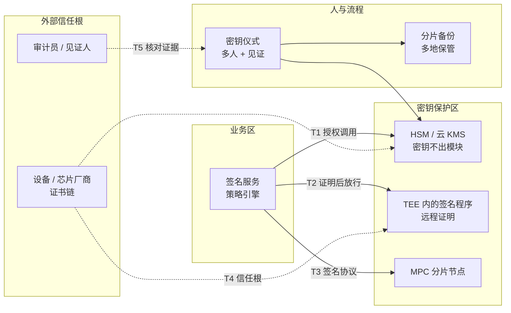
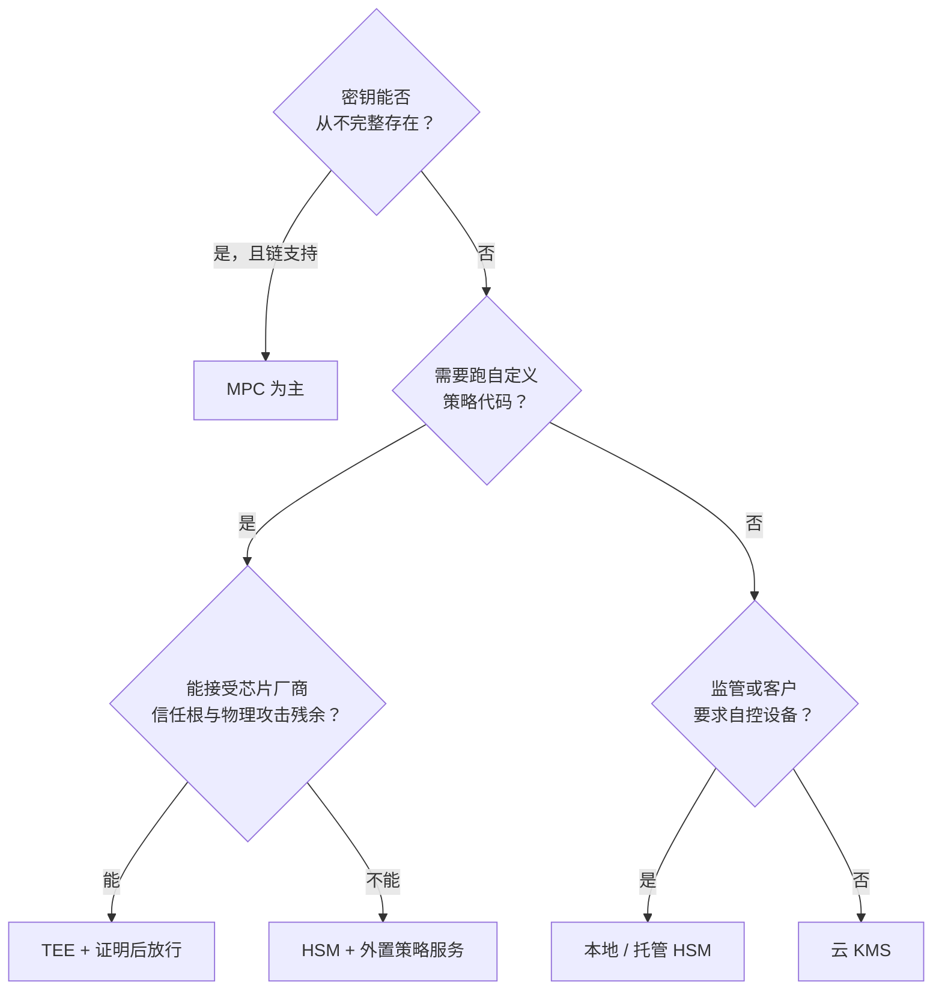
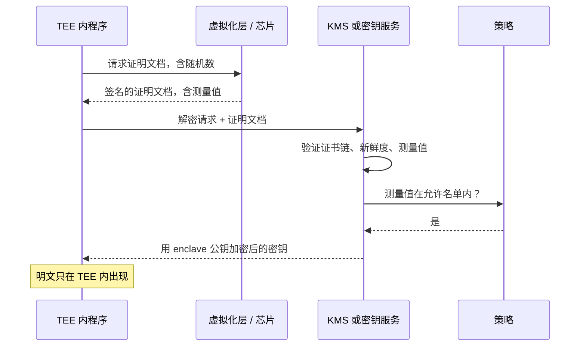

# X45 TEE、HSM 与密钥仪式：从选型到落地与审计

> 学习目标：读完本章，你能——
> 1. 区分 HSM、云 KMS、TEE、MPC 四类密钥保护方案，按威胁和运营成本选型，并写出一页选型记录。
> 2. 设计并主持一次密钥仪式：写出角色、脚本、见证、录像、分片保管和事后证据。
> 3. 写出"远程证明 → 放行密钥"的策略，并列出 TEE 方案必须接受的残余风险。
>
> 适用角色：交易所、托管机构、钱包厂商、桥与项目方的安全工程师和密钥管理员。
> 前置章节：[02 密码学与随机数](../02-cryptography-randomness.md)、[18 钱包与密钥管理](../18-wallet-key-management.md)、[29 2026 专题：签名路径](../29-signing-path-2026.md)、X03-production-infra-security.md
> 同组章节：X17-cex-wallet-treasury-payment.md（签名服务架构）、X35-custodian-security.md（托管仪式与审计）、X32-staking-validator-ops.md（验证者密钥）
> 最后核对：2026-11-23

> 💡 注意：分工。02 章讲随机数与 MPC 的数学。18 章讲单个钱包的密钥生成与备份。X03 讲云机密管理。X17 讲签名服务的架构与调拨。本章只讲一件事：**一把关键密钥该放进哪种"保险箱"，怎样把它生成出来，怎样证明它从未离开过保险箱。**

---

## 开场：一份"通过认证"的设备

2017 年，研究者发现 Infineon 的一个 RSA 密钥生成库有结构性缺陷。CERT/CC 公告称，受影响的版本为 1.02.013。这个库被用在智能卡、安全令牌和 TPM 等安全硬件里。设备是正品。设备有认证。设备里生成的 RSA 公钥，却可以被推算出私钥（研究团队的论文和 CERT/CC 公告）。

<details class="predict"><summary>🤔 先猜再看：你买了认证过的硬件，让它在内部生成密钥。你还需要做什么？</summary>

需要做三件事。第一，对"设备生成的公钥"做独立检查，不把"在硬件内生成"当成证明。第二，记录固件版本，订阅厂商公告，保留"可更换密钥"的流程。第三，不让任何一种硬件成为单点：关键密钥用分片、多人或多路径控制。本章第 3、6 节展开。

</details>

---

## 1. 一句话理解

**密钥保护的目标，是让"使用密钥"和"拿走密钥"变成两件不同的事，并且每次使用都留下别人能核对的证据。**

四个基本术语：

- HSM（Hardware Security Module，硬件安全模块）：专用硬件。私钥在模块内生成和使用，对外只提供"签名""解密"等操作接口。
- KMS（Key Management Service，密钥管理服务）：提供密钥创建、授权、轮换和审计的服务。云 KMS 背后通常是云厂商运营的 HSM。
- TEE（Trusted Execution Environment，可信执行环境）：CPU 或虚拟化层提供的隔离运行环境。常见形态有 Intel SGX、Intel TDX、AMD SEV-SNP、AWS Nitro Enclaves。
- 远程证明（Remote Attestation）：TEE 向外部证明"我是哪段代码、运行在哪种硬件上"的签名凭据。

> 🎯 打个比方：HSM 像银行金库里的一台自动盖章机。你把文件递进去，机器盖章后递出来。没人能把印章拿出来。TEE 像一间玻璃隔音室：房间里的人做什么，外面听不到；门口贴着检验证，写明房间由谁建造、里面放了什么。
>
> 比喻的局限：金库有人看守，隔音室的"检验证"由芯片厂商签发。如果有人拿到了厂商的签发钥匙，他可以给一间普通房间贴上同样的证。TEE 的信任根在芯片厂商，HSM 的信任根在设备厂商和运营流程。两者都不是"零信任"。

---

## 2. 保护目标与信任边界

### 2.1 保护目标

| 目标 | 一句话 | 失守的后果 |
|---|---|---|
| 不可导出 | 私钥明文不离开保护边界 | 一次泄露，永久失效 |
| 可授权使用 | 谁、从哪里、用哪把钥、签什么，由策略决定 | 失陷的服务可以随意签名 |
| 可证明 | 能向审计员和合作方证明上述两点 | 只能"口头保证" |
| 可恢复 | 设备损毁、人员离职时仍能恢复 | 资产永久锁死 |
| 可退役 | 能轮换、撤销、销毁 | 旧钥永远有效 |

### 2.2 信任边界



**读图要点：**

- 业务区（含运维人员）可以"调用"密钥，不可以"取出"密钥。T1–T3 是三种调用方式。
- 外部信任根（T4）是你无法自己控制的部分。选型时要写下"我信任谁，他们失守会怎样"。
- 密钥仪式把人也放进了边界：仪式是 HSM 之外的第二把锁。
- 局限：图没有画备份介质被盗、仪式参与者被胁迫等问题，见第 6 节和 [22 物理与账户安全](../22-physical-account-security.md)。

> ⚠️ 警告：以下说法**不能被信任**。
> 1. "密钥在 HSM 里生成，所以安全。"生成固件有缺陷时，密钥可能可被推算（见案例 1）。
> 2. "我们用了 TEE，所以运维看不到密钥。"物理访问或侧信道可能打破隔离（见案例 3、4）。
> 3. "云厂商的合规报告说明我们的使用方式合规。"报告只覆盖设备或服务，不覆盖你的密钥策略和授权。

---

## 3. 参考架构：四类方案的区别与选型

### 3.1 四类方案对照

下表是通用做法，用于入门选型。具体产品能力以官方最新文档为准。

| 维度 | 本地 / 托管 HSM | 云 KMS | TEE（Enclave / 机密虚拟机） | MPC |
|---|---|---|---|---|
| 保护方式 | 防篡改硬件，私钥在模块内 | 云厂商 HSM 加策略服务 | 隔离内存加远程证明 | 私钥从不完整存在，各方持分片 |
| 信任根 | 设备厂商、你的运营流程 | 云厂商、你的 IAM 与密钥策略 | 芯片厂商、虚拟化层、你的代码 | 协议实现、各分片持有方的独立性 |
| 能签哪些链 | 取决于 HSM 支持的曲线与脚本能力，常需外部适配 | 取决于 KMS 支持的算法，部分链曲线需要变通 | 任意，代码自己写 | 取决于协议实现，需逐链验证 |
| 主要优势 | 成熟、有认证、物理防护强 | 易接入、弹性、审计日志现成 | 能跑自定义策略代码，可做证明后放行 | 无单点私钥，天然多方 |
| 主要风险 | 供应商锁定、固件缺陷、备份流程、人为 | 策略写错、云账号失陷、不可自控的边界 | 侧信道与物理攻击、证明验证写错、代码本身有洞 | 协议漏洞、分片同域、恢复复杂 |
| 适合 | 根密钥、签发 CA、冷存储 | 加解密、数据密钥、部分签名场景 | 策略引擎、验证者远程签名、隐私计算 | 热 / 温钱包、机构托管 |

AWS 官方 FAQ 写明：KMS 密钥由在"FIPS 140-3 Security Level 3"下验证的 HSM 保护（FAQ 另有"验证中"的表述，状态以官方页面为准），并写明设计上包括 AWS 员工在内的任何人都无法取出明文 KMS 密钥。这是官方对服务的描述，不代替你对自身策略的验证。

> 💡 注意：这四类方案不是互斥的。常见组合是：根密钥放 HSM，仪式生成；热路径用 MPC 或 KMS；策略引擎和验证者远程签名放 TEE；数据密钥用 KMS 信封加密。

### 3.2 选型决策图



**读图要点：**

- 第一个问题决定是否上 MPC：这是"消除单点私钥"的方案，不是"更安全的 HSM"。
- 只要选 TEE，就要在选型记录里写下"物理访问与侧信道属于残余风险"。
- 局限：图只管技术选择。预算、人员和供应商风险需要额外评分。

### 3.3 TEE 的三种形态

| 形态 | 隔离粒度 | 证明什么 | 要注意 |
|---|---|---|---|
| Intel SGX | 进程内的 enclave | 代码测量值加芯片平台状态 | 历史上出现多次侧信道与微架构漏洞，需跟踪厂商平台更新 |
| Intel TDX / AMD SEV-SNP | 整台虚拟机（机密虚拟机） | 虚拟机启动测量与固件、芯片版本 | 受信代码基大（含客户机操作系统） |
| AWS Nitro Enclaves | 从父实例划出内存和 vCPU 的虚拟机 | 由 Nitro Hypervisor 签发证明文档，含 PCR | 无外部网络、无持久存储，与父实例只通过 vsock 通信（AWS 官方文档） |

### 3.4 数据流：证明后放行密钥



**读图要点：**

- 密钥服务不信任"请求来自内网"，只信任证明文档里的测量值。
- 随机数防重放；证书链要验到厂商根；测量值名单要随版本发布更新。
- 局限：证明只说明"启动时是这段代码"，不说明"这段代码没有漏洞"。代码仍然需要审计（见 [27 审计与测试流程](../27-audit-testing-workflow.md)）。

---

## 4. 控制清单

| ID | 控制项 | 要防什么 | 优先级 | 怎么验证 |
|---|---|---|---|---|
| KMS-1 | 每把关键密钥有清单：用途、保护方式、持有人、创建日期、轮换期 | 不知道有哪些钥，丢了也不知道 | P0 | 抽 5 把钥，对照清单与实际 |
| KMS-2 | 选型记录写明信任根、残余风险、替代方案 | 默认相信厂商宣传 | P1 | 阅读选型记录，缺项即不通过 |
| KMS-3 | 密钥在保护边界内生成；对公钥做独立有效性检查，记录固件版本 | 生成缺陷（案例 1、2） | P0 | 查仪式记录与固件版本；对公钥跑检查工具 |
| KMS-4 | 根与高价值密钥用仪式生成：多人、脚本、见证、录像 | 单人作恶或操作失误 | P0 | 查仪式证据包是否齐全 |
| KMS-5 | 备份分片多地保管，持有人互相独立，不在同一变更域 | 一次事件拿走所有分片 | P0 | 看保管清单：任意两份不同地点、不同部门 |
| KMS-6 | 恢复演练：用备份在隔离环境恢复，并验证公钥一致 | 备份无法使用 | P0 | 每年一次演练报告 |
| KMS-7 | 云 KMS 策略最小权限，管理权限与使用权限分离 | 管理员能自批使用 | P0 | 导出策略，检查 Principal 与 Action |
| KMS-8 | 禁止密钥导出，用途限定（签名或加密，不混用） | 密钥被"合法"取走 | P0 | 检查创建参数与策略 |
| KMS-9 | TEE 用证明后放行；策略写明测量值、版本、新鲜度 | 任何实例都能取到密钥 | P0 | 重放旧证明与错误测量值，应被拒绝 |
| KMS-10 | 测量值名单有变更流程，旧版本有失效日期 | 已知漏洞版本仍可取钥 | P1 | 对照发布记录与名单 |
| KMS-11 | 订阅硬件、固件、TEE 平台公告，有响应 SLA | 平台漏洞无人处理 | P1 | 查近一年公告与处理工单 |
| KMS-12 | 每次密钥使用有日志：谁、哪把、签了什么摘要、结果 | 事后无法追溯 | P0 | 随机抽 10 次签名，回溯到审批单 |
| KMS-13 | 日志送到密钥管理员无法修改的位置 | 管理员删日志 | P1 | 管理员账号尝试删除应失败 |
| KMS-14 | 轮换：有周期，有触发条件（人员离职、平台漏洞、疑似泄露） | 旧钥永久有效 | P1 | 查轮换记录与触发条件文件 |
| KMS-15 | 退役：销毁有流程，有证据（销毁日志、见证） | 旧介质被再利用 | P1 | 抽一把已退役钥，查销毁证据 |
| KMS-16 | 任何一个人或一个设备失陷，不足以导出或滥用密钥 | 单点 | P0 | 桌面推演（见第 11 节） |
| KMS-17 | 外部信任根失守的应急预案（厂商证书吊销、平台漏洞） | 只能被动等厂商 | P1 | 阅读预案并推演 |
| KMS-18 | 保管人背景核查、轮岗、离职回收 | 内部威胁 | P1 | 查名单与最近一次变更 |
| KMS-19 | 审计员或第三方每年核对一次证据包 | 只有自我声明 | P1 | 看审计报告 |
| KMS-20 | 失败也要留证据：仪式中止、设备故障、证书过期 | 事后无法解释异常 | P2 | 查异常记录 |

---

## 5. 分级落地

| 档位 | 做什么 | 人和时间（示例） |
|---|---|---|
| 最小可行 | 建密钥清单（KMS-1）；云 KMS 策略最小化并禁导出（KMS-7、8）；每把根钥有书面生成与备份记录；至少两人在场 | 1 名安全工程师加 1 名运维，2 周 |
| 标准 | 仪式脚本与证据包；分片多地保管；年度恢复演练；TEE 使用证明后放行；密钥使用日志入 SIEM；订阅平台公告 | 2–3 人，1–2 个季度 |
| 成熟 | 独立见证人与外部审计；多种信任根交叉（HSM 加 MPC）；证明与测量值自动化管线；平台漏洞响应演练；供应商退出方案 | 专职密钥管理小组，持续运营 |

> 💡 注意：先把"最小可行"做对，再加复杂度。一个有清单、有策略、有恢复演练的云 KMS，胜过一台没人说得清谁持有分片的 HSM。

---

## 6. 落地做法

### 6.1 步骤总览

1. 做密钥清单，按"丢失后果"分三级（根钥、业务关键钥、一般数据钥）。
2. 按第 3 节决策图，为每一级选保护方式，写选型记录。
3. 为根钥和高价值钥写仪式脚本（见 6.3）。
4. 为云 KMS 和 TEE 写最小权限策略（见 6.2、6.4）。
5. 打通日志，把"密钥使用"事件接入 [X05 检测与响应工程](X05-detection-response-engineering.md)。
6. 做一次完整的恢复演练，验证公钥一致。
7. 把以上证据汇成证据包，交给内部审计或外部审计。

### 6.2 示例：云 KMS 策略（只允许证明过的 enclave 解密）

AWS 官方文档提供了 `kms:RecipientAttestation:ImageSha384` 与 `kms:RecipientAttestation:PCR` 条件键。下面是示例，值需要换成你的测量值，字段以官方最新文档为准。

```json
{
  "Version": "2012-10-17",
  "Statement": [
    {
      "Sid": "AllowOnlyAttestedEnclaveToDecrypt",
      "Effect": "Allow",
      "Principal": { "AWS": "arn:aws:iam::111122223333:role/signer-enclave-host" },
      "Action": ["kms:Decrypt"],
      "Resource": "*",
      "Condition": {
        "StringEqualsIgnoreCase": {
          "kms:RecipientAttestation:ImageSha384": "<示例：enclave 镜像测量值>",
          "kms:RecipientAttestation:PCR8": "<示例：签名证书测量值>"
        }
      }
    },
    {
      "Sid": "KeyAdminsCannotUseKey",
      "Effect": "Allow",
      "Principal": { "AWS": "arn:aws:iam::111122223333:role/kms-admin" },
      "Action": ["kms:Create*", "kms:Describe*", "kms:Enable*", "kms:Put*",
                 "kms:ScheduleKeyDeletion", "kms:CancelKeyDeletion"],
      "Resource": "*"
    }
  ]
}
```

要点：

1. 使用权限只给宿主角色，并且必须带证明条件。没有证明文档的请求被拒绝（官方文档说明）。
2. 管理员权限里没有 `Decrypt`。管理员能改策略，所以"改策略"本身要走变更审批和告警（见 6.5）。
3. 测量值来自可复现构建的产物，变更走发布流程（KMS-10）。

> ⚠️ 警告：能修改密钥策略的人，等于能给自己授予使用权。把"策略变更"当作与"使用密钥"同级的事件来告警和审批。

### 6.3 密钥仪式

仪式（Key Ceremony）：多人在受控环境中，按预先批准的脚本，生成、备份、使用或销毁关键密钥，并留下可核对证据的活动。

公开的参考做法：ICANN / IANA 的 DNSSEC 根密钥签名仪式。IANA 页面称，仪式通常每年进行四次，由"可信社区代表（Trusted Community Representatives）"参与；议程包括引入、销毁和清零 HSM，以及更换密码官。本节借鉴这类公开仪式的思路，具体细节为通用做法。

**角色：**

| 角色 | 职责 | 不能做 |
|---|---|---|
| 仪式主持人 | 按脚本逐步朗读与操作 | 不得改脚本，遇偏差先停 |
| 内部见证 | 对照脚本打钩，记录偏差 | 不操作设备 |
| 外部见证 / 审计员 | 独立确认，签字 | 不接触密钥材料 |
| 分片持有人（N 人） | 各自在场输入凭据或领取分片 | 不得互相透露凭据 |
| 设备管理员 | 开箱、检查封条、接线 | 不得单独接触已激活设备 |
| 记录员 | 录像、时间线、证据归档 | — |

**仪式脚本示例（生成并备份一把根钥）：**

```yaml
ceremony: root-signing-key-generation   # 示例
version: 3                              # 脚本版本，经安全负责人批准
preconditions:
  - 场地：无信号屏蔽间，门禁记录开启
  - 设备：全新 HSM，封条编号与采购记录一致，固件版本已记录
  - 参与人：主持人1，内部见证1，外部见证1，分片持有人5（阈值3），设备管理员1
  - 脚本已提前一周发给所有参与人
steps:
  - id: 1
    action: 记录开场：日期、地点、参与人身份核验（证件+名单）
    witness: 内部见证核对，外部见证签字
  - id: 2
    action: 开封设备，核对封条编号与固件版本，拍照
    abort_if: 封条或版本与记录不符
  - id: 3
    action: 初始化 HSM，设置分片阈值 3/5，逐人在设备上设置凭据
  - id: 4
    action: 在设备内生成密钥；导出公钥，打印指纹
    evidence: 公钥指纹存入证据包，两名见证各抄写一份
  - id: 5
    action: 用设备的包裹导出功能制作加密备份，写入两份介质
    evidence: 介质编号、哈希
  - id: 6
    action: 对公钥执行独立有效性检查（脚本+第二台独立实现）
    abort_if: 任一检查失败，销毁密钥并重新生成
  - id: 7
    action: 分片凭据封入防拆袋，编号，当场登记保管人与保管点
  - id: 8
    action: 清场；设备放入保险柜；记录结束时间并全体签字
postconditions:
  - 证据包：录像、脚本打钩版、公钥指纹、介质哈希、保管清单、签名页
  - 24 小时内：外部见证出具书面确认
```

**设计原则：**

1. 脚本先审后用。仪式中遇到脚本没写的情况，暂停，由主持人和安全负责人决定，并写入偏差记录。
2. 录像不能代替书面记录。录像不得拍到凭据输入。
3. 分片保管点至少两个地点，各自独立的物理访问控制和不同的责任人。
4. 先在测试设备上完整演练一次，再做正式仪式。
5. 仪式也要有"失败路径"：设备异常、参与人缺席、证据缺失，都写明继续还是中止。

> 🎯 对照：Ethereum 的 KZG 仪式是另一种"仪式"：2023 年 1 月 13 日至 8 月 8 日，共 141,416 次贡献，最终记录文件约 242 MB，任何人都能核对（Ethereum 基金会官方回顾）。它的安全假设是"至少一个贡献者诚实地生成并销毁了随机数"。企业内部仪式没有这么多人，所以需要靠见证、脚本和证据，来补"有人作弊"这条假设。

### 6.4 TEE 证明验证：示例伪代码

下面是验证步骤的示意，不是某一产品的真实 API。实际使用厂商库。

```python
# 示例：密钥服务验证 enclave 证明后放行密钥（伪代码）
def release_key(request):
    doc = parse(request.attestation_document)

    # 1. 证书链必须验到厂商根，且未被吊销
    assert verify_chain(doc.cert_chain, trusted_roots=VENDOR_ROOTS)
    assert not is_revoked(doc.cert_chain)

    # 2. 签名与新鲜度：随机数由我方发出，一次有效
    assert verify_signature(doc)
    assert doc.nonce == session.issued_nonce(request.id)
    assert now() - doc.timestamp < 60  # 秒，示例

    # 3. 测量值必须在允许名单内，且版本未过期
    m = doc.measurements
    entry = ALLOWLIST.get(m.image_hash)
    assert entry and entry.not_after > today()

    # 4. 平台版本必须不低于最低安全版本（跟踪厂商公告）
    assert doc.platform_version >= MIN_PLATFORM_VERSION

    # 5. 密钥只加密给 enclave 在证明里声明的公钥
    return encrypt_to(doc.public_key, load_key(request.key_id))
```

常见错误：只验签名不验证书链；不检查新鲜度；允许名单没有失效日期；平台版本不设下限；把密钥返回给请求里自带的公钥，而不是证明里的公钥。

### 6.5 告警规则示例

```yaml
# 示例：密钥相关告警（用于 X05 的 SIEM）
- name: kms_policy_changed
  when: 云审计日志出现 PutKeyPolicy / CreateGrant / ScheduleKeyDeletion
  severity: P1
  action: 立即通知密钥负责人，24 小时内核对变更审批单

- name: key_use_without_ticket
  when: 签名或解密请求没有对应的审批单号
  severity: P1

- name: key_use_new_caller
  when: 同一把钥首次出现新的调用角色或新的源 IP 段
  severity: P2

- name: attestation_rejected_burst
  when: 10 分钟内证明验证失败超过 5 次   # 阈值示例
  severity: P2

- name: hsm_admin_login_outside_ceremony
  when: HSM 管理员登录没有对应的仪式或维护工单
  severity: P1
```

### 6.6 轮换、退役与灾备

1. **轮换触发条件**：到期；持有人离职；平台或固件出现影响密钥的公开漏洞；疑似泄露；证据缺失。NIST SP 800-57 Part 1 Rev. 5（2020 年 5 月）是通用的密钥管理指南，可作为密钥管理功能与保护要求的参考，具体条款以原文为准。
2. **轮换做法**：新钥生成（走仪式）→ 新钥上线与旧钥并行 → 迁移资产或权限 → 验证 → 旧钥退役。链上资金迁移见 [X19 钱包、财资与支付·运营与恢复](X19-cex-treasury-recovery-ops.md)。
3. **退役**：HSM 清零或物理销毁；介质销毁；记录与见证；证据归档。
4. **灾备**：RTO / RPO 沿用 [X06 韧性与验证](X06-resilience-validation.md)。额外要回答三个问题：设备全部损毁时，用哪份备份恢复？谁到场？恢复后如何证明公钥相同？
5. **恢复演练**：在隔离环境，用备份恢复，对比公钥与签名结果，记录耗时与卡点。

### 6.7 HSM 与 MPC 的运营细节

1. **HSM 角色分离**：管理员（初始化、固件、用户管理）与使用者（调用签名）用不同凭据。管理员凭据用 M-of-N 控制，卡片或令牌分开保管。
2. **固件升级**：升级前在备用设备上演练；升级记录写入证据包；升级后重跑公钥一致性检查。
3. **接口审计**：应用调用 HSM 常用 PKCS#11、厂商 SDK 或云 API。审计时核对"谁能调用哪个接口"，不只核对设备本身。
4. **MPC 分片的独立性**：分片分别放在不同云账号、不同机房或不同公司，并由不同团队运营。同一变更域内的两个分片，只算一个。
5. **MPC 恢复**：写明"失去几个分片仍可恢复"，并演练一次"重新分片"。重新分片的过程同样要走仪式脚本。
6. **混合方案的边界**：HSM 保护根钥和分片加密密钥，MPC 负责热路径，TEE 负责策略。画出每一层失陷时，其余层能否继续保护资产。

### 6.8 常见坑

- 仪式脚本写得太理想，现场发现设备版本与脚本不同，参与人临时改做法。
- 分片持有人都在同一栋楼、同一个部门、同一个变更域。
- 云 KMS 策略里管理员也能 `Decrypt`。
- 测量值名单只增不减。
- 备份从未恢复过，公钥是否相同没人验证。
- 把"证明通过"当成"代码没有漏洞"。

---

## 7. 运营：指标、告警、值班、演练、季度节奏

**指标（示例）：**

| 指标 | 含义 | 目标（示例） |
|---|---|---|
| 清单覆盖率 | 已登记的关键密钥占实际数量 | 100% |
| 恢复演练新鲜度 | 距上次完整恢复演练天数 | ≤ 365 |
| 测量值名单过期条目 | 超过失效日期仍存在的条目 | 0 |
| 平台公告响应时长 | 从公告到评估结论 | ≤ 5 个工作日 |
| 无审批单的密钥使用 | 次数 | 0 |
| 分片保管人在岗率 | 名单与实际人员一致比例 | 100% |

**季度节奏：**

- 每月：核对密钥清单变更；核对策略变更与告警；复盘平台公告。
- 每季度：抽查密钥使用日志对审批单；检查测量值名单；保管点抽查；一次桌面推演。
- 每年：完整恢复演练；外部审计核对证据包；评估供应商与信任根。

**值班：** 密钥事件（疑似泄露、策略被改、证明失败激增）归入 X05 的 P1，并在 [T09 事件手册与值班模板](../templates/T09-incident-runbook-oncall.md) 里加一节"密钥事件"。

---

## 8. 失效案例

> 以下案例已单独核对公开来源；金额为事发时美元估值，归因按公开报道。完整资损复盘见《Web3 行业安全资损 101》。

### 案例 1：ROCA，认证硬件里的密钥生成缺陷（2017，通用硬件）

- 事实：CERT/CC 公告称，Infineon RSA 库 1.02.013 版本生成的 RSA 密钥对有缺陷，攻击者可能从公钥恢复私钥；该库被用在智能卡、令牌和 TPM 等设备。研究者的论文《The Return of Coppersmith's Attack》指出，缺陷在于素数的特殊结构，并且与弱随机数生成器无关。只有 RSA 密钥生成受影响，ECC 与已有密钥的使用不受影响（CERT/CC）。
- 绕过了哪条控制：设备"在硬件内生成"这一信任。
- 映射：KMS-3（公钥独立检查、记录固件）、KMS-11（订阅公告）、KMS-14（可轮换）。
- 教训：认证不等于没有缺陷；在设备外对公钥做检查，并保留更换密钥的流程。来源类型：CERT/CC 公告、学术论文。

### 案例 2：Profanity 靓号工具，随机性不足（2022 年 9 月，以太坊）

- 事实：1inch 公布安全披露，称用 Profanity 生成的以太坊靓号地址存在严重漏洞，私钥可被暴力计算。此后有约 95 万美元从此类地址被盗的报道；Wintermute 报告以太坊金库约 1.6 亿美元被盗，部分安全公司和分析师认为可能与该工具有关，该关联属于分析推测，未见官方证实。
- 绕过了哪条控制：密钥生成使用了熵不足的第三方工具。
- 映射：KMS-3、KMS-4（仪式中生成，不用来路不明的工具）、KMS-16。
- 教训：关键密钥不用来路不明的生成工具，也不用靓号地址保管大额资产。来源类型：项目方披露（1inch）、媒体报道（The Block、Cointelegraph）。

### 案例 3：SGX 证明密钥提取与 Secret Network（2022，SGX）

- 事实：研究站点 sgx.fail 记录，Foreshadow 攻击被用来从测试机提取 SGX 证明密钥，研究者随后能自行签发证明、在 SGX 之外运行受保护的程序。该站点还记录，xAPIC / ÆPIC Leak 类问题（2022 年 8 月公开）被用于提取 Secret Network 的共识种子（consensus seed）；Intel 的 TCB 恢复（TCB recovery）计划在 2022 年 11 月 29 日。SCRT Labs 公开说明：2022 年 10 月 5 日冻结新节点注册，11 月 2 日网络升级，升级包含种子轮换；据其所知，披露前没有被恶意利用。
- 绕过了哪条控制：TEE 隔离与厂商证明链；缓解依赖平台更新和协议升级。
- 映射：KMS-9、KMS-10、KMS-11、KMS-17。
- 教训：把 TEE 的平台版本写进放行策略；平台漏洞出现时，有"冻结注册、轮换密钥"的预案。来源类型：研究站点、项目方公告、媒体报道。

### 案例 4：TEE.fail，对 DDR5 内存总线的物理攻击（2025 年 10 月）

- 事实：Georgia Tech、Purdue 和 van Schaik LLC 的研究者在 DDR5 内存与主板之间放置转接器，用逻辑分析仪读取内存总线上的密文。研究称根因是 Intel 和 AMD 使用的 AES-XTS 加密是确定性的，不能防物理总线窃听，并用它提取了 Intel TDX 和带 Ciphertext Hiding 的 AMD SEV-SNP 的证明密钥，还演示了对 NVIDIA GPU 机密计算与 Phala dstack 的影响。媒体报道称，设备成本低于 1000 美元；Intel 与 AMD 表示，这类物理攻击不在其威胁模型内。没有在野利用的公开证据。
- 绕过了哪条控制：TEE 对"物理接触机器的人"的防护。
- 映射：KMS-2（残余风险记录）、KMS-9、KMS-16。
- 教训：如果云厂商、机房人员或供应链是你的威胁，TEE 不是充分防护；把物理防护和不可信机房写进选型决策，高价值密钥不要只靠一种 TEE。来源类型：IEEE S&P 2026 海报、Georgia Tech、SecurityWeek、The Hacker News、BleepingComputer 的报道。注：这些来源多为研究者自述与媒体转述，细节以论文和厂商公告为准。

---

## 9. 评估检查点

- [ ] **KMS-1** 密钥清单完整，抽 5 把钥与实际一致
- [ ] **KMS-2** 每把高价值钥有选型记录，写明信任根与残余风险
- [ ] **KMS-3** 公钥经独立检查，固件版本有记录
- [ ] **KMS-4** 根钥由仪式生成，有证据包
- [ ] **KMS-5** 分片多地保管，持有人互相独立
- [ ] **KMS-6** 一年内做过一次完整恢复演练
- [ ] **KMS-7** 云 KMS 策略最小权限，管理与使用分离
- [ ] **KMS-8** 密钥禁止导出，用途单一
- [ ] **KMS-9** TEE 放行密钥必须通过证明；重放与错误测量值被拒绝
- [ ] **KMS-10** 测量值名单有变更流程和失效日期
- [ ] **KMS-11** 订阅平台公告，有响应 SLA
- [ ] **KMS-12** 每次密钥使用有日志并可追溯到审批单
- [ ] **KMS-13** 密钥管理员不能改日志
- [ ] **KMS-14** 有轮换周期与触发条件
- [ ] **KMS-15** 退役有销毁证据
- [ ] **KMS-16** 任一人或设备失陷不足以滥用密钥
- [ ] **KMS-17** 外部信任根失守有预案
- [ ] **KMS-18** 保管人有背景核查与轮岗
- [ ] **KMS-19** 每年有第三方核对证据包
- [ ] **KMS-20** 异常与中止的仪式也有记录

**把结果写进报告：**

| 检查项 | 状态（通过 / 部分 / 不通过） | 证据位置 | 负责人 | 整改期限 |
|---|---|---|---|---|
| KMS-1 … KMS-20 | | | | |

---

## 10. 上手路径

**第一周：**

1. 列出你组织所有的"关键密钥"：钱包、签名服务、CA、云根账号、数据加密主钥、验证者密钥。
2. 为每把钥写一行：用途、保护方式、持有人、备份在哪、上次恢复演练日期。
3. 导出云 KMS 策略，检查管理员是否能使用密钥，是否允许导出。

**第一个月：**

1. 为 3 把最高价值的钥写选型记录和残余风险说明。
2. 写第一份仪式脚本，在测试设备上演练一次。
3. 把 6.5 节的告警接入 SIEM。
4. 订阅 HSM、云、芯片厂商的安全公告，指定响应负责人。

**第一个季度：**

1. 完成一次真实仪式，产出完整证据包。
2. 做一次恢复演练，验证公钥一致。
3. 如果用了 TEE，上线"证明后放行"，并用错误测量值与重放证明做负向测试。
4. 做一次"保管人失联 / 离职"的桌面推演，更新保管清单。

---

## 11. 常见误区

| 误区 | 事实 |
|---|---|
| "有 FIPS 认证，所以没问题" | 认证说明设备在评估范围内满足要求，不覆盖你的策略、仪式和使用方式。FIPS 140-3 的安全级别主要区分物理防护与认证强度（通用说法，详见 NIST CMVP 文件） |
| "用 TEE，运维就看不到密钥" | 前提是平台没有未修复漏洞，且威胁里没有物理接触者 |
| "仪式录了像就等于有证据" | 录像是补充。脚本打钩版、公钥指纹、介质哈希、保管清单才是证据主体 |
| "MPC 就不需要仪式" | 分片的生成、分发、备份和恢复仍然需要受控流程 |
| "备份放一个保险柜就够" | 单点可被盗、被烧、被胁迫 |
| "云 KMS 不会泄露，所以不用管策略" | 策略写错、云账号被控，同样可以滥用密钥 |

**桌面推演（30 分钟，3 个注入）：**

1. 背景：你们用云 KMS 加 TEE 签名，根钥分片 3/5 由 5 人保管。
2. 注入 1（10 分钟）：芯片厂商发布公告，称某平台版本的证明密钥可被提取。问：你们的名单里有没有该版本？今天谁决定吊销？
3. 注入 2（10 分钟）：5 位分片持有人里，2 人离职，1 人手机丢失。问：现在还能恢复吗？要不要轮换？
4. 注入 3（10 分钟）：审计员要求你"证明这把钥从未被导出过"。问：你能拿出哪些证据？
5. 评分：能在 15 分钟内写出处置步骤 2 分；能列出 3 项证据 2 分；能指出残余风险 2 分；能写出对外或对客户的说明 2 分；能提出下一次改进 2 分。

---

## 12. 术语表

| 术语 | 英文 | 一句话定义 |
|---|---|---|
| 硬件安全模块 | HSM | 防篡改硬件，私钥在内部生成与使用 |
| 密钥管理服务 | KMS | 提供密钥创建、授权、轮换与审计的服务 |
| 可信执行环境 | TEE | CPU 或虚拟化层提供的隔离运行环境 |
| 远程证明 | Remote Attestation | TEE 向外部证明自己身份与测量值的签名凭据 |
| 测量值 | Measurement / PCR | 对启动代码与配置的哈希，用于证明与放行判断 |
| 密钥仪式 | Key Ceremony | 多人按脚本生成或操作关键密钥的受控活动 |
| 分片 | Shard / Share | 密钥或其恢复材料的一部分，需达到阈值才能恢复 |
| 密码官 | Crypto Officer | 在 HSM 上有管理或使用凭据的角色 |
| 信封加密 | Envelope Encryption | 用数据密钥加密数据，再用主钥加密数据密钥 |
| TCB 恢复 | TCB Recovery | 芯片厂商在平台更新后使旧证明失效的流程 |
| 侧信道 | Side Channel | 通过时间、缓存、功耗等泄露信息的途径 |
| 保管链 | Chain of Custody | 记录介质与设备每次移交的证据链 |

---

## 13. 动手练习与思考题

**练习 1（笔记本，30 分钟）：写一页选型记录。** 选你熟悉的一把钥（热钱包、CA 或验证者），按第 3 节决策图选方案，填写：威胁、信任根、残余风险、替代方案、退出方式。

**练习 2（笔记本，45 分钟）：审一份仪式脚本。** 取 6.3 节的脚本，找出至少 5 处可以改进的地方（例如：缺失败路径、缺保管点、缺外部见证），写出改法。

**练习 3（笔记本，30 分钟）：写证明放行测试用例。** 针对 6.4 节伪代码，列 6 个负向用例（过期证书、错误测量值、重放、旧平台版本、缺随机数、公钥不一致），并写出期望结果。

**思考题：**

1. 如果你的 TEE 方案的威胁里包含"云厂商的机房人员"，你还会只用一种 TEE 吗？你会再加哪一层？
2. 5 人分片、阈值 3：把 5 人放在同一个团队里有什么问题？把 5 人分在 5 个国家又有什么新问题？
3. 仪式的"见证人"如果是你的同事，他的独立性够吗？外部见证应当具备哪些条件？

**建议配套（后续在 L3 训练营实现）：** 密钥使用日志回放工具（对照审批单，找出"无单签名"）；证明验证用例集。可先参考 [B77 安全架构综合实践](../bootcamp/B77-security-architecture-capstone.md) 与 [T08 控制矩阵与风险登记](../templates/T08-control-matrix-risk-register.md)。

**来源（截至 2026-11-23，公开资料）：** CERT/CC VU#307015 与 ROCA 论文；1inch 披露与 The Block 报道；sgx.fail 与 SCRT Labs 安全更新；TEE.fail 海报（IEEE S&P 2026）及 SecurityWeek、The Hacker News、BleepingComputer 报道；AWS Nitro Enclaves 与 KMS 官方文档、AWS KMS FAQ；IANA DNSSEC 仪式页面；Ethereum 基金会 KZG 仪式回顾；NIST SP 800-57 Part 1 Rev. 5。产品能力与版本以官方最新文档为准。
