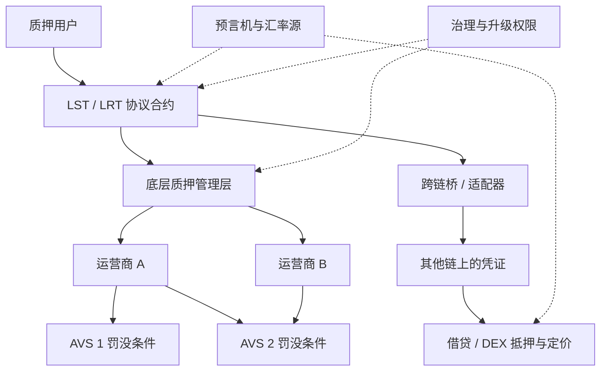
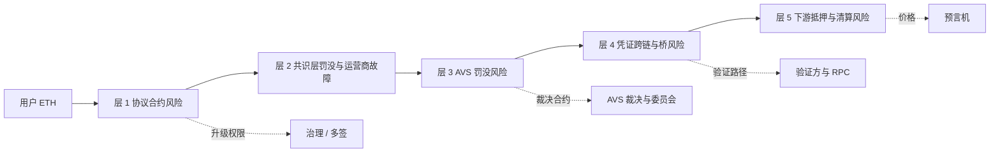
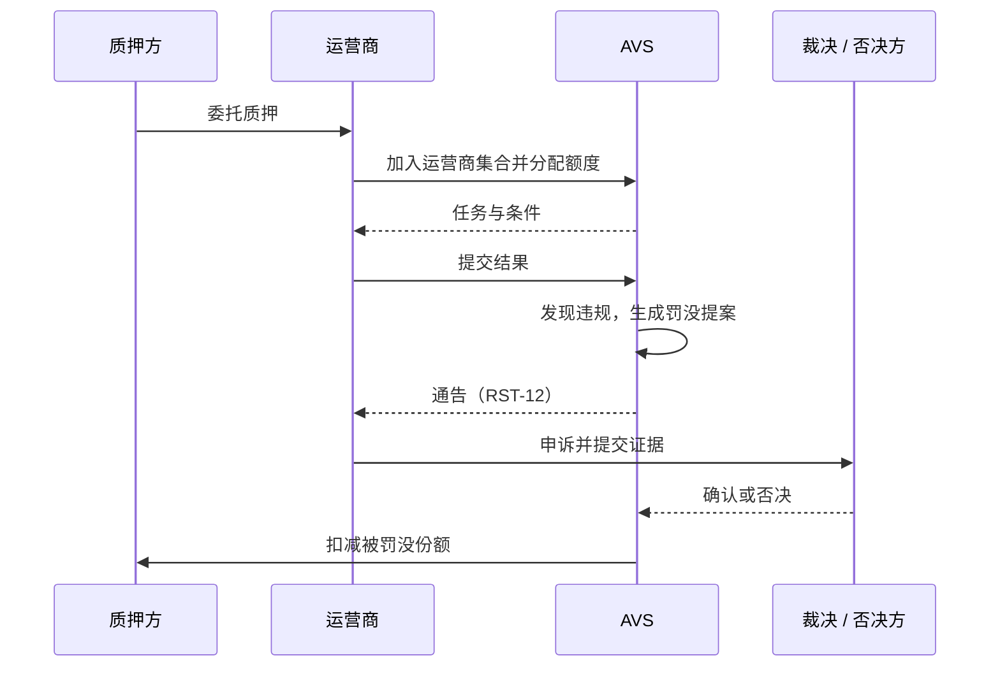
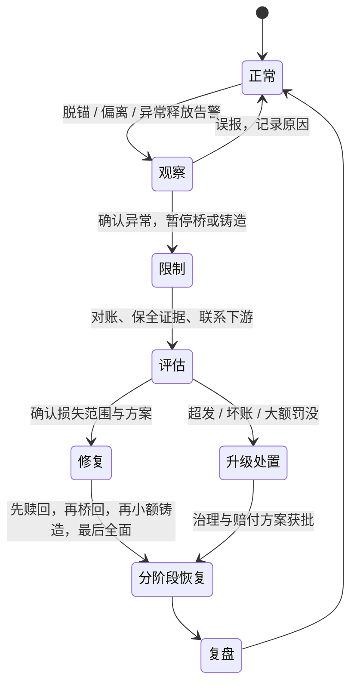

# X46 再质押、流动性质押与 AVS：罚没、委托与运营安全

> 学习目标：读完本章，你能——
> 1. 画出一个流动性再质押（LRT）协议的"风险叠加图"，说清一份 ETH 同时承担了哪几层罚没与合约风险，哪一层的失效会传导到哪里。
> 2. 为一个质押方或运营商写出"AVS 准入与罚没预算"表：每个 AVS 的罚没条件、可罚没比例、分配额度、撤销延迟和退出路径。
> 3. 配置脱锚、赎回队列、桥与权限变更四类告警，并为"跨链凭证失控"和"AVS 误罚"各写一份应急预案。
>
> 适用角色：LST / LRT 协议安全负责人、AVS 开发团队、再质押运营商、质押与风控团队、持有大额再质押头寸的机构、把这类代币收作抵押品的借贷与交易所风控人员
> 前置章节：[X35 质押、节点与验证者运营](X35-staking-validator-ops.md)、[X33 DeFi 项目方安全运营](X33-defi-project-ops.md)、[X32 L2、跨链桥与预言机运营方](X32-l2-bridge-oracle-ops.md)、[11 DeFi 经济安全](../11-defi-economic-security.md)
> 交互实验 / 模板：[T08 控制矩阵与风险登记表](../templates/T08-control-matrix-risk-register.md)、[T04 上线门禁](../templates/T04-go-live-gate.md)；本章给出风险叠加图、AVS 准入表、告警规则、抵押品折价脚本
> 最后核对：2026-11-23

> 💡 注意：本章只写再质押与流动性质押特有的部分。验证者密钥、防双签、迁移手册见 X35；合约升级与暂停守护见 X33；桥与预言机的运营见 X32；治理攻击见 X47。产品参数（延迟天数、上限、合约名）变化快，凡写"截至 2026 年公开资料"的数字，上线前以各协议官方文档为准。

---

## 开场：一个真实场景

2026 年 4 月 18 日，Kelp DAO 的再质押代币 rsETH 在以太坊上的跨链桥适配器，被人用伪造的跨链消息放出约 116,500 枚 rsETH（约 2.9 亿美元，事发时估值）。底层的 ETH 并没有丢：质押仓位、运营商、AVS 都完好。

被拿走的是"凭证"。攻击者随后把凭证押进借贷市场，借出 WETH 等资产。Aave 等协议冻结了 rsETH 市场，许多其他协议暂停了 rsETH 相关业务。

<details class="predict"><summary>🤔 先猜再看：底层质押没被动，问题出在哪一层？</summary>

出在"凭证层"。rsETH 是一张代表底层资产的收据，在多条链上流通。收据的跨链发行依赖一条验证路径，路径被骗，收据就被超发；下游借贷又把收据当成等价的 ETH。再质押的风险不只在罚没，更在"收据—桥—抵押品"这条链上，每一环都会把损失放大。

</details>

本章要回答的问题是：当一份 ETH 被质押、再质押、变成收据、跨链、再被当作抵押品，**谁在每一环上控制什么，出事时谁先按暂停键**。

---

## 1. 一句话理解

**再质押把"一份资产承担多份责任"做成了产品；运营安全的核心，是把每一份额外责任的上限、触发条件和退出路径写清楚，并持续监控。**

名词先对齐：

- 流动性质押代币（LST，Liquid Staking Token）：用户质押 ETH 后收到的可流通收据，例如 stETH。
- 再质押（Restaking）：把已质押的资产（或 LST）再次质押，为其他服务提供经济担保。
- 流动性再质押代币（LRT，Liquid Restaking Token）：再质押仓位的可流通收据，例如 rsETH、ezETH。
- AVS（Actively Validated Service，主动验证服务）：依赖运营商提供验证、且可对运营商罚没的外部服务。
- 运营商（Operator）：运行 AVS 软件、接受委托质押的机构。
- 委托（Delegation）：质押方把仓位的验证职责交给某个运营商。
- 罚没（Slashing）：对被证明违规的运营商，按规则扣减其所控制的质押。
- 脱锚（Depeg）：收据的市场价格偏离其底层资产价值。
- 赎回队列（Withdrawal Queue）：赎回请求必须排队、等待延迟后才能取回底层资产。

> 🎯 打个比方：再质押像把同一套房子同时抵押给几家银行，再把抵押凭证拿去二级市场转让。房子只有一套，每多一家银行，出问题时能被追索的次数就多一次；凭证被转让后，持有人看不到房子，只看到凭证的价格。
>
> 比喻的局限：房产抵押是一对一登记，银行不能互相抢先。再质押的罚没规则由各 AVS 自己定义，一份质押是否只被一个 AVS 罚没，取决于协议设计（见 §3.2）。

---

## 2. 保护目标与信任边界

### 2.1 角色与保护目标

| 角色 | 要保护什么 | 失去后果 |
|---|---|---|
| 质押用户 | 本金与可赎回性 | 被罚没、凭证脱锚、赎回受阻 |
| LST / LRT 协议方 | 凭证与底层资产的对应关系 | 超发、挤兑、信誉崩溃 |
| 运营商 | 委托资格、声誉、被委托资金的安全 | 被罚没、被踢出、客户流失 |
| AVS 团队 | 罚没条件的正确性、证明与裁决的可靠 | 误罚、拒付、生态信任损失 |
| 下游（借贷、交易所、DEX） | 把凭证当抵押品或交易对时的定价与清算 | 坏账、清算失灵 |

### 2.2 信任边界图



读图要点：
- 实线是资金与凭证流，虚线是"必须被信任的外部输入"：汇率、治理、升级权限。这些点最需要独立监控。
- 运营商同时挂多个 AVS，意味着一个运营商的一次失误可能触发多个 AVS 的条件。是否叠加，看 §3.2 的分配规则。
- 跨链桥位于"协议合约"和"下游"之间：它决定凭证在别的链上是否有等量底层支撑。Kelp 事件出在这一段。
- 局限：不同协议的合约拆分不同，本图只表达控制关系，不代表某个具体产品的合约结构。

### 2.3 不能被信任的东西

1. **链外验证路径的单点**：只有一个验证方批准的跨链消息，等于只有一道门。
2. **AVS 自己声明的罚没条件**：条件可能有歧义，裁决可能有 bug。AVS 是外部合约，不是你的合约。
3. **凭证价格**：二级市场价格不等于赎回价值。脱锚时，价格源可能同时给出对的数和错的数。
4. **"没有罚没历史"**：罚没功能或参数上线较晚的 AVS，历史记录不能代表风险。

---

## 3. 参考架构

### 3.1 风险叠加图



读图要点：
- 每往右一层，就多一种"不是你能控制"的失败方式：升级权限、裁决合约、验证路径、预言机。
- 用户看到的是"年化收益"，看不到右侧四层的叠加。运营方的责任，是把这几层写成披露和限额。
- 损失沿箭头方向放大：第 4 层的失效（超发）会直接让第 5 层的抵押品变成空头。
- 局限：不是每个产品都有全部五层，例如只做 LST 的协议没有第 3 层。

### 3.2 组件职责表

| 组件 | 职责 | 关键权限 | 运营方要管什么 |
|---|---|---|---|
| 存款与铸造合约 | 收 ETH，铸凭证，维护汇率 | 汇率更新、铸造上限、暂停 | 汇率更新路径、铸造额度、暂停权归属 |
| 委托与分配模块 | 决定资金给哪些运营商 | 增减运营商、分配比例 | 运营商准入、单一运营商集中度上限 |
| 运营商 | 运行节点与 AVS 软件 | 签名密钥（见 X35）、AVS 注册 | AVS 选择、罚没预算、客户端多样性 |
| AVS 合约 | 定义任务、证明、罚没 | 触发罚没、裁决 | 罚没条件审阅、可罚没比例、延迟 |
| 提款队列 | 把赎回变成排队与延迟 | 赎回入口、批量处理 | 队列长度、延迟参数、加急通道 |
| 跨链适配器与桥 | 让凭证在多链流通 | 铸造或释放凭证 | 验证方数量、限额、暂停、对账 |
| 预言机 / 汇率源 | 给下游提供凭证价格 | 价格更新 | 来源数量、偏离告警、停更应急 |
| 治理与多签 | 升级与参数变更 | 合约升级、角色分配 | 时间锁、签名人分散、紧急权限 |

以 EigenLayer 为例（截至 2026 年公开资料）：其官方公告称罚没功能于 2025 年 4 月 17 日在主网上线。机制是：AVS 定义"运营商集合"（Operator Set）；运营商选择加入；运营商把委托来的质押，按"唯一质押"（Unique Stake）方式分配给某个集合，只有创建该集合的 AVS 能罚没这部分。ELIP-002 规定，撤销分配（deallocate）有 14 天延迟；注销（deregister）即时生效，但不能让运营商躲开已发生的罚没。后续的 ELIP-006 加入了"可重新分配的罚没"，被罚没资金可以销毁或重新分配。以上以官方文档为准；其他协议的规则不同。

### 3.3 为什么这样分

1. **唯一质押把"叠加罚没"变成"分块罚没"**：这是设计上的缓解，但"分多少给谁"变成运营商必须做的决策。决策错了，风险仍在。
2. **撤销延迟**让 AVS 能保证"罚没时钱还在"，也意味着你在 AVS 出问题时不能立即撤出。把它当成流动性约束，写进风险模型。
3. **凭证与桥分开管**：凭证的价值取决于桥，桥的安全取决于验证路径。分开监控，才能在桥异常时先停桥，而不是先停整个协议。

### 3.4 委托与罚没的一次完整流程



读图要点：
- 质押方不直接参与任何一步，却承担最终损失。委托前的运营商评估，是质押方唯一的主动控制点。
- 罚没前的通告和运营商的申诉通道，都不是协议自带的：要在接入前与 AVS 约定。
- 是否存在"裁决 / 否决方"，以及它是谁，因协议而异，以官方文档为准。
- 局限：图省略了延迟、分配与撤销的时间线，那部分见 §6.1。

委托与运营商选择的做法：

1. 对每个运营商建档：控制人、客户端组合、云与地区分布、过往罚没与掉线记录、所挂 AVS 清单。
2. 把"能否撤销委托"和"撤销要几天"写进档案。撤销不是即时的，它决定你在运营商出问题时的暴露窗口。
3. 要求运营商披露每个新 AVS 的接入计划，并在接入前给你评估时间。没有这条约定，运营商可以在你不知情时叠加风险。
4. 限制单一运营商占比，并限制多个运营商共用同一客户端或同一云区域的合计占比。共因故障会让"分散"的运营商同时出问题（建议按此假设做集中度限制）。
5. 运营商要为自己写"罚没后处置手册"：谁通知委托方，在多长时间内，用什么口径。

---

## 4. 控制清单

优先级：P0 必须做，否则不应上线或扩大额度；P1 应当做；P2 建议做。

| ID | 控制项 | 要防什么 | 优先级 | 怎么验证 |
|---|---|---|---|---|
| RST-1 | 维护"凭证—底层"对账表：每份凭证对应的底层资产与所在合约，按链、按小时核对 | 超发、桥失控、汇率错误 | P0 | 抽一小时快照，凭证总量 ≤ 底层可赎回量加在途量 |
| RST-2 | 跨链验证方不少于 2 个，来自不同组织和不同基础设施 | 单一验证方被欺骗 | P0 | 查合约配置，验证方列表与阈值；不得为 1-of-1 |
| RST-3 | 桥按链设单笔与日累计释放上限，超限需人工 | 一次性放出大量凭证 | P0 | 测试环境发超限消息，应被拒绝 |
| RST-4 | 桥和铸造合约有独立暂停开关，暂停权人数少于恢复权人数 | 暂停太慢、误恢复 | P0 | 演练：从告警到暂停的耗时 |
| RST-5 | AVS 准入评审：条件、证明、裁决、可罚没比例、升级权限逐项审 | 接入条件模糊或裁决单点的 AVS | P0 | 每个 AVS 有评审记录和签字 |
| RST-6 | 每个运营商的"罚没预算"：最大可罚没比例 × 分配额度 ≤ 你能承受的损失 | 多 AVS 同时误罚造成不可承受的损失 | P0 | 预算表与实际分配一致 |
| RST-7 | 运营商准入与集中度：单一运营商占比上限，客户端和云厂商多样性 | 一个运营商或一个客户端 bug 带来大范围罚没 | P1 | 月度集中度报表 |
| RST-8 | 汇率与价格源至少 2 个独立来源，偏离超阈值触发告警 | 单一价格源错误、脱锚时错价 | P0 | 回放历史脱锚数据，检查告警是否触发 |
| RST-9 | 赎回队列透明：公开队列长度、预计等待、加急规则 | 挤兑时信息不对称 | P1 | 公告页数据与链上队列一致 |
| RST-10 | 下游抵押品折价与上限规则：按赎回延迟、流动性、桥风险设折价 | 脱锚或超发时出现坏账 | P0 | 见 §6.4 脚本；每季度复核 |
| RST-11 | 升级与角色变更：时间锁 + 变更监控 + 多签分散（见 X33） | 恶意升级、权限悄悄变更 | P0 | 链上监控在变更后 5 分钟内告警 |
| RST-12 | AVS 与协议的"罚没通告"通道：AVS 在提交罚没前先公告 | 突发罚没来不及反应 | P1 | 与每个 AVS 约定通告方式与时限 |
| RST-13 | 运营商自身运营控制：签名密钥、防双签、迁移手册（见 X35） | 因运维失误被罚 | P0 | 按 X35 验收 |
| RST-14 | 官方渠道与转账指令核验：官网、社交账号、空投页面，大额转账的带外确认 | 假空投、账号被劫持、转账指令被篡改 | P1 | 账号 MFA 与权限盘点；"公告前双人复核" |
| RST-15 | 事件预案：脱锚、桥失控、AVS 误罚、运营商失联各一份 | 事发时无人知道谁拍板 | P0 | 桌面推演（§7.4） |
| RST-16 | 保险与赔付边界对用户披露：哪些损失协议承担，哪些不承担 | 事后争议 | P2 | 披露页存在且法务审阅 |

---

## 5. 分级落地

| 档位 | 适用 | 做什么 | 人力与时间（示例） |
|---|---|---|---|
| 最小可行 | 持有再质押头寸的机构、小型协议 | RST-1 手工对账；RST-2 查清所用凭证的桥配置；RST-6 写罚没预算表；RST-10 设折价；订阅官方公告 | 1 人，约 2 周 |
| 标准 | 运营 LRT 协议或中型运营商 | 全部 P0；RST-7、RST-9、RST-12、RST-14；自建汇率与桥监控；每季度一次推演 | 2–3 人，约 2–3 个月 |
| 成熟 | 大型 LRT、主要运营商、AVS 团队 | 全部控制；独立的凭证对账服务；自动分级暂停；运营商轮换演练；对外披露罚没预算 | 4–6 人，约 6–9 个月 |

> 💡 注意：持有方和运营方的优先级不同。持有方先做 RST-2、RST-6、RST-10（知道自己暴露了什么）；运营方先做 RST-1、RST-4、RST-11（别让凭证失控）。

---

## 6. 落地做法

### 6.1 AVS 准入与罚没预算

1. 为每个 AVS 建一页档案：合约地址、条件、裁决方、升级权限、延迟参数。
2. 逐条阅读罚没条件，改写成一句"什么行为会被罚多少"，请运营工程师确认"我们能不能保证不触发"。
3. 看裁决：谁触发罚没，是否有否决窗口。查官方文档确认；有的话，写明谁有否决权、窗口多长。
4. 算预算：可罚没比例上限 × 该 AVS 分配额度 = 最大单 AVS 损失。所有 AVS 相加，不超过承受线。
5. 小额先行：新 AVS 先分配小额，观察一个完整周期，再逐步增加。
6. 写退出路径：撤销分配需几天，期间是否仍可被罚没，谁来操作。

AVS 准入表（示例，数值均为示例）：

```yaml
# 示例：avs-register.yaml
- avs: example-oracle-avs
  contract: "0x...(待填)"
  slashable_conditions:
    - "喂价偏离中位数 > 2% 且持续 > 3 个周期：罚 1%"
    - "超时不响应：罚 0.1%"
  adjudicator: "AVS 委员会 + 否决窗口（以官方文档为准）"
  upgrade_authority: "AVS 多签 3/5，时间锁 48h"
  max_slash_ratio: 0.01        # 示例
  allocated_stake_eth: 5000    # 示例
  max_loss_eth: 50             # 5000 * 0.01
  deallocation_delay_days: 14  # 以协议当前参数为准
  owner: "ops-lead"
  review_date: "2026-11-23"
  status: "pilot"              # pilot / active / paused
```

### 6.2 脱锚、赎回与桥的告警规则

规则为示例，阈值须按自己产品的历史波动校准。

```yaml
# 示例：告警规则（伪 Sigma / 自建规则引擎）
- id: RST-A1-depeg
  when: "dex_twap_5m(lrt/eth) < 0.985 * redeem_value"
  and:  "oracle_b_price < 0.985 * redeem_value 或 oracle_b 超过 10 分钟未更新"
  severity: P2    # 价差 > 3% 升 P1
  action: "通知值班 + 通知下游风控；检查赎回队列"
  false_positive: "单个池子被大额成交砸穿；需同时看第二个价格源"
  tuning: "按 7 日波动率调整 0.985；与预言机来源数量联动"

- id: RST-A2-supply-vs-backing
  when: "sum(lrt_supply_all_chains) > backing_assets_eth * 1.001 + in_flight"
  severity: P1
  action: "暂停桥释放；冻结新铸造；拉人工复核"
  false_positive: "桥在途消息未入账；对账口径更新延迟"
  tuning: "把 in_flight 单独统计，设置最大容许在途时长"

- id: RST-A3-bridge-release-spike
  when: "bridge_release_24h > 0.5 * normal_p99 或 单笔 > per_tx_cap * 0.8"
  severity: P1
  action: "自动限速；值班确认来源消息与验证方"

- id: RST-A4-role-change
  when: "event in (RoleGranted, Upgraded, OwnershipTransferred, ConfigChanged) on watched contracts"
  severity: P1
  action: "5 分钟内人工确认是否对应已批准的变更单"

- id: RST-A5-withdraw-queue-stress
  when: "queue_length > 3 * trailing_30d_mean 或 预计等待 > 公布的等待上限"
  severity: P2
  action: "发布状态公告；评估是否启动加急通道或限额"

- id: RST-A6-avs-slash-notice
  when: "AVS 发出罚没提案或事件，针对本方运营商"
  severity: P1
  action: "冻结对该 AVS 的新增分配；评估是否申诉"
```

### 6.3 凭证对账（SQL 示例）

```sql
-- 示例：每小时对账。表名与字段为示意
SELECT
  s.ts,
  SUM(s.supply)                                      AS supply_all_chains,
  b.backing_eth                                      AS backing_eth,
  b.in_flight_eth                                    AS in_flight_eth,
  SUM(s.supply) - (b.backing_eth + b.in_flight_eth)  AS gap
FROM lrt_supply_snapshot s
JOIN lrt_backing_snapshot b ON b.ts = s.ts
WHERE s.ts >= now() - interval '24 hours'
GROUP BY s.ts, b.backing_eth, b.in_flight_eth
HAVING SUM(s.supply) > (b.backing_eth + b.in_flight_eth) * 1.001
ORDER BY s.ts DESC;
-- 有结果即告警：凭证总量超过底层加在途
```

常见坑：
- 汇率不是 1。LRT 的汇率会随收益变化，对账要用"凭证数量 × 汇率"，不能直接对 ETH 数量。
- 各链快照时间不同步，要对齐到同一时间窗。
- 在途消息要单独统计并设置最长在途时间。超时的在途消息本身就是告警。

### 6.4 下游抵押品折价（给借贷与交易所风控）

下游风控不能只看市场价，要把"赎回延迟、桥层数、流动性"算进折价。

```python
# 示例：抵押品折价建议（参数为示例，须按自身风险偏好调整）
def lrt_haircut(redeem_days, bridge_layers, dex_depth_ratio, avs_count):
    base = 0.03                               # 示例：基础折价 3%
    base += 0.002 * redeem_days               # 每天赎回延迟加 0.2%
    base += 0.02 * max(0, bridge_layers)      # 每多一层桥加 2%
    base += 0.01 * max(0, avs_count - 1)      # 叠加 AVS 每个加 1%
    if dex_depth_ratio < 0.02:                # 能一次性清算的深度不足 2%
        base += 0.05
    return min(base, 0.60)

# 例：14 天延迟、1 层桥、深度不足、3 个 AVS
print(lrt_haircut(14, 1, 0.01, 3))  # 示例输出约 0.148
```

使用要点：
- 上限同样重要：单一 LRT 在整体抵押品中的占比、单用户可借额度，都要有硬上限。
- 当对账告警（RST-A2）触发时，折价应自动调到 100%（即不再接受），不等人工。
- 这段脚本的价值是逼你把每一层风险写成参数，而不是给出正确数字。

### 6.5 常见坑

1. **把默认配置当成最佳实践**。Kelp 事件后，各方对"默认配置是否足够"有争议（见 §8）。验证方数量与阈值要自己审。
2. **只盯罚没，不盯合约与桥**。本章案例里，损失主要来自铸造逻辑、桥与定价，而不是 AVS 罚没。
3. **运营商分配只增不减**。分配额度要有季度复审，长期无人看的分配会变成未定义风险。
4. **下游先接受再评估**。顺序要反过来：先过准入表，再给额度。
5. **公告渠道无人值守**。官方账号被劫持发假空投，用户损失由此而来（见 §8 案例 4）。

---

## 7. 运营：指标、告警、值班、演练

### 7.1 指标

| 指标 | 含义 | 目标（示例） |
|---|---|---|
| 凭证对账差 | 凭证总量 − 底层 − 在途 | 恒 ≤ 0；> 0 即 P1 |
| 脱锚幅度与持续时间 | 二级价格与赎回价值之差 | 超过 3% 持续 15 分钟升级 |
| 最大单 AVS 罚没损失占比 | max_loss / 总质押 | 低于管理层批准的上限 |
| 运营商集中度 | 前三大运营商占比 | 按产品设上限 |
| 暂停响应时间 | 告警到暂停生效 | P1 ≤ 15 分钟 |
| 赎回等待时间 | 请求到到账 | 不超过公告值 |
| 权限变更确认率 | 角色变更中有变更单的比例 | 100% |

### 7.2 值班与升级

- P1：值班安全工程师 5 分钟内响应；10 分钟内拉齐协议方、桥负责人、运营商负责人；有权暂停桥与铸造的人，名单提前定好。
- P2：当班处理，4 小时内给出评估。
- 与下游的联系表：借贷协议风险方、做市商、主要交易所上币风控，事先交换紧急联系人（见 [25 资金追踪与响应](../25-fund-tracing-response.md)、[X36 漏洞披露、赏金与安全社区协作](X36-disclosure-bounty-ops.md)）。检测与响应的通用工程见 [X05](X05-detection-response-engineering.md)。

### 7.3 事件状态机



读图要点：
- 暂停是"限制"状态的第一动作，权限给少数人，恢复需要更多人确认。
- "评估"状态必须有对账结果和证据保全，没有对账不得恢复。
- 分阶段恢复的顺序是先让用户能退出，再恢复新增风险。
- 局限：具体到某个协议，可能还需要治理投票，状态之间的授权人要按你们的治理规则写。

### 7.4 桌面推演（各 30–45 分钟）

**推演 1：桥验证路径被骗，凭证被超发。**
背景：你是 LRT 协议值班负责人，周六晚。注入 1（T+0）：对账告警显示另一条链上的凭证总量比底层多约 15%（示例）。注入 2（T+10）：借贷协议联系你，说有大额新铸凭证被抵押借出。注入 3（T+20）：社交媒体出现"协议被盗"传闻。评分点：多久决定暂停桥；谁有权暂停；是否同时通知下游暂停该凭证；第一次对外公告的内容和时间；如何处置在途消息和合法用户；是否保全日志与 RPC 记录。

**推演 2：某 AVS 发出对你方运营商的罚没提案。**
背景：你方运营商向 AVS-X 分配了 8,000 ETH（示例），AVS 公告其条件被触发。注入 1：运营商团队说"我们的节点没有违规，可能是 AVS 误判"。注入 2：AVS 称提案有否决窗口（以其文档为准）。注入 3：用户在社区问是否会被扣款。评分点：是否冻结新增分配；是否保存证明材料；申诉路径与负责人；对用户的披露措辞；是否评估撤销分配的延迟。

### 7.5 季度节奏

- 月：运营商集中度、AVS 档案更新、对账差历史。
- 季：AVS 准入复审与罚没预算重算；折价与上限重算；一次推演。
- 半年：回放历史脱锚（见 §8）测试告警；复核升级与多签名单。
- 变更后：新增运营商、AVS、桥链路，先过准入表再给额度。

---

## 8. 失效案例

> 以下均来自公开报道或官方资料，写摘要和教训；金额为事发时美元估值，归因写"公开报道归因于"。

### 案例 1：stETH 折价（2022 年 5–6 月，以太坊）——流动性与杠杆

- 公开事实：2022 年 5 月 Terra 崩溃后，stETH 相对 ETH 出现折价。CoinDesk 报道折价一度约 8%（Dune 数据），Fortune 报道 6 月初约 5–6%。Nansen 的分析称，Three Arrows Capital 与 Celsius 在 5 月从 Curve 的 stETH/ETH 池撤出大额流动性，之后为偿债出售 stETH，形成连锁；Nansen 认为 3AC 更像是 Terra 传染的受害者，而非起因。
- 教训：LST 的价格取决于二级流动性，而不是底层价值。映射：RST-8、RST-9、RST-10。
- 来源类型：媒体报道（CoinDesk、Fortune）、链上分析机构（Nansen）。

### 案例 2：ezETH 脱锚（2024 年 4 月，以太坊）——预期变化与薄流动性

- 公开事实：2024 年 4 月 24 日，Renzo 的 ezETH 在 REZ 代币经济公布后大幅脱锚。The Block 报道部分交易所价格偏离达 18.3%；Forklog 报道个别 Uniswap v3 池一度跌近 80%，并称聚合器未记录到如此深度。DL News 报道相关 DeFi 清算约 5,600 万美元，AMBCrypto 称超过 6,000 万美元。各家归因不同：The Block 指向用户对分发方案的反应，Bankless 强调薄流动性与当时无法赎回。Renzo 此后表示会修改代币经济并推进赎回功能。
- 教训：凭证没有被盗，也没有罚没，"预期变化 + 无法赎回 + 薄深度"就能触发连环清算。映射：RST-8、RST-9、RST-10。
- 来源类型：媒体报道。公开资料中未找到 Renzo 官方的完整复盘，本章不引用其内部数据。

### 案例 3：Bedrock uniBTC 铸造漏洞（2024 年 9 月，以太坊）——铸造逻辑

- 公开事实：2024 年 9 月 26–27 日，Bedrock 的 uniBTC 被利用，攻击者以 ETH 按近似 1:1 铸出 uniBTC，损失约 170 万至 200 万美元（各报道不同）。Verichains 与 QuillAudits 的分析指向铸造函数在换算时没有考虑两种资产的价格差。Bedrock 称底层 BTC 储备安全，并与 SEAL 911 协作，暂停了暴露的第三方协议。2025 年 6 月，Fuzzland 声称一名前员工为攻击者；这是该公司的陈述，本章未独立核实。
- 教训：LRT 的"铸造口"是最小也最关键的攻击面；暂停权的协同能压缩损失。映射：RST-1、RST-3、RST-4、RST-12。
- 来源类型：安全公司分析（Verichains、QuillAudits）、媒体报道（Cointelegraph、The Defiant、Decrypt）。

### 案例 4：EigenLayer 转账邮件被攻破与官方账号被劫持（2024 年 10 月）——运营渠道

- 公开事实：2024 年 10 月初，EigenLayer 称，一封涉及某投资人把代币转入托管的邮件往来被攻击者控制，约 170 万枚 EIGEN（报道称约 600 万美元）被盗并被卖出。2024 年 10 月 18 日，其官方 X 账号被劫持，发布假空投链接；有安全分析称至少一名受害者损失约 80 万美元（单一来源）。两起事件是分开的。
- 教训：这是运营渠道问题，不是协议漏洞：转账指令的带外核验、官方账号权限与"公告前复核"。映射：RST-14。托管转账指令核验另见 [X38 托管机构安全](X38-custodian-security.md)、[X41 支付、OTC 与法币出入金安全](X41-payment-otc-fiat-security.md)。
- 来源类型：媒体报道（The Block、Decrypt、The Defiant）；第一件事为项目方声明的转述。

### 案例 5：KelpDAO rsETH 桥（2026 年 4 月）——验证路径与下游传导

- 公开事实：2026 年 4 月 18 日，rsETH 在以太坊上的 LayerZero 适配器被伪造的跨链消息放出约 116,500 枚（约 2.9 亿美元）。LayerZero 的事件报告称：Kelp 的配置为 1-of-1 验证方，唯一验证方是 LayerZero Labs；攻击者没有拿到验证方的密钥或软件，而是控制验证方依赖的两个 RPC 节点（替换节点软件），并对其余 RPC 发起拒绝服务，迫使验证方切换到被控节点。LayerZero 初步归因于朝鲜关联的 Lazarus（TraderTraitor 小组）。Kelp 在 46 分钟后用紧急多签暂停了合约，后续两次各约 4 万枚的放出尝试被拦下。Kelp 称 1-of-1 是 LayerZero 的默认配置，LayerZero 称曾建议多验证方，责任有争议，本章不下结论。LayerZero 随后表示不再为 1-of-1 配置的应用签署消息。
- 下游影响（Galaxy Research 2026 年 4 月 22 日报告，数字在更新）：攻击者以 rsETH 为抵押借出约 2.36 亿美元资产；Aave 的 Guardian 当天冻结了 rsETH 与 wrsETH 市场；LlamaRisk 对 Aave V3 坏账的估算区间约 1.24 亿至 2.30 亿美元，取决于损失如何分摊；多个协议暂停了 rsETH 相关业务。Arbitrum 安全委员会 4 月 21 日以 9/12 票通过，转移与攻击者相关的约 30,766 ETH 到冻结地址。据 The Block 报道，5 月中旬 Kelp 与 Aave 计划恢复 rsETH 运营。
- 教训：底层质押完好，凭证层失控即可造成大额坏账。映射：RST-1、RST-2、RST-3、RST-4、RST-10；验证方依赖的 RPC 属于 [X32](X32-l2-bridge-oracle-ops.md) 与 [17 节点、RPC 与验证者基础设施](../17-node-rpc-infrastructure.md) 的范围。
- 来源类型：安全研究机构（Galaxy Research）、项目方报告（LayerZero 事件报告与声明）、媒体报道（CoinDesk、The Block）。

> 💡 注意：运营商侧的双签罚没案例（Launchnodes 2023、SSV 集群 2025 等）已在 [X35](X35-staking-validator-ops.md) 讲述，本章不重复。截至 2026 年公开资料，本章未找到可独立核实的"AVS 误罚造成大额损失"案例，因此不写。

---

## 9. 评估检查点

- [ ] **RST-1** 有"凭证—底层"对账表，每小时跑，差额告警已测试。
- [ ] **RST-2** 所有跨链路径的验证方不少于 2 个，来自不同组织与不同 RPC 基础设施。
- [ ] **RST-3** 桥有单笔与日累计释放上限，超限需要人工。
- [ ] **RST-4** 桥与铸造有独立暂停开关；暂停权名单已确定；演练过。
- [ ] **RST-5** 每个 AVS 有准入评审记录和签字。
- [ ] **RST-6** 有罚没预算表，总最大损失在批准线内。
- [ ] **RST-7** 运营商集中度、客户端与云多样性按月复核。
- [ ] **RST-8** 汇率与价格至少 2 个独立来源；用历史脱锚回放过告警。
- [ ] **RST-9** 赎回队列信息公开，等待时间与公告一致。
- [ ] **RST-10** 凭证作抵押品有折价、单一资产上限与单用户上限；对账告警能自动提折价。
- [ ] **RST-11** 升级、角色变更有时间锁，且有链上告警与变更单对应。
- [ ] **RST-12** 与每个 AVS 约定罚没前通告方式。
- [ ] **RST-13** 运营商运营控制已按 X35 验收。
- [ ] **RST-14** 官方账号有 MFA、权限盘点与"公告前双人复核"；大额转账有带外确认。
- [ ] **RST-15** 脱锚、桥失控、AVS 误罚、运营商失联四份预案已演练。
- [ ] **RST-16** 对用户披露了风险叠加与赔付边界。

把结果写进报告：

| 检查项 | 状态 | 证据 | 负责人 | 整改期限 |
|---|---|---|---|---|
| RST-1 | 通过 / 部分 / 缺失 | 对账脚本与最近 24 小时结果 | | |
| RST-2 | | 合约配置截图与交易哈希 | | |
| RST-6 | | 预算表与实际分配导出 | | |
| RST-10 | | 折价规则与上限配置 | | |

---

## 10. 上手路径

**第一周**
1. 列出你暴露的所有凭证：持有什么、在哪条链、桥是什么、验证方有几个。
2. 对每个凭证写一行"最坏情况"：桥被骗、AVS 误罚、脱锚 20% 各损失多少。
3. 订阅各协议、AVS 与桥项目方的官方公告渠道，建立联系人表。

**第一个月**
1. 做 AVS 准入表与罚没预算（§6.1）。
2. 搭凭证对账与脱锚、权限变更告警（§6.2、§6.3）。
3. 写下游折价与上限（§6.4）。
4. 完成一次推演（§7.4 推演 1）。

**第一个季度**
1. 对桥做配置审查，推动验证方多元化与限额。
2. 回放历史脱锚（2022 年、2024 年的价格数据）测试告警召回。
3. 与下游（借贷、交易所）建立应急联系与联合演练。
4. 把 RST 检查项接入 [T08](../templates/T08-control-matrix-risk-register.md) 风险登记表。

---

## 11. 常见误区

1. **"有审计就安全"**：审计覆盖合约代码，不覆盖验证方配置、RPC、AVS 条件与运营。
2. **"再质押收益来自风险溢价，不用管细节"**：收益越高，越要写清哪一层在承担风险。
3. **"凭证价格 ≈ 底层价格"**：脱锚时二者可以长时间分离，也可能被池子深度误导。
4. **"AVS 越多越分散"**：多一个 AVS 就多一组罚没条件与裁决合约；是否叠加取决于分配规则。
5. **"暂停会伤信誉，所以慢点按"**：Kelp 事件中，暂停和对下游的通知是压缩损失的主要手段。
6. **"运营商是别人的责任"**：委托方要看运营商的 AVS 选择、客户端分布与历史事件，并保留撤销权。

---

## 12. 术语表

| 术语 | 英文 | 定义 |
|---|---|---|
| 流动性质押代币 | LST | 质押收据，可流通 |
| 流动性再质押代币 | LRT | 再质押仓位的收据 |
| 再质押 | Restaking | 把已质押资产再次为其他服务担保 |
| 主动验证服务 | AVS | 依赖运营商验证、可罚没的外部服务 |
| 运营商 | Operator | 运行 AVS 软件、接受委托的机构 |
| 运营商集合 | Operator Set | EigenLayer 中 AVS 定义的运营商分组 |
| 唯一质押 | Unique Stake | 只由单个 AVS 能罚没的分配额度 |
| 罚没 | Slashing | 对违规运营商扣减质押 |
| 验证方 | DVN | LayerZero 中对跨链消息做验证的角色 |
| 脱锚 | Depeg | 凭证价格偏离其底层价值 |
| 赎回队列 | Withdrawal Queue | 赎回请求排队与延迟 |
| 在途 | In-flight | 已发出但未到账的跨链消息 |

---

## 13. 动手练习与思考题

**练习 1（画图，30 分钟）**：选一个你熟悉的 LRT（只用其公开文档），画出 §3.1 的风险叠加图，在每一层标出"谁控制"和"出事时谁能暂停"。找出一个你回答不了的格子，写成待办。

**练习 2（填表，30 分钟）**：为假想的 3 个 AVS 填 §6.1 的准入表（数值自拟）。算出总最大损失，判断是否在"总质押的 1%"以内；不在，就写出调整分配的方案。

**练习 3（写规则，30 分钟）**：为 RST-A2 写一条在你们环境可执行的规则，列出两个误报来源，以及你准备怎样区分"在途"与"超发"。

**练习 4（推演，45 分钟）**：两人一组跑 §7.4 的推演 1，一人演值班，一人演下游借贷风控。记录从告警到双方暂停的时间，以及第一次对外公告的措辞。

**思考题**
1. 如果桥的验证方改成 2-of-3，但三个验证方使用同一家 RPC 服务商，风险改变了多少？你要查哪些事实来回答？
2. 一个借贷协议应该把凭证的折价与"桥层数"挂钩，还是只与"二级流动性"挂钩？各举一种失败场景。
3. 唯一质押把罚没分块了，运营商仍可能"一个 AVS 全部损失"。这对运营商的分配策略意味着什么？

> 🪞 反思：你的系统里，哪一枚"收据"被当成了等价资产？它的验证路径有几个独立的人在看？

建议配套（后续在 L3 训练营实现）：凭证对账与脱锚告警回放工具（输入历史价格与供应快照，输出告警时间线）；可先参考 [B61 链下与 L2 综合指南](../bootcamp/B61-offchain-l2-guide.md)、[B63 节点、RPC、确认与暴露面](../bootcamp/B63-node-rpc-practice.md)。

---

## 来源说明

案例事实来自公开资料，写作时单独核对：CoinDesk、Fortune、Nansen 报道（stETH）；The Block、DL News、Forklog、AMBCrypto、Bankless（ezETH）；Verichains、QuillAudits、Cointelegraph、Decrypt（uniBTC）；The Block、Decrypt、The Defiant（EigenLayer 2024）；Galaxy Research、LayerZero 声明与事件报告、CoinDesk、The Block（Kelp）；EigenLayer 官方公告与 ELIP-002（罚没机制）。未能获取 Renzo 官方复盘与 EigenLayer 罚没否决窗口的细节，相应内容不写或写明以官方文档为准。
