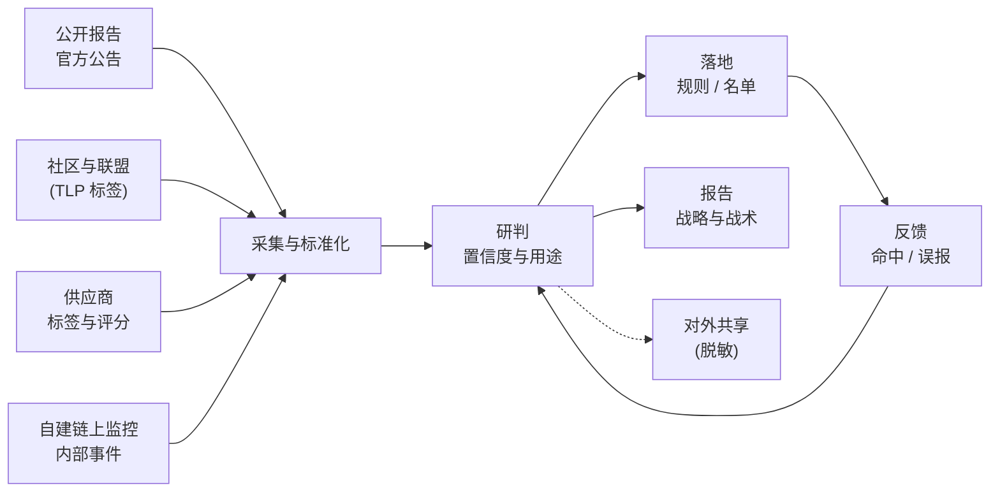
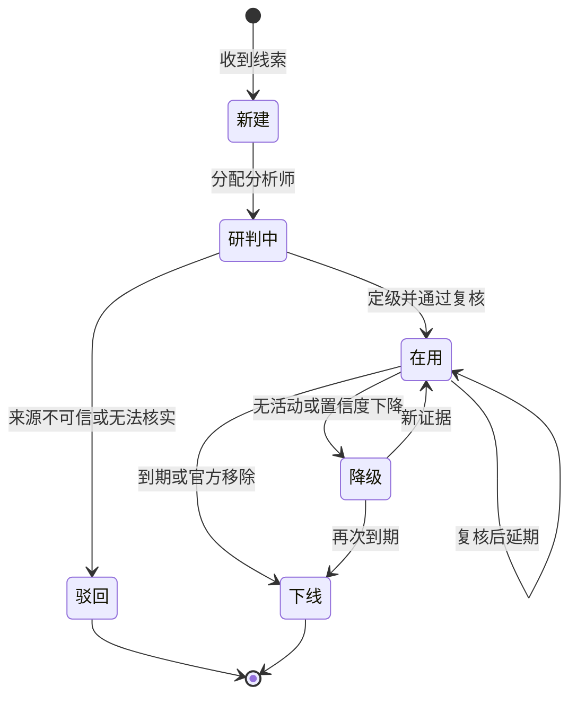
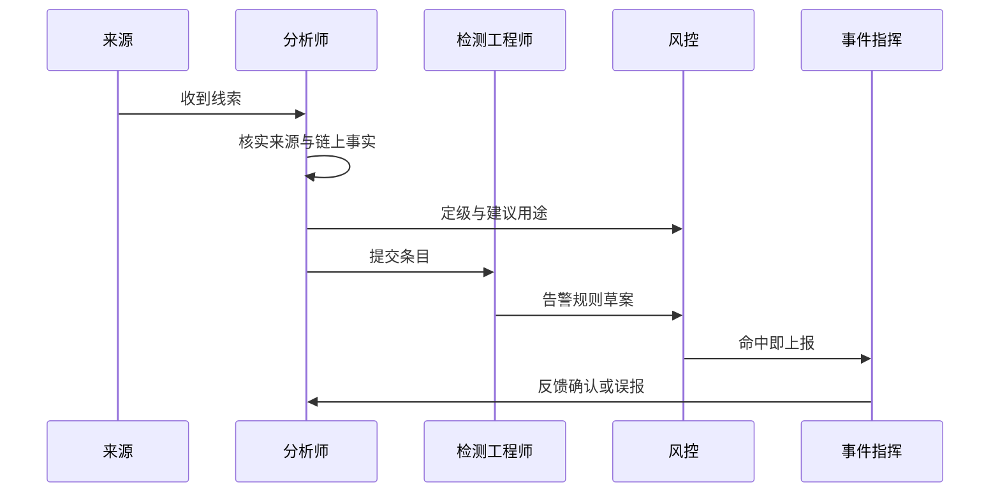

# X46 威胁情报与链上情报运营：采集、研判、共享与落地

> 学习目标：读完本章，你能——
> 1. 把"情报"拆成战略、战术、技术、运营四类，并为每一类写出消费者、产出和时效。
> 2. 建一个最小的情报流水线：来源 → 标准化 → 分级 → 落地为检测规则或封堵名单 → 失效回收，并给地址标签、IOC 定"置信度、来源、过期日"。
> 3. 用 TLP 标签与法律边界规则参与社区共享，并用"落地率、命中率、误报率"度量情报团队。
>
> 适用角色：交易所、项目方、钱包与托管机构的安全负责人、检测工程师、威胁情报分析师
> 前置章节：[X05 检测与响应工程](X05-detection-response-engineering.md)、[25 资金追踪、冻结与事后处置](../25-fund-tracing-response.md)、[X33 漏洞披露、赏金与安全社区协作](X33-disclosure-bounty-ops.md)
> 相关章节：[X14 客户身份与访问·工程验收](X14-cex-identity-verification.md)（接管信号回放）、[21 社工与内部人员](../21-social-engineering-insiders.md)、[19 用户诈骗](../19-user-scams.md)
> 模板：本章给出情报条目模板、标签分级表、TLP 共享规则、Sigma 风格规则与 SQL 示例
> 最后核对：2026-11-23（机构活动、金额与组织状态均以官方最新页面为准）

---

## 开场：一个真实场景

周三上午，交易所安全群里有人转发了一条推文："某攻击者的一批地址正在向多家平台充值。"十分钟内，群里有 3 个人各自去查，得到 3 份不同的地址列表。风控问："这些地址能直接拒收吗？"没人敢答。

<details class="predict"><summary>🤔 先猜再看：这条"情报"缺什么，才能让风控放心使用？</summary>

缺**来源、置信度、时效和用途**。一份没有出处的地址列表，只能当线索，不能当拦截依据。要拦截，至少要回答：谁说的？依据是链上事实还是推断？有没有人复核？过期日是什么？误拦的代价由谁承担？

2025 年 2 月，FBI 就 Bybit 被盗事件发布公告，列出 51 个以太坊地址，并请交易所、桥、RPC 运营方等拦截相关交易。公告同时说明，资金已分散到多条链上的数千个地址，所列地址不是全部（见第 8 节案例 1）。这类来源明确、边界说明清楚的材料，才适合被直接转成规则。

</details>

---

## 1. 一句话理解

**威胁情报运营，是把"别人知道的、你还不知道的"变成你系统里一条可执行、可过期、可度量的规则。**

威胁情报（Threat Intelligence，TI）：经过收集、核实和分析，能支持决策的关于对手、手法和风险的信息。
入侵指标（Indicator of Compromise，IOC）：能用来识别恶意活动的可观测量，例如地址、域名、文件哈希、合约字节码特征。
链上情报（On-chain Intelligence）：从区块链公开数据中得出的地址归属、资金流向与行为模式。
地址标签（Address Label）：对某个地址的归类说明，例如"交易所热钱包""被盗资金持有地址""制裁名单"。

> 🎯 打个比方：情报像天气预报。预报员不能阻止下雨，但你出门前看一眼，就知道带不带伞。预报有概率、有时效，也会错。
>
> 比喻的局限：天气不会因为你看了预报而改变；对手会。你封堵一批地址，对手就换一批。情报的价值随对手反应而衰减，所以要有过期与回收。

没有落地的情报只是阅读材料。没有回收的情报会变成误拦用户的垃圾。

---

## 2. 保护目标与信任边界

要保护的是三件事：**决策质量**（别被假情报带偏）、**用户体验**（别误拦正常用户）、**共享关系**（别泄露来源或用户数据）。



**读图要点：**

- 所有来源都是不可信输入。社区消息可能被对手污染，供应商标签可能有误，推文可能是假的。进入研判之前，不得直接落地。
- 反馈环是关键：规则的命中与误报要回到研判，否则情报质量无法提高。
- 对外共享是单独的出口，要脱敏并遵守来源的 TLP 标签与法律边界（第 6.5 节）。
- 局限：图没有画"对手故意投放假情报"这条线。对策是多源交叉与分级使用（第 3.3 节）。

> ⚠️ 警告：不要把未经核实的地址直接写进提币或充值的拒绝名单。误拦会造成用户资金被卡，且难以解释。

---

## 3. 参考架构

### 3.1 情报的四种类型与消费者

| 类型 | 回答的问题 | 典型内容 | 消费者 | 时效 |
|---|---|---|---|---|
| 战略 | 谁会攻击我们？为什么？ | 对手动机、行业趋势、监管动向 | 管理层、董事会 | 季度 |
| 战术 | 他们怎么攻击？ | 攻击链、社工话术、常见入口 | 安全架构、红队、培训 | 月度 |
| 技术 | 具体长什么样？ | 地址、域名、哈希、合约特征、交易模式 | 检测工程、风控、封堵 | 小时到周 |
| 运营 | 这次攻击现在怎样？ | 活跃活动、资金流向、时间窗 | 事件指挥、风控、联盟 | 分钟到天 |

四类的比例要与团队规模匹配：小团队先做技术与运营两类，因为它们能直接变成规则；战略与战术两类用一份季度报告覆盖即可。

### 3.2 来源与可信度

| 来源 | 典型例子 | 优点 | 风险 | 默认用途 |
|---|---|---|---|---|
| 官方机构 | 执法机关公告、制裁名单 | 权威、有法律意义 | 不完整、更新有延迟 | 可直接落地（按法务要求） |
| 项目方与安全公司复盘 | 事故报告、技术分析 | 细节丰富 | 归因谨慎度不一 | 技术情报，需自己核对链上事实 |
| 社区与联盟 | 行业 ISAC、安全联盟群 | 速度快 | 噪音与伪造、TLP 限制 | 线索，需二次核实 |
| 商业供应商 | 链上分析与标签服务 | 覆盖广、有 API | 方法不透明、评分差异 | 加权输入，不作唯一依据 |
| 自建监控与内部事件 | 自己的充值、风控、日志 | 与自己最相关、可控 | 样本少 | 最高优先级的技术情报 |
| 社交媒体 | 研究员推文 | 最快 | 假账号、误传 | 仅作触发，必须核实 |

### 3.3 置信度与用途分级（通用做法）

把"多可信"和"能干什么"绑在一起，避免情报被滥用：

| 置信度 | 判定依据（示例） | 允许的用途 |
|---|---|---|
| 高 | 官方名单；或自己做过链上核实且至少两个独立来源一致 | 可封堵、可冻结申请、可写入对外公告 |
| 中 | 单一可信来源，或供应商高分标签、链上事实未复核 | 触发人工审核、提高风险评分、加强监控 |
| 低 | 单一未验证来源、社交媒体、推断关联 | 仅观察与告警，不得影响用户 |

### 3.4 组件职责

| 组件 | 职责 | 为什么这样分 |
|---|---|---|
| 情报台账 | 存条目、来源、置信度、状态、过期日 | 单一事实源，避免多份列表 |
| 标准化层 | 统一地址格式、链标识、时间、标签字段 | 跨链、跨来源才能比对 |
| 研判席位 | 核实、定级、写用途 | 把人的判断留痕 |
| 落地管道 | 把条目转成规则、名单、仪表盘 | 情报不落地就没价值 |
| 反馈与回收 | 统计命中、误报；到期或失效时下线 | 防止名单膨胀 |
| 共享网关 | 脱敏、TLP 校验、法务审批 | 防止泄露与违规 |

---

## 4. 控制清单

| ID | 控制项 | 要防什么 | 优先级 | 怎么验证 |
|---|---|---|---|---|
| TIN-1 | 有书面的情报需求清单（PIR）：列出最关心的 5–10 个问题与消费者 | 收集没有目的 | P0 | 检查文档；消费者签字确认 |
| TIN-2 | 单一情报台账，每条含来源、置信度、用途、创建人、过期日 | 多份列表、无法追责 | P0 | 抽 20 条，核对字段完整 |
| TIN-3 | 置信度与用途绑定：低置信度条目技术上无法进入拦截名单 | 假情报误拦用户 | P0 | 尝试把低置信度条目写入拦截表，应被拒绝 |
| TIN-4 | 所有条目有过期日与复核人；到期自动提醒或下线 | 名单膨胀、陈旧标签 | P0 | 查询过期未处理条目，应为 0 |
| TIN-5 | 拦截类落地需要双人复核与回滚方案 | 误操作、单人投毒 | P0 | 抽查最近 5 次变更记录 |
| TIN-6 | 情报到规则有固定流程，并回放历史数据验证误报 | 规则上线即扰民 | P1 | 抽查规则变更单，含回放结果 |
| TIN-7 | 自有事件产出的 IOC 在事件关闭后 5 个工作日内入台账 | 经验不沉淀 | P1 | 对照事件清单与台账 |
| TIN-8 | 每个来源有评分记录（准确率、时效、独特性），季度复评 | 低质来源占用精力 | P1 | 查看来源评分表 |
| TIN-9 | 共享遵守 TLP 标签；对外材料脱敏并经法务审批 | 泄露来源或用户数据 | P0 | 抽查最近 3 次对外共享记录 |
| TIN-10 | 地址标签带版本与证据；改标签有记录 | 标签漂移、无法解释 | P1 | 抽 10 个标签，能追到证据 |
| TIN-11 | 制裁与执法名单有自动同步与延迟监控 | 名单滞后合规风险 | P0 | 检查同步日志；人为延迟时告警 |
| TIN-12 | 对手画像只记录组织级、基于公开来源的手法；不记录对个人的指认 | 误指认、法律风险 | P0 | 审阅画像模板与最近 5 份画像 |
| TIN-13 | 战术情报定期输入培训、红队与桌面推演 | 情报停在文件里 | P1 | 检查近两个季度的推演剧本引用 |
| TIN-14 | 度量：落地率、命中率、误报率、平均处置时间 | 看不见团队价值 | P2 | 月报 |
| TIN-15 | 值班手册写明"收到情报后 30 分钟内要做的事" | 紧急情报无人响应 | P1 | 演练并计时 |

---

## 5. 分级落地

| 档位 | 做什么 | 人力与时间（示例） |
|---|---|---|
| 最小可行 | 一张共享表当台账（字段见 6.1）；订阅 3–5 个官方与可信来源；每周 30 分钟情报例会；官方制裁与执法名单手工同步 | 1 名兼职工程师，约 1–2 周 |
| 标准 | 台账入库并接 API；置信度与用途强制绑定；情报到 SIEM 或风控的规则化落地；加入至少 1 个行业共享组织；月报与度量 | 1–2 名专职分析师 + 检测工程师兼职，约 1–2 个月 |
| 成熟 | 自动采集与标准化；STIX 风格交换；自有链上监控与图分析；多语言多链；与执法、交易所、发行方有预先沟通渠道；对手画像与红队联动 | 3–5 人团队，持续建设 |

> 💡 注意：小团队最常见的错误是一开始就买多个商业源。先把"一个台账、一个落地管道、一次回收"做通，再加来源。

---

## 6. 落地做法

### 6.1 情报条目模板

每条情报用同一格式。下面是台账字段（示例）：

```yaml
# 示例：情报条目
id: TI-2026-0142
type: technical            # strategic | tactical | technical | operational
indicator:
  kind: address            # address | domain | contract_code | tx_pattern
  chain: ethereum
  value: "0x..."           # 示例占位
label: stolen-funds-holder
confidence: high           # high | medium | low
usage: [monitor, block]    # 允许用途，必须与 confidence 匹配
sources:
  - type: government-advisory
    ref: "公告编号或链接"
  - type: self-verified
    ref: "链上追踪记录 TRC-88"
tlp: CLEAR
created: 2026-11-20
expires: 2027-02-20        # 到期必须复核或下线
owner: analyst-a
reviewed_by: analyst-b
notes: "只记录事实与证据，不写对个人的猜测"
```

### 6.2 地址标签分级

| 级别 | 含义 | 例子 | 处置 |
|---|---|---|---|
| L0 | 制裁或执法名单 | 官方公告列出的地址 | 按法务与合规流程处理 |
| L1 | 已核实的恶意活动 | 自己验证过的被盗资金持有地址 | 封堵与冻结申请 |
| L2 | 高度可疑 | 与 L1 有多跳强关联、行为符合洗转模式 | 人工审核、提高评分 |
| L3 | 线索 | 单一来源、未核实 | 仅观察 |
| N | 中性已知实体 | 交易所热钱包、桥合约、混币协议 | 防止误拦，用于过滤 |

> 💡 注意：中性标签（N 级）和恶意标签同样重要。资金经过交易所或桥以后，"资金接触过 X"不等于"来自 X 的人"。关联分析要写明跳数与金额占比。

### 6.3 从情报到规则

流程固定为 5 步：

1. 研判席位核实并定置信度与用途。
2. 检测工程师选择落地形式：拦截名单、告警规则、评分特征或仪表盘。
3. 用过去 90 天数据回放，统计命中和误报。
4. 双人评审后灰度上线，先只告警。
5. 稳定运行一周后，按用途升级到拦截或评分。

下面是一条 Sigma 风格的示意规则（示例，字段名按你的日志改）：

```yaml
title: 充值来自高置信度被盗资金地址
id: tin-dep-001
status: experimental
logsource:
  product: exchange
  service: deposit_events
detection:
  selection:
    from_label|startswith: "L1"
    amount_usd|gte: 1
  condition: selection
fields: [user_id, chain, tx_hash, from_address, amount_usd, label_id]
falsepositives:
  - 标签过期或误标
level: high
action: hold_credit_and_page_oncall   # 入账暂缓并通知值班
```

下面是用 SQL 做回放的示意（示例表结构）：

```sql
-- 示例：回放过去 90 天，统计新标签集的命中与处置结果
SELECT l.label_id,
       COUNT(*)                                        AS hits,
       SUM(CASE WHEN c.outcome = 'confirmed' THEN 1 ELSE 0 END) AS confirmed,
       SUM(CASE WHEN c.outcome = 'false_positive' THEN 1 ELSE 0 END) AS fp
FROM deposits d
JOIN ti_labels l ON d.from_address = l.address AND d.chain = l.chain
LEFT JOIN case_outcomes c ON c.deposit_id = d.id
WHERE d.created_at >= now() - interval '90 days'
GROUP BY l.label_id
ORDER BY hits DESC;
```

资金追踪的具体方法（跳转分析、混币识别、冻结请求）见 [25 资金追踪、冻结与事后处置](../25-fund-tracing-response.md)。本章只管"追踪得出的结论怎样成为台账里的条目"。

### 6.4 IOC 生命周期与失效

IOC 有保质期。对手会换地址、换域名、重写合约，旧指标的命中率随时间下降，而误报率不会跟着下降。这是"过期日"必须成为必填字段的原因。地址、域名、哈希各自的寿命不同：

| 类型 | 典型寿命（示例） | 失效原因 | 回收方式 |
|---|---|---|---|
| 被盗资金持有地址 | 数周到数月 | 资金已转走、地址不再使用 | 到期复核；无活动则降级 |
| 钓鱼域名 | 数小时到数天 | 被下线、被接管 | 短过期日；监控是否仍解析 |
| 恶意合约特征 | 数月 | 对手重写 | 复核命中率 |
| 恶意软件哈希 | 数天到数周 | 对手重新打包 | 配合行为规则使用 |
| 制裁名单地址 | 直到官方移除 | 官方删除或法院裁决 | 随官方名单同步 |

下面是一条情报条目的状态机：



**读图要点：**

- 进入"在用"只有一条路：研判并复核。没有绕过研判的快捷方式，这是 TIN-3 的技术落点。
- "到期"和"官方移除"都会让条目下线。下线要同步撤掉对应的规则与名单，并在台账保留历史，便于事后解释当时为什么拦截。
- "降级"是缓冲区：资金停在地址里不动，不等于地址无害，先降低用途等级再观察。
- 局限：状态机不规定每个状态的停留时间。示例建议"研判中"不超过 2 个工作日，运营类紧急条目除外。

制裁名单是失效的特例：它的有效性由法律决定。Tornado Cash 的合约地址在 2022 年被列入美国财政部 OFAC 名单，2025 年 3 月被移出（见第 8 节案例 4）。如果你的名单没有"同步并处理移除"的机制，就会继续拦截已不再受制裁的地址。具体处理要听法务与合规意见。

### 6.5 共享与协作

**为什么共享。** 对手同时攻击多家机构。一家先看到，其他家就有时间窗口。

**常见渠道（通用事实，截至 2026 年公开资料）：**

- 行业信息共享与分析中心（Information Sharing and Analysis Center，ISAC）：同行互相共享威胁信息的非营利组织。公开资料显示，Crypto ISAC 于 2024 年 5 月宣布成立，创始成员包括多家交易所、稳定币发行方与基础设施公司，并为成员提供情报共享；另有 SEAL 体系下的 SEAL-ISAC（2024 年 4 月宣布）。加入条件、费用与规则以各组织官方为准。
- 应急与救援网络：见 [X33 漏洞披露、赏金与安全社区协作](X33-disclosure-bounty-ops.md) 第 6.7 节的 SEAL 911 与联络清单。
- 公私合作冻结机制：例如 T3 金融犯罪组（T3 Financial Crime Unit，由 Tether、TRON 与 TRM Labs 公开宣布设立）。其公开资料称，该组织协助冻结涉嫌犯罪相关的 USDT；2025 年 1 月报道累计约 1 亿美元，之后持续增长。该例说明，同一事实源能同时服务检测、冻结与执法。
- 执法与监管渠道：向执法机关报案与提供证据。

**TLP 规则。** 交通灯协议（Traffic Light Protocol，TLP）由 FIRST 维护。TLP 2.0 有 TLP:RED、TLP:AMBER、TLP:AMBER+STRICT、TLP:GREEN、TLP:CLEAR 五个标签。它规定接收方可以把信息传给谁：RED 不得再传给任何人；AMBER 限于接收方组织内；AMBER+STRICT 不得传给客户；GREEN 可在社区内传，但不得公开；CLEAR 可不受限制传播（受版权约束）。TLP 不是正式的分级制度，也不规定加密与许可条款。

在台账里把 TLP 当作强制字段。对外共享脚本检查：来源 TLP 为 RED、AMBER 的条目不得进入对外共享包。

**法律边界。** 共享前，法务要回答这五个问题：

1. 材料含个人数据吗？是否有合法依据与最小化处理？
2. 共享对象是否在你的合同与保密协议允许的范围内？
3. 是否会泄露客户身份、交易细节或正在进行的调查？
4. 对"某人是攻击者"的陈述有没有可靠证据？没有就不写（见 6.6）。
5. 不同司法辖区对数据出境与金融信息共享有无限制？

> ⚠️ 警告：不要在群里贴用户姓名、证件、邮箱与账号。共享的是"地址、手法、时间"，不是"人"。

### 6.6 对手画像：只写手法，不指认个人

对手画像按"组织级、公开来源、手法为主"写：

```markdown
# 对手画像模板（示例）
- 名称与别名：（公开报告使用的名称；注明各机构命名不同）
- 归因依据：（谁归因的？置信度？是官方公告还是安全公司评估）
- 动机：（获利 / 勒索 / 欺诈 / 其他）
- 常见入口：（社工话术、恶意文件、供应链、钓鱼）
- 常见资金路径：（换币、跨链、混币、场外）
- 对我们的相关性：（我们的哪些资产最可能被盯上）
- 对应控制与缺口：（链接到本手册控制 ID）
- 最后更新与过期日：
```

写作规则：

- 归因写"公开报道归因于"或"某机构评估"，并标明来源与置信度。
- 不写对具体个人的指认、住址、社交账号。
- 不同机构给同一组织起不同名字，要在画像里列出别名，避免重复建档。

按公开资料，国家级团伙通常以获利和社工入口为特征；勒索团伙以数据窃取与加密、敲诈为特征；诈骗团伙以大规模钓鱼、投资骗局与地址投毒为特征。这是通用事实，用来决定防御的优先级，不是对任何人的判断。

### 6.7 自建链上监控：把自己的数据变成情报

商业标签覆盖广，但最相关的情报来自你自己的充值、提币与风控数据。自建监控不需要一开始就做图数据库，先做四类特征：

| 特征 | 含义 | 用在哪里 | 局限 |
|---|---|---|---|
| 新建即充值 | 地址创建后很短时间内就向你充值，并且金额接近被盗资金分拆后的粒度 | 评分特征、人工审核 | 正常用户从新钱包转入也会触发 |
| 分拆与归并 | 一个来源分成许多小额，几跳后又归并 | 洗转模式告警 | 做市商与归集地址也会这样 |
| 跨链跳转 | 短时间内经桥或兑换服务换链 | 追踪线索 | 单次跨链不说明任何问题 |
| 与已标签集合的距离 | 与 L1 地址相隔的跳数与金额占比 | 评分，不单独拦截 | 要用中性标签排除交易所与桥 |

规则要点：

1. 距离特征只进评分，不直接拦截；"接触过"不等于"同一主体"。
2. 每条特征用历史数据回放，记录它在已确认案例里的召回与在正常用户里的误报。
3. 把你自己事件里确认的路径写回台账，作为 L1 条目。这是最有价值的自有情报。
4. 对跨链路径，先在台账里记录"链、桥或兑换服务、时间"，再决定是否联系对方运营方。

### 6.8 情报团队的产出：谁消费，怎样算有用

情报团队的产出分四种，对应第 3.1 节的类型：

| 产出 | 频率 | 消费者 | 好的标准（示例） |
|---|---|---|---|
| 技术条目与规则 | 每日到每周 | 检测、风控 | 有来源、有回放、有过期日 |
| 事件快报 | 按需，30 分钟内 | 值班与事件指挥 | 一页：发生了什么、对我们是否相关、建议动作 |
| 战术简报 | 每月 | 安全架构、培训、红队 | 手法描述 + 对应控制与缺口 |
| 战略报告 | 每季度 | 管理层 | 3 个关键风险 + 需要的决策 |

事件快报模板（示例）：

```markdown
# 事件快报 TI-FLASH-xxx
- 时间与来源：（谁、何时、什么渠道；TLP）
- 事实：（已核实的链上事实，逐条）
- 推断：（明确标注为推断，写置信度）
- 与我们的相关性：（是否涉及我们的资产、用户、供应商）
- 建议动作：（监控 / 评分 / 拦截 / 通知联盟；每项写授权人）
- 下次更新时间：
```

> 💡 注意：把"事实"与"推断"分行写。事故中最常见的错误，就是把推断当成事实传给下一个人。

### 6.9 与 X05、X14 的分工

- [X05](X05-detection-response-engineering.md) 讲检测平台、规则生命周期与值班。本章讲规则的"原料"：来源、置信度、过期日。规则落地之后的调参与值班，归 X05。
- [X14](X14-cex-identity-verification.md) 用接管风险信号做回放验收。本章为这些信号提供外部输入，例如已知的钓鱼域名、撞库来源与被盗资金地址。
- [25 资金追踪](../25-fund-tracing-response.md) 讲追踪方法。本章讲追踪结论的入账与回收。

### 6.10 常见坑

- 把供应商评分当成事实，直接拦截。
- 台账没有过期日，一年后无人敢删。
- 只收集不落地，团队"读很多报告，规则没变"。
- 共享时漏了 TLP，把 AMBER 材料放进公开群。
- 对手画像里写了个人的猜测，被法务叫停。

### 6.11 情报例会与报告

每周 30 分钟情报例会的议程：

1. 本周新增条目：来源、置信度、用途。
2. 命中与误报：哪些规则命中了？误拦了谁？
3. 即将过期的条目：延期、降级还是下线。
4. 外部事件：行业里本周的新手法，哪些与我们相关。
5. 行动项：谁、什么时候、交付什么。

月报模板（示例）：

```markdown
# 威胁情报月报（示例）
## 1. 摘要（3 句）
## 2. 本月关键事件与对我们的影响
## 3. 新增 / 下线条目数；平均置信度
## 4. 规则落地：新增 X 条，命中 Y 次，确认 Z 次，误报 W 次
## 5. 对手与手法趋势（战术级）
## 6. 缺口与下月计划
```

---

## 7. 运营：指标、告警、值班、演练、季度节奏

### 7.1 指标

| 指标 | 定义 | 参考目标（示例） | 用途 |
|---|---|---|---|
| 落地率 | 进入台账且被规则或名单使用的条目 / 条目总数 | 记录基线并逐季提高 | 情报是否产生价值 |
| 命中率 | 有命中的条目 / 在用条目 | 看趋势 | 情报是否与你相关 |
| 确认率 | 命中后被确认为真的次数 / 命中次数 | 高置信度应较高 | 质量 |
| 误报率 | 命中后被判定为误报的比例 | 拦截类越低越好 | 用户体验 |
| 过期积压 | 到期未复核条目数 | 0 | 红线项 |
| 情报到规则耗时 | 条目创建到上线告警 | 技术类 ≤ 1 个工作日（示例） | 速度 |
| 来源评分 | 来源准确率与独特性 | 季度复评 | 取舍来源 |
| 共享互惠 | 对外共享次数与收到的有用情报数 | 记录基线 | 关系健康 |

红线项：拦截名单里存在无来源或已过期条目；制裁名单同步延迟超过约定时间；TLP 违规共享。

### 7.2 告警与值班

- 高置信度命中（L0、L1）进入值班通道，与 X05 的 P1 流程对接。
- 紧急情报（运营类）的响应：30 分钟内由值班分析师完成"核实、定级、决定用途"，必要时通知风控。
- 值班手册包含联络清单（联盟、交易所、发行方、执法）。

紧急情报的 30 分钟响应：



**读图要点：**

- 分析师先核实，再把条目交给检测与风控。顺序不能反：先拦后查，误拦的代价由用户承担。
- 风控是用途的最终责任人：条目写"建议"，是否拦截由风控与合规决定。
- 命中结果回流给分析师，条目的置信度随之修正。
- 局限：图假设来源可联系。公开来源（例如官方公告）没有对话方，核实只能靠链上数据与第二来源。


### 7.3 演练

每季度做一次 30 分钟的"情报响应演练"：

1. 主持人发一条模拟情报（含 1 个故意的错误来源）。
2. 分析师 10 分钟内给出置信度与用途建议。
3. 检测工程师 15 分钟内写出规则草案并说明回放计划。
4. 复盘：有没有人发现来源错误？有没有越权拦截？

### 7.4 季度节奏（示例）

| 月份 | 动作 |
|---|---|
| 第 1 月 | 回顾需求清单；来源评分；清理到期条目 |
| 第 2 月 | 情报响应演练；检查共享记录与 TLP 合规 |
| 第 3 月 | 度量汇报；对手画像更新；把本季战术情报输入培训与推演 |

---

## 8. 失效案例

以下案例来自官方公告与公开报道。金额写"约"，归因写"公开报道归因于"。

### 案例 1：Bybit 被盗资金追踪（2025 年 2 月，中心化交易所）——官方公告成为高置信度输入

- **经过**：2025 年 2 月 21 日前后，Bybit 约 15 亿美元（事发时估值）的数字资产被盗。FBI 于 2025 年 2 月 26 日发布公告，将其归因于被其称为 TraderTraitor 的朝鲜关联活动，列出 51 个以太坊地址，并请 RPC 节点运营方、交易所、桥、区块链分析公司、DeFi 服务等拦截与这些地址相关的交易。公告说明，资金已被换成比特币等资产，并分散到多条链上的数千个地址，列表只覆盖其中一部分。
- **对应控制**：TIN-2（单一台账）、TIN-3（置信度与用途）、TIN-4（过期日）、TIN-11（官方名单同步）。
- **教训**：官方列表是高置信度的起点，但不完整。你要自己持续追踪后续地址，并给每条加过期日；列表之外的资金流向需要自建监控。
- **来源类型**：FBI IC3 公告（I-022625-PSA）。

### 案例 2：Radiant Capital（2024 年 10 月，DeFi）——战术情报没有变成人员防护

- **经过**：公开报道称，2024 年 9 月，一名开发者收到一条看似来自前承包商的 Telegram 消息，附有压缩的 PDF。文件在同事间传阅，多台设备被植入后门。10 月 16 日，在例行的多签调整中，被感染设备对恶意交易签名，而签名界面显示的是正常内容。损失约 5000 万美元（事发时估值）。Radiant 公布，Mandiant 评估该攻击与朝鲜关联的 UNC4736 有关，置信度为高。
- **对应控制**：TIN-13（战术情报进入培训与推演）、TIN-12（只写组织级归因）；设备与签名流程见 [18 钱包与密钥管理](../18-wallet-key-management.md) 与 [21 社工与内部人员](../21-social-engineering-insiders.md)。
- **教训**：此类"假冒熟人、发文件"的手法属于战术情报。它应转成培训话术、文件处理规则与签名前的独立核对，而不是只在事后复盘里出现一次。
- **来源类型**：项目方事件更新（经媒体转述）、Mandiant 归因（经 SecurityWeek 等转述）。

### 案例 3：地址投毒致 1155 WBTC 损失（2024 年 5 月，用户侧）——线索快，处置难

- **经过**：2024 年 5 月 3 日，一名用户向一个与其常用地址首尾字符相同的"相似地址"转出 1155 枚 WBTC。公开报道给出的美元估值从约 6800 万到 7100 万不等，取决于所用价格。Scam Sniffer 等机构发现并公开了事件。
- **对应控制**：TIN-10（标签带证据）、TIN-14（度量）；用户侧防护见 [19 用户诈骗](../19-user-scams.md)。
- **教训**：投毒是可检测的模式：先发小额"测试"交易，使地址进入对方的历史记录。交易所与钱包可以把"相似地址对"做成技术情报，在用户转账前给出提示。链上情报提早发现不等于能追回，关键在转账前的防线。
- **来源类型**：SlowMist 分析、媒体报道（The Block、CoinDesk 等）。

### 案例 4：Tornado Cash 制裁与移除（2022–2025 年，制裁名单）——名单的失效由法律决定

- **经过**：美国财政部 OFAC 于 2022 年 8 月将 Tornado Cash 列入制裁名单。公开报道称，2024 年 11 月，美国第五巡回上诉法院裁定，不可变的智能合约不属于 IEEPA 下可被封锁的"财产"。2025 年 3 月，财政部将其移出名单，并称这是行使自身裁量权。相关诉讼与对个人的制裁仍有后续，细节以官方与法院文件为准。
- **对应控制**：TIN-4（过期与复核）、TIN-11（名单同步含"移除"）。
- **教训**：名单会增，也会减。只处理"新增"不处理"移除"，会长期误拦。该类处置须由法务确认。
- **来源类型**：美国财政部公告、法律事务所通报、媒体报道。

**本章没有写的内容**：没有找到足够可靠的公开来源，来写"某机构因共享情报被误指认而造成损害"的具体案例；也没有写任何针对特定个人的归因。

---

## 9. 评估检查点

- [ ] **TIN-1** 有书面需求清单，每项有消费者。
- [ ] **TIN-2** 有单一台账，抽 20 条字段完整。
- [ ] **TIN-3** 低置信度条目在技术上无法进入拦截名单。
- [ ] **TIN-4** 所有条目有过期日；过期未处理条目为 0。
- [ ] **TIN-5** 拦截类落地有双人复核与回滚方案。
- [ ] **TIN-6** 情报到规则有固定流程，规则上线前有回放结果。
- [ ] **TIN-7** 自有事件的 IOC 在 5 个工作日内入台账。
- [ ] **TIN-8** 来源有评分并每季度复评。
- [ ] **TIN-9** 对外共享遵守 TLP，经法务审批并脱敏。
- [ ] **TIN-10** 地址标签带版本与证据，改动有记录。
- [ ] **TIN-11** 制裁与执法名单自动同步，含移除，有延迟告警。
- [ ] **TIN-12** 对手画像只记组织级手法，无个人指认。
- [ ] **TIN-13** 战术情报输入培训、红队与推演。
- [ ] **TIN-14** 月报含落地率、命中率、误报率与处置耗时。
- [ ] **TIN-15** 值班手册含 30 分钟响应流程，演练过。

**把结果写进报告**：

| 检查项 | 状态（通过 / 部分 / 缺失） | 证据（链接 / 截图 / 日志） | 负责人 | 补齐日期 |
|---|---|---|---|---|
| TIN-1 | | | | |
| TIN-2 | | | | |
| TIN-3 至 TIN-15 | | | | |

---

## 10. 上手路径

**第一周**

1. 写 5 个情报需求（例如："有哪些团伙在攻击与我们类似的交易所？"）。
2. 建一张共享表当台账，字段照 6.1。
3. 订阅 3–5 个来源：执法公告、制裁名单、主要安全公司与项目方复盘。
4. 把最近一次事件的地址和手法补进台账。

**第一个月**

1. 写置信度与用途表，让风控和检测团队签字。
2. 选 3 条高置信度条目，走完 6.3 的 5 步，落成告警规则。
3. 开始每周 30 分钟例会。
4. 与法务确认 TLP 规则与对外共享的审批人。

**第一个季度**

1. 把台账接 API，并给拦截类落地加双人复核。
2. 加入一个行业共享组织，并做一次情报响应演练。
3. 写第一份月报，并统计落地率、命中率、误报率。
4. 与 [X05](X05-detection-response-engineering.md) 的检测工程师一起，建立"情报 → 规则 → 反馈"的固定节奏。

---

## 11. 常见误区

| 误区 | 为什么错 | 正确做法 |
|---|---|---|
| "订阅越多来源越安全" | 噪音淹没信号，没人读 | 先落地少数来源，按评分取舍 |
| "供应商标签等于事实" | 方法不透明，评分有误 | 当加权输入，高风险用途要自己核实 |
| "地址一旦标记就永远有效" | 对手会换地址，名单会被法律改变 | 每条有过期日与复核人 |
| "情报就是 IOC" | 只看指标，忽略手法与战略 | 四类情报各有消费者 |
| "共享会暴露自己" | 不共享，同行先中招，你也得不到回报 | 脱敏共享，按 TLP 管控 |
| "追到地址就能指认人" | 链上地址不等于身份 | 只写事实与置信度，不指认个人 |
| "拦截比告警更安全" | 误拦会伤害正常用户 | 先告警，再按置信度升级 |

---

## 12. 术语表

| 术语 | 英文 | 含义 |
|---|---|---|
| 威胁情报 | Threat Intelligence | 经核实与分析、能支持决策的威胁信息 |
| 入侵指标 | Indicator of Compromise (IOC) | 能识别恶意活动的可观测量 |
| 链上情报 | On-chain Intelligence | 从区块链数据得出的地址归属与资金流向 |
| 地址标签 | Address Label | 对地址的分类说明 |
| 情报需求 | Priority Intelligence Requirement (PIR) | 管理层最关心、需要情报回答的问题 |
| 信息共享与分析中心 | ISAC | 同行共享威胁信息的组织 |
| 交通灯协议 | Traffic Light Protocol (TLP) | 规定信息可传给谁的标签 |
| 置信度 | Confidence | 对情报真实性的把握程度 |
| 对手画像 | Threat Actor Profile | 对攻击组织手法与动机的归纳 |
| 失效 | Expiry / Decay | 情报因时间或环境变化不再有效 |
| 回放 | Replay | 用历史数据检验规则的命中与误报 |

---

## 13. 动手练习与思考题

**练习 1：写需求清单。** 为你熟悉的一个机构（交易所、钱包或 DeFi）写 5 个情报需求，每个写出"谁用、做什么决定、多久要答案"。

**练习 2：定级。** 下面 3 条"情报"，各给出置信度与允许用途，并说明还缺什么：（a）某官方公告列出的 10 个地址；（b）某研究员推文称"这批地址在洗钱"；（c）你自己追踪出的、与 a 有 3 跳强关联的 5 个地址。

**练习 3：写条目。** 照 6.1 模板，把练习 2 的 (a) 写成一条完整条目，包含过期日。

**练习 4：画规则。** 把一条 L1 标签情报画成流程：充值到账 → 标签匹配 → 暂缓入账 → 值班确认 → 放行或冻结申请。标出误报时用户看到什么。

**练习 5：TLP 判断。** 以下 4 种材料你可以传给谁？（a）TLP:AMBER 的威胁报告；（b）TLP:GREEN 的地址列表；（c）TLP:RED 的口头通报；（d）TLP:CLEAR 的官方公告。

**练习 6：30 分钟桌面推演。** 背景：周五 18:00，一家同行交易所在联盟群里通报，其热钱包被盗，并给出 8 个地址，标 TLP:AMBER。注入 1（18:10）：你的充值监控显示，其中 2 个地址在 3 小时前向你充值过，已入账。注入 2（18:25）：社交媒体出现一份更长的地址列表，来源不明。注入 3（18:40）：一位大客户的提币被你的新规则暂缓，客户来电抗议。请回答：（a）18:10 你可以做哪些动作，哪些必须先问合规？（b）18:25 的列表怎样定级？（c）18:40 你向客户说什么，不能说什么？（d）TLP:AMBER 的材料，你能告诉你的法务和高管吗？评分：核实先于拦截 3 分；区分事实与推断 3 分；遵守 TLP 2 分；有回滚与复盘安排 2 分。

**思考题**

1. 你的对手收到了你的拦截名单。他们会怎样利用？你该在设计上做什么，让名单被看到也不致命？
2. 一个来源给出的标签与另一个来源冲突。你的台账和规则应该怎样表达这种不一致，而不是简单二选一？
3. 把你机构最近一次事件复盘中的"手法"改写成一条战术情报，并写出它应该影响的 3 个控制项。
