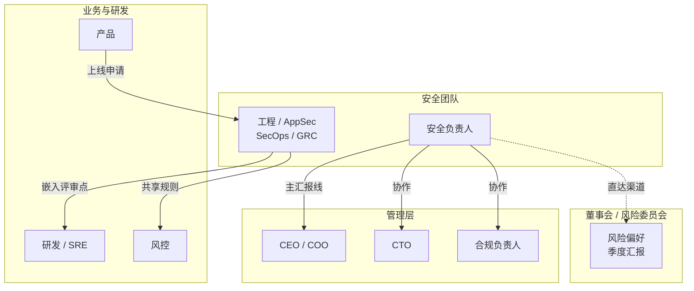
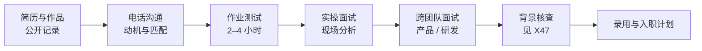
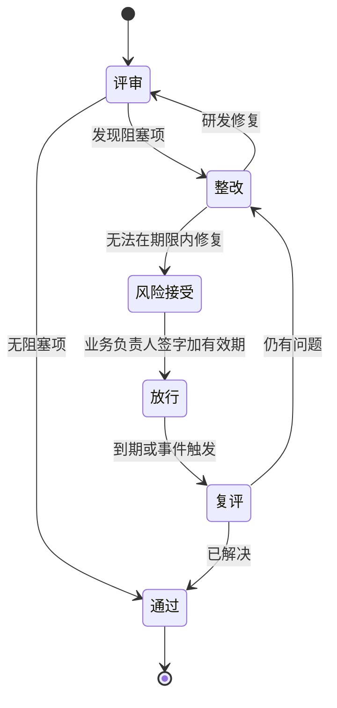

# X48 安全团队建设：组织、预算、招聘、汇报与职业路径

> 学习目标：读完本章，你能——
> 1. 为一家 Web3 机构设计安全团队的结构、汇报线和能力矩阵，并写出前 3 个岗位的招聘标准与面试评分表。
> 2. 做出一份能被管理层批准的安全预算，用"风险减少量"而不是"恐惧"沟通，并写出给董事会的季度汇报。
> 3. 排出首年路线图和 OKR，建立与产品、研发、合规、风控的协作机制，并为团队成员设计职业路径。
>
> 适用角色：安全负责人（CISO / Head of Security）、刚被任命的第一位安全工程师、技术负责人、想往管理方向走的安全工程师
> 前置章节：[X01 安全体系怎么搭](X01-security-program-controls.md)、[X06 韧性与验证](X06-resilience-validation.md)
> 延伸章节：[X02 标准与合规对照](X02-standards-compliance-map.md)、[X05 检测与响应工程](X05-detection-response-engineering.md)、[X47 人员安全](X47-people-security.md)、[B54 求职与专家之路](../bootcamp/B54-expert.md)、[B55 面试题库](../bootcamp/B55-interview.md)
> 模板：[T08 控制矩阵与风险登记](../templates/T08-control-matrix-risk-register.md)、[T06 运营安全自查](../templates/T06-ops-security-self-check.md)、[T11 供应商与托管方评估](../templates/T11-vendor-custodian-assessment.md)
> 最后核对：2026-11-23

---

## 开场：一个"什么都有"的团队

一家做了三年的交易所，安全团队 12 人：2 个渗透测试员、3 个合约审计员、2 个 SecOps、1 个合规联络、4 个"安全开发"。年度预算在公司里排第 6。

出事那天，签名服务的变更没有人评审。原因很普通：变更是周五晚上由 SRE 发起的，安全团队的评审排期在下周二，而 SRE 的发布窗口不等人。安全负责人汇报给 CTO，CTO 那一季度的 KPI 是"交付速度"。

> 这个团队缺的不是人，也不是工具。它缺的是：**在关键决策点上有权说"不"，并且被听见。**

<details class="predict"><summary>🤔 先猜再看：给这个团队再加 5 个工程师，结果会改善吗？</summary>

多半不会。人数增加了，评审排期可能更长。问题在**权限、流程嵌入点和汇报线**。团队建设的第一问不是"要招多少人"，而是"安全决策在组织里的哪一步发生、谁说了算"。

本章的主线是：**安全团队的产出不是工作量，而是"被采纳的风险决策"。**

</details>

---

## 1. 一句话理解

**安全团队建设 = 让对的人，在对的决策点，用被信任的方式，持续降低机构最大的几项风险。**

> 🎯 打个比方：安全团队像医院里的**感染控制科**。
>
> - 它不直接做手术，也不收治大多数病人，但它决定手术室的消毒标准、谁能进无菌区、出现院内感染时先关哪个科室。
> - 好的感染控制科不靠"人多"，靠规程嵌进每个科室的日常，以及院长在关键时刻支持它关科室。
>
> 比喻的局限：医院的感染有明确的医学指标；安全风险的"感染率"常常看不见，只能靠间接度量和演练来证明，所以预算沟通比医院难得多。

本章回答六个问题：

1. 团队怎么分工、向谁汇报？（组织）
2. 要什么样的人，怎么选、怎么留？（岗位、招聘、培养）
3. 钱怎么要、怎么花、怎么证明值？（预算与 ROI）
4. 怎么向管理层和董事会讲真话？（汇报）
5. 和别的团队怎么协作，外包和供应商怎么选？（协作与外部）
6. 第一年做什么？（路线图与 OKR）

本章不重复 [X01](X01-security-program-controls.md) 已有的内容：X01 讲"体系里有哪些职能、RACI 怎么写、首年做哪些控制"。本章讲"团队怎么长出来、怎么被管理、怎么被组织接纳"。人员背景核查与内部威胁归 [X47](X47-people-security.md)；演练与度量的细节归 [X06](X06-resilience-validation.md)。

---

## 2. 保护目标与信任边界

团队建设保护的不是某一项资产，而是**安全决策本身的质量与独立性**。

三样东西要保护：

1. **独立性**：安全负责人的判断不被单一业务线的 KPI 压住。
2. **连续性**：关键知识不只在一个人脑子里，关键人离职不会让体系塌掉。
3. **可信度**：管理层相信安全团队说的数字，不把它当"总是喊狼来了"的部门。



**读图要点：**

- 实线是主汇报线，虚线是"直达渠道"：安全负责人至少每季度能不经过 CTO 向董事会或风险委员会汇报一次。
- 安全团队与研发、产品、风控之间画的是"嵌入评审点"，不是"另一个部门"。
- 如果安全负责人只向 CTO 汇报，而 CTO 又承担交付 KPI，则存在利益冲突。这是常见现象，不是一定错，但要用直达渠道和书面的叫停权来补。
- 局限：小公司没有董事会风险委员会时，直达渠道可以是创始人 / 董事会观察员 / 独立董事。

**一个关键事实：安全负责人面临真实的个人责任压力。** 2022 年，Uber 前安全负责人 Joe Sullivan 因 2016 年数据泄露事件的处理，被联邦陪审团认定妨碍联邦贸易委员会（FTC）调查等罪名成立（案情见第 8 节）。这不等于"安全负责人都会坐牢"。它说明：**你对汇报什么、怎么处理事件，要有书面记录，要有法务参与，要有向上的升级路径。**

---

## 3. 参考架构：组织、岗位与协作点

### 3.1 三种常见组织形态

| 形态 | 做法 | 适合 | 主要风险 |
|---|---|---|---|
| 集中式 | 所有安全人员在一个团队，向安全负责人汇报 | 10–200 人的机构 | 离业务远，评审排队 |
| 嵌入式 | 安全工程师分到各产品线，虚线向安全负责人汇报 | 产品线多、研发规模大 | 标准不一致，被业务吸走 |
| 联合式（Hub & Spoke） | 中心团队定标准与平台，各线有"安全联络人（Security Champion）" | 多业务、多链、多地区 | 联络人是兼职，容易失效 |

通用做法是：**起步用集中式，规模变大后转联合式。** 联络人要有明确的时间预算（例如每周固定几小时，示例）并计入其绩效，否则会变成名义角色。

### 3.2 核心职能与人员配置示例

下表是**示例**，不是行业统计。机构的业务复杂度、监管要求、资产规模不同，配置会差很多。

| 阶段（示例） | 机构规模 | 安全团队构成（示例） | 先解决的事 |
|---|---|---|---|
| 起步 | 10–50 人 | 1 名全栈安全负责人 + 外部审计 / 咨询 | 密钥与签名路径、权限、暂停开关、多签 |
| 成长 | 50–200 人 | 负责人 + 2–4 名工程师（至少含 1 名合约 / AppSec、1 名 SecOps） | 检测与值班、发布门禁、供应商盘点 |
| 成熟 | 200–1000 人 | 负责人 + 工程 / AppSec / SecOps / GRC 各有小组 | 红蓝紫、合规认证、7×24 |
| 大型 / 持牌 | 1000+ 人 | 独立 CISO + 多个子团队 + 联络人网络 | 度量、治理、跨地区合规 |

> 💡 注意：第一位安全员工通常是"最像负责人的人"，而不是最强的技术专家。因为他要同时做技术、做优先级、做沟通。

### 3.3 能力矩阵

能力矩阵回答"每个岗位在每一级需要会什么"，用于招聘、晋升和培养。下面按五个维度写，等级用 L1–L5（示例）。

```yaml
# 示例：能力矩阵片段（字段为本章约定）
roles:
  appsec_engineer:
    dimensions: [technical_depth, threat_modeling, communication, ownership, operations]
    levels:
      L2:
        technical_depth: "独立完成中等复杂度合约或服务的评审，写出可复现的问题说明"
        threat_modeling: "按模板完成一次威胁建模，识别信任边界"
        communication: "能用开发人员听得懂的话写整改建议"
        ownership: "跟踪自己提出的问题直到验证关闭"
        operations: "参与值班，按手册处理 P3/P4"
      L3:
        technical_depth: "评审跨系统改动，发现设计级问题，不只是代码级"
        threat_modeling: "主持一次跨团队威胁建模并输出控制矩阵"
        communication: "能在争议中推动取舍，给出替代方案"
        ownership: "负责一个子域的路线图，并按季度汇报"
        operations: "担任事件指挥官（演练级）"
      L4:
        technical_depth: "为团队定义评审标准与工具；对不熟的方向能快速建立判断"
        threat_modeling: "推动威胁模型进入产品生命周期"
        communication: "向管理层解释技术风险并获得资源"
        ownership: "跨团队推动落地，处理冲突"
        operations: "担任真实事件指挥官并主持复盘"
```

能力矩阵的使用规则：

1. **按岗位写，不按人写**。写人容易变成评价，写岗位才能用来招聘。
2. **每一格是"可观察的行为"**，不是"精通""熟悉"这类形容词。
3. **晋升看"持续稳定地做到"**，不看"一次做出亮点"。
4. **矩阵每年复审一次**，把新出现的方向（例如 [X44 移动端](X44-mobile-client-security.md)、[X45 TEE / HSM](X45-tee-hsm-key-ceremony.md)）补进去。

### 3.4 协作点

协作要写成"触发条件 + 输入 + 输出 + 时限"，见第 6.7 节的机制表。

---

## 4. 控制清单

本章的"控制"是**管理控制**：它们保证安全团队在组织里能工作、能被验证。优先级：P0 必须有；P1 应该有；P2 成熟后再做。

| ID | 控制项 | 要防什么 | 优先级 | 怎么验证 |
|---|---|---|---|---|
| ORG-1 | 安全负责人有书面职责和"叫停高风险上线"的权限，写入制度 | 安全被交付压力压住 | P0 | 看制度条款；找最近一次叫停或升级记录 |
| ORG-2 | 安全负责人有直达董事会 / 风险委员会（或同等治理主体）的渠道，每季度至少汇报一次 | 重大风险只在技术线内打转 | P0 | 看过去 4 个季度的汇报记录 |
| ORG-3 | 每个关键系统有安全负责人（Owner）和后备人（AB 角） | 人员离开后无人负责 | P0 | 抽查 5 个关键系统的 Owner 与 AB 角 |
| ORG-4 | 有能力矩阵，并用于招聘、晋升和培养 | 招聘标准随意，晋升不透明 | P1 | 抽查最近 3 次招聘的评分表 |
| ORG-5 | 安全岗位招聘有额外步骤（作业测试、实操面试、背景核查，见 X47） | 招到不合格者或被渗透的候选人 | P0 | 看招聘流程文件与最近 3 个录用记录 |
| ORG-6 | 年度预算按风险登记的 Top 风险分配，有"风险减少量"说明 | 预算按习惯或按工具分配 | P1 | 看预算表与风险登记的对应 |
| ORG-7 | 季度向管理层汇报：红线项、趋势、未关闭风险、资源缺口 | 管理层看不到真实状况 | P0 | 抽查 3 份汇报 |
| ORG-8 | 关键流程（上线评审、暂停、事件指挥）有书面协作 SLA，并有度量 | 协作靠人情，排队不可见 | P1 | 看 SLA 达成率报表 |
| ORG-9 | 外包、咨询、审计、托管供应商有选择标准、合同安全条款和年度复评 | 供应商成为最薄弱环节 | P0 | 看供应商清单、合同条款、最近一次复评 |
| ORG-10 | 值班有轮换、补偿和人数下限，单人连续值班不超过规定周期 | 人员倦怠、关键时刻无人 | P1 | 看值班表和最近 3 个月的告警量 |
| ORG-11 | 每年有年度计划与 OKR，并在季度中期复核 | 全年被临时需求吞掉 | P1 | 看 OKR 与完成度记录 |
| ORG-12 | 团队成员有职业路径、个人发展计划，每半年一次评估 | 骨干流失 | P2 | 抽查 3 名成员的发展计划与上次评估 |
| ORG-13 | 事件后无责复盘，行动项有负责人和期限，并进入团队 OKR | 同类事故重复 | P0 | 看最近 3 次复盘（接 X06 RES-14） |
| ORG-14 | 有"安全例外 / 风险接受"流程：谁能批、有效期、复评 | 例外无期限，变成永久后门 | P0 | 看例外登记表，是否有过期未复评项 |
| ORG-15 | 安全团队自身的特权与账号接受审计（别人能看到安全团队做了什么） | 安全团队成为单点内部威胁 | P1 | 抽查安全工具管理员的操作日志审阅记录 |

---

## 5. 分级落地：三档做法

| 档位 | 做什么 | 人 | 时间 |
|---|---|---|---|
| **最小可行**（10–50 人机构） | ORG-1、2、3、5、7、9、13、14。把安全负责人的权力和汇报写下来；一页纸季度汇报；供应商清单与 3 项合同条款；一份风险接受表 | 1 名安全负责人，法务与 CTO 配合 | 约 1 个月 |
| **标准**（50–500 人） | 全部 P0 + ORG-4、6、8、10、11；能力矩阵；SLA 与度量；值班与补偿；预算与风险登记挂钩；季度董事会汇报 | 3–6 名安全人员，HR 与财务配合 | 3–6 个月建成 |
| **成熟**（大型 / 持牌） | 全部；联合式组织与联络人；职业双通道；年度跨部门演练；外部审计复核管理控制 | 专职 GRC / 度量 / 招聘协调 | 6–12 个月，持续运营 |

最小可行档要抓住的核心：**把安全负责人的权力、直达渠道和风险接受写成纸面制度，再做一次真实的季度汇报。**

> 💡 注意：以上人数与时间是**建议的量级**，不是行业统计。

---

## 6. 落地做法

### 6.1 招聘：岗位、画像与面试

**第一步：写一页岗位说明**，包含：岗位存在的目的（要降低哪项风险）、前 90 天的三个交付、必备与加分能力、汇报线、值班要求。

**第二步：设计分阶段的筛选。**



**读图要点：**

- 作业测试和实操面试是区分度最高的两步；简历与八股题区分度低。
- 跨团队面试检验的是"能不能和别人一起工作"，安全人员的失败常出在这里。
- 背景核查放在发出正式录用前完成；具体做法见 [X47](X47-people-security.md)。
- 局限：小公司没有足够面试官时，可以合并第 4、5 步，但不要省掉作业。

**招聘本身是攻击面。** 2022 年 Ronin 桥事件中，公开报道称一名 Sky Mavis 工程师被虚假职位邀约诱导打开恶意 PDF（见第 8 节）。因此：安全岗位候选人是你要评估的对象，**你们的员工也是别人冒充"招聘方"攻击的对象**。入职培训里要写明：不在公司设备上打开外部来源的"职位说明""技术测试"文件，来源不明的面试邀约先转给安全团队。

**面试评分表**（可直接改写）：

```yaml
# 示例：AppSec / 合约安全工程师实操面试评分（1–4 分）
candidate: "<编号，不写姓名>"
role: appsec_engineer
interviewers: [a, b]
rubric:
  - id: P1
    name: 威胁识别
    task: "给一段包含签名与升级逻辑的示例设计，30 分钟内画信任边界并列出前 5 个威胁"
    anchors:
      1: "只列已知漏洞名称，没有边界"
      2: "边界基本正确，威胁偏代码层"
      3: "识别出权限与升级路径的设计级问题"
      4: "还能说明优先级、检测手段和不可接受的残余风险"
  - id: P2
    name: 取舍与沟通
    task: "研发拒绝整改，理由是'下周必须上线'。请现场处理"
    anchors:
      1: "只坚持阻止，或直接放行"
      2: "提出整改，但没有替代方案"
      3: "给出分级放行 + 限额 + 监控的替代方案"
      4: "还会记录风险接受并明确复评时间"
  - id: P3
    name: 事件判断
    task: "给一段含时间线的告警，判断是否升级、谁来决定、先保全什么证据"
    anchors:
      1: "直接重启或删除可疑进程"
      2: "知道要升级，但对权限和证据不清楚"
      3: "按暂停级别和证据保全顺序行动"
      4: "还能说明对外沟通和恢复条件"
decision_rule: "任一项为 1，不录用；平均低于 2.5，不录用；有争议时不加面，改成补充作业"
```

**常见招聘坑**：

1. 只招"能审计合约"的人，没人做检测、值班、GRC。
2. 把"赏金排名高"等同于"能当团队成员"。排名反映发现漏洞的能力，不反映写文档、值班、协调的能力。
3. 面试官只问技术，不问"你被研发反对时怎么办"。
4. 让候选人做不付酬的、直接对应公司真实系统的"测试"。作业要用示例系统，避免侵权和泄露。

### 6.2 培养与职业路径

训练营 [B54](../bootcamp/B54-expert.md) 讲个人怎样走向专家。团队管理者要把它转成**组织里的路径**。常见的双通道：

| 通道 | L2–L3 | L4 | L5 |
|---|---|---|---|
| 专家（IC）通道 | 独立评审与检测工程 | 领域技术负责人，定标准 | 跨公司影响力，定架构方向 |
| 管理通道 | 项目负责人 | 小组负责人，管理 3–6 人 | 部门负责人，管预算与汇报 |

规则：

1. **不要强迫最强的技术人员转管理**。给 L4/L5 的专家通道同等薪酬和影响力。
2. **每个人每半年一次个人发展计划**：选一个方向，一个可交付成果，一个导师。
3. **有"技能广度"轮岗**：AppSec 去 SecOps 值 2 周班，SecOps 去参与一次合约评审。这有助于理解对方，也降低关键人单点风险（接 [X06 RES-11](X06-resilience-validation.md)）。
4. **培养预算**写进年度预算：课程、会议、认证、竞赛时间、实验环境。培养不靠"自己下班学"。
5. **离职管理**：离职面谈记录原因，权限回收按 [X47](X47-people-security.md)；交接清单包含"在哪些系统里是唯一 Owner"。

薪酬、级别、编制属于各机构的内部决定，且因地区、阶段、币种差异很大，本章不给数字；做薪酬基准时，请用你所在市场的正式薪酬调研，而不是网上的单点数字。

### 6.3 预算与 ROI：怎么要钱

预算沟通失败的典型样子："我们需要 200 万买一套 SIEM。"管理层的反应是："为什么不是 100 万？"

换成风险语言："目前登记在册的 Top 3 风险是 A、B、C。这三项的合计潜在损失（情景估值）为 X，现有控制把发生概率压到……这笔预算在 12 个月内把 A 的残余风险从'高'降到'中'，并产出可验证证据。"

**预算的结构**（示例分类，比例不固定）：

| 类别 | 内容 | 说明 |
|---|---|---|
| 人员 | 工资、奖金、培训、值班补偿 | 通常是最大头，且最难削减 |
| 工具与平台 | SIEM、EDR、扫描、密钥管理、监控 | 注意许可证、集成与运营人力的隐性成本 |
| 外部服务 | 审计、渗透、红队、赏金奖金池、咨询 | 与 [X02](X02-standards-compliance-map.md) 中的认证路线对应 |
| 应急储备 | 事件响应服务、取证、法务、公关 | 平时不花，事件时必须随时可用 |
| 保险（如有） | 网络安全保险 | 注意免责与排除条款（见 X06 RES-17） |

**用一个小脚本做情景化 ROI**（示例，数字全部为占位，请替换为你机构自己的估计）：

```python
# 示例：用"年化预期损失"（ALE）比较几项投入。所有数值是占位，不是行业统计。
scenarios = [
    # (名称, 单次损失估值, 当前年发生概率, 投入后年发生概率, 年投入成本)
    ("签名路径被控",  50_000_000, 0.020, 0.005, 1_200_000),
    ("前端被篡改",     5_000_000, 0.050, 0.015,   300_000),
    ("客服人员被收买", 3_000_000, 0.100, 0.040,   250_000),
]

print(f"{'场景':<14}{'当前ALE':>14}{'投入后ALE':>14}{'减少量':>14}{'成本':>12}{'比值':>8}")
for name, loss, p0, p1, cost in scenarios:
    ale0, ale1 = loss * p0, loss * p1
    reduction = ale0 - ale1
    ratio = reduction / cost
    print(f"{name:<14}{ale0:>14,.0f}{ale1:>14,.0f}{reduction:>14,.0f}{cost:>12,.0f}{ratio:>8.2f}")
# 比值 > 1 只说明在这套假设下"纸面划算"。概率和损失都是估计，
# 汇报时要同时给出区间和不确定性，不要只给一个点值。
```

使用要点：

1. 概率与损失是**估计**，必须写出依据（历史事件、行业公开案例、内部演练结果）。没有依据就写区间。
2. 比值大不等于优先级高：有些控制（如暂停开关）的价值在于**限制最坏情况**，用 ALE 会低估。把"最坏情况上限"单独列出。
3. 合规与合同强制要求的项目走"必须项"通道，不参与 ROI 排序。
4. **不要夸大**。夸大一次，下一次汇报就失去可信度。

### 6.4 向管理层与董事会汇报

内容分两层：**月度运营报告**（给管理层，见 [X06](X06-resilience-validation.md) 的月报模板）与**季度治理汇报**（给董事会 / 风险委员会）。季度汇报模板：

```markdown
# 安全季度汇报（示例）

**期间**：YYYY-Qn　**汇报人**：安全负责人

## 1. 一句话结论
本季度总体风险：[上升 / 持平 / 下降]。最需要你们决定的事：[1 件]。

## 2. 红线项（有任何一项触发，须立即说明）
| 红线 | 本季度状态 | 说明 |
|---|---|---|
| 密钥与签名路径未经评审的改动 | 0 | |
| 暂停开关演练未通过 | 通过 | |
| 未关闭的 P0 风险超过期限 | 1 | 见第 4 节 |

## 3. 趋势（和上季度比）
- 检测：平均发现时间（MTTD）[ ]，平均响应时间（MTTR）[ ]
- 演练：桌面推演评分 [ ]，行动项关闭率 [ ]
- 变更：被安全评审拦下 / 带条件放行的数量 [ ]

## 4. 未关闭的高风险（Top 5）
| 风险 | 负责人 | 原定期限 | 新期限 | 原因 | 已接受？ |
|---|---|---|---|---|---|

## 5. 资源与决策请求
- 请求 1：……（原因、成本、不批的后果）

## 6. 外部事件与监管变化
- ……
```

汇报原则：

1. **先说结论和要决策的事**，再说细节。董事会通常时间有限。
2. **用趋势和红线，不用工具数量**（"拦截了多少次扫描"没有意义）。
3. **说出坏消息**，并附上"下一步和需要的资源"。
4. **每次汇报留书面记录**：这既是治理证据，也保护汇报人。
5. 对**上市公司或受证券监管的机构**，网络安全事件与治理的披露义务由监管规则决定。以美国上市公司为例，SEC 2023 年通过的规则要求披露重大网络安全事件，并在年报中披露网络安全风险管理、战略与治理（包括董事会监督与管理层角色）。NIST CSF 2.0 也新增了"治理（Govern）"功能，强调角色、职责与权限要写清楚（见 [X01](X01-security-program-controls.md)）。这类规则会随时间调整，具体以所在辖区和官方最新文件为准，并让法务参与。

### 6.5 供应商与外包：怎么选

Web3 机构依赖大量外部方：审计公司、托管商、钱包 / 多签工具、云、KYC 服务、监控与情报供应商、客服外包。选择与管理流程：

1. **先写需求，再看产品**：这项服务要降低哪项风险、产出什么证据。
2. **评估维度**：安全能力（认证与审计报告）、事件历史与披露态度、数据与密钥的接触范围、合同条款、退出方案。
3. **合同条款**：安全事件通知时限、审计权、数据位置与删除、分包限制、保险、责任上限。
4. **接触范围最小化**：外部方不应接触签名材料；客服外包不应有批量导出权限。
5. **年度复评**：看最新审计报告、事件记录、权限范围、是否发生范围蔓延。
6. **退出方案**：核心依赖在 90 天内能否替换？替换演练过吗？

外部服务的选择对比：

| 服务 | 适合 | 不适合 | 注意 |
|---|---|---|---|
| 审计公司 | 上线前设计 / 代码评审、独立意见 | 替代长期运营 | 同一家长期审计会产生盲区，可轮换或双审 |
| 渗透 / 红队 | 验证检测与响应 | 代替内部安全工程 | 先有基线再请红队，否则只是证明"没基线" |
| 赏金平台 | 持续发现，补充内部 | 代替发布前评审 | 要有分诊人力，见 [X33](X33-disclosure-bounty-ops.md) |
| MDR / 外包 SOC | 小团队补 7×24 | 完全外包响应决策 | 响应决策权（暂停、冻结）必须留在内部 |
| 咨询 | 一次性体系建设、认证准备 | 日常运营 | 要有交接，交付物归己方 |

供应商评估细节见 [T11 供应商与托管方评估](../templates/T11-vendor-custodian-assessment.md)。

### 6.6 年度计划与 OKR

OKR 要写成**可验证的结果**，不是活动清单。

```yaml
# 示例：安全团队年度 OKR 片段（数值为占位）
objective: "让签名与提币路径的失效可被发现、可被止血"
key_results:
  - id: KR1
    text: "所有签名请求都有独立解码与账本绑定校验"
    metric: "覆盖的签名流 / 全部签名流"
    baseline: "40%"
    target: "100%"
    owner: security_engineering
  - id: KR2
    text: "暂停开关 L2/L3 在季度演练中触发成功，且独立于业务后台"
    metric: "演练通过次数"
    baseline: 0
    target: 4
    owner: secops
anti_goals:   # 明确不做什么，防止全年被临时需求吞掉
  - "不为单个业务线定制化扫描器"
  - "不承接常规客服工单"
reserve: "20% 容量留给事件与临时需求"
```

建议规则：

1. **每个季度给事件与临时需求留 20% 左右的容量**（示例）。不留的话，计划必败，且预期落空会消耗信任。
2. **OKR 不超过 3 个目标，每个目标 3–4 个关键结果。**
3. **中期复核**：季度中期检查进度，必要时砍掉而不是硬撑。
4. **OKR 与风险登记对应**：每个关键结果要能指向一项风险的下降。

### 6.7 协作机制

| 机制 | 频率 | 参与者 | 目的 |
|---|---|---|---|
| 上线评审会 | 每周 | 产品、研发、AppSec | 发布门禁与风险接受 |
| 风险例会 | 双周 | 安全、合规、风控、财务 | 同步风险登记变化 |
| 事件复盘 | 每次事件后 5 个工作日内 | 事件相关方 | 无责复盘，行动项 |
| 安全联络人会 | 月度 | 各线联络人 | 同步标准、收集阻力 |
| 管理层汇报 | 季度 | 管理层 / 董事会 | 治理 |
| 演练 | 季度 | 跨部门 | 见 X06 |

**处理冲突**：安全与研发的冲突是常态。建议的升级路径：

1. 先在评审会内协商（含替代方案）。
2. 协商不成，书面记录双方理由，提交共同上级。
3. 如果结论是"接受风险"，必须有**风险接受人签字、有效期和复评时间**（ORG-14）。



**读图要点：**

- "风险接受"不是"跳过评审"，它是一个有签字、有期限、有复评的显式状态。
- 签字人必须是**有权承担该风险的业务负责人**，不能是安全团队自己。
- 到期未复评的例外应当自动升级，并出现在季度汇报里。
- 局限：此流程适合常规上线；紧急修复（如已在被利用的漏洞）走事后补评审的快速通道，但事后 5 个工作日内必须补齐记录。

### 6.8 首年路线图

接 [X01 的路线图](X01-security-program-controls.md)，下面补**团队与管理**这条线。

| 阶段 | 团队与管理目标 | 交付物（示例） |
|---|---|---|
| 0–30 天 | 看清、赢得信任 | 访谈 10–15 人；Top 10 风险初稿；书面职责与叫停权；供应商清单 |
| 31–90 天 | 建立节奏 | 上线评审会；风险接受流程；第一份季度汇报；岗位说明与第一轮招聘 |
| 91–180 天 | 建能力 | 能力矩阵 v1；值班轮换与补偿；联络人网络；培养计划 |
| 181–365 天 | 建度量与治理 | OKR 复盘；预算与风险挂钩；年度评审；职业路径；下一年计划 |

**新负责人头 30 天的访谈提纲**（可直接用）：

1. "过去一年，你最担心发生的一件安全事件是什么？"
2. "上一次安全评审让你的项目延期，你怎么看？哪些环节有帮助，哪些没有？"
3. "你知道谁有权暂停提币 / 暂停合约吗？联系得上吗？"
4. "有哪些系统你觉得没人真正负责？"
5. "安全团队做什么对你最没价值？"

访谈的产出是**风险清单、协作摩擦清单、可快速取胜的改进**。快速取胜（例如把评审排期从一周缩短到两天）对赢得信任比一份宏大的路线图更有效。

---

## 7. 运营：指标、告警、值班、演练、季度节奏

### 7.1 团队健康指标

| 指标 | 含义 | 怎么看 |
|---|---|---|
| 评审响应时间 | 从申请到评审结论的中位数 | 持续变长是容量或流程问题 |
| 评审结果分布 | 通过 / 带条件 / 拒绝 / 例外 | 拒绝率为 0 或极高都值得问 |
| 例外数量与到期未复评数 | 风险接受是否失控 | 逾期项必须上报 |
| 行动项按期关闭率 | 复盘与演练是否落地 | 持续偏低要追查原因 |
| 值班告警量 / 人 / 周 | 倦怠风险 | 持续偏高要调规则或加人 |
| 关键岗位 AB 角覆盖率 | 单点风险 | 目标 100% |
| 离职率与原因 | 团队是否健康 | 关注骨干离职，不只是总数 |

以上不是"业绩指标"，是**诊断指标**。把它们用来评判个人，会导致数据被粉饰。

### 7.2 值班与倦怠

1. 值班要有**轮换、补偿和下限**：至少两人（主 / 备），连续值班周期有上限。
2. 告警量上升要优先**调规则**，不是增加值班人数；见 [X05](X05-detection-response-engineering.md)。
3. 事件后要有**恢复期**：参与 P1 事件的人员，次日调休。
4. 指挥官制度：一旦发生 P1，由指挥官统筹，其他人不要各自行动。

---

## 8. 失效案例：团队与治理在哪里断了

下列案例只写摘要与教训。金额以事发时公开报道为准，归因为"公开报道归因于"。与 [X01 第 8 节](X01-security-program-controls.md)重叠的事件，这里只讲"团队与管理视角"。

### 8.1 Uber 前安全负责人案（2016 事件，2022 年定罪）

- **事实摘要**：Uber 在 2016 年遭遇数据泄露。公开报道和法院文件显示，当时的安全负责人 Joe Sullivan 因处理该事件的方式被起诉，2022 年被陪审团认定妨碍 FTC 调查等罪名成立。公开报道称量刑为三年缓刑、200 小时社区服务、5 万美元罚款。2025 年 3 月，第九巡回上诉法院维持定罪；报道转述法院意见称，把事件当作"赏金"处理并让黑客签署保密协议，不能消除其违法性。
- **断在哪**：事件处理的决策与对监管的披露，没有被正确升级到法务与管理层的正式流程。
- **对应控制**：ORG-2（直达渠道）、ORG-14（风险接受的书面流程）、ORG-13（事件复盘与记录）。
- **教训**：**赏金计划不是封口工具**。事件达到披露门槛时，决定必须由法务与管理层按流程作出并记录，不能由一个人"压下去"。
- **来源类型**：媒体报道（The Record、Courthouse News 等）；未核对法院判决原文。

### 8.2 SolarWinds 案：安全负责人与"对外说法"（2023 年起诉，2025 年撤诉）

- **事实摘要**：SEC 曾起诉 SolarWinds 及其安全负责人，指控其对外安全声明与内部实际情况不符。2024 年 7 月法院已将案件范围收窄；据律所与学术论坛的分析，2025 年 11 月 20 日 SEC 同意撤销剩余诉讼请求，并称撤诉不一定代表其对其他案件的立场。
- **断在哪**：争议焦点不是"被攻破"本身，而是**对外安全声明与内部评估之间的距离**。
- **对应控制**：ORG-7（真实汇报）、ORG-14（例外登记）。
- **教训**：对外的安全表述（官网、合规声明、融资材料）要有**内部证据支撑**，并由安全与法务一同复核。案件被撤销不等于风险消失；它说明执法重点会变化，但"说出口的话要与内部现实一致"这条要求不会变。
- **来源类型**：律所与法学院公开分析（Jones Day、哈佛法学院公司治理论坛）。

### 8.3 Coinbase 客服人员被收买（2025-05）：外包与人员

- **事实摘要**：Coinbase 在 2025 年 5 月披露，外部人员收买多名客服承包商，获取了部分用户账户数据，并向公司勒索约 2000 万美元；公司拒绝支付。公司在向 SEC 提交的文件中估计相关成本约 1.8 亿至 4 亿美元，主要是补救和自愿补偿客户（媒体对文件的转述）。公开报道称受影响用户不足月度交易用户的 1%。
- **断在哪**：外包客服能访问的数据范围，大于其工作所需的最小范围。
- **对应控制**：ORG-9（供应商接触范围最小化）、ORG-15，以及 X47 的特权人员管理。
- **教训**：外包团队的**权限设计与监测**是安全团队的职责，不能只靠合同。详细控制分析见 [X01 8.4](X01-security-program-controls.md)。
- **来源类型**：媒体转述公司文件（The Block、Fortune）；未直接核对 8-K 原文。

### 8.4 Ronin 桥（2022-03）：招聘与权限遗留

- **事实摘要**：公开报道称，一名 Sky Mavis 工程师在虚假职位邀约后打开了恶意 PDF，攻击者由此控制了 Ronin 的 9 个验证者中的 4 个；此前为应对高负载，Axie DAO 曾临时允许 Sky Mavis 代签，该权限在任务结束后未被撤销，攻击者借此拿到所需的最后一个签名。损失在不同来源中为约 5.4 亿至 6.25 亿美元（口径不同）。美国政府将事件归因于朝鲜关联组织。
- **断在哪**：招聘渠道被用作攻击入口；**临时权限没有到期回收**。
- **对应控制**：ORG-5（招聘流程）、ORG-14（例外有效期）、X47。
- **教训**：团队要把"员工收到的招聘接触"当作威胁路径，并让每一次临时授权带有到期时间。详细架构分析见 [X01 8.1](X01-security-program-controls.md)。
- **来源类型**：媒体与安全媒体报道（The Block、TechRadar）。不同来源对"代签路径细节"描述不一致，细节以 Sky Mavis 官方复盘为准，本章未直接核对原文。

### 8.5 Bybit（2025-02）：供应商的开发者终端

- **事实摘要**：公开报道称，FBI 将 Bybit 约 15 亿美元的以太坊冷钱包被盗归因于朝鲜关联组织 TraderTraitor；Safe{Wallet} 的初步调查称其一名开发者的工作站被攻破，被改动的前端脚本针对 Bybit 的多签冷钱包。调查当时仍在进行，以官方最终报告为准。
- **对应控制**：ORG-9。**教训**：供应商评估要看其开发者终端、发布与权限控制；自己的签名流程要有独立解码。详见 [X01 8.3](X01-security-program-controls.md)。
- **来源类型**：安全媒体（BleepingComputer、SecurityWeek）。

> 这些案例的共同点：问题不是"团队缺少某项工具"，而是**权限边界、汇报与披露路径、外部依赖和人员入口**这类治理与管理问题。

---

## 9. 评估检查点

可直接用于自查。

### 组织与权限
- [ ] **ORG-1** 安全负责人的职责与叫停权已写入制度，近 12 个月至少有一次实际使用或升级记录
- [ ] **ORG-2** 安全负责人每季度能直接向董事会或风险委员会汇报，有记录
- [ ] **ORG-3** 每个关键系统有 Owner 和 AB 角
- [ ] **ORG-14** 有风险接受 / 例外流程，且无过期未复评项
- [ ] **ORG-15** 安全团队自身的特权操作有他人审阅

### 人
- [ ] **ORG-4** 能力矩阵存在，并被用于招聘、晋升和培养
- [ ] **ORG-5** 安全岗位招聘含作业或实操面试与背景核查
- [ ] **ORG-10** 值班有轮换、补偿和人数下限
- [ ] **ORG-12** 团队成员有职业路径和每半年一次的发展谈话

### 钱与汇报
- [ ] **ORG-6** 预算与风险登记 Top 风险对应
- [ ] **ORG-7** 季度向管理层汇报红线、趋势、未关闭风险与资源缺口
- [ ] **ORG-11** 有年度 OKR 并有中期复核

### 协作与外部
- [ ] **ORG-8** 关键协作流程有 SLA 与度量
- [ ] **ORG-9** 供应商有选择标准、合同安全条款、接触范围限制和年度复评
- [ ] **ORG-13** 近 3 次事件有无责复盘，行动项有负责人和期限

### 把结果写进报告

| 检查项 | 状态（符合 / 部分 / 不符合） | 证据 | 风险说明 | 整改负责人 | 期限 |
|---|---|---|---|---|---|
| ORG-1 | | 制度条款、叫停记录 | | | |
| ORG-2 | | 汇报记录 | | | |
| ORG-9 | | 供应商清单与复评记录 | | | |
| …… | | | | | |

---

## 10. 上手路径

### 第一周
- 读完 [X01](X01-security-program-controls.md) 的组织与路线图，写下"目前谁对哪些关键决策说了算"。
- 找出：谁有权暂停提币？谁能批准签名服务变更？安全负责人向谁汇报？
- 约 5 个人谈话（研发、产品、合规、风控、SRE），用第 6.8 节的访谈提纲。
- 列出所有外部供应商和他们能接触什么。

### 第一个月
- 完成 10–15 人访谈，整理 Top 10 风险与协作摩擦清单。
- 写一页纸：安全负责人的职责与叫停权草案，与管理层对齐。
- 建立"风险接受 / 例外"登记表，先把现有例外都登记进去。
- 做一次快速取胜：例如把上线评审响应时间缩短，或补上一个暂停开关联系人清单。

### 第一个季度
- 做出第一份季度汇报（用第 6.4 节模板），并真的向管理层汇报一次。
- 写出第一个岗位说明与评分表，开始招聘。
- 建立上线评审会、风险例会的固定节奏。
- 起草能力矩阵 v1 与第一版 OKR，并让关键同事评审。

---

## 11. 常见误区

1. **"多招人就能解决"**：先查权限、流程嵌入点和汇报线。
2. **"安全团队要做所有人的安全"**：安全团队定标准、做平台、做评审；业务和研发对自己系统的安全负责。
3. **"用工具数量证明价值"**：用风险下降和事件结果证明。
5. **"夸大风险争取预算"**：一次夸大，下次汇报就被打折。
6. **"例外只是临时的"**：没有期限的例外就是永久后门。
7. **"外包就是转移责任"**：合同可以转移部分经济责任，不能转移对客户和监管的责任。

---

## 12. 术语表

| 术语 | 说明 |
|---|---|
| CISO（Chief Information Security Officer） | 首席信息安全官，对机构信息安全负总责的高管 |
| GRC（Governance, Risk, Compliance） | 治理、风险与合规，负责政策、风险登记、证据与审计对接 |
| OKR（Objectives and Key Results） | 目标与关键结果，一种目标管理方法 |
| ALE（Annualized Loss Expectancy） | 年化预期损失 = 单次损失 × 年发生概率，用于风险量化比较 |
| RACI | 负责、批准、咨询、知会四类角色的分工表，见 X01 |
| Security Champion | 安全联络人，业务或研发线中兼职承担安全职责的成员 |
| Hub & Spoke | 中心团队 + 各线联络人的联合式组织 |
| MDR（Managed Detection and Response） | 托管检测与响应，外部团队提供监控与响应 |
| 风险接受（Risk Acceptance） | 业务负责人在知情下接受某项残余风险，带签字、期限和复评 |
| 直达渠道 | 安全负责人不经过直接上级、向董事会或风险委员会汇报的渠道 |
| IC（Individual Contributor） | 个人贡献者通道，指不带团队管理职责的专家路线 |

---

## 13. 动手练习与思考题

### 练习 1：画你机构的"决策地图"（30 分钟）
画一张图，标出：谁批准签名变更、谁能暂停提币、谁能叫停上线、谁是风险接受人、安全负责人的汇报线与直达渠道。标出你觉得"没人负责"或"一个人说了算"的节点。对照 ORG-1、ORG-2、ORG-3 打分。

### 练习 2：写一页岗位说明 + 评分表（45 分钟）
选一个你机构最缺的岗位，写：存在目的、前 90 天三个交付、必备与加分能力。再按第 6.1 节的格式写 3 条评分标准和锚点。找一个同事做"盲评"：只给他看你的评分表，让他评一份你虚构的候选人答案，看分差。

### 练习 3：30 分钟桌面推演——"预算被砍"
**背景**：董事会季度会上，CFO 提出把安全预算削减 25%，理由是"今年没出事"。你是安全负责人，需要在 10 分钟内回应。

| 时间 | 注入 | 评分点 |
|---|---|---|
| T+0 | CFO 提出削减 | 是否先问清目标，而不是反驳 |
| T+5 | 董事问："没出事是因为我们做得好，还是因为运气？" | 是否能拿出演练、度量、检测数据 |
| T+10 | CTO 说："削减研发评审比削减工具更合适" | 是否能提出分级取舍方案，并写明最坏情况上限 |
| T+15 | 一名董事问："如果削减后出事，谁负责？" | 是否把风险接受写成书面、由谁签字 |
| T+20 | 法务提醒：对外安全表述与预算削减后的现实可能不一致 | 是否识别披露与声明的一致性问题 |

评分：沟通 30、数据依据 25、取舍方案 25、书面记录 20。

### 练习 4：写 OKR（30 分钟）
用第 6.6 节的格式，为你机构写一个与签名路径无关的目标，例如"缩短上线评审响应时间"，并写出 3 个可测量的关键结果和 1 个"不做什么"。

### 思考题
1. 安全负责人向 CTO 汇报与向 CEO 汇报，各自的利弊是什么？在什么规模下哪种更合适？
2. 如果一名核心工程师同时是"唯一 Owner"，又拒绝交接，你怎么处理？这对 ORG-3 意味着什么？
3. 一次演练中，团队得分很高，但行动项关闭率很低。你会向董事会汇报哪一个数字，为什么？

### 建议配套（后续在 L3 训练营实现）
- 安全团队能力矩阵与招聘评分表的模板文件
- 季度汇报与风险登记的联动表格
- 与 [X06 韧性与验证](X06-resilience-validation.md)、[T08 控制矩阵与风险登记](../templates/T08-control-matrix-risk-register.md) 配套使用

---
