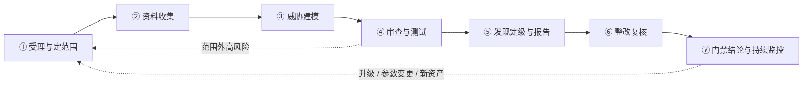
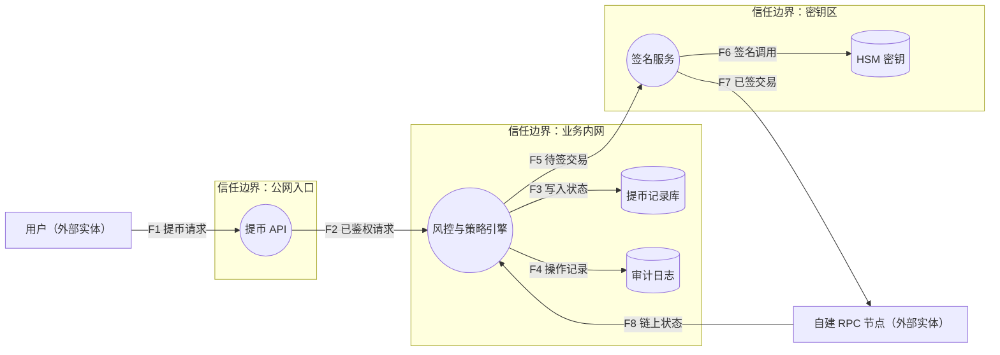
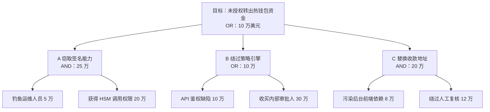

# A01 安全评估方法论：从接单到签字

> 学习目标：读完本章，你能——
> 1. 按 7 个阶段组织一次完整的安全评估，并说出每个阶段的输入、输出和退出条件。
> 2. 区分三类评估对象（交易所自有合约与钱包、DeFi 协议、上币与合作项目）在深度、时长和交付物上的差异。
> 3. 估算一次评估需要的人力和时间，并识别"范围不清"的早期信号。
>
> 前置章节：[01 安全全景](../01-security-landscape.md)、[27 审计与开发流程](../27-audit-testing-workflow.md)
> 模板：[T01 资料清单](../templates/T01-intake-checklist.md)、[T02 威胁模型](../templates/T02-threat-model.md)、[T04 上线门禁](../templates/T04-go-live-gate.md)

---

## 1. 一句话理解

**安全评估不是"找 bug"，而是"对一个具体的上线决策给出有依据的风险结论"。找 bug 是手段，结论才是交付物。**

> 🎯 打个比方：安全评估像**建筑验收**。
>
> - 验收员不重新设计大楼，也不检查每一块砖。
> - 他先拿到图纸和施工记录（资料收集），确定验收范围（主体结构、消防、电梯）。
> - 他知道哪些地方最容易出事（威胁模型），重点检查那些地方。
> - 他把问题分成"必须整改才能入住"和"建议整改"（风险评级）。
> - 最后他签字：可以交付，或附条件交付，或不能交付（门禁结论）。
>
> 比喻的局限：大楼验收后很少改动。合约和系统上线后会升级、换参数、接入新资产，所以评估必须有"变更触发重评"的机制。

---

## 2. 七个阶段

**读图要点：**

- 每个阶段都有退出条件。不满足就不进入下一阶段，避免"边做边改范围"。
- ④ 中发现范围外的高风险（例如依赖的外部协议有问题）时，回到 ① 调整范围，而不是悄悄扩大工作量或视而不见。
- ⑦ 不是终点。任何会改变风险的变更都触发新一轮评估。

| 阶段 | 输入 | 输出 | 退出条件 |
|---|---|---|---|
| ① 受理与定范围 | 评估申请、上线计划 | 范围说明书：评估对象、提交哈希、链、排除项、截止时间、交付物 | 申请方书面确认范围 |
| ② 资料收集 | [T01 资料清单](../templates/T01-intake-checklist.md) | 架构图、规格、权限清单、部署脚本、依赖清单、既往审计报告 | 必需资料齐全；代码冻结 |
| ③ 威胁建模 | 资料包 | [T02 威胁模型](../templates/T02-threat-model.md)：资产、入口、信任边界、不变量、特权清单 | 评估组内部评审通过 |
| ④ 审查与测试 | 威胁模型 | 审查记录、测试代码、工具扫描结果、发现草稿 | 威胁模型中每个高风险项都有结论 |
| ⑤ 定级与报告 | 发现草稿 | [T03 发现报告](../templates/T03-finding-report.md) | 每条发现有定级、证据、修复建议 |
| ⑥ 整改复核 | 修复提交 | 复核记录：已修复 / 部分修复 / 已接受风险（状态词见 [T03](../templates/T03-finding-report.md)） | 严重和高危全部关闭或有签字的风险接受 |
| ⑦ 门禁结论 | 报告 + 复核记录 | [T04 上线门禁](../templates/T04-go-live-gate.md) 结论 + 监控需求 | 门禁签字 |

> 💡 注意：③ 阶段的具体框架和示例见本章末尾的[附录](#附录区块链系统威胁建模框架)。④ 阶段的系统测试见 [A11](A11-blockchain-system-testing.md)。

---

## 3. 三类评估对象

你要负责的三类对象，目标不同，深度和交付物也不同：

| 维度 | A 交易所自有合约与钱包 | B DeFi 协议（自研或接入） | C 上币与合作项目尽调 |
|---|---|---|---|
| 核心问题 | 我们的资产会不会丢？ | 这个协议会不会被掏空？我们接入后会不会被连累？ | 这个项目会不会给用户和交易所带来不可接受的风险？ |
| 你对代码的控制力 | 完全可控 | 自研可控；第三方不可控 | 不可控 |
| 评估深度 | 最深：代码 + 运营 + 密钥 + 流程 | 深：代码 + 经济模型 + 依赖 | 中：合约权限 + 链上数据 + 团队运营安全问卷 |
| 典型时长（示例） | 2–6 周 | 1–4 周 | 1–5 个工作日 |
| 主要交付物 | 完整报告 + 上线门禁 + 监控规则 | 完整报告或接入风险评估 | 尽调评分卡 + 风险结论 + 上线条件 |
| 外部审计 | 必须，作为补充 | 自研必须；接入时审阅对方报告 | 审阅项目方报告 |
| 专章 | [A03](A03-exchange-contracts-wallets.md) | [A04](A04-defi-protocol-review.md) | [A05](A05-listing-due-diligence.md) |

> 💡 注意：C 类尽调的结论是"风险是否可接受"，不是"代码是否安全"。你没有时间审完一个项目的全部代码，也没有权力要求对方修改。尽调要把有限的时间花在**能直接造成用户损失的权限和机制**上。

---

## 4. 定范围：最容易出错的一步

### 4.1 范围说明书必须写清的 8 项

1. 评估对象：仓库地址 + **提交哈希**（不是分支名）。
2. 部署目标：链、网络、合约地址（如果已部署）。
3. 包含的合约文件与排除的文件。
4. 外部依赖：哪些视为可信（例如 OpenZeppelin 库、Chainlink），哪些需要评估。
5. 链下组件：签名服务、后端、前端、密钥管理是否在范围内。
6. 已知问题与既往审计报告。
7. 交付物与截止时间。
8. 结论用途：内部上线决策、对外公告、监管报备。

### 4.2 "范围不清"的早期信号

| 信号 | 风险 | 应对 |
|---|---|---|
| 申请方只给分支名，代码还在改 | 评估的版本不是上线的版本 | 要求冻结提交哈希；之后的改动走差异评估 |
| "只看合约，不看部署脚本" | 初始化参数、权限移交出错（Nomad 类问题） | 部署脚本和初始化参数默认纳入范围 |
| "外部协议是成熟项目，不用看" | 依赖方的风险直接传导 | 至少评估集成点：价格、回调、暂停、升级 |
| 没有规格文档 | 无法判断"这是 bug 还是设计" | 先让申请方写出关键不变量，否则不开工 |
| 上线日期已经对外公布 | 时间压力导致降低标准 | 把门禁条件提前写进范围说明书 |

---

## 5. 审查与测试的工作分配

一个评估组（以 2 人为例）在 ④ 阶段的工作可以这样分配：

| 工作 | 方法 | 工具 | 产出 |
|---|---|---|---|
| 架构与权限审查 | 读架构图、权限清单，逐个验证合约中的修饰器与角色授予 | `cast`、区块浏览器、Slither 的 `vars-and-auth` 打印器 | 特权清单与最大破坏力表 |
| 手工代码审查 | 按威胁模型逐个入口走读；两人交叉审查 | IDE、调用图 | 发现草稿 |
| 静态分析 | 自动扫描，逐条给出结论 | Slither、Aderyn 等 | 扫描结论表 |
| 测试补强 | 为关键不变量写模糊测试和不变量测试 | Foundry、Echidna、Medusa | 测试代码与结果 |
| 部署与配置核查 | 对照部署脚本和链上实际状态 | 部署脚本、链上读取 | 配置差异表 |
| 链差异核查 | 按目标链清单检查 | [链迁移检查器](../interactive/chain-porting-lab.html) | 链风险清单 |

> 💡 注意：自评的最大风险是"熟悉带来的盲区"。评估人员不要评估自己写的代码；同一组内交叉审查；关键模块再请外部审计复核（[A07](A07-external-audit-bounty.md)）。

### 5.1 工作量估算（示例）

业界常用"代码行数（nSLOC，不含注释和空行）"做粗估，再按复杂度调整：

| 复杂度 | 每人每天可审 nSLOC（示例） | 例子 |
|---|---|---|
| 低 | 400–600 | 标准代币、简单金库 |
| 中 | 200–400 | 借贷市场、质押奖励 |
| 高 | 100–200 | 集中流动性 AMM、跨链消息、自定义数学库 |

估算后加 30% 用于报告与复核。如果估算结果超过截止时间，在 ① 阶段就缩小范围或延后上线，而不是压缩审查。

---

## 6. 评估结论的三种形态

| 结论 | 含义 | 条件 |
|---|---|---|
| 通过 | 可以上线 | 无未关闭的严重 / 高危；中危有修复计划 |
| 附条件通过 | 可以上线，但必须满足列明的条件 | 例如：限额上线、只开放白名单资产、上线后 30 天内完成某项修复、部署指定监控 |
| 不通过 | 不能上线 | 存在未关闭的严重 / 高危，且无可接受的缓解措施 |

结论必须写明**依据的版本**、**未覆盖的范围**和**剩余风险**。门禁模板见 [T04](../templates/T04-go-live-gate.md)。

---

## 7. 术语表

| 术语 | 英文 | 定义 |
|---|---|---|
| 范围说明书 | Scope Statement | 书面确认的评估对象、边界与交付物 |
| 代码冻结 | Code Freeze | 评估期间不再修改被评估的提交 |
| nSLOC | Normalized Source Lines of Code | 去除注释与空行后的源码行数 |
| 门禁 | Go-live Gate | 上线前必须满足的安全条件与签字 |
| 风险接受 | Risk Acceptance | 业务负责人书面承担某项未修复风险 |
| 差异评估 | Diff Review | 只针对相对已评估版本的改动进行评估 |

---

## 8. 思考题

1. 产品方在评估进行到第二周时提交了一个"小改动"：手续费从 0.3% 调到 0.25%。按本章流程应该怎样处理？（提示：Uranium Finance）
2. 一个上币申请只给了代币合约地址，没有源码。你的尽调还能做什么？结论应该怎样措辞？
3. 为什么"评估结论"必须写明未覆盖的范围？举一个未覆盖范围出事、却被认为是"评估失职"的场景。

---

## 附录：区块链系统威胁建模框架

> 最后核对：2026-11-10

威胁模型回答四个问题：系统是什么？会出什么错？我们怎么办？我们做得够吗？下面的框架各自解决其中一部分。

🤔 先猜再看：团队只开会列出"最担心的 10 个风险"，没有画系统图。最容易漏掉什么？

最容易漏掉数据穿过信任边界的连接，例如后端到签名服务的请求，节点到验证者的数据。讨论通常集中在人们熟悉的组件上。数据流图强迫你逐条检查连接。

### 附 1. 四类框架各做什么

| 框架 | 用途 | 输出 | 不适合做什么 |
|---|---|---|---|
| STRIDE-per-element | 按系统元素逐项找威胁 | 威胁清单 | 排优先级 |
| 攻击树（Attack Tree） | 展开一个高价值目标的攻击路径 | 路径和最低成本 | 覆盖全系统 |
| DREAD | 粗略打分 | 五维分数 | 独立作为定级依据 |
| ATT&CK / 区块链矩阵 | 对照已知攻击者行为 | 检测和测试覆盖表 | 发现业务逻辑缺陷 |

### 附 2. 数据流图示例：热钱包提币服务

数据流图（Data Flow Diagram，DFD）用四种元素描述系统：外部实体、处理过程、数据存储、数据流。虚线框是信任边界（Trust Boundary）：数据在这里从一个信任等级进入另一个信任等级。

**读图要点：**

- 资金指令从 F1 进入，经 F5 到达密钥区，再经 F7 上链。
- F1、F2、F5、F7、F8 穿过信任边界，优先分析。
- F8 容易被忽略：错误的链上数据会让风控做出错误判断。
- 局限：图省略了管理后台、部署流水线和人工审批。真实模型必须把它们画出来。

### 附 3. STRIDE-per-element

STRIDE 六类威胁：仿冒（Spoofing）、篡改（Tampering）、否认（Repudiation）、信息泄露（Information Disclosure）、拒绝服务（Denial of Service）、权限提升（Elevation of Privilege）。

每类元素只检查它通常面临的威胁（[Microsoft，2006](https://learn.microsoft.com/en-us/archive/msdn-magazine/2006/november/uncover-security-design-flaws-using-the-stride-approach)；[方法说明](https://learn.microsoft.com/en-us/archive/blogs/larryosterman/threat-modeling-again-stride-per-element)）：

| 元素 | S | T | R | I | D | E |
|---|---|---|---|---|---|---|
| 外部实体（Interactor） | ✔ | | ✔ | | | |
| 处理过程（Process） | ✔ | ✔ | ✔ | ✔ | ✔ | ✔ |
| 数据存储（Data Store） | | ✔ | | ✔ | ✔ | |
| 数据流（Data Flow） | | ✔ | | ✔ | ✔ | |

> 💡 注意：这张表是起点，不是上限。审计日志是数据存储，篡改日志会造成否认风险。把这类威胁记录在日志元素下，并标注"R（日志）"。

**钱包（热钱包提币服务）**

| 元素 | 类型 | 类别 | 威胁 | 缓解 | 章节 |
|---|---|---|---|---|---|
| 用户 | 外部实体 | S | 攻击者盗用账号发起提币 | 多因素认证、新地址冷却期 | [22](../22-physical-account-security.md) |
| F5 待签交易 | 数据流 | T | 内网攻击者改动收款地址 | 请求签名；签名服务重新校验 | [18](../18-wallet-key-management.md) |
| 风控引擎 | 处理过程 | E | 管理接口绕过限额 | 权限分离、双人审批 | [23](../23-custody-exchange-ops.md) |
| 审计日志 | 数据存储 | R（日志） | 内部人员删除操作记录 | 追加写入、异地保存 | [21](../21-social-engineering-insiders.md) |
| HSM 密钥 | 数据存储 | I | 密钥被导出 | 不可导出策略、访问审计 | [18](../18-wallet-key-management.md) |
| 自建 RPC 节点 | 外部实体 | S | 伪造节点返回虚假入账 | 多源比对、确认深度 | [17](../17-node-rpc-infrastructure.md) |

**跨链桥（锁定—铸造模型）**

| 元素 | 类型 | 类别 | 威胁 | 缓解 | 章节 |
|---|---|---|---|---|---|
| 中继者 | 外部实体 | S | 伪造源链事件 | 目标链验证证明或门限签名 | [12](../12-cross-chain-bridges.md) |
| 跨链消息 | 数据流 | T | 改动金额、接收人或链 ID | 签名覆盖全部字段和域分隔符 | [12](../12-cross-chain-bridges.md) |
| 目标链铸造合约 | 处理过程 | E | 消息校验缺陷导致任意铸造 | 不变量测试、速率限制 | [12](../12-cross-chain-bridges.md) |
| 已处理消息集合 | 数据存储 | T | 重放同一消息 | 消息 ID 只能使用一次 | [09](../09-mev-signatures.md) |
| 验证者签名密钥 | 数据存储 | I | 多把密钥被同一攻击者获取 | 独立运营方、独立基础设施 | [18](../18-wallet-key-management.md) |
| 源链确认监听 | 处理过程 | D | 重组或节点故障造成错误或停滞 | 最终性规则、多客户端 | [16](../16-consensus-chain-security.md) |

**验证者节点（以太坊 PoS）**

| 元素 | 类型 | 类别 | 威胁 | 缓解 | 章节 |
|---|---|---|---|---|---|
| 验证者签名密钥 | 数据存储 | I | 主机被入侵后密钥外泄 | 远程签名、最小权限 | [17](../17-node-rpc-infrastructure.md) |
| 防罚没数据库 | 数据存储 | T | 迁移时丢失，导致重复签名 | 迁移时导入历史；禁止双开 | [17](../17-node-rpc-infrastructure.md) |
| Engine API | 数据流 | I / T | 共享密钥暴露，连接被窃听 | 仅本机或私有网段 | [17](../17-node-rpc-infrastructure.md) |
| 共识客户端 | 处理过程 | D | 单一客户端缺陷导致离线 | 客户端多样性、灰度升级 | [16](../16-consensus-chain-security.md) |
| P2P 对等节点 | 外部实体 | S | 恶意对端占满连接（日蚀攻击） | 对端多样性、连接数告警 | [17](../17-node-rpc-infrastructure.md) |
| 构建者中继 | 外部实体 | R | 中继不交付承诺的区块 | 多中继、本地构建回退 | [09](../09-mev-signatures.md) |

> 🧪 动手验证：打开[威胁建模实验](../interactive/threat-model-lab.html)。选择一个系统，勾选威胁，查看反馈，导出 Markdown 表格。

### 附 4. 攻击树

攻击树（[Schneier，1999](https://www.schneier.com/academic/archives/1999/12/attack_trees.html)）把攻击目标放在根节点，把实现方法放在子节点。OR 节点：任一子节点成功即可。AND 节点：所有子节点都要成功。

**读图要点：**

- 成本是本手册示例。OR 节点取子节点最小值，AND 节点把子节点相加。
- 根节点最低成本是 10 万美元，路径是 B1。B1 应该最先修复。
- 修复 B1 后，假设其成本升至 40 万。B 变为 30 万，根节点变为 20 万，路径 C 成为新的最弱路径。
- 局限：攻击者的实际成本无法精确测量。攻击树的价值在于比较路径，不在于预测金额。

### 附 5. DREAD 的局限

DREAD 对五个维度打分：损害（Damage）、可复现性（Reproducibility）、可利用性（Exploitability）、受影响用户（Affected Users）、可发现性（Discoverability）。

公开资料记载，Microsoft 因为评分不一致而放弃了这一模型（[概述](https://en.wikipedia.org/wiki/DREAD_%28risk_assessment_model%29)）。下表是两位评估人员对同一威胁的打分（本手册示例，1–10 分）：

| 威胁：桥合约缺少消息重放检查 | D | R | E | A | D | 平均 |
|---|---|---|---|---|---|---|
| 评估人员甲 | 8 | 4 | 3 | 9 | 2 | 5.2 |
| 评估人员乙 | 10 | 7 | 6 | 10 | 7 | 8.0 |

在区块链系统中，DREAD 还有三个问题：

1. 合约源码和字节码公开。低"可发现性"分数没有意义。
2. 损害上限随 TVL 变化。分数在几天内就可能过期。
3. 平均分会掩盖严重性。"高损害、难利用"和"低损害、易利用"可能得到相同分数。

> 💡 注意：可以把 DREAD 当作讨论的提示词。正式定级使用 [A02](A02-risk-rating-reporting.md) 的影响和可能性方法。

### 附 6. ATT&CK 与区块链矩阵

截至 2026 年 11 月，[MITRE ATT&CK](https://attack.mitre.org/matrices/enterprise/) 提供 Enterprise、Mobile、ICS 三类矩阵，没有区块链专用矩阵。Enterprise 矩阵（v20）有 15 个战术，适合分析链下系统：办公网、云、CI/CD、开发者电脑。

区块链和数字资产方向的框架：

| 框架 | 发布方 | 性质 | 使用时的注意事项 |
|---|---|---|---|
| [AADAPT](https://aadapt.mitre.org/) | MITRE，[2025 年 7 月公开报道](https://www.helpnetsecurity.com/2025/07/14/mitre-aadapt-adversarial-actions-in-digital-asset-payment-technologies/) | 仿 ATT&CK 结构的数字资产支付对抗矩阵 | 使用前到官方站点核对当前战术和技术 |
| [DeFi Threat Matrix](https://github.com/UCSB-PLSE/defi-threat) | 社区项目 | 受 ATT&CK 启发的 DeFi 知识库 | 检查维护状态 |
| [Web3 Attack Matrix](https://aisel.aisnet.org/ecis2025/security/security/5) | ECIS 2025 论文 | 学术知识库 | 用作分类参考 |

使用方法：

1. 用 STRIDE 列出威胁。
2. 为链下威胁标注 ATT&CK 战术；为链上和资产威胁标注 AADAPT 条目。
3. 记录框架版本和条目 ID。
4. 对每个条目回答：我们能检测吗？我们测试过吗？

| STRIDE 发现（示例） | 框架标注层级 | 检测或测试 |
|---|---|---|
| 钓鱼窃取运维凭据 | ATT&CK：Initial Access、Credential Access | 钓鱼演练、登录告警 |
| CI 令牌泄露后篡改前端 | ATT&CK：Persistence、Impact | 构建产物签名、部署告警 |
| 桥合约消息伪造 | AADAPT：写报告时核对条目 | [A11](A11-blockchain-system-testing.md) 跨链桥用例 |

> ⚠️ 警告：矩阵列出已知行为。矩阵不能代替业务逻辑分析。价格计算错误、份额舍入错误通常不会出现在链下矩阵中。

### 附 7. 操作顺序

1. 画数据流图并标出信任边界。
2. 按 STRIDE-per-element 列出威胁。
3. 为最高价值资产画攻击树。
4. 按 [A02](A02-risk-rating-reporting.md) 定级。
5. 用矩阵检查检测和测试覆盖。
6. 把高风险项写成 [A11](A11-blockchain-system-testing.md) 的测试用例。
7. 填写 [T02](../templates/T02-threat-model.md)。模板末尾有已填写示例。

下一章：[A02 风险评级与报告](A02-risk-rating-reporting.md)
