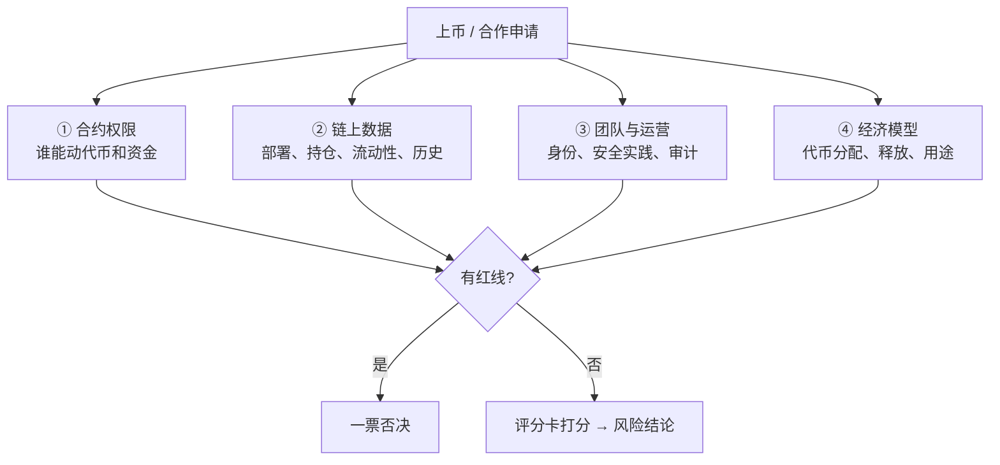

# A05 上币与合作项目尽调

> 学习目标：读完本章，你能——
> 1. 在 1–5 个工作日内,对一个上币或合作项目做出"风险是否可接受"的结论。
> 2. 用一张评分卡,从合约权限、链上数据、团队运营、经济模型四个维度给项目打分。
> 3. 识别貔貅盘、可增发、隐藏后门、虚假锁仓等"必须一票否决"的红线。
>
> 前置章节：[05 访问控制](../05-access-control.md)、[07 外部调用](../07-external-calls-tokens.md)、[A02 评级](A02-risk-rating-reporting.md)
> 交互实验：[listing-scorecard.html](../interactive/listing-scorecard.html) ｜ 模板：[T05 上币尽调问卷](../templates/T05-listing-dd-questionnaire.md)

---

## 1. 一句话理解

**上币尽调不是审计。你审不完对方的代码,也改不了它。你的任务是用有限的时间,判断"上了这个币,用户和交易所会不会遭受不可接受的损失"。**

> 🎯 打个比方：上币尽调像**租客背景调查**。
>
> - 你不会把房客的人生查个底朝天(没时间,也没权力)。
> - 你查几件决定性的事:他能不能按时付租(经济模型)、有没有前科(链上劣迹)、这房子他会不会转手就卖(可增发、可转移所有权)、钥匙还在谁手里(权限与锁仓)。
> - 任何一条踩红线,直接拒绝,不需要查完其余。
>
> 比喻的局限:房客一般不会主动伤害你。上币尽调要假设项目方可能就是攻击者本人(貔貅盘、跑路盘)。

---

## 2. 尽调的四个维度

**读图要点:**

- 红线检查在打分之前。任何一个维度踩红线,直接否决,不进入评分。
- 四个维度的证据来源不同:① ④ 看代码和文档,② 看链上,③ 靠问卷和公开信息。
- 局限:尽调的结论有时效。代币合约可升级、可增发时,今天的结论明天可能失效——这本身就是一条高风险项。

---

## 3. 红线清单（任一命中即否决或暂缓）

| 红线 | 怎么查 | 为什么是红线 |
|---|---|---|
| 可无限增发且无时间锁 | 读 `mint` 权限;检查 owner / minter | 项目方可随时稀释,等于随时跑路 |
| 貔貅盘(能买不能卖) | 在分叉环境模拟买入后卖出;检查转账税、黑名单、暂停 | 用户资金只进不出 |
| owner 可暂停 / 冻结任意地址转账 | 读代币合约的 pause / blacklist | 项目方可定点冻结,包括交易所热钱包 |
| 隐藏的所有权转移或升级后门 | 审代理、`delegatecall`、未初始化、selfdestruct | 合约行为可被悄悄改变 |
| 代理可升级且升级权是单签 EOA | 读实现槽、admin 槽、权限 | 单点被盗即全盘失控 |
| 锁仓 / 流动性锁是假的 | 核验锁仓合约地址、解锁时间、LP 是否真锁 | 虚假锁仓 = 随时砸盘 / 撤池 |
| 合约与官网 / 审计报告中的地址不一致 | 逐一核对地址 | 常见的调包手法 |
| 代码与已验证源码不一致 | 浏览器核对验证状态;比对字节码 | 部署的不是审计的 |

> ⚠️ 警告:红线检查要在**对方给出的部署地址**上做,不是在 GitHub 仓库上做。部署的合约才是用户会交互的合约(Nomad、调包手法)。

---

## 4. 四维评分

红线通过后,用评分卡打分(去 [listing-scorecard.html](../interactive/listing-scorecard.html) 交互打分并导出)。

### 4.1 维度与权重（示例）

| 维度 | 权重 | 主要评分项 |
|---|---|---|
| ① 合约权限 | 30% | 增发 / 暂停 / 升级权限的持有方(EOA / 多签 / 时间锁 / 已放弃);权限最小化程度 |
| ② 链上数据 | 25% | 部署时长;持仓集中度(前 10 地址占比);流动性深度与锁定;历史异常交易 |
| ③ 团队与运营 | 25% | 身份公开度;私钥与多签实践;是否有审计;审计方与范围;漏洞赏金 |
| ④ 经济模型 | 20% | 代币分配;解锁曲线;是否有反身性 / 庞氏结构;收益来源是否可持续 |

### 4.2 每项的打分锚点（示例,0–4 分）

以"① 升级权限持有方"为例:

| 分 | 情形 |
|---|---|
| 4 | 不可升级,或升级权已放弃(renounce) |
| 3 | 多签 + 时间锁(≥48h) |
| 2 | 多签无时间锁,或时间锁较短 |
| 1 | 单签多方,或时间锁 <24h |
| 0 | 单签 EOA,可无延迟升级 |

> 💡 注意:权重和锚点是示例。交易所应按自身风险偏好和上币层级(主区 / 创新区 / 观察区)设定,并固定下来,保证不同项目口径一致。评分卡的价值在于**一致性**,不在于绝对数值。

### 4.3 从分数到结论

| 综合结论 | 建议 |
|---|---|
| 高分、无红线 | 可上线 |
| 中分 | 附条件:限额、观察区、加强监控、要求补审计或锁仓 |
| 低分或有未解决的高风险 | 暂缓,列出需补充的材料与整改项 |
| 任一红线 | 否决 |

---

## 5. 链上数据怎么查

尽调中最省时、最难造假的证据来自链上:

| 查什么 | 怎么查 | 关注 |
|---|---|---|
| 部署信息 | 浏览器看创建交易、创建者、时间 | 刚部署几天的项目风险高 |
| 源码验证 | 浏览器的 verified 状态;比对字节码 | 未验证 / 不一致是危险信号 |
| 持仓集中度 | holders 列表;前 10 / 前 50 占比 | 高度集中 = 砸盘风险 |
| 流动性 | DEX 池深度;LP 代币持有与锁定 | 浅池易被操纵(见 [08](../08-oracle-flashloan.md)) |
| 权限地址 | 读 owner / admin / minter;看它是 EOA 还是多签 | 单签 EOA 是减分项 |
| 历史行为 | 关联地址的历史;是否与已知劣迹地址交互 | 跑路史、黑客地址关联 |
| 锁仓真实性 | 核验锁仓合约、金额、解锁时间 | 假锁仓 |

> 💡 注意:对方提供的审计报告要独立核验——审计方是否可信、审计的是不是这个版本、报告里的"已确认风险"是什么。一份审计报告不等于安全(PancakeBunny 被利用的是审计后上线的新版本)。

---

> 💡 注意：钱包里常见的 Audit 页是自动扫描，不是人工审计。它怎么来、能发现什么，见实例 [A10 币安 Audit 页分析](A10-case-binance-alpha-audit.md)。

## 6. 团队运营安全问卷

近年交易所和项目方的最大损失来自运营环节(见 [A06](A06-operational-key-security.md))。合作项目的运营安全直接影响交易所,尤其是深度合作(共同部署、共享金库、提供流动性)。用 [T05 问卷](../templates/T05-listing-dd-questionnaire.md) 了解:

- 私钥 / 多签的管理方式;签名人数量与独立性;是否用硬件钱包 / MPC / HSM。
- 部署与升级流水线;CI 密钥管理。
- 前端托管、DNS、域名、npm 依赖的保护。
- 团队对社会工程(假招聘、假承包商)的防范意识。
- 是否有应急响应预案与暂停能力。

问卷答案无法完全核实,但"答不上来"或"没有任何措施"本身就是风险信号。

---

## 7. 尽调交付物

C 类尽调的交付物短小、可执行:

1. **一页结论**:上 / 附条件上 / 暂缓 / 否决,加一句话理由。
2. **评分卡**:四维得分 + 红线检查结果。
3. **上线条件**(如附条件):限额、观察区、监控、锁仓、补审计等。
4. **证据附录**:链上地址、权限读数、持仓截图、问卷答案。

---

## 8. 术语表

| 术语 | 英文 | 定义 |
|---|---|---|
| 尽职调查 | Due Diligence (DD) | 决策前对对象的核查 |
| 貔貅盘 | Honeypot | 能买不能卖的代币 |
| 持仓集中度 | Holder Concentration | 代币被少数地址持有的程度 |
| 放弃所有权 | Renounce Ownership | 将 owner 设为零地址,永久放弃特权 |
| 锁仓 | Vesting / Lock | 代币或流动性在一段时间内不可转移 |
| 观察区 | Watch Zone | 风险较高、限额或限期的上币层级 |

---

## 9. 思考题

1. 一个项目综合评分很高,但代币合约的升级权是一个单签 EOA。按本章,你的结论是什么?为什么单项红线能推翻高分?
2. 项目方提供了知名审计公司的报告。你还要做哪三件事才能相信它?
3. 为什么说"刚部署几天的项目风险高"?如果交易所的业务就是要上新项目,怎样用上线条件来缓解?

下一章：[A06 运营与密钥安全](A06-operational-key-security.md)
