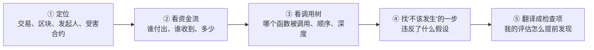
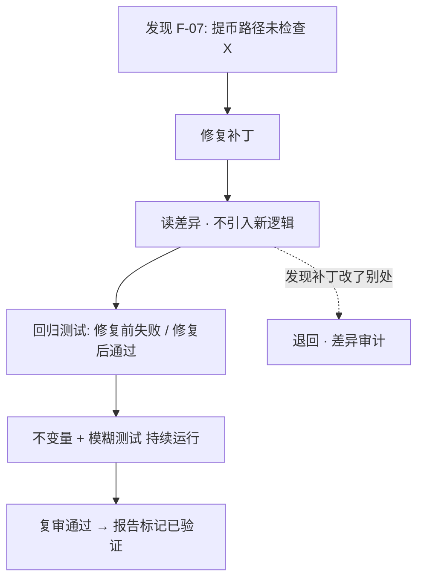

# A08 事故分析与防御性验证

> 学习目标：读完本章，你能——
> 1. 拿到一个攻击交易哈希，用浏览器和交易追踪工具把"发生了什么"还原成一张时间线。
> 2. 把一起事故翻译成**你自己评估时可复用的检查项和不变量**。
> 3. 用不变量测试、模糊测试和分叉环境验证"修复真的有效"，而不是写攻击程序。
> 4. 知道用哪些合法的靶场和课程练手。
>
> 前置章节：[27 审计与测试](../27-audit-testing-workflow.md)、[28 事故案例库](../28-incident-casebook.md)、[A02 评级与报告](A02-risk-rating-reporting.md)
> 交互实验：[incident-explorer.html](../interactive/incident-explorer.html)

> ⚠️ 本章的边界：目标是**读懂已发生的事故、验证防御**。不提供针对真实合约的攻击代码，也不鼓励在未授权的合约和主网上做任何尝试。评估工作里你需要的是"证明这个洞存在并且修好了"，通常不需要一个可运行的攻击程序。

---

## 1. 一句话理解

**评估人员不需要会"发起攻击"，需要会"读懂攻击"和"证明防御"。读懂一起事故，等于免费上了一堂课；证明一个修复有效，等于给上线门禁加了一条硬证据。**

> 🎯 打个比方：这像**消防员复盘火灾**。
>
> - 他们不会为了学习去放火，而是到现场看起火点、蔓延路径、哪道防火门没关。
> - 复盘后做两件事：把"起火点"写进检查表（以后查同类隐患），再做防火演练验证新措施有效。
>
> 比喻的局限：火灾现场会被破坏，链上现场永久公开、可逐笔回放，所以复盘比消防更精确，也更容易被"事后诸葛"误导——你要问的是"事前有什么信号"。

---

## 2. 读一笔攻击交易：五步法

拿到一个攻击交易哈希后，按顺序做：

**读图要点：**

- ①②只需要区块浏览器就够：看转账、事件日志、发起地址的资金来源（常来自混币器或新建地址）。
- ③需要调用追踪：常用的有交易模拟与追踪工具（如 Phalcon、Tenderly 等）或浏览器自带的内部交易视图。看**调用树**比看反编译代码更快。
- ④是核心：用一句话写出"协议原本假设了什么，攻击者让这个假设不成立"。
- ⑤才是价值所在。没有这一步，复盘只是看热闹。
- 局限：追踪工具看到的是"发生了什么"，不直接告诉你"为什么协议这样设计"。回到源码和官方事后报告去确认。

### 2.1 一张复盘表

每起事故用同一张表记录。表头固定，才能横向比较：

| 字段 | 填什么 | 示例（取自本手册案例） |
|---|---|---|
| 事故 / 日期 / 损失 | 名称、时间、金额 | Euler Finance，2023-03，约 1.97 亿美元 |
| 漏洞类别 | 对应主线章节 | 缺少健康检查（[11 章](../11-defi-economic-security.md)） |
| 被打破的假设 | 一句话 | "任何减少抵押品的路径最后都会检查健康因子" |
| 触发条件 | 需要什么前提 | 某个函数遗漏了健康检查 |
| 事前信号 | 公开可见、事前能发现的迹象 | 新增函数、审计未覆盖该模块 |
| 对应检查项 | 本手册哪个清单 | [A04 3.1 借贷](A04-defi-protocol-review.md) |
| 对应不变量 | 可测试的性质 | "任何操作后，账户健康因子 ≥ 1" |
| 修复 | 官方怎么修 | 补检查 |

> 💡 注意："事前信号"这一栏最难填，也最有价值。很多事故的信号其实早就公开：未审计的新代码、单签权限、过短的时间锁、被忽视的审计发现。

### 2.2 常用工具

| 类型 | 工具 | 用途 |
|---|---|---|
| 反编译 | [Dedaub](https://app.dedaub.com/)、[heimdall-rs](https://github.com/Jon-Becker/heimdall-rs) | 攻击合约通常未开源。反编译出伪代码，识别它调用了什么 |
| 交易分析 | [Phalcon Explorer](https://blocksec.com/phalcon/explorer)、[Tenderly](https://tenderly.co/)、[Sentio](https://www.sentio.xyz/) | 调用树、资金流、存储变化、余额变化（Sentio 公开文档只确认调用追踪与调用栈） |
| 专项 | [EigenPhi](https://eigenphi.substack.com/p/eigenphi-mevscan-service-update)（MEV，MEVScan 已于 2026-06-29 关停，未公布替代服务）、[SocketScan](https://socketscan.io/)（跨链） | 定位 MEV 交易；追踪跨链消息 |

> 🧪 交互实验：[攻击交易调用树分析](../interactive/audit-trace.html)

---

## 3. 从事故到不变量

不变量（Invariant）是"任何操作序列后都必须成立"的条件。事故几乎都能翻译成一条被打破的不变量：

| 事故类型 | 被打破的不变量（用自然语言写） |
|---|---|
| 重入类 | 一次外部调用返回时，相关账本余额与代币实际余额一致 |
| 金库通胀 | 每份份额对应的资产价格不会因单笔捐赠而大幅跳变 |
| 借贷坏账 | 任何用户操作结束后，其健康因子不低于清算线 |
| 预言机操纵 | 同一区块内价格偏离参考价不超过阈值 |
| 桥伪造 | 目标链铸造总量 ≤ 源链锁定总量 |
| 权限类 | 只有授权角色能改变权限和升级实现 |
| AMM | 每次交换后恒定乘积不减 |

**写不变量的三条规则：**

1. 用业务语言先写一句话，再翻译成代码断言。写不出一句话，说明你没理解协议。
2. 不变量要覆盖**所有**入口函数，而不是只覆盖你担心的那个。
3. 好的不变量不依赖实现细节。它描述"什么必须永远为真"，而不是"这行代码怎么写"。

> 💡 注意：把不变量交给模糊测试器去"随机地、成千上万次地乱调用"，让它替你寻找违反条件的调用序列。你的工作是把性质写对，不是手工构造攻击步骤。

---

## 4. 验证修复：回归与差异

声称"已修复"的发现，需要证据。评估人员验证修复的最小流程：

1. **读修复补丁**，只看相对审计版本的差异（Diff）。问：补丁是否只改了必要部分？有没有顺手改了别的？（"只改了一行"也要看，见 [A07](A07-external-audit-bounty.md) 的警告。）把每处差异对应到一条发现；无法对应的差异单独审计。
2. **跑原有测试**，确认没有回归。
3. **补一条针对该发现的回归测试**：用断言表达"这个性质现在成立"。测试应当在修复前失败、修复后通过——这是证明它有效的标准证据。
4. **跑不变量与模糊测试**足够久，覆盖修复周围的路径。
5. **检查新增面**：修复是否引入新的入口、状态或权限。
6. **在分叉环境（Fork）验证配置**：对已部署合约，用主网分叉读取权限、参数、实现地址，确认与预期一致（见 [A05 第 5 节](A05-listing-due-diligence.md)）。
7. **复审结论入档**：写进报告的"修复状态"一栏，标明验证方式。

**读图要点：**

- "修复前失败、修复后通过"的测试，是修复有效的最直接证据。只"修复后通过"的测试，可能根本没测到那个问题。
- 局限：测试只能证明你想到的性质。它不能证明不存在其他问题。所以复审不是"测试全绿就结束"。

---

## 5. 合法的练习与学习路径

练习时用专门设计的靶场，不拿真实协议开刀。关卡地图见 [B10 CTF 练习](../bootcamp/B10-ctf-practice.md)（DeFi 关卡见 [B24](../bootcamp/B24-defi-ctf.md)）。审计竞赛的公开报告和官方事后报告也适合练习，资源见 [B70](../bootcamp/B70-glossary-resources.md)。本手册的[交互实验](../interactive/index.html)在浏览器内模拟，不涉及真实合约。练习规则见 [B04 第 1 节](../bootcamp/B04-setup.md)：只在靶场、本地环境或测试网练习；发现真实漏洞时，通过漏洞赏金或安全联系渠道报告，不自行利用。

---

## 6. 事后"事前信号"练习

选一起事故，不看结果，只看事前信息，练习"如果是我做评估会怎么判"：

| 案例 | 事前可见的信息 | 你的评估会给出什么结论 |
|---|---|---|
| Nomad 桥（2022） | 一次升级中把某个初始化值设成了零值 | 部署与初始化参数评审；零值是否被当作"已证明" |
| Ronin（2022） | 9 选 5 的验证人，其中多把由同一机构控制，一份临时授权未撤销 | 签名人独立性不足 |
| PancakeBunny（2021） | 上线的是审计之后的新版本 | 审计版本与上线版本不一致 |
| Bybit（2025） | 冷钱包是 Safe 多签，签名界面被篡改 | 签名流程评估：独立解码、带外确认 |

> 💡 注意：用[事故浏览器](../interactive/incident-explorer.html)筛选类别，一次对比同一类的多起事故。看它们**事前信号的共性**，比记住单个案例更有用。

---

## 7. 评估报告里怎么写"已验证"

| 验证等级 | 含义 | 用在哪 |
|---|---|---|
| 已读代码 | 人工审查，认为问题已修复 | 低风险发现 |
| 已回归测试 | 有修复前失败、修复后通过的测试 | 中高风险发现 |
| 已不变量验证 | 对应性质被持续的模糊/不变量测试覆盖 | 高危、严重发现 |
| 已分叉验证 | 对已部署合约在分叉环境确认配置与行为 | 上线门禁 |
| 未验证 | 仅项目方声明已修复 | 必须明确标注，并在门禁中视为未关闭 |

---

## 8. 术语表

| 术语 | 英文 | 定义 |
|---|---|---|
| 事后报告 | Post-mortem | 事故发生后对原因、影响和改进的书面复盘 |
| 调用树 | Call Trace | 一笔交易内部所有合约调用的层级记录 |
| 不变量 | Invariant | 任何操作后都必须成立的条件 |
| 回归测试 | Regression Test | 防止已修复的问题再次出现的测试 |
| 模糊测试 | Fuzzing | 用大量随机输入寻找违反性质的情况 |
| 分叉环境 | Fork | 复制某一时刻的链状态，在本地或云端读取与模拟 |
| 差异审计 | Diff Audit | 只审相对已审版本的改动 |

---

## 9. 思考题

1. 为什么评估人员验证修复时，要求"修复前失败、修复后通过"的测试？只有后半句的测试缺了什么？
2. 选一起本手册中的事故，填一遍第 2.1 节的复盘表，特别是"事前信号"一栏。
3. 项目方说"这个发现已修复"，但只给了一条口头回复。你在报告里应当怎么标注？门禁怎么处理？

下一章：[A09 应急响应](A09-incident-response.md)
