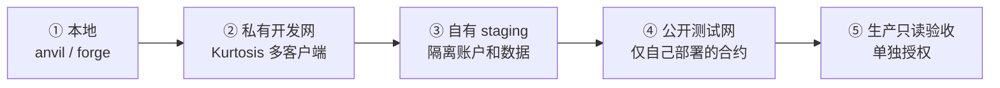
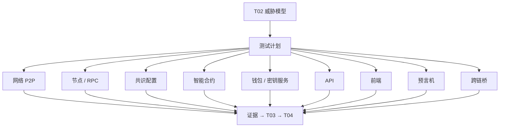
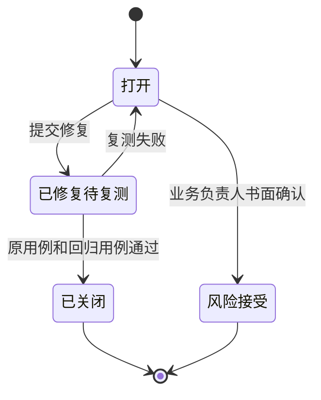

# A11 区块链系统安全测试

> 学习目标：读完本章，你能——
> 1. 在开始测试前写出书面范围和交战规则。
> 2. 为九个系统层次编写带工具和通过标准的测试用例。
> 3. 把测试结果写成报告，完成复测，并映射到上线门禁。
>
> 前置章节：[A01 评估方法论](A01-methodology.md)、[16 共识安全](../16-consensus-chain-security.md)、[17 节点与 RPC](../17-node-rpc-infrastructure.md)、[27 审计与测试流程](../27-audit-testing-workflow.md)
> 模板：[T02 威胁模型](../templates/T02-threat-model.md)、[T03 发现报告](../templates/T03-finding-report.md)、[T04 上线门禁](../templates/T04-go-live-gate.md)
> 交互实验：[threat-model-lab.html](../interactive/threat-model-lab.html) ｜ [rpc-quorum-lab.html](../interactive/rpc-quorum-lab.html) ｜ [confirmation-depth-lab.html](../interactive/confirmation-depth-lab.html)
> 最后核对：2026-11-10

> ⚠️ 警告：本章只适用于你拥有或已获得书面授权的系统。本章不提供针对真实第三方节点、合约、接口或网站的步骤。没有书面授权时，只在本地环境测试。

---

## 开场：配置错误先在测试网暴露

2025 年 2 月 24 日，以太坊 Holesky 测试网在 Pectra 升级测试中出现中断。公开报道称原因是影响客户端组件的配置错误。测试网近两周无法最终确定，3 月 10 日恢复（[The Block](https://www.theblock.co/post/345622/ethereums-holesky-testnet-regains-finality-after-weeks-of-disruption-amid-pectra-testing)）。

合约代码没有被攻击。一个配置值让整条测试链停止最终确定。这个问题在测试网暴露，主网升级前有机会修正。

<details class="predict"><summary>🤔 先猜再看：一个团队的合约测试覆盖率是 100%。Holesky 这类问题会被这些测试发现吗？</summary>

通常不会。合约单元测试运行在模拟 EVM 中，不运行多客户端网络，也不读取真实的网络配置。这类问题要靠多客户端测试网、配置比对和升级演练发现。系统测试必须覆盖合约之外的层次。

</details>

---

## 1. 一句话理解

**区块链系统测试是在授权范围内，从本地环境开始，逐层验证系统在正常和异常条件下仍然满足安全要求，并留下可复现的证据。**

> 🎯 打个比方：新船下水前要先进船坞，再做港内试航，最后才去外海。每一步都有检查表和负责人。没有人会为了测试救生艇，去撞别人的船。
>
> 比喻的局限：船的故障通常只影响一艘船。合约一旦部署到公开网络，所有人都能调用，错误可能立即造成资金损失。

---

## 2. 授权与交战规则

交战规则（Rules of Engagement，ROE）：测试双方书面约定的范围、方法、时间和停止条件。[NIST SP 800-115](https://csrc.nist.gov/pubs/sp/800/115/final) 是安全测试的通用参考。

开始前逐项确认：

- [ ] **TST-1** 系统所有者已签署书面授权。授权写明系统、时间窗口和测试人员。
- [ ] **TST-2** 范围清单写明主机、链 ID、合约地址和提交哈希。第三方系统默认排除，除非该第三方书面同意。
- [ ] **TST-3** 交战规则写明允许的方法、请求速率上限和禁止动作。
- [ ] **TST-4** 交战规则写明停止条件和双方 24 小时联系人。
- [ ] **TST-5** 测试使用独立的账户和密钥。生产密钥和真实用户数据不进入测试环境。
- [ ] **TST-6** 每次发送交易前，脚本校验链 ID 和目标 RPC 属于范围清单。

| 交战规则项目 | 必须写明的内容 | 示例 |
|---|---|---|
| 范围 | 包含项和排除项 | 只测试 staging 的 API 和本地部署的合约 |
| 方法 | 允许和禁止的方法 | 禁止社工、禁止破坏性负载测试 |
| 时间 | 时间窗口和时区 | 工作日 10:00–18:00 UTC+8 |
| 强度 | 请求速率上限 | staging API 不超过 20 次/秒（示例） |
| 数据 | 测试数据和留存期限 | 证据加密保存，交付 30 天后删除（示例） |
| 停止条件 | 何时必须停止 | 发现真实用户数据、服务异常、超出范围 |
| 发现严重问题 | 通知路径和时限 | 2 小时内通知安全负责人（示例） |

> ⚠️ 警告：漏洞赏金规则不等于任意测试许可。[Immunefi 规则](https://immunefi.com/rules/)禁止在主网或公开测试网的合约上测试；具体项目的条款优先适用。

---

## 3. 环境阶梯：本地优先



**读图要点：**

- 测试从 ① 开始。上一级通过后，才进入下一级。
- 破坏性测试只在 ① 和 ② 运行。
- ④ 中只调用你自己部署的合约，并遵守测试网使用规则。
- 局限：本地环境没有真实的网络延迟和 MEV 竞争。所以报告要写明"在什么环境验证"。

### 3.1 安全的家庭实验环境

1. 用独立的虚拟机或容器运行实验环境。
2. 只把服务绑定到本机地址。
3. 使用专用助记词，不用任何真实钱包的助记词。
4. 启动本地链。

```bash
# 生成实验专用助记词，只保存 Phrase 下面那一行
cast wallet new-mnemonic | sed -n '/^Phrase:/{n;p;}' > ./lab-only-mnemonic.txt
# 只监听本机；助记词来自实验专用文件
anvil --host 127.0.0.1 --port 8545 --chain-id 31337 \
  --mnemonic "$(cat ./lab-only-mnemonic.txt)"
```

5. 发送任何交易前运行防误操作检查。下面两行放在部署脚本开头；直接在终端里运行时，`exit 1` 会关闭当前终端。

```bash
# 实验链地址
RPC=http://127.0.0.1:8545
# 链 ID 不是 31337 就中止，防止误连主网
[ "$(cast chain-id --rpc-url "$RPC")" = "31337" ] || { echo "不是实验链，停止"; exit 1; }
```

6. 用 `forge test` 运行合约测试。
7. 需要多客户端网络时，运行 [ethereum-package](https://github.com/ethpandaops/ethereum-package)。该项目用于测试和开发，不用于生产。

```bash
# 用 Kurtosis 启动多客户端本地以太坊测试网
kurtosis run github.com/ethpandaops/ethereum-package
```

> ⚠️ 警告：anvil 默认账户是公开的（[Foundry 文档](https://www.getfoundry.sh/anvil/overview)）。使用 `--fork-url` 分叉公开链时，改用专用助记词，并把交易只发到本地端口。分叉只读取状态，不授权你测试被分叉的协议在线实例。

<details class="predict"><summary>🤔 先猜再看：你把 anvil 绑定到 0.0.0.0，并在云服务器上使用默认账户。会发生什么？</summary>

任何能连到端口的人都能使用公开的默认账户操作这条链。如果你的脚本把这条链当作可信环境，攻击者可以改变测试结果。如果有人向这些公开地址转入真实资金，资金也会面临被盗风险。保持绑定 127.0.0.1。

</details>

---

## 4. 测试计划：九个层次



**读图要点：**

- 每个高风险威胁至少对应一个测试用例。
- 没有对应用例的高风险威胁，要在报告中写明原因。
- 局限：通过全部用例，不代表系统没有漏洞。结论只覆盖已测试的条件。

| 层次 | 关键问题 | 最低环境 | 主要负责人 |
|---|---|---|---|
| 网络 P2P | 对端异常时节点是否仍然正确 | ② | 基础设施 |
| 节点 / RPC | 接口是否按设计暴露 | ② | 基础设施 |
| 共识配置 | 所有节点的配置是否一致 | ② | 协议 |
| 智能合约 | 不变量和权限是否成立 | ① | 合约 |
| 钱包 / 密钥服务 | 策略能否阻止错误签名 | ① | 钱包 |
| API | 请求能否越权或重放 | ③ | 后端 |
| 前端 | 用户看到的是否等于实际签名内容 | ③ | 前端 |
| 预言机 | 异常价格时系统如何反应 | ① | 合约 / 风控 |
| 跨链桥 | 消息是否只生效一次 | ① | 合约 / 协议 |

---

## 5. 测试用例表

所有用例只针对范围清单内的系统。"环境"列使用第 3 节的编号。

### 5.1 网络 P2P

| ID | 用例 | 工具 | 环境 | 通过标准 |
|---|---|---|---|---|
| TST-7 | 从范围内的外部网段检查实验节点端口 | `nmap`（只扫描范围清单中的实验主机） | ② | 只有 P2P 端口可达；RPC、Engine API、监控端口不可达 |
| TST-8 | 把节点隔离到受控对端集合 | Kurtosis + Chaos Mesh | ② | 对端数低于阈值时告警；恢复后回到多数链 |
| TST-9 | 制造网络分区后恢复 | [Attacknet](https://blog.trailofbits.com/2024/03/18/releasing-the-attacknet-a-new-tool-for-finding-bugs-in-blockchain-nodes-using-chaos-testing/) | ② | 约定时间内恢复；没有节点最终确定冲突区块 |
| TST-10 | 客户端协议一致性和异常消息 | [Hive](https://github.com/ethereum/hive) | ② | 无崩溃；异常对端被断开 |

### 5.2 节点 / RPC

| ID | 用例 | 工具 | 环境 | 通过标准 |
|---|---|---|---|---|
| TST-11 | 调用未列入白名单的 RPC 命名空间 | `cast rpc` | ② | `admin`、`debug`、`personal` 被拒绝 |
| TST-12 | 用缺失或过期的 JWT 调用实验节点 Engine API | `curl` | ② | 节点拒绝请求（[规范](https://github.com/ethereum/execution-apis/blob/main/src/engine/authentication.md)） |
| TST-13 | 发送大范围日志查询 | k6 或脚本（遵守速率上限） | ②③ | 网关限流；节点保持同步 |
| TST-14 | 让一个模拟 RPC 返回错误数据 | 本地模拟服务、[RPC 比对实验](../interactive/rpc-quorum-lab.html) | ① | 系统发现不一致，不入账，并告警 |
| TST-15 | 演练客户端升级和回滚 | Kurtosis | ② | 升级手册可执行；回滚后节点恢复 |

### 5.3 共识配置

| ID | 用例 | 工具 | 环境 | 通过标准 |
|---|---|---|---|---|
| TST-16 | 比对各节点的创世文件和分叉参数 | `diff`、`jq` | ② | 所有节点哈希一致，并匹配已批准的配置 |
| TST-17 | 多客户端网络中停止一种客户端 | Kurtosis | ② | 结果符合事先计算：达到约定的最终确定行为 |
| TST-18 | 在开发网中启动同一验证者的第二个实例 | Kurtosis、防罚没数据库 | ② | 第二个实例被流程或防罚没数据阻止，不产生重复签名 |
| TST-19 | 模拟重组后的入账处理 | `evm_snapshot`、`evm_revert`、[确认深度实验](../interactive/confirmation-depth-lab.html) | ① | 未达确认阈值不入账；回滚后余额正确 |

### 5.4 智能合约

| ID | 用例 | 工具 | 环境 | 通过标准 |
|---|---|---|---|---|
| TST-20 | 静态分析并逐条分类 | Slither、Aderyn | ① | 每条结果有结论；无未处理高危 |
| TST-21 | 对关键不变量做模糊和不变量测试 | Foundry、Echidna、Medusa | ① | 达到约定运行次数，无违反 |
| TST-22 | 对每个特权函数使用未授权账户调用 | Foundry | ① | 全部回滚；角色矩阵与设计一致 |
| TST-23 | 检查升级存储布局和时间锁 | `forge inspect`、Foundry | ① | 布局兼容；未到时间不能执行 |
| TST-24 | 执行暂停和限额 | Foundry | ① | 暂停后受限函数回滚；超限回滚 |
| TST-25 | 比对部署字节码和审计版本 | `cast code`、构建产物 | ①③ | 去除元数据和不可变量差异后一致 |
| TST-26 | 执行部署脚本并逐项核对初始化参数 | Foundry script | ① | 初始化不可重复；参数匹配批准清单 |

### 5.5 钱包 / 密钥服务

| ID | 用例 | 工具 | 环境 | 通过标准 |
|---|---|---|---|---|
| TST-27 | 发送超限、非白名单地址的签名请求 | 集成测试、SoftHSM | ① | 策略拒绝，且记录审计日志 |
| TST-28 | 检查密钥导出和日志 | SoftHSM、日志检索 | ① | 密钥不可导出；日志没有密钥材料 |
| TST-29 | 并发提交交易 | anvil、集成测试 | ① | nonce 无冲突；失败重试不重复付款 |
| TST-30 | 独立解码待签内容，并与审批内容比对 | `cast calldata-decode`、[多签审查实验](../interactive/multisig-review-lab.html) | ① | 内容不一致时阻止签名 |

### 5.6 API

| ID | 用例 | 工具 | 环境 | 通过标准 |
|---|---|---|---|---|
| TST-31 | 用账户 A 的令牌访问账户 B 的测试资源 | ZAP、集成测试 | ③ | 返回拒绝；无数据泄露 |
| TST-32 | 重放同一提币请求 | 集成测试 | ③ | 幂等键生效，只产生一笔提币记录 |
| TST-33 | 基于接口规范发送异常输入 | Schemathesis | ③ | 无 5xx；输入校验拒绝错误格式 |

### 5.7 前端

| ID | 用例 | 工具 | 环境 | 通过标准 |
|---|---|---|---|---|
| TST-34 | 检查 CSP、SRI 和第三方脚本 | 浏览器开发者工具、Playwright | ③ | 策略符合基线；无未批准脚本 |
| TST-35 | 检查依赖锁定和构建可复现性 | `npm ci`、依赖扫描 | ③ | 锁文件一致；高危依赖已处理 |
| TST-36 | 比较页面显示和钱包收到的请求 | Playwright + 测试钱包 | ③ | 目标地址、金额、链 ID 完全一致 |

### 5.8 预言机

| ID | 用例 | 工具 | 环境 | 通过标准 |
|---|---|---|---|---|
| TST-37 | 让模拟预言机停止更新 | Foundry | ① | 超过时限后受影响操作回滚 |
| TST-38 | 让模拟价格大幅偏离 | Foundry | ① | 偏离检查或回退源生效 |
| TST-39 | 在本地分叉操纵现货池 | Foundry + 本地分叉 | ① | 协议不使用该现货价格结算（见[预言机实验](../interactive/oracle-manipulation-lab.html)） |

### 5.9 跨链桥

用两条本地 anvil 链（端口 8545 和 8546）模拟源链和目标链。

| ID | 用例 | 工具 | 环境 | 通过标准 |
|---|---|---|---|---|
| TST-40 | 提交同一消息两次 | Foundry | ① | 第二次回滚 |
| TST-41 | 提交低于门限的签名或重复签名者 | Foundry | ① | 回滚 |
| TST-42 | 提交错误链 ID 或错误合约域的消息 | Foundry | ① | 回滚 |
| TST-43 | 超过单位时间铸造上限；源链回滚后处理 | Foundry、`evm_revert` | ① | 超限回滚；未最终确定的消息不铸造 |

### 5.10 跨层：监控与应急

| ID | 用例 | 工具 | 环境 | 通过标准 |
|---|---|---|---|---|
| TST-44 | 触发大额转出、权限变更、升级、价格异常告警 | 测试事件、告警平台 | ①③ | 告警在约定时间内到达值班人，并有确认记录 |
| TST-45 | 进行应急推演 | [应急模拟](../interactive/incident-response-sim.html)、[A09](A09-incident-response.md) | ③ | 联系人有效；决策有时间线记录；改进项有负责人 |

---

## 6. 报告

每条发现使用 [T03](../templates/T03-finding-report.md)，严重性按 [A02](A02-risk-rating-reporting.md) 定级。

- [ ] **TST-46** 每条发现包含：版本、环境、前置条件、复现步骤、实际结果、预期结果、影响和修复建议。
- [ ] **TST-47** 证据不含真实用户数据或密钥，复现步骤只使用范围内的环境。
- [ ] **TST-48** 报告列出未测试的层次、未达到的覆盖率和剩余风险。

### 把检查结果写进报告

| 检查结果 | 报告写法 |
|---|---|
| 用例通过 | 写明环境、版本、运行次数和证据位置 |
| 用例失败 | 建立 T03 发现，并关联 TST 编号 |
| 用例未执行 | 写明"未测试"和原因，不写"通过" |
| 只在本地通过 | 写明"仅本地验证"，说明与生产环境的差异 |
| 超出范围的发现 | 停止测试，按交战规则通知，不继续验证 |

---

## 7. 复测



**读图要点：**

- 修复后运行原用例和相关回归用例。
- 复测版本必须写明提交哈希。
- 局限：修复可能引入新问题。较大的修复要回到 [A01](A01-methodology.md) 的差异评估。

- [ ] **TST-49** 每个严重和高危发现都有复测记录，或有业务负责人签字的风险接受；修复用例进入 CI。

---

## 8. 映射到 T04 上线门禁

| T04 # | 门禁项 | TST 用例 | 必须提交的证据 |
|---|---|---|---|
| 1 | 严重 / 高危发现 | TST-46、TST-48、TST-49 | 报告、复测记录、风险接受 |
| 2 | 上线版本 = 评估版本 | TST-25 | 提交哈希和字节码比对结果 |
| 3 | 部署与初始化 | TST-26 | 脚本运行日志和参数对照表 |
| 4 | 权限 | TST-22 | 角色矩阵和回滚测试结果 |
| 5 | 升级时间锁 | TST-23 | 时间锁测试结果 |
| 6 | 暂停能力 | TST-24、TST-45 | 暂停测试结果和值班记录 |
| 7 | 限额 | TST-24、TST-27、TST-43 | 超限回滚结果 |
| 8 | 监控与告警 | TST-44 | 告警送达和确认记录 |
| 9 | 应急预案 | TST-45 | 推演时间线和改进项 |
| 10 | 签名流程 | TST-30、TST-36 | 解码比对和页面显示比对结果 |
| 建议项 | 前端 SRI、依赖锁定 | TST-34、TST-35 | 扫描结果和配置截图 |

> 💡 注意：门禁项只有在证据对应上线版本时才算通过。

---

## 9. 术语表

| 术语 | 英文 | 定义 |
|---|---|---|
| 交战规则 | Rules of Engagement, ROE | 书面约定的测试范围、方法、时间和停止条件 |
| 私有开发网 | Private Devnet | 由测试方控制的隔离区块链网络 |
| 混沌测试 | Chaos Testing | 主动注入故障，验证系统的恢复行为 |
| 不变量测试 | Invariant Testing | 在随机调用序列后检查某性质是否始终成立 |
| 复测 | Retest | 修复后重新运行原用例，确认问题已解决 |
| 回归用例 | Regression Test | 防止已修复问题再次出现的测试 |

---

> 🪞 反思：选择你正在维护或学习的一个系统。
> 1. 九个层次中，哪一层目前没有任何测试证据？
> 2. 如果今天发现严重问题，谁有权要求停止测试？
> 3. 你的脚本靠什么确保不会把交易发到错误的网络？

## 10. 思考题

1. 产品经理说："我们的合约已经上线了，你直接在主网上打一下，反正你是白帽。"按本章规则，你应该怎样回应？如果合约属于其他项目，答案有什么不同？
2. 跨链桥的 TST-40 到 TST-43 在两条本地 anvil 链上全部通过。这个结果能证明什么？不能证明什么？
3. 团队提交了一张"监控已配置"的截图作为 T04 第 8 项的证据。为什么这份证据不够？你怎样设计 TST-44 的证据？

返回：[A01 评估方法论](A01-methodology.md)
