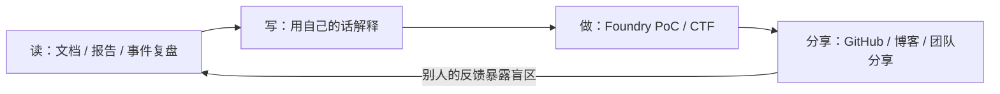
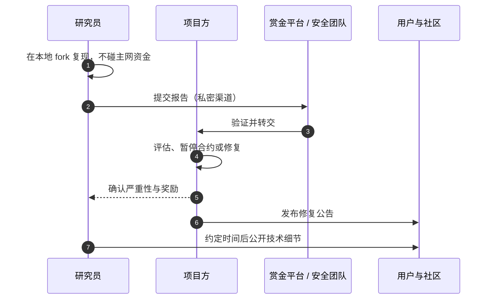

# B02 学习心法与每日训练

> 学习目标：读完本章，你能——
> 1. 说清审计员的职业底线，并画出负责任披露的流程。
> 2. 用反向、边界、顺序、组合四种思维，对一个功能提出滥用问题。
> 3. 按固定的每日循环学习，并用慢雾路线图对照表查漏补缺。
>
> 前置章节：[B00 从零到专家：Web3 安全训练营路线](B00-roadmap.md)
> 预计用时：30 分钟。
>
> 最后核对：2026-11-10

---

## 开场：路线定了，怎么走？

[B00](B00-roadmap.md) 给出了 8 个阶段、2 段链下赛道和学习路线。本篇讲走这条路的方法：出发前的心法、负责任披露的流程、每天的学习循环，以及本训练营与慢雾审计工程师路线图的逐条对照。

## 1. 出发前的心法

技术决定你能找到多少漏洞。底线决定你能不能留在这个行业。出发前先记住三件事：知行合一、守正出奇、团队意识。

### 1.1 知行合一：学习要有输出，输出要有实践

只读文章不会让你找到漏洞。每学一个漏洞类型，做三件事：

1. 用自己的话写一段原理说明（博客、笔记或 GitHub）。
2. 用 Foundry 写一个能复现的 PoC。
3. 在一份真实审计报告或一个历史事件里找到同类漏洞。

读图要点：

- 这是一个闭环。断在"读"这一步的人最多。
- GitHub 开源文化是这个闭环的加速器。你的 PoC 仓库就是你的作品集（见 [B54](B54-expert.md)）。
- 知识源可以从慢雾安全团队知识库（[slowmist/Knowledge-Base](https://github.com/slowmist/Knowledge-Base)）开始。它收录审计报告、事件分析和安全指南。
- 局限：分享的前提是内容可以公开。客户代码和未修复漏洞不能分享。

### 1.2 守正：三条底线

- **遵守法律**：不攻击未授权的目标。不利用漏洞获利。
- **保守秘密**：客户代码和未修复漏洞属于保密信息。审计期间不公开，也不交易相关代币。
- **负责任的披露**：发现线上漏洞时，先私下通知项目方，给出修复时间，再公开。

[FIRST（Forum of Incident Response and Security Teams）道德守则](https://www.first.org/global/sigs/ethics/ethics-first)是行业参考。它要求保护信息、尊重隐私、协调披露、避免伤害。利益冲突的具体处理见 [B54](B54-expert.md)。

负责任披露的流程如下。

读图要点：

- 第 1 步最关键：在本地 fork 上复现。在主网上"试一下"，本身就可能构成攻击。
- 如果项目方没有联系方式，可以通过赏金平台、安全公司或 SEAL 911 这类白帽应急组织转交。
- 风险点：如果漏洞正在被利用，时间比流程重要。此时并行联系项目方和安全团队（见 [A09 应急响应](../assessment/A09-incident-response.md)）。
- 局限：各平台的规则和安全港条款不同。提交前读平台规则（见 [B04](B04-setup.md) 和 [B53](B53-contests-and-habits.md)）。

### 1.3 出奇：黑客思维

开发者问"这个功能能不能用"。审计员问"这个功能能不能被滥用"。黑客思维有四个习惯：

| 习惯 | 问题模板 | 例子 |
|---|---|---|
| 反向思维 | 如果我是攻击者，我最想改哪个变量？ | 价格、份额、权限、时间戳 |
| 边界思维 | 输入为 0、1、最大值或自己时会怎样？ | 转账给自己、借 0 元、第一个存款人 |
| 顺序思维 | 如果我改变调用顺序，或在回调里再调用一次，会怎样？ | 重入、抢跑、闪电贷 |
| 组合思维 | 如果我同时使用另一个协议，会怎样？ | 用 AMM 价格操纵借贷协议的预言机 |

> 🎯 打个比方：开发者像设计门锁的工程师，他测试"钥匙能不能开门"。审计员像开锁师傅，他测试"不用钥匙能不能开门"：撬锁、拆铰链、从窗户进。
>
> 比喻的局限：开锁师傅面对的是一把锁。合约审计员面对的是很多把互相连接的锁。一个协议的漏洞，常常要和另一个协议组合才会出现。

### 1.4 团队意识：为什么审计要多人协同

一个人的知识面有限。不同审计员找到的漏洞往往不完全重合。团队用三种方式提高覆盖率：

- **协同审计工具（技术手段）**：团队共用一个审计工作台。检查项、批注和发现集中在一处，经验沉淀为检查清单。
- **审计工作流（管理手段）**：交叉审计、内部复核、报告审核。每个发现至少两人确认。完整流程见阶段 4 的 [B27](B27-what-is-audit.md)。
- **Hacking Time 文化**：团队成员随时分享新思路和新攻击手法，对齐团队能力。

> 💡 注意：协同不能代替个人能力。团队里每个人都要能独立完成一轮完整审计。训练营的靶场都按一个人独立完成来设计。

### 1.5 与同道者同行：读顶尖研究员的思路

建立自己的信息源。从每位研究员身上学一种方法。

| 作者 / 机构 | 建议重点读 |
|---|---|
| samczsun | 真实漏洞发现与白帽救援的叙事（例如 "Two Rights Might Make A Wrong"）。学习"从一个小异常追到大漏洞"的思路 |
| Christoph Michel（cmichel） | 竞赛审计心得与 DeFi 机制分析 |
| Noxx | EVM Deep Dives 系列 |
| Bytes032 | 竞赛审计方法与案例 |
| MixBytes | 协议拆解与审计技术文章 |
| Pessimistic | 审计案例与工具 |
| OfficerCIA | 资源汇总、链上调查工具清单 |
| Zefram | 协议设计与 Gas 优化 |
| Alin Tomescu | 密码学（承诺、签名、零知识） |
| Kyrian Alex | DeFi 漏洞分析 |
| Smart Contract Research Forum | 学术与工业研究讨论 |

信息流按固定节奏安排：

- 每天：看安全预警账号（PeckShield、BlockSec Phalcon 等）和 Solodit 新报告。每天的训练方法见 [B53](B53-contests-and-habits.md)。
- 每周：读一篇深度技术文章，复现一个 DeFiHackLabs 事件。
- 每月：做一次竞赛审计，或完整审计一个开源协议。
- 输出：把学到的写成文章或推文串。

更多资源按主题列在 [B78 术语表与资源索引](B78-glossary-resources.md)。

## 2. 每天怎么学

每次学习都走同一个循环。

1. 花 5 分钟复述上次学到的一个漏洞。
2. 先做"先猜再看"。答错时记下错因。
3. 运行章节中的命令。比较你的输出和预期输出。
4. 自己改动一处代码，再跑测试，观察结果。
5. 花 10 分钟写学习日志：今天的假设、证据、错误。

> 💡 注意：不要只读不跑。没有运行过的知识，审计时用不出来。

各章使用固定标记：

| 标记 | 含义 |
|---|---|
| 🎯 打个比方 | 用生活场景解释机制。比喻后面写出它的局限。 |
| ⚠️ 警告 | 会导致资金损失或法律风险的事项。 |
| 💡 注意 | 容易误解的事项。 |
| 🤔 先猜再看 | 先写下你的预测，再展开答案。 |
| 🧪 动手验证 | 打开实验页或运行命令，记录结果。 |
| 🪞 反思 | 把本章内容连到你自己的工作。 |
| 读图要点 | 说明数据从哪里来、到哪里去、哪里会出错、局限在哪。 |
| Critical / High / Medium / Low / Info | 漏洞严重性。分级规则见 [A02](../assessment/A02-risk-rating-reporting.md)。 |

## 3. 外部免费资源

按阶段排列的免费课程、练习平台和参考资料，见 [B78 术语表与资源索引](B78-glossary-resources.md) 的"按阶段的免费课程与练习"。本训练营受 Cyfrin Updraft 课程的覆盖范围和慢雾路线图的条目启发。靶场、代码和文字都是原创。几者可以配合学习。

## 4. 覆盖慢雾审计工程师路线图

本训练营与手册其他章节一起，覆盖慢雾安全团队[《智能合约审计工程师学习路线图》](https://github.com/slowmist/SlowMist-Learning-Roadmap-for-Becoming-a-Smart-Contract-Auditor)（SlowMist Learning Roadmap）的全部条目。原路线图分五段。训练营在此基础上补充了原理、图解、交互实验和本地靶场。下表第一列是原路线图的段落名。训练营的阶段另有命名（整装待发、初窥门径……），按本手册的能力目标划分，与原路线图的段落不一一对应。

| 原路线图段落 | 条目 | 本手册位置 |
|---|---|---|
| 出发准备 | 知行合一、守正出奇、团队意识 | 本章第 1 节 |
| 寻门而入 | 区块链基础 | [B03](B03-blockchain-basics.md) |
| 寻门而入 | Solidity 与合约基础、ERC 标准 | [B05](B05-first-contract.md)、[B08](B08-tokens-and-vault.md)、主线 [03](../03-evm-solidity-basics.md)、[07](../07-external-calls-tokens.md) |
| 寻门而入 | 代理与升级 | 主线 [10](../10-upgradeable-proxy.md) |
| 寻门而入 | 工具链 | [B04](B04-setup.md)、[B06](B06-foundry-basics.md)、[B12](B12-foundry-advanced.md)、[B15](B15-audit-2-luckypot.md)（静态分析） |
| 寻门而入 | 常见漏洞 | 主线 [04](../04-reentrancy.md)–[09](../09-mev-signatures.md)、[B28](B28-bug-patterns.md) |
| 寻门而入 | 最佳实践与标准 | [B14](B14-writing-findings.md) |
| 寻门而入 / 倚门而歌 | 入门 CTF、进阶 CTF | [B10](B10-ctf-practice.md)（入门）、[B24](B24-defi-ctf.md)（DeFi） |
| 倚门而歌 | DeFi 基础、AMM、借贷、其他头部协议 | [B17](B17-defi-basics.md)、[B18](B18-dex-amm.md)、[B20](B20-lending-cdp.md)、主线 [08](../08-oracle-flashloan.md) |
| 倚门而歌 | 读源码 | [B09](B09-reading-code-mindset.md)、[B35](B35-case-method.md) |
| 倚门而歌 | DeFi 风险与事件 | 主线 [11](../11-defi-economic-security.md)、[28](../28-incident-casebook.md) |
| 倚门而歌 | 审计报告 | [B14](B14-writing-findings.md)、[A02](../assessment/A02-risk-rating-reporting.md) |
| 融会贯通 | EVM 深入、Gas 优化 | [B45](B45-yul-opcodes.md)、[B46](B46-calldata-memory.md)、[B47](B47-gas.md) |
| 融会贯通 | 经济模型、拆解复杂协议 | [B22](B22-economics-governance.md)、[B23](B23-complex-protocols.md) |
| 融会贯通 | 应急分析 | [A09](../assessment/A09-incident-response.md) |
| 融会贯通 | Bug Bounty | [B53](B53-contests-and-habits.md) |
| 破门而出 | 多语言与多链 | [B50](B50-solana-audit.md)、[B51](B51-move-audit.md)、主线 [13](../13-non-evm-ecosystems.md) |
| 破门而出 | 跨链桥与密码学 | 主线 [12](../12-cross-chain-bridges.md)、[02](../02-cryptography-randomness.md)、[B32](B32-audit-5-echobridge.md) |
| 破门而出 | 方法论、工程化工具 | [B27](B27-what-is-audit.md)、[B29](B29-why-audits-miss.md)、[B31](B31-automation-tools.md)、[B52](B52-ai-assisted-audit.md) |
| 项目实例 | Uniswap V2、Aave V3、Lido、Safe、ERC-4626 | [B35](B35-case-method.md)–[B41](B41-case-erc4626.md) |
| 实战与求职 | 实战项目、求职、面试 | [B25](B25-capstone-minilend.md)、[B33](B33-audit-6-guardvault.md)、[B54](B54-expert.md)、[B55](B55-interview.md) |
| 与同道者同行 | 研究员与博客 | 本章 1.5 节、[B78](B78-glossary-resources.md) |

> 💡 注意：原路线图是线性的，真实学习是螺旋的。每读完一段，就回到 CTF 和真实报告里验证。

## 5. 过关标准

- [ ] 你能按顺序说出负责任披露的步骤。
- [ ] 你能用"反向 / 边界 / 顺序 / 组合"四种思维，对一个功能各提一个问题。
- [ ] 你按第 2 节的循环完成了一次学习，并写下了当天的学习日志。

> 🪞 反思：你最容易跳过哪一步，是运行命令、写日志，还是写报告？你打算怎样防止自己跳过它？再想三个问题：
> 1. 如果报酬足够高，你会在什么情况下越过授权范围？
> 2. 你最近一次把学到的东西写成输出，是什么时候？
> 3. 你的工作里，谁能发现你漏掉的问题？

## 6. 思考题

1. 你在 CTF 之外，偶然发现一个主网合约可以无限铸币。按顺序写出你接下来的 5 个动作。
2. 为什么"在主网上用 0.01 ETH 试一下"也不可接受？
3. 选一个你熟悉的 Web2 漏洞（例如 SQL 注入），用"反向 / 边界 / 顺序 / 组合"四种思维各提一个问题。

下一章：[B03 区块链基础](B03-blockchain-basics.md)
