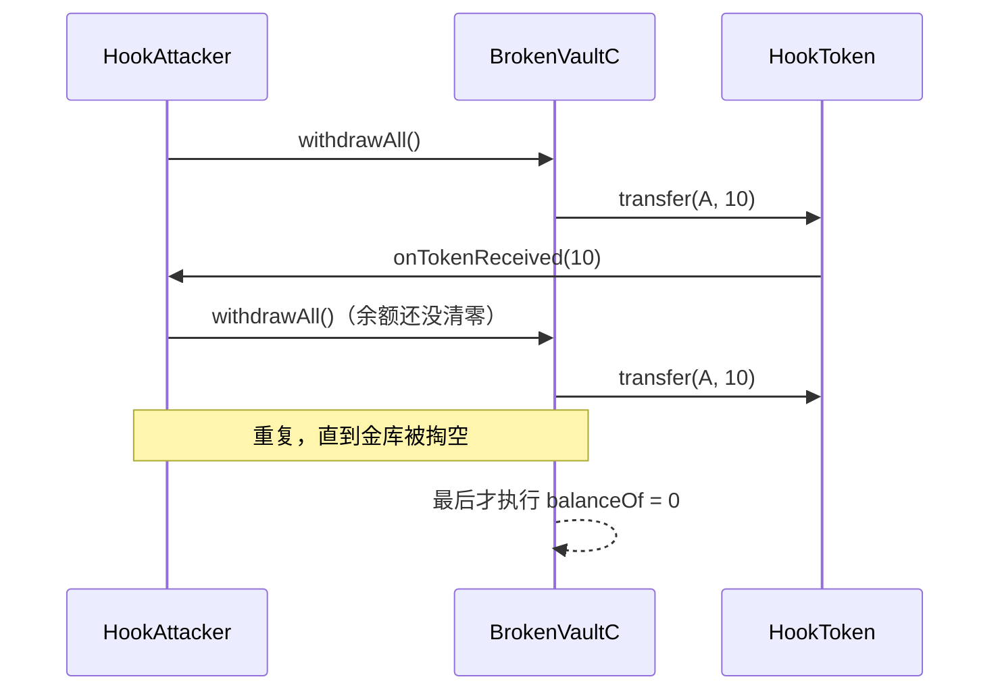

# B08 代币与小金库

> 学习目标：读完本章，你能——
> 1. 用 OpenZeppelin 写一个 ERC-20 代币。
> 2. 解释 `approve` + `transferFrom` 的两步流程。
> 3. 写出一个小金库并部署到 anvil。
> 4. 亲手破坏金库 3 次，并用测试证明每一次破坏的后果。
>
> 前置章节：[B06 Foundry 基本功](B06-foundry-basics.md)
> 预计用时：3～4 小时
> 配套代码：[practice-example-code/range/basics/src/b04/](../../practice-example-code/range/basics/src/b04)
> 交互实验：[授权流程](../interactive/audit-approve.html)

---

## 开场：钱为什么不能直接"塞"给合约

示例场景：你想把 100 个代币存进金库。你先调用 `token.transfer(vault, 100)`。代币到了。可是金库不知道是谁存的，也没有记账。

这就是 `approve` 流程存在的原因。

<details class="predict"><summary>🤔 先猜再看：金库要"替你"把代币拉进来。代币合约怎么判断金库有这个权力？</summary>

你先调用 `token.approve(vault, 100)`，在代币合约里写下一条授权记录。金库再调用 `token.transferFrom(你, 金库, 100)`。代币合约检查这条记录，然后扣减额度。

</details>

> 🎯 打个比方：`approve` 像给物业写一张"可从我账户代扣 100 元"的授权书。`transferFrom` 是物业拿授权书去扣款。
>
> 比喻的局限：真实银行可以撤销错误扣款。链上转账无法撤销。一张写着"无限额"的授权书，在合约被攻破时会让所有余额暴露。

---

## 1. 写一个 ERC-20

ERC-20 是可替代代币的接口标准。它规定了 `transfer`、`approve`、`transferFrom`、`balanceOf` 等函数。

OpenZeppelin 提供经过广泛审计的实现。自己重写一遍 ERC-20 是常见的错误来源。

本章回到 `~/bootcamp-lab`。参考副本在 `practice-example-code/bootcamp-lab/`；本章的金库、破坏 A/B/C 的完整代码在 `practice-example-code/range/basics/src/b04/`。安装依赖：

```bash
cd ~/bootcamp-lab
# 下载 OpenZeppelin 合约库到 lib/，@ 后固定版本
forge install OpenZeppelin/openzeppelin-contracts@v5.6.1
# 重映射：让 @openzeppelin/ 指向 lib 里的真实路径
echo '@openzeppelin/contracts/=lib/openzeppelin-contracts/contracts/' > remappings.txt
```

最后一行输出：

```text
    Installed openzeppelin-contracts tag=v5.6.1@5fd1781b1454fd1ef8e722282f86f9293cacf256
```

> 💡 注意：2026-11-10 查询 npm 的最新稳定版是 5.6.1；GitHub 上已有 v5.7.0 标签。本章固定使用 v5.6.1，保证你和手册的结果一致。

创建 `src/BootToken.sol`：

```solidity
// SPDX-License-Identifier: MIT
pragma solidity ^0.8.20;

// 从 OpenZeppelin 导入标准实现
import {ERC20} from "@openzeppelin/contracts/token/ERC20/ERC20.sol";

/// @notice 训练币。部署者一次性获得全部供应量。
contract BootToken is ERC20 {  // is：继承，自动获得全部 ERC-20 函数
    // 把名称和符号传给父合约的构造函数
    constructor(uint256 initialSupply) ERC20("Boot Token", "BOOT") {
        _mint(msg.sender, initialSupply);  // _mint 凭空铸币，只在部署时调用一次
    }
}
```

`is ERC20` 表示继承。`BootToken` 自动获得 ERC-20 的全部函数。

---

## 2. 写小金库

创建 `src/MiniVault.sol`：

```solidity
// SPDX-License-Identifier: MIT
pragma solidity ^0.8.20;

// 接口：只声明函数，不含实现
import {IERC20} from "@openzeppelin/contracts/token/ERC20/IERC20.sol";
// 安全转账库，兼容不返回 bool 的代币
import {SafeERC20} from "@openzeppelin/contracts/token/ERC20/utils/SafeERC20.sol";
// 重入锁
import {ReentrancyGuard} from "@openzeppelin/contracts/utils/ReentrancyGuard.sol";

/// @notice 小金库：用户存入一种代币，之后取回自己的部分。
contract MiniVault is ReentrancyGuard {
    using SafeERC20 for IERC20;  // using…for：给 IERC20 挂上 safe* 函数

    IERC20 public immutable token;  // 金库只接受这一种代币
    uint256 public totalDeposits;  // 所有用户存款的总账
    mapping(address => uint256) public balanceOf;  // 每个用户在金库里的余额

    event Deposited(address indexed user, uint256 amount);
    event Withdrawn(address indexed to, uint256 amount);

    error ZeroAmount();
    error InsufficientBalance(uint256 have, uint256 want);

    constructor(IERC20 _token) {
        token = _token;
    }

    // nonReentrant：执行期间禁止再次进入
    function deposit(uint256 amount) external nonReentrant {
        if (amount == 0) revert ZeroAmount();
        uint256 before = token.balanceOf(address(this));  // 记下转账前的余额
        // 拉走用户已授权的代币，需先 approve
        token.safeTransferFrom(msg.sender, address(this), amount);
        // 按实际到账记账
        uint256 received = token.balanceOf(address(this)) - before;
        balanceOf[msg.sender] += received;
        totalDeposits += received;
        emit Deposited(msg.sender, received);
    }

    function withdraw(uint256 amount) external nonReentrant {
        if (amount == 0) revert ZeroAmount();
        uint256 have = balanceOf[msg.sender];  // Checks：先检查余额够不够
        if (have < amount) revert InsufficientBalance(have, amount);
        balanceOf[msg.sender] = have - amount; // 先记账
        totalDeposits -= amount;  // 总账同步减少
        token.safeTransfer(msg.sender, amount); // 后转账
        emit Withdrawn(msg.sender, amount);
    }
}
```

每个防御点的作用：

| 写法 | 防什么 |
|---|---|
| `SafeERC20` | 兼容不返回布尔值的代币，失败时回滚 |
| `received = 余额差` | 转账收费的代币 |
| 先记账、后转账 | 重入 |
| `nonReentrant` | 重入锁，防止函数执行中被再次进入 |
| `balanceOf[msg.sender]` | 用户只能动自己的钱 |

```bash
forge build
```

输出包含 `Compiler run successful!` 即通过。

---

## 3. 部署到 anvil

创建 `script/DeployB04.s.sol`：

```solidity
// SPDX-License-Identifier: MIT
pragma solidity ^0.8.20;

// Script 是部署脚本基类；console2 打印日志
import {Script, console2} from "forge-std/Script.sol";
import {BootToken} from "../src/BootToken.sol";
import {MiniVault} from "../src/MiniVault.sol";

/// @notice 只部署到本地 anvil。使用 --unlocked，不需要私钥。
contract DeployB04 is Script {
    function run() external {
        // 不是本地 anvil 就直接失败
        require(block.chainid == 31337, "local anvil only");
        vm.startBroadcast();  // 之后的调用都会作为真实交易发出
        // 1_000 ether = 1000×10¹⁸ 个最小单位
        BootToken token = new BootToken(1_000 ether);
        MiniVault vault = new MiniVault(token);
        vm.stopBroadcast();  // 停止广播
        console2.log("BootToken:", address(token));
        console2.log("MiniVault:", address(vault));
    }
}
```

`require(block.chainid == 31337)` 是保险。31337 是 anvil 的默认链 ID。脚本在其他网络上直接失败。

第一个终端：

```bash
anvil  # 启动本地链
```

第二个终端：

```bash
cd ~/bootcamp-lab
export RPC=http://127.0.0.1:8545
export ME=0xf39Fd6e51aad88F6F4ce6aB8827279cffFb92266
# 运行部署脚本；--sender 指定发交易的账户，--broadcast 真正上链
forge script script/DeployB04.s.sol --rpc-url $RPC --unlocked --sender $ME --broadcast
```

输出的关键行：

```text
ONCHAIN EXECUTION COMPLETE & SUCCESSFUL.
```

全新 anvil 上的两个合约地址是确定的：

```bash
export T=0x5FbDB2315678afecb367f032d93F642f64180aa3  # 代币地址
export V=0xe7f1725E7734CE288F8367e1Bb143E90bb3F0512  # 金库地址
cast call $T 'symbol()(string)' --rpc-url $RPC  # 读代币符号
# 读部署者的代币余额
cast call $T 'balanceOf(address)(uint256)' $ME --rpc-url $RPC
```

实际输出：

```text
"BOOT"
1000000000000000000000 [1e21]
```

---

## 4. 走一遍 approve 流程

**第 1 步：不授权，直接存款。**

```bash
# 没授权就存款，预期失败
cast send $V 'deposit(uint256)' 10ether --unlocked --from $ME --rpc-url $RPC
```

实际输出的结尾：

```text
ERC20InsufficientAllowance(0xe7f1725E7734CE288F8367e1Bb143E90bb3F0512, 0, 10000000000000000000 [1e19])
```

错误的三个参数依次是：花费者（金库）、现有额度（0）、需要的额度。

**第 2 步：授权。**

```bash
# 授权金库最多拉走 10 个代币
cast send $T 'approve(address,uint256)' $V 10ether --unlocked --from $ME --rpc-url $RPC | grep -E '^status'
# 查剩余额度：owner、spender
cast call $T 'allowance(address,address)(uint256)' $ME $V --rpc-url $RPC
```

```text
status               1 (success)
10000000000000000000 [1e19]
```

**第 3 步：存款，然后取回 4 个。**

```bash
# 授权后再存款
cast send $V 'deposit(uint256)' 10ether --unlocked --from $ME --rpc-url $RPC | grep -E '^status'
cast call $V 'balanceOf(address)(uint256)' $ME --rpc-url $RPC  # 金库里记的余额
# 额度被 transferFrom 用掉
cast call $T 'allowance(address,address)(uint256)' $ME $V --rpc-url $RPC
# 取回 4 个
cast send $V 'withdraw(uint256)' 4ether --unlocked --from $ME --rpc-url $RPC | grep -E '^status'
cast call $V 'balanceOf(address)(uint256)' $ME --rpc-url $RPC
```

```text
status               1 (success)
10000000000000000000 [1e19]
0
status               1 (success)
6000000000000000000 [6e18]
```

额度用完后变成 0。这就是精确授权的好处。

> ⚠️ 警告：很多前端默认申请无限额度。合约被攻破后，所有给过无限授权的用户都面临风险。详见 [19 用户诈骗](../19-user-scams.md) 和 [授权流程实验](../interactive/audit-approve.html)。

完成后按 `Ctrl+C` 关闭 anvil。

---

## 5. 亲手破坏它

只有亲手弄坏过，你才知道防御写法在防什么。

### 5.1 破坏 A：取谁的钱，由调用者说了算（权限，ACC 类）

在 `~/bootcamp-lab` 里，复制金库：

```bash
cp src/MiniVault.sol src/BrokenVault.sol  # 复制一份金库，用来改坏
```

打开 `src/BrokenVault.sol`，做 2 处修改：

1. 把 `contract MiniVault` 改成 `contract BrokenVault`。
2. 用下面的函数替换 `withdraw`：

```solidity
    // from 由调用者随便填
    // ❌ 漏洞
    function withdraw(address from, uint256 amount) external nonReentrant {
        if (amount == 0) revert ZeroAmount();
        uint256 have = balanceOf[from];
        if (have < amount) revert InsufficientBalance(have, amount);
        balanceOf[from] = have - amount;  // 扣的是 from 的账
        totalDeposits -= amount;
        token.safeTransfer(msg.sender, amount);  // 钱却转给了调用者
        emit Withdrawn(msg.sender, amount);
    }
```

创建 `test/BreakA.t.sol`：

```solidity
// SPDX-License-Identifier: MIT
pragma solidity ^0.8.20;

import {Test} from "forge-std/Test.sol";
import {BootToken} from "../src/BootToken.sol";
import {BrokenVault} from "../src/BrokenVault.sol";

contract BreakATest is Test {
    // PoC：mallory 取走 alice 的存款
    function test_AnyoneWithdrawsForOthers() public {
        address alice = makeAddr("alice");
        address mallory = makeAddr("mallory");
        // 测试合约自己是部署者，拿到全部代币
        BootToken token = new BootToken(100 ether);
        BrokenVault vault = new BrokenVault(token);
        token.transfer(alice, 100 ether);  // 分给 alice

        vm.startPrank(alice);  // 步骤 1：alice 授权并存入 100
        token.approve(address(vault), 100 ether);
        vault.deposit(100 ether);
        vm.stopPrank();

        vm.prank(mallory);  // 步骤 2：mallory 填 alice 的地址取款
        vault.withdraw(alice, 100 ether);

        // 断言：钱到了 mallory 手里，攻击成功
        assertEq(token.balanceOf(mallory), 100 ether);
    }
}
```

```bash
forge test --match-contract BreakATest  # 运行破坏 A 的 PoC
```

预期输出：

```text
Ran 1 test for test/BreakA.t.sol:BreakATest
[PASS] test_AnyoneWithdrawsForOthers() (gas: 1510288)
Suite result: ok. 1 passed; 0 failed; 0 skipped; finished in 627.63µs (394.71µs CPU time)

Ran 1 test suite in 375.45ms (627.63µs CPU time): 1 tests passed, 0 failed, 0 skipped (1 total tests)
```

> 🧪 动手验证：这个 PoC 通过，说明攻击成功。在审计里，PoC 的绿色代表漏洞存在。这一点和普通测试相反。

**修复对比**：`MiniVault` 用 `balanceOf[msg.sender]`，调用者只能动自己的余额。

### 5.2 破坏 B：按请求金额记账（外部代币，EXT 类）

切换到配套工程，阅读 `src/b04/broken/BrokenVaultB.sol` 和 `src/b04/mocks/FeeToken.sol`。

<details class="predict"><summary>🤔 先猜再看：转账收 1% 的代币，两个用户各存 100 个。最后一个取款的人会怎样？</summary>

金库账面上记 200，实际只收到 198。第一个人取走 100 时，金库转出的 100 个代币也要被扣 1% 手续费，但金库的余额减少 100。金库剩 98，第二个人取 100 回滚。

</details>

```bash
cd practice-example-code/range/basics  # 从 web3-security-handbook/ 出发，切到配套工程
forge test --match-test test_BreakB  # 运行收费代币的 PoC
```

```text
[PASS] test_BreakB_FeeTokenMakesVaultInsolvent() (gas: 1360676)
```

**修复对比**：`MiniVault.deposit` 计算余额差，`test_FeeTokenCreditsReceivedAmount` 证明它按 99 记账。

### 5.3 破坏 C：先转账，后记账（重入，REN 类）

阅读 `src/b04/broken/BrokenVaultC.sol`、`src/b04/mocks/HookToken.sol` 和 `test/b04/Break.t.sol` 里的 `HookAttacker`。

`HookToken` 在转账后回调接收方。这是一个玩具代币，ERC-777 等标准有类似的钩子。



**读图要点：**

- 控制权在 `transfer` 时交给了攻击合约。
- 攻击合约重新进入时，`balanceOf[attacker]` 还是旧值。
- 错误不在代币的钩子，而在金库的顺序。
- 局限：图只画两层嵌套，实际 PoC 嵌套 11 次。

```bash
# 单引号里用 | 同时匹配两个测试名
forge test --match-test 'test_BreakC|test_FixedVault'
```

```text
[PASS] test_BreakC_HookTokenDrainsVault() (gas: 1818303)
[PASS] test_FixedVaultStopsHookReentry() (gas: 2028955)
```

Alice 的账面余额仍然是 100，但金库里已经没有代币。`test_FixedVaultStopsHookReentry` 用同样的手法攻击 `MiniVault`，重入被拒绝。

<details class="predict"><summary>🤔 先猜再看：为什么 BrokenVaultC 用 `balanceOf = 0` 而不是 `balanceOf -= amount`？</summary>

Solidity 0.8 的减法有溢出检查。如果嵌套调用都用 `-= amount`，第二层返回时余额已经是 0，再减就回滚，整笔交易失败，攻击不成立。这是一种"意外的保护"。不要依赖它。写成 `= 0` 或按比例计算时，这个保护就没有了。

</details>

重入的完整讲解在 [04 重入](../04-reentrancy.md)。

---

## 6. 如果出错

| 现象 | 原因 | 处理 |
|---|---|---|
| `Source "@openzeppelin/…" not found` | 没有安装依赖，或没有写 `remappings.txt` | 重做第 1 节的两条命令 |
| `fatal: 'lib/openzeppelin-contracts' already exists` | 目录已存在 | 运行 `rm -rf lib/openzeppelin-contracts` 后重新安装 |
| `ERC20InsufficientAllowance` | 没有授权或额度不够 | 先运行 `approve` |
| `InsufficientBalance` | 取款金额超过存款 | 检查 `balanceOf` |
| `Failed to estimate gas` | 交易在模拟时回滚 | 看报错结尾的错误名 |
| `local anvil only` | 脚本指向了非本地网络 | 确认 `--rpc-url` 是 `127.0.0.1:8545` |
| 地址和本章不同 | anvil 不是全新启动 | 重启 anvil，重新部署 |

---

## 7. 过关标准

- [ ] 你能从 anvil 上读到 `BOOT` 的余额，也能在没有授权时看到 `ERC20InsufficientAllowance`。
- [ ] `balanceOf` 最后显示 `6e18`。
- [ ] 破坏 A 的 PoC 在 `bootcamp-lab` 里通过。
- [ ] 破坏 B、C 的测试在配套工程里通过。
- [ ] 你能各用一句话说出 A、B、C 的根因和修复方法。

---

## 8. 相关章节

- [04 重入](../04-reentrancy.md)
- [05 访问控制](../05-access-control.md)
- [07 外部调用与代币](../07-external-calls-tokens.md)
- 交互实验：[授权流程](../interactive/audit-approve.html)、[重入实验](../interactive/reentrancy-lab.html)
- 下一章：[B09 读代码与攻击者思维](B09-reading-code-mindset.md)

> 🪞 反思：你的钱包现在有多少无限额度的授权？你最后一次检查是什么时候？

---

## 9. 思考题

1. 配套的 `HookToken` 只回调接收方。如果代币在转账**前**回调发送方（ERC-777 的 `tokensToSend` 属于这一类），去掉 `deposit` 的 `nonReentrant`，余额差的计算会出什么问题？
2. 破坏 A 的代码里还留着 `nonReentrant`。为什么它帮不上忙？
3. 金库把"实际到账"记账后，收费代币的问题就彻底解决了吗？如果代币余额会自动增减（rebase），会怎样？

下一章：[B09 读代码与攻击者思维](B09-reading-code-mindset.md)
