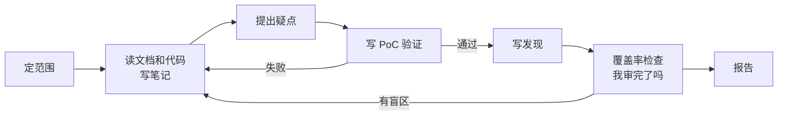

# B09 读代码与攻击者思维

> 学习目标：读完本章，你能——
> 1. 说出审计的最小流程，以及范围、nSLOC、发现、PoC、覆盖率 5 个词的含义。
> 2. 对一个小合约完成侦察、读规格、由小到大阅读，并留下代码内笔记；知道后续要用"多轮多视角"减少漏报。
> 3. 用攻击者和防御者两种思维，对每一行代码提出 3 个问题。
>
> 前置章节：[B08 代币与小金库](B08-tokens-and-vault.md)
> 预计用时：2 小时
> 交互实验：[审计自查清单](../interactive/audit-checklist.html)
> 最后核对：2026-11-10
> 配套代码：[examples/range/basics/src/b05/LunchPool.sol](../examples/range/basics/src/b05/LunchPool.sol)、[docs/lunchpool-spec.md](../examples/range/basics/docs/lunchpool-spec.md)

---

## 开场：同事请你看一眼午餐基金

示例场景：同事写了一个午餐基金合约 LunchPool。大家往里出钱，组织者统一付给餐厅；如果取消，每人退款。同事说："只有 62 行，你帮我看一眼。"

你写过合约，也破坏过 [B08](B08-tokens-and-vault.md) 的金库。可是别人的代码，你从哪一行开始读？本章给出一个顺序：先侦察，再由小到大读代码，最后用攻击者的眼光逐行提问。

> 🎯 打个比方：读别人的合约像检查一套陌生的房子。你不会从第一块砖开始看。你先看图纸（规格），再看门和窗（入口），最后顺着水管走一遍（资金路径）。
>
> 比喻的局限：房子不会主动改变。合约的每一个入口，都可能被攻击者用你没想到的顺序调用。

### 准备工作

命令在配套工程 `Web3-Security/examples/range/basics` 里运行。代码内笔记写在 LunchPool 的工作副本里，不改原文件。先建好副本：

```bash
cd Web3-Security/examples/range/basics  # 进入配套工程
# 清掉旧副本，新建空目录
rm -rf /tmp/lunchpool-audit && mkdir /tmp/lunchpool-audit
cp -R src/b05 docs /tmp/lunchpool-audit/  # 复制合约源码和规格文档
cd /tmp/lunchpool-audit  # 进入副本目录
# -q 静默；建仓库并提交一次
git init -q && git add . && git commit -q -m "lunchpool audit target"
git rev-parse HEAD  # 打印这次提交的完整哈希，它就是"审了哪个版本"的证据
```

之后回到配套工程：

```bash
cd -  # 回到上一个所在目录
```

---

## 1. 审计是什么：最小流程

**审计**（Audit）：在代码上线前，由人系统地查找漏洞，并给出可复核的书面证据。

本训练营反复用到 5 个词：

| 术语 | 定义 |
|---|---|
| 范围（Scope） | 本次审计负责的文件和版本。版本用提交哈希锁定 |
| nSLOC | 不含注释和空行的代码行数，用来估算工作量。LunchPool 是 62 |
| 发现（Finding） | 一个有证据的问题，有编号、严重性、位置、影响和修复建议 |
| PoC（Proof of Concept） | 一段能运行的代码，证明问题真实存在 |
| 覆盖率（Coverage） | 测试执行到的代码占全部代码的比例 |

一次最小审计的流程如下。



**读图要点：**

- 审计不是直线。PoC 失败时，你回到代码，因为你的假设错了。覆盖率显示盲区时，你也回到代码。
- 报告是最后一步，不是第一步。
- 本章练前半段：读文档和代码、写笔记、提出疑点。[B13](B13-audit-1-notebox.md) 走完全程，[B14](B14-writing-findings.md) 讲怎样写发现。
- 局限：这是一个人的最小流程。专业审计还有受理、排期、内部评审和修复复查，见阶段 4 的 [B27](B27-what-is-audit.md)。

> 💡 注意：审计不是"这个合约安全"的保证。报告只陈述"在这个范围和时间内，发现了这些问题"。

---

## 2. 侦察（Reconnaissance）

侦察指在读代码之前，先搞清楚项目是什么、怎么运作。

顺序：

1. **读文档和规格。** 先理解它**应该**做什么。
2. **画出角色和资产。** 谁有钱？谁有权？
3. **列出外部依赖。** 预言机、代币、其他协议。
4. **运行测试。** 确认环境可用，看一看覆盖率。
5. **运行静态分析。** 拿到一份线索清单。

现在，**先读** [docs/lunchpool-spec.md](../examples/range/basics/docs/lunchpool-spec.md)，不要看代码。

<details class="predict"><summary>🤔 先猜再看：只读规格，LunchPool 最值得攻击的目标是什么？</summary>

资金池里的 ETH。接触资金的路径有 3 条：`refund`、`payVendor`、`cancelAll`。控制 `payVendor` 收款方的角色是组织者，所以"谁能成为组织者"立刻成为第一个问题。规格第 5 条还告诉你，一个人阻止全体退款就算违规。

</details>

然后运行静态分析工具 Slither：

```bash
# 运行 Slither；2>&1 合并错误输出，grep 只留重入相关的行
slither src/b05/LunchPool.sol 2>&1 | grep -E 'Reentrancy in'
```

实际输出（Slither 0.11.5，节选）：

```text
Reentrancy in LunchPool.cancelAll() (src/b05/LunchPool.sol#62-74):
Reentrancy in LunchPool.refund() (src/b05/LunchPool.sol#38-47):
Reentrancy in LunchPool.refund() (src/b05/LunchPool.sol#38-47):
Reentrancy in LunchPool.payVendor(address) (src/b05/LunchPool.sol#53-60):
Reentrancy in LunchPool.refund() (src/b05/LunchPool.sol#38-47):
```

> 💡 注意：工具输出是线索，不是结论。上面的结果里，同一个函数出现多次，来自不同的检测器。并非每一条都构成可利用的漏洞。还要注意，Slither 没有告诉你 `setOrganizer` 违反了规格，因为它不知道你的规格。

没有安装 Slither 时，跳过这一步。Slither 的安装和分诊在 [B15](B15-audit-2-luckypot.md) 讲。

---

## 3. 由小到大读代码

阅读顺序：

1. 先读没有外部调用、不改状态的小函数。
2. 再读修改状态的入口（`external` 和 `public`）。
3. 最后沿调用关系读完整路径，从用户入口一直到资金流出。

对 LunchPool，建议的顺序是：`contribute` → `setOrganizer` → `refund` → `payVendor` → `cancelAll`。

### 3.1 代码内笔记

在你的**工作副本**里写笔记。业界常用的前缀（团队习惯，不是标准）：

| 前缀 | 含义 |
|---|---|
| `// @audit` | 可疑点，需要验证 |
| `// @audit-issue` | 已确认的问题 |
| `// @audit-ok` | 查过了，没问题，写明理由 |
| `// @audit-q` | 需要问项目方的问题 |

例子：

```solidity
function contribute() external payable {
    // @audit-ok 金额下限和截止时间都有检查
    require(msg.value >= MIN_CONTRIBUTION, "too small");
    require(block.timestamp < deadline, "closed");
    // @audit-q 用户退款后再出资，eaters 里会有重复地址，影响是什么？
    if (paidBy[msg.sender] == 0) eaters.push(msg.sender);
```

> 💡 注意：`@audit-ok` 和 `@audit` 同样重要。它记录你排除了什么，帮助你第二轮不做重复工作。

### 3.2 练习：自己标注 LunchPool

阅读 `src/b05/LunchPool.sol`，用规格的 5 条规则逐一对照。写下你的笔记后，再展开提示。

<details class="predict"><summary>🤔 提示 1：哪个写操作函数和其他函数长得不一样？</summary>

对比所有修改状态的函数的声明，看修饰器。`payVendor`、`cancelAll` 有 `onlyOrganizer`。规格第 1 条说，只有当前组织者能转交身份。

</details>

<details class="predict"><summary>🤔 提示 2：`refund` 里 3 件事的顺序是什么？</summary>

转账，然后清零。回忆 [B08 破坏 C](B08-tokens-and-vault.md)。

</details>

<details class="predict"><summary>🤔 提示 3：`cancelAll` 的循环里，一次转账失败会发生什么？`deadline` 的比较用的是哪个符号？</summary>

失败时 `require(ok)` 回滚整笔交易。比较 `contribute` 和 `refund` 的符号，再对照规格第 2 条。

</details>

<details class="predict"><summary>🤔 答案：4 个问题</summary>

| 编号 | 问题 |
|---|---|
| H-01 | `setOrganizer` 缺少权限检查（ACC） |
| H-02 | `refund` 先转账后记账，可重入（REN） |
| M-01 | `cancelAll` 推送转账，一个拒收者阻止全员（EXT） |
| L-01 | `refund` 用 `<=`，违反规格 |

验证每一个 PoC：

```bash
forge test --match-contract LunchPoolPoC  # 运行全部 PoC 和修复验证
```

实际输出：

```text
Ran 8 tests for test/b05/PoC.t.sol:LunchPoolPoC
[PASS] test_Fix_H01_StrangerCannotSetOrganizer() (gas: 14135)
[PASS] test_Fix_H02_ReentryGetsNothingExtra() (gas: 281108)
[PASS] test_Fix_L01_RefundRejectedAtDeadline() (gas: 70565)
[PASS] test_Fix_M01_RejecterCannotBlockOthers() (gas: 269087)
[PASS] test_PoC_H01_AnyoneTakesOrganizerAndDrains() (gas: 111329)
[PASS] test_PoC_H02_ReentrantRefundDrainsPool() (gas: 439736)
[PASS] test_PoC_L01_RefundAllowedAtDeadline() (gas: 94671)
[PASS] test_PoC_M01_OneRejecterBlocksCancelAll() (gas: 283081)
Suite result: ok. 8 passed; 0 failed; 0 skipped
```

`test_PoC_*` 在漏洞合约上通过，表示攻击成立。`test_Fix_*` 在 `solution/LunchPoolFixed.sol` 上通过，表示修复有效。[B14](B14-writing-findings.md) 把它们写成报告。

</details>

### 3.3 一轮不够：四轮视角

LunchPool 只有 62 行，一遍逐函数阅读就能找到大部分问题。几千行的协议不行。专业审计会换视角读多轮，每一轮问不同的问题：

| 轮次 | 视角 | 产出 |
|---|---|---|
| 第 1 轮 | 逐合约、逐函数：语法级和局部逻辑 | 函数表、变量读写表、局部疑点 |
| 第 2 轮 | 按用户流程：存、借、还、清算、取 | 流程图、跨函数疑点 |
| 第 3 轮 | 按角色和权限：管理员、Keeper、预言机能做什么 | 中心化风险清单 |
| 第 4 轮 | 按经济与集成：外部协议、极端行情、怪代币 | 经济风险与集成风险 |

你在 3.2 节做的就是第 1 轮。H-01 也能在第 3 轮被发现：问"谁能成为组织者"。

> 🧪 动手验证：打开[审计自查清单](../interactive/audit-checklist.html)，逐组勾选 LunchPool 或另一个你读过的合约。记录没有勾上的组，把它们排进第 3、4 轮。

---

## 4. 攻击者思维和防御者思维

| | 防御者（开发者） | 攻击者（审计员要模仿） |
|---|---|---|
| 想的问题 | 怎样让功能跑通 | 怎样让它在不该跑通的时候跑通 |
| 看到一个参数 | 用户会传合法值 | 我能传什么？ |
| 看到一个外部调用 | 对方会正常返回 | 我控制对方的话，会做什么？ |
| 看到一个假设 | 这个假设成立 | 这个假设谁来保证？ |

审计员需要两种思维。攻击者思维用来找问题。防御者思维用来判断问题的影响，并给出能落地的修复。

每一行代码都问 3 个问题：

1. 这行代码做了什么假设？
2. 这个假设由谁保证？
3. 如果假设不成立，谁损失什么？

提问的四个习惯（反向、边界、顺序、组合）见 [B02 第 1.3 节](B02-study-method.md)。

---

## 5. 常见攻击向量

常见攻击向量的学习地图见 [27 章第 5 节一页审计速查表](../27-audit-testing-workflow.md)。表中每一类都有关键问题和对应章节。后面的靶场按这张表逐类展开。

本训练营的检查项用前缀区分类别：重入 REN、访问控制 ACC、算术与精度 ARI、外部调用与代币 EXT、预言机与闪电贷 ORA、MEV 与签名 MEV、代理升级 UPG、经济逻辑 DFI、跨链桥 BRG。密钥与签名流程属于运营风险，见主线 [18](../18-wallet-key-management.md) 和 [23](../23-custody-exchange-ops.md)。

---

## 6. 如果出错

| 现象 | 原因 | 处理 |
|---|---|---|
| `slither: command not found` | 没有安装 Slither | 跳过这一步，[B15](B15-audit-2-luckypot.md) 会安装 |
| Slither 报 `solc` 版本错误 | 系统 solc 版本不匹配 | 用 `solc-select` 切换版本 |
| `git commit` 报身份错误 | 没有配置 git | 见 [B04 第 3 节](B04-setup.md) |
| `/tmp` 目录不存在（Windows） | 环境差异 | 在 WSL 中运行 |

---

## 7. 术语表

| 术语 | 英文 | 定义 |
|---|---|---|
| 审计 | Audit | 上线前由人系统地查找漏洞，并给出可复核的书面证据 |
| 侦察 | Reconnaissance | 读代码之前理解项目、角色、资产和依赖 |
| 代码内笔记 | Inline Audit Note | 写在工作副本里、以 `@audit` 开头的批注 |
| 攻击向量 | Attack Vector | 攻击者利用漏洞的一类路径，例如重入、访问控制 |

范围、nSLOC、发现、PoC、覆盖率的定义见第 1 节。

---

## 8. 过关标准

- [ ] 你能不看书写出第 1 节 5 个词的定义，并画出最小审计流程。
- [ ] 你的工作副本里至少有 5 条 `@audit` 系列笔记，其中至少 1 条是 `@audit-ok`。
- [ ] 你在看答案之前，自己找到至少 2 个问题。
- [ ] 你能对 LunchPool 的任意一行，说出第 4 节的 3 个问题的答案。

---

## 9. 相关章节

- [27 审计与测试](../27-audit-testing-workflow.md)
- [B02 学习心法](B02-study-method.md)、[B13 第 1 次审计：NoteBox](B13-audit-1-notebox.md)、[B14 写好一个发现](B14-writing-findings.md)
- 交互实验：[审计自查清单](../interactive/audit-checklist.html)
- 下一章：[B10 CTF 入门关卡](B10-ctf-practice.md)

> 🪞 反思：
> 1. 你最近读别人的代码时，是从第一行开始读，还是从资金和权限开始读？
> 2. 你写过的一个函数，它依赖的哪个假设没有人保证？

---

## 10. 思考题

1. Slither 没有报告 H-01。这说明静态分析工具有什么局限？
2. 用第 4 节的 3 个问题分析 `cancelAll` 里的 `require(ok)`：它做了什么假设？谁保证这个假设？假设不成立时，谁损失什么？
3. LunchPool 读一轮就够，一个 3,000 行的借贷协议为什么要换视角读四轮？H-01 能在哪两轮被发现？

下一章：[B10 CTF 入门关卡](B10-ctf-practice.md)
