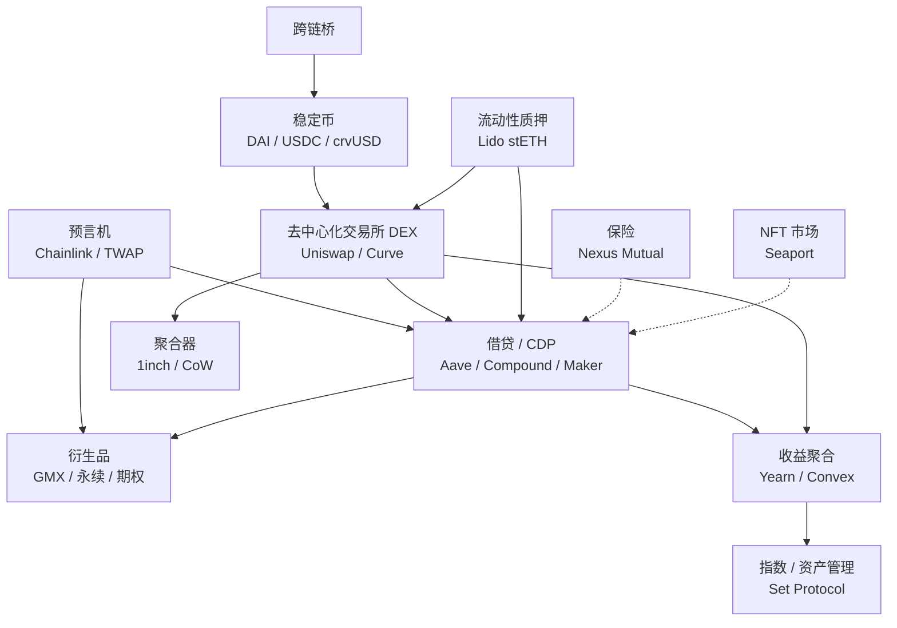
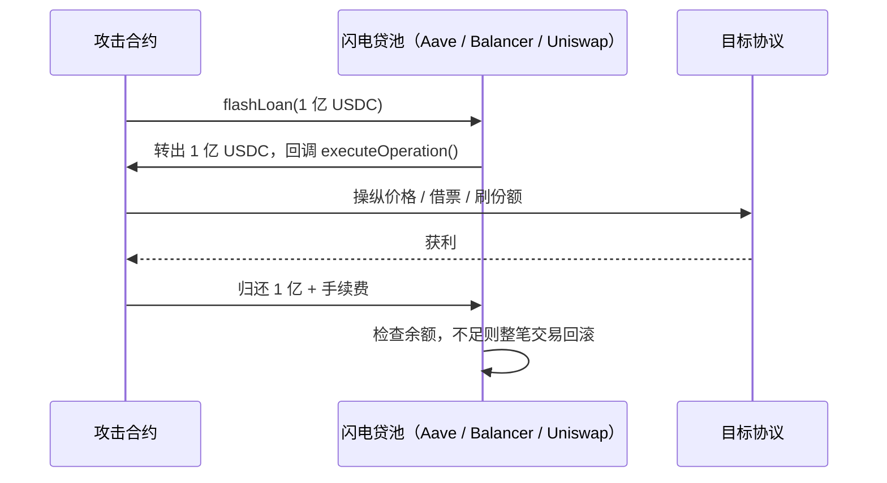
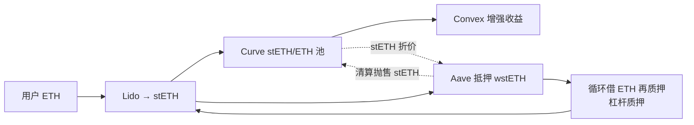

# B17 DeFi 地图与头部协议

> 学习目标：画出 DeFi 的主要类别与依赖关系；掌握审计 DeFi 必需的金融术语；理解闪电贷为什么改变了攻击成本；用同一张"协议卡"拆解头部协议的资金流、核心不变量和审计重点。  
> 前置章节：阶段 0–2 全部（到 [B15 LuckyPot](B15-audit-2-luckypot.md) 为止）  

> 🔗 关联：主线 [07 章](../07-external-calls-tokens.md)、[08 章](../08-oracle-flashloan.md)、[11 章](../11-defi-economic-security.md) ｜ 实验 [APR/APY](../interactive/audit-apy.html)、[预言机操纵](../interactive/oracle-manipulation-lab.html)、[份额换算](../interactive/audit-steth.html)、[金库通胀](../interactive/vault-inflation-lab.html) ｜ 评估 [A04](../assessment/A04-defi-protocol-review.md)、[A05](../assessment/A05-listing-due-diligence.md) ｜ 衔接 [B18](B18-dex-amm.md)、[B20](B20-lending-cdp.md)；阶段 5 深入 [B39](B39-case-lido.md)、[B41](B41-case-erc4626.md)

## 1. 一句话理解

**DeFi（去中心化金融）把交易所、银行、保险、衍生品写成公开合约。任何合约都能调用其他合约，所以一个协议的漏洞会沿着组合关系扩散。**

> 🎯 打个比方：DeFi 像一堆乐高积木搭成的城市。每块积木（协议）都可以拿来搭新楼。好处是建得快；坏处是一块底层积木（例如一个预言机或一个稳定币）裂了，上面所有楼都会晃。
>
> 比喻的局限：乐高积木不会互相改变形状。DeFi 协议之间有反馈：下游的清算会反过来压低上游的价格（见第 7 节）。

## 2. DeFi 地图



**读图要点：**

- 箭头表示"依赖"。预言机和稳定币是根节点，它们出问题影响最广。
- 审计一个协议时，先画出它的上游依赖，再问："如果上游价格被操纵、上游被暂停、上游升级了，我会怎样？"
- 局限：真实依赖比图中更密。一个收益聚合器可能同时依赖 5 个 DEX、3 个借贷协议和 2 个预言机。

DEX 和借贷在 [B18](B18-dex-amm.md)、[B20](B20-lending-cdp.md) 单独讲。图中其余类别的头部协议见第 5 节的协议卡。

## 3. 审计 DeFi 必备术语

| 术语 | 定义 | 审计关注 |
|---|---|---|
| TVL | 锁仓总价值 | 攻击收益上限的估计 |
| APR / APY | 年化单利 / 年化复利 | APY = (1 + APR/n)<sup>n</sup> − 1；宣传数字常用 APY |
| 流动性提供者 LP | 向池子提供资产、获得份额的人 | 份额铸造与销毁公式 |
| 滑点 Slippage | 预期价格与成交价格的差 | 是否有 `minOut` 参数 |
| 价格影响 Price Impact | 交易本身对池子价格的推动 | 能否被用来操纵价格 |
| 无常损失 IL | LP 相对于单纯持有的损失 | B18 章实验 可计算 |
| 抵押率 / LTV | 借款价值 ÷ 抵押物价值 | 上限参数的设置与单位 |
| 健康因子 HF | 风险调整后的抵押价值 ÷ 债务 | HF 低于 1 可被清算 |
| 清算 Liquidation | 第三方偿还债务，按折扣拿走抵押物 | 清算激励、坏账处理 |
| 闪电贷 Flash Loan | 同一交易内借出并归还的无抵押贷款 | 任何"需要大资金"的攻击都变成零成本 |
| 预言机 Oracle | 把链外数据（价格）带上链的机制 | 可操纵性、陈旧性 |
| 治理 Governance | 代币持有者投票修改参数或升级 | 闪电贷借票、时间锁 |
| 代币经济 Tokenomics | 代币的发行、分配、激励与回购规则 | B22 章 |

## 4. 闪电贷：攻击的"杠杆放大器"



**读图要点：**

- 原子性：要么全部成功，要么全部回滚。攻击者失败时只损失 Gas。审计时要按"攻击者有无限资金"评估。
- 局限：闪电贷只在一笔交易内有效。威胁模型和能抵抗闪电贷的价格源见 [08 章](../08-oracle-flashloan.md) 第 2、4 节。

> 🧪 交互实验：[APR / APY 计算器](../interactive/audit-apy.html)

## 5. 头部协议卡

每个协议都用五个问题拆解：**钱从哪来？存在哪里？谁能动它？价格从哪来？什么必须永远成立？**

| 协议 | 类别 | 核心机制 | 必须成立的不变量 | 审计重点 |
|---|---|---|---|---|
| Convex Finance | 收益增强 | 用户存入 Curve LP，Convex 统一质押到 Curve gauge，用自己锁定的 veCRV 提高收益，分发 CRV + CVX | 每个用户的待领奖励之和 ≤ 合约持有奖励 | 奖励累计（rewardPerToken，见第 6 节）更新顺序；包装代币转让时奖励归属 |
| Yearn Finance | 收益聚合器 | Vault 接收存款，分配给多个 Strategy；`harvest` 时结算盈亏，盈利逐步释放 | 份额价格只在真实盈利时上升 | harvest 可被夹击（存款→harvest→取款）；策略亏损报告；V3 采用 ERC-4626 |
| GMX | 永续合约 | V1：GLP 池作为所有交易者的对手方，按预言机价格成交，无滑点 | 池子价值 = 资产 − 交易者未实现盈亏 | 预言机延迟套利；空头均价计算；2025 年 7 月 V1 事故见 [B42 第 11.1 节](B42-perps.md) |
| Nexus Mutual | 保险（互助） | 成员购买保障，理赔自 2025 年 NMPIP-261 起改由专家委员会评估（[来源](https://nexusmutual.io/blog/nexus-mutual-v3-a-year-of-progress-in-onchain-risk-infrastructure)）；NXM 通过协议定价买卖 | 资本池 ≥ 最低资本要求 | 理赔决策权限；定价公式；会员白名单绕过 |
| OpenSea Seaport | NFT 市场 | 订单离线签名，链上撮合；支持条件（criteria）、zone、conduit 授权代理 | 每个订单的成交量不超过签名允许的量 | 签名与订单哈希；部分成交的分数计算；conduit 授权范围；旧订单未取消导致低价成交（2022 年 1 月 OpenSea 旧挂单事件，[来源](https://blockworks.co/news/opensea-responds-to-nft-loophole)；此后 Wyvern 合约升级让旧挂单失效，[公告](https://opensea.io/blog/articles/announcing-a-contract-upgrade)） |
| Set Protocol | 指数 / 资产管理 | SetToken 持有一篮子资产（Set Labs 2023 年宣布停止开发 V2，现存 Set 继续运行，[来源](https://medium.com/set-protocol/announcing-the-deprecation-of-set-protocol-v2-and-tokensets-f019410f2d2a)）；Manager 通过模块（发行、交易、再平衡）调整 | 每单位 SetToken 的成分 × 份额 = 实际持仓 | 发行/赎回取整；模块权限；Manager 恶意调仓 |
| Lido | 流动性质押 | 用户存 ETH 得 stETH（rebase）；预言机委员会每日报告信标链余额；提款走队列 | stETH 总量 = 协议控制的 ETH | rebase 代币 1–2 wei 取整误差；集成方应使用 wstETH；预言机报告异常；提款队列 NFT |

> 💡 项目实例（阶段 5）：[B39 Lido stETH 集成审计](B39-case-lido.md) · [B41 ERC-4626 金库审计](B41-case-erc4626.md) · [B42 永续合约](B42-perps.md)。

## 6. 奖励累计算法（多个协议通用）

Synthetix StakingRewards 的"每代币奖励累积"算法被 Convex、Sushi MasterChef 等大量复用：

```solidity
// 累计每单位质押应得奖励，放大 1e18 保精度
rewardPerTokenStored += (now - lastUpdate) * rewardRate * 1e18 / totalSupply;
// 用户应得 = 余额 × 自上次结算以来的增量 + 未领部分
earned[user] = balance[user] * (rewardPerTokenStored - userPaid[user]) / 1e18 + rewards[user];
// 任何改变 balance 或 totalSupply 的操作之前，必须先 updateReward(user)
```

- 在 `stake / withdraw / transfer` 前忘记 `updateReward` → 新用户领到历史奖励。
- `totalSupply == 0` 时奖励去向未定义 → 奖励永久卡在合约里。
- `rewardRate` 精度：奖励代币小数位低（例如 USDC 6 位）且总质押量大时，每秒奖励被取整为 0。

## 7. 组合风险图



**读图要点：**

- 虚线是反馈回路：stETH 在 Curve 折价 → Aave 中的杠杆头寸被清算 → 清算人在 Curve 抛售 stETH → 折价更深。
- 2022 年 6 月 stETH 曾出现超过 5% 的折价（CoinDesk 引 Dune 数据，最高约 8%，[来源](https://www.coindesk.com/markets/2022/06/14/staked-ether-becomes-focus-of-crypto-stress-from-celsius-to-three-arrows)），部分杠杆质押头寸被清算。
- 审计单个协议时，要问：我的预言机用的是 stETH 的市场价，还是按 1:1 兑换率？两种选择各有被攻击的方式。

## 8. 学习资源（路线图原文条目）

- CoinGecko《How to DeFi: Beginner》《How to DeFi: Advanced》。
- Teach Yourself Crypto 第 4 模块：DeFi 各类型介绍与基础经济学术语。
- Khan Academy 衍生证券（期货、期权、互换）基础课程。
- Tokenomics DAO：Tokenomics 101。

> 🪞 反思：选一个你用过的 DeFi 产品。
> 1. 你的收益来自谁付的钱？用五个问题写出它的协议卡，你卡在哪一题？
> 2. 它依赖了哪几个外部协议？它的奖励能否被短时持仓套利？
> 3. 其中一个失效或底层资产脱锚时，你的损失路径是什么？你多久能知道？

## 9. 思考题

1. 一个协议的奖励按"当前持仓"实时计算，没有时间加权。闪电贷能怎样利用它？
2. APR 10%，按秒复利的 APY 和按年复利相差多少？在实验里验证。
3. 一个金库集成 stETH，用 `transfer(amount)` 后断言接收方余额增加了 `amount`。为什么这个断言偶尔会失败？
4. Yearn 的"盈利逐步释放"机制防御的是哪一种攻击？
