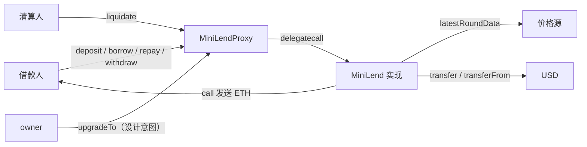
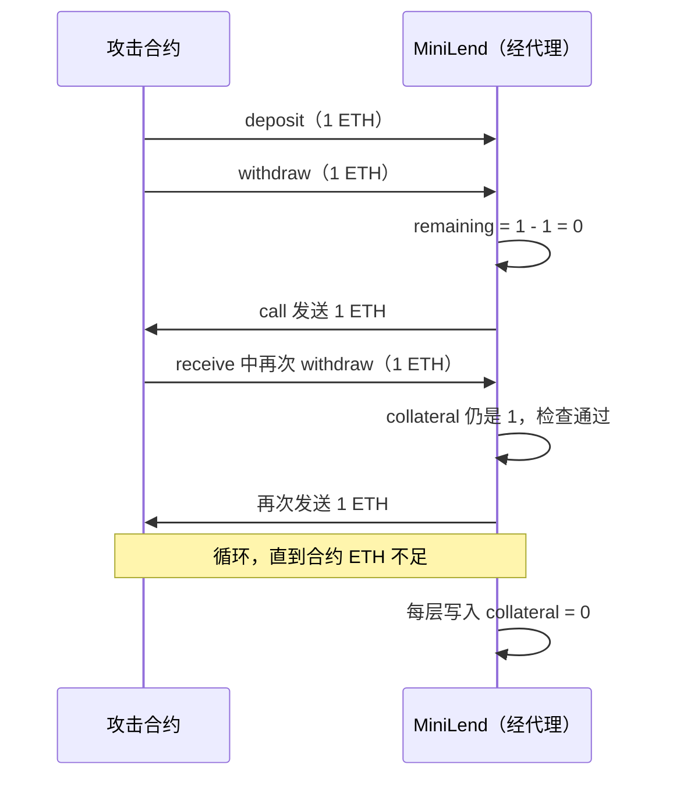

# B25 实战项目：端到端审计 MiniLend 与模型报告

> 学习目标：读完并做完本章，你能——
> 1. 独立走完"范围 → 威胁模型 → 入口权限图 → 清单 → 发现 → PoC → 修复复查"七个阶段。
> 2. 用检查项编号（REN-、ACC-、ARI-、EXT-、ORA-）记录每一处检查结果。
> 3. 按 T03 模板写出可复核的完整报告，并按 A02 矩阵定级。写完后与第 11 节的模型报告逐字段对照自评。
> 4. 说出每个发现的严重度、可能性和影响怎样按 A02 矩阵得出。
> 5. 说出"附条件上线"需要哪些上线条件、已接受风险和监控需求。
>
> 前置章节：[04](../04-reentrancy.md)–[09](../09-mev-signatures.md)、[B14](B14-writing-findings.md)、[B20](B20-lending-cdp.md)、[A02](../assessment/A02-risk-rating-reporting.md)
> 交互实验：[MiniLend 审计练习台](../interactive/audit-capstone.html) ｜ 靶场：[practice-example-code/minilend/](../../practice-example-code/minilend/src/MiniLend.sol) ｜ 模板：[T03](../templates/T03-finding-report.md)

## 1. 一句话理解

**审计不是找 bug 比赛，而是一条证据链：先写清楚审什么，再说明什么不能被打破，最后用可运行的测试证明它被打破了、又被修好了。**

> 🎯 打个比方：审计像**验房**。
>
> - 验房师先确认验哪一套房、验哪些项目（范围）。
> - 然后问：什么情况算房子不合格（不变量）。
> - 接着按清单逐项敲墙、试水（清单检查）。
> - 发现问题要拍照、标位置（发现和 PoC）。
> - 业主修好后再验一次（修复复查）。
>
> 比喻的局限：房子不会主动攻击验房师。合约的攻击者会主动寻找清单之外的路径。所以清单只是下限。

## 2. 靶场与运行方式

MiniLend 允许用户存入 ETH 作为抵押，借出稳定币 USD。最大借款比例（LTV，Loan-to-Value）是 75%。清算阈值是 80%。债务按每秒利率累积。合约部署在代理之后。

| 文件 | 作用 |
|---|---|
| [src/MiniLend.sol](../../practice-example-code/minilend/src/MiniLend.sol) | 审计目标，包含 8 个预埋漏洞 |
| [src/MiniLendFixed.sol](../../practice-example-code/minilend/src/MiniLendFixed.sol) | 全部修复，对外接口不变 |
| [src/MiniLendProxy.sol](../../practice-example-code/minilend/src/MiniLendProxy.sol) | 最小 ERC-1967 代理 |
| [test/MiniLendPoC.t.sol](../../practice-example-code/minilend/test/MiniLendPoC.t.sol) | 每个发现的 PoC 和修复验证 |
| [test/MiniLendInvariant.t.sol](../../practice-example-code/minilend/test/MiniLendInvariant.t.sol) | 修复版的不变量测试 |

运行步骤：

1. 确认 `practice-example-code/foundry/lib/forge-std` 存在。靶场共用这份依赖。
2. 进入目录：`cd practice-example-code/minilend`。
3. 运行测试：`forge test`。

> ⚠️ 警告：靶场只用于本地学习。靶场不连接任何网络，也不包含真实地址。不要部署到主网。

> 💡 注意：做题时先只打开 `MiniLend.sol`。源码里的 `// ❌ 漏洞` 注释是答案。第一遍审计前，先生成无注释的副本：`sed '/❌/d' src/MiniLend.sol > /tmp/target.sol`。副本的行号会变化。本章的行号以原文件为准。

## 3. 阶段一：定义范围

范围回答一个问题：这份报告对哪些代码负责。

**任务 1.1** 写出审计范围。写出文件、版本、部署方式、外部依赖、排除项。

<details class="predict"><summary>🤔 先写再看：范围表应该包含哪些内容？</summary>

| 项目 | 内容 |
|---|---|
| 代码 | `MiniLend.sol` 全部 121 行；`MiniLendProxy.sol` 全部 |
| 版本 | 文件 SHA-256 前 16 位：`88869dcae78a7ba3`（靶场没有提交哈希，所以用文件摘要） |
| 编译 | solc 0.8.30，EVM 版本 prague |
| 部署 | 单链；代理部署，构造函数内调用 `initialize` |
| 外部依赖 | USD 代币（失败时返回 false）；8 位小数的价格源 |
| 排除项 | 前端、部署脚本、密钥运营、价格源自身的安全 |

</details>

**任务 1.2** 列出你需要向项目方确认的问题。至少写 3 个。

<details class="predict"><summary>🤔 先写再看：哪些问题会改变定级？</summary>

1. USD 失败时回滚还是返回 false？答案决定 F-06 的可能性。
2. `owner` 由谁持有，有没有时间锁？答案决定升级风险的可能性。
3. 价格源的心跳是多少？答案决定过期阈值。
4. 协议是否预期出现坏账？答案决定清算设计的验收标准。

本靶场的回答：USD 失败时返回 false；`owner` 是单一地址；心跳按 3,600 秒（示例）；协议不接受可以避免的坏账。

</details>

## 4. 阶段二：威胁模型

按 [T02](../templates/T02-threat-model.md) 的结构回答：谁会攻击什么，怎么攻击。



**读图要点：**

- 资金从两个方向离开协议：USD 经 `borrow` 离开，ETH 经 `withdraw` 和 `liquidate` 离开。
- 控制权在 `call` 发送 ETH 时交给外部。这里是重入的入口。
- 价格来自一个外部合约。协议对这个输入没有校验时，错误价格直接变成错误放款。
- 局限：图只画了设计意图。`owner` 这条边在代码里没有落实，是审计要验证的内容。

**任务 2.1** 列出资产和角色，写出信任假设。

<details class="predict"><summary>🤔 先写再看：资产和角色表</summary>

| 资产 | 位置 |
|---|---|
| 用户 ETH 抵押品 | 代理合约余额 |
| 协议 USD 流动性 | 代理合约的 USD 余额 |
| 升级权和 `owner` | ERC-1967 槽位、`owner` 变量 |

| 角色 | 能做什么 | 信任假设 |
|---|---|---|
| 借款人 / 清算人 | 调用公开函数 | 不可信，可以是合约 |
| owner | 升级实现 | 半可信，私钥可能泄露 |
| 价格源 | 提供价格 | 可信但会失效：可能停更、可能返回 0 |
| USD | 转账 | 可信，但失败时返回 false |

攻击者画像：外部攻击者（有合约，有资金）、恶意用户、失效的依赖。

</details>

**任务 2.2** 写出协议必须保持的不变量。至少写 4 条。

<details class="predict"><summary>🤔 先写再看：参考不变量</summary>

| 编号 | 不变量 |
|---|---|
| INV-1 | 合约 ETH 余额等于全部用户的 `collateral` 之和 |
| INV-2 | `totalDebtShares` 等于全部用户的 `debtShares` 之和 |
| INV-3 | 用户操作结束后，借款和取款不能让仓位超过 LTV |
| INV-4 | 每次借款增加的债务不小于借出金额（取整偏向协议） |
| INV-5 | USD 余额变化等于实际流入减去流出 |
| INV-6 | 只有 `owner` 能改变实现合约 |

INV-1 到 INV-5 对应 `MiniLendInvariant.t.sol`。INV-6 由单元测试覆盖。

</details>

## 5. 阶段三：入口与权限图

**任务 3.1** 列出全部外部函数。为每个函数标记调用者、状态写入、外部调用、价格依赖。

<details class="predict"><summary>🤔 先写再看：入口表</summary>

| 函数 | 预期调用者 | 实际限制 | 写入状态 | 外部调用 | 用价格 |
|---|---|---|---|---|---|
| `initialize` | 部署交易 | **无** | `usd`、`feed`、`owner`、`borrowIndex` | 无 | 否 |
| `upgradeTo` | owner | **无** | 实现槽位 | 无 | 否 |
| `accrue` | 任何人 | 无（符合预期） | `borrowIndex` | 无 | 否 |
| `deposit` | 任何人 | 无（符合预期） | `collateral` | 无 | 否 |
| `borrow` | 任何人 | LTV 检查 | `debtShares` | `usd.transfer` | 是 |
| `repay` | 任何人 | 无 | `debtShares` | `usd.transferFrom` | 否 |
| `withdraw` | 任何人 | 余额检查 | `collateral` | ETH `call` | **应该用但没有用** |
| `liquidate` | 任何人 | 仓位低于阈值 | `collateral`、`debtShares` | `transferFrom`、`transfer` | 是 |

两个加粗的"无"已经是 Critical 候选项。`withdraw` 的第三个加粗项，是 LTV 校验的缺口。

</details>

**任务 3.2** 用一句话写出每个外部调用发生时，哪些状态还没有更新。

<details class="predict"><summary>🤔 先写再看：外部调用点</summary>

| 位置 | 调用前未更新的状态 |
|---|---|
| `borrow` 第 83 行 | 无。状态已更新，返回值被忽略 |
| `repay` 第 89 行 | `debtShares` 未更新。ToyUSD 没有钩子，当前不构成重入 |
| `withdraw` 第 103 行 | `collateral` 未更新，这是重入窗口 |
| `liquidate` 第 113 行 | `collateral` 和 `debtShares` 未更新。ToyUSD 没有钩子 |
| `liquidate` 第 119 行 | 无。状态已清零 |

</details>

## 6. 阶段四：清单检查

**任务 4.1** 打开四个章节的审计检查点，逐项检查 `MiniLend.sol`。用下表格式记录：编号、位置、结论、发现编号。

检查点来源：[REN](../04-reentrancy.md)、[ACC](../05-access-control.md)、[ARI](../06-arithmetic-precision.md)、[EXT](../07-external-calls-tokens.md)、[ORA](../08-oracle-flashloan.md)。

<details class="predict"><summary>🤔 先写再看：清单结果</summary>

| 检查项 | 位置 | 结论 | 发现 |
|---|---|---|---|
| REN-1 列出外部调用 | 第 83、89、103、113、119 行 | 已列出 | — |
| REN-2 外部调用前状态已更新 | 第 103 行 | **失败** | F-03 |
| REN-3 共享状态的入口共用锁 | 全合约 | **失败**，没有锁 | F-03 |
| REN-5 带钩子的代币 | USD | 通过，USD 是指定代币 | — |
| REN-7 原生币转账触发 fallback | 第 103、119 行 | 触发，是重入前提 | F-03 |
| ACC-1 修改状态的函数有权限论证 | `initialize`、`upgradeTo` | **失败** | F-01、F-02 |
| ACC-3 初始化保护 | 第 35 行 | **失败** | F-01 |
| ACC-4 用户可控的 delegatecall 目标 | `upgradeTo` | **失败**，经升级获得 | F-02 |
| ACC-5 两步转移所有权 | 无转移函数 | 不适用；建议增加 | — |
| ACC-7 升级经过时间锁 | 第 44 行 | **失败** | F-02 |
| ARI-4 先乘后除 | 第 67、79、91 行 | 通过 | — |
| ARI-5 取整方向对协议有利 | 第 63、79、91 行 | **失败** | F-08 |
| ARI-7 不写死精度 | 第 67 行的 `1e8` | 失败，价格源精度写死；影响被范围假设覆盖 | F-05 建议 |
| ARI-9 重复操作的模糊测试 | 测试集 | 审计前缺失 | F-08 |
| EXT-1 低级调用检查返回值 | 第 103 行 | 通过 | — |
| EXT-2 无代码目标 | `upgradeTo` | 失败，没有代码长度检查 | F-02 建议 |
| EXT-3 代币操作用 SafeERC20 | 第 83、89、113 行 | **失败** | F-06 |
| EXT-5 拉取模式或单笔失败隔离 | 第 119 行 | **失败**，`transfer` 让合约清算人失败 | F-07 |
| ORA-1 列出价格来源 | `feed` | 单一喂价，一笔交易内不可变 | — |
| ORA-4 时效、正值、上下限、精度 | 第 59–60 行 | **失败** | F-05 |
| ORA-5 L2 排序器 | 单链假设 | 不适用；部署到 L2 前必须增加 | — |
| ORA-7 预言机失败的降级路径 | `price()` | **失败**，没有降级路径；修复后见阶段七 | F-05 |
| ORA-8 VRF 回调 | 无 VRF | 不适用 | — |

未列出的检查项，在本靶场没有对应代码（例如 `unchecked` 块）。

</details>

> 💡 注意：清单结论写"失败"还不够。下一阶段要把失败项写成攻击路径。写不出路径的失败项，只能作为建议。

**任务 4.2** 清单之外，再看一次协议语义。清算函数的清单项全部通过吗？还有什么问题？

<details class="predict"><summary>🤔 先写再看：清算的语义问题</summary>

清算人只偿还全部债务，却拿走全部抵押品。清单没有一条直接说"奖励必须有上限"。这需要读 B20 的清算模型后判断。结果是 F-07。

</details>

## 7. 阶段五：写发现

定级用 [A02](../assessment/A02-risk-rating-reporting.md) 的矩阵。先写影响，再写可能性，最后查表。

**任务 5.1** 给清单失败项定级。写出影响、可能性、等级。

<details class="predict"><summary>🤔 先写再看：定级结果</summary>

| 发现 | 影响 | 可能性 | 等级 | 依据 |
|---|---|---|---|---|
| F-01 重复初始化 | 严重 | 高 | 严重 | 任何人一笔交易夺取协议 |
| F-02 未授权升级 | 严重 | 高 | 严重 | 任何人一笔交易替换实现 |
| F-03 `withdraw` 重入 | 严重 | 高 | 严重 | 一笔交易提走其他用户抵押品 |
| F-04 取款不检查健康度 | 严重 | 高 | 严重 | 任何人三笔调用制造坏账 |
| F-05 价格未校验 | 严重 | 中 | 高 | 需要价格源停更或返回 0 |
| F-06 未检查代币返回值 | 严重 | 中 | 高 | 取决于 USD 返回 false |
| F-07 清算无上限 | 高 | 高 | 高 | 借款人越线即损失超额抵押品 |
| F-08 取整方向错误 | 中 | 高 | 中 | 每次操作只损失小额 |

</details>

**任务 5.2** 用 [T03](../templates/T03-finding-report.md) 的字段写 F-04。写完再与第 11 节的模型报告对比。

<details class="predict"><summary>🤔 先写再看：常见写法错误</summary>

| 错误 | 修正 |
|---|---|
| 标题写"缺少检查" | 标题写后果："`withdraw` 不检查健康度，借款人可取走全部抵押品并保留债务" |
| 证据贴完整攻击代码 | T03 要求证据不含可直接利用的攻击代码。写测试名称和读数 |
| 只写"加检查" | 写清楚检查放在哪：更新 `collateral` 之后、转出 ETH 之前 |

</details>

## 8. 阶段六：写 PoC

PoC（Proof of Concept，概念验证）用可运行的测试证明发现成立。每个发现需要两组测试：

1. 对漏洞版运行，断言资金损失或状态被破坏。
2. 对修复版运行同一场景，断言它回滚或没有收益。



**读图要点：**

- 数据从 `collateral` 读出，在 `call` 之后才写回。
- 错误点是第 105 行写入"调用前算好的 `remaining`"。Solidity 0.8 的检查算术救不了这种写法。
- 每一层重入都通过了余额检查，因为账本还没有更新。
- 局限：图省略了代理的 `delegatecall`。

**任务 6.1** 回答：如果第 105 行写成 `collateral[msg.sender] -= amt`，同一函数重入还能成功吗？

<details class="predict"><summary>🤔 先猜再看：Solidity 0.8 与 `-=`</summary>

不能。内层把余额减到 0 后，外层再减一次会下溢并回滚。整笔交易失败。

攻击者仍然可以跨函数重入：在回调中调用 `borrow`，用尚未扣减的抵押品借款。所以 `-=` 不是修复。修复是 CEI 加重入锁。

</details>

**任务 6.2** 不看答案，写 `F-03` 的 PoC。然后对照 `test_F03_PoC_ReentrantWithdrawDrainsOtherUsers`。

<details class="predict"><summary>🤔 先写再看：这条 PoC 的断言</summary>

示例场景：受害者存入 10 ETH，攻击者存入 1 ETH。

1. `assertEq(address(vuln).balance, 0)`：合约被提空。
2. `assertEq(address(bot).balance, 11 ether)`：攻击合约多拿 10 ETH。
3. `assertEq(vuln.collateral(victim), 10 ether)`：账本仍然显示受害者有 10 ETH。

第 3 条断言证明的是账实不符，这是 INV-1 被打破。

</details>

**任务 6.3** 运行全部 PoC：`forge test --match-contract MiniLendPoCTest -vv`。对照下表找到每个发现的测试。

| 发现 | 漏洞版 PoC | 修复版验证 |
|---|---|---|
| F-01 | `test_F01_PoC_ReinitializeHijacksProtocol` | `test_F01_Fixed_ReinitializeReverts`、`test_F01_Fixed_ImplementationLocked` |
| F-02 | `test_F02_PoC_AnyoneUpgradesAndDrains` | `test_F02_Fixed_UpgradeRequiresOwner` |
| F-03 | `test_F03_PoC_ReentrantWithdrawDrainsOtherUsers` | `test_F03_Fixed_ReentrantWithdrawReverts` |
| F-04 | `test_F04_PoC_WithdrawAllCollateralKeepDebt` | `test_F04_Fixed_WithdrawBelowLtvReverts` |
| F-05 | `test_F05_PoC_StalePriceAllowsOverBorrow`、`test_F05_PoC_ZeroPriceLiquidatesHealthyUser` | `test_F05_Fixed_StalePriceReverts`、`test_F05_Fixed_ZeroPriceReverts` |
| F-06 | `test_F06_PoC_RepayWithoutPaying` | `test_F06_Fixed_RepayWithoutPayingReverts` |
| F-07 | `test_F07_PoC_LiquidatorSeizesAllCollateral`、`test_F07_PoC_ContractLiquidatorFailsOnTransfer` | `test_F07_Fixed_PartialLiquidationCapsBonus`、`test_F07_Fixed_ContractLiquidatorSupported` |
| F-08 | `test_F08_PoC_DustBorrowCreatesNoDebt`、`test_F08_PoC_RepayRoundsInBorrowerFavour` | `test_F08_Fixed_DustBorrowCreatesDebt`、`test_F08_Fixed_DustRepayBurnsNothing` |

## 9. 阶段七：修复复查

复查不是确认"改过了"。复查要回答三个问题：根因是否消除，修复是否引入新问题，同类位置是否都改了。

**任务 7.1** 对比 `MiniLend.sol` 和 `MiniLendFixed.sol`。检查 F-06 的修复是否覆盖全部三处调用。

<details class="predict"><summary>🤔 先写再看：F-06 的三处位置</summary>

三处都改了。`borrow` 调用 `_pushUSD`，`repay` 和 `liquidate` 调用 `_pullUSD`。这两个函数都经过 `_checkedCall`。`_checkedCall` 还拒绝无代码的 USD 地址，覆盖 EXT-2。

</details>

**任务 7.2** 修复版的 `withdraw` 在无债务时不读取价格。为什么？

<details class="predict"><summary>🤔 先猜再看：取款与预言机</summary>

没有债务的用户不会影响偿付能力。如果预言机失效时也禁止这些用户取款，预言机故障就变成全体资金冻结。这对应 ORA-7 的降级路径。

</details>

**任务 7.3** 修复版还有什么剩余风险？至少写 3 条。

<details class="predict"><summary>🤔 先写再看：剩余风险</summary>

| 剩余风险 | 证据或说明 |
|---|---|
| 抵押品不足时，坏账留在账本上，没有处置机制 | `test_F07_Fixed_SeizureCappedAtCollateralBadDebtRemains` |
| 预言机过期时，借款和清算都回滚；价格下跌期间无法清算 | `price()` 的设计取舍 |
| `owner` 仍是单一地址，没有时间锁 | ACC-7 只修复了权限，没有修复治理 |
| 修复版只验证了 ToyUSD，换代币要重新评估 | 范围假设 |
| 单次 50% 清算比例和 5% 奖励是示例参数，没有经过经济建模 | 需要单独的参数评估 |

</details>

**任务 7.4** 运行不变量测试：`forge test --match-contract MiniLendInvariantTest`。

<details class="predict"><summary>🤔 先猜再看：不变量全部通过，能说明合约安全吗？</summary>

不能。它只说明在测试用的处理器（Handler）能走到的路径上，这些断言没有被打破。Handler 没有实现重入攻击，也没有操纵价格到范围之外。不变量测试是证据之一，不是证明。

</details>

## 10. 练习台与本靶场的差异

练习台的概念仍然适用：逐行标记问题，然后对照答案。先用练习台热身，再做本章的完整流程。

> 🧪 交互实验：[MiniLend 审计练习台](../interactive/audit-capstone.html)

两者是不同的合约：

| 项目 | 练习台 | 本靶场 |
|---|---|---|
| 代码 | 36 行，依赖 OpenZeppelin UUPS | 121 行，无外部依赖，自带最小代理 |
| 利息 | 无 | 有 `borrowIndex` 和债务份额 |
| 问题数 | 7 个 | 8 个，新增 F-08 取整问题 |
| `withdraw` 写法 | `collateral -= amt`。同函数重入在 0.8 下下溢回滚，只能跨函数利用 | 写入预先算好的 `remaining`。同函数重入成立 |
| 问题 1–3 | Critical | 对应 F-01、F-02、F-03，严重 |
| 问题 4：取款不查健康度 | High | F-04，严重。任何人可触发，且造成资不抵债 |
| 问题 5：价格未校验 | Medium | F-05，高。按 A02 矩阵：影响严重，可能性中 |
| 问题 6：未检查返回值 | Medium | F-06，高。靶场 USD 失败时返回 false |
| 问题 7：清算奖励无上限 | Low | F-07，高。借款人的超额抵押品被全部拿走 |
| 等级名称 | 英文四级 | A02 中文五级 |

> 💡 注意：练习台的等级是练习用的静态答案。写报告时以 A02 矩阵和本章的攻击假设为准。

## 11. 模型报告（T03 格式）

> ⚠️ 警告：本节是第 3–9 节任务的参考答案。先完成全部任务，写出你自己的报告，再读本节。先读答案，你就失去了独立定级和写作的练习机会。

第 3–9 节带你走完了七个阶段。本节把这些阶段的结果汇总成一份按 [T03](../templates/T03-finding-report.md) 格式写的完整报告。读的时候，把你的报告放在旁边，逐节对照。第 12 节给出对照的要点。

> 💡 注意：T03 的"影响"字段写作"高 / 中 / 低"。本报告按 A02 的四档影响填写，因此会出现"严重"。

### 11.1 摘要

**结论：暂缓上线（`MiniLend.sol` 原版）。** 修复版 `MiniLendFixed.sol` 的结论是**附条件**：完成第 11.9 节的上线条件后可以上线。

| 严重 | 高 | 中 | 低 | 信息 |
|---|---|---|---|---|
| 4 | 3 | 1 | 0 | 0 |

三句话风险概述：

1. 任何外部账户都能夺取协议的初始化或升级权，并取走全部资金。
2. 抵押品可以被重入提空，也可以在保留债务时被取走。
3. 价格、代币返回值和清算奖励都缺少校验，这些问题造成坏账或借款人损失。

### 11.2 范围与版本

| 项目 | 内容 |
|---|---|
| 文件 | `practice-example-code/minilend/src/MiniLend.sol`（SHA-256 前 16 位 `88869dcae78a7ba3`）、`MiniLendProxy.sol` |
| 修复复查 | `practice-example-code/minilend/src/MiniLendFixed.sol` |
| 链 | 本地测试环境，单链假设 |
| 评估日期 | 2026-11-10（教学示例） |
| 方法与工时 | 人工审计、清单、Foundry PoC、模糊和不变量测试；工时为教学示例，不记录 |

### 11.3 架构与信任假设

架构见第 4 节的图。角色和信任假设见任务 2.1 的答案。USD 失败时返回 false。价格源使用 8 位小数。

### 11.4 发现列表

```
ID:            F-01
标题:          initialize 可被任何人重复调用，攻击者可替换 owner 和价格源并借空 USD
严重度:        严重
可能性:        高        影响: 严重
位置:          src/MiniLend.sol:35-41
类别:          权限

描述:          initialize 没有一次性保护。部署后任何人都能再次调用。被打破的假设：
               初始化只发生一次，且只由部署方发起。
影响:          攻击者设置自己的价格源，用 1 wei 抵押借出全部 USD。示例中损失
               1,000,000 USD 全部流动性。全体用户受影响。
触发条件:      无。任何账户，一笔交易。
证据:          test_F01_PoC_ReinitializeHijacksProtocol
建议:          增加一次性初始化标记；实现合约的构造函数锁死初始化；校验地址非零和
               价格源精度。
状态:          已修复
验证方式:      回归测试（test_F01_Fixed_ReinitializeReverts、
               test_F01_Fixed_ImplementationLocked）
```

```
ID:            F-02
标题:          upgradeTo 没有权限检查，任何人可替换实现合约并转走全部资产
严重度:        严重
可能性:        高        影响: 严重
位置:          src/MiniLend.sol:44-48
类别:          升级

描述:          upgradeTo 直接写入 ERC-1967 实现槽位，没有调用者检查，也没有代码
               长度检查。被打破的假设：只有 owner 能改变合约逻辑。
影响:          攻击者把实现指向自己的合约，通过 delegatecall 转走代理持有的全部 ETH
               和 USD。示例中转走 100 ETH。全体用户受影响。
触发条件:      无。任何账户，一笔交易。
证据:          test_F02_PoC_AnyoneUpgradesAndDrains
建议:          增加 onlyOwner 和代码长度检查；owner 由多签加时间锁持有。
状态:          已修复（治理部分见已接受风险）
验证方式:      回归测试（test_F02_Fixed_UpgradeRequiresOwner）
```

```
ID:            F-03
标题:          withdraw 先转 ETH 后写入旧值，攻击者可重入提走其他用户的抵押品
严重度:        严重
可能性:        高        影响: 严重
位置:          src/MiniLend.sol:101-105
类别:          重入

描述:          withdraw 在 call 之后写入调用前算好的 remaining。回调期间 collateral
               还是旧值，重复调用都能通过余额检查。写入固定值也绕过了 0.8 的下溢
               保护。被打破的假设：INV-1 账实相符。
影响:          攻击者用 1 ETH 提走合约全部 ETH。示例中多得 10 ETH。账本仍显示受害者
               有余额，受害者无法取款。
触发条件:      攻击者使用合约账户，一笔交易。
证据:          test_F03_PoC_ReentrantWithdrawDrainsOtherUsers
建议:          调用前扣减 collateral（CEI）；全部写状态入口共用 nonReentrant。
状态:          已修复
验证方式:      回归测试（test_F03_Fixed_ReentrantWithdrawReverts）、不变量
               （invariant_EthBalanceEqualsCollateralLedger）
```

```
ID:            F-04
标题:          withdraw 不检查健康度，借款人可取走全部抵押品并保留债务
严重度:        严重
可能性:        高        影响: 严重
位置:          src/MiniLend.sol:97-106
类别:          其他（业务逻辑）

描述:          withdraw 只检查 collateral 余额，不检查剩余抵押是否支撑债务。被打破
               的假设：INV-3 有债务的仓位始终有抵押。
影响:          攻击者存入、借款、取回抵押品，净得全部借款。示例中 10 ETH 抵押借
               15,000 USD 后取回 10 ETH，协议坏账 15,000 USD。重复操作可借空 USD。
触发条件:      任何账户，三笔调用；不需要合约。
证据:          test_F04_PoC_WithdrawAllCollateralKeepDebt
建议:          更新 collateral 后、转出 ETH 前，校验 debtOf(user) <= maxBorrow(user)。
               没有债务时跳过校验。
状态:          已修复
验证方式:      回归测试（test_F04_Fixed_WithdrawBelowLtvReverts）、不变量
               （invariant_NoFreeBorrowNoUnsafeExit）
```

```
ID:            F-05
标题:          price 不校验时效和正值，过期价格可超额借款，零价格可清算健康仓位
严重度:        高
可能性:        中        影响: 严重
位置:          src/MiniLend.sol:58-61
类别:          预言机

描述:          price 直接把 answer 转成 uint256，没有检查 answer > 0 和 updatedAt。
               被打破的假设：协议读到的价格是当前有效价格。
影响:          价格源停更时，借款按旧价放款。示例中旧价 2,000、真实价 1,000，借出
               15,000 USD 对应 10,000 USD 的真实抵押价值。价格为 0 时，健康仓位可被
               清算，抵押品被低价取走。
触发条件:      价格源停更或返回 0。攻击者只需观察并调用。
证据:          test_F05_PoC_StalePriceAllowsOverBorrow、
               test_F05_PoC_ZeroPriceLiquidatesHealthyUser
建议:          校验 answer > 0、updatedAt 非零且未超过心跳阈值；初始化时校验 decimals；
               L2 部署时增加排序器检查。
状态:          已修复
验证方式:      回归测试（test_F05_Fixed_StalePriceReverts、test_F05_Fixed_ZeroPriceReverts）
```

```
ID:            F-06
标题:          未检查 USD 转账返回值，借款人可以不付款清除债务
严重度:        高
可能性:        中        影响: 严重
位置:          src/MiniLend.sol:83、89、113
类别:          外部调用

描述:          borrow、repay、liquidate 忽略 transfer 和 transferFrom 的返回值。USD
               失败时返回 false，不回滚。被打破的假设：调用返回即转账成功。
影响:          攻击者借款后转走 USD，再调用 repay。transferFrom 失败，债务仍被清除。
               示例中损失 10,000 USD。liquidate 同样会在未收款时清账并转出抵押品。
触发条件:      USD 失败时返回 false（范围内成立）。若 USD 改为失败即回滚，本发现不可利用。
证据:          test_F06_PoC_RepayWithoutPaying
建议:          用 SafeERC20 或等价封装；同时检查目标有代码、调用成功、返回值为 true。
状态:          已修复
验证方式:      回归测试（test_F06_Fixed_RepayWithoutPayingReverts）
```

```
ID:            F-07
标题:          清算没有比例和奖励上限，清算人只还债务却拿走全部抵押品
严重度:        高
可能性:        高        影响: 高
位置:          src/MiniLend.sol:113-119
类别:          经济

描述:          liquidate 按全部债务收款，并转出全部抵押品。seized 与债务无关。被打破的
               假设：清算只补偿清算风险。另外 transfer 只转发 2300 gas。
影响:          仓位刚越过阈值时，借款人损失全部超额抵押品。示例中清算人支付 15,000 USD，
               得到价值 18,000 USD 的 ETH，溢价 20%。合约钱包清算人的交易回滚。
触发条件:      仓位越过 80% 阈值。任何清算人，一笔交易。
证据:          test_F07_PoC_LiquidatorSeizesAllCollateral、
               test_F07_PoC_ContractLiquidatorFailsOnTransfer
建议:          限制单次清算比例和奖励比例；抵押品不足时反算应还金额；用 call 发送 ETH
               并检查结果。
状态:          已修复（参数和坏账处置见已接受风险）
验证方式:      回归测试（test_F07_Fixed_PartialLiquidationCapsBonus、
               test_F07_Fixed_ContractLiquidatorSupported、
               test_F07_Fixed_SeizureCappedAtCollateralBadDebtRemains）
```

```
ID:            F-08
标题:          债务份额的取整偏向借款人，小额借款产生 0 债务，小额还款多烧份额
严重度:        中
可能性:        高        影响: 中
位置:          src/MiniLend.sol:63、79、91
类别:          算术

描述:          borrow 向下取整铸造份额，repay 向上取整烧毁份额，debtOf 向下取整。
               利息指数上升后，小额借款的份额为 0。被打破的假设：INV-4 取整偏向协议。
影响:          攻击者重复小额借款，不产生债务。示例中 100 次调用借出 100 wei，债务份额
               为 0。单次金额小，gas 成本通常高于收益；低精度代币下损失放大。
触发条件:      利息指数大于初始值。任何账户。
证据:          test_F08_PoC_DustBorrowCreatesNoDebt、test_F08_PoC_RepayRoundsInBorrowerFavour
建议:          borrow 和 debtOf 向上取整；repay 向下取整；份额为 0 时回滚；全额还款时
               清零份额并只收取欠款。
状态:          已修复
验证方式:      回归测试（test_F08_Fixed_DustBorrowCreatesDebt、
               test_F08_Fixed_DustRepayBurnsNothing）、模糊测试
               （testFuzz_Fixed_BorrowAlwaysCreatesAtLeastTheBorrowedDebt）、不变量
               （invariant_RecordedDebtCoversPrincipal）
```

### 11.5 签名流程与运营安全评估

本靶场没有签名流程。运营安全不在范围内。`owner` 私钥管理需要项目方另行提供资料。

### 11.6 经济与依赖风险

| 项目 | 结论 |
|---|---|
| 价格依赖 | 单一价格源；修复版在价格失效时停止借款和清算 |
| 清算激励 | 50% 比例和 5% 奖励是示例参数，未做压力测试 |
| 利率 | 固定利率，没有按利用率调整 |
| 坏账 | 没有准备金或社会化机制 |

### 11.7 已接受风险

靶场没有业务负责人。下表列出需要业务负责人签字的项目，当前均**未签字**。

| 风险 | 缓解措施 | 负责人 | 复查日期 |
|---|---|---|---|
| owner 为单一地址 | 上线前迁移到多签加时间锁 | 待定 | 待定 |
| 坏账没有处置机制 | 设置总借款上限 | 待定 | 待定 |
| 预言机失效时无法清算 | 监控喂价心跳，设置告警 | 待定 | 待定 |

### 11.8 范围外说明

前端、部署脚本、密钥运营、价格源自身的安全、其他 USD 实现、L2 排序器场景都未覆盖。MEV（Maximal Extractable Value，最大可提取价值）对清算的影响未评估。

### 11.9 上线条件与监控需求

上线条件：

1. 全部发现的修复通过复查。
2. `owner` 迁移到多签加时间锁。
3. 确定并验证清算参数和总借款上限。

监控需求：

1. 监控价格源更新时间。
2. 监控实现槽位变化。
3. 监控 ETH 余额与账本之差。

### 11.10 附录

测试清单见第 8 节。不变量见任务 2.2。运行命令：`cd practice-example-code/minilend && forge test`。

修复版的不变量测试：`invariant_EthBalanceEqualsCollateralLedger`、`invariant_DebtSharesSumToTotal`、`invariant_UsdBalanceMatchesFlows`、`invariant_RecordedDebtCoversPrincipal`、`invariant_NoFreeBorrowNoUnsafeExit`。

## 12. 对照自评

逐项对照你的报告和第 11 节。每一项回答"有"或"没有"，"没有"的项写出你要补的内容。

| 对照项 | 模型报告的写法 | 位置 |
|---|---|---|
| 结论 | 原版和修复版分别给出结论；修复版写明上线条件 | 11.1、11.9 |
| 数量表 | 按 A02 五级统计：严重 4、高 3、中 1 | 11.1 |
| 范围与版本 | 写文件摘要、修复复查对象、评估日期 | 11.2 |
| 标题 | 写后果，不写"缺少检查" | 11.4 每个发现 |
| 定级 | 先写影响和可能性，再查 A02 矩阵 | 11.4 每个发现 |
| 触发条件 | 写清前提，例如 F-06 只在 USD 失败时返回 false 时成立 | 11.4 |
| 证据 | 写测试名称，不贴可直接利用的攻击代码 | 11.4 |
| 建议 | 写清检查放在哪里，例如 F-04 "更新 collateral 后、转出 ETH 前" | 11.4 |
| 状态与验证方式 | 每个发现写回归测试名；部分写不变量或模糊测试 | 11.4 |
| 剩余风险 | 未签字的已接受风险单独列表 | 11.7 |

> 💡 注意：等级与模型报告不同，不一定是错。先看你的攻击假设与任务 1.2 的回答是否一致。假设不同，等级就可能不同。报告里要写出你的假设。

## 13. 术语表

| 术语 | 英文 | 定义 |
|---|---|---|
| 最大借款比例 | Loan-to-Value（LTV） | 借款额与抵押品价值的比例上限 |
| 清算阈值 | Liquidation Threshold | 仓位可以被清算的比例线 |
| 概念验证 | Proof of Concept（PoC） | 证明漏洞可利用的最小测试 |
| 不变量 | Invariant | 协议在任何操作后都必须成立的性质 |
| 处理器 | Handler | 不变量测试中，约束随机调用的合约 |
| 利息指数 | Borrow Index | 把债务份额换算成债务金额的累计系数 |
| 坏账 | Bad Debt | 抵押品价值已无法覆盖的债务 |

## 14. 思考题

1. 把 `MiniLendFixed.sol` 的 `nonReentrant` 全部删掉，`test_F03_Fixed_ReentrantWithdrawReverts` 还能通过吗？用 `forge test` 验证，并解释原因。
2. 如果 USD 改成失败即回滚的代币，F-06 应该怎样定级？用[评级计算器](../interactive/severity-calculator.html)核对。
3. 给 `MiniLendHandler` 增加一个重入动作。你需要修改哪些 ghost 变量？它能发现 F-03 吗？
4. 模型报告把 F-05 和 F-06 定为"高"，而不是"严重"。它们的影响都是"严重"，差别在哪里？如果你的报告给了"严重"，你的假设和模型报告有什么不同？
5. 模型报告对修复版 `MiniLendFixed.sol` 的结论是"附条件"。如果你的报告对修复版直接写"可以上线"，你漏掉了报告里的哪些内容？
6. 对照你写的 F-04。模型报告的"建议"和"验证方式"字段分别写了什么？你的版本缺了哪一项？
