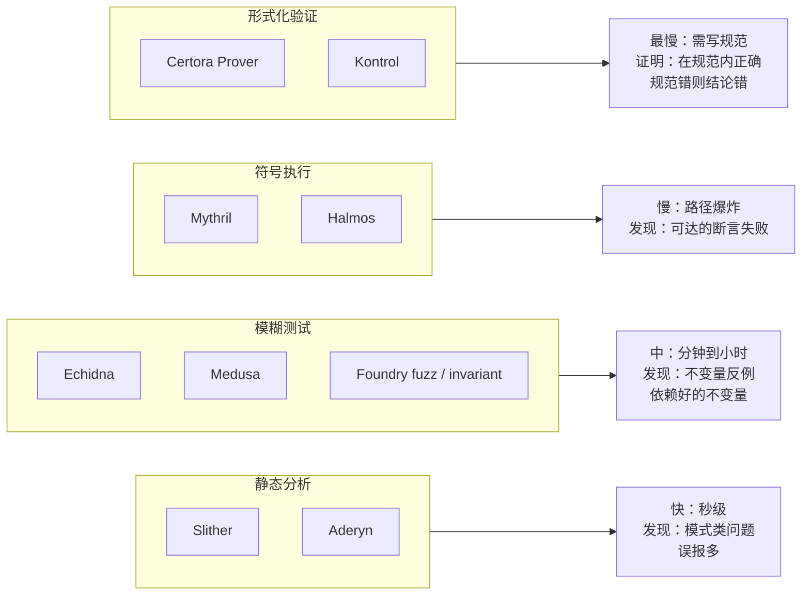

# B31 创造力与工程化：让工具替你做重复的事

> 学习目标：说出静态分析、模糊测试、符号执行、形式化验证各自能发现什么、不能发现什么；写一个自定义检测器。  
> 前置章节：[B23 拆解复杂 DeFi 协议](B23-complex-protocols.md)、[B27 专业审计流程](B27-what-is-audit.md)  
> 交互实验：[不变量模糊测试器](../interactive/audit-fuzz.html)  
> 最后核对：2026-11-09

> 🔗 关联：主线 [26 章](../26-ai-web3-security.md)、[27 章](../27-audit-testing-workflow.md) ｜ 实验 [模糊测试](../interactive/audit-fuzz.html) ｜ 评估 [A08](../assessment/A08-reproduce-attacks.md) ｜ 衔接 [B27](B27-what-is-audit.md)、[B52](B52-ai-assisted-audit.md)

## 开场：同样的扫描，第 10 次还靠手工

示例场景：你审第 10 个分叉项目。你又花半天查"谁能调用 setter"。这件事有固定模式。固定模式应该写成工具。

<details class="predict"><summary>🤔 先猜再看：Slither 报告某函数"缺少访问控制"。这就是一条可以写进报告的发现吗？</summary>

不是。检测器只匹配代码结构。它不知道这个函数是否本来就对所有人开放。你要先确认预期行为，再证明影响，然后才写发现。

</details>

## 1. 一句话理解

**工具擅长发现"模式"，人擅长发现"意图偏差"。好审计员把模式交给工具，把时间留给业务逻辑。**

## 2. 工具能力图



**读图要点：**

- 没有工具能理解"这个协议应该做什么"。业务逻辑漏洞仍需人工。
- 本图只画安全分析工具。Foundry、Hardhat、Tenderly 等开发与调试工具的全景见 [B12 第 3.1 节](B12-foundry-advanced.md)。
- 形式化验证证明的是"代码符合规范"。规范漏写了某个性质，证明就不覆盖它。
- 2025–2026 年，AI 辅助审计工具快速发展。它们适合做初筛和解释代码，结论仍需人工验证。

## 3. 自定义 Slither 检测器（示例）

先新建一个空的 Foundry 项目。下面三节都在这个目录里做：

```bash
# 新建空项目：自带 git 仓库、foundry.toml 和 lib/forge-std
forge init --empty feevault-lab && cd feevault-lab
mkdir -p tools rules  # 检测器和 Semgrep 规则的目录
```

> 💡 注意：`detector.py .` 靠 `foundry.toml` 识别 Foundry 项目。没有这个文件，Slither 会报 `. is a directory`。

再准备被测合约 `src/FeeVault.sol`。下面三节共用它。

```solidity
// SPDX-License-Identifier: MIT
pragma solidity ^0.8.20;

/// @notice 本手册示例：记账金库。不得部署。
contract FeeVault {
    address public owner;
    uint256 public feeBps;
    uint256 public totalDeposits;
    mapping(address => uint256) public balanceOf;

    modifier onlyOwner() {
        require(msg.sender == owner, "not owner");
        _;
    }

    constructor() {
        owner = msg.sender;
    }

    // ❌ 漏洞：任何人都能修改费率
    function setFeeBps(uint256 newFee) external {
        feeBps = newFee;   // 费率可被设成任意值，包括超过 10000
    }

    // ✅ 修复：调用者必须是 owner
    function setOwner(address newOwner) external onlyOwner {
        owner = newOwner;
    }

    function deposit() external payable {
        balanceOf[msg.sender] += msg.value;   // 个人余额与总账同时增加
        totalDeposits += msg.value;
    }

    function withdraw(uint256 amount) external {
        balanceOf[msg.sender] -= amount;   // 0.8 自带下溢检查：超额取款会回滚
        // ❌ 漏洞：少扣总账，总账与余额之和逐渐偏离
        totalDeposits -= amount / 2;   // 总账只减一半，与个人余额之和不再相等
        // 外部调用在状态更新之后
        (bool ok, ) = msg.sender.call{value: amount}("");
        require(ok, "send failed");
    }
}
```

检测器 `tools/detector.py`：

```python
"""UnprotectedSetter：标记没有访问控制、却写入状态的 set* 入口。"""
import sys
from slither import Slither
from slither.detectors.abstract_detector import AbstractDetector, DetectorClassification


class UnprotectedSetter(AbstractDetector):
    ARGUMENT = "unprotected-setter"   # 命令行中启用该检测器的名称
    HELP = "set* entry point writes state without access control"
    IMPACT = DetectorClassification.HIGH
    CONFIDENCE = DetectorClassification.MEDIUM
    WIKI = "https://example.invalid/unprotected-setter"
    WIKI_TITLE = "Unprotected setter"
    WIKI_DESCRIPTION = "A public set* function writes state and has no sender check."
    WIKI_EXPLOIT_SCENARIO = "Any account calls setFeeBps and changes the fee."
    WIKI_RECOMMENDATION = "Add an access-control modifier or a msg.sender check."

    def _detect(self):
        results = []
        for contract in self.compilation_unit.contracts_derived:
            # 只看外部可调用的入口函数
            for fn in contract.functions_entry_points:
                # 跳过构造函数和非 set* 函数
                if fn.is_constructor or not fn.name.lower().startswith("set"):
                    continue
                # 不写状态的 setter 不报告
                if not fn.all_state_variables_written():
                    continue
                # 已有 msg.sender 检查或任何修饰符则视为受保护（可能漏报）
                if fn.is_protected() or fn.modifiers:
                    continue
                info = [fn, " writes state without access control\n"]
                results.append(self.generate_result(info))
        return results


if __name__ == "__main__":
    found = False
    slither = Slither(sys.argv[1])   # 编译并解析目标文件
    slither.register_detector(UnprotectedSetter)
    for batch in slither.run_detectors():
        for finding in batch:
            print(finding["description"].strip())
            found = True
    sys.exit(1 if found else 0)   # 有发现时以非零码退出，CI 会失败
```

```bash
# 用自定义检测器扫描示例金库
python tools/detector.py src/FeeVault.sol
# FeeVault.setFeeBps(uint256) (src/FeeVault.sol#21-23) writes state without access control
```

**读检测逻辑：**

- `functions_entry_points` 只遍历外部可达的函数。
- `all_state_variables_written()` 包含内部调用写入的状态。
- `is_protected()` 识别函数内的 `msg.sender` 检查，`fn.modifiers` 排除带修饰器的函数。
- 局限：任何修饰器都会让函数被放行，包括与权限无关的 `nonReentrant`。如果你需要更高精度，继续检查修饰器内部是否读取 `msg.sender`。

> 💡 注意：把检测器作为插件发布时，用 Slither 的插件入口（`make_plugin`）打包。上面的脚本形式不需要安装到环境，适合单次审计。

## 4. 工程化你的研究（路线图原文条目）

- 保持好奇心：对新事物敏感，不局限于自己的圈子和专业。
- 追逐知识：对知识保持敬畏，持续探索。
- 善于研究：研究要有文档输出。
- 工程化：好的研究成果要做成工具，并在实战中检验。慢雾的例子：MistEye 监控系统、合约可视化分析工具、静态漏洞扫描器。

> 🎯 打个比方：工具像机场的安检门。它能稳定发现金属，但它不知道旅客要去做什么。
>
> 比喻的局限：安检门有固定的物理原理。检测器的规则由人编写，规则的盲区也来自人。

## 5. 工具版本（截至 2026 年 11 月 9 日）

下表来自各项目的 GitHub Releases 页面。

| 工具 | 最新稳定版 | 发布日期 | 来源 |
|---|---|---|---|
| solc | 0.8.38 | 2026-10-22 | [Releases](https://github.com/argotorg/solidity/releases) |
| Foundry | v1.9.0 | 2026-11-02 | [Releases](https://github.com/foundry-rs/foundry/releases) |
| Slither | 0.11.6 | 2026-07-28 | [Releases](https://github.com/crytic/slither/releases) |
| Semgrep | 1.184.0 | 2026-11-05 | [Releases](https://github.com/semgrep/semgrep/releases) |
| Aderyn | 0.6.8 | 2026-01-22 | [Releases](https://github.com/Cyfrin/aderyn/releases) |
| Echidna | v2.4.0 | 2026-11-04 | [Releases](https://github.com/crytic/echidna/releases) |
| Medusa | v1.5.1 | 2026-03-11 | [Releases](https://github.com/crytic/medusa/releases) |
| Halmos | v0.3.3 | 2025-07-31 | [Releases](https://github.com/a16z/halmos/releases) |

> 💡 注意：本章代码的实际运行环境是 Slither 0.11.5、Semgrep 1.156.0、Forge 1.5.1、solc 0.8.24。这些版本低于上表。升级后要重新运行一次，并把版本写进审计底稿。

> ⚠️ 警告：不要在 CI 中使用 `latest`。工具升级会改变结果，审计结论要能复现。

## 6. Semgrep 规则

Semgrep 按语法结构匹配代码。它适合把一次审计里发现的代码模式，写成下一次可用的规则。

`rules/solidity-audit.yml`：

```yaml
rules:
  # 规则 1：tx.origin 鉴权，命中即为错误
  - id: tx-origin-auth
    languages: [solidity]
    severity: ERROR
    message: tx.origin 不能用于鉴权；钓鱼合约可以借用户身份通过这个检查。
    pattern-either:
      - pattern: require(tx.origin == $X, ...);
      - pattern: require($X == tx.origin, ...);
      - pattern: require(tx.origin == $X);
      - pattern: require($X == tx.origin);
  # 规则 2：低级 call 只做标记，交给人工复核
  - id: low-level-call-review
    languages: [solidity]
    severity: WARNING
    message: 低级 call 需要人工复核：返回值是否检查，状态是否已更新。
    pattern-either:
      - pattern: "$T.call($DATA);"
      - pattern: "$T.call{value: $V}($DATA);"
```

```bash
# 校验规则文件语法，关闭遥测
semgrep --validate --config rules/solidity-audit.yml --metrics=off
# 扫描 src；有命中时 --error 让命令返回非零
semgrep --config rules/solidity-audit.yml --metrics=off --error src
```

第二条规则是分诊规则。它也会命中已经检查返回值的 `(bool ok, ) = t.call{...}(...)`。它的作用是列出需要人工看的位置，不是直接判定漏洞。

## 7. 不变量测试桩（Invariant Harness）

不变量测试桩：约束模糊器调用范围，并用幽灵变量（Ghost Variable）记录期望值的测试合约。

`test/FeeVault.invariant.t.sol`：

```solidity
// SPDX-License-Identifier: MIT
pragma solidity ^0.8.20;

import {Test} from "forge-std/Test.sol";
import {FeeVault} from "../src/FeeVault.sol";

contract Handler is Test {
    FeeVault public immutable vault;
    uint256 public ghostSum;   // ghost：Handler 视角的应有总存款
    // 每个参与者的应有存款，用于约束取款金额
    mapping(address => uint256) internal deposited;
    address[3] internal actors = [address(0xA1), address(0xA2), address(0xA3)];

    constructor(FeeVault v) { vault = v; }

    function deposit(uint256 seed, uint96 amount) external {
        address a = actors[seed % 3];
        // 限制金额范围，避免无意义回滚
        amount = uint96(bound(amount, 1, 100 ether));
        vm.deal(a, amount);   // 作弊码：给参与者发 ETH
        vm.prank(a);   // 下一次调用以 a 的身份发出
        vault.deposit{value: amount}();
        deposited[a] += amount;
        ghostSum += amount;
    }

    function withdraw(uint256 seed, uint96 amount) external {
        address a = actors[seed % 3];
        if (deposited[a] == 0) return;   // 没有存款就跳过，避免必然回滚
        uint256 amt = bound(amount, 1, deposited[a]);   // 取款不超过已存金额
        vm.prank(a);
        vault.withdraw(amt);
        deposited[a] -= amt;
        ghostSum -= amt;   // ghost 按真实取款额扣减
    }
}

contract FeeVaultInvariant is Test {
    FeeVault vault;
    Handler handler;

    function setUp() public {
        vault = new FeeVault();
        handler = new Handler(vault);
        targetContract(address(handler));   // fuzzer 只随机调用 Handler
    }

    function invariant_totalMatchesGhostSum() public view {
        // 会失败：withdraw 只扣一半，totalDeposits 偏高
        assertEq(vault.totalDeposits(), handler.ghostSum());
    }

    function invariant_solvent() public view {
        // 偿付能力：余额 ≥ 应有总存款
        assertGe(address(vault).balance, handler.ghostSum());
    }
}
```

```bash
# forge init 已经装好 forge-std。在别的已有目录里，先 git init，再运行：
# forge install foundry-rs/forge-std
# 只跑不变量测试，预期 invariant_totalMatchesGhostSum 失败
forge test --match-path test/FeeVault.invariant.t.sol -vv
```

运行结果（本机）：

1. 漏洞版上，`invariant_totalMatchesGhostSum` 失败。Forge 把反例缩减到 2 步：一次 `deposit` 和一次 `withdraw`。
2. `invariant_solvent` 通过。这个漏洞不影响金库偿付能力，它破坏的是账本一致性。
3. 把 `amount / 2` 改成 `amount` 后，两个不变量都通过。

> 🧪 动手验证：打开[不变量模糊测试器](../interactive/audit-fuzz.html)，在"有缺陷版本"上点击运行，记录反例步数。再切换到"修复版本"，记录页面上"这只说明随机搜索没找到"的结论。

<details class="predict"><summary>🤔 先猜再看：把 Handler 的 withdraw 改成不限制金额，会发生什么？</summary>

大多数调用会因为余额不足而回滚。模糊器把调用预算花在无效路径上，发现深层状态的概率下降。Handler 的作用就是让调用保持有效。

</details>

## 8. 接入 CI

```yaml
name: audit-checks
on: [pull_request]
jobs:
  # 每个 PR 自动执行以下检查
  checks:
    runs-on: ubuntu-latest
    steps:
      - uses: actions/checkout@v4
      - uses: foundry-rs/foundry-toolchain@v1
        with:
          version: v1.9.0   # 固定版本，结果可复现
      - uses: actions/setup-python@v5
        with:
          python-version: "3.12"
      # 固定工具版本，避免规则行为漂移
      - run: pip install slither-analyzer==0.11.6 semgrep==1.184.0
      # 任一步返回非零，PR 检查即失败
      - run: forge test -vv
      - run: python tools/detector.py .
      - run: semgrep --config rules/solidity-audit.yml --metrics=off --error src
```

| 步骤 | 失败含义 | 处理 |
|---|---|---|
| `forge test` | 测试或不变量失败 | 阻止合并 |
| `detector.py` | 出现新的未保护 setter | 修复，或记录白名单和理由 |
| `semgrep --error` | 命中规则 | 分诊后修复或加注释豁免 |

> 💡 注意：`python tools/detector.py .` 把当前 Foundry 项目交给 crytic-compile 编译。本机验证中，它对示例项目输出同一条结果，并以退出码 1 结束。上面的 YAML 只做了语法校验，没有在 GitHub Actions 上运行。

## 9. 术语表

| 术语 | 英文 | 定义 |
|---|---|---|
| 检测器 | Detector | 匹配代码模式的静态分析规则 |
| 测试桩 | Harness | 约束和驱动被测代码的测试代码 |
| 幽灵变量 | Ghost Variable | 只在测试中记录期望值的变量 |
| 分诊 | Triage | 判断工具结果真假和优先级 |
| 版本锁定 | Version Pinning | 固定工具版本，让结果可以复现 |

> 🪞 反思：打开你最近写的一份审计笔记。
> 1. 哪个检查你已经手工做过 3 次以上？
> 2. 如果把它写成规则，它会漏掉什么？
> 3. 你的工具版本能否在 6 个月后复现同样的结果？

## 10. 思考题

1. 第 3 节的检测器会放过 `function setFee(uint256 f) external nonReentrant { fee = f; }`。为什么？怎样修改？
2. 第 7 节的测试中，为什么 `invariant_solvent` 通过，而 `invariant_totalMatchesGhostSum` 失败？这对写不变量有什么启发？
3. 在 CI 中锁定 Slither 版本和每周自动升级版本，各解决什么问题？你怎样同时得到两者的好处？

下一章：[B32 第 5 次审计：EchoBridge](B32-audit-5-echobridge.md)
