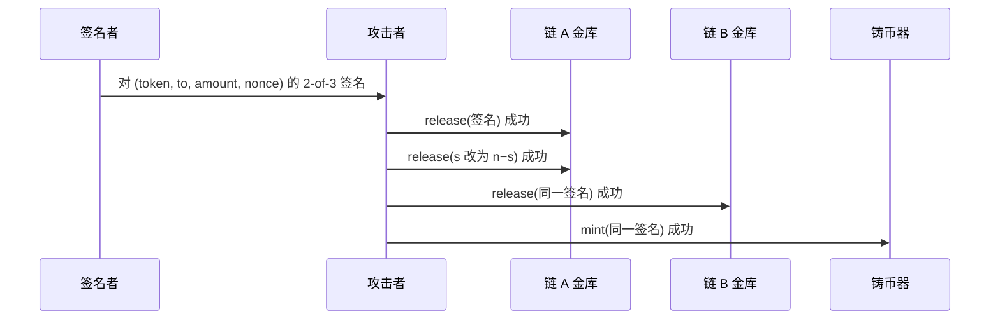

# B32 第 5 次审计：EchoBridge

> 学习目标：完成本章后，你能——
> 1. 读懂靶场中的内联汇编（Yul），并说出每条指令读写的位置。
> 2. 检查桥的签名消息是否绑定了链、合约、方向和 nonce。
> 3. 区分"代码缺陷"和"L2 部署差异"，并为后者写出可验证的发现。
>
> 前置知识：[12 跨链桥](../12-cross-chain-bridges.md)、[09 MEV 与签名](../09-mev-signatures.md)；[B45 EVM 深入](B45-yul-opcodes.md)（可选，阶段 6 学；本章第 3 节讲了所需的 Yul）。
> 预计用时：5–7 小时。
> 交互实验：[signature-replay-lab.html](../interactive/signature-replay-lab.html)
> 靶场目录：`examples/range/echobridge/`
> 最后核对：2026-11-10

> ⚠️ 警告：本章只在本地运行玩具合约。不要对任何真实桥尝试这些攻击。未经授权测试他人系统可能违法。发现真实漏洞时，走项目方的漏洞赏金或负责任披露渠道。

---

## 开场：一份签名，用了四次

桥的签名者批准了一笔 100 代币的提款。合约记录了这份签名，防止重放。第二次提交原样的签名，合约正确回滚。可是攻击者把同一份签名换一种写法再提交，合约又放行了。

<details class="predict"><summary>🤔 先猜再看：同一条消息、同一把私钥，能产生几种都有效的签名字节？</summary>

至少两种。ECDSA 的 `(r, s)` 和 `(r, n−s)` 都能通过验证，`ecrecover` 恢复出同一个地址。只要合约用签名字节判断"是否用过"，这个问题就存在。

</details>

> 🎯 打个比方：门卫记住了支票的笔迹，用笔迹判断支票是否兑现过。同一张支票，换一种写法，门卫就当成新支票。门卫应该记住的是支票编号（nonce）。
>
> 比喻的局限：ECDSA 的第二种写法不需要私钥，任何人都能从公开的签名算出来。现实中伪造笔迹要难得多。

## 1. 术语

| 术语 | 定义 |
|---|---|
| 锁定并铸造（Lock-and-Mint） | 源链锁定原始代币，目标链铸造等量包装代币的跨链方式。 |
| 重放（Replay） | 把已经使用过的有效签名再次提交。 |
| 域绑定（Domain Binding） | 让签名内容包含链 ID、合约地址和用途，使签名只在一处有效。 |
| 签名延展性（Malleability） | 不知道私钥，也能把有效签名变换成另一个有效签名。 |
| m-of-n | n 个签名者中至少 m 个批准才通过。 |
| 内联汇编（Inline Assembly） | 写在 Solidity 中的低级代码，语言是 Yul。编译器不为它做类型和边界检查。 |
| EraVM | ZKsync 类链原生使用的虚拟机，指令集和 EVM 不同。 |

## 2. 范围与简报

打开 `examples/range/echobridge/README.md`，读范围和部署计划。**不要打开 `test/` 和 `solution/`。**

注意部署计划中的第三条链。它是下面第 5 节的线索。

```bash
cd Web3-Security/examples/range/echobridge # 进入 EchoBridge 靶场目录
forge build # 编译全部合约
```

预期输出包含这一行：

```text
Compiler run successful!
```

编译输出之后还会出现 forge-lint 的 `note` 和 `warning` 风格提示。它们不是编译错误。

## 3. 读懂靶场中的 Yul

打开 `src/EchoSigCheck.sol`。Yul 只有几个常用指令。下表覆盖本靶场用到的全部指令。

| 指令 | 作用 | 读写位置 |
|---|---|---|
| `mload(p)` | 读 32 字节 | 内存位置 p |
| `mstore(p, v)` | 写 32 字节 | 内存位置 p |
| `calldataload(p)` | 读 32 字节 | 调用数据位置 p |
| `add` `mul` | 加法、乘法，溢出不回滚 | 栈 |
| `byte(n, x)` | 取 x 的第 n 个字节，0 是最高位 | 栈 |
| `keccak256(p, n)` | 对内存 `[p, p+n)` 求哈希 | 内存 |
| `create2(v, p, n, s)` | 用内存中的初始化代码部署合约 | 新合约 |

### 读 `_recoverAt`

```solidity
// 第 index 个签名的起点，每个占 65 字节
let entry := add(signatures.offset, mul(index, 65))
r := calldataload(entry)  // r：前 32 字节
s := calldataload(add(entry, 32))  // s：接下来的 32 字节
// v：第 65 个字节（读 32 字节后取最高位）
v := byte(0, calldataload(add(entry, 64)))
```

逐行解释：

1. `signatures.offset` 是签名数组在调用数据中的起始位置。
2. 每个签名占 65 字节，所以第 `index` 个在 `offset + index × 65`。
3. `r` 是前 32 字节。`s` 是下一个 32 字节。
4. `calldataload` 总是读 32 字节。`byte(0, …)` 只留最高位的 1 字节作为 `v`。

### 读 `messageHash`

```solidity
let ptr := mload(0x40)  // 读取空闲内存指针
mstore(ptr, token)  // 依次写入字段，每个占 32 字节
mstore(add(ptr, 0x20), to)
mstore(add(ptr, 0x40), amount)
mstore(add(ptr, 0x60), nonce)
digest := keccak256(ptr, 0x80)  // 对这 0x80 字节求哈希，作为签名消息
```

`0x40` 处保存空闲内存指针。代码在空闲内存写入 4 个字段，然后对 `0x80`（128）字节求哈希。

<details class="predict"><summary>🤔 先猜再看：这段代码没有更新空闲内存指针。这是缺陷吗？这个哈希里缺了什么？</summary>

不更新指针在这里不是缺陷。这段内存只用于这一次哈希，后续代码可以覆盖它。

真正的问题是哈希的输入：只有 token、to、amount、nonce。审计 Yul 时，先问"它读了什么、写了什么"，再问"它漏了什么"。

</details>

> 💡 注意：汇编绕过了 Solidity 的类型检查。审计时要手动确认三件事：下标是否受长度约束，内存是否被覆盖，输入是否完整。本靶场中，`_verify` 先检查 `signatures.length == threshold * 65`，所以 `_recoverAt` 的下标不越界。

## 4. 第一步：独立审计

用时盒 3 小时。按 `BRG`（桥）、`MEV`（签名）、`ACC`（权限）检查项族走一遍，再单独检查部署目标。

### 分阶段提示

**发现 1**

<details class="predict"><summary>🤔 提示 1</summary>

`EchoVault.release` 用什么判断"已处理"？这个值能被改变吗？

</details>

<details class="predict"><summary>🤔 提示 2</summary>

把两个签名的顺序交换，`keccak256(signatures)` 会变吗？把 s 换成 n−s 呢？

</details>

<details class="predict"><summary>🤔 发现</summary>

EB-BRG-2：防重放标记基于签名字节，nonce 没有被消费。

</details>

**发现 2**

<details class="predict"><summary>🤔 提示 1</summary>

列出 `messageHash` 的输入字段。部署计划里有几条链？

</details>

<details class="predict"><summary>🤔 提示 2</summary>

`EchoVault.release` 和 `EchoMinter.mint` 哈希的内容一样吗？

</details>

<details class="predict"><summary>🤔 发现</summary>

EB-BRG-1：摘要没有绑定链 ID、合约地址和方向。

</details>

**发现 3**

<details class="predict"><summary>🤔 提示 1</summary>

`lockAndCall` 的 `target` 由谁决定？调用时的 `msg.sender` 是谁？

</details>

<details class="predict"><summary>🤔 提示 2</summary>

用户为了使用 `lock` 给金库做了什么授权？

</details>

<details class="predict"><summary>🤔 发现</summary>

EB-ACC-4：金库可被诱导调用代币的 `transferFrom` 和 `transfer`。

</details>

**发现 4**

<details class="predict"><summary>🤔 提示 1</summary>

在 `_verify` 中，同一个签名者的签名出现两次，`approvals` 是几？

</details>

<details class="predict"><summary>🤔 提示 2</summary>

`EchoMinter.mint` 有没有检查铸造总量或速率？

</details>

<details class="predict"><summary>🤔 发现</summary>

EB-BRG-8：单个签名者重复自己的签名即可满足 2-of-3，且铸造量没有上限。

</details>

**发现 5**

<details class="predict"><summary>🤔 提示 1</summary>

`EchoFactory.deploy` 用手写汇编部署，并校验地址公式。部署计划里的第三条链接受这种写法吗？

</details>

<details class="predict"><summary>🤔 提示 2</summary>

先读第 5 节。

</details>

<details class="predict"><summary>🤔 发现</summary>

EB-L2-1：工厂假设 EVM 的 CREATE2 行为，在原生 EraVM 上不成立。

</details>

## 5. L2 差异：什么已经核实，什么没有

下表区分来源层级。

| 事实 | 来源 | 状态 |
|---|---|---|
| `PUSH0` 从 Shanghai 引入 | Solidity 官方文档 | 已核实 |
| 指定 `paris` 可避免生成 `PUSH0` | 本地 `forge inspect` 对比 | 已运行 |
| 原生 EraVM 上，汇编中的 `create`/`create2` 不安全，任意字节码的 `create` 不工作 | ZKsync 官方文档，EVM instructions 页 | 已核实 |
| 原生 EraVM 的合约地址公式和以太坊不同 | ZKsync 官方文档 | 已核实 |
| ZKsync 的 EVM 解释器（EVM Interpreter）使用和以太坊相同的地址推导 | ZKsync 官方文档 | 已核实 |
| 解释器不支持 `CALLCODE`、`SELFDESTRUCT`、`BLOBHASH`、`BLOBBASEFEE` | ZKsync 官方文档 | 已核实 |
| 当前各 L2 对 `PUSH0` 的支持情况 | 只找到 2023–2024 年的二手资料 | **未核实** |
| 靶场合约在 EraVM 上的实际行为 | 没有运行 zksolc 或 foundry-zksync | **未运行** |

> ⚠️ 警告：不要把"某链不支持 PUSH0"当作常识写进报告。历史资料显示过去部分链不支持，但支持情况会变。部署前查目标链的最新文档，或者在该链的测试网上实际部署一次。

### 自己验证 PUSH0

同一份合约，用两个 EVM 版本编译。

```bash
# 按 paris 编译（无 PUSH0），只看开头
forge inspect EchoFactory deployedBytecode --evm-version paris | head -c 90; echo
# 按默认版本（prague）编译，对比回滚序列
forge inspect EchoFactory deployedBytecode | head -c 90; echo
```

实际输出：

```text
0x608060405234801561001057600080fd5b50600436106100365760003560e01c8063c77bc7f41461003b5780
0x608060405234801561000f575f5ffd5b5060043610610034575f3560e01c8063c77bc7f414610038578063d5
```

**读图要点：**

- `paris` 版本的回滚序列是 `600080fd`：`PUSH1 0`、`DUP1`、`REVERT`。
- 默认配置（靶场为 `prague`）的回滚序列是 `5f5ffd`：`PUSH0`、`PUSH0`、`REVERT`。
- 不要用 `grep 5f` 统计 `PUSH0`。`5f` 也可能是数据字节。PoC 中的 `_scan` 会跳过 `PUSH` 的数据部分。

### 这条发现怎么写

EB-L2-1 的结论是"**按原生 EraVM 路径部署时**工厂不可用"。如果团队使用 EVM 解释器路径，地址公式相同，结论就要改写。报告必须写明这个条件。

## 6. 发现清单

| 编号 | 严重性 | 标题 | 检查项 |
|---|---|---|---|
| EB-BRG-2 | Critical | 签名可重放（延展性和换序） | BRG-2、MEV-4、MEV-3 |
| EB-BRG-1 | Critical | 签名未绑定链、合约和方向 | BRG-1、MEV-2 |
| EB-ACC-4 | Critical | 任意调用可转走金库和用户授权 | ACC-4 |
| EB-BRG-8 | High | 单签名者可无限铸造 | BRG-7、BRG-8 |
| EB-L2-1 | Medium | 工厂依赖 EVM 专属行为 | 无对应编号 |

## 7. 验证：运行 PoC

```bash
forge test # 运行全部 PoC 和修复测试
```

实际输出：

```text
Ran 6 tests for test/PoC.t.sol:EchoBridgeFixTest
[PASS] test_fix_domainBinding() (gas: 1215818)
[PASS] test_fix_duplicateSignerRejected() (gas: 60640)
[PASS] test_fix_factoryUsesNew() (gas: 1312706)
[PASS] test_fix_mintRateLimited() (gas: 92907)
[PASS] test_fix_noArbitraryCall() (gas: 11098)
[PASS] test_fix_replayAndMalleationBlocked() (gas: 142316)
Suite result: ok. 6 passed; 0 failed; 0 skipped

Ran 5 tests for test/PoC.t.sol:EchoBridgePoC
[PASS] test_EB_ACC_4_arbitraryCallDrains() (gas: 130484)
[PASS] test_EB_BRG_1_missingDomainBinding() (gas: 1211221)
[PASS] test_EB_BRG_2_signatureReplayViaMalleability() (gas: 229663)
[PASS] test_EB_BRG_8_oneSignerUnlimitedMint() (gas: 121894)
[PASS] test_EB_L2_1_factoryIsEvmSpecific() (gas: 3046148)
Suite result: ok. 5 passed; 0 failed; 0 skipped
```

字节码扫描的结果：

```bash
forge test --match-test L2 -vv # 只跑 L2 测试；-vv 打印操作码计数
```

```text
  PUSH0 opcodes: 191
  CREATE2 opcodes: 1
```

> 💡 注意：`test_EB_L2_1` 只证明字节码中有这些指令，并证明地址符合 EVM 公式。它不能证明 EraVM 上的行为。EVM 上的测试无法模拟 EraVM。

攻击路径如下。



**读图要点：** 一份签名从签名者流向四个入口。第 2 步错在防重放标记。第 3、4 步错在摘要没有域绑定。修复这两处后，每份签名只在一个合约、一条链、一个方向上生效一次。

## 8. 模型报告

````markdown
# EchoBridge 安全审计报告

| 项目 | 内容 |
|---|---|
| 审计对象 | EchoSigCheck、EchoVault、EchoMinter、EchoFactory |
| 方法 | 人工审查、Yul 逐行分析、Foundry PoC |
| 发现 | Critical 3、High 1、Medium 1 |

## 范围与假设

范围：`src/EchoSigCheck.sol`、`src/EchoVault.sol`、`src/EchoMinter.sol`、`src/EchoFactory.sol`。
假设：签名者集合 2-of-3，且多数签名者诚实。EB-BRG-8 说明单个签名者失陷时的影响。

## [C-1] EB-BRG-2：签名可重放

**位置**：`EchoVault.sol:33–35`。

**描述**：`release` 用 `keccak256(signatures)` 作为已处理标记，签名内容中的 nonce 没有被消费。

**影响**：任何人都可以把 s 换成 n−s，或交换签名顺序，重复提取同一笔款项。PoC 中一笔 100 代币的批准被提取 4 次，共 400 代币。

**PoC**：`test_EB_BRG_2_signatureReplayViaMalleability`。

**修复**：按签名内容中的 nonce 记录已使用状态。同时拒绝高 s 值。

## [C-2] EB-BRG-1：签名未绑定链、合约和方向

**位置**：`EchoSigCheck.sol:19`（`messageHash`）。

**描述**：摘要只包含 token、to、amount、nonce。部署计划使用同一组签名者覆盖三条链。

**影响**：一条链上的批准可以在另一条链上使用。放行批准也可以用于铸造。PoC 把同一份签名用于第二个金库和铸币器。

**PoC**：`test_EB_BRG_1_missingDomainBinding`。

**修复**：使用 EIP-712 风格的域分隔，包含 `chainId`、合约地址和方向。

## [C-3] EB-ACC-4：任意调用可转走金库和用户授权

**位置**：`EchoVault.sol:24`（`lockAndCall`）。

**描述**：`target` 和 `data` 由调用者任意指定，调用以金库为 `msg.sender`。

**影响**：攻击者把 `amount` 设为 0，让金库调用 `token.transfer` 转走金库余额，或调用 `token.transferFrom` 转走任何已授权用户的余额。PoC 取走金库 1,000 代币和用户 500 代币。

**PoC**：`test_EB_ACC_4_arbitraryCallDrains`。

**修复**：删除这个功能。如果必须保留，把目标限定为白名单，并禁止代币地址。

## [H-1] EB-BRG-8：单签名者可无限铸造

**位置**：`EchoSigCheck.sol:52`（`_verify`）、`EchoMinter.sol:49`。

**描述**：`_verify` 不检查签名者是否重复。单个签名者把自己的签名重复 2 次，即可满足 2-of-3。铸币器没有总量或速率上限。

**定级依据**：需要一个签名者失陷，所以不是 Critical。但它把声明的 2-of-3 降成了 1-of-3，且影响没有上限。

**PoC**：`test_EB_BRG_8_oneSignerUnlimitedMint`。

**修复**：要求签名者地址严格递增。铸造设置时间窗口上限。对账源链锁定量。

## [M-1] EB-L2-1：工厂依赖 EVM 专属行为

**位置**：`EchoFactory.sol:16–23`。

**描述**：工厂用内联汇编 `create2` 部署，并按 EVM 公式校验地址。ZKsync 官方文档说明，在原生 EraVM 上，汇编中的 `create`/`create2` 不安全，且地址公式不同。

**影响**：按原生 EraVM 路径部署时，工厂无法按预期工作，桥在该链不可用。这是部署失败，不直接损失资金。

**未验证事项**：本次审计没有在 EraVM 上运行。使用 EVM 解释器路径时，地址公式与以太坊一致，结论需重新评估。

**PoC**：`test_EB_L2_1_factoryIsEvmSpecific`（只证明字节码特征和地址公式）。

**修复**：使用 `new` 配合 salt，由编译器为目标虚拟机生成部署代码。不要在链上断言 EVM 地址公式。在目标链测试网实际部署。

## 附加观察（未定级）

- `EchoMinter` 的 `nonceUsed` 不区分代币。相同 nonce 的不同代币批准会互相阻塞。
- 包装代币没有销毁入口，审计范围内没有回程路径。
- 签名者集合构造后不可更换，没有轮换流程。
````

## 复盘表

| 我的发现 | 模型报告对应项 | 定级差异 | 原因 |
|---|---|---|---|
| | | | |

## 如果出错

| 现象 | 原因 | 解决 |
|---|---|---|
| `forge inspect` 报错 `--evm-version` | Foundry 版本较旧 | 运行 `foundryup`。本章使用 forge 1.5.1 |
| `head` 输出为空 | 上一条命令失败 | 单独运行 `forge inspect`，查看错误 |
| PoC 中 `vm.sign` 结果不同 | 改动了测试私钥 | 还原测试文件 |
| `stack too deep` | 修改代码时加了过多局部变量 | 拆成内部函数 |

## 过关标准

- [ ] 能不看注释解释 `_recoverAt` 和 `messageHash` 的每一行。
- [ ] 找到全部 3 个 Critical。
- [ ] `forge test` 显示 11 个测试全部通过。
- [ ] EB-L2-1 的报告写明了"什么已验证、什么没有"。
- [ ] 能手工算出一份高 s 签名的 `n − s` 含义。

> 🪞 反思：你信任的跨链桥，签名者有几个？谁保管钥匙？如果一个签名者失陷，单日最多损失多少？

## 思考题

1. `EchoVaultFixed` 用 `nonceUsed[nonce]` 替换了签名字节标记。修复后，还需要拒绝高 s 签名吗？为什么？
2. 只把 `block.chainid` 加入 `messageHash`，EB-BRG-1 就完全修复了吗？用 PoC 中的场景说明。
3. 一个团队说"我们的桥只部署在一条链上，不需要域绑定"。你怎么回应？

下一章：[B33 毕业审计：GuardVault](B33-audit-6-guardvault.md)
