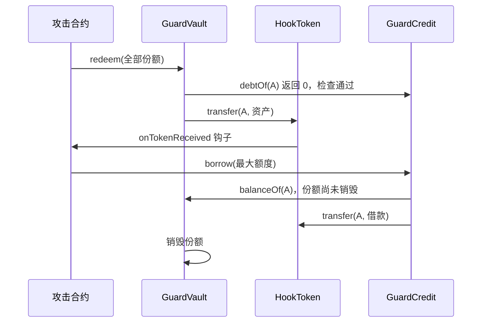

# B33 毕业审计：GuardVault

> 学习目标：独立完成一次多合约审计，并用评分表衡量结果。
> 前置知识：完成 B21 和 B32，读过 [B25 综合实战](B25-capstone-minilend.md)。
> 预计用时：时盒 8 小时，复盘 2 小时。
> 交互实验：[audit-governance.html](../interactive/audit-governance.html) ｜ [vault-inflation-lab.html](../interactive/vault-inflation-lab.html) ｜ [reentrancy-lab.html](../interactive/reentrancy-lab.html)
> 靶场目录：`practice-example-code/range/guardvault/`
> 最后核对：2026-11-10

> ⚠️ 警告：本章只在本地运行玩具合约。不要对任何真实协议尝试这些攻击。未经授权测试他人系统可能违法。

---

## 开场：这一次没有提示

前面的审计都有分阶段提示。真实审计没有。客户交给你一个仓库、一份说明和一个截止时间。

> 🎯 打个比方：前几次是教练陪跑。这一次是正式比赛，教练站在终点，手里拿着成绩表。
>
> 比喻的局限：真实审计没有标准答案。你永远不知道自己漏了多少。本靶场的发现总数是已知的，这只是练习条件。

## 1. 简报

GuardVault 是一个收益金库。用户存入资产，策略团队把资金分配给策略，机器人收割奖励，治理合约持有管理权限，信用模块允许用户以份额为抵押借款。

先读 `practice-example-code/range/guardvault/README.md`。范围、角色和团队声明的不变量都在里面。

```bash
cd practice-example-code/range/guardvault  # 从 web3-security-handbook/ 出发，进入 GuardVault 靶场目录
forge build # 编译全部合约
```

预期输出包含这一行：

```text
Compiler run successful!
```

编译输出之后还会出现 forge-lint 的 `note` 和 `warning` 风格提示，例如 `unwrapped-modifier-logic`。它们不是编译错误。

## 2. 规则

1. 时盒 8 小时。到时间就停笔。
2. 不要打开 `test/` 和 `solution/`，不要展开第 5 节。
3. 可以使用前面章节的任何工具：Slither、Aderyn、不变量测试、自己写的 PoC。
4. 每个发现都要写出编号、严重性、位置、影响、PoC（或 PoC 思路）和修复建议。
5. 把报告写成一个 Markdown 文件，然后再对答案。

> 💡 注意：这里有多合约交互。先画一张合约调用图，标出每一次外部调用。很多问题只有跨合约看才会出现。

## 3. 建议的时间分配

| 阶段 | 用时 |
|---|---|
| 读文档、画调用图和角色表 | 1 小时 |
| 逐合约人工审查 | 3.5 小时 |
| 写 PoC 验证 | 2 小时 |
| 写报告 | 1.5 小时 |

## 4. 评分表

对完答案后填写。满分 100。

| 维度 | 评分方法 | 满分 | 得分 |
|---|---|---|---|
| 发现数量 | 找到的发现 ÷ 6 × 60 | 60 | |
| 定级准确 | 每个找到的发现，定级符合第 5 节的可接受范围得 3 分，最多 18 分；其余 2 分看定级依据是否写明 | 20 | |
| 报告质量 | 见下表 | 20 | |

| 报告质量项 | 分值 |
|---|---|
| 每个发现都有准确位置（文件和函数） | 5 |
| 影响用数字或具体后果描述 | 5 |
| 至少 3 个发现带可运行的 PoC | 5 |
| 修复建议可以直接实施，且不引入新问题 | 5 |

| 总分 | 结论 |
|---|---|
| 85–100 | 可以开始参加公开审计竞赛 |
| 70–84 | 通过。复盘漏掉的发现后，再做一个新目标 |
| 低于 70 | 重读漏掉项对应的章节，一周后重做 |

误报扣分：每个被证伪的发现从总分扣 2 分。真实审计中，误报会消耗客户的信任。

---

**以下内容是答案。评分表填写前不要继续阅读。**

---

## 5. 隐藏答案

<details class="predict"><summary>🤔 完成审计后展开：发现清单（共 6 个）</summary>

| 编号 | 严重性 | 可接受范围 | 标题 | 检查项 |
|---|---|---|---|---|
| GV-DFI-5 | Critical | Critical–High | 闪电治理 | DFI-5 |
| GV-ACC-7 | High | High–Critical | KEEPER 权限升级 | ACC-7、ACC-1 |
| GV-REN-2 | High | High | 跨合约重入，信用额度重复抵押 | REN-2、REN-3 |
| GV-MEV-2 | High | High–Medium | 收割没有滑点保护 | MEV-1 |
| GV-MEV-1 | Medium | Medium–Low | `block.timestamp` 作为截止时间 | MEV-1 |
| GV-ARI-2 | Medium | Medium–Low | ERC-4626 取整方向错误 | ARI |

</details>

<details class="predict"><summary>🤔 复盘提示：如果漏掉了某一项</summary>

- 闪电治理：投票权来自哪个时间点？投票和执行之间隔了多久？
- 权限升级：把 `roleAdmin` 的每个映射画成一张图，和 README 的角色表对照。
- 跨合约重入：金库的重入锁能保护 `GuardCredit` 吗？`_exit` 中外部调用和状态更新的顺序是什么？
- 滑点和截止时间：`YieldStrategy.harvest` 传给 `swap` 的两个参数是什么？
- 取整：EIP-4626 要求 `previewMint` 和 `previewWithdraw` 向哪个方向取整？

</details>

<details class="predict"><summary>🤔 验证：运行 PoC，查看实际输出</summary>

```bash
forge test # 运行全部 PoC 和修复测试
```

实际输出：

```text
Ran 6 tests for test/PoC.t.sol:GuardVaultFixTest
[PASS] test_fix_flashVoteHasNoWeight() (gas: 543415)
[PASS] test_fix_harvestEnforcesLimits() (gas: 221643)
[PASS] test_fix_keeperCannotEscalate() (gas: 17802)
[PASS] test_fix_legitimateVoterStillWorks() (gas: 474580)
[PASS] test_fix_roundingFavorsVault() (gas: 200995)
[PASS] test_fix_withdrawBlocksHookBorrow() (gas: 606608)
Suite result: ok. 6 passed; 0 failed; 0 skipped

Ran 6 tests for test/PoC.t.sol:GuardVaultPoC
[PASS] test_GV_ACC_7_keeperEscalation() (gas: 441051)
[PASS] test_GV_ARI_2_rounding() (gas: 38214869)
[PASS] test_GV_DFI_5_flashGovernance() (gas: 1882769)
[PASS] test_GV_MEV_1_timestampDeadlineNeverExpires() (gas: 258652)
[PASS] test_GV_MEV_2_harvestSandwich() (gas: 329792)
[PASS] test_GV_REN_2_crossContractReentrancy() (gas: 636122)
Suite result: ok. 6 passed; 0 failed; 0 skipped
```

查看数字：

```bash
forge test -vv --match-test 'REN|MEV' # 只跑名字匹配 REN 或 MEV 的测试，打印数字
```

```text
[PASS] test_GV_MEV_1_timestampDeadlineNeverExpires() (gas: 258652)
  expected at signing: 9090.909090909090909091
  executed after 30 days: 2923.976608187134502924
[PASS] test_GV_MEV_2_harvestSandwich() (gas: 329792)
  harvest without attack: 9090.909090909090909091
  harvest when sandwiched: 4166.666666666666666667
  attacker reward balance: 55652.173913043478260871
[PASS] test_GV_REN_2_crossContractReentrancy() (gas: 636122)
  attacker assets: 14545.454545454545454545
  unbacked debt: 4545.454545454545454545
```

</details>

<details class="predict"><summary>🤔 跨合约重入的调用顺序图</summary>



**读图要点：** 债务检查在第 2 步，份额销毁在最后一步，中间把控制权交给了攻击者。金库的 `nonReentrant` 只保护金库自己的入口。`GuardCredit.borrow` 不受这把锁保护。

</details>

## 6. 模型报告

<details class="predict"><summary>🤔 完成评分后展开：完整模型报告</summary>

````markdown
# GuardVault 安全审计报告

| 项目 | 内容 |
|---|---|
| 审计对象 | GuardVault、StrategyManager、YieldStrategy、GuardGovernor、GuardCredit、MiniSwap、Tokens |
| 方法 | 人工审查、调用图分析、Foundry PoC |
| 发现 | Critical 1、High 3、Medium 2 |

## 范围与假设

范围：`src/` 下全部合约。
假设：STRATEGIST 多签诚实；KEEPER 是热钱包，可能失陷；治理代币可在市场上借入。

## [C-1] GV-DFI-5：闪电治理

**位置**：`GuardGovernor.sol:38`（`vote`）、`:46`（`execute`）。

**描述**：投票权使用投票时的 `balanceOf`。提案、投票和执行可以在同一笔交易内完成，没有延迟。治理合约持有 ADMIN 角色。

**影响**：攻击者借入 30% 以上的治理代币，一笔交易内添加恶意策略并转走金库的全部闲置资金。PoC 中攻击者取走 100,000 代币，并在交易结束时归还全部治理代币。

**PoC**：`test_GV_DFI_5_flashGovernance`。

**修复**：使用历史快照计算投票权；增加投票期和执行延迟。

## [H-1] GV-ACC-7：KEEPER 权限升级

**位置**：`StrategyManager.sol:33`、`:41`。

**描述**：`roleAdmin[STRATEGIST_ROLE] = KEEPER_ROLE`。KEEPER 可以把 STRATEGIST 角色授予自己，再添加策略并分配资金。这违反了 README 的角色表。

**定级依据**：需要 KEEPER 热钱包失陷。但这种失陷在假设范围内，影响是全部闲置资金。

**PoC**：`test_GV_ACC_7_keeperEscalation`。

**修复**：`roleAdmin[STRATEGIST_ROLE] = ADMIN_ROLE`。`addStrategy` 只允许 ADMIN。

## [H-2] GV-REN-2：跨合约重入，信用额度重复抵押

**位置**：`GuardVault.sol:128–136`（`_exit`）、`GuardCredit.sol:25`（`borrow`）。

**描述**：`_exit` 先检查债务，再转账，最后销毁份额。资产是带接收钩子的代币。攻击者在钩子内调用 `GuardCredit.borrow`，此时份额还没有销毁。

**影响**：攻击者取回全部存款，同时带走无抵押的借款。PoC 中存入 10,000 代币，退出时持有约 14,545 代币，留下约 4,545 代币的无抵押债务。这违反了 README 的不变量。

**PoC**：`test_GV_REN_2_crossContractReentrancy`。

**修复**：先销毁份额，再转账。信用模块读取金库的锁状态，金库操作期间拒绝借款。

## [H-3] GV-MEV-2：收割没有滑点保护

**位置**：`YieldStrategy.sol:48`。

**描述**：`swap` 的 `minOut` 固定为 0。

**影响**：攻击者夹击收割交易。示例中收割所得从约 9,091 降到约 4,167 代币，攻击者净赚约 5,652 奖励代币。

**PoC**：`test_GV_MEV_2_harvestSandwich`。

**修复**：由 KEEPER 传入链下计算的 `minOut`。使用私有交易通道发送收割交易。

## [M-1] GV-MEV-1：`block.timestamp` 作为截止时间

**位置**：`YieldStrategy.sol:48`。

**描述**：`deadline` 传入 `block.timestamp`。这个检查在任何区块都通过。

**影响**：收割交易在内存池中滞留后，仍按当时的不利价格成交。PoC 中延迟 30 天，所得从约 9,091 降到约 2,924 代币。

**定级依据**：如果合约已有 `minOut`，超时的交易会因滑点回滚，损失受限。本合约两项保护都缺失，所以风险上升。

**PoC**：`test_GV_MEV_1_timestampDeadlineNeverExpires`。

**修复**：由 KEEPER 传入签名时计算的绝对截止时间。

## [M-2] GV-ARI-2：ERC-4626 取整方向错误

**位置**：`GuardVault.sol:62`（`previewMint`）、`:66`（`previewWithdraw`）。

**描述**：两个函数向下取整。EIP-4626 的安全注意事项要求这两个函数向上取整，使计算有利于金库。

**影响**：份额价格高于 1 时，`withdraw(1)` 销毁 0 份额。没有份额的账户也能提取资产。PoC 中 1,000 次调用取走 1,000 wei，账户份额为 0。

**定级依据**：在 18 位小数代币上，单次收益小于 gas 成本，所以直接损失很小。定级为 Medium 是因为它破坏了标准保证，会影响集成方；份额价格很高或资产小数位较少时影响更大。定为 Low 也可以接受。

**PoC**：`test_GV_ARI_2_rounding`。

**修复**：`previewMint` 和 `previewWithdraw` 向上取整。

## 附加观察（未定级）

- `totalAssets` 为 0 且 `totalSupply` 大于 0 时，`convertToShares` 会除零回滚。
- `GuardGovernor` 没有反对票，转移代币后可用另一个地址再次投票。
- `GuardCredit` 没有清算和利息逻辑。
- `withdraw` 要求 `msg.sender == owner`，不支持 ERC-4626 的授权提款。
- 策略被视为可信，`receiveFromStrategy` 信任已批准策略上报的金额。
````

</details>

## 7. 下一步

用这份评分表复盘后，可以找一个公开的竞赛目标练习：

- [CodeHawks](https://codehawks.cyfrin.io)：有面向初学者的公开竞赛。
- [Solodit](https://solodit.cyfrin.io)：可以检索历史审计发现的数据库。

> ⚠️ 警告：练习时只在竞赛规定的范围内测试。分叉主网时只读取状态，只测试自己的代码，不要向任何真实合约发送攻击交易。

## 如果出错

| 现象 | 原因 | 解决 |
|---|---|---|
| 编译输出有 `unwrapped-modifier-logic` | forge-lint 的风格提示 | 可以忽略，不影响编译 |
| 自己写的 PoC 中钩子没有触发 | 接收方不是合约，或没有实现 `onTokenReceived` | 用合约作为接收方 |
| `vm.expectRevert` 不匹配 | 回滚信息被 `HookToken` 转发 | 读 `HookToken._move` 的 try/catch |
| `test_GV_ARI_2_rounding` 运行较慢 | 循环 1,000 次调用 | 属于正常现象 |

## 过关标准

- [ ] 在时盒内提交了完整报告。
- [ ] 评分表总分不低于 70。
- [ ] 至少 3 个发现带可运行的 PoC。
- [ ] 找到了 GV-REN-2，并能画出调用顺序图。
- [ ] `forge test` 显示 12 个测试全部通过。

> 🪞 反思：回顾你的 8 小时。哪一段时间产出最低？下一次审计，你会把这段时间用在哪里？

## 思考题

1. 只给 `GuardCredit.borrow` 加上 `nonReentrant`（使用 `GuardCredit` 自己的锁），能修复 GV-REN-2 吗？为什么？
2. `GuardGovernorFixed` 使用 `block.number - 1` 作为快照。如果改成 `block.number`，闪电治理攻击还能成功吗？
3. GV-MEV-1 和 GV-MEV-2 都修复后，KEEPER 的 `minOut` 从哪里来才安全？如果 KEEPER 从同一个池子读取现货价来计算 `minOut`，会发生什么？

阶段 4 到此结束。下一章：[B34 阶段 5 导读](B34-stage5-guide.md)
