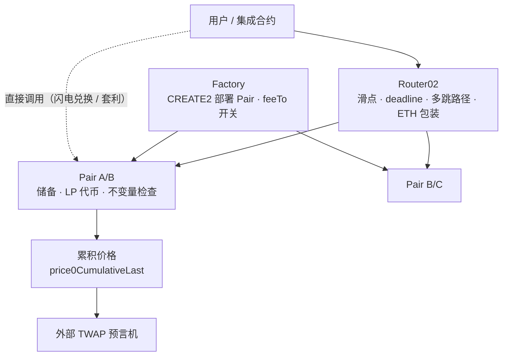

# B36 Uniswap V2：最小的完整 AMM 审计底稿

> 代码：v2-core（Factory、Pair、ERC20）约 500 行；v2-periphery（Router02、Library、Oracle 示例）。  
> 前置章节：[B18 AMM](B18-dex-amm.md)、[B35 底稿方法](B35-case-method.md)  

> 🔗 关联：主线 [08 章](../08-oracle-flashloan.md)、[09 章](../09-mev-signatures.md)、[11 章](../11-defi-economic-security.md) ｜ 实验 [K 值检查](../interactive/audit-v2k.html)、[逐行讲解](../interactive/audit-codewalk.html)、[AMM 工作台](../interactive/audit-amm.html) ｜ 评估 [A04](../assessment/A04-defi-protocol-review.md) ｜ 衔接 [B18](B18-dex-amm.md)、[B35](B35-case-method.md)

## 1. 架构

**读图要点：**

- 安全核心只在 Pair。Router 是便利层：所有用户保护（滑点、deadline）都在 Router，而不是 Pair。
- Pair 地址由 CREATE2 确定，可以离线计算。集成方用它验证"调用我的是不是真正的 Pair"。
- 局限：Router 不支持转账收费代币的普通函数，需要使用 `...SupportingFeeOnTransferTokens` 版本。

## 2. 资产表

| 资产 | 位置 | 记账变量 | 真实来源 | 两者不一致时 |
|---|---|---|---|---|
| token0 / token1 | Pair | `reserve0 / reserve1` | `balanceOf(pair)` | `skim()` 把多余部分转走；`sync()` 把储备对齐到余额 |
| LP 份额 | Pair（自身是 ERC20） | `totalSupply / balanceOf` | 同左 | — |
| 协议手续费 | Pair | `kLast` | 在 mint/burn 时以 LP 形式铸给 feeTo | feeTo 关闭时不累计 |

## 3. 角色表

| 角色 | 能力 | 约束 |
|---|---|---|
| feeToSetter | 设置 feeTo（开启 1/6 协议费）、转移 feeToSetter | 不能动池子资产、不能暂停、不能升级 |
| 任何人 | 创建 Pair、交易、加减流动性、skim、sync | 受不变量约束 |

结论：V2 几乎没有中心化风险。`ACC` `UPG` 审计分支时（大量 V2 分叉）要重点看分叉是否新增了特权，例如可修改手续费、可暂停、可升级。

## 4. 入口表（Pair）

| 函数 | 状态写入 | 外部调用 | 关键检查 |
|---|---|---|---|
| `mint(to)` | LP 铸造、储备更新、kLast | 无（代币已预先转入） | 首次铸造永久锁定 `MINIMUM_LIQUIDITY = 1000` 份额，防止首存者攻击；按两种资产较小的比例给份额 |
| `burn(to)` | LP 销毁、储备更新 | 两次代币转出 | `lock`；按份额比例返还 |
| `swap(...)` | 储备更新、累积价格 `price0CumulativeLast`（链上 TWAP 的数据源，见 [08 章](../08-oracle-flashloan.md)） | 代币转出 + 可选回调 | `lock`；扣费后 K 值不减 |
| `skim(to)` | 无 | 转出余额超过储备的部分 | `lock`；转账收费代币和 rebase 代币会让余额与储备不一致 |
| `sync()` | 储备 = 余额 | 无 | `lock` |

## 5. 不变量

1. **K 值不减**：每次 swap 后，扣除 0.3% 输入费后的余额乘积 ≥ 交易前储备乘积。
2. **储备 ≤ 余额**：任何函数结束时，`reserve ≤ balanceOf(pair)`（多出部分可被 skim）。
3. **份额公平**：mint 给出的份额不超过存入资产占比的较小值。
4. **重入隔离**：所有修改储备的函数共享同一把 `lock`。

> 🧪 交互实验：[K 值不变量检查器](../interactive/audit-v2k.html)

## 6. 集成方清单

| # | 检查项 | 原因 |
|---|---|---|
| 1 | `ORA` 不把 `getReserves()` 或 `balanceOf(pair)` 当价格使用 | 单笔交易可改变（见 08 章） |
| 2 | `ORA` 使用 TWAP 时窗口足够长、池子足够深，并处理累积价格的溢出差值 | 累积价格设计上允许 uint256 回绕，只能用差值 |
| 3 | `MEV` 调用 Router 时 `amountOutMin` 不为 0，`deadline` 不为 `block.timestamp` | 用 `block.timestamp` 当 deadline 等于没有 deadline |
| 4 | `ACC` `EXT` 实现 `uniswapV2Call` 时校验 `msg.sender` 是 Factory 计算出的 Pair 地址，并校验 `sender == address(this)` | 否则任何人可以触发你的回调 |
| 5 | `ORA` 按 LP 份额给 LP 代币估值时不使用"储备 × 现货价格" | 应使用公平储备定价（基于 √(k·p0·p1)） |
| 6 | `EXT` 处理转账收费代币和 rebase 代币 | 储备与余额会偏离 |
| 7 | `ARI` 分叉代码修改手续费时，同步修改 `swap` 中的 1000/3 常数和 Library 中的计算 | 两处不一致会让 Router 报价与 Pair 校验不符 |

## 7. 公开审计中的已知设计取舍

- `MEV` `DFI` 首个 LP 决定初始价格，任何人可以抢先创建并设定一个偏离市场的价格；集成方添加流动性时要检查价格。
- `EXT` `skim` 允许任何人拿走"多转进来的钱"：误转入 Pair 的代币不受保护。
- `ORA` TWAP 只在每个区块第一次交互时更新：同一区块内的操纵不影响累积价格，但连续多区块操纵可以。

> 🪞 反思：找一个你了解的 V2 分叉。
> 1. 它新增了哪项 V2 没有的权限？
> 2. 它修改过手续费吗？Library 和 Pair 一致吗？
> 3. 你的集成使用的价格，能被一笔交易改变吗？

## 8. 思考题

1. 一个 V2 分叉把手续费从 0.3% 改成 0.25%，只修改了 Library。写出这个发现的标题和影响。
2. 为什么 Pair 的 `swap` 不需要 `amountOutMin` 参数也是安全的（对 Pair 自身而言）？
