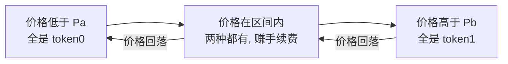
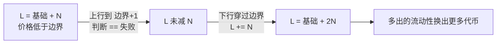
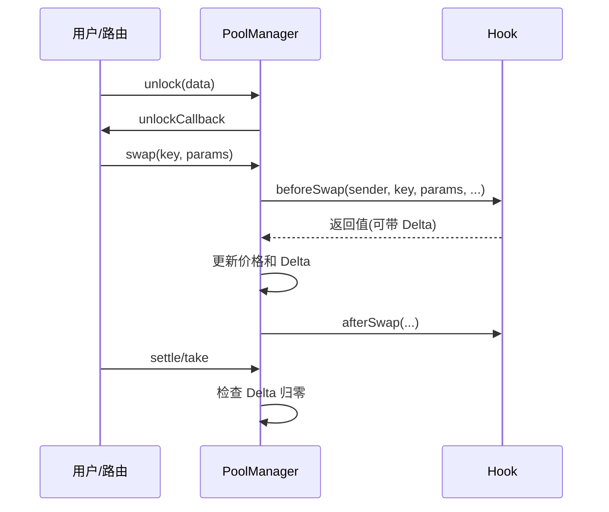

# B37 集中流动性与 V4 Hooks

> 学习目标：做完本章，你能——
> 1. 从 `x·y=k` 推导 tick、`sqrtPriceX96` 和流动性 L，并手算一个区间的代币数量。
> 2. 解释取整方向和 tick 边界为什么是集中流动性的高危区，并跑通本地演示。
> 3. 用 AMM 清单审计一个 V4 Hook：权限、调用者、`sender`、Delta 和恶意 Hook。
>
> 前置知识：AMM 恒定乘积公式（[B18 DEX 与 AMM](B18-dex-amm.md)、[B36 Uniswap V2](B36-case-uniswap-v2.md)）。
> 预计用时：3–4 小时。
> 示例：[examples/range/clamm/](../../examples/range/clamm/README.md)
> 关联章节：[06 算术与精度](../06-arithmetic-precision.md)｜[08 预言机与闪电贷](../08-oracle-flashloan.md)｜[B18 DEX 与 AMM](B18-dex-amm.md)｜交互实验 [audit-v2k.html](../interactive/audit-v2k.html)
> 最后核对：2026-11-10（Uniswap v4-core 主分支代码；forge 1.5.1 本地运行；事故来源见文内链接）

> ⚠️ 警告：法律与道德边界。本章代码只在本地运行。不要用来测试任何未授权的线上池子。

---

## 开场：差 1 wei，丢几千万

2023 年 11 月，KyberSwap Elastic 被攻击。公开分析把根因归结到一次取整方向错误。价格只比边界多走了 1 个最小单位，流动性却被算了两次。

<details class="predict"><summary>🤔 先猜再看：一个 AMM 公式里，把"向下取整"改成"向上取整"，差距最多 1 wei。这能造成大额损失吗？</summary>

能。1 wei 的差距本身不值钱。但它能让**状态判断**出错：程序以为价格没有越过边界，流动性账本就会错一大截。下文第 6 节在本地复现这个机制。

</details>

## 1. 从 x·y=k 开始

恒定乘积 AMM 的池子持有两种代币，数量为 x 和 y。交易前后保持 `x · y = k`。价格 `P = y / x`。

问题：流动性分布在 0 到无穷的所有价格上。真实交易集中在当前价格附近。绝大部分资金闲置。

集中流动性（Concentrated Liquidity）：LP 只在自己选定的价格区间内提供流动性。

> 🎯 打个比方：普通 AMM 像把一桶水洒满整个操场。集中流动性像把水倒进你选定的一段水渠。水量相同，水渠里的水更深。
>
> 比喻的局限：水渠外价格没水可用。价格离开区间后，LP 不再赚手续费，还会全部持有一种代币。

## 2. 三个核心量：L、√P、tick

**流动性 L**：区间内的深度，定义为 `L = √(x·y)`。

**√P**：价格的平方根。用 √P 计算时，代币数量变化是线性的：

```text
Δy = L · Δ√P
Δx = L · Δ(1/√P)
```

**tick**：把价格离散化的整数刻度。价格只能落在 `P = 1.0001^tick` 上。相邻 tick 相差约 0.01%。

**sqrtPriceX96**：合约里的 √P，用 Q64.96 定点数存储：

```text
sqrtPriceX96 = √P × 2^96
```

Solidity 没有小数。Q64.96 表示 64 位整数部分和 96 位小数部分。

| tick | 价格（token1/token0） | sqrtPriceX96（本地计算） |
|---|---|---|
| 0 | 1 | 79228162514264337593543950336 |
| 1000 | 约 1.105 | 83290069058676223003182343269 |
| 69082 | 约 1000 | 2505538923316343871269983126943 |

Uniswap 的 tick 范围是 ±887272（见 v4-core `TickMath.sol`）。本章的教学库限制在 ±200000。

**头寸**：V3 的每个 LP 头寸是一个 NFT（由外围合约 `NonfungiblePositionManager` 铸造）。区间不同的头寸不能合并，手续费按头寸单独累计（见第 5 节）。

## 3. 区间内的代币数量

LP 在价格区间 `[Pa, Pb]` 提供 L。当前价 `P` 在区间内时：

```text
token0 = L · (√Pb − √P) / (√P · √Pb)
token1 = L · (√P − √Pa)
```

如果价格高于 Pb，LP 全部持有 token1。如果价格低于 Pa，LP 全部持有 token0。



读图要点：跨越区间边界时，这个 LP 的流动性从"活跃"变"不活跃"。全局活跃流动性必须同步加减。这就是 tick 跨越的来源。

## 4. tick 跨越和 liquidityNet

合约不遍历 LP。每个初始化的 tick 上记一个 `liquidityNet`：价格向上穿过这个 tick 时，活跃流动性要加多少。向下穿过时取相反数。

示例（数值为示例）：一个 LP 在 tick 1000 到 2000 提供 L=500。

- 价格向上穿过 1000：活跃 L +500。
- 价格向上穿过 2000：活跃 L −500。
- 价格向下穿过 2000：活跃 L +500。

一次 swap 是"走一段，跨 tick，再走一段"的循环。

## 5. 手续费增长

每笔手续费先累计到全局值：

```text
feeGrowthGlobal += 手续费 × 2^128 ÷ 活跃 L
```

单个头寸的手续费用"区间内部增长"计算：

```text
inside = global − 区间下方增长 − 区间上方增长
```

要点：

1. 这几个减法**故意允许回绕**。Uniswap V3 和 V4 都依赖 uint256 的模运算。审计时不要"修复"回绕，要确认回绕的语义正确。
2. 区间外时，`inside` 冻结。LP 不再赚手续费。

## 6. 取整方向和 tick 边界

### 6.1 取整方向

原则：**每次取整都对池子有利，对用户不利**。

- 用户付入的代币：向上取整。
- 用户拿走的代币：向下取整。
- 用 token0 换 token1 时，下一个价格向上取整（少给用户）。

本地演示：

```bash
cd examples/range/clamm # 进入 CLAMM 配套目录
forge test --match-test wrongRounding -vv # 只跑错误取整的演示，打印差额
```

真实输出：

```text
[PASS] test_wrongRoundingUnderchargesUser()
Logs:
  wrong rounding: amountIn 1
  wrong rounding: shortfall in wei 1
```

差值只有 1 wei，但已经违反"用户付的钱覆盖价格变化"这个性质。`testFuzz_correctRoundingNeverOwesPool` 对正确方向做了模糊测试。

### 6.2 tick 边界

一个 tick 边界有三种情况要写对：价格**恰好等于**边界、**高于**边界 1 wei、**低于**边界 1 wei。

KyberSwap Elastic 是同一类错误：注释要求向上取整，代码用了 `mulDivFloor`。价格越过 tick 边界后，程序没有跨越 tick；反向交易时，流动性被计入两次（[C00 4.4 节](../chains/C00-ethereum.md)）。`src/ToyBoundary.sol` 用 30 行代码抽象了这个机制：

```solidity
// ❌ 漏洞：只有恰好相等才算跨越
bool crossed = next == boundary;  // 越过边界 1 wei 时为 false，tick 未被跨越

// ✅ 修复：到达或越过边界都算跨越
bool crossed = next >= boundary;  // 价格到达或越过边界即更新流动性
```

```bash
forge test --match-test boundary -vv # 只跑 tick 边界的演示
```

真实输出：

```text
[PASS] test_boundaryEqualityCheckDoubleCountsLiquidity()
Logs:
  buggy liquidity after round trip 2000000000000000000000

[PASS] test_boundaryGteCheckKeepsLiquidity()
```

读数：起始 L = 1,500e18（基础 1,000e18 + 头寸 500e18）。价格越界再回来后，错误版本的 L 变成 2,000e18，**多了一份 500e18**。



读图要点：错误发生在"上行"这一步。伤害发生在"下行"之后。审计时必须成对检查方向。这是抽象演示，没有实现真实 swap 循环。

## 7. V3 的 TWAP

TWAP（Time-Weighted Average Price）：时间加权平均价格。V3 池子累加 `tickCumulative`。用户读两个时间点的差值：

```text
平均 tick = (tickCumulative2 − tickCumulative1) ÷ 时间差
```

[Uniswap 文档](https://docs.uniswap.org/concepts/protocol/oracle)说明，对 tick 做算术平均，对应价格的**几何平均**。

审计要点：

| 风险 | 说明 |
|---|---|
| 直接读 `slot0` | `slot0` 是当前现货价，单笔交易（含闪电贷）就能推动它。只能用 TWAP 或外部预言机 |
| 窗口过短 | 演示：同样的 12 秒尖峰（tick +10000），1800 秒窗口平均 tick 66；60 秒窗口平均 tick 2000 |
| 观测容量 | `observationCardinality` 初始为 1。容量不够时，`observe` 读不到所需历史 |
| 负数取整 | 平均 tick 要向负无穷取整。Solidity 的除法向零取整 |
| 低流动性 | 流动性低时，操纵一段窗口的成本低 |

演示对应 `test_twapDampsOneBlockSpike` 和 `test_twapRoundsTowardNegativeInfinity`。

## 8. V4 的三件大事

### 8.1 单例 PoolManager

V3 的每个池子是一个合约。V4 把所有池子放进一个合约 `PoolManager`（单例，Singleton）。

### 8.2 闪电记账

闪电记账（Flash Accounting）：同一笔 `unlock` 内先记 Delta，最后统一结清。

1. 调用者调用 `poolManager.unlock(data)`。
2. PoolManager 回调调用者的 `unlockCallback`。
3. 回调内可以做多次 swap、加减流动性。每次只更新 Delta（净欠额）。
4. 回调结束时，PoolManager 检查 `NonzeroDeltaCount == 0`，否则回滚 `CurrencyNotSettled`。

Delta 用 EIP-1153 瞬态存储保存。

> 💡 注意：结算检查只保证**净额归零**。它不保证 Hook 自己的账本正确。[Trail of Bits](https://blog.trailofbits.com/2026/07/30/building-secure-uniswap-v4-hooks/) 指出，Cork 和 Bunni 两起事故都不是 PoolManager 的缺陷，而是 Hook 的应用逻辑问题。

### 8.3 Hooks

Hook：V4 池子可选的外部合约。PoolManager 在 swap、加减流动性等时刻调用它。

Hook 的权限**写在合约地址的低 14 位里**（见 [v4-core Hooks.sol](https://github.com/Uniswap/v4-core/blob/main/src/libraries/Hooks.sol)）。比如 `BEFORE_SWAP_FLAG = 1 << 7`。地址的对应位没有置 1，PoolManager 就不调用这个回调。



读图要点：Hook 里 `msg.sender` 是 PoolManager。参数 `sender` 是调用 PoolManager 的地址，通常是路由，不是最终用户。图中没有展示 Hook 自己再调用 PoolManager 的情况。

## 9. Hook 攻击面

| 攻击面 | 问题 | 防御 |
|---|---|---|
| 调用者（`onlyPoolManager`） | Hook 函数是外部函数，攻击者能直接调用 | 用 `BaseHook` / `onlyPoolManager`；`unlockCallback` 也要校验 |
| `sender` 信任 | `sender` 通常是路由，不代表用户 | 不用 `sender` 做用户鉴权；需要时使用受信路由 |
| 权限位 | 地址位与实现不一致，导致回调被跳过或回滚 | `getHookPermissions()` 与地址位同步；用 CREATE2 挖矿部署 |
| 池子绑定 | 任何人能用任意币对把池子挂到你的 Hook 上 | 限制规范池子或白名单；重新计算 `PoolId` |
| 重入和共享状态 | `beforeSwap` 和 `afterSwap` 之间状态变化；嵌套操作覆盖临时变量 | 按 `PoolId` 和调用者隔离临时数据；CEI |
| Delta 返回 | `*_RETURNS_DELTA` 权限允许 Hook 改变用户结算 | 审计返回值逻辑；路由设置最小输出 |
| 恶意 Hook | 池子创建者可以选择恶意 Hook | 路由和用户只用已知 Hook；Hook 不信任 PoolKey 中的币对 |
| 阻塞退出 | `afterRemoveLiquidity` 回滚让 LP 无法退出 | 可选逻辑放 `try/catch` |
| 可升级 Hook | 权限位不变，逻辑可变 | 单独审计升级权限 |

## 10. 真实案例

### 10.1 KyberSwap Elastic（2023 年 11 月，多链）

- 根因、损失口径和受影响的链见 [C00 4.4 节](../chains/C00-ethereum.md)。本章第 6.2 节在本地复现了它的机制。

### 10.2 Cork Protocol（2025 年 5 月 28 日，以太坊）

- 损失：3,761 wstETH（[Cork 官方复盘](https://www.cork.tech/blog/post-mortem)）。公开报道估值约 1,100 万–1,200 万美元。
- 根因：官方复盘列出三点：
  1. 临近到期的薄市场定价被操纵，扭曲了新市场的初始价格。
  2. `CorkHook` 缺少一个访问控制检查。官方复盘称，这个检查后来才加入 Uniswap v4-periphery。
  3. `FlashSwapRouter` 不应持有余额，却持有储备。
- 过程：攻击者部署自己的 Hook。通过 `unlock` 回调模拟合法环境。把伪造数据通过 `beforeSwap` 传入路由的 Cork 回调路径。
- 教训：多个问题组合才造成损失。不要只修复 Hook 的访问控制，要检查 Hook 的数据流向哪里。

> 💡 注意：2025 年 9 月 Bunni 损失约 840 万美元（Trail of Bits 文章引用），根因是 Hook 内部的取整问题。它说明 Hook 的数学和权限同样危险。

## 11. 审计检查点 AMM

- [ ] **AMM-1** 所有取整方向都已标注，并对池子有利。
- [ ] **AMM-2** 价格等于、高于 1 wei、低于 1 wei 三种边界情况都有测试。
- [ ] **AMM-3** tick 跨越的加减成对；向上和向下都覆盖。
- [ ] **AMM-4** 手续费增长的回绕语义正确；没有被错误的 `checked` 算术破坏。
- [ ] **AMM-5** 不把 `slot0` 现货价当预言机；用作预言机的 TWAP：窗口足够长、容量足够、负数向负无穷取整。
- [ ] **AMM-6** `sqrtPriceX96` 的乘法使用 512 位中间值或已证明不溢出。
- [ ] **AMM-7** 修改过的 Uniswap 数学库，逐行比对原实现，并说明差异。
- [ ] **AMM-8** Hook 回调都有 `onlyPoolManager` 或等效校验；`unlockCallback` 同样校验。
- [ ] **AMM-9** Hook 没有用 `sender` 做用户鉴权。
- [ ] **AMM-10** Hook 权限位与实现一致；部署脚本校验地址位。
- [ ] **AMM-11** Hook 绑定规范池子，或把未知 PoolKey 按恶意处理。
- [ ] **AMM-12** Hook 内部账本和 PoolManager Delta 分别对账；结算通过不代表账本正确。
- [ ] **AMM-13** Hook 的临时状态按 `PoolId` 隔离；嵌套调用有测试。
- [ ] **AMM-14** Hook 的可选逻辑失败时，不阻止 LP 退出。
- [ ] **AMM-15** 路由和集成方不信任任意 Hook，并设置最小输出。

把检查结果写进报告：

| 检查项 | 证据 | 常见严重性 | 关联 |
|---|---|---|---|
| AMM-1、2、3 | 边界单元测试；失败序列 | Critical / High | [06 章](../06-arithmetic-precision.md) |
| AMM-4、6、7 | 差分测试；与原实现的 diff | High | [B18](B18-dex-amm.md) |
| AMM-5 | TWAP 窗口和操纵成本估算 | High / Medium | [08 章](../08-oracle-flashloan.md) |
| AMM-8、9 | 直接调用 Hook 的 PoC | Critical | [05 章](../05-access-control.md) |
| AMM-10、11、15 | 部署脚本；池子白名单 | High | [B42](B42-perps.md) |
| AMM-12、13、14 | 账本对账不变量 | High | [27 章](../27-audit-testing-workflow.md) |

## 12. 跑通全部演示

```bash
forge test # 运行本章全部演示
```

真实输出：

```text
Ran 13 tests for test/Clamm.t.sol:ClammTest
Suite result: ok. 13 passed; 0 failed; 0 skipped
```

> 🧪 动手验证：把 `ToyBoundary.moveUp` 里的 `next >= boundary` 改成 `next > boundary`，运行 `forge test --match-test boundary`。两个测试仍然通过，因为它们只测了边界 +1。自己加一个 `moveUp(boundary)` 的测试，写下你认为正确的结果。这就是 AMM-2 要求三种情况都测的原因。

> 🪞 反思：你用过的协议里，有没有一个 1 wei 的取整看起来"无所谓"？如果把它放进循环 1,000 次，或者用它做一次条件判断，结果还无所谓吗？

## 13. 如果出错

| 现象 | 原因 | 解决 |
|---|---|---|
| `forge: command not found` | Foundry 未安装 | 按 [B04](B04-setup.md) 安装 |
| `Source "forge-std/Test.sol" not found` | 符号链接失效 | `ln -sfn ../../../foundry/lib/forge-std lib/forge-std` |
| `assertEq` 报多个候选函数 | `int24` 或 `uint160` 没有对应重载 | 显式转换成 `int256` 或 `uint256` |
| 算出的 `sqrtPriceX96` 和链上差几位 | 教学库精度低 | 这是预期；真实审计要用 `TickMath` 做差分 |
| 看不懂 Q64.96 | 定点数不熟 | 回看 [06 章](../06-arithmetic-precision.md) 的定点数部分 |

## 14. 过关标准

- [ ] `forge test` 显示 13 个测试全部通过。
- [ ] 手算：tick 0 的 `sqrtPriceX96` 是 `2^96`。
- [ ] 不看书解释：`next == boundary` 为什么会让流动性被计入两次。
- [ ] 说出 Hook 里 `msg.sender` 和参数 `sender` 分别是谁。
- [ ] 写一个直接调用 Hook 函数的测试思路，说明 `onlyPoolManager` 如何阻止它。

## 思考题

1. 手续费增长的减法为什么允许回绕？如果把它改成 Solidity 0.8 默认的检查算术，会发生什么？
2. V4 的 `CurrencyNotSettled` 检查已经保证净额归零。为什么 Hook 还可能让 LP 亏钱？
3. 你要给一个 V4 Hook 写不变量测试。列出两条与 PoolManager 无关、只属于这个 Hook 的不变量。
