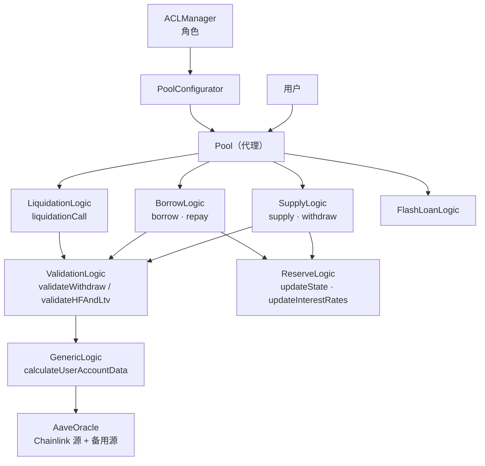

# B38 Aave V3：权限分层、健康度检查与分叉审计

> 代码：aave-v3-core（该仓库已弃用，最新 V3 代码见 [aave-v3-origin](https://github.com/aave-dao/aave-v3-origin)；截至 2026 年 11 月，[Aave V4](https://aave.com/blog/aave-v4-live-ethereum) 已上线以太坊主网，V3 继续运行）：Pool（代理）+ 逻辑库（SupplyLogic、BorrowLogic、LiquidationLogic、ValidationLogic、ReserveLogic…）+ 代币（aToken、VariableDebtToken）+ 配置（PoolConfigurator、ACLManager、AaveOracle）。  
> 前置章节：[B20 借贷](B20-lending-cdp.md)、[08 预言机](../08-oracle-flashloan.md)、[B35 底稿方法](B35-case-method.md)  

> 🔗 关联：主线 [08 章](../08-oracle-flashloan.md)、[10 章](../10-upgradeable-proxy.md)、[11 章](../11-defi-economic-security.md) ｜ 实验 [检查覆盖矩阵](../interactive/audit-hfmatrix.html)、[健康因子](../interactive/audit-lending.html) ｜ 评估 [A04](../assessment/A04-defi-protocol-review.md) ｜ 衔接 [B20](B20-lending-cdp.md)

## 1. 一句话理解

**Aave V3 把"做什么"（逻辑库）、"能不能做"（ValidationLogic）和"谁能改参数"（ACLManager）分开。审计它或它的分叉，核心工作是确认：每一个会让账户变得更危险的入口，都经过了同一套校验。**

## 2. 架构

**读图要点：**

- 所有用户入口先调 `ReserveLogic.updateState`（结算利息），再调 ValidationLogic，最后改余额。审计时按这个顺序逐个核对。
- 健康度计算集中在 `GenericLogic.calculateUserAccountData`。分叉如果新增入口，最常见的问题是没有调用它。
- 局限：图中省略了 eMode、隔离模式、Portal（跨链桥接供应）和 GHO 相关模块。

## 3. 角色表

| 角色 | 能力 | 审计关注 |
|---|---|---|
| POOL_ADMIN | 上架资产、修改大部分参数 | 应由治理 + 时间锁持有 |
| EMERGENCY_ADMIN | 暂停池子或单个资产 | 暂停是否会阻断还款和清算？（V3 支持单独暂停清算的宽限期设计） |
| RISK_ADMIN | 调整风险参数（上限、LTV 等） | 能否把参数改到让大量账户立即可被清算？ |
| ASSET_LISTING_ADMIN | 上架资产 | 新资产的价格源与初始配置 |
| FLASH_BORROWER | 免闪电贷手续费 | 白名单范围 |
| BRIDGE | Portal 无抵押铸造 aToken | 额度上限 |

## 4. 核心不变量：风险增加的入口都要校验

下表列出让账户风险上升的操作，以及 V3 对应的校验。这张表是审计 Aave 分叉时最有用的一页。

| 操作 | 风险变化 | V3 的校验 |
|---|---|---|
| borrow | 债务增加 | `validateBorrow`：HF、LTV、借款上限、隔离模式、eMode |
| withdraw | 抵押减少 | `validateHFAndLtv`（仅当该资产被用作抵押） |
| setUserUseReserveAsCollateral(false) | 抵押减少 | `validateHFAndLtv` |
| aToken.transfer | 抵押转移给他人 | `finalizeTransfer` 中调用 `validateHFAndLtv` |
| setUserEMode | 参数变化 | 切换后重新校验 HF |
| flashLoan（模式 2：不还款转为债务） | 债务增加 | 走 borrow 的校验 |

> ⚠️ 警告：（`DFI`）行业里已有借贷协议因为"后来新增的某个入口没有做健康度校验"而遭受重大损失（例如 2023 年的 Euler 事件，[来源](https://blocksec.com/blog/de-fi-exploit-analysis-the-root-cause-of-euler-s-200-m-loss)）。审计分叉或升级时，先列出所有会减少抵押或增加债务的入口，再逐一确认校验存在。下方实验就是这张检查表的交互版。

> 🧪 交互实验：[入口 × 检查覆盖矩阵](../interactive/audit-hfmatrix.html)

## 5. 清算参数的审计要点

- `DFI` **close factor**：默认可清算 50% 债务；HF 不高于阈值（0.95），或该储备的抵押或债务价值低于 2,000 美元（V3.3 起，[合约](https://github.com/aave-dao/aave-v3-origin/blob/main/src/contracts/protocol/libraries/logic/LiquidationLogic.sol)）时允许 100%，避免留下无法清算的"灰尘"债务。
- `DFI` **清算奖励**：要高于清算者的 Gas 与价格冲击成本，又不能高到让"清算本身"使账户更不健康。审计时验算：`LT × (1 + bonus) < 1`，否则清算会降低 HF。
- `ORA` **预言机失效**：Chainlink 源被移除或报价异常时，清算是否全部 revert？V3 支持备用源。
- `ACC` `DFI` **暂停与宽限期**：恢复后给予用户补充抵押的时间，避免恢复瞬间的大规模清算。

## 6. 分叉审计清单

1. `DFI` 新增的每个外部入口，是否进入了 ValidationLogic？
2. `ORA` 新上架资产：价格源小数位、心跳、是否为可被捐赠操纵的份额类资产？
3. `DFI` 修改过的利率策略：拐点和斜率是否有上限？
4. `ARI` 缩放余额（scaled balance）的取整：`rayDiv`/`rayMul` 的方向是否与原版一致？
5. `ARI` `DFI` 空市场或低流动性市场的首次存款是否有保护？
6. `ORA` L2 部署：是否接入了排序器状态检查（PriceOracleSentinel）？

> 🪞 反思：打开一个你了解的借贷协议或分叉。
> 1. 列出所有会增加账户风险的入口，有没有遗漏校验？
> 2. 暂停时，用户能否还款？
> 3. 谁能修改风险参数，能否让账户立即被清算？

## 7. 思考题

1. 一个分叉新增了"把 aToken 直接捐赠给储备"的函数。按第 4 节的表格，你会要求它做什么校验？
2. 为什么 `aToken.transfer` 也属于"风险增加的入口"？
