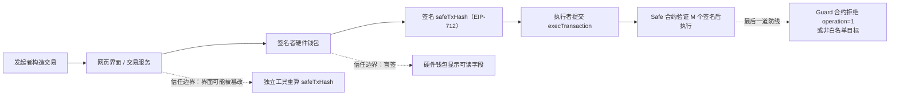

# B40 Safe 多签：合约没有漏洞，流程也要审计

> 对象：Safe（原 Gnosis Safe）智能账户：项目方金库、协议管理员、交易所冷钱包常用。  
> 前置章节：[03 delegatecall](../03-evm-solidity-basics.md)、[10 代理](../10-upgradeable-proxy.md)、[20 前端与供应链](../20-frontend-dns-supply-chain.md)  

> 🔗 关联：主线 [05 章](../05-access-control.md)、[10 章](../10-upgradeable-proxy.md)、[18 章](../18-wallet-key-management.md)、[21 章](../21-social-engineering-insiders.md) ｜ 实验 [多签复核](../interactive/audit-safetx.html) ｜ 评估 [A03](../assessment/A03-exchange-contracts-wallets.md)、[A06](../assessment/A06-operational-key-security.md) ｜ 衔接 [B50](B50-solana-audit.md)

## 1. 一句话理解

**多签保证的是"M 个人都同意了"，不保证"他们看懂了自己同意的是什么"。签名者在界面上看到的内容和实际签名的内容必须独立核对。**

2025 年 2 月的 Bybit 事件（约 15 亿美元，[FBI](https://www.ic3.gov/psa/2025/psa250226)）是这一点最昂贵的例证：签名者使用的网页界面被篡改，展示的交易与实际签名的交易不同。Safe 合约本身没有漏洞（[来源](https://www.certik.com/blog/bybit-incident-technical-analysis)）。

## 2. SafeTx 结构

| 字段 | 含义 | 复核要点 |
|---|---|---|
| `to` | 目标地址 | 是否在白名单内？是否为预期合约？ |
| `value` | 附带 ETH | 与意图一致？ |
| `data` | 调用数据 | 选择器与参数解码后是否与意图一致？ |
| `operation` | 0 = CALL，1 = DELEGATECALL | **1 表示用目标代码改写 Safe 自身存储**（包括 slot 0 的实现地址、owners、threshold）。日常转账永远不应该是 1 |
| `safeTxGas / baseGas / gasPrice / gasToken / refundReceiver` | Gas 退款参数 | 非零的 gasPrice 与陌生 refundReceiver 可以把 Safe 资金作为"退款"转走 |
| `nonce` | Safe 交易序号 | 是否是预期的下一个？ |

## 3. 签名流程与信任边界

**读图要点：**

- 签名者应在另一台设备上，用独立工具从原始字段重算 `safeTxHash`，与硬件钱包上显示的哈希比对。
- Guard 是 Safe 的可选钩子合约，可以在执行前检查交易字段。它把"流程纪律"变成"合约强制"。
- 局限：Guard 本身设置错误可能锁死 Safe；Module 可以绕过多签直接执行，要单独审计。

> 🧪 交互实验：[多签交易签前复核面板](../interactive/audit-safetx.html)

## 4. 审计范围扩展：项目方运维审查清单

1. `ACC` 门限是否合理（例如 3/5 而非 2/3）？签名者是否分布在不同人、不同设备、不同地点？
2. `ACC` `UPG` 是否启用了 Guard 限制 DELEGATECALL 与目标白名单？
3. `ACC` 已启用的 Module 有哪些？每个 Module 能执行什么？
4. `ACC` 签名流程是否要求独立复核 safeTxHash 与解码后的 calldata？
5. `ACC` `UPG` 是否对 Safe 的 owners、threshold、实现地址、Module 变化设置了链上监控与告警？
6. `ACC` 大额资产是否有时间锁或分级审批？

> 🪞 反思：想一想你团队的多签。
> 1. 上一次签名前，你在什么设备上看过交易字段？
> 2. 谁能修改 Guard、Module 或门限？
> 3. 如果你今天被诱导签名，多久能发现？

## 5. 思考题

1. 为什么"operation = 1"对一个代理形式的 Safe 特别危险？（提示：Safe 代理的 slot 0）
2. 如果签名者只能看到哈希，看不到可读字段，你会建议增加哪一步流程？
