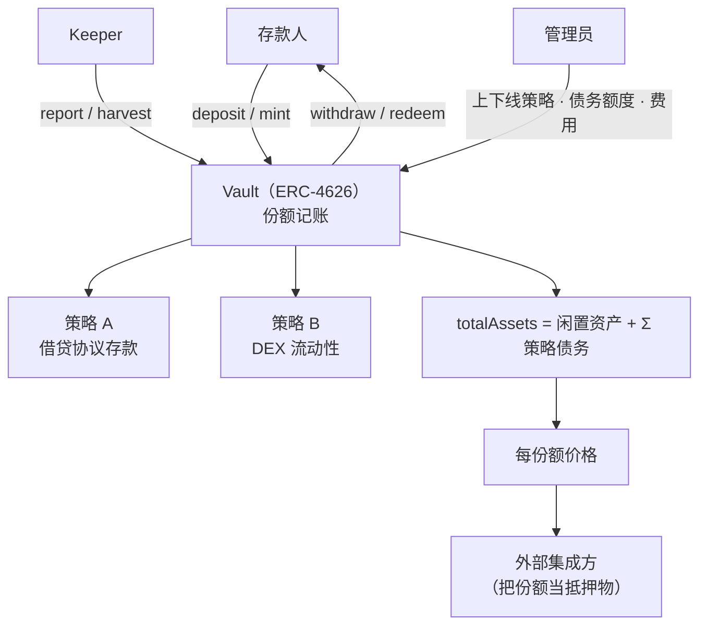

# B41 ERC-4626 金库：取整方向、资产来源与策略风险

> 对象：OpenZeppelin ERC4626 实现、Yearn V3 Vault 风格的多策略金库，以及集成金库份额的借贷协议。  
> 前置章节：[06 ERC-4626](../06-arithmetic-precision.md)、[B20 借贷](B20-lending-cdp.md)、[B17 Yearn 协议卡](B17-defi-basics.md)  

> 🔗 关联：主线 [06 章](../06-arithmetic-precision.md)、[07 章](../07-external-calls-tokens.md) ｜ 实验 [取整判定](../interactive/audit-rounding.html)、[金库通胀](../interactive/vault-inflation-lab.html) ｜ 评估 [A04](../assessment/A04-defi-protocol-review.md) ｜ 衔接 [B17](B17-defi-basics.md)

## 1. 一句话理解

**金库的全部安全性可以压缩成两件事：份额与资产的换算永远向有利于金库的方向取整；`totalAssets()` 不能被外部低成本地抬高或压低。**

## 2. 架构（多策略金库）

**读图要点：**

- `totalAssets` 用的是"内部记录的策略债务"还是"实时查询的余额"？前者需要 report 才更新；后者可能被捐赠或外部价格影响。
- 盈利通常逐步释放（profit unlocking），防止在 report 前存款、report 后取款的套利。
- 局限：策略本身的风险（被投协议出问题）会通过亏损报告传递给所有份额持有人。

## 3. 取整方向规则（EIP-4626 规定）

四个入口的取整方向见 [06 章](../06-arithmetic-precision.md) 第 3 节：用户给出的一侧向上取整，用户得到的一侧向下取整。EIP-4626 还规定了另外两类函数：

- `preview*`：结果必须与实际函数一致，或对用户更不利，不能更有利。
- `convertTo*`：向下取整，不含费用，只用于展示。

> 🧪 交互实验：[取整方向判定器](../interactive/audit-rounding.html)

## 4. 实现审计清单

1. `ARI` 四个入口的取整方向是否全部正确？`preview` 与实际执行是否一致？
2. `ARI` `DFI` 首存者保护：虚拟份额偏移、死份额或最小初始存款（见 [06 章](../06-arithmetic-precision.md) 第 4 节）。
3. `DFI` `totalAssets` 是否依赖 `balanceOf(this)`？捐赠会不会改变每份额价格？
4. `ARI` 费用是在份额铸造时收，还是在资产上收？是否会重复收取？
5. `EXT` `maxDeposit / maxWithdraw` 在暂停或策略流动性不足时是否返回正确值？
6. `DFI` 亏损报告：亏损是否立即反映到价格？会不会出现"先知道亏损的人先跑"？

## 5. 集成方审计清单

1. `ORA` 把金库份额作为抵押物时，估值用 `convertToAssets` 还是市场价？前者是否可能被捐赠或短时间操纵？是否设置了价格变化速率上限？
2. `MEV` 集成方调用 `deposit` 时是否检查了实际收到的份额（滑点保护）？
3. `EXT` 是否假设 `withdraw` 一定成功？金库可能有提款限制或排队。
4. `EXT` 金库资产本身是否为怪代币（收费、rebase）？

> 💡 注意：（`ORA`）2021 年 Cream Finance 事件的一个关键因素，就是把一个收益金库的份额价格直接用作抵押估值。份额价格可以通过向金库转入资产而被抬高。这正是第 5 节第 1 条要检查的问题（[复盘](https://medium.com/cream-finance/post-mortem-exploit-oct-27-507b12bb6f8e)）。

> 🪞 反思：选一个你了解的金库。
> 1. 四个入口的取整方向你都验证过吗？
> 2. 向金库转入资产会改变每份额价格吗？
> 3. 策略亏损时，谁先知道，谁先能退出？

## 6. 思考题

1. 在取整判定器中，把 `withdraw` 改成"向下取整烧份额"。连续执行 1,000 次小额提款会发生什么？
2. 为什么 `convertToAssets` 不适合直接作为借贷协议的抵押价格？
