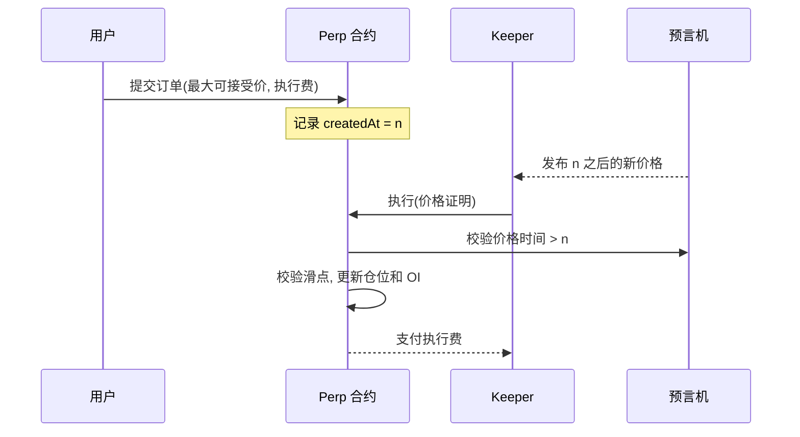
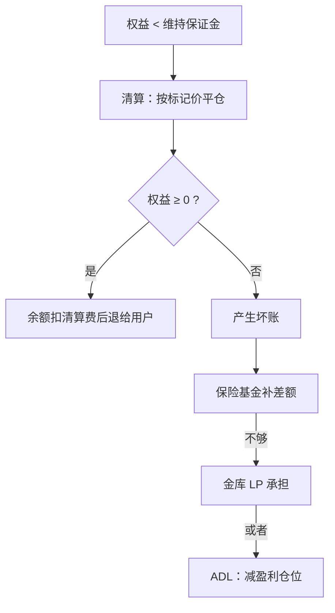
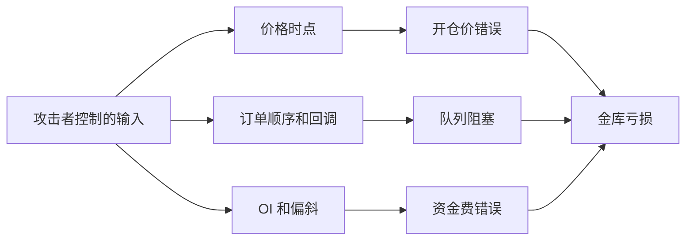

# B42 永续合约：从零到能审计

> 学习目标：做完本章，你能——
> 1. 用自己的话解释仓位、保证金、杠杆、盈亏、资金费、未平仓量、标记价格和清算。
> 2. 说清三种永续合约设计（金库对手方、订单簿应用链、链上订单簿加金库）的信任假设。
> 3. 用 PRP 清单审计一个永续合约，并写出偿付和 OI 两条不变量。
>
> 前置知识：[B13 第 1 次审计](B13-audit-1-notebox.md)、[B17 DeFi 地图与头部协议](B17-defi-basics.md)、[08 预言机与闪电贷](../08-oracle-flashloan.md)、[B41 ERC-4626 金库](B41-case-erc4626.md)。
> 预计用时：3–4 小时。
> 交互实验：[perp-lab.html](../interactive/perp-lab.html)
> 靶场：[examples/range/perplite/](../../examples/range/perplite/README.md)（下一章使用）
> 关联章节：[08 预言机与闪电贷](../08-oracle-flashloan.md)｜[11 DeFi 经济安全](../11-defi-economic-security.md)｜[B17 DeFi 地图与头部协议](B17-defi-basics.md)
> 最后核对：2026-11-10（协议设计和事故来源见文内链接；计算示例已用 Foundry 和实验页核对）

> ⚠️ 警告：法律与道德边界。本章只讨论原理和本地玩具合约。未经书面授权，不要测试任何真实协议。下文的事故只用于学习防御。

---

## 开场：一笔交易，四千万美元

2025 年 7 月 9 日，GMX V1 在 Arbitrum 上损失约 4,200 万美元（事发时估值）。攻击者没有偷私钥。攻击者让协议算错了一个数：所有空头的平均开仓价。这个数决定金库的账面价值。账面价值决定 LP 份额能换多少钱。

永续合约的账本比借贷协议更复杂。一个错误的平均价，就能变成真金白银。

<details class="predict"><summary>🤔 先猜再看：你用 600 美元保证金做多 3,000 美元的 ETH。ETH 跌 20%。你的 600 美元还剩多少？</summary>

还剩 0。仓位名义价值 3,000 美元，跌 20% 亏 600 美元，正好亏完保证金。杠杆放大的是**盈亏相对保证金的比例**，不是价格本身。协议实际上会在亏完之前清算你，下文第 7 节解释。

</details>

## 1. 现货和永续：差别在哪里

- 现货（Spot）：你买入真实资产。你持有 1 ETH，这 1 ETH 就是你的。
- 期货（Futures）：约定未来按某个价格交易。到期日结算。
- 永续合约（Perpetual Contract，简称 Perp）：**没有到期日**的合约。你不持有资产。你持有一份"价格涨跌的盈亏权利"。

> 🎯 打个比方：现货是买一套房。永续是和别人打赌房价涨跌，押金放在第三方。赌局一直持续，直到你退出或押金赔光。
>
> 比喻的局限：真实赌局通常有固定对手。永续合约的对手方可能是另一批交易者，也可能是金库。

永续合约有两个基本操作。**做多**（Long）在价格上涨时赚钱。**做空**（Short）在价格下跌时赚钱。做空不需要先借入资产。

## 2. 仓位、保证金和杠杆

| 术语 | 定义 | 示例（下文全部使用） |
|---|---|---|
| 仓位（Position） | 交易者的一份合约敞口 | 做多 ETH |
| 名义价值（Size / Notional） | 仓位按美元计的大小 | 3,000 美元 |
| 保证金（Margin / Collateral） | 交易者押在协议里的钱 | 600 美元 |
| 杠杆（Leverage） | 名义价值 ÷ 保证金 | 5 倍 |
| 开仓价（Entry Price） | 开仓时的成交价 | 3,000 美元 |

做多的盈亏公式（按美元名义价值计）：

```text
盈亏 = 名义价值 × (当前价 − 开仓价) ÷ 开仓价
```

做空的盈亏公式把括号里的两项对调。

```text
权益（Equity）= 保证金 + 未实现盈亏 − 累计应付费用
```

未实现盈亏（Unrealized PnL）：仓位还没有平，账面上的盈亏。平仓后，盈亏变成已实现（Realized PnL）。

示例：ETH 从 3,000 涨到 3,300，涨 10%。盈亏 = 3,000 × 10% = 300 美元。权益 = 600 + 300 = 900 美元。保证金回报率 50%。

> 🧪 动手验证：打开 [perp-lab.html](../interactive/perp-lab.html)。名义价值填 3,000，保证金填 600，把价格冲击拖到 +10%。确认权益显示 900。

## 3. 资金费：把永续价格拉回现货

永续合约没有到期日，所以没有"到期收敛"的力量。**资金费（Funding Fee）** 是多空双方互相支付的定期费用。它把永续价格拉回现货价格。

- 永续价格高于现货：通常多头付给空头。做多变贵，价格回落。
- 永续价格低于现货：通常空头付给多头。

示例：名义价值 3,000 美元，资金费率 0.01%/小时，持仓 24 小时。多头应付 3,000 × 0.01% × 24 = 7.2 美元。

资金费有两种常见定价方式：

| 方式 | 依据 | 公开资料 |
|---|---|---|
| 溢价法 | 永续价格相对预言机价格的溢价 | [Hyperliquid](https://hyperliquid.gitbook.io/hyperliquid-docs/trading/funding)：每小时结算；费率由溢价和利率组成；文档写明上限 0.5%/小时 |
| 偏斜法 | 多空未平仓量的不平衡 | [GMX Synthetics README](https://github.com/gmx-io/gmx-synthetics)：多空失衡时，较大一方向较小一方支付 |

> 💡 注意：资金费的实现几乎都是一个"累计指数"。协议维护一个随时间增长的全局值。开仓时记下快照。结算时用差值乘仓位大小。这样不需要遍历所有仓位。**累计指数必须在任何改变仓位或 OI 的操作之前更新。** 这是下一章 F-04 的根因。

## 4. 未平仓量 OI

未平仓量（Open Interest，OI）：所有未平仓位的名义价值之和。协议通常分别记录多头 OI 和空头 OI。

OI 有三个用途：

1. 算资金费（偏斜法）。
2. 限制金库的风险敞口（OI 上限）。
3. 给 LP 估值（金库对手方模型）。

审计要点：**每条改变仓位的路径都必须更新 OI**。开仓、加仓、平仓、清算、ADL 都算。漏一条，OI 就和真实仓位脱节。

## 5. 预言机价格、标记价格和指数价

| 价格 | 定义 | 用途 |
|---|---|---|
| 指数价（Index Price） | 多个交易所现货价的综合 | 反映外部市场 |
| 预言机价（Oracle Price） | 链上可读的指数价 | 成交、结算参考 |
| 标记价（Mark Price） | 协议算出的合理价格，通常结合外部价和自身订单簿 | 清算、未实现盈亏 |
| 成交价（Fill Price） | 实际成交价，含价格影响 | 开平仓 |

为什么要用标记价？如果清算用单一成交价，攻击者在薄盘口打一小笔，就能触发别人被清算。[Hyperliquid 文档](https://hyperliquid.gitbook.io/hyperliquid-docs/trading/liquidations)写明清算使用标记价。标记价结合外部交易所价格和自身订单簿状态。

## 6. Keeper 和两步下单

如果用户在一笔交易里提交订单并立刻按预言机价成交，会出现问题。用户能在链上价格更新前，提前看到新价格。这叫**预言机延迟套利**：攻击者比链上喂价更早知道场外价格。

两步下单（Two-step Order）就是对策：

1. 用户第一笔交易提交请求，写明最大可接受价格。
2. Keeper（链下机器人）第二笔交易执行。执行时使用**请求之后**的价格。

Keeper：由链下程序驱动，代替用户发交易并收取费用的角色。

[GMX Synthetics README](https://github.com/gmx-io/gmx-synthetics) 明确写了：大多数操作分两步，订单创建于时间戳 `n` 时，应使用时间戳 `n` 之后的预言机价格执行。



读图要点：价格只能来自订单之后。如果合约允许执行者挑选任意价格，两步下单就失去意义。Keeper 回调用户时也可能被拒绝，这会造成阻塞（第 10 节）。图中没有表示价格影响和手续费。

## 7. 清算、保险基金和 ADL

保证金率过低时，协议强制平仓。这叫**清算（Liquidation）**。

- 维持保证金（Maintenance Margin）：仓位必须保持的最低权益。常见写法是名义价值的固定比例。
- 清算价（Liquidation Price）：权益等于维持保证金时的价格。

做多的清算价公式（忽略费用）：

```text
清算价 = 开仓价 × (1 − (保证金 − 维持保证金) ÷ 名义价值)
```

示例：开仓价 3,000，保证金 600，名义价值 3,000，维持保证金 1% 即 30。清算价 = 3,000 × (1 − 570 ÷ 3,000) = 2,430 美元。

<details class="predict"><summary>🤔 先猜再看：同一个仓位，价格从 3,000 跳空到 2,200。权益是多少？谁承担差额？</summary>

权益 = 600 + 3,000 × (2,200 − 3,000) ÷ 3,000 = −200 美元。这 200 美元就是**坏账（Bad Debt）**：亏损超过保证金的部分。交易者已经赔光，差额要由保险基金、金库或其他交易者承担。

</details>

坏账的处理顺序如下，不同协议的细节不同：



读图要点：链条从上到下，每一层失败才进入下一层。保险基金是隔离层，不是无限资金。ADL 直接影响盈利用户，所以必须透明。

自动减仓（Auto-Deleveraging，ADL）：市场无法吸收亏损仓位时，协议强制减少对手方盈利仓位。

## 8. 手续费和价格影响

- 开平仓手续费：按名义价值的比例收取。
- 借款费（Borrowing Fee）：金库对手方模型里，按占用的流动性收费。[GMX Synthetics README](https://github.com/gmx-io/gmx-synthetics) 说明它用于防止用户同时开等额多空来占用容量。
- 价格影响（Price Impact）：不靠真实订单簿滑点，由合约模拟的成交折扣。让池子更不平衡的交易付负价格影响，让池子更平衡的交易得正价格影响。

## 9. 谁是对手方：三种设计

| 设计 | 代表（公开资料） | 对手方 | 价格来源 | 关键信任假设 |
|---|---|---|---|---|
| 金库对手方 | GMX V1（GLP）、GMX V2（GM 池） | LP 金库 | 预言机 + Keeper | 预言机、Keeper、LP 估值正确 |
| 订单簿应用链 | [dYdX v4](https://docs.dydx.xyz/concepts/trading/contract-loss-mechanism) | 其他交易者 | 验证者运行的订单簿 + 预言机 | 验证者集合 |
| 高性能 L1 订单簿 + 金库 | [Hyperliquid](https://hyperliquid.gitbook.io/hyperliquid-docs/trading/liquidations)（HLP 金库含清算策略） | 其他交易者；极端情况下由清算金库接手 | 订单簿 + 外部价 | 验证者、接管金库的容量 |

要点：

- **金库对手方**：LP 的盈亏和交易者相反。LP 份额价格必须计入交易者的未实现盈亏。GMX V1 事故就发生在这一步。
- **dYdX**：账户价值为负时，协议按其文档描述立即进行去杠杆。保险基金覆盖清算时的抵押品缺口。文档还说明隔离市场有独立的保险基金。
- **Hyperliquid**：权益低于维持保证金时，协议先向订单簿发市价单。权益低于维持保证金的 2/3 时，清算金库接手仓位。JELLY 事件就发生在这里。

> 💡 注意：金库对手方模型里，每一分盈利都来自 LP。LP 的份额价格必须包含"未实现盈亏"。否则先走的 LP 把亏损留给后走的 LP。

## 10. 攻击目录

下表是审计时的问题清单。第一列是攻击类型，第二列说明攻击者控制什么。

| 攻击类型 | 攻击者做什么 | 根因 | 防御 |
|---|---|---|---|
| 预言机延迟（Oracle Latency） | 先看到场外价格，再按旧价开仓 | 执行价早于订单时间 | 两步下单，只接受订单之后的价格 |
| 过期价格 | 喂价停止时，按旧价清算或平仓 | 没有检查时效 | 检查 `updatedAt`，L2 还要检查排序器 |
| 订单执行博弈 | 选择对自己有利的执行时机或价格轮次 | 执行者能选价格 | 绑定订单后的第一轮价格；设订单有效期 |
| Keeper 阻塞 | 用回滚的回调卡住队列 | 外部调用失败导致整笔交易回滚 | 拉取式退款；失败订单取消而不回滚 |
| 资金费操纵 | 用短暂的 OI 偏斜影响过去的资金费 | 累计时点在 OI 变化之后 | 先累计资金费，再改变 OI；限制单次变化 |
| 自我清算 | 用两个账户对敲，把亏损留给金库 | 清算奖励高于成本 | 清算费率低于最小亏损；限制单账户 OI |
| 坏账累积 | 仓位亏过保证金却无法平掉 | 清算路径在权益为负时回滚 | 分支处理负权益；记录坏账 |
| 保证金提取 | 带着未实现亏损提走保证金 | 提取校验只看名义杠杆 | 校验权益，不只校验保证金 |
| 精度和仓位记账 | 加仓后均价偏离真实成本 | 均价公式错误，整数除法方向错误 | 用调和均价；向不利用户的方向取整 |
| LP 估值操纵 | 让金库账面价值偏离真实价值，再赎回 | 未实现盈亏或全局均价可被操纵 | 全局均价只由受信路径更新 |



读图要点：攻击者不需要"破解"合约。攻击者只需要影响价格时点、订单顺序或 OI。这三类输入最终都会落到金库账本。

## 11. 真实事故

### 11.1 GMX V1：一个平均价撬动金库（2025 年 7 月，Arbitrum）

- 损失：约 4,200 万美元（事发时估值，[BlockSec 分析](https://blocksec.com/blog/gmx-incident-cross-contract-reentrancy-bypasses-a-four-year-old-guard)）。GMX 官方表述约为 4,000 万美元。另见 [GMX 治理论坛](https://gov.gmx.io/t/discussion-resolve-the-distribution-plan-for-the-recovered-funds-from-arbitrum-glp/4678)、[CertiK 分析](https://www.certik.com/blog/gmx-incident-analysis)。
- 根因：跨合约重入。`OrderBook` 的 `nonReentrant` 只保护自己，不保护 `Vault`。减仓 WETH 仓位时，合约向接收者转出 ETH。接收者是攻击合约。攻击合约在回调中直接调用 `Vault.increasePosition()`。这条路径绕过了 `ShortTracker` 对全局空头均价的更新。
- 放大：全局空头均价（`globalShortAveragePrice`）从约 1.08e35 被压到 1.9e33。金库账面价值（AUM）包含空头未实现盈亏，所以 AUM 和 GLP 价格被抬高。攻击者用闪电贷铸造 GLP，再按被抬高的价格赎回金库资产。
- 后续：攻击者接受约 10% 的赏金，归还大部分资金（[GMX 公告](https://gmxio.substack.com/p/glp-funds-on-arbitrum-fully-recovered)）。公开资料称 V2 不受影响；团队成员称 Keeper 按预期执行，没有被入侵。

这起事故把三个主题连在一起：重入（[04 章](../04-reentrancy.md)）、全局均价记账、LP 估值。

### 11.2 Hyperliquid JELLY：薄盘口把对手方风险压给金库（2025 年 3 月）

- 公开报告：攻击者用多个账户建立对冲仓位，其中空头约 410 万美元，再在外部市场拉升 JELLY 价格（[Halborn 分析](https://www.halborn.com/blog/post/explained-the-hyperliquid-hack-march-2025)）。
- 过程：空头被清算后，HLP 接手了这笔仓位。JELLY 上涨使 HLP 浮亏约 1,000 万–1,350 万美元（不同报告数字不同）。
- 处置：验证者投票下架 JELLY，按约 0.0095 美元结算全部 JELLY 仓位。公开报道称结算后 HLP 约赚 70 万美元。这个决定引发了对中心化的批评。

教训：金库接手仓位的容量必须与薄市场的深度匹配。单一资产的 OI 上限、接手上限和价格保护，都是风险参数。

## 12. 审计检查点 PRP

- [ ] **PRP-1** 写出偿付不变量：`合约余额 ≥ LP 资金 + 所有保证金 + 待执行订单押金`。
- [ ] **PRP-2** 写出 OI 不变量：`多头/空头 OI = 所有仓位名义价值之和`；每条路径都覆盖。
- [ ] **PRP-3** 开仓价来自订单之后的价格，并且不能由执行者挑选。
- [ ] **PRP-4** 所有用价路径都检查时效；L2 检查排序器状态。
- [ ] **PRP-5** 资金费累计发生在任何 OI 或仓位变化之前。
- [ ] **PRP-6** 加仓时结算已有仓位的资金费，或把它写入新的快照。
- [ ] **PRP-7** 加仓的均价公式与仓位计价单位匹配（名义计价用调和均价）。
- [ ] **PRP-8** 取整方向不利于用户，并经过模糊测试。
- [ ] **PRP-9** 清算路径在权益为零或为负时不回滚；坏账有记录。
- [ ] **PRP-10** 清算使用标记价或受保护的价格，不使用可被一笔成交操纵的价格。
- [ ] **PRP-11** 提取保证金校验包含未实现盈亏和应付资金费的权益。
- [ ] **PRP-12** Keeper 执行不依赖用户回调成功；失败时取消订单，队列继续前进。
- [ ] **PRP-13** 订单有有效期；Keeper 不能无限拖延后选择时机。
- [ ] **PRP-14** LP 份额价格计入未实现盈亏；全局均价只由受信路径更新。
- [ ] **PRP-15** 跨合约重入：锁覆盖所有能改变账本的合约，而不只是入口合约。
- [ ] **PRP-16** 风险参数：单资产 OI 上限、金库接手上限、最大杠杆，都有上限和变更流程。

把检查结果写进报告：

| 检查项 | 证据 | 常见严重性 | 关联 |
|---|---|---|---|
| PRP-1、2 | 不变量测试失败序列 | Critical / High | [B43](B43-audit-7-perplite.md) |
| PRP-3、4、10 | 价格读取路径 + 过期价格 PoC | Critical / High | [08 章](../08-oracle-flashloan.md)、ORA-4 |
| PRP-5、6、7、8 | 资金费或均价计算的 PoC | High | [06 章](../06-arithmetic-precision.md)、ARI-5 |
| PRP-9、11 | 跳空场景的负权益 PoC | High | [11 章](../11-defi-economic-security.md)、DFI-1、DFI-2 |
| PRP-12、13 | 回滚回调阻塞队列的 PoC | High / Medium | [07 章](../07-external-calls-tokens.md)、EXT-5 |
| PRP-14、15 | 全局均价调用路径表 | Critical | [04 章](../04-reentrancy.md) |
| PRP-16 | 参数表和变更流程 | Medium | [B17](B17-defi-basics.md) |

## 13. 用户侧防护

1. 按清算价算亏损，不按保证金算亏损。
2. 不用满杠杆。杠杆越高，清算价越接近开仓价。
3. 查看金库规模和单资产 OI 上限。薄市场的永续风险更高。
4. 持仓时持续查看资金费。多头持有高资金费仓位会持续亏钱。

## 14. 如果出错

| 现象 | 原因 | 解决 |
|---|---|---|
| Mermaid 图不显示 | 阅读器不支持 Mermaid | 用手册的单文件阅读版查看，或粘贴到 mermaid.live |
| 手算清算价和实验页不同 | 实验页计入了资金费 | 把资金费率设为 0 再比较 |
| 打不开 `perp-lab.html` | 路径错误 | 从 `interactive/` 目录打开 |
| 想跑 PerpLite 但 `forge` 找不到 | Foundry 未安装 | 按 [B04](B04-setup.md) 安装 |

## 15. 过关标准

- [ ] 不看书算出：3,000 美元名义、600 美元保证金、1% 维持保证金的多头，清算价是 2,430 美元。
- [ ] 用一句话说明：为什么金库对手方模型的 LP 价格必须包含未实现盈亏。
- [ ] 能画出两步下单的时序，并指出价格必须晚于订单时间。
- [ ] 在实验页把价格跳到 2,200，确认坏账显示 200 美元。

## 16. 术语表

| 术语 | 英文 | 一句话 |
|---|---|---|
| 永续合约 | Perpetual Contract | 没有到期日的价格盈亏合约 |
| 名义价值 | Notional | 仓位的美元大小 |
| 保证金 | Margin | 押在协议里的钱 |
| 资金费 | Funding Fee | 多空之间定期互付的费用 |
| 未平仓量 | Open Interest | 未平仓位的总名义价值 |
| 标记价 | Mark Price | 协议用于清算和盈亏的合理价 |
| Keeper | Keeper | 链下驱动的执行者 |
| 清算 | Liquidation | 保证金不足时的强制平仓 |
| 坏账 | Bad Debt | 亏损超过保证金的部分 |
| ADL | Auto-Deleveraging | 强制减少盈利方仓位 |

> 🪞 反思：你用过或审计过的金融协议里，谁承担"最坏的那一笔亏损"？这个人知道自己承担这个风险吗？

## 思考题

1. 一个永续合约只检查预言机价格是否过期。它还能被预言机延迟攻击吗？用两步下单解释。
2. GMX V1 事故中，`nonReentrant` 已存在。为什么没有挡住攻击？审计时应该怎么检查？
3. 一个金库对手方协议，LP 份额价格只用 `金库余额 ÷ 份额`。构造一个让后退出的 LP 吃亏的场景。
