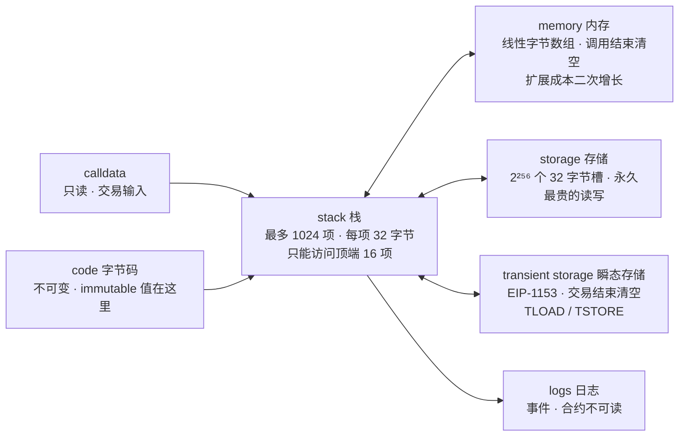
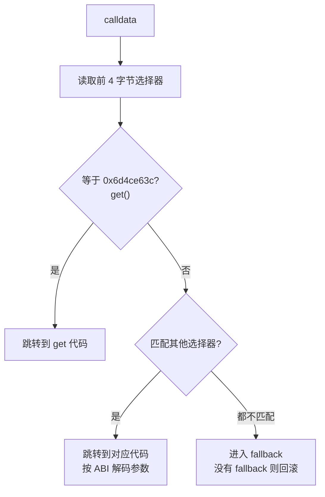
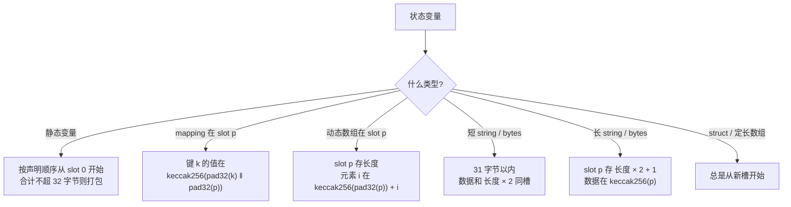

# B45 深入 EVM：机器模型、操作码、Yul 与字节码审计

> 学习目标：读完并做完本章，你能——
> 1. 单步执行字节码并预测栈变化；计算函数选择器。
> 2. 读懂一段 Yul，把小合约改写成 Yul。
> 3. 用差分测试确认改写后行为不变，并比较三种实现的 gas 和运行时字节码大小。
> 4. 从字节码中找出分发器和部署代码；计算合约地址、映射槽位和 ERC-1967 槽。
> 5. 在审计中识别脏高位、内存安全、返回数据和汇编 `return` 四类陷阱。
>
> 前置章节：[03 EVM 与 Solidity 基础](../03-evm-solidity-basics.md)、[B06 Foundry 基础](B06-foundry-basics.md)
> 预计用时：8–10 小时。
> 交互实验：[EVM 单步执行器](../interactive/audit-evm.html) ｜ [选择器与槽位计算器](../interactive/audit-abi.html) ｜ [存储与代理](../interactive/storage-proxy-lab.html) ｜ 配套代码：[practice-example-code/range/yul/](../../practice-example-code/range/yul/README.md)
>
> 最后核对：2026-11-10

---

## 开场：同样的 `add`，三份字节码

下面三个合约对外的接口完全一样。它们的运行时字节码大小分别是 276、209、116 字节。

审计员不能只读 Solidity。很多高 gas 优化代码、代理合约和库都写在内联汇编中。Solidity 的安全检查到了汇编里全部失效。本章带你跨过这道门槛。

<details class="predict"><summary>🤔 先猜再看：Solidity 版的 `add` 比纯 Yul 版多花的 gas，主要花在哪里？</summary>

主要花在自动生成的检查和分发结构上：ABI 解码、溢出检查封装、内存指针初始化和事件编码。本章第 5 节给出实测数字。差距并不大，真正的成本在存储写入。

</details>

## 1. 一句话理解

**EVM 是一台字长 256 位的栈式虚拟机，它只懂字节码。Yul 是贴近字节码的中间语言。内联汇编是把 Yul 写进 Solidity 的方式。**

有些漏洞只在字节码层面可见，例如编译器 bug、内联汇编错误和存储布局冲突。

术语：

- 栈机器（Stack Machine）：指令从栈顶取操作数，再把结果压回栈顶。
- 操作码（Opcode）：EVM 的一条机器指令，例如 `SLOAD`。
- 字节码（Bytecode）：操作码和数据组成的十六进制序列。
- Yul：Solidity 编译器使用的中间语言，语法类似函数调用，不含类型检查。
- 内联汇编（Inline Assembly）：写在 Solidity 的 `assembly { ... }` 块中的 Yul 代码。

> 🎯 打个比方：Solidity 像汽车的自动挡，帮你换挡、防止熄火。Yul 像手动挡，换挡时机全由你决定。字节码是发动机里每一次点火的记录。
>
> 比喻的局限：手动挡操作错了，车会抖动提醒你。汇编写错了，合约照常运行，只是资金算错了。

## 2. EVM 的机器模型

### 2.1 数据区域



**读图要点：**

- 所有计算都经过栈。"Stack too deep" 编译错误来自"只能访问顶端 16 项"这个限制。
- 存储读写最贵。Gas 优化的核心是减少 `SLOAD` / `SSTORE`。各操作的 Gas 数字见 [B47 第 2 节](B47-gas.md)。
- 瞬态存储（Transient Storage）：交易内有效、交易结束自动清空的存储。它适合做重入锁和单交易内的临时记账。
- 局限：如果在 multicall 或同一交易的多次调用中忘记清理瞬态存储，值会"泄漏"到后续调用（YUL-7，见第 8 节）。
- 内存的固定区域和 ABI 编码见 [B46](B46-calldata-memory.md)。

> 🎯 打个比方：EVM 像一个只有一叠盘子的厨师。每道指令从盘子顶端拿 1–3 个盘子，处理后再放回一个。他还有一块用完就擦掉的白板（memory）、一个上锁的永久保险柜（storage）和一张客人递来的点菜单（calldata，只读）。
>
> 比喻的局限：真实的白板按大小计费，写得越多越贵。保险柜也不是秘密：`private` 变量任何人都能从链上读出来。

### 2.2 单步执行

> 🧪 动手验证：打开 [EVM 单步执行器](../interactive/audit-evm.html)。选择一段预置程序，点击"单步"，记录栈、内存、存储和 Gas 如何变化。再输入你自己的十六进制字节码。

> 🧪 动手验证：打开 [evm.codes Playground](https://www.evm.codes/playground)，粘贴字节码 `602a60005260206000f3`，单步执行。这段代码把 42 写入内存，然后返回 32 字节。记录每一步的栈内容。

## 3. 操作码动手

先进入配套目录。后面的所有命令（包括第 6–8 节）都在这个目录中运行。

```bash
cd practice-example-code/range/yul # 进入 Yul 配套目录
forge build # 同时编译 .sol 和 .yul 文件
```

如果 `lib/forge-std` 不存在，运行 `forge install --no-git foundry-rs/forge-std`。

下面是审计中最常见的操作码。

| 操作码 | 作用 | 审计时关注什么 |
|---|---|---|
| `CALLDATALOAD` | 从调用数据读 32 字节 | 读到的值没有清理高位 |
| `MLOAD` / `MSTORE` | 读写内存 | 是否覆盖了别的数据 |
| `SLOAD` / `SSTORE` | 读写存储 | 槽位是否算对 |
| `CALL` / `STATICCALL` / `DELEGATECALL` | 外部调用 | 返回值和返回数据是否检查 |
| `RETURNDATASIZE` / `RETURNDATACOPY` | 查看和复制返回数据 | 长度是否足够 |
| `LOG2` | 发出带两个主题的事件 | 主题和数据是否正确 |

计算函数选择器（Selector：函数签名哈希的前 4 字节）：

```bash
cast sig "get()" # 计算 get() 的 4 字节选择器
cast sig "add(uint256)" # 参数类型是签名的一部分
```

实测输出：

```text
0x6d4ce63c
0x1003e2d2
```

calldata 的前 4 字节是选择器，后面是按 ABI 编码的参数。参数的编码规则见 [B46 第 4 节](B46-calldata-memory.md)。

> ⚠️ 警告：选择器只有 32 位，可以人为构造碰撞。如果代理和实现合约暴露了同选择器的函数，调用可能落到错误的函数。这叫函数冲突（Function Clashing），见 [10 可升级与代理](../10-upgradeable-proxy.md)。

> 🧪 动手验证：打开 [选择器与槽位计算器](../interactive/audit-abi.html)，输入 `get()` 和 `add(uint256)`，确认结果与 `cast sig` 相同。

## 4. 把小合约改写成 Yul

`src/TallySol.sol` 是一个计数器：`add(uint256)` 累加并发事件，`get()` 读取总数。下面是纯 Yul 版本的结构（完整代码见 `src/Tally.yul`）：

```yul
object "Tally" {  // 外层对象：部署代码
    code {
        if callvalue() { revert(0, 0) }  // 拒绝附带 ETH 的部署
        // 把运行时代码复制到内存 0 处
        datacopy(0, dataoffset("runtime"), datasize("runtime"))
        return(0, datasize("runtime"))  // 返回的这段字节就是链上代码
    }
    object "runtime" {  // 内层对象：运行时代码
        code {
            // 手写 Solidity 默认的非 payable 检查
            if callvalue() { revert(0, 0) }
            // calldata 不足 4 字节，无法取选择器
            if lt(calldatasize(), 4) { revert(0, 0) }
            // 右移 224 位，只留前 4 字节选择器
            switch shr(224, calldataload(0))
            // get()：读槽 0，写入内存后返回 32 字节
            case 0x6d4ce63c { mstore(0x00, sload(0)) return(0x00, 0x20) }
            case 0x1003e2d2 { /* 累加、发事件 */ }  // add(uint256)
            default { revert(0, 0) }  // 未知选择器一律回滚
        }
    }
}
```

你必须手写 Solidity 原本替你做的 4 件事：

1. 拒绝附带 ETH 的调用。
2. 检查调用数据长度。
3. 检查加法溢出（`if lt(newTotal, oldTotal) { revert(0, 0) }`）。
4. 手动发出事件。

事件主题用这条命令算出：

```bash
cast keccak "Added(address,uint256)" # 事件签名的哈希即 LOG2 的第一个主题
```

实测输出：

```text
0x446e00ad56f9b887844f390c87a128507b991ea0499375f13ecb115288c2df7d
```

Foundry 会一起编译 `src/` 下的 `.yul` 文件。测试用下面的方式读取产物并部署：

```solidity
// 从编译产物 JSON 读出 Yul 合约的部署字节码
bytes memory init = vm.parseJsonBytes(vm.readFile("out/Tally.yul/Tally.json"), ".bytecode.object");
```

> 💡 注意：`vm.getCode("Tally.yul:Tally")` 在本环境（forge 1.5.1）中找不到 Yul 产物。所以这里直接读 JSON。`foundry.toml` 需要 `fs_permissions` 授权读取 `out/`。

## 5. 运行测试并比较 gas

```bash
# 运行 Tally 测试，含 Yul 与 Solidity 差分对比
forge test -vv --match-contract TallyTest
```

实测输出（节选）：

```text
Ran 6 tests for test/Tally.t.sol:TallyTest
[PASS] testFuzz_SameState(uint128,uint128) (runs: 256, ...)
[PASS] test_AllRevertOnOverflow() (gas: 92589)
[PASS] test_AllRevertOnShortCalldata() (gas: 16416)
[PASS] test_AllRevertOnUnknownSelector() (gas: 15809)
[PASS] test_GasReport() (gas: 106423)
Logs:
  Solidity
    add gas : 2347
    get gas : 660
    codesize: 276
  InlineAsm
    add gas : 2236
    get gas : 628
    codesize: 209
  PureYul
    add gas : 2163
    get gas : 579
    codesize: 116
[PASS] test_SameEvent() (gas: 95238)
Suite result: ok. 6 passed; 0 failed; 0 skipped
```

| 实现 | `add` gas（示例环境） | `get` gas | 运行时字节码 |
|---|---|---|---|
| Solidity | 2,347 | 660 | 276 字节 |
| 内联汇编 | 2,236 | 628 | 209 字节 |
| 纯 Yul | 2,163 | 579 | 116 字节 |

读表要点：

- 测量值来自 `gasleft()` 差值，包含外部调用开销。槽位已经是非零且已热访问。
- 三者的 `add` 只差约 8%（2,347 → 2,163）。首次写存储（从零到非零）时，存储成本约 2 万 gas（见 [B47 成本表](B47-gas.md)），这点差距就更小。
- 结论：只有高频路径才值得用汇编。可读性和可审计性也是成本。

`testFuzz_SameState` 是差分测试（Differential Testing）：对同一输入运行多个实现，断言结果相同。改写合约时，这是最重要的测试。

## 6. 读字节码

第 4–5 节把计数器 Tally 写成了三个版本：Solidity、内联汇编和纯 Yul，运行时字节码分别是 276、209、116 字节。从本节起，打开这些字节码，找出分发器和部署代码，再看存储布局和汇编中的 4 个审计陷阱。命令仍在第 3 节的 Yul 配套目录中运行。

### 6.1 函数分发器

分发器（Dispatcher）：运行时代码开头那段比较选择器、跳转到函数体的逻辑。



**读图要点：**

- 数据流：calldata 前 4 字节决定去哪段代码，后面的 32 字节块是参数。
- 风险：没有匹配的调用都落进 fallback。fallback 的逻辑同样是攻击入口。
- 局限：Solidity 在函数很多时会用二分查找排列比较，不一定按声明顺序。

```bash
# Solidity 版运行时代码的开头
forge inspect TallySol deployedBytecode | head -c 80; echo
# 用 python 从 JSON 取 Yul 版运行时代码，再反汇编
cast disassemble $(python3 -c "import json;print(json.load(open('out/Tally.yul/Tally.json'))['deployedBytecode']['object'])") | head -24
```

下面是 `Tally.yul` 运行时代码的实测反汇编（节选）：

```text
00000000: CALLVALUE
00000001: PUSH1 0x67
00000003: JUMPI
00000004: PUSH1 0x04
00000006: CALLDATASIZE
00000007: LT
00000008: PUSH1 0x67
0000000a: JUMPI
0000000b: PUSH0
0000000c: CALLDATALOAD
0000000d: PUSH1 0xe0
0000000f: SHR
00000010: DUP1
00000011: PUSH4 0x6d4ce63c
00000016: EQ
00000017: PUSH1 0x6b
00000019: JUMPI
0000001a: PUSH4 0x1003e2d2
0000001f: EQ
00000020: PUSH1 0x26
00000022: JUMPI
00000023: PUSH0
00000024: DUP1
00000025: REVERT
```

逐段解释：

1. `0x00–0x03`：如果带了 ETH，跳到 `0x67` 回滚。
2. `0x04–0x0a`：如果调用数据小于 4 字节，跳到 `0x67` 回滚。
3. `0x0b–0x0f`：读取前 32 字节，右移 224 位，得到选择器。
4. `0x10–0x19`：与 `get()` 比较，相等时跳到 `0x6b`。
5. `0x1a–0x22`：与 `add(uint256)` 比较，相等时跳到 `0x26`。
6. `0x23–0x25`：都不匹配，回滚。

> 💡 注意：拿不到源码时，选择器是最重要的线索。可以到 [4byte.directory](https://www.4byte.directory) 反查函数名，但结果可能有碰撞。

> 🧪 动手验证：在 [EVM 单步执行器](../interactive/audit-evm.html) 中运行预置程序"选择器分发"。观察 `SHR`、`EQ`、`JUMPI` 三步后的栈。

### 6.2 部署代码

部署代码（Init Code）：只在部署时运行一次的代码，它的返回值就是运行时代码。

`forge build` 得到的 `Tally.yul` 部署字节码开头是：

```text
34 600d 57   CALLVALUE; PUSH1 0x0d; JUMPI   // 带 ETH 就跳到回滚
6074 80      PUSH1 0x74; DUP1               // 0x74 = 116，运行时代码长度
6012 5f 39   PUSH1 0x12; PUSH0; CODECOPY    // 从偏移 0x12 复制 116 字节到内存 0
5f f3        PUSH0; RETURN                  // 返回内存 0 起的 116 字节
5b 5f 80 fd  JUMPDEST; PUSH0; DUP1; REVERT  // 回滚入口
fe           INVALID                        // 分隔符
```

`0x74` 正好等于第 5 节报告的 116 字节运行时代码。

<details class="predict"><summary>🤔 先猜再看：审计时，为什么要关心部署代码？</summary>

因为部署代码可以运行任意逻辑，并且它决定了链上最终的运行时代码。构造函数里的初始化、不可变变量的写入，都发生在这里。验证源码时，运行时代码相同，也不代表构造参数相同。

</details>

构造期间，运行时代码还没有返回，所以 `extcodesize(this) == 0`。因此，用 `extcodesize > 0` 判断"调用方是不是合约"会失效：攻击合约在构造函数里发起调用即可绕过。

### 6.3 合约地址从哪里来

| 方式 | 地址公式 | 安全含义 |
|---|---|---|
| CREATE | `keccak256(rlp(sender, nonce))[12:]` | 地址可预测（Ethernaut Recovery）。跨链用同一部署者和同一 nonce 部署，得到同一地址，但代码可能不同（2022 年 Optimism 上 Wintermute 约 2,000 万 OP 事件，[来源](https://gov.optimism.io/t/message-to-optimism-community-from-wintermute/2595)） |
| CREATE2 | `keccak256(0xff ‖ sender ‖ salt ‖ keccak256(initCode))[12:]` | 部署前就可以向该地址转账。Cancun 之前，可配合 `selfdestruct` 在同一地址部署不同代码（变形合约，Metamorphic Contract） |

读表要点：

- CREATE2 的地址绑定了部署代码的哈希。部署代码不同，地址就不同。
- 但部署代码可以从外部读取运行时代码。所以"地址相同"不等于"代码相同"，审计时要看部署代码。

## 7. 存储布局

存储是 2²⁵⁶ 个 32 字节的槽。声明顺序、打包、mapping 和动态数组的基本规则见 [03 章 3.1 节](../03-evm-solidity-basics.md)。下图把全部类型画在一起。

代理合约是例外：它不按顺序放实现地址，而是放在 ERC-1967 槽：`bytes32(uint256(keccak256("eip1967.proxy.implementation")) - 1)`，即 `0x3608…2bbc`。减 1 是为了让这个槽没有已知的哈希原像。详见 [10 可升级与代理](../10-upgradeable-proxy.md)。

**图 · 变量落在哪个槽**



**读图要点：**

- 关键：动态类型的数据不在声明槽里，而在哈希算出的位置。
- 数据流：用这些规则，`cast storage` 就能读出任意变量，包括 `private` 变量。
- 风险：动态数组长度下溢为 2²⁵⁶ − 1 后，数组覆盖全部存储。Ethernaut 第 19 关 Alien Codex 就是这样：攻击者算出 slot 0 对应的数组下标，改写 owner。
- 局限：这些规则只针对 Solidity。Vyper 和手写 Yul 可以用别的布局，汇编中的槽位要逐个核对（YUL-6）。

```bash
forge inspect TallySol storageLayout # 打印每个状态变量的槽位和偏移
cast index address 0xab5801a7d398351b8be11c439e05c5b3259aec9b 1 # 计算 mapping 在 slot 1 时该键的槽位
```

> 🧪 动手验证：打开 [选择器与槽位计算器](../interactive/audit-abi.html)，计算 mapping 槽位和 ERC-1967 槽，并与 `cast index` 的结果对照。再打开 [存储与代理](../interactive/storage-proxy-lab.html)，观察升级后布局错位会覆盖哪个变量。

## 8. 汇编审计陷阱

下面 4 个陷阱都有可运行的对照测试：

```bash
forge test -vv --match-contract PitfallsTest # 运行 4 个汇编陷阱的对照测试
```

实测结果：11 个测试全部通过。其中 `test_Returndata_SilentFeedYieldsSelectorAsPrice` 打印：

```text
garbage price: 1388308361
```

### 8.1 脏高位（Dirty Bits）

`address` 只有 20 字节。`calldataload` 总是读 32 字节。高 12 字节可能是任意值。

```solidity
// ❌ 漏洞：直接用 calldata 的 32 字节作为 mapping 键
mstore(0x00, calldataload(4))  // 高 12 字节可能是脏数据，槽位随之改变
// ✅ 修复：先用掩码清理高位
// 只保留低 20 字节
mstore(0x00, and(calldataload(4), 0xffffffffffffffffffffffffffffffffffffffff))
```

如果高位是脏的，`keccak256` 算出的槽位不同。余额写到了一个没有人能读到的槽位。测试 `test_DirtyBits_VulnerableLosesCredit` 证明 `balanceOf(alice)` 仍然是 0。

### 8.2 内存安全（Memory Safety）

地址 `0x40` 存放空闲内存指针（Free Memory Pointer）。写入内存后如果不更新它，Solidity 下一次分配内存就会覆盖你的数据。内存的固定区域和分配规则见 [B46 第 3 节](B46-calldata-memory.md)。

```solidity
ptr := mload(0x40)
mstore(ptr, 0xAAAA)  // 数据写在空闲指针处
// ❌ 漏洞：没有 mstore(0x40, add(ptr, 0x20))
// 下次分配内存会从同一个 ptr 开始，覆盖 0xAAAA
```

测试结果：`clobbered()` 读回 32，而不是 `0xAAAA`。32 是 `abi.encodePacked` 写下的新 bytes 长度。

> 💡 注意：`assembly ("memory-safe") { ... }` 只是你对编译器的承诺。编译器不会验证。如果你违反承诺，优化器可能做出错误的变换。详见 [Solidity 内联汇编文档](https://docs.soliditylang.org/en/latest/assembly.html)。

### 8.3 返回数据（Returndata）

`call` 和 `staticcall` 的输出区只会写入实际返回的字节。如果对方没有返回数据，输出区保持原样。

```solidity
// ❌ 漏洞：输入区和输出区都是 0x00，并且没有检查 returndatasize
// 输出区与输入区重叠；无返回数据时不被覆盖
let ok := staticcall(gas(), feed, 0x1c, 0x04, 0x00, 0x20)
price := mload(0x00)  // 读到的可能是调用前写入的选择器
```

如果 `feed` 不返回数据，或者 `feed` 根本没有代码，`ok` 仍是 1。`mload(0)` 读到的是调用前写入的选择器。这就是上面打印的 `1388308361`，它等于 `0x52bfe789`（`latest()` 的选择器）。

```solidity
// ✅ 修复：要求返回数据至少 32 字节
// 调用失败或返回不足 32 字节都回滚
if or(iszero(ok), lt(returndatasize(), 0x20)) { revert(0, 0) }
```

> ⚠️ 警告：另一个相关风险是返回数据炸弹（Returndata Bomb）：恶意被调用方返回巨大的数据，调用方复制时耗尽 gas。实测数字和修复见 [B46 第 6.2 节](B46-calldata-memory.md)。

### 8.4 汇编 `return` 跳过修饰器尾部

汇编的 `return` 结束的是整个外部调用，不是当前函数。修饰器 `_;` 之后的代码不会运行。

```solidity
function exitEarly() external nonReentrant returns (uint256) {
    assembly { mstore(0x00, 7) return(0x00, 0x20) } // ❌ 漏洞：锁永远不释放
    // return 直接结束外部调用，nonReentrant 尾部不执行
}
```

测试 `test_AsmReturn_LeavesLockStuck` 证明第二次调用回滚 `locked`。编译器会对此发出 `Unreachable code` 警告。审计时不要忽略这条警告。

### 审计检查点

- [ ] **YUL-1** 所有从 `calldataload`、`mload` 读到的短类型都清理了高位。
- [ ] **YUL-2** 写内存后更新了 `0x40`，或只使用 `0x00–0x3f` 暂存区。
- [ ] **YUL-3** 每个 `call` 都检查了成功标志和 `returndatasize`。
- [ ] **YUL-4** 汇编中的 `return` 和 `stop` 没有跳过必须执行的收尾逻辑。
- [ ] **YUL-5** 算术运算有溢出检查。汇编里的 `add` 不会检查。
- [ ] **YUL-6** 存储槽位的计算与 Solidity 的布局规则一致（第 7 节）。
- [ ] **YUL-7** 瞬态存储（`TSTORE`）在用完后清零；如果跨调用保留，确认这是有意的设计。

| 检查项 | 写进报告时的常见标题 | 常见定级 |
|---|---|---|
| YUL-1 | 未清理的地址高位导致记账到错误槽位 | 高（如果涉及资金） |
| YUL-2 | 空闲内存指针未更新导致内存覆盖 | 中到高 |
| YUL-3 | 未校验返回数据长度，读到陈旧内存 | 高（如果数据用于定价） |
| YUL-4 | 汇编提前返回导致锁未释放 | 中（拒绝服务） |
| YUL-6 | 手算槽位与布局不一致，写入覆盖其他变量 | 高（如果覆盖权限或余额） |
| YUL-7 | 瞬态存储未清理，值泄漏到同一交易的后续调用 | 中到高 |

## 9. 可选：Huff

Huff 是比 Yul 更底层的合约语言，开发者直接编排操作码。本章不要求学习。原 [huff-rs](https://github.com/huff-language/huff-rs) 仓库在 2026-11-10 核对时已标记为归档，社区分支是 [huff-neo](https://github.com/cakevm/huff-neo)。读 Huff 的价值和读字节码相同：理解每一个字节的代价。

## 10. 如果出错

| 现象 | 原因 | 处理 |
|---|---|---|
| `forge-std/Test.sol` 找不到 | `lib/forge-std` 符号链接缺失 | 运行 `forge install --no-git foundry-rs/forge-std` |
| `vm.readFile` 报权限错误 | `foundry.toml` 缺少 `fs_permissions` | 添加 `fs_permissions = [{ access = "read", path = "./out" }]` |
| `vm.getCode: no matching artifact found` | 该形式找不到 Yul 产物 | 改用 `vm.readFile` 加 `vm.parseJsonBytes` |
| `Unreachable code` 警告 | `LockDemo` 故意演示 | 这是预期输出，保留用于教学 |
| `python3` 命令不存在 | 未安装 Python | 用编辑器打开 `out/Tally.yul/Tally.json`，复制 `deployedBytecode.object` |
| 改了 `Tally.yul`，测试结果不变 | forge 没有重新编译 Yul 产物 | 先运行 `forge build --force`，再运行 `forge test` |
| `Error: Lint failed`（`src/Tally.yul`） | forge 的 lint 不支持 `.yul` | 配套工程的 `foundry.toml` 已设置 `lint_on_build = false`；自建工程照此添加 |

## 11. 过关标准

- [ ] `forge test -vv --match-contract TallyTest` 显示 6 个测试全部通过。
- [ ] 你给 `TallyAsm` 增加一个 `reset()` 函数（选择器自己算），写测试通过，并确保 `testFuzz_SameState` 仍然通过。
- [ ] `forge test` 显示 17 个测试全部通过。
- [ ] 你能手工指出 `Tally.yul` 分发器中两个选择器的位置。
- [ ] 你能在 3 分钟内说清 4 个陷阱的根因。
- [ ] 你能手算一个 mapping 键的槽位，并用 `cast index` 和计算器得到相同结果。

> 🪞 反思：打开你审过或写过的一个合约。
> 1. 它有内联汇编吗？哪一行没有经过编译器检查？
> 2. 你能指出它前 3 个槽位存了什么吗？升级后这个布局会变吗？
> 3. 汇编里的每个 `call`，你当时检查了 `returndatasize` 吗？

## 12. 思考题

1. 为什么 `Tally.yul` 的 `add` 必须自己写溢出检查？如果删掉 `if lt(newTotal, oldTotal)`，哪个测试会失败？
2. 用 [选择器与槽位计算器](../interactive/audit-abi.html) 验证 `burn(uint256)` 和 `collate_propagate_storage(bytes16)` 的选择器相同。这对代理合约意味着什么？
3. 把 `FeedReader.readUnchecked` 的输出区改成 `0x20`，并且事先不写内存，还会读到选择器吗？读到什么？
4. 一个合约的运行时代码只有 45 字节，开头是 `CALLDATASIZE`，并包含 `DELEGATECALL`。它可能是什么？审计时先看什么？
5. 在 [EVM 单步执行器](../interactive/audit-evm.html) 中运行"选择器分发"，把 calldata 改成 `0x12345678`。程序在哪一步走向 REVERT？
6. `mapping(address => uint256) balances` 在 slot 1。写出地址 A 余额所在槽的计算式，并在计算器里算出来。

## 13. 相关章节与学习资源

- [03 EVM 与 Solidity 基础](../03-evm-solidity-basics.md)、[10 可升级与代理](../10-upgradeable-proxy.md)
- [B46 calldata 与内存](B46-calldata-memory.md)、[B47 Gas](B47-gas.md)、[B48 形式化验证](B48-formal-verification.md)
- 评估：[A03](../assessment/A03-exchange-contracts-wallets.md)
- [evm.codes](https://www.evm.codes)：指令表与在线 Playground，是本章单步执行器的完整版。
- 延伸阅读：The EVM From Scratch Book；Noxx 的 EVM Deep Dives 系列；ethdebug 的 Solidity 数据表示文档；以太坊黄皮书及简化版 Beige Paper；Quillhash EVM Mastery；EVM by Example。
