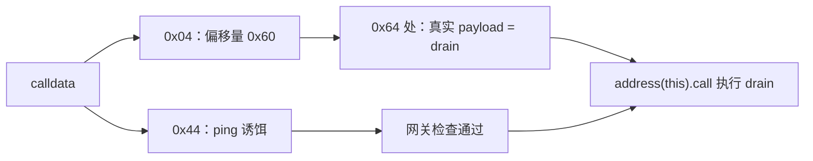

# B46 calldata 与内存

> 学习目标：读完本章，你能——
> 1. 说明内存布局，并预测一次分配后的空闲内存指针。
> 2. 手工解码静态、动态和嵌套类型的 ABI 编码。
> 3. 找出信任 calldata 偏移量和返回数据的错误写法。
>
> 前置章节：[B45 深入 EVM：机器模型、操作码、Yul 与字节码审计](B45-yul-opcodes.md)
> 预计时间：120 分钟。
> 交互实验：[audit-abi.html](../interactive/audit-abi.html) ｜ 示例：[examples/range/abi](../examples/range/abi/)

> ⚠️ 警告：本章的畸形编码只在本地 `forge test` 中使用。不要把它们发送到未授权的在线合约。

---

## 开场：检查通过了，为什么内层执行的是另一个函数

一个网关只允许转发 `ping()`。它从 calldata 的固定位置读取内层选择器，并确认那是 `ping`。攻击者发送一笔交易，检查通过，实际执行的却是 `drain()`。

<details class="predict"><summary>🤔 先猜再看：攻击者改了什么？</summary>

攻击者改了动态参数的**偏移量**。网关假定 `payload` 紧跟在偏移量之后。攻击者把偏移量改大，把诱饵 `ping` 放在网关读取的位置，把真正的 `drain` 放在解码器读取的位置。第 4 节会逐字节分析这笔 calldata。

</details>

## 1. 一句话理解

**calldata 是攻击者逐字节写的数据。内存是你的合约自己管理的草稿纸。**

术语：

| 术语 | 英文 | 定义 |
|---|---|---|
| calldata | Calldata | 调用附带的只读字节 |
| 内存 | Memory | 调用期间存在的临时字节数组 |
| 字 | Word | 32 字节，EVM 的基本读写单位 |
| 空闲内存指针 | Free Memory Pointer | 保存在 `0x40` 的值，指向下一块可用内存 |
| 选择器 | Selector | calldata 的前 4 字节，标识被调用的函数 |
| 偏移量 | Offset | 动态数据的起始位置，存放在参数头部 |
| 返回数据 | Returndata | 上一次外部调用返回的字节 |

> 🎯 打个比方：calldata 像寄来的快递单，内容由寄件人填写。内存像你桌上的便签本，你自己决定写在哪一页。空闲内存指针就是"下一张空白页"的书签。
>
> 比喻的局限：快递单不能指向单内其他位置。ABI 偏移量可以，这正是问题的来源。

## 2. 运行实验

在 `Web3-Security/` 目录运行：

```bash
cd examples/range/abi # 进入 ABI 配套目录
forge test # 运行全部编码实验
```

预期结果的最后一行（本机 forge 1.5.1、solc 0.8.30 实测）：

```text
Ran 4 test suites: 32 tests passed, 0 failed, 0 skipped (32 total tests)
```

> 💡 注意：实际输出在 `Ran 4 test suites` 后还带有运行耗时。

## 3. 内存

### 3.1 固定区域

| 地址 | 用途 |
|---|---|
| `0x00`–`0x3f` | 草稿区，哈希等短操作使用 |
| `0x40`–`0x5f` | 空闲内存指针 |
| `0x60`–`0x7f` | 零槽，空动态数组指向这里 |
| `0x80` 起 | 普通分配从这里开始 |

测试 `test_PointerStartsAt0x80` 和 `test_ZeroSlotIsZero` 验证了这两点。

### 3.2 分配按字向上取整

<details class="predict"><summary>🤔 先猜再看：`new bytes(33)` 使指针前进多少？</summary>

`0x60`，也就是 96 字节。其中 1 个字保存长度，33 字节数据向上取整为 2 个字。`test_AllocationRoundsUpToWords` 断言了 1、32、33 字节的结果：`0x40`、`0x40`、`0x60`。

</details>

### 3.3 汇编写内存时要移动指针

不移动指针为什么会被覆盖，见 [B45 第 8.2 节](B45-yul-opcodes.md)。本目录用 `MemoryLab` 再测一次：

- 测试 `test_UnreservedWriteIsOverwritten`：写入 `0xBEEF` 后不移动指针，Solidity 把数组长度写到同一位置，读回 `1`。
- 测试 `test_ReservedWriteSurvives`：先把指针加 `0x20`，读回 `0xBEEF`。

## 4. ABI 编码

一次函数调用的 calldata = 4 字节选择器 + 参数编码。选择器的算法见 [B45 第 3 节](B45-yul-opcodes.md)。以 `transfer(address,uint256)` 为例：

```text
a9059cbb                                                          ← 选择器
000000000000000000000000ab5801a7d398351b8be11c439e05c5b3259aec9b  ← address 左补零到 32 字节
0000000000000000000000000000000000000000000000000de0b6b3a7640000  ← uint256 = 1e18
```

下面只看选择器之后的参数部分。

### 4.1 静态类型直接放在头部

`abi.encode(uint256(7), address(0xA11CE), true)`，实际输出：

```text
0x0000000000000000000000000000000000000000000000000000000000000007
0x00000000000000000000000000000000000000000000000000000000000a11ce
0x0000000000000000000000000000000000000000000000000000000000000001
```

每个值占一个字，按顺序排列。

### 4.2 动态类型放偏移量

`abi.encode(uint256(7), bytes("hi"))`，实际输出：

```text
0x0000000000000000000000000000000000000000000000000000000000000007   a
0x0000000000000000000000000000000000000000000000000000000000000040   b 的偏移量
0x0000000000000000000000000000000000000000000000000000000000000002   b 的长度
0x6869000000000000000000000000000000000000000000000000000000000000   "hi"，右侧补零
```

偏移量 `0x40` 从参数区的开头算起。函数调用时，参数区从选择器之后开始。

### 4.3 嵌套数组的偏移量是相对的

`uint256[][]`，值为 `[[5],[6,7]]`，实际输出：

```text
字 0   0x20   外层数组的偏移量
字 1   2      外层长度
字 2   0x40   x[0] 的偏移量，从字 2 算起
字 3   0x80   x[1] 的偏移量，从字 2 算起
字 4   1      x[0] 的长度
字 5   5
字 6   2      x[1] 的长度
字 7   6
字 8   7
```

<details class="predict"><summary>🤔 先猜再看：字 2 的 `0x40` 指向哪一个字？</summary>

指向字 4。基准是外层数组元素区的开头（字 2），不是整个编码的开头。字 2 的位置加 `0x40` 等于字 4。把基准弄错是手写解码器最常见的错误。

</details>

### 4.4 含动态成员的结构体

`abi.encode(Pair(9, bytes("abc")))`，实际输出：

```text
0x0000000000000000000000000000000000000000000000000000000000000020   结构体本身的偏移量
0x0000000000000000000000000000000000000000000000000000000000000009   id
0x0000000000000000000000000000000000000000000000000000000000000040   tag 的偏移量，从结构体起点算
0x0000000000000000000000000000000000000000000000000000000000000003   tag 的长度
0x6162630000000000000000000000000000000000000000000000000000000000   "abc"
```

结构体含有动态成员时，结构体自身也算动态类型，所以最前面有一个偏移量。

### 4.5 `encodePacked` 不写边界

`encodePacked("ab","c")` 和 `encodePacked("a","bc")` 的结果相同。`test_PackedCollides` 证明了这一点。这是 [B28](B28-bug-patterns.md) 的 BP-41。

> 🧪 动手验证：运行 `forge test -vv --match-test 'Static|DynamicUses|Nested|StructWith'`，把输出的每一行和上面的注释对照。再打开 [audit-abi.html](../interactive/audit-abi.html) 换几组参数。

## 5. 不要信任 calldata 的形状

ABI 规范定义了规范编码（canonical encoding）。合约收到的数据不一定规范。下表的结果来自 solc 0.8.30 的测试 [Malformed.t.sol](../examples/range/abi/test/Malformed.t.sol)。

| 输入 | 高层解码器的行为 | 测试 |
|---|---|---|
| 偏移量大于规范值，头部和数据之间有垃圾字 | 接受 | `test_HighLevelAcceptsNonCanonicalOffset` |
| 两个 `bytes` 参数指向同一段数据 | 接受 | `test_TwoArgsMayShareOneTail` |
| `bytes` 数据末尾的补零位置不是零 | 接受 | `test_DirtyTailPaddingIsAccepted` |
| 偏移量超出 calldata | 回滚 | `test_OffsetOutOfBoundsReverts` |
| 长度超出 calldata | 回滚 | `test_LengthPastEndReverts` |
| `address` 高位不是零 | 回滚 | `test_DirtyAddressReverts` |
| `uint8` 值大于 255 | 回滚 | `test_DirtyUint8Reverts` |
| `calldatacopy` 读到末尾之外（汇编） | 不回滚，补零 | `test_CalldataCopyPastEndFillsZero` |

结论：高层解码器保证**不越界**和**值类型干净**。它不保证编码唯一。

### 5.1 陷阱一：固定偏移读取

`SelectorGate.forwardFixedOffset` 从 `0x44` 读内层选择器。攻击 calldata 的布局：

| calldata 位置 | 内容 | 网关看到 | 解码器看到 |
|---|---|---|---|
| `0x00` | 外层选择器 | 入口 | 入口 |
| `0x04` | 偏移量 `0x60` | 不读 | `payload` 在 `0x64` |
| `0x24` | `0` | 不读 | 垃圾 |
| `0x44` | `ping` 选择器 | 这是内层选择器 | 垃圾 |
| `0x64` | 长度 `4` | 不读 | `payload` 长度 |
| `0x84` | `drain` 选择器 | 不读 | `payload` 内容 |



**读图要点：**

- 同一笔 calldata 有两种读法。
- 检查用了一种读法，执行用了另一种读法。
- 修复后，检查和执行使用同一个解码后的变量。

测试：

- `test_FixedOffset_BlocksCanonicalDrain`：规范编码被拦下。
- `test_Exploit_FixedOffsetSmuggling`：非规范编码绕过检查，`drained` 变为 `true`。
- `test_Fix_DecodedCheckStopsSmuggling`：用 `payload[:4]` 检查，攻击失败。

```solidity
// ❌ 漏洞：假定偏移量是 0x20
// 编码方可以把 payload 放到别的偏移
assembly { inner := and(calldataload(0x44), shl(224, 0xffffffff)) }

// ✅ 修复：读解码后的 payload
// 检查读的就是执行用的那个变量
require(payload.length >= 4 && bytes4(payload[:4]) == this.ping.selector, "only ping");
```

### 5.2 陷阱二：用 `msg.data` 做唯一标识

`CalldataHashGuard.once` 用 `keccak256(msg.data)` 防重放。

<details class="predict"><summary>🤔 先猜再看：怎样让同一笔订单执行两次？最简单的改法是什么？</summary>

在 calldata 末尾追加 1 个字节。解码器忽略多余字节，所以订单内容不变，但 `msg.data` 的哈希变了。`test_Exploit_HashGuardBypassedByTrailingByte` 证明同一订单执行了 2 次。修复是对解码后的内容（并带上 nonce）做标记，见 `test_Fix_ContentGuardBlocksVariant`。

</details>

## 6. 返回数据

下面的结果来自 [Returndata.t.sol](../examples/range/abi/test/Returndata.t.sol)。

| 情况 | 结果 | 测试 |
|---|---|---|
| 低级调用无代码地址 | 成功，返回 0 字节 | `test_LowLevelCallToNoCodeSucceeds` |
| 高层调用无代码地址 | 回滚 | `test_HighLevelCallToNoCodeReverts` |
| `abi.decode` 解码过短的返回数据 | 回滚 | `test_AbiDecodeOfShortReturnReverts` |
| `returndatacopy` 超过返回长度 | 回滚 | `test_ReturndatacopyPastEndReverts` |

### 6.1 陈旧的输出缓冲

输出区与输入区重叠、对方不返回数据时会读到旧值。机制和修复见 [B45 第 8.3 节](B45-yul-opcodes.md)。本目录的 `readWithStaleBuffer` 对无代码地址复现：`ok = true`，`word` 是自己写入的选择器 `0x3fa4f245...`（`test_NoCodeAlsoLeavesStaleBuffer`）。修复版是 `readChecked`。

### 6.2 返回炸弹

`(bool ok,) = target.call{gas: g}("")` 看起来忽略了返回数据。这里实际测量（对方回滚时返回 200,000 字节）：

```text
gas with Solidity (ok,) call: 214873
gas with assembly out=0 call: 96204
```

这组数据来自 solc 0.8.30、优化器开启、`test_ReturnBombCostMeasured`。差额约 11.9 万 gas 由调用方承担，因为 Solidity 仍然把返回数据复制进了内存。对方的代码只消耗被限制的 gas，但复制成本落在调用方。

> ⚠️ 警告：如果函数在调用失败后必须继续执行（例如队列处理），请用汇编把输出长度设为 0，或者只复制有上限的字节数。

运行：

```bash
forge test -vv --match-test ReturnBomb # 只跑返回数据炸弹测试，打印 gas
```

## 7. 审计检查点

- [ ] **ABI-1** 每一处 `calldataload` 的偏移量都有依据，不假定规范编码。
- [ ] **ABI-2** 检查和执行读取同一个解码后的变量。
- [ ] **ABI-3** 没有用 `msg.data` 或签名字节做唯一标识。
- [ ] **ABI-4** 汇编写内存：按 B45 的 YUL-2 检查，并用 `MemoryLab` 测试复核。
- [ ] **ABI-5** 汇编调用的返回数据：按 B45 的 YUL-3 检查，并覆盖目标为空账户的情况。
- [ ] **ABI-6** 调用不受信目标并在失败后继续执行时，返回数据的复制量有上限。
- [ ] **ABI-7** 低级调用目标可能为空账户时，有代码存在性检查。

把检查结果写进报告：

| 未通过 | 常见等级 | 写法示例 |
|---|---|---|
| ABI-1、ABI-2 | 严重 | "网关校验与实际转发读取不同的 calldata 位置，攻击者能调用禁止的函数" |
| ABI-5 | 高 | "目标无返回数据时，合约把内存旧值当作价格" |
| ABI-6 | 中 | "恶意接收方能耗尽队列处理的 gas" |

## 如果出错

| 现象 | 原因 | 处理 |
|---|---|---|
| `forge-std/Test.sol not found` | 软链接失效 | 在 `abi/` 下运行 `ls -l lib/forge-std`，确认指向 `../../../foundry/lib/forge-std` |
| gas 数字和本章不同 | 编译器或优化器设置不同 | 比较两行的差额，不比较绝对值 |
| `test_DirtyAddressReverts` 失败 | 使用了 ABI coder v1 | 确认没有写 `pragma abicoder v1` |
| 手工解码偏移量错位 | 基准选错 | 嵌套偏移量从所在数组或结构体的起点算起 |

## 过关标准

- [ ] `forge test` 显示 32 个测试通过。
- [ ] 你能不看答案，手工解码 4.3 的嵌套数组。
- [ ] 你能写出 5.1 的畸形 calldata，并说明每个字的作用。
- [ ] 你能说明 `(ok,)` 为什么不代表不复制返回数据。

> 🪞 反思：你的代码里有多少地方在"解析两次"同一段输入？每一处都是潜在的检查与执行不一致。

## 思考题

1. 为什么 `test_DirtyAddressReverts` 回滚，而 `test_DirtyTailPaddingIsAccepted` 不回滚？这种差异对写防重放逻辑有什么影响？
2. 把 `SelectorGate.forwardFixedOffset` 改成读取 `calldataload(4)` 的偏移量再定位内层选择器，这样够安全吗？还有什么更简单的做法？
3. 只有 200,000 字节，返回炸弹就让调用方多花约 11.9 万 gas。如果调用方把 `gasCap` 设得更高，这个成本会怎样变化？为什么？
