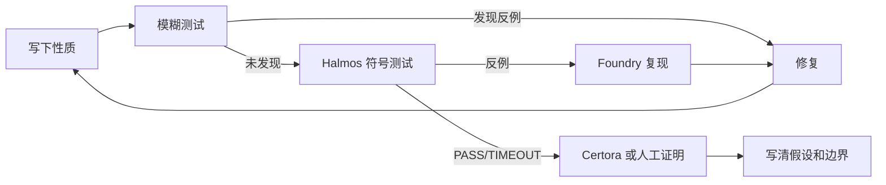

# B48 形式化验证

> 学习目标：读完并做完本章，你能——
> 1. 说清模糊测试、符号测试和形式化验证各自能证明什么。
> 2. 用 SMTChecker 和 Halmos 找到反例，并在 Foundry 中复现。
> 3. 读懂一份 Certora 规格，并判断项目是否值得做形式化验证。
>
> 前置章节：[B06 Foundry 基础](B06-foundry-basics.md)、[B12 模糊测试与不变量](B12-foundry-advanced.md)、[B19 审计三：MiniSwap](B19-audit-3-miniswap.md)（不变量）、[B31 自动化工具](B31-automation-tools.md)
> 预计用时：6–8 小时。
> 交互实验：[模糊测试实验](../interactive/audit-fuzz.html) ｜ 配套代码：[practice-example-code/range/fv/](../../practice-example-code/range/fv/README.md)
>
> 最后核对：2026-11-10

---

## 开场：跑了 5,000 轮，bug 还在

本章的 `msbBuggy` 函数有一个边界错误。我们用 Foundry 模糊测试跑了 3 个种子，每个种子 5,000 轮，全部通过。Halmos 用 0.47 秒给出了反例。

这不是说模糊测试没用。这说明两种工具回答的是不同的问题。

<details class="predict"><summary>🤔 先猜再看：如果 Halmos 说 PASS，就代表合约安全吗？</summary>

不代表。PASS 只代表在 Halmos 的边界内，你写的这条断言成立。如果断言写错了，或者循环长度被截断，或者漏了一条性质，合约仍然可能有漏洞。

</details>

## 1. 三种方法能证明什么

术语：

- 模糊测试（Fuzzing）：用大量随机输入运行代码，寻找失败。
- 符号测试（Symbolic Testing）：把输入当成未知数，用求解器找出能触发失败的取值。
- 形式化验证（Formal Verification）：用数学方法证明程序满足一条规格。
- 规格（Specification）：用精确语言写下的"程序必须满足什么"。
- 反例（Counterexample）：能让规格失败的一组具体取值。
- SMT 求解器（SMT Solver）：判断一组逻辑约束能否同时满足的程序。

| 方法 | 回答的问题 | 结果 FAIL 的含义 | 结果 PASS 的含义 |
|---|---|---|---|
| 单元测试 | 这个例子对吗 | 这个例子错了 | 这个例子对 |
| 模糊测试 | 随机样本里有反例吗 | 找到真实反例 | 这批样本没有反例 |
| 符号测试 | 边界内存在反例吗 | 找到真实反例（需复现） | 边界内没有反例 |
| 形式化验证 | 规格对所有状态都成立吗 | 反例，可能是虚假反例 | 在建模假设下成立 |

> 🎯 打个比方：模糊测试像随机抽查 5,000 件货。符号测试像把质检写成方程，直接解出会出问题的那件货的编号。形式化验证像证明这条产线不可能造出次品。
>
> 比喻的局限：证明只针对你写下的"次品"定义。定义漏了一条，证明也救不了你。

## 2. 环境准备

本章的命令都在配套目录中运行。

```bash
cd practice-example-code/range/fv  # 从 web3-security-handbook/ 出发，进入形式化验证配套目录
forge test -vv # 先用 Foundry 复现反例
```

实测输出（节选）：

```text
Ran 1 test for test/ToyVault.t.sol:ToyVaultSymbolic
[PASS] test_CounterexampleReplay() (gas: 325768)
Logs:
  deposit 192, redeem gives 193
Ran 2 tests for test/BitMath.t.sol:BitMathTest
[PASS] testFuzz_MsbBuggy(uint256) (runs: 256, ...)
[PASS] test_CounterexampleReplay() (gas: 4335)
Logs:
  msbBuggy(2**64) = 63
Ran 2 test suites ...: 3 tests passed, 0 failed, 0 skipped (3 total tests)
```

在虚拟环境里安装 Halmos。虚拟环境（Virtual Environment）是一个隔离的 Python 安装目录。

```bash
python3 -m venv ~/halmos-venv # 创建隔离的 Python 环境
~/halmos-venv/bin/pip install halmos # 在环境中安装 Halmos
~/halmos-venv/bin/halmos --version # 确认安装成功
```

实测版本：`halmos 0.3.3`（本章用 Python 3.13 运行）。官方也推荐 `uv tool install --python 3.13 halmos`，见 [Halmos 仓库](https://github.com/a16z/halmos)。

> 💡 注意：`foundry.toml` 中必须有 `ast = true`。否则普通 `forge build` 生成的产物没有 `ast` 字段，Halmos 会报 `Skipped ... KeyError: 'ast'`。这是本章实测遇到的问题。

## 3. SMTChecker：编译器自带的检查

SMTChecker 是 Solidity 编译器内置的形式化检查器。它不需要额外安装，但需要编译器带有求解器支持。

```bash
# CHC 引擎检查 assert；超时 20 秒（单位毫秒）
solc --model-checker-engine chc --model-checker-targets assert \
  --model-checker-timeout 20000 src/SmtDemo.sol
```

实测输出（solc 0.8.24，节选）：

```text
Warning: CHC: Assertion violation happens here.
Counterexample:
total = 101, cap = 100
x = 1

Transaction trace:
SmtDemo.constructor()
State: total = 0, cap = 100
SmtDemo.addBuggy(100)
State: total = 100, cap = 100
SmtDemo.addBuggy(1)
  --> src/SmtDemo.sol:12:9:
Info: CHC: 1 verification condition(s) proved safe!
```

读输出要点：

1. CHC 引擎跨交易分析。它找到了两笔交易的序列。
2. `addBuggy` 的断言失败。反例是先加 100，再加 1。
3. `addFixed` 的断言被证明安全，这就是"1 verification condition proved safe"。

详见 [SMTChecker 文档](https://docs.soliditylang.org/en/latest/smtchecker.html)。

## 4. Halmos：符号测试

Halmos 运行 Foundry 风格的测试。以 `check_` 开头的函数参数都被当作符号值。

### 4.1 数学 bug

`src/BitMath.sol` 用二分法求最高有效位。`msbBuggy` 的第二个分支把 `>=` 写成了 `>`。

```solidity
// 正确写法是 x >= 2 ** 64；等于边界时本应进入此分支
if (x > 2 ** 64) { x >>= 64; r += 64; } // ❌ 漏洞：边界值 2**64 落入错误分支
```

测试断言：结果 `r` 必须满足 `x >> r == 1`。

```bash
# 符号执行 BitMathTest 里的 check_ 函数
~/halmos-venv/bin/halmos --contract BitMathTest
```

实测输出：

```text
Running 2 tests for test/BitMath.t.sol:BitMathTest
Counterexample:
    p_x_uint256_81fbd4c_00 = 0x1000000000000000000000000000000000000000000000000
Counterexample:
    p_x_uint256_81fbd4c_00 = 0x10000000000000000
[FAIL] check_MsbBuggy(uint256) (paths: 258, time: 0.47s, bounds: [])
[PASS] check_MsbFixed(uint256) (paths: 256, time: 0.42s, bounds: [])
Symbolic test result: 1 passed; 1 failed; time: 0.89s
```

读输出要点：

- `0x10000000000000000` 就是 `2**64`。另一个反例是 `2**192`，它在第一个分支右移后也等于 `2**64`。
- `check_MsbFixed` 通过。这里没有循环，路径全部覆盖，所以它对全部 `uint256` 成立（在 Halmos 的建模下）。
- 反例要回到 Foundry 复现。`test_CounterexampleReplay` 打印 `msbBuggy(2**64) = 63`。正确结果是 64。

> 🧪 动手验证：运行 `forge test --match-test testFuzz_MsbBuggy --fuzz-runs 5000 --fuzz-seed 1`。本章实测 3 个种子各 5,000 轮全部通过，模糊测试没有发现这个 bug。

> 💡 注意：模糊测试的结果和种子、字典有关。你换一个种子，理论上可能撞到边界值。结论是"这次没找到"，不是"找不到"。

### 4.2 玩具金库性质

`src/ToyVault.sol` 是一个只记账的份额金库。参数 `roundUp` 控制存款时份额是否向上取整。

测试了两条性质：

1. 份额守恒：两名用户的份额之和等于总份额。
2. 不能获利：存入后立刻赎回，取回的资产不超过存入的资产。

```bash
# 把单次求解超时放宽到 180 秒
~/halmos-venv/bin/halmos --contract ToyVaultSymbolic --solver-timeout-assertion 180000
```

实测输出（用时约 3 分钟）：

```text
Counterexample:
    p_amount_uint8_d816e3a_00 = 0xc0
    p_gift_uint8_e945dfc_00 = 0xee
    p_seed_uint8_fbc4acc_00 = 0xc6
[FAIL] check_NoProfit_Buggy(uint8,uint8,uint8) (paths: 15, time: 1.68s, bounds: [])
[TIMEOUT] check_NoProfit_Fixed(uint8,uint8,uint8) (paths: 12, time: 180.18s, bounds: [])
[PASS] check_SharesConserved(uint64,uint64,uint64) (paths: 17, time: 0.10s, bounds: [])
Symbolic test result: 1 passed; 2 failed; time: 181.98s
```

上面的输出来自加入 `check_NoProfit_Fixed_Small` 之前的运行。现在运行同一命令，还会多出这一条测试的结果，见下。

三个结果分别告诉你：

- `check_SharesConserved` 通过。它没有乘除，求解很快。
- `check_NoProfit_Buggy` 失败。反例 `seed=198, gift=238, amount=192`。在 Foundry 中复现：存 192，赎回 193。
- `check_NoProfit_Fixed` **超时**。超时不是证明。结果统计把它算作失败。

> ⚠️ 警告：超时不是通过。很多团队把 TIMEOUT 当作绿灯，这是错误的。报告中必须写"未证明"。

处理超时的一个办法是缩小边界：

```bash
# 只跑缩小边界后的版本
~/halmos-venv/bin/halmos --contract ToyVaultSymbolic \
  --function check_NoProfit_Fixed_Small --solver-timeout-assertion 200000
```

实测输出：

```text
[PASS] check_NoProfit_Fixed_Small(uint8,uint8,uint8) (paths: 13, time: 23.37s, bounds: [])
Symbolic test result: 1 passed; 0 failed; time: 23.39s
```

这个 PASS 只覆盖三个值都小于 16 的情况。要覆盖全部取值，可以做人工推导：

设存款前总资产 `A`、总份额 `S`，存入 `a`，铸造份额 `s = ⌊a·S/A⌋`，赎回得到 `out = ⌊s·(A+a)/(S+s)⌋`。

1. 由向下取整得 `s·A ≤ a·S`。
2. 两边加 `s·a`，得 `s·(A+a) ≤ a·(S+s)`。
3. 两边除以 `(S+s)` 后取整，得 `out ≤ a`。

这段推导只覆盖无溢出的数学情况。代码中有 `uint256` 乘法，溢出时 Solidity 会回滚，所以性质不被破坏。

## 5. Certora：读规格

> ⚠️ 警告：本节的规格**没有在 Certora 证明器上运行**。证明器需要 API 密钥（`CERTORAKEY`），本章没有配置密钥。我们只用 `certoraRun --compilation_steps_only` 做了本地编译和 CVL 类型检查，结果没有报错。

Certora Prover 用 CVL（Certora Verification Language）写规格。证明器已在 2025 年以 GPLv3 开源（[官方公告](https://certora.com/blog/certora-goes-open-source)）。云端运行需要注册个人密钥，官网注册页列出的免费额度以当时页面为准。

规格文件是 `certora/ToyVault.spec`。下面是其中一条规则：

```cvl
rule noProfitRoundTrip(env e, uint256 assets) {  // e：任意调用者、任意区块环境
    // 前提：金库已有份额和资产；过强会漏掉漏洞
    require totalShares() > 0 && totalAssets() > 0;
    uint256 minted = deposit(e, assets);  // 存入 assets，得到份额
    uint256 out = redeem(e, minted);  // 立刻赎回全部份额
    assert out <= assets, "round trip profit";  // 结论：往返不能获利
}
```

| 语法 | 含义 |
|---|---|
| `rule` | 一条要证明的性质 |
| `env e` | 任意的调用环境（`msg.sender`、`block.timestamp`） |
| `require` | 前提条件，会缩小证明范围 |
| `assert` | 必须成立的结论 |
| `envfree` | 该函数不依赖调用环境 |
| `method f` + `calldataarg args` | 任意函数的任意参数 |

> 💡 注意：审计规格时，首先看 `require`。一条过强的 `require` 会把真实漏洞排除在证明之外，这叫过约束（Over-constraining）。

如果你有密钥，运行：

```bash
python3 -m venv ~/certora-venv # 创建隔离的 Python 环境
~/certora-venv/bin/pip install certora-cli # 安装 Certora 命令行工具
export CERTORAKEY=你的个人密钥 # 换成你自己的密钥，不要提交到仓库
~/certora-venv/bin/certoraRun certora/ToyVault.conf # 按配置文件提交到云端证明器
```

本章本地安装的版本是 `certora-cli 8.20.3`。

## 6. 什么时候值得做

| 适合 | 不适合 |
|---|---|
| 核心数学库、AMM 公式、清算计算 | 经常变动的早期原型 |
| 规格能写成清晰不变量的金库和记账 | 依赖链下行为的业务逻辑 |
| 锁定大量资金的上线版本 | 没有写过单元测试和模糊测试的项目 |

建议顺序：单元测试 → 模糊和不变量测试 → 符号测试 → 形式化验证。形式化验证不能替代人工审计。经济风险、错误的规格和跨系统假设，都在证明范围之外。



读图要点：

- 性质从人的理解出发，不从工具出发。
- 每个反例都要回到 Foundry 复现，排除虚假反例。
- TIMEOUT 只能走"缩小边界"或"人工证明"，不能当作通过。
- 局限：图中各步可以并行，真实项目不必严格顺序执行。

## 7. 审计检查点

- [ ] **FV-1** 规格写清了假设。每个 `require` 都有理由。
- [ ] **FV-2** 报告列出了 TIMEOUT 和未覆盖的路径、循环边界。
- [ ] **FV-3** 每条反例都在具体测试中复现过。
- [ ] **FV-4** 证明的是生产版本的字节码和编译设置。

| 检查项 | 报告中的表述 |
|---|---|
| FV-1 | "规则 X 依赖假设 Y；若 Y 不成立，证明不适用" |
| FV-2 | "规则 Z 超时，未证明；已用边界 N 验证" |

## 8. 如果出错

| 现象 | 原因 | 处理 |
|---|---|---|
| `KeyError: 'ast'` 后 `No tests with ...` | 产物缺少 AST | 在 `foundry.toml` 加 `ast = true`，运行 `forge clean` |
| `[TIMEOUT]` | 非线性乘除太难求解 | 缩小参数范围，或加大 `--solver-timeout-assertion`（单位毫秒） |
| `solc` 报 model checker 不可用 | 该构建没有求解器 | 用官方 solc 或在 `foundry.toml` 配置 `model_checker` |
| `pip install halmos` 失败 | Python 版本过低 | 用 Python 3.11 及以上，或用 `uv tool install` |
| `certoraRun` 提示缺少密钥 | 未设置 `CERTORAKEY` | 注册后设置环境变量；本地检查用 `--compilation_steps_only` |

## 9. 过关标准

- [ ] `forge test` 显示 3 个测试全部通过。
- [ ] 你得到了 `check_MsbBuggy` 的反例和 `check_MsbFixed` 的 PASS。
- [ ] 你在 `ToyVault` 中新增一条性质（例如"捐赠不减少总资产"），写成 `check_` 测试并运行。
- [ ] 你能向同伴解释 FAIL、PASS 和 TIMEOUT 的区别。

> 🪞 反思：你的上一个项目有哪一条性质写得出来，但从未被测试？

## 10. 思考题

1. `check_MsbFixed` 的 PASS，和 `testFuzz_MsbBuggy` 的 PASS，含义有什么不同？
2. 如果把 `noProfitRoundTrip` 的前提改成 `require totalAssets() == totalShares()`，规则结论是否更有价值？为什么？
3. 为什么 `check_SharesConserved` 很快，而 `check_NoProfit_Fixed` 超时？

## 11. 相关章节

- [06 算术与精度](../06-arithmetic-precision.md)
- [B31 自动化工具](B31-automation-tools.md)
- [B45 Yul、字节码与存储布局](B45-yul-opcodes.md)
