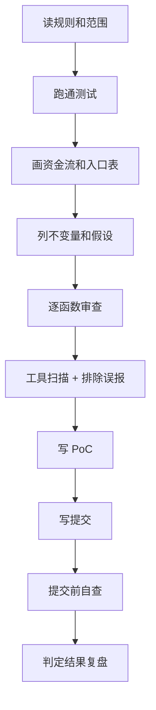
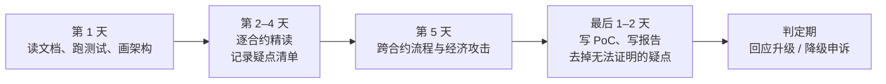

# B53 竞赛、赏金与每日训练

> 学习目标：读完并做完本章，你能——
> 1. 区分赏金与竞赛两种模式，走完一次公开练习赛：选题、审计、提交、看判定、申诉。
> 2. 写出评委能直接复核的竞赛提交和赏金报告，并合理分配竞赛时间。
> 3. 建立每天的 Solodit 训练和刻意练习日志，并在本地安全地复现历史事故。
>
> 前置章节：[B14 如何写发现](B14-writing-findings.md)、[B19](B19-audit-3-miniswap.md)、[A02 风险评级与报告](../assessment/A02-risk-rating-reporting.md)
> 预计用时：第一次练习赛 15–20 小时；之后每天 30–45 分钟。
> 交互实验：[严重性计算器](../interactive/severity-calculator.html)
>
> 最后核对：2026-11-10

---

## 开场：你找到了漏洞，为什么是零奖励

新手第一次比赛常见的结果是：找到了一个真实的问题，判定却是无效或重复。问题不在技术。问题在于提交没有证据，或者根因和别人相同，或者不符合该平台的规则。

竞赛是一个有规则的游戏。规则也是审计范围的一部分。

<details class="predict"><summary>🤔 先猜再看：同一个根因，你写了 3 条提交，会得到 3 份奖励吗？</summary>

不会。评委按根因合并重复项。重复提交还可能拉低你的统计数据。Sherlock Audit Engine 的文档说，同一有效问题提交两次，只有一条计为 Accepted，另一条仍计入比率分母。

</details>

## 1. 一句话理解：赏金与竞赛

**赏金计划针对已上线代码，按漏洞严重性付费。审计竞赛针对上线前代码，多名审计员同时审，按发现的独特性分奖池。两者都是你的公开成绩单。**

术语：

- 漏洞赏金（Bug Bounty）：项目方为已部署代码设立的长期计划。报告有效漏洞的人按规则领取奖金。
- 审计竞赛（Audit Contest）：项目上线前的限时公开审计。奖池按有效发现分配。

| 对比项 | 漏洞赏金 | 审计竞赛 |
|---|---|---|
| 代码状态 | 已上线，有真实资金 | 上线前，通常是固定提交哈希 |
| 时间 | 长期开放 | 限时，通常几天到几周 |
| 奖金计算 | 按严重性分档，高危常与风险资金挂钩 | 按严重性计分，重复越多单份越少 |
| 竞争方式 | 先到先得，重复报告通常无奖 | 同一根因的提交者平分 |
| 主要风险 | 误碰线上系统，触犯法律 | 时间不够，提交缺证据 |

## 2. 平台现状（2026-11-10 核对）

> ⚠️ 警告：平台规则变化很快。下表只反映核对当天的公开文档。参赛前必须读当期规则。

| 平台 | 形式 | 现状与要点 |
|---|---|---|
| [CodeHawks First Flights](https://codehawks.cyfrin.io/first-flights) | 新手练习赛 | 无现金奖，获得 XP；[官方说明](https://docs.cyfrin.io/codehawks/what-is-a-codehawks-first-flight)分为发现、提交、评估、认可四个阶段。[AI First Flights](https://docs.cyfrin.io/codehawks/ai-first-flights) 可随时开始，有一周提交时间，AI 即时判定，**不支持申诉** |
| [CodeHawks 有奖竞赛](https://codehawks.cyfrin.io/contests) | 竞赛 | 也有私有竞赛。最近一场在 2026 年 7 月，上一场在 2025 年 4 月，频率已明显下降 |
| [Sherlock](https://sherlock.xyz/) | 审计竞赛、协作审计、赏金、Audit Engine | 2026 年 8 月上线 AI 审计产品 Audit Engine，官网和官方文章仍把审计竞赛列为现有服务（[官方说明](https://sherlock.xyz/post/why-we-built-sherlock-audit-engine)）。竞赛只计 High 和 Medium，判定规则文档严格。官网仍列 Sherlock Shield，保障条款以官方为准。部分旧版竞赛文档已被归档，规则以当期公告为准 |
| [Cantina](https://cantina.xyz/opportunities/competitions) | 竞赛 + 赏金 | [判定标准](https://docs.cantina.security/standards/judging)：高危 10 分、中危 3 分；重复项按公式折算分数；只有提交者可以申诉，无效申诉罚 100 美元。[主页](https://www.cantina.security/)已转向 AI 安全产品和赏金，竞赛页仍有 2026-11-03 结束的比赛 |
| [Immunefi](https://immunefi.com/) | 赏金 + 竞赛 | Web3 主要赏金平台之一；有自己的严重性分级体系；高危奖金通常与风险资金挂钩 |
| [HackenProof](https://hackenproof.com/programs)、BugRap、Hats Finance、HackerOne | 赏金 | HackenProof 截至核对日仍在更新计划。BugRap 官网可访问，第三方目录 [bbradar](https://bbradar.io/platforms/bugrap) 仍收录新计划，官方运营状态未能确认。Hats 是链上去中心化赏金，2025 年底已关闭中心化前端与服务器（[来源](https://www.kucoin.com/news/flash/hats-finance-to-cease-centralized-custody-operations-by-end-of-2025)） |
| Code4rena | 历史平台 | 2026 年 5 月宣布关停，赏金客户转由 Immunefi 承接（[来源](https://www.theblock.co/post/401179)）。它曾有公开排行榜。历史报告仍是很好的学习材料 |

术语：

- 重复项（Duplicate）：不同参赛者提交的同一根因发现。
- 申诉（Escalation）：参赛者对初步判定提出质疑的流程。
- 根因（Root Cause）：修复后能让问题消失的那一处逻辑错误。

> 🎯 打个比方：竞赛像考试阅卷。答案对了，但步骤没写，老师不能给分。两个学生写了同一个解法，分数要平分。
>
> 比喻的局限：考试有标准答案。竞赛的判定常有争议，所以才有申诉流程。

## 3. 第一次练习赛：全流程

推荐第一次参加 AI First Flight 或 First Flight。不要直接打有奖竞赛。



读图要点：

- 工具扫描排在人工审查之后，用来补漏，不是起点。
- PoC 在提交之前完成。没有 PoC 的高危通常很难成立。
- 局限：真实比赛中 E、F、G 会循环多次。

具体步骤：

1. 注册 [CodeHawks](https://codehawks.cyfrin.io) 账号，打开 First Flights 页面。
2. 选择一场比赛，读 README 中的范围（Scope）和已知问题（Known Issues）。
3. 把代码克隆到本地，运行 `forge test`，确认全部通过。
4. 用 30 分钟画一张表：每个外部函数、谁能调用、动了哪些资金和状态。
5. 写下 3–5 条不变量。不变量（Invariant）：任何时刻都必须成立的性质。
6. 逐函数审查，把怀疑点写进疑点清单。每个疑点写三项：位置、假设、如何验证。
7. 运行工具：`slither .` 和 `aderyn .`。逐条排除误报。
8. 对每个假设写 PoC。PoC 不通过，就不提交。
9. 按第 4 节写提交。
10. 比赛结束后，读其他人的有效发现，把漏掉的写进日志。

> ⚠️ 警告：比赛的代码和发现在公开之前受平台规则约束。不要在社交媒体上讨论未公开的发现。也不要去攻击已部署的版本。

### 3.1 有奖竞赛的时间分配

练习赛没有时间压力。有奖竞赛通常持续一周左右。下图是一种分配方法（示例）：



读图要点：

- 新手最常犯的错误是第 1 天就开始找 bug。前期建模越充分，后期越快。
- 疑点清单是核心资产。前几天只记录疑点，最后集中验证。
- 最后 1–2 天只写 PoC 和报告，不再扩大范围。
- 竞赛中，一个独特的中危，奖金常常比 30 人都发现的高危更高。
- 局限：天数按一周的比赛估算。比赛更短时，按比例压缩，但不要压缩最后的 PoC 时间。

## 4. 写一份能被采信的提交

```markdown
## [H-01] <一句话：谁，通过什么，造成什么后果>

### 摘要
两句话以内。

### 根因
`Vault.sol:L42` 在更新余额之前发起外部调用。

### 影响
谁损失什么，损失上限是多少，前提条件是什么。

### 攻击路径
1. 攻击者……
2. ……

### PoC
<完整的 Foundry 测试，以及运行命令和实际输出>

### 修复建议
最小修改的代码 diff。

### 严重性理由
按平台规则逐条对应。
```

提交前自查：

- [ ] 这个问题在范围内，不在已知问题中。
- [ ] 根因只有一个。不同根因分开提交，同一根因合并提交。
- [ ] PoC 能在干净的仓库上一条命令运行。
- [ ] 严重性写的是该平台的定义，不是我的感觉。
- [ ] 标题读完就知道问题和后果。

## 5. 判定、重复项和申诉

Sherlock 的旧版竞赛文档定义了一个严格的重复项标准，它对各平台都有参考价值。判为重复需要同时满足：相同根因、至少中危影响、描述了有效的攻击路径。来源是 [Sherlock 判定标准](https://docs.sherlock.xyz/audits/judging/guidelines)。

Cantina 的重复项折算公式（[来源](https://docs.cantina.security/standards/judging)）：

```text
Points = Full Points / (1 + 0.8 × (n − 1))
```

下面按该公式计算一个高危（10 分）的结果：

| 重复数 n | 每人得分 |
|---|---|
| 1 | 10 |
| 2 | 5.56 |
| 3 | 3.85 |

> 💡 注意：Cantina 文档示例列的是 4.5（两人）和 2.7（三人），它们与文档给出的公式不一致。上表是按公式算的。实际分数以当期规则为准。

申诉规则：

1. 只在有新证据或规则被误用时申诉。不要因为不甘心申诉。
2. 引用规则原文，给出可运行的 PoC。
3. 控制成本。Cantina 对无效申诉罚款 100 美元。Sherlock 旧版流程要花费 Signal Score，窗口 24 小时。
4. 输了也要复盘。写下判定者的理由，并判断自己下次如何表述。

> 🧪 动手验证：打开[严重性计算器](../interactive/severity-calculator.html)，给你写的一条发现定级，再按 Cantina 或你所参加平台的规则重新定级，比较差异。

## 6. 提交赏金报告

赏金针对线上代码。它在第 4 节的提交格式之外，还有额外要求：

1. 先读项目的赏金规则：范围内合约、排除项、PoC 要求、禁止的测试方式。例如"需要管理员恶意"通常被排除。
2. 只在本地 fork 上测试。不在主网验证。
3. 报告写清：受影响合约地址、风险资金规模、攻击前提、PoC、修复建议。
4. 按受影响资金估算奖金，不按计划的上限估算。上限只在风险资金足够大时才能达到。
5. 遇到分歧时，用平台的严重性标准逐条对照，冷静申诉。

> ⚠️ 警告：把漏洞信息卖给第三方、在协商中以公开漏洞相威胁、或在主网"演示"，都可能构成违法行为，并会让你失去行业信任。

详细的外部审计与赏金流程见 [A07 外部审计与漏洞赏金管理](../assessment/A07-external-audit-bounty.md)。

## 7. Solodit 每日训练（30 分钟）

[Solodit](https://solodit.cyfrin.io) 汇总了公开审计报告中的发现。

1. **选题（3 分钟）**：选一个主题，例如 `oracle` 或 `rounding`，严重性选 High。
2. **遮挡（2 分钟）**：只读标题和受影响函数。不读修复。
3. **预测（10 分钟）**：写下你认为的根因和攻击路径。
4. **对照（10 分钟）**：读完整发现，比较自己差在哪里。
5. **归档（5 分钟）**：写进日志，打上手册的检查项编号（REN、ACC、ARI、EXT、ORA、MEV、UPG、DFI、BRG）。

## 8. 刻意练习日志

刻意练习（Deliberate Practice）：针对明确弱点，带即时反馈的重复训练。

| 日期 | 主题 | 我的预测 | 实际根因 | 差距 | 对应检查项 | 下次动作 |
|---|---|---|---|---|---|---|
| 2026-11-10（示例） | 取整 | 以为是除零 | 存款向上取整 | 没算极小金额 | ARI | 每个除法都试金额 1 |

每周日做一次复盘：

1. 统计漏掉最多的检查项。
2. 下周的 Solodit 主题选这一项。
3. 选一个相关靶场重做一次。

## 9. 安全地复现历史事故

复现的目的是学习机制。复现必须满足三个条件：

1. **本地**：全部运行在 `forge test` 或 `anvil` 上，不广播任何交易。
2. **隔离**：测试开头断言链 ID，防止误连到真实网络。
3. **抽象**：把事故机制提炼成玩具合约。不写针对真实地址的攻击脚本。

```solidity
function test_LocalOnlyHarness() public {
    // 安全闸：不是本地链就立即停止
    assertEq(block.chainid, 31337, "stop: not a local chain");
    ToyPool pool = new ToyPool();  // 玩具合约，只抽象事故机制
    vm.deal(address(this), 6 ether);  // 给测试合约本地发 6 ETH
    pool.deposit{value: 5 ether}();  // 步骤 1：存入 5 ETH 作为受害资金
    // 步骤 2：部署攻击合约，带 1 ETH 本金
    Thief t = new Thief{value: 1 ether}(pool);
    t.go();  // 步骤 3：发动攻击
    assertEq(address(pool).balance, 0);  // 证明池子被掏空
    assertEq(address(t).balance, 6 ether);  // 证明攻击者拿走全部 6 ETH
}
```

本节代码在本地实测通过（链 ID 31337，分别直接运行和 `--fork-url http://127.0.0.1:18545` 连本地 anvil 运行）：

```text
[PASS] test_LocalOnlyHarness() (gas: 478556)
  thief balance (wei): 6000000000000000000
```

> ⚠️ 警告：分叉测试（Fork Test）从 RPC 读取链上状态，在本地模拟执行。它只能用于阅读状态和测试你自己的合约。本手册不提供针对在线合约的攻击脚本。不要用真实私钥，也不要在分叉脚本中使用 `--broadcast`。

事故复现清单：

- [ ] 我有公开的复盘来源（项目方或安全公司）。
- [ ] 我能用 3 句话说出根因。
- [ ] 我的玩具合约只保留了导致漏洞的机制。
- [ ] 测试同时证明了"漏洞存在"和"修复有效"。

更多方法见 [A08 攻击复现](../assessment/A08-reproduce-attacks.md) 和 [28 事故案例集](../28-incident-casebook.md)。

## 10. 如果出错

| 现象 | 原因 | 处理 |
|---|---|---|
| 提交被判无效，理由是超范围 | 没读范围 | 把范围文件写进笔记第一行 |
| 判定为重复，奖励很少 | 常见漏洞竞争激烈 | 花更多时间在业务逻辑和跨函数问题上 |
| 赏金报告被拒，理由是在排除项内 | 没读排除项 | 提交前逐条对照排除项 |
| 最后一天还有多个疑点没验证 | 前期没有控制范围 | 下次按第 3.1 节的时间表，提前停止新增疑点 |
| PoC 在评委那边跑不通 | 依赖本地状态 | 在干净目录重新克隆并运行 |
| `slither .` 报编译错误 | 依赖未安装 | 先让 `forge build` 通过 |
| `assertEq(block.chainid, 31337)` 失败 | 连到了真实网络的分叉 | 立刻停止，检查 RPC 地址 |

## 11. 过关标准

- [ ] 完成 1 次 First Flight 或 AI First Flight，并至少提交 1 条带 PoC 的发现。
- [ ] 连续 14 天完成 Solodit 训练，日志有 14 行。
- [ ] 用玩具合约复现 1 个历史事故，测试包含修复验证。
- [ ] 能引用当期规则解释你的一条判定结果。
- [ ] 能读懂一份赏金计划的范围、排除项和奖金规则，并估算一条发现的奖金区间。

> 🪞 反思：回想你提交过或读过的一份报告。
> 1. 你给出的影响，有数据支持吗？
> 2. 如果项目方或评委否认，你的证据还站得住吗？
> 3. 你上一次提交被判无效后，改变了流程中的哪一步？
> 4. 你在什么情况下应该停止测试并联系对方？

## 12. 思考题

1. 两个不同函数都缺少滑点保护。它们是同一根因吗？怎样判断？
2. 为什么 PoC 通过之后，仍然要写严重性理由？
3. 复现事故时，为什么要断言 `block.chainid`？这条断言挡不住什么？
4. 你在竞赛最后 3 小时发现一个疑似高危，但 PoC 还没写完。你会怎么做？
5. 一个赏金计划写着"最高 100 万美元"，但你的漏洞只影响 2 万美元的资金。你预期的奖金区间是多少？依据是什么？

## 13. 相关章节

- [B14 如何写发现](B14-writing-findings.md)、[B35 案例方法](B35-case-method.md)
- [B54 求职与专家之路](B54-expert.md)
- 主线 [27 审计、测试与开发流程](../27-audit-testing-workflow.md)
- [A02 风险评级与报告](../assessment/A02-risk-rating-reporting.md)、[A07 外部审计与漏洞赏金管理](../assessment/A07-external-audit-bounty.md)

下一章：[B54 求职与专家之路](B54-expert.md)
