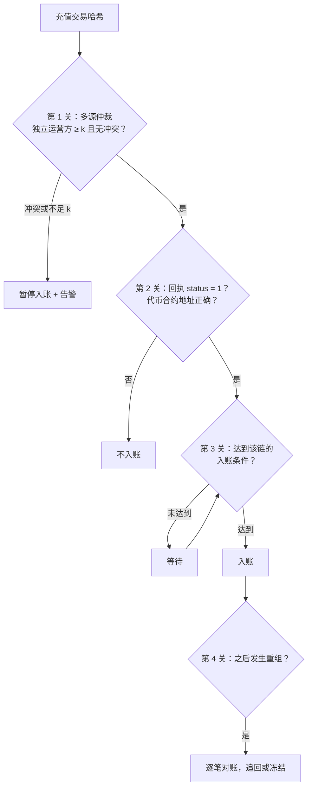

# B63 节点、RPC、确认与暴露面

> 学习目标：做完本章，你能——
> 1. 用两台本地 Anvil 节点和一个仲裁脚本，复现"结果冲突要暂停"和"降级会放行伪造"两种结果。
> 2. 在本地链上制造一次重组，看着一笔已到账的充值消失，并说出 `latest`、`safe`、`finalized` 三个标签的区别。
> 3. 盘点一个节点的暴露面：监听地址、解锁账户、方法白名单和 JWT 密钥文件。
> 4. 说出验证者故障切换前必须确认的三件事，以及最终性停止时按"区块数"入账的问题。
> 5. 为一个示例交易所写出每条链的入账条件，并填写 NODE-1 至 NODE-10 检查清单。
>
> 前置知识：完成阶段 0–1（[阶段 1 导读](B07-stage1-guide.md)），建议先完成链下赛道 L1（[L1 导读](B56-offchain-l1-guide.md)）；会用 `anvil` 和 `cast`（[B06](B06-foundry-basics.md)）；会用 `curl`、`jq`。
> 预计用时：约 3–3.5 小时。
> 交互实验：[RPC 多源仲裁实验](../interactive/rpc-quorum-lab.html)｜[确认深度实验](../interactive/confirmation-depth-lab.html)
> 关联章节：[17 节点、RPC 与验证者基础设施](../17-node-rpc-infrastructure.md)｜[16 共识层与链级安全](../16-consensus-chain-security.md)｜[30 企业链安全](../30-enterprise-blockchain-security.md)｜[C00 以太坊](../chains/C00-ethereum.md)｜[C01 BNB Chain](../chains/C01-bnb-chain.md)｜[C02 TRON](../chains/C02-tron.md)｜[C03 Mantle](../chains/C03-mantle.md)｜[A06 运营与密钥安全](../assessment/A06-operational-key-security.md)｜[B62 前端供应链与 DNS](B62-frontend-supply-chain-practice.md)
> 最后核对：2026-11-10（anvil / cast 1.5.1、node v26.12.1、OpenSSL 3.0.13、curl、jq、lsof 均在本机运行过；两个实验页的结果用页面自带的计算逻辑逐条复算过；下文输出来自真实运行）

> ⚠️ 警告：法律与道德边界。本章的节点都是你本机的 Anvil，只监听 `127.0.0.1`。文中的私钥是 Anvil 公开的默认测试私钥，人人都知道，只能用于本地练习，绝不能向它转入真实资产。不要扫描别人的 8545 端口，不要调用别人的 RPC 去测试漏洞。

---

## 开场：两个节点，两种说法

你在示例交易所 NoteEx 值班。监控显示一笔 1 ETH 的充值已上链。你在第二个 RPC 上查同一个交易哈希，结果是 `null`。

两个节点说法不同。哪个是真的？系统应该先入账，还是先停下？

2026 年 4 月的 KelpDAO 事件就是这种情况的极端版：两个被替换的 RPC 节点只对验证者说谎，干净的节点被 DDoS 打掉，系统切换到被污染的节点，损失约 2.92 亿美元（媒体统计；来源：[LayerZero 声明](https://layerzero.network/blog/kelpdao-incident-statement)，详见 [17 章 §5.2.1](../17-node-rpc-infrastructure.md)）。

<details class="predict"><summary>🤔 先猜再看：你的仲裁规则是"2 个源里至少 1 个说有就入账"。一个源说有，一个源说没有。系统会怎么做？</summary>

会入账。法定数 k = 1 时，只要有一个源被污染，伪造就成立。正确的做法是：结果冲突就暂停，不按"有人说有"放行。第 2 步你会用脚本跑出这两种结论。

</details>

> 🎯 打个比方：你请两位证人确认"昨晚有没有人进仓库"。一人说有，一人说没有。你不会按"有人说有"去报案，也不会按"有人说没有"去结案。你会先封住仓库，再调监控。
>
> 比喻的局限：真实证人很难被同一个人收买。两个 RPC 如果来自同一家运营方，等于同一个证人说了两遍。

## 1. 本章怎么练

原理在 [17 章](../17-node-rpc-infrastructure.md) 和 [16 章](../16-consensus-chain-security.md)。第 1–6 步把一次充值入账拆成 4 道关，每道关做一个练习。第 7–8 步看节点自身：它对谁开放、能替谁签名、出故障时怎么切换。



读图要点：数据从交易哈希开始，依次过仲裁、回执状态、入账条件三道关才入账。第 4 关在入账之后，处理"已入账的交易消失"。最容易出错的是第 1 关的降级和第 3 关的"所有链用同一个 N"。局限：图里没有画链停摆。最终性停止时，第 3 关应当一直停在"等待"，见 [16 章 §3.2](../16-consensus-chain-security.md)。

| 步骤 | 你做什么 | 原理 | 检查项 |
|---|---|---|---|
| 第 1–3 步 | 两台节点 + 仲裁脚本 + 实验页 | [17 §3.1、§4.1](../17-node-rpc-infrastructure.md) | NODE-1、NODE-2 |
| 第 4 步 | 回执状态为 0 的"到账" | [C02 §4.2](../chains/C02-tron.md) | NODE-3 |
| 第 5–6 步 | 制造重组；用实验页定确认策略 | [16 §4.1](../16-consensus-chain-security.md) | NODE-4、NODE-5 |
| 第 7 步 | 盘点节点暴露面 | [17 §4.2](../17-node-rpc-infrastructure.md) | NODE-6 至 NODE-8 |
| 第 8 步 | 验证者与共识风险速查（只答题） | [17 §4.3](../17-node-rpc-infrastructure.md)、[16](../16-consensus-chain-security.md) | NODE-9、NODE-10 |

## 2. 第 1 步：起两台节点

1. 打开两个终端，各起一台 Anvil。`--timestamp` 固定创世时间，让两台链的创世块相同。`--slots-in-an-epoch 4` 让 `finalized` 标签更快前进（第 5 步用）：

```bash
anvil --port 28545 --slots-in-an-epoch 4 --timestamp 1800000000   # 终端 1：节点 A
```

```bash
anvil --port 28546 --slots-in-an-epoch 4 --timestamp 1800000000   # 终端 2：节点 B
```

2. 在第三个终端确认两台节点在同一条链上：

```bash
for u in http://127.0.0.1:28545 http://127.0.0.1:28546; do cast block 0 --field hash --rpc-url $u; done
```

```text
0xbf48bc3c82308c9f095294b82fb69a9d32425e21de16ef725a531fd6ff2d8c9c
0xbf48bc3c82308c9f095294b82fb69a9d32425e21de16ef725a531fd6ff2d8c9c
```

> 💡 注意：两台 Anvil 不互相同步。这正好用来模拟"两个节点看到的链不一样"。

## 3. 第 2 步：写一个仲裁脚本

1. 新建目录 `node-lab`，写入 `quorum.sh`：

```bash
#!/usr/bin/env bash
# 用法：./quorum.sh <交易哈希> <k> <RPC1> <RPC2> ...
# 每个数据源独立回答"这笔交易成功上链了吗"；冲突就暂停，不按多数放行
tx=$1; k=$2; shift 2
yes=0; no=0; down=0
for rpc in "$@"; do
  if ! cast block-number --rpc-url "$rpc" >/dev/null 2>&1; then
    echo "$rpc -> 无响应"; down=$((down+1)); continue
  fi
  st=$(cast rpc eth_getTransactionReceipt "$tx" --rpc-url "$rpc" | jq -r '.status // "none"')
  if [ "$st" = "0x1" ]; then echo "$rpc -> 存在且成功"; yes=$((yes+1))
  else echo "$rpc -> 不存在或失败"; no=$((no+1)); fi
done
echo "存在 $yes，不存在 $no，无响应 $down，k = $k"
if [ $yes -gt 0 ] && [ $no -gt 0 ]; then echo "结论：结果冲突，暂停入账并告警"
elif [ $yes -ge $k ]; then echo "结论：达到法定数，进入确认等待"
else echo "结论：达不到法定数，暂停入账"; fi
```

> 💡 注意：脚本用 `cast rpc eth_getTransactionReceipt`，不用 `cast receipt`。`cast receipt` 找不到交易时会一直等待，脚本会卡住。

2. 模拟"节点 A 被替换"：只在 A 上发一笔充值。B 上没有这笔交易。

```bash
chmod +x quorum.sh
A=http://127.0.0.1:28545; B=http://127.0.0.1:28546
K=0xac0974bec39a17e36ba4a6b4d238ff944bacb478cbed5efcae784d7bf4f2ff80   # Anvil 公开测试私钥，只用于本地
TO=0x70997970C51812dc3A010C7d01b50e0d17dc79C8                          # 当作 NoteEx 的充值地址
TX=$(cast send $TO --value 1ether --private-key $K --rpc-url $A --json | jq -r .transactionHash); echo $TX
./quorum.sh $TX 2 $A $B
```

```text
0xce09985d94caad02fc26f64a68a95d3ae7ec58fa0ef5208c672d4f42052488dc
http://127.0.0.1:28545 -> 存在且成功
http://127.0.0.1:28546 -> 不存在或失败
存在 1，不存在 1，无响应 0，k = 2
结论：结果冲突，暂停入账并告警
```

3. 模拟"干净节点被 DDoS"：把 B 换成一个没有节点的端口 28547。

```bash
./quorum.sh $TX 2 $A http://127.0.0.1:28547
```

```text
http://127.0.0.1:28545 -> 存在且成功
http://127.0.0.1:28547 -> 无响应
存在 1，不存在 0，无响应 1，k = 2
结论：达不到法定数，暂停入账
```

4. 模拟"自动降级"：很多系统在节点超时后，把 k 降到存活节点数。这里直接用 k = 1：

```bash
./quorum.sh $TX 1 $A http://127.0.0.1:28547
```

```text
http://127.0.0.1:28545 -> 存在且成功
http://127.0.0.1:28547 -> 无响应
存在 1，不存在 0，无响应 1，k = 1
结论：达到法定数，进入确认等待
```

同一个被污染的节点，同一笔不存在于 B 的交易。只因为 k 降了，结论从"暂停"变成"放行"。这就是 Kelp 式攻击要 DDoS 干净节点的原因。

## 4. 第 3 步：在实验页里量"最少要攻破几个运营方"

> 🧪 动手验证：打开 [RPC 多源仲裁实验](../interactive/rpc-quorum-lab.html)，按下表操作，记录"结论"和"伪造被接受所需攻破的最少运营方数"。

| # | 操作 | 预期结论 | 最少运营方数 |
|---|---|---|---|
| 1 | 默认 Kelp 式场景（k = 2，降级，冲突暂停已勾选） | ❌ 错误接受 | 1 个（不 DDoS 时 3 个） |
| 2 | "节点无响应时"改为"不降级"，k 拖到 3 | ⏸ 暂停：达不到法定数 | 2 个（不 DDoS 时 3 个） |
| 3 | 场景换成"同一上游被污染"，k = 2 | ⏸ 暂停：结果冲突 | 1 个（不 DDoS 时 2 个） |
| 4 | 在 #3 基础上取消"结果冲突时暂停" | ❌ 错误接受 | 1 个 |
| 5 | 场景换回 Kelp 式，恢复"降级"和 k = 2，勾回"结果冲突时暂停"；业务改为"跨链消息"，勾选独立验证者 | ✅ 独立验证者拦截 | 无法伪造 |
| 6 | 场景换成"无攻击"，"不降级"，k = 2 | ✅ 真实消息通过 | 记录"多少个源宕机时仍能通过"：0 个 |

<details class="predict"><summary>🤔 先猜再看：#1 里选了 4 个数据源。为什么"最少运营方数"只有 1？</summary>

因为 4 个源只来自 3 个运营方，其中节点 A 和节点 B 同属"你方内部"。攻击者攻破这一个运营方，就同时控制了 2 个源。再 DDoS 掉另外两个，降级后 k 正好等于 2。数据源要按**运营方**数，不按 URL 数。

</details>

#6 说明代价：不降级、k 等于源数时，任何一个源宕机，真实充值也要等待。安全和可用性要一起设计，例如多接几个独立运营方，而不是降低 k。

## 5. 第 4 步：交易在链上，钱没到

C02 章提醒：TRON 上有"失败但上链"的交易，交易所只看"交易存在"就会记成到账（[C02 §4.2](../chains/C02-tron.md)）。EVM 链也一样。下面在 A 上复现。

1. 部署一个永远回滚的合约。它的运行时代码是 `PUSH1 0 PUSH1 0 REVERT`：

```bash
C=$(cast send --private-key $K --rpc-url $A --json --create 0x6460006000fd6000526005601bf3 | jq -r .contractAddress); echo $C
cast code $C --rpc-url $A
```

```text
0xe7f1725e7734ce288f8367e1bb143e90bb3f0512
0x60006000fd
```

2. 向它转 1 ETH。`--gas-limit` 让 cast 跳过预估，直接发送：

```bash
TX2=$(cast send $C --value 1ether --gas-limit 50000 --private-key $K --rpc-url $A --json | jq -r .transactionHash)
cast rpc eth_getTransactionReceipt $TX2 --rpc-url $A | jq -c '{blockNumber, status}'
cast balance $C --rpc-url $A
./quorum.sh $TX2 1 $A
```

```text
{"blockNumber":"0x3","status":"0x0"}
0
http://127.0.0.1:28545 -> 不存在或失败
存在 0，不存在 1，无响应 0，k = 1
结论：达不到法定数，暂停入账
```

交易在第 3 块，回执 `status` 是 `0x0`，余额是 0。仲裁脚本检查的是 `status = 0x1`，所以没有入账。如果脚本只检查"回执不为 null"，这笔就会被记成到账。

> 💡 注意：代币充值还要多一道检查：`Transfer` 事件必须来自**正确的代币合约地址**。攻击者可以部署一个同名代币，发出一模一样的事件（[C02 §4.2](../chains/C02-tron.md)）。

## 6. 第 5 步：看一笔已到账的充值消失

重组（Reorg）：节点放弃已接受的若干区块，改用另一条链。原理见 [16 章 §1](../16-consensus-chain-security.md)。Anvil 提供 `anvil_reorg`，可以在本机制造一次重组。

1. 在节点 B 上充值 5 ETH，再挖 2 个块：

```bash
TX3=$(cast send $TO --value 5ether --private-key $K --rpc-url $B --json | jq -r .transactionHash)
cast rpc anvil_mine 2 --rpc-url $B >/dev/null
for t in latest safe finalized; do printf "%s: " $t; cast block $t --field number --rpc-url $B; done
cast block 1 --field hash --rpc-url $B
cast rpc eth_getTransactionReceipt $TX3 --rpc-url $B | jq -c '{blockNumber, status}'
cast balance $TO --ether --rpc-url $B
```

```text
latest: 3
safe: 0
finalized: 0
0x8262763b47b7e99062a09dfc311a5bc994aaa6516fb9bcabe851cb306a800be7
{"blockNumber":"0x1","status":"0x1"}
10005.000000000000000000
```

充值在第 1 块，已有 3 个区块。按"3 个确认"的规则，它已经可以入账。

2. 制造一次深度为 3 的重组。第二个参数 `[]` 表示新链上不放任何交易：

```bash
cast rpc anvil_reorg 3 '[]' --rpc-url $B
cast block-number --rpc-url $B
cast block 1 --field hash --rpc-url $B
cast rpc eth_getTransactionReceipt $TX3 --rpc-url $B
cast balance $TO --ether --rpc-url $B
```

```text
null
3
0x611123741da4cb8d5249762832f7bfe7be747266bcdb259de06d27bcb8872499
null
10000.000000000000000000
```

第一行 `null` 是 `anvil_reorg` 的返回值。高度还是 3，但第 1 块的哈希变了。充值回执变成 `null`，余额回到 10000。区块哈希含出块时间，你的哈希会和本章不同，变化本身才是重点。

3. 再充值一次，多挖 8 个块，看三个标签怎么走：

```bash
TX4=$(cast send $TO --value 5ether --private-key $K --rpc-url $B --json | jq -r .transactionHash)
cast rpc eth_getTransactionReceipt $TX4 --rpc-url $B | jq -r .blockNumber | xargs cast to-dec
cast rpc anvil_mine 8 --rpc-url $B >/dev/null
for t in latest safe finalized; do printf "%s: " $t; cast block $t --field number --rpc-url $B; done
```

```text
4
latest: 12
safe: 8
finalized: 4
```

充值在第 4 块。`finalized` 刚好走到 4，这时才满足"以 finalized 为准"的入账条件。

<details class="predict"><summary>🤔 先猜再看：在 Anvil 上，你能不能对已经 finalized 的第 4 块再做一次 anvil_reorg？在以太坊主网上呢？</summary>

在 Anvil 上通常能。Anvil 的 `finalized` 只是"最新高度减去 2 个 epoch"的算术结果，没有共识在背后。在以太坊主网上，回滚已最终确定的检查点，需要至少 1/3 的质押被罚没（[16 章 §2](../16-consensus-chain-security.md)）。本地实验演示的是"标签怎么用"，不演示"标签为什么可信"。

</details>

## 7. 第 6 步：用实验页给每条链定入账条件

> 🧪 动手验证：打开 [确认深度实验](../interactive/confirmation-depth-lab.html)，先在第 1 节记录下面的数字。

| 设置 | Rosenfeld | Nakamoto | 达到 0.1% 所需最少确认数 |
|---|---|---|---|
| q = 10%，n = 6 | 5.91e-4 | 2.43e-4 | 6 个 |
| q = 30%，n = 1 | 60.000% | — | — |
| q = 30%，n = 6 | 15.645% | — | 32 个 |
| q = 50%，n = 6 | 100% | — | 不存在 |

再到第 2 节，金额先用默认的 100,000，按下表给每条链选策略，点"评估策略"：

| 链（实验页的示例） | 选这个 | 预期 | 原因（页面会显示） |
|---|---|---|---|
| 大算力 PoW | 6 个区块 | 不合格 | P(成功) = 6.866%，至少需要 20 个确认 |
| 小算力 PoW | 5,760 个区块 | 合格 | 租算力成本约 480,000 美元，不低于充值额 |
| PoS L1 | 30 个区块 | 不合格 | 数区块不等于最终性 |
| PoS L1 | finalized 标签 | 合格 | 以链的最终性为准 |
| L2 | safe 标签 | 不合格 | 金额超过 safe 限额 50,000（示例） |
| L2 | L1 已最终确定的批次 | 合格 | 排序器回滚不影响这部分数据 |

最后把金额改成 1,000,000，重新评估。小算力 PoW 的 5,760 个区块变成不合格，页面提示至少需要 12,000 个区块，或降低单笔上限。

> 💡 注意：确认数是经济问题。2020 年 Ethereum Classic 一个月内被攻击三次，之后 Coinbase 把 ETC 的充值确认时间提高到约两周（来源：[Bitquery](https://bitquery.io/blog/ethereum-classic-51-chain-attack-july-31-2020)、[ForkLog](https://forklog.com/en/coinbase-raises-ethereum-classic-deposit-confirmation-time-to-two-weeks/amp)，见 [16 章 §5.1](../16-consensus-chain-security.md)）。

## 8. 第 7 步：盘点节点暴露面

第 1–6 步回答了"该信哪个节点、等多久才入账"。第 7–8 步看节点自己。2018 年，一个团伙扫描暴露 JSON-RPC 的以太坊节点，累计盗走 38,642 ETH，路径就是"开放端口 + 能签名的接口"。2023 年 10 月，Lido 一家运营商的 20 个验证者被罚没，起因是故障后的签名器配置错误。两件事都不需要攻破密码学，只需要一个配置错误。

原理和加固表见 [17 章 §4.2](../17-node-rpc-infrastructure.md)。本步沿用第 1 步起的节点 A，以及第 2 步设的变量 `A` 和 `TO`。如果节点 A 已关闭，按第 1 步的命令重新启动，并重新设置这两个变量：

```bash
A=http://127.0.0.1:28545
TO=0x70997970C51812dc3A010C7d01b50e0d17dc79C8   # 一个充值地址，这里当作被盗的目标
```

> 💡 注意：下文输出里的区块高度接着第 2–4 步的操作。新起的节点，区块高度数字会不同，其余输出相同。

1. 看节点监听在哪个地址：

```bash
lsof -iTCP:28545 -sTCP:LISTEN -n -P
```

```text
COMMAND   PID USER   FD   TYPE             DEVICE SIZE/OFF NODE NAME
anvil   …     …       9u  IPv4 …                  0t0  TCP 127.0.0.1:28545 (LISTEN)
```

`127.0.0.1` 表示只有本机能连。如果你在自己的服务器上看到 `*:8545` 或 `0.0.0.0:8545`，就表示所有网卡都在监听，要立刻核对防火墙。

2. 看节点有没有"解锁账户"。解锁账户能直接签名转账，不需要私钥：

```bash
cast rpc eth_accounts --rpc-url $A | jq -r '.[0:3][]'
cast send $TO --value 100ether --unlocked --from 0x3C44CdDdB6a900fa2b585dd299e03d12FA4293BC --rpc-url $A --json | jq -r .status
cast balance 0x3C44CdDdB6a900fa2b585dd299e03d12FA4293BC --ether --rpc-url $A
```

```text
0xf39fd6e51aad88f6f4ce6ab8827279cfffb92266
0x70997970c51812dc3a010c7d01b50e0d17dc79c8
0x3c44cdddb6a900fa2b585dd299e03d12fa4293bc
0x1
9899.999985918745953000
```

你没有提供私钥，100 ETH 就被转走了。这就是本节开头所说的 2018 年 8545 端口盗币路径（来源：[BleepingComputer](https://www.bleepingcomputer.com/news/security/hackers-stole-over-20-million-from-misconfigured-ethereum-clients)，见 [17 章 §5.3](../17-node-rpc-infrastructure.md)）。

3. 在节点前面加一个只读网关。写入 `rpc-gate.js`：

```javascript
// 只读 RPC 网关：监听 28600，只把白名单里的方法转发给 28545 上的节点
const http = require("http");
const ALLOW = new Set(["eth_chainId", "eth_blockNumber", "eth_getBlockByNumber",
  "eth_getTransactionReceipt", "eth_getBalance", "eth_call"]);
const TOKEN = process.env.GATE_TOKEN;  // 调用方必须带这个令牌
http.createServer((req, res) => {
  let body = "";
  req.on("data", c => (body += c));
  req.on("end", () => {
    const deny = (code, msg) => { res.writeHead(code); res.end(msg + "\n"); console.log("DENY", msg); };
    if (req.headers.authorization !== "Bearer " + TOKEN) return deny(401, "missing or bad token");
    let m; try { m = JSON.parse(body); } catch { return deny(400, "bad json"); }
    if (Array.isArray(m) || !ALLOW.has(m.method)) return deny(403, "method not allowed: " + (m.method || "batch"));
    const up = http.request({ host: "127.0.0.1", port: 28545, method: "POST",
      headers: { "Content-Type": "application/json" } }, r => r.pipe(res));
    up.end(body);
  });
}).listen(28600, "127.0.0.1", () => console.log("gate on 127.0.0.1:28600"));
```

4. 生成令牌，限制文件权限，启动网关（在新终端里运行最后一行）：

```bash
openssl rand -hex 16 > gate.token && chmod 600 gate.token && ls -l gate.token | cut -c1-10
GATE_TOKEN=$(cat gate.token) node rpc-gate.js
```

```text
-rw-------
```

5. 回到原终端，测试 5 种请求：

```bash
T=$(cat gate.token); G=http://127.0.0.1:28600
curl -s $G -d '{"jsonrpc":"2.0","id":1,"method":"eth_blockNumber","params":[]}'
curl -s $G -H "Authorization: Bearer $T" -d '{"jsonrpc":"2.0","id":1,"method":"eth_blockNumber","params":[]}'; echo
curl -s $G -H "Authorization: Bearer $T" -d '{"jsonrpc":"2.0","id":2,"method":"eth_accounts","params":[]}'
curl -s $G -H "Authorization: Bearer $T" -d '{"jsonrpc":"2.0","id":3,"method":"eth_sendTransaction","params":[{"from":"0x3C44CdDdB6a900fa2b585dd299e03d12FA4293BC","to":"0x70997970C51812dc3A010C7d01b50e0d17dc79C8","value":"0x1"}]}'
curl -s $G -H "Authorization: Bearer $T" -d '[{"jsonrpc":"2.0","id":4,"method":"eth_blockNumber","params":[]}]'
```

```text
missing or bad token
{"jsonrpc":"2.0","id":1,"result":"0x4"}
method not allowed: eth_accounts
method not allowed: eth_sendTransaction
method not allowed: batch
```

> 💡 注意：网关拒绝了批量请求。批量请求里可以藏一个危险方法。如果你的网关要支持批量，必须逐条检查。

6. 生成一个 Engine API 用的 JWT 密钥文件。执行层和共识层客户端用它互相认证（[17 章 §4.2](../17-node-rpc-infrastructure.md)）：

```bash
umask 077
openssl rand -hex 32 | tr -d '\n' > jwt.hex
ls -l jwt.hex | awk '{print $1, $5, $NF}'
```

```text
-rw------- 64 jwt.hex
```

64 个十六进制字符就是 32 字节。权限 `-rw-------` 表示只有文件所有者能读。真实节点上，所有者应当是节点进程的专用低权限账户。

> 💡 注意：企业链（Fabric、Besu 等）的 P2P 和 gRPC 端口同样只对成员网络开放，并启用 mTLS，见 [30 章 §4.4](../30-enterprise-blockchain-security.md)。

## 9. 第 8 步：验证者与共识风险速查

本步不运行命令。用 3 个问题检查你是否读懂了主线章节。

<details class="predict"><summary>🤔 先猜再看：凌晨，验证者主机 A 失去响应。值班运维想马上在备用机 B 上启动同一把密钥。启动前他必须确认哪三件事？</summary>

①A 已经确实停止，不只是"看起来宕机"；②A 的防罚没数据（EIP-3076）已导出并导入 B；③已经等待至少 2 个 epoch。分身检测是最后一道防线，不能代替这三步（[17 章 §4.3](../17-node-rpc-infrastructure.md)）。2023 年 10 月 Lido 一家运营商的 20 个验证者被罚没，起因就是故障后的签名器配置错误（[Lido 事后报告](https://blog.lido.fi/post-mortem-launchnodes-slashing-incident/)）。

</details>

<details class="predict"><summary>🤔 先猜再看：以太坊投票参与率掉到 60%，链还在出块。你的系统按"64 个区块"入账。会发生什么？</summary>

系统会继续入账。参与率低于 2/3 时，检查点不再最终确定，但区块照样增长，"64 个区块"的条件照样满足。2025 年 12 月 Fusaka 上线后的 Prysm 事件，参与率约 75%，还在 2/3 之上（[Prysm 事后报告](https://prysm.offchainlabs.com/docs/misc/mainnet-postmortems/)，见 [16 章开场](../16-consensus-chain-security.md)）。按 `finalized` 入账、并监控最终性延迟的系统，才会停下。

</details>

<details class="predict"><summary>🤔 先猜再看：你的节点有 50 个对等连接，同步高度正常。能证明它没有被日蚀吗？</summary>

不能。连接数只说明有连接，不说明连接来自独立的运营方。要把节点链头和不同网络、不同运营方的数据源持续比对。这和第 2 步的仲裁是同一条防线（[17 章 §3.3.1](../17-node-rpc-infrastructure.md)）。

</details>

## 10. 交付物：NoteEx 的数据源与入账策略表

NoteEx（示例）支持 5 条链。现状：每条链只接一家第三方 RPC；所有链统一按"12 个区块"入账；充值扫描只检查回执不为 null。

用第 2–6 步的结论，重写入账条件。参考答案如下，先自己写再对照。最终性参数以各链章节为准，截至 2026 年公开资料：

| 链 | 数据源（按运营方） | 入账条件 | 额外检查 | 依据 |
|---|---|---|---|---|
| 以太坊 | 自建节点 + 2 家第三方，k = 3，不降级，冲突暂停 | `finalized` 标签（约 2 个 epoch） | 最终性延迟超阈值时暂停大额入账 | [C00 §2](../chains/C00-ethereum.md)、[16 §4.1](../16-consensus-chain-security.md) |
| BSC | 同上 | 快速最终性投票达成（Fermi 后约 1.125 秒） | 投票不足时按概率性处理；订阅停链公告 | [C01 §2.1](../chains/C01-bnb-chain.md)、[16 §5.6](../16-consensus-chain-security.md) |
| TRON | 同上 | 按 PoSA / DPoS 规则：最终性达成后入账 | 回执执行结果为成功；`Transfer` 来自正确的 USDT 合约（TRX-11）；订阅停链、冻结公告 | [C02 §4.2](../chains/C02-tron.md)、[16 §4.1](../16-consensus-chain-security.md) |
| Mantle（L2） | 同上 | 大额以 L1 已最终确定的批次为准 | 监控 unsafe 与 finalized 头的差距 | [C03 §6](../chains/C03-mantle.md)、[16 §4.1](../16-consensus-chain-security.md) |
| 小算力 PoW 币 | 同上 | 确认数按租算力成本定，必要时以天计 | 单笔、单日上限；重组深度告警 | [16 §4.1](../16-consensus-chain-security.md) |

所有链通用：回执 `status = 1` 才入账；重组后逐笔对账（CON-5）。

## 11. 检查清单

把下面的表抄进你的笔记，对你负责或了解的一个入账或节点系统逐项填写。

| 编号 | 检查项 | 怎么验证 | 本章步骤 | 你的结果 |
|---|---|---|---|---|
| NODE-1 | 每条链至少 2 个独立**运营方**的数据源；结果冲突时暂停 | 数据源清单按运营方去重 | 第 2、3 步 | |
| NODE-2 | 节点超时时 k 不自动下降 | 读故障切换配置；做一次断节点演练 | 第 2、3 步 | |
| NODE-3 | 只有回执 `status = 1` 且事件来自正确合约才入账 | 用失败交易做测试 | 第 4 步 | |
| NODE-4 | 每条链有单独的入账条件，写明依据 | 入账规则文档 | 第 6 步、第 10 节 | |
| NODE-5 | 重组后能逐笔找出已入账但消失的充值 | 用 `anvil_reorg` 做一次演练 | 第 5 步 | |
| NODE-6 | HTTP / WS RPC 不监听公网地址；对外经过认证网关和方法白名单 | `lsof` 或 `ss` 看监听地址；网关测试 | 第 7 步 | |
| NODE-7 | 节点上没有解锁账户，没有提币私钥 | `eth_accounts` 返回空 | 第 7 步 | |
| NODE-8 | Engine API 的 JWT 文件权限最小，不进日志 | `ls -l`；搜日志 | 第 7 步 | |
| NODE-9 | 验证者故障切换需人工确认原实例已停止，并迁移防罚没数据 | 切换 runbook；演练记录 | 第 8 步 | |
| NODE-10 | 监控最终性延迟和链头与外部来源的差距，超阈值暂停 | 告警规则；一次触发记录 | 第 8 步 | |

报告定级参考 [17 章第 6 节](../17-node-rpc-infrastructure.md) 和 [16 章第 6 节](../16-consensus-chain-security.md) 的对照表，发现格式用 [T03](../templates/T03-finding-report.md)。

> 🪞 反思：写下你的系统判断一笔充值时读的全部数据源。去掉同一运营方的重复项，还剩几个？主节点超时那一刻，系统自动做的第一件事是什么？

## 12. 如果出错

| 现象 | 原因 | 处理 |
|---|---|---|
| `Address already in use` | 端口被占用，可能是你之前的 Anvil | 关掉旧进程，或换端口并同步改命令 |
| 两台节点的创世哈希不同 | 漏了 `--timestamp`，或参数不一致 | 两台用完全相同的参数重启 |
| 脚本卡住不动 | 用了 `cast receipt`，它在等交易出现 | 改用 `cast rpc eth_getTransactionReceipt` |
| `jq: command not found` | 没装 jq | 安装 jq，或把 `jq` 部分改成 `grep '"status"'` |
| `cast send --create` 报 unexpected argument | `--create` 后面的参数被当成构造参数 | 把 `--private-key` 等选项放在 `--create` 前面 |
| `finalized` 一直是 0 | 没加 `--slots-in-an-epoch 4`，默认要 64 个块 | 重启并加参数，或多挖块 |
| 第 5 步的区块哈希和本章不同 | 哈希含出块时间 | 正常，只比较重组前后是否变化 |
| 网关返回 `missing or bad token` | 启动网关和发请求时用的令牌不同 | 两边都从 `gate.token` 读取 |

## 13. 过关标准

- [ ] 第 2 步跑出 3 种结论：冲突暂停、达不到法定数、降级后放行，并解释第 3 种为什么危险。
- [ ] 第 3 步填完 6 行表，能说出 #1 的"最少运营方数"为什么是 1。
- [ ] 第 4 步看到 `"status":"0x0"`，并说出只检查"回执存在"会怎样。
- [ ] 第 5 步看到充值回执从 `0x1` 变成 `null`，余额从 10005 回到 10000。
- [ ] 第 7 步的网关拦下 4 种请求，只放行带令牌的 `eth_blockNumber`。
- [ ] 第 8 步的 3 个问题先写下自己的答案再展开，并说出每题对应 NODE-9 还是 NODE-10。
- [ ] 独立写完 NoteEx 的 5 条链入账条件，每条链都写明依据。
- [ ] 做完后关闭全部 Anvil 和网关进程。

## 14. 思考题

1. 第 2 步里，NoteEx 的两个数据源一个是自建节点，一个是第三方。第三方 RPC 背后其实也用了同一家云厂商的同一个机房。这对"独立运营方"的计数有什么影响？你会怎么核实？
2. 第 5 步的重组发生在充值入账之后。如果用户已经把这笔钱提到了另一条链，按第 1 节的图，你的系统应该做什么？哪些动作必须提前准备好？
3. 一个团队说："我们用 `safe` 标签入账，比 `finalized` 快，也比数区块安全。"对以太坊 L1 和对 L2，你的回应分别是什么？
4. 第 7 步的网关放行了 `eth_call`。一个只读方法也可能带来风险吗？请从资源消耗的角度说明，并给出一条限制措施。
5. 第 7 步的网关直接拒绝了批量请求。如果业务必须支持批量，网关要怎么改？只检查批量里的第一条为什么不够？
6. 第 8 步第三题说，50 个对等连接不能证明节点没有被日蚀。你会用什么数据来证明？这和第 2 步的仲裁是什么关系？

- 下一章：[B64 热钱包水位、提现风控与多签复核](B64-custody-ops-ir-practice.md)
