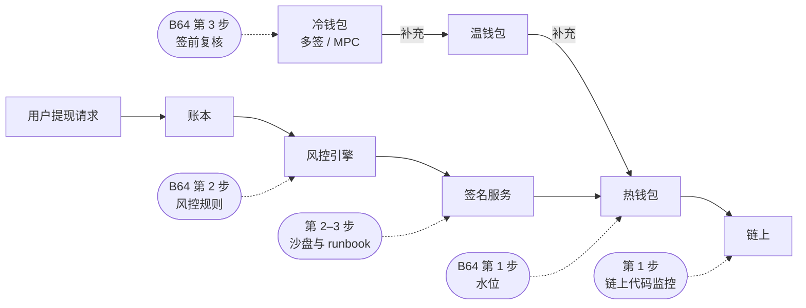

# B65 应急：检查链上委托、沙盘与 runbook

> 学习目标：做完本章，你能——
> 1. 在本地链上设置并撤销一个 EIP-7702 委托，用脚本检查自有地址的链上代码。
> 2. 跑完一次热钱包应急沙盘，比较不同决策的结果，并写出一份可执行的 runbook。
>
> 前置章节：[B64 热钱包水位、提现风控与多签复核](B64-custody-ops-ir-practice.md)（本篇的 runbook 用到它的风控规则 R1）。
> 前置知识：完成阶段 0–1（[阶段 1 导读](B07-stage1-guide.md)），建议先完成链下赛道 L1（[L1 导读](B56-offchain-l1-guide.md)）；会用 `anvil` 和 `cast`（[B06](B06-foundry-basics.md)）；读过 [B59](B59-social-engineering-practice.md) 更好。
> 预计用时：约 1.5–2 小时。
> 交互实验：[热钱包应急演练](../interactive/incident-response-sim.html)｜[安全事故浏览器](../interactive/incident-explorer.html)
> 关联章节：[23 托管与充提安全](../23-custody-exchange-ops.md)｜[29 2026 签名路径专题](../29-signing-path-2026.md)｜[25 资金追踪、冻结与事后处置](../25-fund-tracing-response.md)｜[A09 应急响应](../assessment/A09-incident-response.md)｜[T06 运营安全自查](../templates/T06-ops-security-self-check.md)｜[B64 热钱包水位、提现风控与多签复核](B64-custody-ops-ir-practice.md)
> 最后核对：2026-11-10（anvil / cast 1.5.1、node v26.12.1 在本机运行过；下文命令输出来自真实运行；应急演练的三组结果和多签实验 #42 的哈希在本机浏览器中跑过）

> ⚠️ 警告：法律与道德边界。本章只在本机的 Anvil 链和浏览器实验页上操作。文中的私钥是 Anvil 公开的默认测试私钥，只能用于本地，任何人都知道它，绝不能往对应地址转真实资产。不要对任何真实交易所或钱包做提现测试、签名测试或"应急演练"。真实的应急演练只在你所在组织的授权范围内进行。

---

## 开场：提现已经暂停，钱还在流出

2026 年 10 月 29 日，Binance 发现大额转账后暂停了提现。按项目方报告，暂停提现没有阻止全部未授权的资产转移。以太坊热钱包上的恶意 EIP-7702 委托在链上存活了约 3 小时 50 分（[23 章 5.2 节](../23-custody-exchange-ops.md)，来源：[Binance 初步报告](https://www.linkedin.com/pulse/29-october-binance-security-incident-initial-findings-response-modgf/)）。

<details class="predict"><summary>🤔 先猜再看：你是值班负责人。提现接口已关闭，热钱包服务也停了。你还要去哪里确认"钱不会再流出"？</summary>

去链上。EIP-7702 委托写在账户的链上代码里，独立于链下服务。你要逐个检查自有地址的代码（`cast code`），看有没有 `0xef0100` 开头的委托标记。第 1 步你会在本地链上亲手设置、发现并撤销一个委托。

</details>

> 🎯 打个比方：交易所关闭提现，像银行营业厅拉下卷帘门。但金库还有一扇后门，钥匙已经被人复制。卷帘门拉得再快，也挡不住后门。应急的第一件事是找到所有的门，而不是只关前门。
>
> 比喻的局限：银行的后门是物理的，看得见。链上的"后门"可能是一条委托、一个授权、一笔已签名未广播的交易。它们只有在你主动查询时才看得见。

## 1. 本章怎么练

[B64](B64-custody-ops-ir-practice.md) 沿一笔提现的路径做了 3 个"事前控制"练习。本篇做"事中响应"，在链上和签名服务两个位置各做练习。决策树见 [A09 §3](../assessment/A09-incident-response.md)。下文的示例交易所 Nebula（虚构）沿用 B64 的设定。



读图要点：
- 实线是资金和请求的方向。虚线标出本章每一步练习所在的位置。
- 第 1 步的位置在链上，不在任何链下服务里。这是开场问题的答案。
- 局限：图里没有内部人和终端失陷。那是 [B59](B59-social-engineering-practice.md) 的内容，但它们最终都会打到这条路径上。

## 2. 第 1 步：暂停提现之后，检查链上委托

这一步在本地 Anvil 链上重演开场的问题。Anvil 默认账户 #1 扮演"热钱包"。

1. 打开第二个终端，启动支持 EIP-7702 的本地链（Prague 硬分叉）：

```bash
anvil --port 18546 --hardfork prague
```

输出的最后一行是 `Listening on 127.0.0.1:18546`。

2. 回到第一个终端，进入 `b51-lab`（没做 B64 就先 `mkdir b51-lab`），设置变量。下面两个私钥是 Anvil 公开的默认测试私钥，只用于本地：

```bash
R=http://127.0.0.1:18546
DEPK=0xac0974bec39a17e36ba4a6b4d238ff944bacb478cbed5efcae784d7bf4f2ff80   # Anvil 账户 #0，扮演攻击者
HOT=0x70997970C51812dc3A010C7d01b50e0d17dc79C8                              # Anvil 账户 #1，扮演热钱包
HOTK=0x59c6995e998f97a5a0044966f0945389dc9e86dae88c7a8412f4603b6b78690d
```

3. 部署一个最小的"攻击者合约"。它的代码只有一个 `STOP`，只用来提供一个合约地址：

```bash
cast send --rpc-url $R --private-key $DEPK --create 0x6001600c60003960016000f300 | grep -E 'contractAddress|status'
cast code $HOT --rpc-url $R   # 委托前：热钱包是普通账户
```

```text
contractAddress      0x5FbDB2315678afecb367f032d93F642f64180aa3
status               1 (success)
0x
```

4. 模拟"热钱包签下了一个委托"。真实事件里，这一步是攻击者驱动签名服务完成的：

```bash
C=0x5FbDB2315678afecb367f032d93F642f64180aa3
cast send $HOT --auth $C --private-key $HOTK --rpc-url $R | grep -E '^(status|type)'
cast code $HOT --rpc-url $R
```

```text
status               1 (success)
type                 4
0xef01005fbdb2315678afecb367f032d93f642f64180aa3
```

`type 4` 是 EIP-7702 交易。账户代码变成 `0xef0100` 加委托目标地址。

5. 写一个监控脚本 `check-code.sh`，并准备地址清单 `own-addresses.txt`（第二个地址是 Anvil 账户 #2，扮演另一个没有被委托的热钱包）：

```text
0x70997970C51812dc3A010C7d01b50e0d17dc79C8
0x3C44CdDdB6a900fa2b585dd299e03d12FA4293BC
```

```bash
#!/bin/sh
# 逐个检查自有地址的链上代码；EOA 正常应为 0x
RPC=http://127.0.0.1:18546
while read -r a; do
  code=$(cast code "$a" --rpc-url "$RPC")
  case "$code" in
    0x) echo "OK     $a" ;;
    0xef0100*) echo "ALERT  $a delegated to 0x${code#0xef0100}" ;;
    *) echo "WARN   $a has contract code" ;;
  esac
done < own-addresses.txt
```

```bash
sh check-code.sh
```

```text
ALERT  0x70997970C51812dc3A010C7d01b50e0d17dc79C8 delegated to 0x5fbdb2315678afecb367f032d93f642f64180aa3
OK     0x3C44CdDdB6a900fa2b585dd299e03d12FA4293BC
```

<details class="predict"><summary>🤔 先猜再看：本地链上没有任何"提现服务"。如果有，关掉它会让 ALERT 变成 OK 吗？</summary>

不会。ALERT 来自 `cast code` 读到的链上状态。没有任何链下开关能改变它。只有一笔新的 EIP-7702 授权能覆盖委托。下一小步你就发这笔授权。

</details>

6. 撤销：发送一个指向零地址的新授权，再检查一次：

```bash
cast send $HOT --auth 0x0000000000000000000000000000000000000000 --private-key $HOTK --rpc-url $R | grep status
sh check-code.sh
```

```text
status               1 (success)
OK     0x70997970C51812dc3A010C7d01b50e0d17dc79C8
OK     0x3C44CdDdB6a900fa2b585dd299e03d12FA4293BC
```

7. 在第二个终端按 `Ctrl+C` 关闭 Anvil。

> ⚠️ 警告：本地撤销只用了一条命令，因为你手里有私钥。真实的 MPC 热钱包没有一把能立刻发交易的单独私钥。先切断签名路径，再走独立的应急路径撤销，步骤见 [29 章 §4.9](../29-signing-path-2026.md)。

## 3. 第 2 步：应急沙盘

> 🧪 动手验证：打开[热钱包应急演练](../interactive/incident-response-sim.html)，勾选"教学模式：关闭倒计时"。按下面三组设置各跑一次，把"最终损失"和"已冻结"填进表格。页面数字是本手册的示例模型，不是历史数据。

| 运行 | 事前控制 | 决策 | 最终损失（模型） | 已冻结（模型） |
|---|---|---|---|---|
| A | 全部不勾 | ①宣布 P0，之后每步都选"关停型"：②暂停用户提现 → ②-2停掉热钱包服务 → ③再暂停一层 → ③-2继续观察 → ④只熔断异常链 → ⑤先联系最大一家 → ⑥立即发布精确金额 → ⑦立刻重建 → ⑧一次性恢复 | | |
| B | 全部不勾 | 每步都选第一个选项（①宣布 P0 → ②停止全部签名路径 → ③运行撤销流程 → ④全部链熔断 → ⑤并行通知 → ⑥发布事实 → ⑦先保全 → ⑧分批恢复） | | |
| C | 三项事前控制全勾 | 同 B（策略拒签后，页面不会出现第 ③ 步） | | |

我在本机跑的结果：A 为 3,846M / 1,088M，B 为 1,828M / 1,397M，C 为 315M / 0M。你的结果应当相同，因为模型的事件脚本是固定的。

<details class="predict"><summary>🤔 先猜再看：C 的"已冻结"是 0，比 B 少。这说明 C 的发行方冻结做得更差吗？</summary>

不是。C 勾选了"签名策略默认拒签 EIP-7702 授权"，委托根本没有生成，流失大幅减少。没有被盗的稳定币，自然也不需要冻结。比较应急方案时看"最终损失"，不要把"冻结了多少"当成功劳。这也说明：事前一条策略（SIG-6），抵得上事中很多正确操作。

</details>

完成三次运行后：

1. 打开 B 运行的复盘页，看"对照路径（同一模型）"表。找到"同上 + 已演练撤销手册 + 代码告警"一行，记录它比 B 少多少。
2. 看"公开时间线对比"表。记录"委托清零"一行：公开事实是 T+245，你的演练是多少。
3. 打开[安全事故浏览器](../interactive/incident-explorer.html)，根因类别选"签名服务与运营"。页面列出 Bitget、Binance 热钱包、Mercado Bitcoin 三起。选一起作为第 3 步桌面推演的背景。

## 4. 第 3 步：写一份 runbook

runbook（运行手册）：值班人在事故中照着执行的步骤清单。它不是解释文档，每一行都是一个动作、一个负责人、一个时限。决策树见 [A09 §3](../assessment/A09-incident-response.md)，前 6 小时的通知清单见 [25 章 §4](../25-fund-tracing-response.md)。

下面是 Nebula 交易所"热钱包异常流出"的 runbook 示范。时限是示例值。请你把"负责人"一列填成你团队的角色，并补完 ⑦、⑧ 两行：

```markdown
# RB-01 热钱包异常流出（Nebula，示例）
触发：任一热钱包出现账本中没有对应提现单的流出（B64 第 2 步 R1 的同类告警），或第 1 步脚本出现 ALERT。

| # | 动作 | 负责人 | 时限 | 完成标志 |
|---|---|---|---|---|
| ① | 宣布 P0，拉起应急室；核实与响应并行 | 值班 SRE | T+5 分钟 | 应急频道建立，记录员就位 |
| ② | 停止全部签名路径（不是只停提现接口） | 钱包负责人 | T+10 分钟 | 签名服务拒绝所有新请求 |
| ③ | 对全部自有地址运行 check-code；有 ALERT 则走 break-glass 撤销 | 钱包负责人 + 第二签名人 | T+30 分钟 | 全部地址 OK，撤销交易哈希已记录 |
| ④ | 全部链熔断，含归集和补充 | 值班 SRE | T+15 分钟 | 每条链广播层已停 |
| ⑤ | 向多家稳定币发行方并行发送地址清单（交易哈希 + 接收地址），每 30 分钟更新 | 合规值班 | T+60 分钟内第一版 | 发送记录与回执 |
| ⑥ | 对外发布事实：提现已暂停、正在调查、金额待核实、下次更新时间 | 公关 + 法务 | T+60 分钟 | 公告链接 |
| ⑦ | （你来写）证据保全与根除 | | | |
| ⑧ | （你来写）恢复条件与顺序 | | | |

禁止事项：不在事故中给出最终损失数字；不先重建系统再取证；暂停提现后不得宣布"已控制"，除非 ③ 已完成。
```

然后用这份 runbook 做一次 30 分钟的桌面推演（方法见 [A09 §5](../assessment/A09-incident-response.md)）。主持人按第 2 步选定的事件，每 5 分钟释放一条新情况。记录每个卡点：谁不知道下一步、谁没有权限、哪一行没写。

最后用卡点更新 runbook，并把 [T06](../templates/T06-ops-security-self-check.md) 的第 1、2、7 节为 Nebula 填一遍。每个 ❌ 都要对应一个整改项。

## 5. 检查清单

本章使用 OPS 前缀。右列给出主线章节和模板中的对应编号，便于把结论写进同一份报告：

| 检查项 | 内容 | 本章练习 | 对应 | 结论 | 证据 |
|---|---|---|---|---|---|
| **OPS-6** | 自有地址的链上代码有实时监控（`0xef0100`） | 第 1 步 | SIG-17、T06 7.2 | | |
| **OPS-7** | 有独立的紧急撤销路径；先切断签名再撤销；每季度演练并记录用时 | 第 1 步、第 2 步 | SIG-18、SIG-19、T06 7.6 | | |
| **OPS-8** | 发行方冻结的地址清单 1 小时内可发出第一版，联系人本季度验证过 | 第 2 步 ⑤、第 3 步 | CUS-13、SIG-20、T06 7.3–7.4 | | |
| **OPS-9** | 先保全证据，后重建系统 | 第 2 步 ⑦ | T06 7.5 | | |
| **OPS-10** | 对外沟通只说已确认事实，并给出下次更新时间 | 第 2 步 ⑥ | A09 §4 | | |

定级用 [A02](../assessment/A02-risk-rating-reporting.md) 复核。发现按 [T03](../templates/T03-finding-report.md) 记录。

> 🪞 反思：想一想你接触过的一个托管系统（交易所、项目金库或你自己的多签）。
> 1. 除了提现接口，还有哪些路径能让资金离开它？你能逐条列出来吗？
> 2. 如果今晚出事，你的 runbook 第 ③ 行由谁执行？这个人知道 break-glass 的密钥在哪里吗？

## 6. 如果出错

| 现象 | 原因 | 处理 |
|---|---|---|
| `cast` 连到了公网节点 | 环境变量 `ETH_RPC_URL` 指向外部 RPC | 每条命令都显式加 `--rpc-url $R`；不要省略 |
| `cast send --auth` 报交易类型不支持 | Anvil 没用 Prague 硬分叉启动 | 用 `anvil --port 18546 --hardfork prague` 重启 |
| 部署地址不是 `0x5FbD…0aa3` | Anvil 没有重启，nonce 变了 | 用你自己的输出地址赋给 `C`，或重启 Anvil |
| `check-code.sh` 全部显示 OK | 委托没有成功，或脚本里的端口不一致 | 看第 4 小步是否 `status 1`、`type 4`；核对 `RPC=` 那一行 |
| 演练结果和本章不同 | 没勾"教学模式"导致超时，或某一步选错 | 勾选教学模式，按表格逐步重跑 |

## 7. 过关标准

- [ ] 在本地链上完成"委托 → ALERT → 撤销 → OK"全过程，保留 4 段输出。
- [ ] 应急演练 A、B、C 三组结果填进表格，并解释 C 的"已冻结"为什么是 0。
- [ ] 交付 RB-01 runbook（含你补写的 ⑦、⑧）和一份推演卡点记录，至少 3 个卡点有负责人和期限。

## 8. 思考题

1. 第 1 步的撤销只用了一条命令。在一个 3 节点 MPC 热钱包上，撤销为什么更难？runbook 里要提前准备哪些东西，才能把撤销用时从"230 分钟"压到"35 分钟"（演练模型的示例数字）？
2. 应急演练的运行 C 损失最小，但它依赖"策略默认拒签 EIP-7702 授权"。如果业务未来需要使用 EIP-7702，你会怎样调整这条策略，而不是简单地关掉它？

- 下一章：[B66 资金追踪与处置：读交易图、冻结与证据](B66-tracing-privacy-practice.md)
