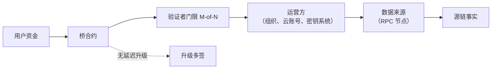

# B69 ZK 与跨链实现风险：约束、绑定与门限

> 学习目标：做完本章，你能——
> 1. 在 ZK 实验里构造能通过验证的恶意见证，并说清约束不足和公开输入越界的后果。
> 2. 用 `cast` 演示桥消息缺少链 ID、Merkle 哈希域不分离的后果，并按运营方数清验证者门限。
> 3. 为一座示例桥写出评审笔记和检查清单。
>
> 前置章节：[B68 密码学实现风险：签名 nonce 与随机数种子](B68-crypto-zk-bridge-practice.md)（评审笔记里的签名库一行用到它的结论）。
> 前置知识：完成阶段 0–1（[阶段 1 导读](B07-stage1-guide.md)），建议先完成链下赛道 L1（[L1 导读](B56-offchain-l1-guide.md)）；会运行 `cast` 和 `python3`；知道哈希和签名是什么（[B03](B03-blockchain-basics.md)）。
> 预计用时：约 2 小时。
> 交互实验：[ZK 约束不足实验](../interactive/zk-constraint-lab.html) ｜ [Merkle 证明与验证者门限](../interactive/audit-merkle.html) ｜ [链迁移风险检查器](../interactive/chain-porting-lab.html)
> 关联章节：[14 ZK 与证明系统](../14-zk-proof-systems.md)｜[12 跨链桥安全](../12-cross-chain-bridges.md)｜[T02 威胁建模模板](../templates/T02-threat-model.md)｜[B32 第 5 次审计：EchoBridge](B32-audit-5-echobridge.md)｜[B68 密码学实现风险：签名 nonce 与随机数种子](B68-crypto-zk-bridge-practice.md)
> 最后核对：2026-11-10（cast 1.5.1、Python 3.12、node 26、openssl 3.0.13 均在本机运行过；下文输出来自真实运行）

> ⚠️ 警告：法律与道德边界。本章的私钥都由 `cast wallet new` 在本机临时生成，只用于练习。本章的脚本只演示原理，不要拿它去扫描任何真实地址或真实签名。玩具签名代码不安全，不要用它保护任何资产。

---

## 开场：证明都能通过

一个团队请你看三样东西：自研的签名服务、一个 ZK 提款电路、一座 5 个验证者的桥。签名服务在 [B68](B68-crypto-zk-bridge-practice.md) 里已经拆开。本篇看剩下两样。团队说："单元测试全过，签名都能验证，证明都能通过。"

> 🎯 打个比方：密码学算法是一把好锁。实现是装锁的工人。锁本身没人能撬开，但工人可能把同一把钥匙模具用了两次，可能在门框上少钉一颗钉子，也可能让门卫只看印章、不看盖章的人是谁。
>
> 比喻的局限：门框少钉子，路人看得出来。实现缺陷从外面看不出，签名、证明、消息在格式上全部正确。只有针对性的测试才能发现它们。

## 1. 本章练什么

| 第几步 | 你做什么 | 原理在哪里 | 检查项 |
|---|---|---|---|
| 1 | ZK 约束不足 | [14 章 3.1 节](../14-zk-proof-systems.md) | ZKP-1 |
| 2 | 公开输入越界与绑定 | [14 章 3.3、5.4 节](../14-zk-proof-systems.md) | ZKP-4、ZKP-5 |
| 3 | 桥消息字段 | [12 章 2 节](../12-cross-chain-bridges.md) | BRG-1、BRG-2 |
| 4 | Merkle 哈希域与零值根 | [12 章 3.1 节](../12-cross-chain-bridges.md) | BRG-4、BRG-5 |
| 5 | 验证者门限的独立性 | [12 章 4.1、4.6 节](../12-cross-chain-bridges.md) | BRG-8 |

> 💡 注意：检查项编号沿用主线章节，含义不变：ZKP 来自 14 章，BRG 来自 12 章。

## 2. 第 1 步：ZK 约束不足（ZKP-1）

打开 [ZK 约束不足实验](../interactive/zk-constraint-lab.html)。电路的域是模 97，余额是 20。

1. 点"诚实提款"，确认全部约束通过。
2. 点"尝试超额提款"，取消勾选 B4，再点"让恶意证明者求解"。
3. 记录见证。预期是 `a = 25`、`r = 92`、`b = [0, 0, 0, 0, 30]`。验证通过，页面显示"业务含义：错误"和"伪造成功"。
4. 自己核对这组数：

```bash
python3 -I -c "print(16*30 % 97, (20-25) % 97)"   # 位分解的和，以及 20 − 25 在域内的值
```

```text
92 92
```

两者都是 92，所以位分解约束成立。但 b4 = 30 不是一个二进制位。

5. 看"逐条移除的结果"表。除了 R，删掉任意一条约束，a = 25 都能通过。每一行"可超额的 a 个数"都是 11，"不移除"一行是 0。
6. 点"恢复全部约束"，勾选 O，再点"诚实提款（余额大）"。合法提款失败。这是过度约束：不丢钱，但用户的钱可能被锁住。

> 💡 注意：真实电路里，这类问题对应 Circom 的 `<--` 只赋值不约束。Tornado Cash 2019 年的 MiMC 问题就属于这一类，见 [14 章 5.2 节](../14-zk-proof-systems.md)。

## 3. 第 2 步：公开输入越界与绑定（ZKP-4、ZKP-5）

1. 在实验里点"恢复全部约束"，取消勾选 R，把 a 改成 96，点"让恶意证明者求解"。预期 `r = 21`。在模 97 下，96 等于 −1。提款 −1，余额变成 21。
2. 在 BN254 标量域上做同样的事。验证器不检查输入是否小于 r，合约又按整数记录"已用的 nullifier"：

```bash
python3 -I -c "
r = 21888242871839275222246405745257275088548364400416034343698204186575808495617  # BN254 标量域的阶
x = 12345                                  # 某个 nullifier（示例）
used = set()                               # 合约按整数记录已用的 nullifier
for submitted in [x, x + r]:
    same_in_field = submitted % r == x     # 证明系统眼中：两者相等
    fresh = submitted not in used          # 合约眼中：是否没用过
    print(hex(submitted)[:18]+'…', '域内等于 x:', same_in_field, '合约认为没用过:', fresh)
    used.add(submitted)
print('x + r < 2**256:', x + r < 2**256)
"
```

```text
0x3039… 域内等于 x: True 合约认为没用过: True
0x30644e72e131a029… 域内等于 x: True 合约认为没用过: True
x + r < 2**256: True
```

同一个 nullifier 被用了两次。`x + r` 仍能放进 `uint256`，所以合约不会自然拒绝它。修复：验证器拒绝所有不小于 r 的公开输入（ZKP-4）。

3. 绑定问题（ZKP-5）。Aztec Connect（2026 年 6 月）的证明全部有效，但结算只处理到攻击者控制的 `numRealTxs`（[14 章 5.4 节](../14-zk-proof-systems.md)）。评审时，把业务合约读取的每个字段列成表，逐个标注"被证明覆盖 / 未覆盖"。

## 4. 第 3 步：桥消息必须绑定什么（BRG-1、BRG-2）

同一条"给 TO 转 100，nonce 7"的消息，比较三种哈希：

```bash
TO=0x90F79bf6EB2c4f870365E785982E1f101E93b906; BRIDGE=0x8464135c8F25Da09e49BC8782676a84730C318bC
cast keccak $(cast abi-encode "m(address,uint256,uint256)" $TO 100 7)
cast keccak $(cast abi-encode "m(uint256,uint256,address,address,uint256,uint256)" 56 1 $BRIDGE $TO 100 7)
cast keccak $(cast abi-encode "m(uint256,uint256,address,address,uint256,uint256)" 56 5000 $BRIDGE $TO 100 7)
```

```text
0x50a01d39d9245d0e1ed77e6a2bcefe4c270376aacdfee802dbc8323ad91978fe
0xc7159e4b585cc1031985ee2b9db64a90e5e01854f833398b5a673e0a15ac2cb4
0xc1f6e3e6081fbb990a3be6ee09f20fa74028fe6397a3c16e681052e97f2c603a
```

第一行没有链 ID 和合约地址。部署在两条目标链上的同一个桥，会接受同一份签名，消息可以跨链重放。后两行加入了源链 56、目标链（1 或 5000）和桥合约，哈希不同，签名不能互用。nonce 只防"同一链上重复提交"，还需要已处理标记（BRG-2）。

> 🧪 动手验证：打开[链迁移风险检查器](../interactive/chain-porting-lab.html)，点"清空"，只勾选"写死链 ID，或链下签名工具写死链 ID"。目标链选 BNB Chain，记录严重度（预期"中"）；换成 TRON，记录严重度（预期"高"）和原因。

## 5. 第 4 步：Merkle 哈希域与零值根（BRG-4、BRG-5）

<details class="predict"><summary>🤔 先猜再看：叶子哈希和中间节点哈希都用 keccak256(数据)。攻击者能不能提交一个"叶子"，让它的哈希等于某个中间节点？</summary>

能。把两个子节点哈希拼成 64 字节，当作叶子内容提交。它的哈希就等于中间节点。下面的命令会证明。

</details>

```bash
LA=$(cast keccak "transfer 100 to Bob"); LB=$(cast keccak "transfer 5 to Carol")
NODE=$(cast keccak $(cast concat-hex $LA $LB)); echo "node  $NODE"
FAKE=$(cast concat-hex $LA $LB); echo "伪造叶子哈希 $(cast keccak $FAKE)"
echo "leaf(00||fake) $(cast keccak $(cast concat-hex 0x00 $FAKE))"
echo "node(01||A||B) $(cast keccak $(cast concat-hex 0x01 $LA $LB))"
```

```text
node  0x2c0e891df55ea3f0109332d63bdf0d6a60ebc5f345986285da21d097d77dbf64
伪造叶子哈希 0x2c0e891df55ea3f0109332d63bdf0d6a60ebc5f345986285da21d097d77dbf64
leaf(00||fake) 0xf3daa466635e7ee359c8a49ed96f2ac6072569972b23adb939896b7caa04f49c
node(01||A||B) 0xd177adde16572bb4baec4e2b0d29316a52efea5f8f0c227f9337145b4f48a70c
```

前两行相同：没有域分离时，伪造叶子与中间节点无法区分。叶子加前缀 `0x00`、节点加前缀 `0x01` 后，两者不再相同。

> 🧪 动手验证：打开 [Merkle 证明与验证者门限](../interactive/audit-merkle.html)。① 把"提交的叶子内容"改掉一个字，记录"验证失败"的提示。② 看"可信根"输入框，默认值是全零，记录 lint 的结论。Nomad（2022 年 8 月）就是把可信根设成了 `0x00`，见 [12 章 4.4 节](../12-cross-chain-bridges.md)。

## 6. 第 5 步：数清验证者门限的独立性（BRG-8）

门限写着 M-of-N，真正的防线数是"要攻破几个独立组织"。



读图要点：桥合约相信验证者，验证者相信运营方的系统，运营方的系统相信 RPC 数据。任何一层只有一个独立来源，整座桥就只有一道防线。升级多签是一条旁路，能绕过整条链。局限：图里没有画监控和限额，它们只能减少损失，不能阻止伪造。

1. 在 [Merkle 证明与验证者门限](../interactive/audit-merkle.html) 下半部分，保持 N = 7、M = 5、独立运营商 = 4。记录"攻破几个运营商"（预期 3）。
2. 把独立运营商改成 2。记录结果（预期 2）。
3. 实验假设节点平均分布。手算两个真实结构（数字来自 [12 章](../12-cross-chain-bridges.md)）：

| 结构 | 门限 | 分布 | 最少要攻破几个组织 |
|---|---|---|---|
| Ronin（2022 年 3 月） | 5/9 | Sky Mavis 4 个 + Axie DAO 授权路径 1 个 | 2 |
| KelpDAO 路径（2026 年 4 月） | 1 个 DVN | DVN 依赖的 RPC 节点被控制 | 1 |

> 💡 注意：KelpDAO 事件中，桥合约代码没有错。来源：[LayerZero 声明](https://layerzero.network/blog/kelpdao-incident-statement)、[Chainalysis](https://www.chainalysis.com/blog/kelpdao-bridge-exploit-april-2026/)。责任归属有争议，见 [12 章 4.6 节](../12-cross-chain-bridges.md)。

## 7. 交付物：MiniBridge 评审笔记

[T02](../templates/T02-threat-model.md) 附录的 MiniBridge 是 5 个守护者、3 个签名放行。假设你发现 5 个守护者中有 3 个在同一个云账号下。按下面的格式写一页笔记：

```markdown
# MiniBridge 评审笔记（练习）
- 范围：链 B 铸造合约的消息验证、守护者门限、证明代码
- 消息哈希字段：源链 / 源合约 / 目标链 / 目标合约 / nonce —— 缺哪个：……（BRG-1）
- 已处理消息标记：有 / 无（BRG-2）
- Merkle 或签名验证：叶子与节点前缀；零值根被拒绝（BRG-4、BRG-5）
- 门限独立性：名义 3/5；按云账号计，攻破 1 个账号即达门限（BRG-8）
- 守护者签名库：RFC 6979 / 已知答案测试 / 重复 r 监控（CRY-2、CRY-3）
- 结论：最高风险是……；建议：……
```

## 8. 检查清单

为 MiniBridge 填写状态（通过 / 不通过 / 不适用）和证据。

| 检查项 | 内容（原文见主线章节） | 状态 | 证据 |
|---|---|---|---|
| **ZKP-1** | 每个信号都有约束 | | 第 1 步恶意见证 |
| **ZKP-4** | 公开输入都小于标量域的阶 | | 第 2 步 x 与 x + r |
| **ZKP-5** | 业务合约使用全部公开输入；数量和长度被证明覆盖 | | 第 2 步字段表 |
| **BRG-1** | 消息哈希含源链、源合约、目标链、目标合约、nonce | | 第 3 步三个哈希 |
| **BRG-4** | 零值根不被当作有效证明 | | 第 4 步 lint |
| **BRG-5** | 叶子与中间节点哈希域分离 | | 第 4 步四行输出 |
| **BRG-8** | 签名人清单、门限、私钥存放已披露 | | 第 5 步独立性表 |

> 🪞 反思：你用过或写过的系统里，哪一处"证明能通过、测试全过"，但你没有检查约束是否完整、签名人是否独立？如果明天要证明它安全，你会先写哪一个测试？

## 9. 如果出错

| 现象 | 原因 | 处理 |
|---|---|---|
| `cast concat-hex` 报错 | 参数缺少 `0x` 前缀 | 用 `cast keccak` 的原样输出 |
| 实验页的数字和本章不同 | 改过其他约束或滑块 | 先点"恢复全部约束"，或刷新页面 |

## 10. 过关标准

- [ ] 在 ZK 实验里复现 `b4 = 30` 和 `a = 96 → r = 21` 两组恶意见证。
- [ ] 用 `cast` 得到三个不同的消息哈希，并说明第一个为什么可以跨链重放。
- [ ] 写完 MiniBridge 评审笔记，检查清单 7 项都有状态和证据。

## 11. 思考题

1. ZK 验证器补上了公开输入的域检查，但业务合约仍从 calldata 读取一个"批次长度"字段。这个字段没有进入公开输入。还有什么风险？
2. 一座桥有 7 个验证者、门限 5，它们分属 7 家公司，但都从同一家 RPC 服务商读取源链数据。按第 5 步的方法，它的实际防线有几道？

- 下一章：[B70 术语表与资源索引](B70-glossary-resources.md)。也可以回到 [B00 训练营路线](B00-roadmap.md)，选下一条路线。
