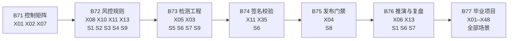

# B70 链下赛道 L3 导读：运筹帷幄——架构与运营

> 学习目标：读完本篇，你能——
> 1. 说出链下赛道 L3 要掌握的 8 个主题，以及每个主题怎样算掌握。
> 2. 一键生成 MiniEx 靶场，按顺序安排 B71–B77，并知道每章配合哪几章手册 X 章读。
> 3. 用过关标准判断自己是否完成 L3，以及最终要交付什么。
>
> 前置：完成链下赛道 L1（[L1 导读](B56-offchain-l1-guide.md)）与 L2（[L2 导读](B61-offchain-l2-guide.md)）。读过 [X01 安全体系怎么搭](../arch/X01-security-program-controls.md) 与 [X07 交易所安全架构总览](../arch/X07-cex-architecture-overview.md) 更好，也可以边学边读。会运行 `python3` 和写简单 SQL；不需要 Foundry，不需要联网。
> 预计用时：B71–B76 约 15.5–20.5 小时，B77 另计（见第 5 节）；周计划示例见 [B00 第 4 节](B00-roadmap.md)。
> 关联章节：[X01](../arch/X01-security-program-controls.md)｜[X07](../arch/X07-cex-architecture-overview.md)｜[MiniEx 靶场说明](../../practice-example-code/ops/README.md)｜[靶场 API](../../practice-example-code/ops/API.md)
> 最后核对：2026-11-23（第 3 节的命令与场景表取自靶场 README 与 B71–B76 已运行的输出）

> ⚠️ 警告：法律与道德边界。MiniEx 是虚构的交易所，所有数据由脚本合成，不含真实用户、真实地址或真实密钥。数据里的"攻击"只是日志与账务上的痕迹，没有针对真实系统的步骤。本赛道的规则、阈值和清单不要原样搬进真实环境：先用你自己的数据回放，并取得你所在组织的授权。

---

## 开场：从"懂攻击"到"建体系并持续运营"

L1 教你守住个人与终端，L2 教你加固一条条具体的链路：前端、RPC、热钱包、追踪、密码学实现。做完这两段，你已经知道很多攻击怎么发生。

但一家机构的安全不是一串单点修补。有人问"我们到底有多少资产要保护""哪些控制写在文档里、哪些真的在运行""这条告警规则上线后每天会响多少次""下次事故我们几分钟发现、几分钟止血"，靠"懂攻击"回答不了。这些问题要靠**体系**：资产清单、威胁模型、控制矩阵、规则与检测、独立校验、发布门禁、推演与复盘，并且持续运营。

L3 要解决的就是这件事。它把手册的 [X01–X48](../arch/X01-security-program-controls.md) 里的方法，变成你能在笔记本上亲手跑通的练习：每一步都用同一个虚构交易所 MiniEx 的合成数据，产出可以量化的结果（召回、误报、覆盖率、MTTD），最后交付一份带 90 天路线图的安全架构评估。

## 1. 本阶段学完能做什么

- 为一家机构从日志与表里"勘察"出资产清单，画信任边界，写威胁模型，填控制矩阵，并算出各保护域的覆盖率与缺口排序。
- 为账户接管、API Key 滥用、洗钱漏斗、对敲和标记价偏离写规则，用回放读出召回与误报，并把误报很多的朴素规则调到能上线。
- 为内部人批量读取、签名服务异常、开发终端失陷写检测规则，把多份日志串成一条关联链，并用时间戳算出 MTTD 与分诊工作量。
- 写一个签名策略引擎，对每条签名请求独立对照审批单、提币单和链上转账，拒绝异常请求；模拟冷 → 温 → 热调拨审批。
- 审一份发布流水线，写 linter，用 CI 事件日志找出供应链事件，并写一份带证据栏的发布清单。
- 把多源日志合并成事故时间线，主持一次 30 分钟桌面推演，写一份无责复盘。
- 为 MiniEx 交付一份安全架构评估与 90 天路线图。

## 2. 要掌握的主题

| 主题 | 在哪学 | 掌握标准 |
|---|---|---|
| 资产清单、威胁模型与控制矩阵 | [B71](B71-control-matrix-practice.md)、[X01](../arch/X01-security-program-controls.md)、[X02](../arch/X02-standards-compliance-map.md)、[X07](../arch/X07-cex-architecture-overview.md) | `assets.csv` 至少 14 项并有证据编号；找出全部 3 条员工权限治理发现 G1–G3；10 个保护域各至少 1 行；合计覆盖率 31.1%，缺口排名第 1 的域是"内部人与权限"。 |
| 账户接管与 API Key 滥用的风控规则 | [B72](B72-withdrawal-risk-rules-practice.md)（S1、S2）、[X08](../arch/X08-cex-identity-account-access.md)、[X13](../arch/X13-cex-fraud-compliance-secops.md) | S1 三条规则合起来召回 3/3 且无答案漏报；S2 两条规则都召回 2/2、误报 0；朴素版"任何调用来自新 IP"误报 > 30，你能说出原因。 |
| 洗钱漏斗、对敲与标记价规则的调参 | [B72](B72-withdrawal-risk-rules-practice.md)（S3、S4、S9）、[X10](../arch/X10-cex-trading-settlement-credit.md)、[X11](../arch/X11-cex-wallet-treasury-payment.md) | S3 调阈值后召回 3/3、误报 0，并指出 10,000 与 9,000 之间的悬崖；8 条规则的互补矩阵覆盖全部 11 个答案、误报 0；每条规则写出一个盲区。 |
| 检测工程：假设、回放与关联 | [B73](B73-detection-engineering-practice.md)（S5、S6、S7、S9）、[X05](../arch/X05-detection-response-engineering.md)、[X03](../arch/X03-production-infra-security.md) | S5 规则召回 2/2、误报 ≤ 2；S7 关联规则把三份日志串成一条链；你量出朴素规则的告警量与噪声类型，并起草 P1–P4 分级。 |
| 签名服务独立校验与调拨审批 | [B74](B74-signing-policy-practice.md)（S6）、[X11](../arch/X11-cex-wallet-treasury-payment.md)、[X35](../arch/X35-custodian-security.md) | `policy.py` 输出共 1302 条、放行 1293、拒绝 6、升级人工 3，漏掉的 S6 为"无"，误拒为"无"；说出 3 种绕过各被哪条规则拦下。 |
| 发布门禁与软件供应链 | [B75](B75-release-gate-practice.md)（S8）、[X04](../arch/X04-delivery-supply-chain.md) | `release.yml` 的 9 处缺陷找出至少 7 处；linter 报 9 条发现，对 `ci.yml` 报 0 条；`replay.py` 对 S8 召回 3/3、误报 0；发布清单用无签名制品测出变 ❌ 的行。 |
| 桌面推演与事故复盘 | [B76](B76-tabletop-postmortem-practice.md)（S1、S6、S7）、[X06](../arch/X06-resilience-validation.md)、[X13](../arch/X13-cex-fraud-compliance-secops.md) | 8 份时间线 `check_timeline.py` 都是"覆盖 n/n"；缺口表每个场景至少 3 行并有控制 ID；S1-01 的 MTTD 是 48.1 分钟；完成一份含行动项的无责复盘。 |
| 安全架构评估与 90 天路线图 | [B77](B77-security-architecture-capstone.md)、[X01–X48](../arch/X01-security-program-controls.md)、[T12](../templates/T12-security-architecture-review.md) | 评估与路线图按 B77 的过关标准交付，并引用 B71–B76 的证据（第 7 节）。 |

> 💡 注意：S9 不是单独一章，而是每个场景周围的 103 个"看起来可疑但正常"的事件。它让你在 B72、B73 里练调参：召回和误报要一起看。

## 3. MiniEx 靶场：一键生成

MiniEx 是一个虚构的小型交易所，贯穿 B71–B77。先在 `web3-security-handbook/` 根目录运行：

```bash
bash practice-example-code/ops/setup.sh              # 生成数据 + 装载 SQLite + 跑自检 + 回放参考规则
bash practice-example-code/ops/setup.sh --no-tests   # 只生成与装载
```

- **数据全部合成。** 由 `gen/generate.py` 按固定种子 20260301 生成；IP 只用保留段，链上地址是哈希出来的随机十六进制串，云密钥以 `AKSIM` 开头。不含任何真实用户、地址或密钥。
- **只用 Python 3（≥ 3.9）标准库。** 不装第三方包，不联网。生成约 2 秒，`data/` 约 66 MB，自检约 9 秒。
- **可重复。** 同一种子两次生成的所有文件逐字节一致；`data/` 可以随时删掉重新生成。
- **答案在 `practice-example-code/ops/answers/`。** 做完练习再看。各章会告诉你何时对照。
- **时间基准。** 2026-03-01 00:00 UTC（周日）起 14 天，时间戳均为 UTC。

生成后，用下面两条命令确认环境可用：

```bash
python3 practice-example-code/ops/lib/logread.py --tables                  # 所有表与行数
python3 -m unittest discover -s practice-example-code/ops/tests -v         # 靶场自检
```

靶场里的 9 个注入场景：

| 场景 | 内容 | 对应练习章 |
|---|---|---|
| S1 | 账户接管：撞库成功 → 改绑 / 找回 → 新地址大额提币 | B72、B76 |
| S2 | API Key 滥用：新开提币权限的 Key 从新 IP 调用 | B72 |
| S3 | 洗钱漏斗：小额入账汇聚后快速提走 | B72 |
| S4 | 对敲刷量与标记价偏离 | B72 |
| S5 | 客服非工作时间批量查看 / 导出 KYC | B73 |
| S6 | 签名服务异常：缺审批单、地址 / 金额与审批单不一致 | B73、B74、B76 |
| S7 | 开发终端失陷痕迹：外联工具 → 云凭证外部使用 → 签名命名空间 | B73、B76 |
| S8 | 供应链：被篡改依赖、未固定 Action、未签名发布 | B75 |
| S9 | 误报与噪声：103 个"看起来可疑但正常"的事件 | 全部（调参） |

> 💡 注意：命令都从 `web3-security-handbook/` 根目录出发。工具用法与数据字典见 [靶场 API](../../practice-example-code/ops/API.md)。

## 4. 章节顺序

1. [B71 控制矩阵实战](B71-control-matrix-practice.md)：先搞清"有什么、丢了会怎样、现在控制到哪一步"，得到覆盖率与缺口排序。约 2–2.5 小时。
2. [B72 提币与账户风控规则实战](B72-withdrawal-risk-rules-practice.md)：把矩阵里账户与提币的缺口，变成可回放的规则，练调参。约 2.5–3 小时。
3. [B73 检测工程实战](B73-detection-engineering-practice.md)：从业务风控扩展到内部人、签名服务和开发终端，学关联规则与 MTTD。约 3–4 小时。
4. [B74 签名服务独立校验与调拨审批实战](B74-signing-policy-practice.md)：检测之外，在签名前设一道独立的拒绝点。约 2–3 小时。
5. [B75 发布门禁实战](B75-release-gate-practice.md)：把关口前移到发布流水线和供应链。约 3–4 小时。
6. [B76 桌面推演与事故复盘实战](B76-tabletop-postmortem-practice.md)：前面的控制都可能失效，练习事故发生后怎么还原、推演和复盘。约 3–4 小时。
7. [B77 毕业项目：安全架构评估与 90 天路线图](B77-security-architecture-capstone.md)：把 B71–B76 的证据合成一份交付物。用时见第 5 节。

## 5. 时间安排

| 章 | 预计用时 | 靶场场景 | 配套 X 章 |
|---|---|---|---|
| B71 | 2–2.5 小时 | — | X01、X02、X07 |
| B72 | 2.5–3 小时 | S1 S2 S3 S4 S9 | X08、X10、X11、X13 |
| B73 | 3–4 小时 | S5 S6 S7 S9 | X05、X03 |
| B74 | 2–3 小时 | S6 | X11、X35 |
| B75 | 3–4 小时 | S8 | X04 |
| B76 | 3–4 小时 | S1 S6 S7 | X06、X13 |
| B77 | 约 3–4 小时（预估；以章内为准） | 全部 | X01–X48 |

B71–B76 合计约 15.5–20.5 小时，按每周 6–8 小时，约 3 周完成练习，再加 B77。



## 6. 手册 X 章怎么和练习配合读

X 章讲"为什么这样设计"，练习章让你在数据上验证。建议先读 X 章里列出的节，再做练习；也可以先做练习，遇到不明白的概念再回头读。

| 读哪章 | 再做哪个练习 | 读完应该能回答 |
|---|---|---|
| [X01 安全体系怎么搭](../arch/X01-security-program-controls.md)、[X07 交易所安全架构总览](../arch/X07-cex-architecture-overview.md) | [B71](B71-control-matrix-practice.md) | 资产怎么分级？一条控制要有什么证据才算"已实施"？ |
| [X02 标准与合规映射](../arch/X02-standards-compliance-map.md) | [B71](B71-control-matrix-practice.md)、[T08](../templates/T08-control-matrix-risk-register.md) | 控制矩阵怎样映射到外部标准？ |
| [X08 客户身份、账户与访问](../arch/X08-cex-identity-account-access.md) | [B72](B72-withdrawal-risk-rules-practice.md) 第 1–4 步 | 撞库、找回、API Key 的风险信号各是什么？ |
| [X10 交易、结算与信用](../arch/X10-cex-trading-settlement-credit.md)、[X13 欺诈、合规与安全运营](../arch/X13-cex-fraud-compliance-secops.md) | [B72](B72-withdrawal-risk-rules-practice.md) 第 5–7 步 | 洗钱漏斗、对敲、标记价偏离怎样用规则看见？ |
| [X05 检测与响应工程](../arch/X05-detection-response-engineering.md)、[X03 生产基础设施安全](../arch/X03-production-infra-security.md) | [B73](B73-detection-engineering-practice.md)、[T09](../templates/T09-incident-runbook-oncall.md) | 一条检测规则怎样从假设走到上线？分级和升级路径怎么定？ |
| [X11 钱包、财资与支付渠道](../arch/X11-cex-wallet-treasury-payment.md)、[X35 托管机构安全](../arch/X35-custodian-security.md) | [B74](B74-signing-policy-practice.md) | 签名服务为什么不能只信上游？调拨审批要绑定哪些字段？ |
| [X04 软件交付与供应链安全](../arch/X04-delivery-supply-chain.md) | [B75](B75-release-gate-practice.md)、[T04](../templates/T04-go-live-gate.md) | 发布门禁查哪些条件？每条条件的证据是什么？ |
| [X06 韧性与验证](../arch/X06-resilience-validation.md) | [B76](B76-tabletop-postmortem-practice.md)、[T10](../templates/T10-tabletop-script-scorecard.md) | 桌面推演怎么设计和打分？无责复盘怎么写？ |
| 全部相关 X 章 | [B77](B77-security-architecture-capstone.md)、[T12](../templates/T12-security-architecture-review.md) | 怎样把证据合成评估与路线图？ |

> 💡 注意：B77 评估覆盖全部保护域。动手前，把 [X01](../arch/X01-security-program-controls.md) 的优先级与路线图部分再读一遍。

## 7. 本阶段交互实验与模板

- [控制矩阵覆盖率](../interactive/control-matrix-lab.html)（B71）
- [风控规则调参](../interactive/risk-rule-tuning-lab.html)（B72）
- [签名请求独立校验](../interactive/signing-policy-lab.html)（B74）
- 模板：[T08 控制矩阵与风险登记表](../templates/T08-control-matrix-risk-register.md)、[T09 事故 runbook 与值班](../templates/T09-incident-runbook-oncall.md)、[T10 推演剧本与复盘模板](../templates/T10-tabletop-script-scorecard.md)、[T11 供应商与托管方评估](../templates/T11-vendor-custodian-assessment.md)、[T12 安全架构评审](../templates/T12-security-architecture-review.md)

## 8. 过关标准

L3 以"交付物 + 各章数字"判断，不靠记忆。

- [ ] **毕业交付物：** B77 的 MiniEx 安全架构评估与 90 天路线图，满足 [B77 的过关标准](B77-security-architecture-capstone.md)。
- [ ] **B71：** 资产清单至少 14 项；G1–G3 全部找到；控制矩阵覆盖率 31.1%，缺口第 1 为"内部人与权限"，未完全实施的 P0 控制共 15 条。
- [ ] **B72：** S1–S4 的规则都能召回对应答案，8 条规则的互补矩阵覆盖全部 11 个答案、误报 0，每条规则写出盲区。
- [ ] **B73：** S5 召回 2/2、误报 ≤ 2；S6、S7 的检测规则与关联规则按章内标准回放通过；写出 P1–P4 分级草案。
- [ ] **B74：** `policy.py` 共 1302 条、放行 1293、拒绝 6、升级人工 3；漏掉的 S6 与误拒的正常请求都为"无"。
- [ ] **B75：** linter 对 `release.yml` 报 9 条发现；`replay.py` 对 S8 召回 3/3、误报 0；发布清单至少 10 行必须项。
- [ ] **B76：** 8 份时间线全部"覆盖 n/n"；完成一次 30 分钟推演与一份无责复盘；S1-01 的 MTTD 为 48.1 分钟。
- [ ] 对你所在的组织（或一个示例组织），用 [T12](../templates/T12-security-architecture-review.md) 做一次架构评审，并把缺口写进 [T08](../templates/T08-control-matrix-risk-register.md)。

> 💡 注意：B71–B76 的过关标准里还有更细的条目（例如每条规则的盲区、检查清单的覆盖）。完整条目以各章"过关标准"一节为准；这里只摘要。

## 9. 学习建议

- **先跑通环境，再读章。** 第 3 节两条命令都通过，再进 B71。
- **回放比直觉可靠。** 每条规则都先写，再回放，再看召回与误报。不要凭感觉判断"这条规则应该够了"。
- **只看数字，不比写法。** 命中条数会因写法不同而变。过关看召回和误报，不看条数。
- **做完再看 `answers/`。** 先自己给结论，再对照。差异比对得越细，学到的越多。
- **每章留一份证据。** 资产清单、规则文件、策略引擎输出、linter 报告、时间线、复盘，都是 B77 的素材。边做边存，别到毕业项目时再找。
- **把 X 章当参考，不必一次读完。** 每章"前置知识"已写明该读哪几节。

## 10. 常见问题

**运行命令提示找不到文件？** 确认当前目录是 `web3-security-handbook/` 根目录。靶场命令里的路径都以 `practice-example-code/ops/` 开头。

**提示 `python3: command not found`，或语法报错？** 靶场需要 Python 3（≥ 3.9），只用标准库。先运行 `python3 --version` 确认版本。各章在 macOS 上用系统 `python3` 跑通。

**数据缺失，或不小心改坏了？** `data/` 不进仓库，可以随时重新生成：再运行一次 `bash practice-example-code/ops/setup.sh`。同一种子的结果逐字节一致。

**我的数字和章里不一样？** 章里的数值按默认种子 20260301 得出。如果你用了 `setup.sh --seed N`，答案文件和数值都会变；改回默认种子重新生成即可。

**自检失败？** 先重新生成数据再跑一次自检。仍失败，把 `python3 -m unittest discover -s practice-example-code/ops/tests -v` 的输出对照 [靶场 API](../../practice-example-code/ops/API.md) 查看。

**没有 Foundry，能做吗？** 能。L3 不需要 Foundry，也不需要云账号、链节点或付费服务。

## 11. 下一步

从 [B71 控制矩阵实战](B71-control-matrix-practice.md) 开始。全部做完并交付 B77 后，回到 [B00 训练营路线](B00-roadmap.md)；术语和外部资源查 [B78 术语表与资源索引](B78-glossary-resources.md)。
