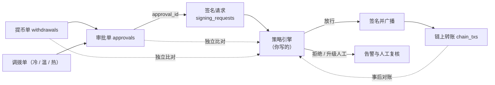
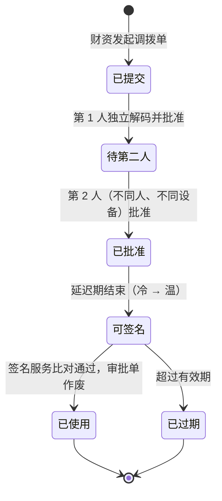

# B74 签名服务独立校验与调拨审批实战

> 学习目标：做完本章，你能——
> 1. 用 Python 写一个签名策略引擎：对每条签名请求，独立对照审批单、提币单和链上转账，输出放行 / 拒绝 / 升级人工。
> 2. 在 MiniEx 靶场数据上拒绝 S6 的 3 条异常请求，并且对正常请求零误拒。
> 3. 模拟"冷 → 温 → 热"调拨审批，演示审批单被重复使用、地址被换、金额一致但地址不同（S6-03）三种绕过，并说出哪条规则拦下了它们。
>
> 前置知识：完成链下赛道 L1 或 L2 中至少一篇练习；会用 Python 3（≥ 3.9，只用标准库）和 SQL 的 `SELECT ... JOIN`；读过 [B72](B72-withdrawal-risk-rules-practice.md) 和 [B73](B73-detection-engineering-practice.md) 更好（会用 `logread.py` 与 `replay.py`）。
> 预计用时：约 2–3 小时。
> 交互实验：[签名请求独立校验](../interactive/signing-policy-lab.html)
> 关联章节：[X11 钱包、财资与支付渠道](../arch/X11-cex-wallet-treasury-payment.md)｜[X35 托管机构安全](../arch/X35-custodian-security.md)｜[29 2026 签名路径专题](../29-signing-path-2026.md)｜[B64 热钱包水位、提现风控与多签复核](B64-custody-ops-ir-practice.md)｜[T12 安全架构评审](../templates/T12-security-architecture-review.md)
> 最后核对：2026-11-23（Python 3.12.3；下文命令在本机从 `web3-security-handbook/` 根目录逐条运行，输出来自真实运行）

> ⚠️ 警告：法律与道德边界。本章的数据全部由脚本合成，地址、金额、审批单都是虚构的，不对应任何真实系统。本章只写"检查规则"，不写任何绕过真实签名服务的步骤。不要把本章的参考实现直接接到真实的签名服务上。真实的策略引擎要经过你所在组织的变更评审和回放测试。

---

## 开场：三条都"看起来正常"的请求

2026-03-12 02:15（UTC），MiniEx 的签名服务收到一条调拨请求：温钱包向热钱包转 250,000 USDT。请求带着审批单 `AP-T0048`。审批单存在，两名财资人员批准，金额也是 250,000 USDT，一分不差。

签名服务签了。钱到了一个陌生地址。

审批单批准的目标是热钱包。请求里的目标是另一个地址。只检查"有没有审批单"和"金额超没超"的签名服务，看不出这个差别。这就是 S6-03。

本章要写的，是一个会逐字段比对的策略引擎。

## 1. 本章怎么练

原理不在这里重讲。签名服务的防御层见 [29 章 §4](../29-signing-path-2026.md)；调拨审批流程见 [X11 §6.2](../arch/X11-cex-wallet-treasury-payment.md)；托管机构的角色分离见 [X35](../arch/X35-custodian-security.md)。策略引擎（Policy Engine）：签名服务里决定"这笔请求该不该签"的一段代码。MPC 或多签只管谁持有密钥，不管该不该签（[X11 §3.2](../arch/X11-cex-wallet-treasury-payment.md)）。本章沿着一条签名请求的路径，做两件事。



读图要点：
- 实线是请求的正常路径。虚线是引擎的独立比对：引擎不信请求自己带的字段，只信审批单、提币单和链上结果。
- 引擎在签名前运行（拒绝或放行），链上结果用于事后对账，两者都要有。
- 局限：如果审批系统和签名服务被同一个攻击者控制，这个比对不再有意义。这时靠限额、熔断和三方对账兜底（[X11 §3.3](../arch/X11-cex-wallet-treasury-payment.md)）。

第 1 步先看数据。第 2 步写引擎，覆盖场景 S6。第 3 步模拟冷 → 温 → 热的调拨审批，演示三种绕过。

先在 `web3-security-handbook/` 根目录准备靶场（只依赖 Python 标准库）：

```bash
bash practice-example-code/ops/setup.sh | tail -1
mkdir -p my_b74
```

```text
靶场已就绪：数据在 practice-example-code/ops/data/，答案在 practice-example-code/ops/answers/（练习做完再看）
```

> 🧪 动手验证：打开[签名请求独立校验](../interactive/signing-policy-lab.html)。8 个场景，每题选"放行 / 拒绝 / 升级人工"并选理由，满分 24 分。记录你的总分，以及哪几题的差异你一开始没有看出来。

## 2. 第 1 步：认识三条异常请求

签名请求有 1302 条（`signing_requests`）。其中 3 条是 S6。先把这 3 条和它们的审批单放在一起看：

```bash
OPS=practice-example-code/ops
python3 $OPS/lib/logread.py --sql "SELECT s.request_id id, s.wallet_tier tier, s.asset, substr(s.to_address,1,10) req_to, s.amount, s.approval_id ap, substr(a.to_address,1,10) ap_to, a.amount ap_amt, a.approver_count n FROM signing_requests s LEFT JOIN approvals a USING(approval_id) WHERE s.request_id IN ('SR000538','SR000828','SR001044')"
```

```text
（3 行）
id        tier  asset  req_to      amount     ap          ap_to       ap_amt    n   
--------  ----  -----  ----------  ---------  ----------  ----------  --------  ----
SR000538  hot   ETH    0xd687f6ac  13.186267  None        None        None      None
SR000828  hot   USDT   0xbf491b67  60000.0    AP-W000829  0x7f45e368  150.0     1   
SR001044  warm  USDT   0x8dc7d972  250000.0   AP-T0048    0x5f55c81e  250000.0  2   
```

三行各有不同：

| 请求 | 与审批单的关系 | 只看"有没有审批单"能抓到吗 | 只看"金额超没超"能抓到吗 |
|---|---|---|---|
| SR000538（S6-01） | 没有审批单 | 能 | 不适用 |
| SR000828（S6-02） | 借用一张 150 USDT 的提币审批单；地址和金额都被换 | 不能 | 能（60,000 > 150） |
| SR001044（S6-03） | 审批单存在；金额一致；目标地址被换 | 不能 | 不能 |

<details class="predict"><summary>🤔 先猜再看：SR000828 借用的审批单 AP-W000829，在 1302 条请求里一共被几条请求引用？其中几条已签名？</summary>

用下面的查询数一数同一张审批单被引用的次数：

```bash
python3 $OPS/lib/logread.py --sql "SELECT approval_id, COUNT(*) n, SUM(signer_result='signed') signed FROM signing_requests WHERE approval_id IS NOT NULL GROUP BY 1 HAVING n>1"
```

```text
（4 行）
approval_id  n  signed
-----------  -  ------
AP-W000157   2  1     
AP-W000219   2  1     
AP-W000350   2  1     
AP-W000829   2  2     
```

4 张审批单被引用了 2 次。前 3 张是"网络超时后的重试"：第 2 次请求已被签名服务按幂等（Idempotency，同一请求重复提交只生效一次）拒绝，`signed` 只有 1。`AP-W000829` 两次都是 `signed`：第一次是正常的 150 USDT，第二次是被换掉内容的 60,000 USDT。同一张审批单签了两次，这就是"审批单已使用"这项检查要抓的。

</details>

> 💡 注意：S9 噪声里有 12 条 S6 的"长得像异常的正常请求"：4 条地址大小写不同（校验和写法）、3 条重试、2 条紧急调拨补签、3 条净额小于审批金额。引擎必须放行或升级它们，不能一概拒绝。

## 3. 第 2 步：写签名策略引擎

### 3.1 检查项

引擎对每条请求做 9 项检查。每项返回"拒绝"或"升级人工"的原因码，没有问题就返回空。

| # | 检查项 | 对照什么 | 不通过时 |
|---|---|---|---|
| 1 | 审批单存在 | `approvals` | 拒绝 |
| 2 | 目标地址一致（忽略大小写） | 审批单的 `to_address` | 拒绝 |
| 3 | 金额不超过审批金额 | 审批单的 `amount` | 拒绝 |
| 4 | 代币、链一致；提币单的地址与金额一致 | 审批单、`withdrawals` | 拒绝 |
| 5 | 有效期：审批在先，请求在窗口内 | 审批时间与请求时间 | 拒绝；补签的紧急调拨升级人工 |
| 6 | 审批单未使用 | 此前已放行的请求 | 拒绝 |
| 7 | calldata 摘要与审批单一致 | 用审批单字段重算 | 拒绝 |
| 8 | 双人控制 | `approved_by`、`staff` | 升级人工 |
| 9 | 请求来源配对；链上结果与审批单一致 | `source`、`chain_txs` | 拒绝 |

校验摘要的算法是靶场的约定：`calldata_hash` 是 `sha256("20260301:cd:链|代币|小写地址|金额")` 的前 16 位。真实系统里，这一项是对原始交易字节做哈希（[29 章 SIG-3](../29-signing-path-2026.md)）。

引擎的两个原则：
1. 对照审批单，不对照请求自己。请求里的 `amount_usd`、`calldata_hash` 都由请求方提供，攻击者可以让它们彼此一致。
2. 先收集全部原因，再决定。有任何"拒绝"就拒绝；没有"拒绝"但有"升级"就升级人工；否则放行。

### 3.2 骨架

创建 `my_b74/policy.py`。检查 1–3 已写好，检查 4–9 留给你。`--level N` 启用前 N 项检查，方便一项一项加：

```python
# my_b74/policy.py —— 签名策略引擎骨架（从 web3-security-handbook/ 根目录运行）
import argparse, hashlib, sys
from collections import Counter
from datetime import datetime, timezone

sys.path.insert(0, "practice-example-code/ops/lib")
import mini

# ---- 策略参数（示例）----
WINDOW_MIN = {"withdrawal": (0, 30), "warm_to_hot": (0, 120), "hot_to_warm": (0, 120), "cold_to_warm": (240, 72 * 60)}
HUMAN_USD = 20000          # 提币 >= 此金额，须 2 名真人审批
POST_HOC_GRACE_MIN = 15    # 紧急调拨允许补签的最长时间（分钟）


def ts_of(s):
    return datetime.strptime(s, "%Y-%m-%dT%H:%M:%SZ").replace(tzinfo=timezone.utc)


def digest(chain, asset, to, amount):
    """靶场约定的 calldata 摘要：sha256("20260301:cd:链|代币|小写地址|金额") 的前 16 位。"""
    return hashlib.sha256(("20260301:cd:%s|%s|%s|%s" % (chain, asset, to.lower(), amount)).encode()).hexdigest()[:16]


# 每个检查返回 [("reject" 或 "escalate", "原因码"), ...]；空列表 = 这一项通过
def c1_approval_exists(s, ap, ctx):
    if not s["approval_id"]:
        return [("reject", "NO_APPROVAL")]
    if ap is None:
        return [("reject", "APPROVAL_NOT_FOUND")]
    return []


def c2_address(s, ap, ctx):
    if ap and s["to_address"] != ap["to_address"]:          # 先故意不处理大小写
        return [("reject", "ADDRESS_MISMATCH")]
    return []


def c3_amount(s, ap, ctx):
    if ap and s["amount"] > ap["amount"] * 1.0001:
        return [("reject", "AMOUNT_EXCEEDS")]
    return []


def c4_asset_chain(s, ap, ctx):
    # TODO 代币要与审批单一致；提币审批单对应的 withdrawals 行（ap["subject_id"]）还要核对链、地址、金额
    return []


def c5_window(s, ap, ctx):
    # TODO 提币：请求晚于审批 0–30 分钟；温->热、热->温：0–120 分钟；冷->温：240 分钟–72 小时
    #      approved_post_hoc 且补签晚于请求不超过 15 分钟：升级人工；其余过早 / 过期：拒绝
    return []


def c6_approval_used(s, ap, ctx):
    # TODO ctx["used"] 记录已用审批单 {approval_id: calldata_hash}。再次出现：同摘要 = 重试，不同摘要 = 借用
    return []


def c7_digest(s, ap, ctx):
    # TODO 用审批单字段重算摘要（digest(s["chain"], ap["asset"], ap["to_address"], ap["amount"])），与请求里的 calldata_hash 比较
    return []


def c8_dual_control(s, ap, ctx):
    # TODO 调拨须 >= 2 名在职且持有 transfer_approve 的审批人；提币 >= HUMAN_USD 同样；不足：升级人工
    return []


def c9_source_and_chain_tx(s, ap, ctx):
    # TODO 来源与审批单类型要配对；已签名的请求，链上转账（ctx["txs"][request_id]）要对照审批单，提币出金还要有 wd_id
    return []


CHECKS = [c1_approval_exists, c2_address, c3_amount, c4_asset_chain, c5_window,
          c6_approval_used, c7_digest, c8_dual_control, c9_source_and_chain_tx]


def main():
    p = argparse.ArgumentParser()
    p.add_argument("--level", type=int, default=len(CHECKS), help="启用前 N 项检查")
    args = p.parse_args()
    db = mini.connect()
    ctx = {
        "approvals": {a["approval_id"]: a for a in mini.q(db, "SELECT * FROM approvals")},
        "wds": {w["wd_id"]: w for w in mini.q(db, "SELECT * FROM withdrawals")},
        "txs": {t["request_id"]: t for t in mini.q(db, "SELECT * FROM chain_txs WHERE request_id IS NOT NULL")},
        "staff_ok": {r["staff_id"] for r in mini.q(db, "SELECT staff_id FROM staff WHERE privilege='transfer_approve' AND employed='yes'")},
        "used": {},
    }
    results = []
    for s in mini.q(db, "SELECT * FROM signing_requests ORDER BY ts, request_id"):
        ap = ctx["approvals"].get(s["approval_id"])
        found = []
        for check in CHECKS[:args.level]:
            found += check(s, ap, ctx)
        rej = [r for k, r in found if k == "reject"]
        esc = [r for k, r in found if k == "escalate"]
        decision = "reject" if rej else ("escalate" if esc else "allow")
        if ap and s["signer_result"] == "signed":
            if decision == "allow":
                ctx["used"][ap["approval_id"]] = s["calldata_hash"]
            else:
                ctx["used"].setdefault(ap["approval_id"], s["calldata_hash"])
        results.append((s, decision, rej + esc))

    pos, _ = mini.load_answers()
    s6 = {p["match"]["request_id"][0] for p in pos if p["scenario"] == "S6"}
    cnt = Counter(d for _, d, _ in results)
    signed_rej = {s["request_id"] for s, d, _ in results if d == "reject" and s["signer_result"] == "signed"}
    retry_ok = all(d == "reject" for s, d, _ in results if s["signer_result"] == "rejected_duplicate")
    print("启用检查 %d 项。共 %d 条：放行 %d，拒绝 %d，升级人工 %d" % (args.level, len(results), cnt["allow"], cnt["reject"], cnt["escalate"]))
    print("漏掉的 S6：%s" % (sorted(s6 - signed_rej) or "无"))
    print("误拒的正常请求：%s" % (sorted(signed_rej - s6) or "无"))
    print("3 条重试请求全部拒绝：%s" % retry_ok)
    for s, d, why in results:
        if d == "escalate" or s["request_id"] in s6:
            print("  %s %-8s %s" % (s["request_id"], d, ",".join(why)))


main()
```

### 3.3 一项一项加，看每一项抓到什么

1. 只启用检查 1：

```bash
python3 my_b74/policy.py --level 1
```

```text
启用检查 1 项。共 1302 条：放行 1301，拒绝 1，升级人工 0
漏掉的 S6：['SR000828', 'SR001044']
误拒的正常请求：无
3 条重试请求全部拒绝：False
  SR000538 reject   NO_APPROVAL
  SR000828 allow    
  SR001044 allow    
```

只看"有没有审批单"，抓到 S6-01，漏掉另外 2 条。

2. 启用检查 1–2：

```bash
python3 my_b74/policy.py --level 2
```

```text
启用检查 2 项。共 1302 条：放行 1295，拒绝 7，升级人工 0
漏掉的 S6：无
误拒的正常请求：['SR000127', 'SR000235', 'SR000252', 'SR000634']
3 条重试请求全部拒绝：False
  SR000538 reject   NO_APPROVAL
  SR000828 reject   ADDRESS_MISMATCH
  SR001044 reject   ADDRESS_MISMATCH
```

S6 全部抓到，但误拒了 4 条正常请求。这 4 条就是 S9 里"地址大小写不同"的噪声：请求用校验和大小写，审批单用小写，地址相同。

<details class="predict"><summary>🤔 先猜再看：怎么改 `c2_address`，才能放过这 4 条又不放过 S6？</summary>

比较前把两边都转成小写：`s["to_address"].lower() != ap["to_address"].lower()`。这样只改了"书写方式"，没有放松"是不是同一个地址"。注意：大小写转换只适用于 EVM 地址。区分大小写的地址格式（例如 Solana 和 BTC 的 base58 地址）不能这样处理。靶场里所有地址都用 `0x` + 十六进制，所以这里可以。

</details>

3. 改完 `c2_address` 后，启用检查 1–3：

```bash
python3 my_b74/policy.py --level 3
```

```text
启用检查 3 项。共 1302 条：放行 1299，拒绝 3，升级人工 0
漏掉的 S6：无
误拒的正常请求：无
3 条重试请求全部拒绝：False
  SR000538 reject   NO_APPROVAL
  SR000828 reject   ADDRESS_MISMATCH,AMOUNT_EXCEEDS
  SR001044 reject   ADDRESS_MISMATCH
```

只用 3 项检查，已经做到 S6 零漏、零误拒。但"3 条重试请求全部拒绝"还是 `False`：重试请求带着一张已经用过的审批单，需要检查 6。另外，检查 3 的写法是 `请求金额 > 审批金额 × 1.0001`。它放过了 3 条"净额小于审批金额"的请求（请求 880，审批 900）。如果你写成"金额必须相等"，会误拒这 3 条。

> 💡 注意：只剩检查 1–3 的引擎，在这份数据上"够用"，在真实系统里不够。检查 4–9 里的每一项，都对应一种检查 1–3 看不见的绕过：换链、换代币、过期的审批单、被重复使用的审批单、没有第二个人的审批、绕过上游直接伪造请求。

### 3.4 补全检查 4–9

按下面的提示补全 `c4`–`c9`。不要先看参考实现。

| 检查 | 提示 |
|---|---|
| c4 | `ap["type"] == "withdrawal"` 时，`ap["subject_id"]` 是提币单号，在 `ctx["wds"]` 里取出提币单。比较 `chain`；比较地址（小写）和金额；代币与审批单比较。 |
| c5 | 间隔（分钟）= 请求时间 − 审批时间。提币用窗口 `withdrawal`；调拨按 `s["wallet_tier"]`（源钱包：`cold` / `warm` / `hot`）选 `cold_to_warm`、`warm_to_hot`、`hot_to_warm`。`ap["status"] == "approved_post_hoc"` 时，间隔在 −15 到 0 分钟之间：升级人工；其余：拒绝。其他审批单：间隔小于下限（冷 → 温是延迟期）或大于上限：拒绝。 |
| c6 | `ctx["used"]` 存着已用审批单的摘要。同一张审批单再次出现：摘要相同是重试（拒绝，原因 `RETRY_OF_USED`），摘要不同是借用（拒绝，原因 `APPROVAL_REUSED`）。 |
| c7 | `digest(s["chain"], ap["asset"], ap["to_address"], ap["amount"])` 必须等于请求的 `calldata_hash`。注意：要用审批单的字段重算，不能用请求自己的字段。 |
| c8 | `ap["approved_by"]` 用逗号分隔。只数 `ctx["staff_ok"]` 里的人（在职且持有 `transfer_approve`）。调拨单要 ≥ 2 人；提币金额 ≥ `HUMAN_USD` 也要 ≥ 2 人。不足：升级人工。 |
| c9 | `source` 为 `hot-withdraw-svc` 时审批单类型应是 `withdrawal`；为 `treasury-transfer` 时应是 `treasury_transfer`。`signer_result == "signed"` 的请求，链上转账 `ctx["txs"][request_id]` 的目标与金额要对照审批单（不对照请求），提币出金的链上转账还要有 `wd_id`。 |

<details class="predict"><summary>🤔 先猜再看：c7 为什么要"用审批单的字段重算摘要"，而不是"检查摘要与请求自己的字段一致"？</summary>

攻击者构造请求时，会同时写好地址、金额和摘要，让三者彼此一致。比较"请求 vs 请求自己的摘要"会全部通过。比较"审批单重算的摘要 vs 请求的摘要"，才能发现请求内容不是审批单批准的内容。靶场里有一个旁证：3 条"净额 880 / 审批 900"的请求，它们的摘要正好是审批金额 900 的摘要。摘要绑定的是"被批准的内容"。

</details>

### 3.5 运行完整引擎

补全后运行：

```bash
python3 my_b74/policy.py
```

你的输出应该是：

```text
启用检查 9 项。共 1302 条：放行 1293，拒绝 6，升级人工 3
漏掉的 S6：无
误拒的正常请求：无
3 条重试请求全部拒绝：True
  SR000372 escalate POST_HOC_APPROVAL
  SR000538 reject   NO_APPROVAL,CHAIN_TX_WITHOUT_WITHDRAWAL
  SR000828 reject   ADDRESS_MISMATCH,AMOUNT_EXCEEDS,WITHDRAWAL_FIELD_MISMATCH,APPROVAL_REUSED,DIGEST_MISMATCH,CHAIN_TX_MISMATCH,DUAL_CONTROL_MISSING
  SR000835 escalate POST_HOC_APPROVAL
  SR000890 escalate DUAL_CONTROL_MISSING
  SR001044 reject   ADDRESS_MISMATCH,DIGEST_MISMATCH,CHAIN_TX_MISMATCH
```

原因码的顺序和个别名称可以与你的实现不同；决定（放行 / 拒绝 / 升级）和数量要一致。

读这份输出：
- 拒绝 6 条：S6 的 3 条，加 3 条重试（签名服务也已拒绝它们，两边一致）。已签名的请求里，被拒绝的恰好是 S6-01、S6-02、S6-03。
- 升级 3 条：SR000372、SR000835 是紧急调拨补签（审批晚于请求 6 分钟，状态 `approved_post_hoc`，S9 噪声）。它们不是攻击，但值得人工确认一次。
- SR000890 的审批单 `AP-W000889` 是 25,000 美元的提币，只有 `ST033` 一个人批准。按"≥ 20,000 美元需 2 名真人"的规则，缺第二个人。这笔提币是 S1-03 的账户接管提币（[B72](B72-withdrawal-risk-rules-practice.md) 处理的场景）：风控规则漏掉了它，审批流程也只有一个人。引擎把它升级人工，是对的。
- S6-03 同时被 3 项检查拦下（地址、摘要、链上结果）。S6-02 被 7 项拦下。多重独立检查，让单项检查写错时不至于失守。

> 💡 注意：把引擎在这份数据上回放的目的，是同时测"漏放率"和"误拒率"（[X11 §3.2](../arch/X11-cex-wallet-treasury-payment.md) 的策略回放测试）。零误拒比零漏放更难：误拒会让正常提现卡住，运营最后会去关掉规则。

### 3.6 与 SQL 规则比较

[B73](B73-detection-engineering-practice.md) 的参考规则 r09 用一条 SQL 做同样的比对。用回放框架看它的结果：

```bash
python3 $OPS/lib/replay.py $OPS/answers/reference_rules/r09_signing_without_approval.sql | head -4
```

```text
规则：r09_signing_without_approval   参数：无
目标场景：S6
命中 5 条：TP 3，误报 2（噪声/未解释的不同实体 2），其他场景的真阳性 0
召回：3/3 = 100%   精确率：60%
```

r09 召回 3/3，但有 2 条误报：两条紧急调拨补签。它只有"拒绝 / 告警"两种输出。你的引擎多了第三种输出"升级人工"，补签调拨有了正确的去处。

## 4. 第 3 步：冷 → 温 → 热的调拨审批

调拨是低频、大额、最"信任流程"的动作（[X11 开场](../arch/X11-cex-wallet-treasury-payment.md)）。本步先从数据里读出调拨流程的真实数字，再写一个小模拟器，演示三种绕过。

### 4.1 从数据读出策略数字

1. 审批到请求的间隔（分钟），按路径分组（只看状态 `approved` 的审批单）：

```bash
python3 $OPS/lib/logread.py --sql "SELECT CASE WHEN a.type='withdrawal' THEN 'withdrawal' ELSE s.wallet_tier END path, COUNT(*) n, round(MIN((julianday(s.ts)-julianday(a.ts))*1440),1) min_lag, round(MAX((julianday(s.ts)-julianday(a.ts))*1440),1) max_lag FROM signing_requests s JOIN approvals a USING(approval_id) WHERE a.status='approved' GROUP BY 1"
```

```text
（4 行）
path        n     min_lag  max_lag
----------  ----  -------  -------
cold        3     1383.0   1434.0 
hot         2     25.0     33.0   
warm        43    21.0     90.0   
withdrawal  1251  0.0      9.5    
```

（`path` 是源钱包层。`withdrawal` 的 1251 条含 1 条被借用的 S6-02 请求。）

2. 温 → 热 的单日调拨总额，取最大的 3 天（美元）：

```bash
python3 $OPS/lib/logread.py --sql "SELECT substr(c.ts,1,10) day, ROUND(SUM(c.amount_usd),2) usd FROM chain_txs c JOIN approvals a ON a.approval_id=(SELECT approval_id FROM signing_requests WHERE request_id=c.request_id) WHERE c.kind='rebalance' AND c.from_tier='warm' AND a.status='approved' GROUP BY 1 ORDER BY usd DESC LIMIT 3"
```

```text
（3 行）
day         usd      
----------  ---------
2026-03-05  923000.02
2026-03-03  872999.98
2026-03-09  767000.03
```

3. 据此写出本章的示例策略（数值是本手册示例，按你自己的业务调整，不是行业标准）：

| 路径 | 真人审批人 | 审批到请求的间隔 | 单笔上限 | 单日上限 |
|---|---|---|---|---|
| 冷 → 温 | ≥ 2，去掉发起人 | 240 分钟到 72 小时（数据：约 23–24 小时） | 20,000,000 美元 | — |
| 温 → 热 | ≥ 2，去掉发起人 | 0 到 120 分钟（数据：21–90 分钟） | 500,000 美元 | 1,000,000 美元（数据最大 923,000.02） |
| 提币 | 金额 ≥ 20,000 美元需 ≥ 2 | 0 到 30 分钟（数据：0–9.5 分钟） | — | — |

> 💡 注意：时间窗有两个方向。上限（审批会过期）防止旧审批单被拿来用。下限（冷 → 温的延迟期）给监控与风控留出"后悔期"（[X11 §6.2](../arch/X11-cex-wallet-treasury-payment.md)）。紧急通道不能绕过时间窗，只能缩短它，并且要有补签与事后复核。



读图要点：
- "已使用"是终点。同一张审批单不能回到"可签名"，所以重复使用会被拒绝。
- "第 2 人"必须是另一个人。发起人自己批准，不算第二人（模拟器里用 `set(approvers) - {initiator}` 实现）。
- 局限：图里没有"紧急通道"。紧急调拨先请求、后补签，是这张图之外的流程，应该升级人工并事后复核，不能自动放行。

### 4.2 写模拟器

创建 `my_b74/sim.py`。它用同样的 7 个场景，比较"朴素签名服务"和"严格签名服务"。朴素版已经写好，严格版 `strict_sign` 留给你：

```python
# my_b74/sim.py —— 冷 -> 温 -> 热 调拨审批模拟骨架（从 web3-security-handbook/ 根目录运行）
import sys
from dataclasses import dataclass, replace
from datetime import datetime

sys.path.insert(0, "practice-example-code/ops/lib")
import mini

POLICY = {  # 示例策略
    "cold_to_warm": dict(min_approvers=2, delay_min=240, window_min=72 * 60),
    "warm_to_hot": dict(min_approvers=2, delay_min=0, window_min=120),
}
HOT = "0xbbbb000000000000000000000000000000000002"
OTHER = "0xdddd000000000000000000000000000000000009"


@dataclass
class Approval:
    id: str
    path: str            # cold_to_warm 或 warm_to_hot
    to: str
    asset: str
    amount: float
    approvers: tuple     # 真人审批人
    initiator: str
    ts: int              # 审批时间，单位：分钟
    used: bool = False


@dataclass
class Request:
    approval_id: str
    to: str
    asset: str
    amount: float
    ts: int              # 请求时间，单位：分钟


def naive_sign(ap, rq):
    """朴素签名服务：有审批单、金额不超，就签。"""
    return ("allow", []) if rq.amount <= ap.amount else ("reject", ["AMOUNT_EXCEEDS"])


def strict_sign(ap, rq):
    """严格签名服务。返回 (决定, 原因列表)。成功签名后要把 ap.used 设为 True。"""
    # TODO 1 目标地址（忽略大小写）、代币、金额要与审批单一致
    # TODO 2 审批单已经用过：拒绝
    # TODO 3 去掉发起人后，真人审批人数 >= POLICY[ap.path]["min_approvers"]
    # TODO 4 请求时间 - 审批时间：不得小于 delay_min，不得大于 window_min
    return "allow", []


def case(name, ap, *rqs):
    out = {}
    for label, fn in (("朴素", naive_sign), ("严格", strict_sign)):
        book = replace(ap)                      # 每种签名服务用自己的一份审批单
        out[label] = "/".join(fn(book, r)[0] for r in rqs)
    print("%s | 朴素 %s | 严格 %s" % (name, out["朴素"], out["严格"]))


def main():
    ok = Approval("AP-1", "warm_to_hot", HOT, "USDT", 150000, ("ST031", "ST032"), "ST033", 0)
    rq = Request("AP-1", HOT, "USDT", 150000, 40)
    case("1 正常 15 万", ok, rq)
    case("2 同一审批单用两次", ok, rq, replace(rq, ts=45))
    case("3 地址被换", ok, replace(rq, to=OTHER))
    case("4 只有 1 个真人审批", replace(ok, approvers=("ST031",)), rq)
    case("5 冷->温 只等了 30 分钟", replace(ok, path="cold_to_warm"), replace(rq, ts=30))
    case("6 审批 3 小时后才来签", ok, replace(rq, ts=180))
    db = mini.connect()
    a = mini.q(db, "SELECT * FROM approvals WHERE approval_id='AP-T0048'")[0]
    s = mini.q(db, "SELECT * FROM signing_requests WHERE request_id='SR001044'")[0]
    t = lambda x: int(datetime.strptime(x, "%Y-%m-%dT%H:%M:%SZ").timestamp() // 60)
    real_ap = Approval(a["approval_id"], "warm_to_hot", a["to_address"], a["asset"], a["amount"], tuple(a["approved_by"].split(",")), "ST030", t(a["ts"]))
    case("7 真实 S6-03（AP-T0048 / SR001044）", real_ap, Request(s["approval_id"], s["to_address"], s["asset"], s["amount"], t(s["ts"])))


main()
```

1. 先原样运行，看到严格版和朴素版一模一样，说明骨架没有任何防护：

```bash
python3 my_b74/sim.py
```

```text
1 正常 15 万 | 朴素 allow | 严格 allow
2 同一审批单用两次 | 朴素 allow/allow | 严格 allow/allow
3 地址被换 | 朴素 allow | 严格 allow
4 只有 1 个真人审批 | 朴素 allow | 严格 allow
5 冷->温 只等了 30 分钟 | 朴素 allow | 严格 allow
6 审批 3 小时后才来签 | 朴素 allow | 严格 allow
7 真实 S6-03（AP-T0048 / SR001044） | 朴素 allow | 严格 allow
```

2. 按 4 条 TODO 补全 `strict_sign`。每条检查把原因码加进列表；有原因就返回 `("reject", 原因列表)`；全部通过时，先把 `ap.used = True`，再返回 `("allow", [])`。
3. 再次运行。你的输出应该是：

```text
1 正常 15 万 | 朴素 allow | 严格 allow
2 同一审批单用两次 | 朴素 allow/allow | 严格 allow/reject
3 地址被换 | 朴素 allow | 严格 reject
4 只有 1 个真人审批 | 朴素 allow | 严格 reject
5 冷->温 只等了 30 分钟 | 朴素 allow | 严格 reject
6 审批 3 小时后才来签 | 朴素 allow | 严格 reject
7 真实 S6-03（AP-T0048 / SR001044） | 朴素 allow | 严格 reject
```

读这张表：
- 场景 2：朴素版把同一张审批单签了两次。这就是 S6-02 借用审批单的机制：审批单没有"用完作废"。
- 场景 3 和场景 7：朴素版只比较金额，金额一致就放行，地址被换完全看不见。场景 7 用的是靶场里真实的 `AP-T0048` 和 `SR001044`，朴素版放行了。这就是 S6-03。
- 场景 1：严格版仍然放行正常请求。防护不能靠"把一切都拒绝"。

<details class="predict"><summary>🤔 先猜再看：场景 3（地址被换）里，攻击者要改的只是请求里的 `to`。如果审批单本身存放在同一个被攻陷的系统里，攻击者能否把审批单的地址也一起改掉？这个检查还有用吗？</summary>

能。如果请求和审批单存放在同一个攻击者可写的系统里，两边同时改，比对就会通过。所以审批单必须"独立保存"：写入权限属于审批系统，签名服务只读，并且审批单要带审批人的签名或不可篡改的日志。这是 [29 章 SIG-4](../29-signing-path-2026.md) 的要求：账本写入权限与签名服务调用权限属于不同身份。比对的价值取决于被比对的那一份，是不是攻击者碰不到的。

</details>

### 4.3 参考实现里多出来的部分

参考模拟器 `solutions/b74/transfer_sim.py` 还演示了三件本步骨架没有要求的事：目标地址必须登记；金额放大到单笔上限之上；同日 3 笔各 40 万美元，第 3 笔触发日限额，决定是"升级人工"，不是直接拒绝。你可以在你的 `strict_sign` 里自己加上它们。

## 5. 对照答案

两步都做完后，再看参考实现。参考实现放在 `practice-example-code/ops/solutions/b74/`：

```bash
python3 practice-example-code/ops/solutions/b74/policy_engine.py | head -3
python3 practice-example-code/ops/solutions/b74/transfer_sim.py | tail -4
```

```text
共 1302 条签名请求：放行 1293，拒绝 6，升级人工 3
已签名且被拒绝：['SR000538', 'SR000828', 'SR001044']
漏掉的 S6：无    误拒的正常请求：无    重试请求全部拒绝：True
8 日限额：同日 3 笔各 40 万（日限额 100 万） | allow/allow/allow | allow/allow/escalate | DAILY_LIMIT
9 真实 S6-03：SR001044 / AP-T0048（金额一致） | allow | reject | ADDRESS_MISMATCH

严格签名对场景 2-8 全部拦下或升级：7/7；场景 1 放行；真实 S6-03：朴素=allow，严格=reject
```

`policy_engine.py` 的退出码是 0 表示过关，1 表示未过关。可以把它接进你自己的回放测试：

```bash
python3 practice-example-code/ops/solutions/b74/policy_engine.py --json
```

```text
{"counts": {"allow": 1293, "reject": 6, "escalate": 3}, "missed": [], "false_reject": [], "pass": true}
```

与你的实现比较三件事：它覆盖了你漏掉的检查吗？它的原因码更少还是更多？它对"升级人工"的处理和你一样吗？

## 6. 检查清单

本章使用 SGP 前缀。右列给出主线章节中的对应编号：

| 检查项 | 内容 | 本章练习 | 对应 | 结论 | 证据 |
|---|---|---|---|---|---|
| **SGP-1** | 签名服务只为有审批单的请求签名，审批单与请求的目标、金额、代币、链逐项比对 | 第 2 步 检查 1–4 | SIG-2、SIG-3 | | |
| **SGP-2** | 比对对象独立保存：签名服务不能写审批单，审批系统不能调用签名服务 | 第 3 步 思考 | SIG-4 | | |
| **SGP-3** | 审批单有有效期，且只能使用一次；重试按幂等处理 | 第 2 步 检查 5–6 | SIG-2 | | |
| **SGP-4** | 签名摘要由审批单字段重算，不信任请求自带的摘要 | 第 2 步 检查 7 | SIG-3 | | |
| **SGP-5** | 调拨有双人控制（去掉发起人）、延迟期和限额；紧急通道更严 | 第 3 步 | X11 §6.2、SIG-16 | | |
| **SGP-6** | 策略变更前有回放测试：漏放率与误拒率都有数字 | 第 2 步 3.5 | X11 §3.2 | | |

定级用 [A02](../assessment/A02-risk-rating-reporting.md) 复核。把这些检查项写进你的控制矩阵时，用 [T08](../templates/T08-control-matrix-risk-register.md)。

> 🪞 反思：想一想你接触过的签名或审批流程。
> 1. 签名的那一方，比对的是"审批单"，还是"请求里附带的描述"？

## 7. 如果出错

| 现象 | 原因 | 处理 |
|---|---|---|
| `ModuleNotFoundError: No module named 'mini'` | 不在 `web3-security-handbook/` 根目录运行，相对路径找不到 `practice-example-code/ops/lib` | `cd` 到根目录再运行 |
| 数据库缺表或行数不对 | 数据被改动过 | 重新运行 `bash practice-example-code/ops/setup.sh` |
| `--level 2` 没有出现 4 条误拒 | 你已经把 `c2_address` 改成了忽略大小写 | 正常，这是预期行为 |
| 你的引擎误拒了 `SR000238`、`SR000352`、`SR000994` | 检查 3 写成了"金额必须相等" | 改成"请求金额 ≤ 审批金额 × 1.0001" |
| 你的引擎误拒了 `SR000372`、`SR000835` | 补签的紧急调拨按"审批晚于请求"直接拒绝 | 状态为 `approved_post_hoc` 且间隔在 −15 到 0 分钟：升级人工 |
| 重试请求没有被拒绝 | 检查 6 没有读 `ctx["used"]` | 主循环已经维护 `ctx["used"]`，只需在检查里读它 |

## 8. 过关标准

- [ ] 说出三条 S6 各自"与审批单的关系"：无审批单（S6-01）；借用审批单并换掉地址与金额（S6-02）；审批单存在、金额一致、地址不同（S6-03）。
- [ ] `python3 my_b74/policy.py` 的结果是：共 1302 条，放行 1293，拒绝 6，升级人工 3；漏掉的 S6 为"无"；误拒的正常请求为"无"；3 条重试请求全部拒绝。
- [ ] 能解释为什么 6 条拒绝里有 3 条不是 S6（重试请求，签名服务也已拒绝），以及 3 条升级各自的原因（2 条紧急补签、1 条提币缺第二个审批人）。
- [ ] `python3 my_b74/sim.py` 的严格列：场景 1 放行；场景 2 第二次、场景 3–7 拒绝；真实 S6-03 朴素版放行、严格版拒绝。
- [ ] 能说出 3 种绕过各自被哪条规则拦下：审批单重复使用（审批单已使用）、地址被换（目标地址一致）、金额一致但地址不同（目标地址一致；摘要和链上对账是冗余防线）。
- [ ] 完成[签名请求独立校验](../interactive/signing-policy-lab.html)，并记录总分。

## 9. 思考题

1. 冷 → 温 的 3 张审批单（`AP-T0043`、`AP-T0044`、`AP-T0045`）各有 3 个审批人，第 3 个是 `ST041`。用 `logread.py --sql "SELECT staff_id, role, privilege FROM staff WHERE staff_id IN ('ST031','ST041')"` 查一查它的岗位和特权，再说：本章的引擎为什么没有因此拒绝这 3 张审批单？这是引擎的缺陷，还是策略的缺陷？
2. 调拨审批单（`AP-T...`）里没有"链"字段。本章对调拨请求只能靠摘要间接绑定链。如果攻击者把一笔以太坊上的 USDT 调拨，改成了另一条链上同名代币的调拨，你的引擎会怎样？审批单应该增加什么字段？
3. 引擎把"紧急补签"升级人工，而不是直接放行。如果紧急通道每周被用 2 次，3 个月后会发生什么？你会怎样设计紧急通道，让它"更严，不是更松"（[X11 §6.2](../arch/X11-cex-wallet-treasury-payment.md) 常见坑 2）？

- 下一篇：[B75 发布门禁实战：审流水线、查供应链、做发布清单](B75-release-gate-practice.md)。本章保护的是签名服务"收到什么请求"；B75 保护的是签名服务"运行什么代码"。S7 的开发终端失陷和 S8 的 CI 被污染，都是从这一侧绕过审批单，让签名服务本身变成攻击者的。
