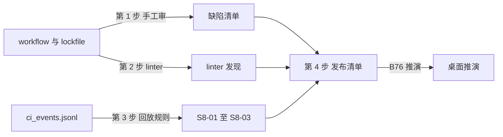

# B75 发布门禁实战：审流水线、查供应链、做发布清单

> 学习目标：做完本章，你能——
> 1. 手工审一份发布流水线，找出权限、触发器、凭证、签名上的缺陷，并说明每个缺陷的后果。
> 2. 用 Python 标准库写一个小 linter，自动查出同样的缺陷，并让它在合规的流水线上保持安静。
> 3. 用 CI 事件日志找出三类供应链事件：依赖哈希被换、Action 没有固定、未签名制品被发布；并把噪声排除掉。
> 4. 用 X04 的发布门禁思路，为 MiniEx 写一份带证据栏的发布清单。
>
> 前置知识：读过 [X04 软件交付与供应链安全](../arch/X04-delivery-supply-chain.md) 的第 3、4、6 节；做过 [B62 前端供应链](B62-frontend-supply-chain-practice.md)；会读 YAML 和 JSON；了解 [B70 链下赛道 L3 导读](B70-offchain-l3-guide.md) 里的 MiniEx 靶场；装好 Python 3（≥ 3.9）。
> 预计用时：3–4 小时。
> 关联章节：[X04 软件交付与供应链安全](../arch/X04-delivery-supply-chain.md)｜[T04 上线门禁清单](../templates/T04-go-live-gate.md)｜[T12 新系统安全架构评审单](../templates/T12-security-architecture-review.md)｜[B62](B62-frontend-supply-chain-practice.md)｜[B73 检测工程](B73-detection-engineering-practice.md)
> 最后核对：2026-11-23（Python 3.12.3；本章每条命令都在本机运行过；下文输出来自真实运行。数据是 MiniEx 靶场合成的，不含真实仓库、真实密钥）

> ⚠️ 警告：本章的 workflow 是合成示例，故意带缺陷，只用来读、不用来运行。linter 只读文件，不联网。不要把示例里的 `thirdparty/setup-foo` 当成真实的 Action，也不要拿本章脚本去扫描不属于你的仓库。

---

## 开场：一次没人批准的发布

MiniEx（虚构的小型交易所）有两个会发布到 release 通道的仓库：`wallet-service` 和 `exchange-web`。3 月 10 日到 13 日，CI 日志里有三件事：

- 3 月 10 日，一次主干构建装了 `web3-helper@2.3.1`。lockfile 里写的是 2.3.0。
- 3 月 11 日，发布流水线用了一个标签为 `main` 的第三方 Action，触发方式是 `pull_request_target`。
- 3 月 13 日，`wallet-service:v1.8.0` 被发到 release 通道，没有任何签名。

没有人收到告警。每件事单独看都"只是一次构建"。

<details class="predict"><summary>🤔 先猜再看：这三件事里，哪一件让攻击者最容易拿到发布令牌？</summary>

第二件。`pull_request_target` 在仓库的上下文里运行，能读到密钥。再加一个会变的第三方 Action，作者一改代码，所有用它的流水线都会运行新代码。第一件和第三件是"坏东西进了产物"。第二件是"坏东西拿到了钥匙"。第 1 步你会在 `release.yml` 里亲眼看到这两个缺陷的位置。

</details>

> 🎯 打个比方：发布流水线像银行的金库通道。lockfile 是货单，Action 固定是门卫的名册，签名是封条，环境审批是第二把钥匙。上面三件事分别是：货单对不上、名册上写着"谁都行"、封条没贴。
>
> 比喻的局限：金库的门卫不会被一次更新悄悄换人。Action 的 `@main` 会。

## 1. 本章怎么练

本章没有要你运行的危险代码。你只读文件、写脚本、查日志。



读图要点：左边是静态材料（配置），中间是动态材料（日志），右边汇到一份发布清单。静态检查在发布之前拦，日志检查在发布之后发现。局限：本章的日志是合成的。真实日志要先确认 CI 平台能导出哪些字段。

| 步骤 | 你做什么 | 对应 X04 控制 | 产物 |
|---|---|---|---|
| 第 1 步 | 手工审三份 workflow 和一份 lockfile | SDL-6、11、12、14、15、16 | 你的缺陷清单 |
| 第 2 步 | 写 linter，扫三份 workflow | 同上 | `my_work/lint.py` |
| 第 3 步 | 用日志找 S8-01 至 S8-03 | SDL-6、11、16、17 | `my_work/s8_ci.sql` |
| 第 4 步 | 写 MiniEx 发布清单 | SDL-18、T04 | `my_work/release_checklist.md` |
| 第 5 步 | 对照参考实现 | — | 差异记录 |

## 2. 第 0 步：准备

1. 从 `web3-security-101/` 根目录出发，设置变量并确认数据已生成：

```bash
cd web3-security-101          # 从这里出发；本章所有命令都在这个目录运行
OPS=practice-example-code/ops
ls $OPS/data/workflows
```

预期输出：

```text
ci.yml
docs.yml
lockfile.sample.json
release.yml
```

如果提示目录不存在，先运行 `bash $OPS/setup.sh --no-tests` 生成数据。

2. 建一个工作目录，放你自己的脚本和规则：

```bash
mkdir -p my_work
```

> 💡 注意：`release.yml` 的注释里写着"缺陷 1""缺陷 2"……这些注释就是答案。第 1 步先看去掉注释的版本，做完再对照。

## 3. 第 1 步：手工审三份 workflow

1. 先读合规的 `ci.yml` 和低风险的 `docs.yml`。它们告诉你"正常"长什么样：

```bash
cat $OPS/data/workflows/ci.yml
cat $OPS/data/workflows/docs.yml
```

记下两个差别。`ci.yml` 的 Action 后面是 40 位十六进制串。`docs.yml` 的 Action 后面是 `v4`。

2. 读去掉注释的 `release.yml`：

```bash
sed -E 's/[[:space:]]*#.*$//' $OPS/data/workflows/release.yml | grep -v '^[[:space:]]*$' | cat -n
```

预期输出：

```text
     1	name: release
     2	on:
     3	  pull_request_target:
     4	  workflow_dispatch:
     5	permissions: write-all
     6	jobs:
     7	  publish:
     8	    runs-on: ubuntu-latest
     9	    environment: ""
    10	    steps:
    11	      - uses: thirdparty/setup-foo@main
    12	      - uses: actions/checkout@130210f4e17c8f865ecd3ca463d2af18aa69af4d
    13	        with:
    14	          ref: ${{ github.event.pull_request.head.sha }}
    15	      - run: npm install
    16	      - run: npm run build
    17	      - run: ./scripts/publish.sh ${{ github.event.inputs.version }}
    18	        env:
    19	          REGISTRY_TOKEN: ${{ secrets.REGISTRY_TOKEN }}
```

3. 拿一张纸，按 X04 的七个关口（[3.1 节](../arch/X04-delivery-supply-chain.md)）逐行审。每个缺陷写三样：行号、一句话后果、对应的 SDL 编号。下面的提问帮你找：

| 提问 | 看哪里 |
|---|---|
| 谁能触发这条流水线？外部人员能吗？ | `on:` |
| 令牌能做什么？ | `permissions:` |
| 发布前有人批准吗？ | job 的 `environment:` |
| 每个 Action 会变吗？ | `uses:` 的 `@` 后面 |
| 运行的是谁的代码？ | `checkout` 的 `ref:` |
| 依赖按 lockfile 装吗？安装脚本会执行吗？ | `npm install` |
| 外部输入进了 shell 吗？ | `run:` 里的 `${{ }}` |
| 发布用的凭证能活多久？ | `secrets.` |
| 产物有签名吗？发布前验证吗？ | 整个文件 |

4. 看 lockfile。它记录 6 个依赖的版本和哈希：

```bash
python3 -c "
import json
for k,v in json.load(open('$OPS/data/workflows/lockfile.sample.json'))['packages'].items(): print(k.split('/')[-1], v['version'], v['integrity'][:15]+'...')"
```

预期输出：

```text
axios 1.6.7 sha256-fd6efb2d...
ethers 6.11.1 sha256-4d228f14...
pino 8.19.0 sha256-2810f55b...
viem 2.7.9 sha256-69eed4d9...
web3-helper 2.3.0 sha256-4b1177cf...
zod 3.22.4 sha256-b2bd14b7...
```

记下 `web3-helper` 是 2.3.0。第 3 步会用到。

5. 再用 X04 [6.2 节](../arch/X04-delivery-supply-chain.md) 的 `grep` 做一遍。目录换成靶场的 workflows。X04 原版的第三条只查 PR 标题一类字段，在这三份文件里没有命中，所以这里换成查 `github.event.inputs`：

```bash
W=$OPS/data/workflows
grep -rnE 'uses:[[:space:]]+[^./][^@[:space:]]*@' $W | grep -vE '@[0-9a-f]{40}([[:space:]]|$)'
grep -rnE 'pull_request_target|workflow_run' $W
grep -rnE '\$\{\{[[:space:]]*github\.event\.inputs' $W
```

预期输出（注释里的"缺陷"字样是靶场自带的）：

```text
practice-example-code/ops/data/workflows/release.yml:12:      - uses: thirdparty/setup-foo@main              # 缺陷 4：第三方 Action 使用可变引用
practice-example-code/ops/data/workflows/docs.yml:12:      - uses: actions/checkout@v4
practice-example-code/ops/data/workflows/docs.yml:13:      - uses: actions/setup-node@v4
practice-example-code/ops/data/workflows/release.yml:4:  pull_request_target:          # 缺陷 1：在带密钥的上下文里运行外部 PR 的代码
practice-example-code/ops/data/workflows/release.yml:18:      - run: ./scripts/publish.sh ${{ github.event.inputs.version }}   # 缺陷 7：输入直接拼进命令
```

三条 `grep` 一共命中 `release.yml` 的 3 个缺陷（第 4、1、7 个），并把 `docs.yml` 的 2 个官方标签引用也列了出来。

<details class="predict"><summary>🤔 先猜再看：`grep` 只命中 3 个缺陷。剩下的 6 个为什么抓不到？</summary>

因为它们是"缺少某样东西"或"两行之间的关系"。没有环境审批、没有签名，是"文件里没有的东西"，`grep` 找不到不存在的行。`write-all`、`npm install`、长期令牌是"有这一行，但要结合上下文判断"。检出 PR 提交是"触发器 + `ref` 两行合起来才危险"。这就是第 2 步要写 linter 的原因。

</details>

6. 现在写下你的清单，并确认答案里的缺陷数。答案里是 9 处：

```bash
python3 -c "
import json
d=json.load(open('$OPS/answers/S8.json'))['workflow_defects']
print(d['file'], len(d['defects']))"
```

预期输出：

```text
workflows/release.yml 9
```

> 🧪 动手验证：先写完自己的清单，再去看 `answers/S8.json` 里的具体条目。记下你找到几处。过关标准在第 9 节。

## 4. 第 2 步：写一个 workflow linter

目标：一个只用标准库的脚本，输入 workflow 文件，输出带行号和规则编号的发现。它要覆盖九条规则：

| 规则 | 查什么 | 对应 X04 |
|---|---|---|
| R01 | `pull_request_target`（高权限触发器） | SDL-12 |
| R02 | `permissions: write-all`；完全没写 `permissions` | SDL-12 |
| R03 | 会发布的 job 没有绑定 `environment` | SDL-15 |
| R04 | Action 没有固定到 40 位哈希 | SDL-11 |
| R05 | 高权限触发器下检出 PR 的提交 | SDL-12 |
| R06 | `npm install`；`npm ci` 没加 `--ignore-scripts` | SDL-6、8 |
| R07 | `run:` 里直接展开 `${{ github.event.* }}` 或输入 | SDL-12 |
| R08 | 长期凭证 `secrets.*_TOKEN`，而没有 OIDC | SDL-14 |
| R09 | 发布流程里没有签名或来源证明，也没有发布前验证 | SDL-16、17 |

另外加一条 lockfile 检查 L01：每个依赖都有版本和 `integrity`。

1. 把下面的骨架存成 `my_work/lint.py`。R04 已经写好，其余留给你：

```python
#!/usr/bin/env python3
import re, sys, json

SHA = re.compile(r"^[0-9a-f]{40}$")
OFFICIAL = {"actions", "github"}

def read(path):
    """返回 [(行号, 去掉注释的文本)]，跳过空行。"""
    out = []
    for no, raw in enumerate(open(path, encoding="utf-8"), 1):
        s = re.sub(r"\s+#.*$", "", raw.rstrip("\n")).rstrip()
        if s.strip() and not s.lstrip().startswith("#"):
            out.append((no, s))
    return out

def r04_pinning(lines):
    for no, s in lines:
        m = re.match(r"^\s*(?:-\s+)?uses:\s*([^\s@]+)@(\S+)\s*$", s)
        if not m or m.group(1).startswith("./") or SHA.match(m.group(2)):
            continue
        action, ref = m.groups()
        sev = "LOW" if action.split("/")[0] in OFFICIAL and ref not in ("main", "master") else "HIGH"
        yield no, "R04", sev, f"{action}@{ref} 没有固定到提交哈希"

def r01_trigger(lines):
    ...   # TODO：哪一行含 pull_request_target？

def r02_permissions(lines):
    ...   # TODO：write-all 是 HIGH；整个文件没有 permissions 是 MEDIUM

def r03_environment(lines):
    ...   # TODO：先判断"这个 job 会发布吗"（run 里有 publish 或 deploy），再看 environment 是否为空

def r05_untrusted_checkout(lines):
    ...   # TODO：文件里有高权限触发器，且 `ref:` 指向 github.event.pull_request.head.*

def r06_install(lines):
    ...   # TODO：npm install 是 HIGH；npm ci 没有 --ignore-scripts 是 LOW

def r07_injection(lines):
    ...   # TODO：在 run 行里找 ${{ github.event.xxx }}、${{ github.head_ref }}、${{ inputs.xxx }}
          # 提示：.sha、.number、.id 结尾的值不是自由文本，可以放过

def r08_long_lived_secret(lines):
    ...   # TODO：secrets.NAME，NAME 含 TOKEN / KEY / PASSWORD / SECRET，且不是 GITHUB_TOKEN

def r09_signing(lines):
    ...   # TODO：只在"会发布"的文件里查；整个文件没有 cosign / attest / provenance，也没有 verify

RULES = [r01_trigger, r02_permissions, r03_environment, r04_pinning, r05_untrusted_checkout,
         r06_install, r07_injection, r08_long_lived_secret, r09_signing]

def lint(path):
    lines = read(path)
    found = [f for rule in RULES for f in (rule(lines) or [])]
    return sorted(found)

if __name__ == "__main__":
    high = 0
    for path in sys.argv[1:]:
        res = lint(path)
        for no, rule, sev, msg in res:
            print(f"{path.split('/')[-1]}:{no} {rule} {sev:<6} {msg}")
            high += sev == "HIGH"
        print(f"== {path.split('/')[-1]}：{len(res)} 条发现\n")
    sys.exit(1 if high else 0)
```

2. 几条提示，卡住时再看：

- 这不是完整的 YAML 解析器。按缩进和正则读就够用。`jobs:` 下缩进 2 格的 `名字:` 是一个 job，缩进 4 格的 `environment:` 属于它。
- `run:` 后面可能是单行，也可能是 `|` 块。本章三份文件只有单行。你的脚本至少要处理单行。
- R03 和 R09 都先问"这是发布流程吗"。`ci.yml` 里没有 `publish`，不该被报。
- 每条规则一个函数，每个函数独立可测。出错时，只把一份文件喂给一条规则。
- R08 要看文件里有没有 `id-token: write`。有的话，长期令牌只是 MEDIUM（还在，但已有 OIDC 可替代）。

3. 写完一条测一条。例如先只留 R04：

```bash
python3 my_work/lint.py $OPS/data/workflows/release.yml $OPS/data/workflows/docs.yml
```

4. 全部写完后，扫三份文件。参考实现的输出如下，你的措辞可以不同，行号和规则编号应当一致。参考实现按行号排序，R09 针对整个文件，所以报在第 1 行：

```text
release.yml:1 R09 HIGH   发布流程里没有签名 / 来源证明，也没有发布前的验证
release.yml:4 R01 HIGH   pull_request_target：在带密钥的上下文里运行外部 PR 触发的流程
release.yml:6 R02 HIGH   permissions: write-all，权限过大；改为 contents: read 起步，按 job 加权限
release.yml:8 R03 HIGH   job publish 会发布，但没有绑定带审批的 environment
release.yml:12 R04 HIGH   thirdparty/setup-foo@main：分支引用，随时可被改写
release.yml:15 R05 HIGH   高权限触发器下检出 PR 提交，外部代码会和密钥同处一个 job
release.yml:16 R06 HIGH   `npm install`：不按 lockfile 安装，且会执行依赖的安装脚本；改用 npm ci --ignore-scripts
release.yml:18 R07 HIGH   run 里直接展开 ${{ github.event.inputs.version }}；先放进 env 再引用
release.yml:20 R08 HIGH   长期凭证 secrets.REGISTRY_TOKEN；改用 OIDC 换短期身份（permissions: id-token: write）
== release.yml：9 条发现，覆盖规则 9 个 ['R01', 'R02', 'R03', 'R04', 'R05', 'R06', 'R07', 'R08', 'R09']
```

`ci.yml` 应当是 0 条发现。`docs.yml` 应当是 3 条 LOW：两个官方标签引用（R04）和一个没加 `--ignore-scripts` 的 `npm ci`（R06）。退出码：`release.yml` 为 1，其余为 0。

> 💡 注意：这个 linter 会漏掉很多真实写法：块式 `run: |` 里的复杂拼接、可复用工作流、组合 Action 的间接依赖。真实项目用 `zizmor` 等成熟工具，再用你的 linter 补公司自己的规则。写 linter 的目的是看清每条规则查的是什么。

5. 补 L01：`integrity` 缺失或格式不对时报 `L01`。对示例 lockfile 的预期结果是 6 个依赖、0 条发现。这条规则只能说明"lockfile 本身完整"，说明不了"CI 装的东西和它一致"。后一件事要靠第 3 步的日志。

6. 写一份修好的 `my_work/release.fixed.yml`，让你的 linter 对它输出 0 条 HIGH。修法对应缺陷：去掉 `pull_request_target`；`permissions` 改只读，发布 job 单独加 `id-token: write`；绑定 `environment: production`；Action 固定到哈希；`npm ci --ignore-scripts`；版本号先放进 `env` 再引用；加签名与验证两步。

> 🧪 动手验证：故意把你修好的文件里的一处改回去（比如把 `npm ci --ignore-scripts` 改回 `npm install`），确认 linter 报出对应规则。一个只在"全对"时安静、不能在"改坏一处"时报警的 linter，是不可信的。

## 5. 第 3 步：用 CI 日志找供应链事件

静态检查看的是"文件怎么写"。日志看的是"实际发生了什么"。S8 在日志里埋了三件事：S8-01、S8-02、S8-03。

1. 先看有什么。`ci_events` 一共有 4822 条，类型有 6 种。看 release 流水线的事件分布：

```bash
python3 $OPS/lib/logread.py --sql "SELECT workflow, event_type, COUNT(*) n FROM ci_events WHERE repo IN ('miniex/wallet-service','miniex/exchange-web') AND workflow='release.yml' GROUP BY 1,2"
```

```text
（6 行）
workflow     event_type          n  
-----------  ------------------  ---
release.yml  action_use          26 
release.yml  artifact_build      20 
release.yml  artifact_sign       5  
release.yml  dependency_install  120
release.yml  publish             20 
release.yml  workflow_trigger    20 
```

20 次发布流程，只有 5 次有签名事件。这是线索，不是结论。

2. 看发布通道与签名的关系：

```bash
python3 $OPS/lib/logread.py --sql "SELECT json_extract(detail,'\$.channel') channel, json_extract(detail,'\$.signature') IS NOT NULL signed, COUNT(*) n FROM ci_events WHERE event_type='publish' GROUP BY 1,2"
```

```text
（3 行）
channel  signed  n 
-------  ------  --
nightly  0       14
release  0       1 
release  1       5 
```

无签名的发布有 15 次。14 次在 nightly 通道，1 次在 release 通道。字段说明在靶场的 `practice-example-code/ops/API.md` 第 1.2 节：`dependency_install` 有 `integrity` 和 `lock_integrity`，`action_use` 有 `ref`，`publish` 有 `channel` 和 `signature`。

3. 写一条回放规则 `my_work/s8_ci.sql`。骨架如下，三段各补一个条件：

```sql
-- id: my_s8
-- scenario: S8
-- 三段查询用 UNION ALL 合并，列名必须一致：run_id, ts, package, action, artifact

-- 段 1：安装的哈希与 lockfile 不一致（S8-01）
SELECT run_id, ts, json_extract(detail, '$.package') AS package, NULL AS action, NULL AS artifact
FROM ci_events
WHERE event_type = 'dependency_install'
  AND ______                      -- 提示：integrity 与 lock_integrity 不相等，且 lock_integrity 不为空
UNION ALL
-- 段 2：release 流水线里没有固定到哈希的 Action（S8-02）
SELECT run_id, ts, NULL, json_extract(detail, '$.action'), NULL
FROM ci_events
WHERE event_type = 'action_use'
  AND ______                      -- 提示：ref 的长度不是 40；先不限制流水线，看第 4 点
UNION ALL
-- 段 3：release 通道发布了没有签名的制品（S8-03）
SELECT run_id, ts, NULL, NULL, json_extract(detail, '$.artifact')
FROM ci_events
WHERE event_type = 'publish'
  AND ______                      -- 提示：channel 与 signature 两个条件
```

4. 先故意写一个"天真版"，看噪声有多大。`my_work/naive_pin.sql` 只含段 2，不限制流水线，头部写 `-- id: naive_pin` 和 `-- scenario: S8-02`：

```bash
python3 $OPS/lib/replay.py my_work/naive_pin.sql | head -4
```

预期输出：

```text
规则：naive_pin   参数：无
目标场景：S8-02
命中 57 条：TP 1，误报 56（噪声/未解释的不同实体 28），其他场景的真阳性 0
召回：1/1 = 100%   精确率：2%
```

误报来自文档站：`docs.yml` 的 28 次运行，每次 2 个官方标签引用，共 56 条。同样，段 3 不限制通道（`-- scenario: S8-03`），会命中 15 条，其中 14 条是 nightly：

```text
命中 15 条：TP 1，误报 14（噪声/未解释的不同实体 14），其他场景的真阳性 0
召回：1/1 = 100%   精确率：7%
```

<details class="predict"><summary>🤔 先猜再看：把 nightly 的无签名发布排除掉，等于接受了"nightly 不用签名"。这个排除合理吗？</summary>

只有在 nightly 产物不会进入生产的前提下才合理。门禁规则要写明这个前提：nightly 通道的制品不能被部署到生产。如果有一天某个 nightly 制品被部署了，这条前提就破了，规则要重新写。排除噪声时，一定把"为什么可以排除"写成一句话，放进规则注释。

</details>

5. 补全三个条件（段 2 加上只看 `release.yml`），运行带门槛的回放：

```bash
python3 $OPS/lib/replay.py my_work/s8_ci.sql --scenario S8 --min-recall 1.0 --max-fp 0
echo "退出码 $?"
```

预期输出（规则名是你起的名字，参考实现叫 `b75_s8`）：

```text
规则：b75_s8   参数：无
目标场景：S8
命中 3 条：TP 3，误报 0（噪声/未解释的不同实体 0），其他场景的真阳性 0
召回：3/3 = 100%   精确率：100%
  [TP] S8-01  {"run_id": "run-00503", "ts": "2026-03-10T15:22:47Z", "package": "web3-helper", "action": null, "artifact": null}
  [TP] S8-02  {"run_id": "run-00504", "ts": "2026-03-11T11:00:24Z", "package": null, "action": "thirdparty/setup-foo", "artifact": null}
  [TP] S8-03  {"run_id": "run-00505", "ts": "2026-03-13T17:42:56Z", "package": null, "action": null, "artifact": "wallet-service:v1.8.0"}
退出码 0
```

6. 对三个命中各写一句话，回答：它违反了 X04 的哪条控制？如果它真的发生了，第一个处置动作是什么？S8 的应有处置在 `answers/S8.json` 的 `expected_response`，做完再看。

| 命中 | 事实 | 违反的控制（你来填） |
|---|---|---|
| S8-01 | `web3-helper@2.3.1`，哈希与 lockfile（2.3.0）不符，这次提交没有改 lockfile | |
| S8-02 | `release.yml` 用 `thirdparty/setup-foo@main`，触发方式 `pull_request_target` | |
| S8-03 | release 通道发布 `wallet-service:v1.8.0`，`signature` 为空 | |

7. 有 3 条没有被你的规则命中，但值得知道：实验仓库 `miniex/infra` 的 `exp/sandbox` 分支安装了 `left-pad-x`，`lock_integrity` 为空，因为那个仓库没有 lockfile。这不是 S8-01，因为没有"与 lockfile 不符"。但"没有 lockfile 的仓库"本身是一个治理发现。

```bash
python3 $OPS/lib/logread.py --sql "SELECT event_id, run_id, json_extract(detail,'\$.package') AS package FROM ci_events WHERE event_type='dependency_install' AND json_extract(detail,'\$.lock_integrity') IS NULL"
```

```text
（3 行）
event_id  run_id     package   
--------  ---------  ----------
CI000552  run-00500  left-pad-x
CI002240  run-00501  left-pad-x
CI003333  run-00502  left-pad-x
```

> 💡 注意：S8-01 发生在 `ci.yml`，不是 `release.yml`。构建被换了依赖，产物才被换。如果只审 release 流水线，你会漏掉它。X04 的 G4（构建）关口覆盖所有会产出制品的流水线。

## 6. 第 4 步：写 MiniEx 的发布清单

前三步产出的是发现。第 4 步把发现变成"以后每次发布都要过的门"。

1. 打开 [T04 上线门禁清单](../templates/T04-go-live-gate.md)。它是合约上线用的。MiniEx 是交易所服务，不是合约，所以 T04 的 10 项里只有 4 项直接适用：

| T04 项 | 在 MiniEx 里的意思 |
|---|---|
| 4 权限 | 构建、发布、签名三个身份分离 |
| 8 监控与告警 | 发布后 30 分钟内有人看告警 |
| 9 应急预案 | 令牌轮换、撤包、公告联系人 |
| 10 签名流程 | 制品签名与发布前验证 |

2. 再从 [X04 第 4 节](../arch/X04-delivery-supply-chain.md) 挑 P0 控制。本章的发现已经对应了这些：

| 本章发现 | X04 控制 | 能自动化吗 |
|---|---|---|
| R04、S8-02 | SDL-11 Action 固定 | 能：linter + 日志规则 |
| R01、R02、R05、R07 | SDL-12 最小权限与脚本注入 | 能：linter |
| R06、S8-01 | SDL-6、SDL-8 依赖锁定与禁用脚本 | 能：linter + 日志规则 |
| R08 | SDL-14 OIDC | 能：linter |
| R03 | SDL-15 环境审批 | linter 查有没有；审批人是谁要人工核对 |
| R09、S8-03 | SDL-16、SDL-17 签名与验证 | 能：linter + 日志规则 |
| 三个身份分离 | SDL-18 | 不能：要画权限矩阵 |

3. 把下面的骨架存成 `my_work/release_checklist.md`，填完：

```markdown
# MiniEx 发布清单

> 范围：（哪些仓库、哪个通道）
> 规则：任一"必须"项为 ❌，发布不得进行。

## 1. 必须项

| # | 项 | 通过标准 | 对应 | 自动化 | 状态 | 证据 |
|---|---|---|---|---|---|---|
| 1 | 工作流静态检查 | （写出命令与通过条件） | | | | |
| 2 | Action 固定 | | SDL-11 | | | |
| ...（至少 10 行，覆盖上表每条发现）| | | | | | |

## 2. 建议项
（至少 2 条）

## 3. 门禁结论
| 结论 | 可发布 / 附条件发布 / 暂缓 / 否决 |
```

填写规则：

- "通过标准"写成别人能判对错的句子。写"无 HIGH 发现"，不写"流水线安全"。
- "自动化"一栏写具体命令或规则编号。写"人工"的项，要写谁在什么时间做。
- "证据"在发布当天填，写命令输出或截图的位置。没有证据按 ❌ 处理。
- 至少一行写 nightly 通道的前提：nightly 制品不进入生产。

4. 用一个场景测你的清单：假设今天要发布 `wallet-service:v1.8.0`，它没有签名。你的清单里，哪一行会变成 ❌？这一行有没有一个自动化的命令可以直接判断？如果没有，你的清单就有一个洞。

> 🪞 反思：你的团队今天的发布，有几项是靠"发布的人记得去做"？把这几项挑出来，问自己：如果发布的人明天离职，第二个人会知道吗？

## 7. 第 5 步：对照答案

做完前四步，再看参考实现。它们在 `practice-example-code/ops/solutions/b75/`：

```bash
ls $OPS/solutions/b75
```

```text
b75_s8.sql
check_ci_events.py
lint_workflow.py
release.fixed.yml
release_checklist.md
```

1. 运行参考 linter，对比你的输出：

```bash
python3 $OPS/solutions/b75/lint_workflow.py $OPS/data/workflows/release.yml $OPS/data/workflows/ci.yml $OPS/data/workflows/docs.yml --lockfile $OPS/data/workflows/lockfile.sample.json
```

2. 运行参考的事件检查脚本。`--all` 同时列出排除的噪声和原因：

```bash
python3 $OPS/solutions/b75/check_ci_events.py --all
```

预期输出：

```text
扫描 4822 条 CI 事件
C1 CI003293 run-00503 2026-03-10T15:22:47Z 安装 web3-helper@2.3.1，哈希与 lockfile（2.3.0）不符
C2 CI003571 run-00504 2026-03-11T11:00:24Z 发布流水线使用 thirdparty/setup-foo@main（可变引用），触发方式 pull_request_target
C3 CI004656 run-00505 2026-03-13T17:42:56Z release 通道发布 wallet-service:v1.8.0，signature 为空
发现 3 条；排除的噪声 73 条
  噪声 C1 x3：仓库没有 lockfile（实验仓库），本规则无从比对，另行治理
  噪声 C2 x56：非发布流水线的官方标签引用，按 LOW 另行治理
  噪声 C3 x14：nightly 通道（非 release）的无签名发布
```

3. 运行参考的修复版，确认 linter 对它安静：

```bash
python3 $OPS/solutions/b75/lint_workflow.py $OPS/solutions/b75/release.fixed.yml; echo "退出码 $?"
```

```text
== release.fixed.yml：0 条发现，覆盖规则 0 个 []

退出码 0
```

4. 回放参考规则，确认和你的结果一致：

```bash
python3 $OPS/lib/replay.py $OPS/solutions/b75/b75_s8.sql --scenario S8 --min-recall 1.0 --max-fp 0
```

5. 打开 `release_checklist.md`，对照你的清单：缺了哪些行？哪些"自动化"栏你写了"人工"，参考答案写了命令？

## 8. 如果出错

| 现象 | 原因 | 处理 |
|---|---|---|
| `ls` 找不到 `data/workflows` | 数据还没生成 | `bash practice-example-code/ops/setup.sh --no-tests` |
| 你的 linter 对 `ci.yml` 报了发现 | R03 或 R09 没有先判断"是否发布" | 只在 job 的 `run` 里有 `publish` 或 `deploy` 时才查 |
| `release.yml` 只报出 8 条 | R09 漏了，或 R05 没有判断触发器 | R09 看整个文件；R05 先查文件里有没有 `pull_request_target` |
| R07 把 `head.sha` 也报了 | 没有放过 `.sha`、`.number`、`.id` | 这三类不是自由文本，放过 |
| 回放里 `S8-01` 没命中 | 比较了 `integrity` 与 `version` | 比较的是 `integrity` 与 `lock_integrity` |
| 回放误报 56 条 | 段 2 没有限制 `workflow = 'release.yml'` | 加上限制，并在注释里写原因 |
| 回放误报 14 条 | 段 3 没有限制 `channel = 'release'` | 同上 |
| 段 1 命中里多出 3 条 `left-pad-x` | 把 `lock_integrity` 为空当成了不一致 | 段 1 要明确写 `lock_integrity IS NOT NULL` |

## 9. 过关标准

用真实数字判定：

- [ ] 第 1 步：手工审 `release.yml`，9 处缺陷找出至少 7 处，每处有行号和后果。三条 `grep` 命中其中 3 处。
- [ ] 第 2 步：你的 linter 对 `release.yml` 覆盖 9 条规则、9 条发现；对 `ci.yml` 0 条发现；对 `docs.yml` 无 HIGH；对 `release.fixed.yml`（你自己的版本）无 HIGH。
- [ ] 第 2 步：你做了"改坏一处"的测试，linter 报出了对应规则。
- [ ] 第 3 步：`replay.py` 对 S8 召回 3/3，误报 0，`--min-recall 1.0 --max-fp 0` 退出码为 0。
- [ ] 第 3 步：你能说出三类噪声的数量（56、14、3）和各自的排除理由。
- [ ] 第 4 步：发布清单至少 10 行必须项，覆盖第 6 节表里的每条发现，每行有"通过标准""自动化""证据"三栏。
- [ ] 清单用"今天发布无签名的 `wallet-service:v1.8.0`"测过，指出了哪一行变 ❌。
- [ ] 第 5 步：写下你的实现与参考实现的 3 个差异。

## 10. 思考题

1. 第 1 步里 `grep` 只命中 9 个缺陷里的 3 个。把剩下 6 个按"缺少某样东西""有这一行但要看上下文""两行合起来才危险"分类。哪一类最难用正则写对？
2. `docs.yml` 用官方 Action 的标签引用（`@v4`），本章只把它标 LOW，没有当作误报丢掉。标签被移动时，它会在哪种条件下变成高风险？参考 X04 [8.1 节](../arch/X04-delivery-supply-chain.md) 的 tj-actions 事件，说明你的判断。
3. S8-01 里，哈希与 lockfile 不符，而且这次提交没有改 lockfile。一次"正常的依赖升级"会同时改 lockfile 和代码。你怎么用日志把"升级"和"被换"区分开？靶场里有 3 次带 lockfile 更新的升级，你的规则为什么没有把它们当成命中？
4. 发布清单里"制品已签名"可以由 linter 的 R09 查，也可以由 `check_ci_events` 的 C3 查。它们查的是同一件事吗？分别能挡住什么、挡不住什么？提示：一个看配置，一个看实际发生的发布。
5. 你的发布清单里有一行"发布者不能批准自己的发布"（SDL-18）。linter 能查到吗？如果不能，用什么证据证明它被执行了？

## 11. 衔接

本章你产出了三样东西：一个会报警的 linter、一条会回放的日志规则、一份发布清单。它们都在"出事之前"和"出事时看日志"这两个环节。出事之后，团队要一起做三件事：判断现在到底发生了什么、谁来做第一个动作、事后怎么写复盘。

下一章 [B76 桌面推演与事故复盘](B76-tabletop-postmortem-practice.md) 会拿 S8 的这三件事，配合其他场景，主持一次桌面推演。到那时，你今天写的发布清单就是推演里"检查点"的来源之一：推演会问你，清单上哪一行本来应该拦住这件事，为什么没有。

- 下一章：[B76 桌面推演与事故复盘](B76-tabletop-postmortem-practice.md)
