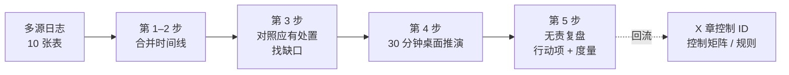

# B76 桌面推演与事故复盘实战

> 学习目标：做完本章，你能——
> 1. 写一个 Python 小脚本，把多源日志按时间合并成事故时间线，并对 S1、S6、S7 各出一份。
> 2. 拿时间线对照"应有的处置"，说出实际处置缺了什么，并映射到 X 章的控制 ID。
> 3. 主持并计时一次 30 分钟桌面推演，用 T10 评分表打分；再写一份无责复盘，算出 MTTD 和 MTTR。
>
> 前置章节：[B73 检测工程实战](B73-detection-engineering-practice.md)（你已经会用 `logread.py` 和 `replay.py`）；建议先读 [B72](B72-withdrawal-risk-rules-practice.md)（S1 的风控规则）和 [B74](B74-signing-policy-practice.md)（S6 的签名校验）。
> 前置知识：会写 20 行以内的 Python 脚本；读过 [B65](B65-incident-response-practice.md) 的沙盘。
> 预计用时：约 3–4 小时（脚本与时间线 1.5 小时；推演 30 分钟加准备；复盘 1 小时）。
> 配套章节：[X06 韧性与验证](../arch/X06-resilience-validation.md)（桌面推演、无责复盘）｜[X23 反欺诈、合规与安全运营](../arch/X23-cex-fraud-compliance-secops.md)（处置权限、恢复）｜[X05 检测与响应工程](../arch/X05-detection-response-engineering.md)（指挥与证据保全）｜[T10 推演剧本与复盘模板](../templates/T10-tabletop-script-scorecard.md)｜[T09 事故 runbook](../templates/T09-incident-runbook-oncall.md)｜[A09 应急响应](../assessment/A09-incident-response.md)
> 最后核对：2026-11-23（命令在本机 Python 3.12.3 上运行过；下文输出来自真实运行）

> ⚠️ 警告：本章的数据全部是合成的。MiniEx 是虚构交易所，账户、IP、地址、员工号都不对应任何真实对象。推演只在笔记本上做。不要对真实系统执行本章的"处置"动作。

---

## 开场：事故发生后，第一个问题是什么

事故结束后，复盘会上第一个问题永远是：到底发生了什么，按什么顺序？

日志分散在 10 个地方。登录在一张表，改绑在另一张表，签名请求在签名服务，云操作在云审计，终端进程在 EDR。每个人手里只有一块拼图。没有合并的时间线，复盘会变成"我记得……"和"我以为……"的争论。

<details class="predict"><summary>🤔 先猜再看：账户 A01367 在 2026-03-04 被接管。从攻击者第一次试密码，到 18,400 USDT 上链，你猜隔了多久？风控规则在哪一刻能发现？</summary>

从第一次失败登录（01:00:24）到资金上链（01:50:06）约 49.7 分钟。"改绑后提币"规则在提币申请时（01:48:30）命中，比上链早 96 秒。也就是说，规则发现得"准"，但"晚"：它只给人留下不到 2 分钟。第 6 步你会算出这些数字。

</details>

> 🎯 打个比方：时间线像飞机的黑匣子译码。飞行数据、驾驶舱语音、塔台录音各录各的，只有按同一条时间轴对齐，才能看出"机长说话时发动机已经停了"。
>
> 比喻的局限：飞机的几个记录仪时钟由同一套系统校准。你的日志来自不同团队，时钟可能有偏差。本章的数据全部是 UTC，没有偏差，真实环境要先核对时钟。

## 1. 本章怎么练

本章走完一次完整的事后流程：先还原，再对照，再演练，最后复盘。



读图要点：
- 实线是本章的顺序。时间线是后面所有步骤的输入。
- 虚线表示复盘的产出要回到控制矩阵和检测规则，否则事故白发生。
- 局限：MiniEx 的日志只记录"发生了什么"，不记录"人做了什么处置"。第 3 步会让你发现这本身就是一个缺口。

三个场景的时间窗（均为 2026 年 3 月，UTC，答案以 `answers/` 为准）：

| 场景 | 答案编号 | 时间窗 | 一句话 |
|---|---|---|---|
| S1 账户接管 | S1-01、S1-02、S1-03 | 03-04 01:00–05:00；03-09 06:00–03-10 14:00 | 撞库成功 → 改绑 / 找回 → 新地址大额提币 |
| S6 签名服务异常 | S6-01、S6-02、S6-03 | 03-06 16:20；03-09 21:05；03-12 02:15 | 签名请求无审批单，或与审批单不一致 |
| S7 开发终端失陷 | S7-01、S7-02 | 03-09 11:02–11:52；03-12 15:10–16:00 | 外联隧道 → 云凭证外部使用 → 签名命名空间 |

准备工作。从 `web3-security-handbook/` 根目录出发（下文所有命令都从这里运行）：

```bash
bash practice-example-code/ops/setup.sh --no-tests
mkdir -p my_b76
```

`setup.sh` 会生成数据并装载 SQLite。本章只读数据，不改靶场任何文件。

## 2. 第 1 步：写一个时间线脚本

思路只有三步：每个来源读成统一的事件；按实体筛选；按时间排序。

统一事件有 4 个字段：`ts`（时间）、`source`（来源表）、`id`（该来源里的事件 ID）、`summary`（一行摘要）。**实体**（entity）是你能拿来"换个角度再查"的值：账户、IP、设备、地址、审批单号、请求号、员工号、主机名。一个事件的任一实体列命中你给的实体，它就属于这条时间线。

下面是骨架。把它存成 `my_b76/timeline.py`。骨架里只接了 `logins` 和 `withdrawals` 两个来源，其余留给你：

```python
#!/usr/bin/env python3
"""把多源日志按时间合并成事故时间线。从 web3-security-handbook/ 根目录运行。"""
import argparse, csv, json, sys
from pathlib import Path

DATA = Path("practice-example-code/ops/data")


def rows_csv(name):
    with open(DATA / f"{name}.csv", newline="", encoding="utf-8") as f:
        yield from csv.DictReader(f)


def rows_jsonl(name):
    with open(DATA / f"{name}.jsonl", encoding="utf-8") as f:
        for line in f:
            yield json.loads(line)


# 来源表：名称 -> (读取函数, 事件 ID 列, 实体列, 摘要函数)
SOURCES = {
    "logins": (lambda: rows_csv("logins"), "login_id", ["account_id", "ip", "device_id"],
               lambda r: f"登录 {r['result']} ip={r['ip']} mfa={r['mfa_method']}"),
    "withdrawals": (lambda: rows_csv("withdrawals"), "wd_id", ["account_id", "to_address", "approval_id", "tx_hash"],
                    lambda r: f"提币申请 {r['amount']} {r['asset']} -> {r['to_address'][:12]} status={r['status']}"),
    # TODO 1：补 recoveries、account_events（第 1 步，S1 要用）
    # TODO 2：补 approvals、signing_requests、chain_txs（第 3.1 节，S6 要用）
    # TODO 3：补 cloud_audit、k8s_audit、endpoint_events（第 3.2 节，S7 要用）
}


def collect(entities, since, until):
    out = []
    for name, (reader, idf, ents, summ) in SOURCES.items():
        for r in reader():
            if (since and r["ts"] < since) or (until and r["ts"] > until):
                continue
            # 事件的任一实体列命中查询实体，就算相关
            if not entities & {str(r[e]) for e in ents if r.get(e)}:
                continue
            out.append({"ts": r["ts"], "source": name, "id": r[idf], "summary": summ(r)})
    out.sort(key=lambda e: (e["ts"], e["source"], e["id"]))  # 按时间合并
    return out


def main():
    ap = argparse.ArgumentParser()
    ap.add_argument("--entity", action="append", required=True)
    ap.add_argument("--since"); ap.add_argument("--until")
    ap.add_argument("--fmt", choices=["table", "csv"], default="table")
    a = ap.parse_args()
    ev = collect(set(a.entity), a.since, a.until)
    if a.fmt == "csv":
        w = csv.DictWriter(sys.stdout, fieldnames=["ts", "source", "id", "summary"])
        w.writeheader(); w.writerows(ev)
        return
    for e in ev:
        print(f"{e['ts']}  {e['source']:<16} {e['id'][:14]:<14} {e['summary']}")
    print(f"（共 {len(ev)} 行）")


if __name__ == "__main__":
    main()
```

提示：
- 各表的列名在 `ops/API.md` 第 1 节。事件 ID 列：`recoveries` 是 `recovery_id`，`account_events` 是 `event_id`，`chain_txs` 是 `tx_hash`，`approvals` 是 `approval_id`，`signing_requests` 是 `request_id`。
- 时间戳都是 UTC、以 `Z` 结尾的 ISO 8601 字符串，格式一致，可以直接比较字符串大小。
- JSONL 里的空值读出来是 `None`，CSV 里的空值是空字符串。`if r.get(e)` 对两者都有效。

先看骨架的输出。只用 `logins` 和 `withdrawals` 两个来源，查账户 A01367：

```bash
python3 my_b76/timeline.py --entity A01367 --since 2026-03-04T00:30:00Z --until 2026-03-04T03:00:00Z
```

```text
2026-03-04T01:00:24Z  logins           L003172        登录 failed_password ip=203.0.113.15 mfa=none
2026-03-04T01:04:48Z  logins           L003341        登录 failed_password ip=203.0.113.10 mfa=none
2026-03-04T01:09:39Z  logins           L003524        登录 failed_password ip=203.0.113.14 mfa=none
2026-03-04T01:12:10Z  logins           L003623        登录 success ip=203.0.113.12 mfa=none
2026-03-04T01:21:55Z  logins           L004023        登录 failed_password ip=203.0.113.11 mfa=none
2026-03-04T01:48:30Z  withdrawals      W000279        提币申请 18400.0 USDT -> 0x4aadf5fb30 status=completed
（共 6 行）
```

只有 6 行，缺了"改手机"和"加地址"两步。这就是 TODO 1。补上 `recoveries` 和 `account_events` 后，同一条命令输出 8 行。补齐全部 10 个来源（TODO 1–3）后，输出 9 行，多出最后一行链上转出：

```text
2026-03-04T01:00:24Z  logins           L003172        登录 failed_password ip=203.0.113.15 mfa=none
2026-03-04T01:04:48Z  logins           L003341        登录 failed_password ip=203.0.113.10 mfa=none
2026-03-04T01:09:39Z  logins           L003524        登录 failed_password ip=203.0.113.14 mfa=none
2026-03-04T01:12:10Z  logins           L003623        登录 success ip=203.0.113.12 mfa=none
2026-03-04T01:15:40Z  account_events   AE000047       phone_change  ip=203.0.113.12
2026-03-04T01:20:05Z  account_events   AE000048       add_withdraw_address addr=0x4aadf5fb30 ip=203.0.113.12
2026-03-04T01:21:55Z  logins           L004023        登录 failed_password ip=203.0.113.11 mfa=none
2026-03-04T01:48:30Z  withdrawals      W000279        提币申请 18400.0 USDT(约18400.0美元) -> 0x4aadf5fb30… status=completed 地址加入=2026-03-04T01:20:05Z 审批=AP-W000279
2026-03-04T01:50:06Z  chain_txs        0x30b354c8ff6b 链上 hot->external withdrawal 18400.0 USDT(约18400.0美元) 提币单=W000279 请求=SR000279
```

> 💡 注意：第 8、9 行的摘要比骨架长，因为完成版把"地址加入时间""审批单""提币单"也印出来了。摘要写什么由你决定。判断标准只有一条：复盘时不用再回表就能看懂这一行。

> 💡 注意：`withdrawals.status` 是日志的最终状态。推演里不要把它当作"此刻已知"的信息（第 4 步会说明）。

### 2.1 S1：三个事件各出一份时间线

S1-01 已经有了。S1-02 和 S1-03 的起点实体见下表。起点来自"告警"给你的第一个线索（一个账户），再加上时间窗。**不要**一上来就用攻击 IP 做实体：IP `203.0.113.10` 在 25 分钟内尝试了 158 次登录，会把时间线淹没。

| 事件 | 起点实体 | 时间窗 |
|---|---|---|
| S1-01 | A01367 | 03-04 00:30–03:00 |
| S1-02 | A00981 | 03-04 01:00–05:00 |
| S1-03 | A01432 | 03-09 06:00–03-10 14:00 |

把三份都存成 CSV，供 3.3 节检查：

```bash
python3 my_b76/timeline.py --fmt csv --entity A01367 --since 2026-03-04T00:30:00Z --until 2026-03-04T03:00:00Z > my_b76/s1-01.csv
python3 my_b76/timeline.py --fmt csv --entity A00981 --since 2026-03-04T01:00:00Z --until 2026-03-04T05:00:00Z > my_b76/s1-02.csv
python3 my_b76/timeline.py --fmt csv --entity A01432 --since 2026-03-09T06:00:00Z --until 2026-03-10T14:00:00Z > my_b76/s1-03.csv
```

S1-03 去掉失败登录之后是这样（跨 22 小时的低慢事件）：

```bash
python3 my_b76/timeline.py --entity A01432 --since 2026-03-09T06:00:00Z --until 2026-03-10T14:00:00Z | grep -v failed_password
```

```text
2026-03-09T14:10:22Z  logins           L009817        登录 success ip=203.0.113.31 mfa=recovery_flow
2026-03-09T14:20:00Z  recoveries       RC000023       找回 email success 审核=manual
2026-03-09T14:35:00Z  account_events   AE000159       mfa_reset  ip=203.0.113.31
2026-03-09T14:50:00Z  account_events   AE000160       add_withdraw_address addr=0x2cc5359cd3 ip=203.0.113.31
2026-03-10T12:40:00Z  withdrawals      W000889        提币申请 25000.0 USDT(约25000.0美元) -> 0x2cc5359cd3… status=completed 地址加入=2026-03-09T14:50:00Z 审批=AP-W000889
2026-03-10T13:21:02Z  chain_txs        0x287864750f33 链上 hot->external withdrawal 25000.0 USDT(约25000.0美元) 提币单=W000889 请求=SR000890
（共 7 行）
```

"共 7 行"包含 1 行被 `grep` 去掉的失败登录。读时间线的三个问题：
1. 第一个恶意事件是什么时候？最后一个呢？
2. 相邻两个事件之间最长的空档在哪？这个空档里本该有人介入。
3. 哪一步是"换账户状态"（改绑、找回、改 MFA、加地址）？

S1-03 的答案：最长的空档是加地址（14:50）到提币申请（次日 12:40）之间的约 21.8 小时。这 21.8 小时是 X08 里"新地址延迟"（IC-07）和"受害者介入"能起作用的窗口。

## 3. 第 2 步：S6 与 S7 的时间线

S6 和 S7 没有"账户"作起点。起点是告警里的另一类实体：

| 场景 | 起点实体 | 换角度（pivot）的做法 |
|---|---|---|
| S6 | 签名请求号 `SR...` | 取它的 `to_address` 和 `approval_id`，各查一次，看审批单和链上转出 |
| S7 | 员工号 `ST...` 与主机 `dev-mbp-...` | 取外联工具的目的 IP 和云凭证的来源 IP，再查一次 |

换角度（pivot）：从一个事件取出它的另一个实体，用新实体再查一次。这是时间线工作里最常用的动作。

### 3.1 S6：先补齐 TODO 2

把 `approvals`、`signing_requests`、`chain_txs` 接进脚本。然后分别查 S6-01、S6-02、S6-03。

S6-01 的起点是请求 SR000538：

```bash
python3 my_b76/timeline.py --entity SR000538 --entity 0xd687f6ac55a05f0c8a6c01281aae5dc7dcf5d3c2
```

```text
2026-03-06T16:20:00Z  signing_requests SR000538       签名请求 hot-withdraw-svc hot 13.186267 ETH(约48000.0美元) -> 0xd687f6ac55… 审批=无 signed
2026-03-06T16:21:00Z  chain_txs        0xe4e30013e9b0 链上 hot->external withdrawal 13.186267 ETH(约48000.0美元) 提币单=无 请求=SR000538
（共 2 行）
```

只有 2 行。这就是 S6-01 的特征：时间线里**缺**审批单，也缺提币申请。"该有而没有"是证据，要写进复盘。

S6-02 的起点是请求 SR000828，换角度用它引用的审批单 AP-W000829：

```bash
python3 my_b76/timeline.py --entity SR000828 --entity AP-W000829 --entity 0xbf491b67d00f3b194114aba65ab6a7bc42d45892
```

```text
2026-03-09T20:55:00Z  withdrawals      W000829        提币申请 150.0 USDT(约150.0美元) -> 0x7f45e3680c… status=completed 地址加入=2025-05-09T00:00:00Z 审批=AP-W000829
2026-03-09T20:55:27Z  approvals        AP-W000829     审批 withdrawal 150.0 USDT -> 0x7f45e3680c… risk-engine×1 approved
2026-03-09T20:55:45Z  signing_requests SR000827       签名请求 hot-withdraw-svc hot 150.0 USDT(约150.0美元) -> 0x7f45e3680c… 审批=AP-W000829 signed
2026-03-09T21:05:00Z  signing_requests SR000828       签名请求 hot-withdraw-svc hot 60000.0 USDT(约60000.0美元) -> 0xbf491b67d0… 审批=AP-W000829 signed
2026-03-09T21:05:45Z  chain_txs        0xf4be652139ea 链上 hot->external withdrawal 60000.0 USDT(约60000.0美元) 提币单=无 请求=SR000828
（共 5 行）
```

读法：同一张审批单 AP-W000829 被用了两次。第一次（SR000827）地址和金额都对。第二次（SR000828）10 分钟后，地址换了，金额从 150 变成 60,000，链上转出没有提币单。

S6-03 的起点是请求 SR001044 和调拨审批 AP-T0048：

```bash
python3 my_b76/timeline.py --entity SR001044 --entity AP-T0048 --entity 0x8dc7d972648c15a7fff85370057eb878a8c0c976
```

```text
2026-03-12T01:40:00Z  approvals        AP-T0048       审批 treasury_transfer 250000.0 USDT -> 0x5f55c81e90… ST031,ST032×2 approved
2026-03-12T02:15:00Z  signing_requests SR001044       签名请求 treasury-transfer warm 250000.0 USDT(约250000.0美元) -> 0x8dc7d97264… 审批=AP-T0048 signed
2026-03-12T02:16:40Z  chain_txs        0x702d84eedd03 链上 warm->hot rebalance 250000.0 USDT(约250000.0美元) 提币单=无 请求=SR001044
（共 3 行）
```

读法：审批目标是 `0x5f55c81e90…`，请求目标是 `0x8dc7d97264…`。金额一样，所以只看"有没有审批单""金额是否超限"的规则会漏掉它。时间线把两个地址放在相邻两行，差异就不会藏在两张表里。

### 3.2 S7：补齐 TODO 3

把 `cloud_audit`、`k8s_audit`、`endpoint_events` 接进脚本。S7-01 的起点是员工 ST021 与主机 dev-mbp-021。端点日志里有外联隧道的目的 IP `203.0.113.77`，云审计里有外部来源 IP `198.51.100.77`，把它们都作为实体：

```bash
python3 my_b76/timeline.py --entity ST021 --entity dev-mbp-021 --entity 198.51.100.77 --entity 203.0.113.77 --since 2026-03-09T11:00:00Z --until 2026-03-09T12:00:00Z | grep -v net_connect
```

```text
2026-03-09T11:02:00Z  endpoint_events  EP001425       端点 dev-mbp-021 process_start node<-npm npm run postinstall
2026-03-09T11:02:06Z  endpoint_events  EP001426       端点 dev-mbp-021 process_start rtunnel-agent<-node rtunnel-agent --relay 203.0.113.77
2026-03-09T11:03:38Z  cloud_audit      CA002527       云 ST021 AssumeRole arn:synthetic:iam ip=192.0.2.61 ua=Terraform/1.7.5 success
2026-03-09T11:06:29Z  endpoint_events  EP001433       端点 dev-mbp-021 process_start cargo<-zsh cargo ...
2026-03-09T11:11:57Z  cloud_audit      CA002532       云 ST021 AssumeRole arn:synthetic:ec2 ip=192.0.2.181 ua=aws-cli/2.15.30 success
2026-03-09T11:19:26Z  cloud_audit      CA002538       云 ST021 DescribeInstances arn:synthetic:lambda ip=192.0.2.207 ua=Terraform/1.7.5 success
2026-03-09T11:26:00Z  cloud_audit      CA002542       云 ST021 GetCallerIdentity arn:synthetic:secretsmanager ip=198.51.100.77 ua=python-requests/2.31.0 success
2026-03-09T11:27:00Z  cloud_audit      CA002545       云 ST021 ListSecrets arn:synthetic:secretsmanager ip=198.51.100.77 ua=python-requests/2.31.0 success
2026-03-09T11:28:00Z  cloud_audit      CA002546       云 ST021 GetSecretValue prod/signing-config ip=198.51.100.77 ua=python-requests/2.31.0 success
2026-03-09T11:42:00Z  k8s_audit        K8001295       k8s ST021 get secrets signing/signer-keys code=200 ip=198.51.100.77
2026-03-09T11:46:00Z  k8s_audit        K8001297       k8s ST021 create pods/exec signing/signer-0 code=101 ip=198.51.100.77
（共 16 行）
```

`grep -v net_connect` 去掉了 5 条隧道心跳（11:02:10 到 11:06:10，每分钟一次）。读法：

- 有两种"噪声"。来自 `192.0.2.x`（办公出口）的云操作是员工的正常工作。来自 `198.51.100.77`、UA 是 `python-requests` 的操作不是。**来源 IP 和 UA 是区分它们的第一依据。**
- 链条是：11:02 隧道 → 11:26–11:28 云凭证读 `prod/signing-config` → 11:42 读 signing 命名空间的 secret → 11:46 exec 进入 `signer-0`。
- 从隧道出现到进入签名命名空间用了 44 分钟。

S7-02（ST024，dev-mbp-024）的做法相同。把实体换成 `ST024`、`dev-mbp-024`、`198.51.100.78`、`203.0.113.78`，时间窗是 03-12 15:00–16:00。它的 k8s 读取返回 `code=403`：失陷已发生，被权限挡住。

### 3.3 保存并检查全部时间线

把 S6、S7 的五份时间线也存成 CSV：

```bash
python3 my_b76/timeline.py --fmt csv --entity SR000538 --entity 0xd687f6ac55a05f0c8a6c01281aae5dc7dcf5d3c2 > my_b76/s6-01.csv
python3 my_b76/timeline.py --fmt csv --entity SR000828 --entity AP-W000829 --entity 0xbf491b67d00f3b194114aba65ab6a7bc42d45892 > my_b76/s6-02.csv
python3 my_b76/timeline.py --fmt csv --entity SR001044 --entity AP-T0048 --entity 0x8dc7d972648c15a7fff85370057eb878a8c0c976 > my_b76/s6-03.csv
python3 my_b76/timeline.py --fmt csv --entity ST021 --entity dev-mbp-021 --entity 198.51.100.77 --entity 203.0.113.77 --since 2026-03-09T11:00:00Z --until 2026-03-09T12:00:00Z > my_b76/s7-01.csv
python3 my_b76/timeline.py --fmt csv --entity ST024 --entity dev-mbp-024 --entity 198.51.100.78 --entity 203.0.113.78 --since 2026-03-12T15:00:00Z --until 2026-03-12T16:00:00Z > my_b76/s7-02.csv
```

检查"时间线是否包含全部关键事件 ID"。检查脚本 `check_timeline.py` 在参考实现目录里。它只读 `answers/` 里的证据 ID，不打印答案内容：

```bash
for s in S1-01 S1-02 S1-03 S6-01 S6-02 S6-03 S7-01 S7-02; do
  python3 practice-example-code/ops/solutions/b76/check_timeline.py $s my_b76/$(echo $s | tr A-Z a-z).csv
done
```

```text
S1-01：关键事件 4 个，时间线 9 行，覆盖 4/4
S1-02：关键事件 5 个，时间线 8 行，覆盖 5/5
S1-03：关键事件 5 个，时间线 7 行，覆盖 5/5
S6-01：关键事件 2 个，时间线 2 行，覆盖 2/2
S6-02：关键事件 3 个，时间线 5 行，覆盖 3/3
S6-03：关键事件 1 个，时间线 3 行，覆盖 1/1
S7-01：关键事件 6 个，时间线 16 行，覆盖 6/6
S7-02：关键事件 5 个，时间线 12 行，覆盖 5/5
```

你的行数可能和上面不同，因为摘要、是否包含心跳由你决定。**覆盖必须是 n/n。** 如果出现"缺失 XXX"，先看是哪个来源：多半是漏接了来源，或实体列没写全。

> 🧪 动手验证：故意只保留时间线的前 2 行，再检查一次：`head -3 my_b76/s1-01.csv > my_b76/short.csv`，然后 `python3 practice-example-code/ops/solutions/b76/check_timeline.py S1-01 my_b76/short.csv`。输出应是"覆盖 0/4"，并列出 4 个缺失 ID，退出码为 1。

## 4. 第 3 步：对照"应有的处置"，找缺口

时间线回答"发生了什么"。现在回答"人和系统做了什么，缺了什么"。

每个场景的答案文件有一段 `expected_response`（应有的处置）。打开 `answers/S1.json`、`answers/S6.json`、`answers/S7.json` 之前，先自己列一份你认为应有的处置，做完缺口表再对照（第 8 节）。

先做一个基础检查：MiniEx 的日志里有没有"处置动作"这种事件？

```bash
python3 practice-example-code/ops/lib/logread.py --sql "select status, count(*) n from withdrawals group by status"
python3 practice-example-code/ops/lib/logread.py --sql "select event_type, count(*) n from account_events group by event_type"
```

```text
status     n   
---------  ----
completed  1247
frozen     1   
pending    19  
rejected   40  

event_type            n  
--------------------  ---
add_withdraw_address  159
api_key_perm_add      3   
create_api_key        1   
mfa_reset             19  
mfa_unbind            21  
phone_change          26  
```

（真实输出里每个表前后各有一行"（N 行）"提示，这里和下文都省略。）

提币里只有 1 笔 `frozen`（W000293，S1-02）。账户事件里没有"冻结账户""重置会话""撤销找回"这类事件类型。云审计和 k8s 审计里也没有"隔离主机""吊销凭证"的记录。

结论一：**处置动作没有进入日志**。复盘时无法证明"当时做了什么"，也算不出 MTTR。这对应 X23 的 FRD-3（处置动作经执行器执行，带原因码和不可篡改日志）。

### 4.1 S1：账户接管

```bash
python3 practice-example-code/ops/lib/logread.py --sql "select approval_id, approved_by, approver_count, amount from approvals where approval_id in ('AP-W000279','AP-W000889')"
python3 practice-example-code/ops/lib/logread.py --sql "select count(distinct account_id) accts, count(*) attempts, sum(result='success') ok from logins where ip like '203.0.113.1_'"
python3 practice-example-code/ops/lib/logread.py --sql "select recovery_id, channel, result, review_type, ts, completed_ts from recoveries where recovery_id in ('RC000004','RC000023')"
```

```text
approval_id  approved_by  approver_count  amount 
-----------  -----------  --------------  -------
AP-W000279   risk-engine  1               18400.0
AP-W000889   ST033        1               25000.0

accts  attempts  ok
-----  --------  --
332    992       2 

recovery_id  channel  result   review_type  ts                    completed_ts        
-----------  -------  -------  -----------  --------------------  --------------------
RC000004     sms      success  auto         2026-03-04T01:31:00Z  2026-03-04T01:34:00Z
RC000023     email    success  manual       2026-03-09T14:20:00Z  2026-03-09T14:30:00Z
```

| 应有处置（`expected_response`） | 日志里看到的 | 缺口 | 控制 ID |
|---|---|---|---|
| 冻结账户提币并重置会话 | S1-01 的 18,400 USDT 由 risk-engine 单人自动审批（AP-W000279），28 分钟后上链。只有 S1-02 被冻结 | 提币链路没有"账户 30 分钟内改过绑定"的同步检查；没有冻结记录 | IC-04、IC-06、IC-07 |
| 撤销找回结果、通知用户走人工身份核验 | S1-02 的短信找回 3 分钟自动完成（RC000004）；S1-03 的人工审核 10 分钟完成（RC000023） | 短信可单独完成找回；人工审核几乎没有冷静期；没有撤销记录 | IC-03、IC-05 |
| 封禁涉及 IP，检查同批撞库账户 | 6 个 IP 在 25 分钟内尝试 332 个账户、992 次，成功 2 个（A01367、A00981） | 撞库活动没有被阻断；无 MFA 账户可被撞库 | IC-01 |
| 链上追踪与协查 | 日志只到热钱包转出（`hot->external`），之后的流向在 MiniEx 之外 | 数据不足：需要外部追踪工具与联系人表 | FRD-14 |
| （额外发现）S1-03 的 25,000 美元提币只有 1 名审批人（AP-W000889，ST033） | 靶场约定"≥ 20,000 美元两人人工审批"。15 笔此类提币审批里只有这一笔是单人 | 没有对应的手册 ID，建议在控制矩阵新增一条，原则与 IC-14 的双人要求一致 | 新增 |

### 4.2 S6：签名服务

```bash
python3 practice-example-code/ops/lib/logread.py --sql "select count(*) n, sum(signer_result='signed') signed from signing_requests where ts>'2026-03-06T16:21:00Z' and ts<'2026-03-09T21:05:00Z'"
python3 practice-example-code/ops/lib/logread.py --sql "select approval_id, count(*) signed from signing_requests where signer_result='signed' and approval_id is not null group by approval_id having count(*)>1"
```

```text
n    signed
---  ------
289  289   

approval_id  signed
-----------  ------
AP-W000829   2     
```

第一条：S6-01（03-06 16:20）到 S6-02（03-09 21:05）之间，签名服务又处理了 289 个请求，289 个全部签名。S6-01 之后没有暂停，也没有新增校验。

第二条：全部已签名的请求里，只有 AP-W000829 被签了两次。重试会产生 `rejected_duplicate`，那是正常噪声；两次都 `signed` 才是异常。

| 应有处置 | 日志里看到的 | 缺口 | 控制 ID |
|---|---|---|---|
| 立即冻结签名服务并切到应急开关 | S6-01 之后 289 个请求照常签名 | 没有暂停动作，没有应急开关记录 | TRS-9、DET-9 |
| 核对热钱包水位与链上转出，必要时转移资金 | 链上有 2 笔提币类转出没有提币申请（共 108,000 美元，即 S6-01 与 S6-02）。S6-03 是温转热调拨，不属于这一类 | 三方对账没有把"无提币单的转出"升级成事件 | TRS-10、TRS-11 |
| 取证：调用方身份、请求来源、审批系统日志 | `requester` 是 `svc-withdraw`，一个服务账号；日志里没有更细的调用链 | 签名请求缺少调用方与审批单的绑定校验 | TRS-5、TRS-4 |
| （S6-03 额外）审批目标与请求目标不一致 | 审批 `0x5f55c81e90…`，请求 `0x8dc7d97264…`，金额一致 | 签名前只核对了审批单是否存在，没有核对地址 | TRS-5、TRS-6 |

### 4.3 S7：开发终端

```bash
python3 practice-example-code/ops/lib/logread.py --sql "select count(*) n, max(ts) last from cloud_audit where identity='ST021' and ts>'2026-03-09T12:00:00Z'"
python3 practice-example-code/ops/lib/logread.py --sql "select count(*) n, min(ts) first, max(ts) last from endpoint_events where dest_ip='203.0.113.77'"
```

```text
n    last                
---  --------------------
131  2026-03-14T22:00:31Z

n  first                 last                
-  --------------------  --------------------
5  2026-03-09T11:02:10Z  2026-03-09T11:06:10Z
```

第一条：事件之后，ST021 的云账号又产生了 131 条审计记录，一直持续到 03-14。没有凭证被吊销的迹象。第二条：隧道只连了 5 次（4 分钟）就停了。它不是被隔离的，是自己停的。

| 应有处置 | 日志里看到的 | 缺口 | 控制 ID |
|---|---|---|---|
| 隔离该开发机，吊销云凭证与会话令牌 | 隧道自行停止；该账号的云操作持续到 03-14；开发机在 11:52 之后仍有 135 条端点事件 | 没有隔离、没有吊销 | INF-22、INF-6 |
| 核查 signing 命名空间被读取的 secret，必要时轮换 | ST021 读取了 `prod/signing-config`（云）和 `signing/signer-keys`（k8s，返回 200），并 exec 进入 `signer-0` | 开发者账号能读签名区机密；终端到签名集群有路径 | TRS-14、INF-11、INF-20 |
| 回溯同一依赖 / 同一来源的其他开发机 | 同样的 `rtunnel-agent` 还出现在 dev-mbp-024（S7-02） | 事后才发现第二台；没有按"同一父进程 `npm postinstall`"做横向查询 | DET-12、INF-12 |
| （S7-02 做对的部分）k8s 读取返回 403 | RBAC 挡住了 K8001864 | 但云凭证已经读出 `prod/signing-config`，权限边界只在一层生效 | INF-17 |

> 💡 注意：S7 的"噪声"很多。6 次值班 SRE 持变更单 exec 进入 signing 命名空间是正常的（见 `API.md` 第 2 节）。它们和 S7-01 的区别：来源是办公出口、有变更单、没有前置的外联隧道。

## 5. 第 4 步：30 分钟桌面推演

桌面推演（Tabletop Exercise）：一组人围着桌子，按剧本逐条收到"注入"，口头说出自己会怎么做，不触碰任何生产系统。完整方法见 [X06 第 6.3 节](../arch/X06-resilience-validation.md)和 [T10](../templates/T10-tabletop-script-scorecard.md)。

本章的推演把 MiniEx 的真实日志当"注入"（Inject）：主持人每次读出一条新事实，并给出当时能看到的日志。你扮演指挥官（Incident Commander，IC）：唯一对事件做决策的人。

### 5.1 剧本基本信息（T10 第 1.1 节，已填好）

| 项 | 内容 |
|---|---|
| 剧本名称 | 周三夜班：三条线索同时亮起 |
| 日期 / 时长 | 你选；30 分钟（演练时钟 T+0 到 T+30） |
| 目标 | 1. 测量"告警到确认"与"确认到暂停决策"的用时。2. 检验失联时的顺位。3. 检验"先保全、后轮换" |
| 范围 | 风控、签名服务、开发终端；指挥官、值班 SecOps、客服、取证 |
| 主持人 / 记录员 / 观察员 | 至少 2 人更好：一人主持兼记录，一人观察打分。只有你一个人时，见 5.4 |
| 前置假设 | 值班人员按 [T09](../templates/T09-incident-runbook-oncall.md) 行动；指挥官有权暂停业务；A4（暂停单链提币）对值班预授权 |
| 禁止事项 | 不触碰任何真实系统；不真实发送对外通知 |

日志时间和演练时钟是两回事。推演把不同日期的日志当作"此刻能看到的"。每张卡只放出"当时"的日志，由 `drill.py` 控制。

### 5.2 注入表（T10 第 1.2 节）

下表是主持人手册。**指挥官不要看"期望决策"列。** 只有你一个人时，用纸遮住它。

| # | 演练时钟 | 注入内容（主持人读出） | 期望决策 | 期望时限 | 观察要点 |
|---|---|---|---|---|---|
| 1 | T+0 | 周三 01:48 UTC（示例）。规则 3 告警：账户 A01367 改手机后新增提币地址，随后申请提币 18,400 USDT | 判定 P1；冻结该账户提币（A3）并阻止这笔提币；开事件频道 | 5 分钟内确认 | 是否先看日志再定级？是否等批准？ |
| 2 | T+6 | 这笔提币已被自动审批并上链。目的地址是 28 分钟前新增的地址 | 资金已出：转入追踪与协查；检查同活动的其他账户 | 立即 | 是否把"已完成"当成结束？ |
| 3 | T+11 | 工程师把新规则 r09 回放到最近 10 天，得到 5 条命中。有人说"这几条是紧急调拨补签，不用管" | 核对审批状态：2 条是 `approved_post_hoc`（噪声），3 条是真实异常。决定暂停热钱包签名（高影响动作，双人批准） | 10 分钟内决定 | 是否逐条验证而不是整批忽略？是否双人批准？ |
| 4 | T+17 | EDR 给出同一员工的三条线索（隧道、云凭证外部使用、读签名区机密）。你呼叫安全负责人，电话关机 | 按顺位找到可决策人；隔离开发机；吊销该员工的云凭证与会话 | 10 分钟内联系上顺位 | 顺位清单是否在线可用？ |
| 5 | T+23 | 用户 A01367 打进客服：我没改过手机，也没提过币。社交媒体有人发帖称交易所被盗。客服问怎么回答 | 沟通负责人起草声明，法务审核，技术核对事实；统一给客服口径 | 30 分钟内发出首次声明（推演里写出草稿即可） | 声明里是否推测原因、金额或攻击者？是否承诺赔付？ |
| 6 | T+27 | 你决定轮换签名命名空间的密钥。取证同事问：快照做了吗？另一台开发机有没有同样的外联工具？ | 先快照、再轮换；回溯同一外联工具的其他主机（会找到 dev-mbp-024） | 立即 | 是否先保全后清理？ |

注入设计覆盖了 T10 的 5 条规则：

| T10 规则 | 本剧本哪张卡 |
|---|---|
| 每次只给一条新事实 | 全部 |
| 至少一次矛盾或不完整信息 | 卡 3（"不用管"与 `approved_post_hoc`） |
| 至少一次高影响动作 | 卡 3（暂停热钱包签名） |
| 至少一次对外沟通 | 卡 5 |
| 至少一次关键人失联 | 卡 4 |

### 5.3 注入卡：用 `drill.py` 放出

`drill.py` 在参考实现目录里。它只用于主持人在推演时调用，指挥官在推演前不要运行 `card` 子命令。先列出卡号（不含内容）：

```bash
python3 practice-example-code/ops/solutions/b76/drill.py list
```

```text
卡 1  T+0   风控告警
卡 2  T+6   链上已转出
卡 3  T+11  回放规则的 5 条命中
卡 4  T+17  开发机线索
卡 5  T+23  用户来电与撞库范围
卡 6  T+27  第二台开发机与保全
```

主持人在 T+0 运行卡 1：

```bash
python3 practice-example-code/ops/solutions/b76/drill.py card 1
```

```text
== 卡 1  T+0 分钟  风控告警 ==
周三 01:48 UTC（示例）。规则 3 告警：账户 A01367 改手机号后新增提币地址，随后申请提币 18,400 USDT。值班电话响起。

2026-03-04T01:12:10Z  logins           L003623        登录 success ip=203.0.113.12 mfa=none
2026-03-04T01:15:40Z  account_events   AE000047       phone_change  ip=203.0.113.12
2026-03-04T01:20:05Z  account_events   AE000048       add_withdraw_address addr=0x4aadf5fb30 ip=203.0.113.12
2026-03-04T01:21:55Z  logins           L004023        登录 failed_password ip=203.0.113.11 mfa=none
2026-03-04T01:48:30Z  withdrawals      W000279        提币申请 18400.0 USDT(约18400.0美元) -> 0x4aadf5fb30… status=completed 地址加入=2026-03-04T01:20:05Z 审批=AP-W000279
```

> 💡 注意：卡 1 最后一行的 `status=completed` 是日志的最终状态。主持人读出时要说"处理中"，不要说"已完成"。已完成是卡 2 才揭示的事实。

T+6 运行 `card 2`，T+11 运行 `card 3`，依此类推直到卡 6。每张卡的输出只含"当时能看到"的日志。卡 3 会列出 5 个签名请求和相关审批；其中 SR000372、SR000835 对应审批状态 `approved_post_hoc`。

### 5.4 角色、计时与规则

| 角色 | 谁来做 | 做什么 |
|---|---|---|
| 指挥官 | 你 | 每张卡后说出：我做什么、谁批准、多久做完 |
| 主持人 | 同事；没有同事就你自己 | 按时钟放卡；每次问"你现在知道什么？不知道什么？" |
| 观察员 / 记录员 | 同事；没有同事就用手机录音 | 记时间线，按 5.5 打分 |

计时规则：

1. 用手机计时，从 T+0 开始。到点放下一张卡，不管上一张处理完没有。
2. 指挥官的每个决策说出口时，记录员记下演练时钟和原话。"确认到决策"用时 = 决策时刻 − 告警卡的时刻。
3. 主持人至少问一次"如果这个人电话关机呢？"（卡 4 已内置）。
4. 30 分钟到点结束。主持人的结束语：如果这是真的，现在有哪三件事还没做？
5. 只有你一个人时：推演前不要运行 `drill.py card`，也不要看 5.2 的"期望决策"列。用手机设 6 个闹钟（T+0、6、11、17、23、27 分钟），闹钟响时再运行对应的卡。

> 🎯 打个比方：桌面推演像消防演习里"只拉警报、不真喷水"。你检验的是谁拉警报、疏散路线通不通，不是水压。
>
> 比喻的局限：消防演习有真实的烟雾和时间压力。桌面推演里，压力来自计时和"电话关机"这类摩擦，要靠主持人刻意制造。

### 5.5 评分表（T10 第 3 节，已按本剧本调整）

观察员在推演后按下表打分。总分 100，维度和红线与 [T10](../templates/T10-tabletop-script-scorecard.md) 一致。

| 维度 | 满分 | 本剧本的评分要点 |
|---|---|---|
| A 发现与定级 | 15 | 卡 1 在 5 分钟内确认并定级 P1（8）；拿不准时按高一级（4）；立即开事件频道（3） |
| B 指挥与决策 | 20 | 全程唯一指挥官（5）；卡 3 在 10 分钟内决定暂停热钱包签名（8）；卡 4 按顺位顶替（4）；决策都有记录（3） |
| C 处置权限 ★ | 15 | 预授权动作直接执行（6）；暂停热钱包签名双人批准（5）；对外声明经法务（4） |
| D 遏制与证据 | 15 | 隔离开发机并吊销凭证（6）；卡 6 先快照后轮换（6）；记录保管链与哈希（3） |
| E 沟通与通报 | 15 | 内部通报格式完整（4）；声明只写已核对事实（6）；监管通知有人负责有时限（5） |
| F 协作与外部联络 | 10 | 联系协查方与追踪的时机与材料（6）；客服获得统一口径（4） |
| G 恢复与复盘 | 10 | 恢复分阶段，有验证点与回退条件（6）；说出行动项与负责人（4） |

红线项（任一为 `fail`，本次不通过）：

| # | 红线 |
|---|---|
| ★1 | 没有人明确担任指挥官，或指挥官无权暂停业务 |
| ★2 | 预授权的最小动作被拖延超过时限，原因是"等批准" |
| ★3 | 对外发布了未核对的事实，或承诺了未经决策的赔付 |
| ★4 | 在保全证据之前清理了受影响系统 |

把分数写成 CSV，让脚本按 T10 的口径给结论。维度行是"维度,得分"，红线行是"★编号,ok 或 fail"：

```bash
printf 'A,13\nB,16\nC,12\nD,11\nE,11\nF,7\nG,8\n★1,ok\n★2,ok\n★3,ok\n★4,ok\n' > my_b76/score.csv
python3 practice-example-code/ops/solutions/b76/drill_score.py my_b76/score.csv
```

```text
总分 78/100；红线失败：无；结论：附条件通过
```

78 分是示例，不是你的目标。"附条件通过"要求 30 天内关闭行动项并复测（T10）。把 `C,12` 改成 `C,0`、`★2,ok` 改成 `★2,fail` 再跑，结论必须变成"不通过"：任一红线失败，分数再高也不通过。

## 6. 第 5 步：写无责复盘

无责复盘（Blameless Postmortem）：事后写的复盘，只问"流程和设计为什么允许这样的错误发生"，不问"谁犯了错"。原因：追责会让人隐瞒信息，下一次你会更晚发现问题。模板见 [T10 第 4 节](../templates/T10-tabletop-script-scorecard.md)和 [X06 第 6.6 节](../arch/X06-resilience-validation.md)。

对象选 S1-01：它有真实资金流出，链条完整，全部证据都在你的时间线里。时间线用第 2 步的输出，不要重新编。

### 6.1 骨架（存成 `my_b76/postmortem.md`）

```markdown
# 复盘：MiniEx 账户接管与新地址提币（S1-01，2026-03-04，P1）

## 摘要（3 句话）
（谁、什么时候、怎么发生、结果。不写人名，不推测攻击者。）

## 影响
账户数：__；资金：约 __ USDT（事发时约 __ 美元）；从首次恶意登录到资金离开：__ 分钟。

## 时间线（UTC，每条标来源）
| 时间 | 事件 | 来源 |
|---|---|---|
| （把 my_b76/s1-01.csv 的 9 行整理进来） | | |

## 做得好的
## 做得不好的
## 根因（技术 / 流程 / 组织各一条）
## 根因五问
1. 为什么资金被转走？
2. 为什么……
（问到"我们能改的流程或设计"为止。问到"某人粗心"就停错了位置。）

## 度量
MTTD = __ 分钟；MTTR = __ 分钟；告警到资金离开的窗口 = __ 分钟。

## 行动项
| 编号 | 行动 | 控制 ID | 负责人 | 截止日期 | 状态 |
|---|---|---|---|---|---|

## 回流
暴露了哪条控制缺失？更新了哪份清单 / 规则？
```

提示：

- **摘要和影响**的数字全部来自时间线。金额写"约"并注明估值时点。
- **做得好的**别写空。S1-02 的提币被风控冻结（W000293）就是一条。
- **根因五问**的第一问是"为什么资金被转走"。往下问时，每个"因为"都要能在时间线或第 3 步的缺口表里找到证据。X06 第 6.6 节有一个完整示例。
- **行动项**的控制 ID 来自第 3 步的缺口表。负责人写**角色**（如"风控负责人"），不写个人名字。截止日期要具体。
- 把措辞检查一遍：句子的主语是"系统""流程""规则"，不是某个人。比如写"AP-W000889 只有一名审批人"，不写"ST033 少批了一次"。

### 6.2 算 MTTD 与 MTTR

MTTD（Mean Time To Detect，平均检测时间）：从事件开始到被发现的时间。MTTR（Mean Time To Respond，平均响应时间）：本章定义为从被发现到遏制完成的时间。X06 第 7.1 节有同样思路的脚本。

每个事件需要 4 个时间点，都来自你的时间线：

| 时间点 | 含义 | S1-01 | S6-02 | S7-01 |
|---|---|---|---|---|
| `started_at` | 第一条恶意证据 | 01:00:24（首次失败登录） | 21:05:00（SR000828） | 11:02:00（EP001425） |
| `detected_at` | 规则能发现的时间 | 01:48:30（规则 r03 命中提币申请） | 21:05:00（规则 r09 命中请求） | 11:42:00（链式规则最后一步） |
| `impact_at` | 资金离开或关键资产被触达 | 01:50:06（链上转出） | 21:05:45（链上转出） | 11:46:00（exec 进入 signer-0） |
| `contained_at` | 遏制完成 | 你的推演决策时刻（下面用示例值） | 同左 | 同左 |

> 💡 注意：`detected_at` 对链式规则要取**最后一步**出现的时间。规则 r11 回放输出的时间是链条的第一步（S7-01 是 11:02:06），但在 11:42 之前，链条没有走完，规则无法下结论。用第一步的时间会把 MTTD 算成接近 0，是错的。

把三个事件写成 CSV。`contained_at` 取推演里指挥官下达遏制令的时刻（下面是示例值）：

```bash
cat > my_b76/incidents.csv <<'EOF'
id,started_at,detected_at,impact_at,contained_at
S1-01,2026-03-04T01:00:24Z,2026-03-04T01:48:30Z,2026-03-04T01:50:06Z,2026-03-04T02:00:30Z
S6-02,2026-03-09T21:05:00Z,2026-03-09T21:05:00Z,2026-03-09T21:05:45Z,2026-03-09T21:15:00Z
S7-01,2026-03-09T11:02:00Z,2026-03-09T11:42:00Z,2026-03-09T11:46:00Z,2026-03-09T12:00:00Z
EOF
python3 practice-example-code/ops/solutions/b76/metrics.py my_b76/incidents.csv
```

```text
事件         MTTD(分)     窗口(分)   MTTR(分)
S1-01         48.1       1.6      12.0
S6-02          0.0       0.8      10.0
S7-01         40.0       4.0      18.0
平均 MTTD = 29.4 分钟；平均 MTTR = 13.3 分钟
```

读数字：

- "窗口"是 `impact_at − detected_at`。S1-01 只有 1.6 分钟，S6-02 只有 0.8 分钟。这两个事件里，规则发现的时刻离资金离开太近，靠人工响应来不及。结论：这两条规则要做成**同步拦截**（提币前、签名前），不是事后告警。
- S7-01 的窗口是 4.0 分钟。关键资产在告警后 4 分钟被触达。
- MTTR 的 12.0、10.0、18.0 是示例值。换成你自己的决策时刻。MTTR 大于窗口，说明遏制发生在损失之后。
- S6-02 的 MTTD 是 0.0，因为"事件开始"和"规则命中"是同一条请求。这不说明响应快，只说明这条规则看的就是事件本身。

用回放确认这三条规则真的能命中：

```bash
for r in r03_change_then_add_address r09_signing_without_approval r11_dev_chain_to_signing; do
  python3 practice-example-code/ops/lib/replay.py practice-example-code/ops/answers/reference_rules/$r.sql | head -4
done
```

```text
规则：r03_change_then_add_address   参数：{'gap_min': 30, 'wd_hours': 24, 'min_usd': 1000}
目标场景：S1
命中 3 条：TP 3，误报 0（噪声/未解释的不同实体 0），其他场景的真阳性 0
召回：3/3 = 100%   精确率：100%
规则：r09_signing_without_approval   参数：无
目标场景：S6
命中 5 条：TP 3，误报 2（噪声/未解释的不同实体 2），其他场景的真阳性 0
召回：3/3 = 100%   精确率：60%
规则：r11_dev_chain_to_signing   参数：{'win_min': 90}
目标场景：S7
命中 2 条：TP 2，误报 0（噪声/未解释的不同实体 0），其他场景的真阳性 0
召回：2/2 = 100%   精确率：100%
```

r09 的 2 条误报就是卡 3 里的紧急调拨补签。复盘里要写：这条规则上线时需要加"补签豁免 + 事后复核"的处理，并登记假阳性率（DET-8）。

### 6.3 回流：把缺口写回控制矩阵

复盘不回流，就等于没写。回流有三个动作：

1. 把第 3 步缺口表里的控制 ID 写进你在 [B71](B71-control-matrix-practice.md) 做的控制矩阵，状态改成"缺失"或"部分"。
2. 把复盘里提出的规则（如 r03 做成同步拦截）加入回放测试集（[B73](B73-detection-engineering-practice.md)），门槛写成"召回 3/3，误报 0"。
3. 把推演中暴露的权限、顺位问题写进 [T09](../templates/T09-incident-runbook-oncall.md) 并重新批准。

## 7. 过关标准

- [ ] 你写了 `my_b76/timeline.py`，接入 10 个来源：`logins`、`recoveries`、`account_events`、`withdrawals`、`approvals`、`signing_requests`、`chain_txs`、`cloud_audit`、`k8s_audit`、`endpoint_events`。
- [ ] 8 份时间线（S1-01、S1-02、S1-03、S6-01、S6-02、S6-03、S7-01、S7-02）用 `check_timeline.py` 检查，每份都是"覆盖 n/n"。8 份的关键事件数是 4、5、5、2、3、1、6、5，合计 31 个。
- [ ] S6-01 的时间线里没有审批单与提币单，你在缺口表里写明了"该有而没有"；S6-02 的时间线里 AP-W000829 出现了两次签名。
- [ ] 缺口表：S1、S6、S7 每个场景至少 3 行，每行有控制 ID；并找到这 3 个额外发现：S1-03 单人审批 25,000 美元、S6-02 同一审批单签名两次、S7-02 的 403 说明权限只在一层生效。
- [ ] 你完成了一次 30 分钟推演，卡 1–6 全部放出，观察员（或你自己）按 5.5 打了分，`drill_score.py` 给出结论；4 条红线逐条有记录。
- [ ] 一份无责复盘（对象 S1-01），包含：9 行时间线、五问（最后一问落在流程或设计上）、至少 4 个行动项（有控制 ID、角色负责人、具体日期）、MTTD 与 MTTR。
- [ ] 你的 `incidents.csv` 用 `metrics.py` 跑通。S1-01 的 MTTD 是 48.1 分钟，窗口是 1.6 分钟；其余数字按你的推演填写。

## 8. 和标准答案对照

做完再看。对照的做法：

1. 打开 `practice-example-code/ops/answers/S1.json`、`S6.json`、`S7.json`，把 `expected_response` 与你的缺口表逐条比对。你列出的处置少于答案里的，说明你漏了动作；多于答案的，要说明依据。
2. 打开参考实现目录 `practice-example-code/ops/solutions/b76/`：

| 文件 | 内容 |
|---|---|
| `timeline.py` | 时间线脚本的完成版，另有 `--source`、`--limit` 过滤 |
| `check_timeline.py` | 3.3 节的检查脚本 |
| `drill.py` | 6 张注入卡，每张卡的日志窗口与筛选 |
| `drill_score.py` | 评分脚本，按 T10 口径出结论 |
| `metrics.py` | MTTD、MTTR、窗口的计算 |
| `postmortem-S1-01.md` | S1-01 的参考复盘 |

3. 比对复盘时重点看两处：你的五问是否落到了流程或设计；你的行动项是否每条都有控制 ID 与角色负责人。参考复盘的 5 个行动项只是一种写法，不是唯一答案。

## 9. 常见错误

| 错误 | 为什么错 | 怎么改 |
|---|---|---|
| 用攻击 IP 做起点实体，时间线有几百行 | IP `203.0.113.10` 在 25 分钟内尝试了 158 次登录 | 从告警给的账户或请求号起步；用 `--since`、`--until` 限窗；再按需 pivot |
| 把时间字符串转成本地时区 | 数据全是 UTC，转换后顺序可能错乱 | 全程用字符串比较，或统一用 UTC 的 `datetime` |
| 链式规则的 `detected_at` 取第一步时间 | 链没走完，规则无法下结论，MTTD 被算小 | 取最后一步出现的时间（6.2 节） |
| 把 S9 噪声当事故，如 AP-E001、AP-E002 | 它们是 `approved_post_hoc` 的紧急调拨补签 | 查 `approvals.status` 与审批人，再判断 |
| 推演时读出 `status=completed` | 把最终状态提前告诉了指挥官 | 主持人只读"处理中"，已完成留给卡 2 |
| 复盘里写"ST033 没按规定审批" | 追责，下次没人敢报告 | 写"AP-W000889 只有 1 名审批人，审批流程允许单人通过 25,000 美元" |
| 五问停在"运营疏忽" | 没有可改的流程或设计 | 继续问"为什么流程允许这样" |
| 行动项只写"加强监控" | 没有负责人、日期、控制 ID，无法关闭 | 动作 + 控制 ID + 角色 + 日期 + 证据 |
| 推演中先轮换密钥再保全 | 红线 ★4，证据被覆盖 | 先快照并记哈希，再轮换 |

## 10. 思考题

1. S1-01 的窗口只有 1.6 分钟，S6-02 只有 0.8 分钟。人工响应来不及。哪些控制应该做成"同步拦截"，哪些适合"异步告警"？每一类各举一例，并说明误拦的代价由谁承担。
2. 本章的日志不记录处置动作。如果让你给 MiniEx 设计一张"处置动作日志"表，字段至少有哪些？哪些字段能支撑 MTTR 的计算，哪些能支撑 FRD-3 的验证？
3. 卡 3 里有人说"这几条是紧急调拨补签，不用管"。你如何在 5 分钟内验证这句话？如果验证通过，你还要不要在复盘里写这一条？为什么？

> 🪞 反思：你所在团队的最近一次事故，有没有一条能在 1 分钟内拼出来的时间线？没有的话，缺的是日志、统一的事件 ID，还是统一的时钟？

## 11. 下一步

你已经能还原事件、找出控制缺口、演练处置并写出复盘。这些产出——控制缺口表、规则回放结果、推演评分、复盘行动项——是下一章的原材料。

进入 [B77 毕业项目：为 MiniEx 交付安全架构评估与 90 天路线图](B77-security-architecture-capstone.md)：把 B71 到 B76 的产出整合成一份评估报告，并按优先级排出 90 天路线图。
