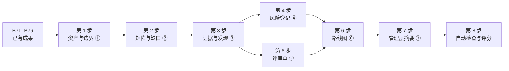
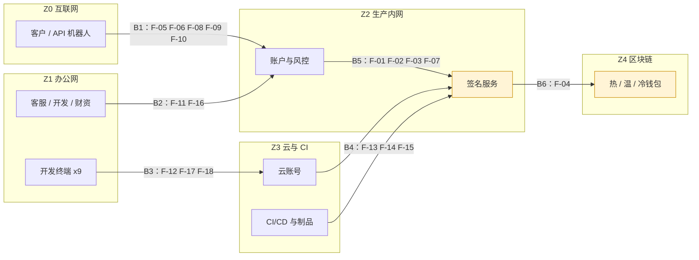
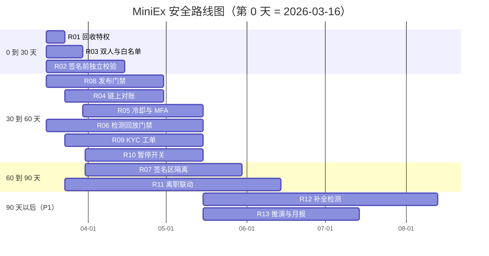

# B77 毕业项目：为 MiniEx 交付安全架构评估与 90 天路线图

> 学习目标：做完本章，你能——
> 1. 把 B71–B76 的成果合成一份对 MiniEx 的安全架构评估：7 件交付物，每个结论都有可复跑的证据。
> 2. 按 X01 的 P0 / P1 / P2 判据排出 90 天路线图，写明人力、依赖和度量目标，并让脚本检查它没有漏掉任何未完成的 P0 控制。
> 3. 写出一页管理层摘要：红线项、基线指标、需要管理层决定的事项。
>
> 前置知识：做完 [B71](B71-control-matrix-practice.md)–[B76](B76-tabletop-postmortem-practice.md)；读过 [X01 安全体系怎么搭](../arch/X01-security-program-controls.md) 与 [X07 交易所安全架构总览](../arch/X07-cex-architecture-overview.md)；会运行 `python3` 和写简单 SQL。不需要 Foundry。
> 预计用时：约 8–10 小时（可拆成 3 个半天）。
> 关联章节：[B70 L3 导读](B70-offchain-l3-guide.md)｜[X01](../arch/X01-security-program-controls.md)｜[X06 韧性与验证](../arch/X06-resilience-validation.md)｜模板 [T08 控制矩阵与风险登记表](../templates/T08-control-matrix-risk-register.md)｜[T12 安全架构评审单](../templates/T12-security-architecture-review.md)｜[A02 定级与报告](../assessment/A02-risk-rating-reporting.md)
> 参考实现：`practice-example-code/ops/solutions/b77/`（`evidence.py`、`check_capstone.py` 与 4 份参考 CSV）
> 最后核对：2026-11-23（本章全部命令在本机用系统 `python3` 运行过；输出来自真实运行，数值由靶场默认种子 20260301 决定）

> ⚠️ 警告：法律与道德边界。MiniEx 是虚构的交易所，所有数据由脚本合成。本章的方法只用在你自己的机器和你被授权评估的系统上。真实评估要有书面授权、范围和保密约定。

---

## 开场：董事会前的最后一周

MiniEx 的董事会下周开会。安全负责人在前五周做了六件事：建矩阵、写风控规则、写检测规则、做签名校验、审流水线、办一次推演。每件事都有结果。

CEO 只问了三个问题：现在最危险的是什么？这个季度要花多少人？我要批准什么？

六份结果放在桌上，没有一份能直接回答。矩阵说覆盖率 31.1%。规则说召回 2/3。推演说 MTTD 48.1 分钟。这些数字对董事会没有意义，除非有人把它们连成一个故事：**哪些问题已经发生，哪些会在 24 小时内造成不可逆损失，先做什么，花多少人，怎样证明做完了。**

本章就是写这个故事。它不新增勘察。它要求你把已有的证据变成判断，并让每个判断经得起追问："证据在哪里？"

## 1. 项目目标与边界

### 1.1 目标

对 MiniEx 交付一份安全架构评估。读者是三类人：

| 读者 | 要从评估里得到什么 |
|---|---|
| 管理层（CEO、CTO、风控负责人） | 红线项、要做的决定、要花的人力 |
| 工程负责人（平台、钱包、风控、发布） | 每条发现的证据、建议和负责的路线图条目 |
| 审计与监管 | 控制矩阵、风险登记、已接受风险的签字记录 |

### 1.2 边界

| 项 | 范围 |
|---|---|
| 评估对象 | MiniEx 的资金与签名链路、账户与提币风控、云与生产环境、发布流水线、内部人权限 |
| 数据窗口 | 靶场的 14 天日志：2026-03-01 至 2026-03-15（UTC） |
| 评估日 | 2026-03-15（`check_capstone.py` 的 `--asof` 默认值） |
| 方法 | 数据勘察、规则回放、策略引擎回放、静态审查、桌面推演 |
| 不做 | 渗透测试；访谈；配置检查；对第三方 KYC 与支付渠道的评估 |

> 💡 注意：14 天日志只能证明"发生过什么"，不能证明"没有别的事"。日志里没有出现的控制，本章记为"未见证据"。真实评估还要加访谈与配置检查。评估报告要写明这条局限。

> 🎯 打个比方：评估像一次体检。验血（日志勘察）、拍片（规则回放）、问诊（推演）各出一份报告。毕业项目是医生写的总结：哪项指标已经越线，先治哪里，几周后复查。局限：医生的总结不能比检查更乐观。没有做的检查，要写"未检查"。

## 2. 交付物清单与格式

| # | 交付物 | 文件 | 来源 | 评分项 |
|---|---|---|---|---|
| ① | 资产清单与信任边界图 | `b77-lab/assets.csv`、第 5 节的图 | B71 第 1–2 步 | 1 |
| ② | 控制矩阵、覆盖率、缺口排序 | `b77-lab/my_matrix.csv` | B71 第 6–7 步 | 2 |
| ③ | 证据表与发现清单 | `b77-lab/evidence.csv`、`b77-lab/findings.csv` | B71–B76 | 3、4 |
| ④ | 风险登记与已接受风险 | `b77-lab/risks.csv` | T08 第 3–4 部分 | 5 |
| ⑤ | 架构评审单 | `b77-lab/review.md` | T12 | 6 |
| ⑥ | 90 天路线图 | `b77-lab/roadmap.csv` | X01 §4.3、§6.3 | 7 |
| ⑦ | 管理层一页摘要 | `b77-lab/summary.md` | X01 §7.1 | 8 |

证据、发现、风险和路线图的格式（`check_capstone.py` 按这些列检查）：

| 文件 | 列 |
|---|---|
| `evidence.csv` | `evidence_id`、`source`、`command`、`result`、`answer_ids`、`status` |
| `findings.csv` | `finding_id`、`title`、`severity`、`evidence_ids`、`impact`、`recommendation`、`control_ids`、`matrix_ids` |
| `risks.csv` | `risk_id`、`description`、`finding_ids`、`control_ids`、`likelihood`、`impact`、`level`、`treatment`、`owner`、`due`、`status`、`accepted_by`、`compensating_control`、`accept_expiry` |
| `roadmap.csv` | `item_id`、`title`、`control_ids`、`finding_ids`、`priority`、`start_day`、`end_day`、`owner_role`、`person_days`、`depends_on`、`metric`、`baseline`、`target`、`override_reason` |

规则：

- 一个字段里有多个值，用英文分号 `;` 分隔。字段内的逗号用中文逗号"，"。
- `severity` 取 严重 / 高 / 中 / 低（定级口径见第 7 节）。
- `control_ids` 填 X 章的控制 ID（`TRS-5`、`IC-04` 这类），`matrix_ids` 填你矩阵里的行（`C-10`）。
- 没有证据的发现不得分。`evidence_ids` 必须指向 `evidence.csv` 里真实存在的行。

## 3. 工作流



读图要点：
- 证据在中间。矩阵告诉你"哪些控制弱"，证据告诉你"弱到什么程度、有没有已经发生的事件"。风险、评审单和路线图都从发现清单里来。
- 路线图在风险登记之后。路线图回答"先做什么"，风险登记回答"没做之前，谁承担什么"。
- 局限：图是单向的，真实项目会回头。写路线图时发现缺证据，要回到第 3 步补。

> 💡 注意：时间安排。第 0–2 步约 1.5 小时（多数是复用）；第 3 步约 3 小时；第 4–5 步约 2 小时；第 6–7 步约 2 小时；第 8 步约 0.5 小时。

## 4. 第 0 步：准备

所有命令从 `web3-security-handbook/` 根目录出发。

```bash
cd /Users/k/Workon/Learning/web3
bash practice-example-code/ops/setup.sh --no-tests | tail -2
```

```text
  endpoint_events       2540 行
靶场已就绪：数据在 practice-example-code/ops/data/，答案在 practice-example-code/ops/answers/（练习做完再看）
```

（第一行的 `cd` 只对作者的机器有意义。读者已经在自己克隆的 `web3-security-handbook/` 里。）

建工作目录，复用 B71 的成果：

```bash
mkdir -p b77-lab
ls b71-lab/ 2>/dev/null || echo "没有 b71-lab：用参考文件代替"
```

如果你做过 B71，`b71-lab/` 里有 `assets.csv` 和 `my_matrix.csv`，复制过来：

```bash
cp b71-lab/assets.csv b71-lab/my_matrix.csv b77-lab/
```

如果你没有这两个文件，用参考实现代替。矩阵的参考文件和 B71 第 6 节的矩阵逐字相同：

```bash
cp -n practice-example-code/ops/solutions/b71/matrix.reference.csv b77-lab/my_matrix.csv
cp -n practice-example-code/ops/solutions/b77/assets.reference.csv b77-lab/assets.csv
ls b77-lab
```

```text
assets.csv
my_matrix.csv
```

> 💡 注意：`cp -n` 不会覆盖已有的文件。自己做的成果比参考文件好。评分只看文件内容，不看来源。但参考文件只用来补缺，不替你判断。

## 5. 第 1 步：资产清单与信任边界图（交付物 ①）

这一步不重新勘察。复核 B71 的清单，再给边界图加一层：**把发现挂到边界上**。

```bash
python3 -c "
import csv
from collections import Counter
rows = list(csv.DictReader(open('b77-lab/assets.csv', encoding='utf-8')))
print('资产', len(rows), '项；', dict(sorted(Counter(r['level'] for r in rows).items())))
print('缺证据的行：', [r['asset_id'] for r in rows if not r['evidence'].strip()] or '无')"
```

```text
资产 15 项； {'L1': 8, 'L2': 7}
缺证据的行： 无
```

边界图用 B71 的六条边界（B1–B6）。第 3 步写完发现清单后，回来把发现 ID 标在边界上。参考版：



读图要点：
- 边界上的 F 编号越多，这条边界越值得先看。B5（账务到签名服务）挂着 4 条发现，其中 3 条是"严重"。
- 金色节点是最后两关。最后两关出问题，前面所有区域的控制都已经失效。
- 局限：F-19（规则盲区）不属于某一条边界，它是整个检测体系的问题，所以图里没有它。
- 这是"评估版"的图：它标的是**发现**，不是**架构**。B71 的图标的是架构。

<details class="predict"><summary>🤔 先猜再看：为什么 B5 边界上挂的发现最严重，但它的入口（账务）不在互联网上？</summary>

攻击者不需要从 B5 进入。S6 的三次事件里，攻击者先拿到了"能向签名服务发请求"的位置，再伪造请求。B5 是最后一道独立检查。它的校验缺失，会让前面所有被攻破的区域都变成"资金转出"。这就是 X07 里"最后两关要独立判断"的意思。

</details>

## 6. 第 2 步：控制矩阵与缺口排序（交付物 ②）

复用 B71 的矩阵，重新计算一次，确认数字没变：

```bash
python3 practice-example-code/ops/solutions/b71/matrix_gap.py b77-lab/my_matrix.csv | sed -n 5,16p
```

```text
保护域         控制数      覆盖率     缺口分   有效预防  有效检测  有效恢复
身份与账户         2    30.0%     3.5      是        否        否
提币与风控         3    33.3%     6.0      是        否        否
交易与清算         2    60.0%     2.0      是        否        否
钱包与资金         2    25.0%     4.5      是        否        否
签名服务           3    37.5%     5.0      是        否        否
云与生产环境       3    28.6%     5.0      否        否        否
开发与发布         3    50.0%     3.5      是        否        否
检测与响应         2     0.0%     5.0      否        否        否
数据与合规         2    25.0%     4.5      是        否        否
内部人与权限       3    18.8%     6.5      是        否        否
合计              25    31.1%    45.5
```

再数出路线图要处理的对象：未完全实施的 P0 与 P1 控制：

```bash
awk -F, 'NR>1 && $5=="P0" && $8!="implemented"' b77-lab/my_matrix.csv | wc -l
awk -F, 'NR>1 && $5=="P1" && $8!="implemented"' b77-lab/my_matrix.csv | wc -l
```

```text
      15
       8
```

15 条 P0 和 8 条 P1 是第 6 步路线图的"待办总数"。矩阵 25 条控制里只有 2 条是 `implemented`（C-06 账务平衡、C-15 审计日志集中保存）。

> 💡 注意：矩阵在毕业项目里可以改。如果你在第 3 步发现了新的缺口（例如暂停开关失效），回到矩阵补一行或改一行，并让 `evidence_ref` 指向新证据。**改矩阵要留痕**：在 `my_matrix.csv` 旁边保留旧版本。

## 7. 第 3 步：证据表与发现清单（交付物 ③）

这是毕业项目最重的一步。分三小步：收集证据，定级，写发现。

### 7.1 收集证据：一条命令重跑 B71–B76

`evidence.py` 把 B71–B76 的关键检查重新跑一遍：20 条 SQL 勘察，14 次规则回放，1 次签名策略回放，1 次 workflow 静态检查。每条证据记录命令、真实输出和它支持的标准答案 ID。

```bash
python3 practice-example-code/ops/solutions/b77/evidence.py --out b77-lab/evidence.csv
```

```text
已写入 b77-lab/evidence.csv：36 条证据，0 条与预期不符
```

"与预期不符"是脚本的自检：每条证据都带一个 `expect` 字符串（例如 `without_approval=1`）。如果输出里没有它，说明数据或脚本变了，脚本以退出码 1 结束。

看几条关键证据：

```bash
python3 - <<'EOF'
import csv
for r in csv.DictReader(open('b77-lab/evidence.csv', encoding='utf-8')):
    if r['evidence_id'] in ('E02', 'E06', 'E07', 'E25', 'E29', 'E35'):
        print(r['evidence_id'], '|', r['source'], '|', r['result'], '|', r['answer_ids'] or '-')
EOF
```

```text
E02 | B71 Q11 | approval_id=AP-W000889，approved_by=ST033，approver_count=1，amount_usd=25000.0 | S1-03
E06 | B71 Q15 | withdrawals_on_chain=1249，without_request=2 | S6-01;S6-02
E07 | B71 Q16 | requests=1302，without_approval=1 | S6-01
E25 | B72 | 命中 1，TP 1，误报 0，召回 1/3 | S3-01
E29 | B73 | 命中 5，TP 3，误报 2，召回 3/3 | S6-01;S6-02;S6-03
E35 | B74 | 放行 1293，拒绝 6，升级人工 3；漏掉的 S6：无 | S6-01;S6-02;S6-03
```

证据表里的 36 条分四类：

| 范围 | 内容 |
|---|---|
| E01–E20 | SQL 勘察（B71 的 Q10–Q24，B76 的缺口查询）。E05（账务平衡）和 E14（无工单占比）是"控制在运行"或"程度"的证据，不对应单个事件 |
| E21–E34 | 参考规则回放（B72–B75）。`answer_ids` 取自 `replay.py` 的 `recalled_ids`，是真实命中的答案 |
| E35 | B74 的签名策略引擎：对 1302 个签名请求逐条独立校验 |
| E36 | B75 的 workflow linter：对 `release.yml` 的静态检查 |

> ⚠️ 警告：`answer_ids` 里的答案 ID（S1-01、G1 等）来自靶场的标准答案，是练习用的"事后知道真相"。**真实评估没有标准答案**。在真实评估里，这一列写的是"事件 ID"或"工单号"。本章用答案 ID，是为了让脚本能判断你有没有遗漏。

### 7.2 定级口径

发现的严重度取四档，沿用 [A02](../assessment/A02-risk-rating-reporting.md) 的名称，口径按"运营"调整：

| 严重度 | 判据 | MiniEx 示例 |
|---|---|---|
| 严重 | 事件已经发生，L1 资产（资金、密钥、签名权）已不可逆流出或被触达 | F-01 无审批单的签名请求，链上已转出 |
| 高 | L1 资产的预防控制缺失或被绕过，24 小时内可造成不可逆损失；或客户资料可被大规模取得 | F-06 新地址冷却没有生效 |
| 中 | 让攻击更容易，或让检测失明，但单独不会造成 L1 损失 | F-10 对敲没有监测 |
| 低 | 加固项，不影响 L1 | 本章没有低危发现 |

### 7.3 写发现

`findings.csv` 每行一条发现。一条发现回答六个问题：

| 列 | 回答 |
|---|---|
| `title` | 发生了什么（一句话，带数字） |
| `severity` | 多严重（按 7.2） |
| `evidence_ids` | 证据在哪里（`evidence.csv` 里的行） |
| `impact` | 如果不修，会怎样 |
| `recommendation` | 做什么能关闭它 |
| `control_ids` / `matrix_ids` | 对应 X 章的控制，对应你矩阵里的行 |

下面是三条示范（完整的 19 条在参考文件 `findings.reference.csv`，做完自己的再看）：

```text
F-01  严重  E06;E07;E29;E30;E35  TRS-5;TRS-10;TRS-11  C-10;C-09
      S6-01 签名服务签了一个没有审批单的请求，热钱包链上转出约 48000 美元
F-06  高    E03;E22              IC-06;IC-07          C-04
      新提币地址 24 小时冷却没有生效：11 笔 1000 美元以上提币在新地址加入后 24 小时内发生
F-18  高    E17                  INF-8;INF-10         C-24
      G3 ST051 的 cloud_admin 没有审批人
```

写发现时的三条规则：

1. **一条发现一个根因。** S6 的三次事件根因相同：签名前只查"审批单存在"，不查目标是否一致。但它们的影响和证据不同，所以写成 F-01、F-02、F-03 三条。
2. **证据要比结论"小"。** 证据是一条命令和一行输出。结论是你的判断。不要把判断写进证据列。
3. **建议要能验证。** 写"加强审批"不行。写"2 万美元及以上必须 2 个不同审批人，用 E02 的 SQL 验证结果为 0 行"可以。

<details class="predict"><summary>🤔 先猜再看：24 个应当发现的项里，哪几项只靠一条规则回放抓不全？</summary>

S1-03 不被撞库规则（r01）抓到，要靠"改绑后加地址"规则（r03）。S6-03 不被"链上出金无申请"规则（r10）抓到，要靠"审批单与请求目标对账"（r09 或 B74 的引擎）。S3-02 与 S3-03 被 20000 美元的手册阈值漏掉，要把阈值调到 8000。**单条证据支持单条规则的结论，不支持"这类攻击已被覆盖"的结论。** 所以发现清单里一条发现常引用多条证据。

</details>

### 7.4 检查你的发现清单

在跑评分之前，先用几行脚本做自检：

```bash
cp -n practice-example-code/ops/solutions/b77/findings.reference.csv b77-lab/findings.csv   # 只在你还没写完时用
python3 -c "
import csv
from collections import Counter
rows = list(csv.DictReader(open('b77-lab/findings.csv', encoding='utf-8')))
print(len(rows), '条发现；', dict(Counter(r['severity'] for r in rows)))
print('没有证据的发现：', [r['finding_id'] for r in rows if not r['evidence_ids'].strip()] or '无')"
```

```text
19 条发现； {'严重': 4, '高': 12, '中': 3}
没有证据的发现： 无
```

> 💡 注意：上面的 `cp -n` 把参考答案复制成你的发现清单（已有文件不会被覆盖）。这只用来跑通后面的步骤。如果你要拿分，请先写自己的，再看参考。

> 🧪 动手验证：用文本编辑器打开 `b77-lab/findings.csv`，删掉 F-01 的 `evidence_ids`。评分会怎样？先预测，再运行（第 12.1 节有实验）。

## 8. 第 4 步：风险登记与已接受风险（交付物 ④）

发现是"现在有什么问题"。风险登记是"没修之前，谁在承担什么"。T08 第 3 部分的规则：**控制失效就登记**。本章的约定：每条未完全实施的 P0 控制，至少出现在一条风险的 `control_ids` 里。

风险条目的写法（条件在前，结果在后）：

| 列 | 写什么 |
|---|---|
| `description` | 如果……，会……（一句话） |
| `likelihood` / `impact` | 1–5 的整数。评分口径写成文字，例如"影响 5 = 可能造成 L1 资产不可逆损失" |
| `level` | 可能性 × 影响：≥ 15 高；8–14 中；≤ 7 低（T08 的口径） |
| `treatment` | 整改 / 转移 / 接受 / 取消 |
| `owner`、`due` | 负责人角色与计划完成日 |
| `accepted_by`、`compensating_control`、`accept_expiry` | 只有"接受"才填：批准人、补偿控制、到期日 |

接受风险的规则（来自 T08 第 4 部分，本章用脚本检查）：

1. 必须有补偿控制。没有补偿控制，不得接受。
2. 必须有到期日，且不超过 6 个月。
3. 必须有批准人。涉及 L1 资产的高风险，由管理层成员批准。
4. L1 资产上的风险不允许无限期接受。

参考答案登记了 12 条风险：10 条整改，2 条接受。两条已接受风险都不涉及 L1：

| 风险 | 为什么可以接受 | 补偿控制 |
|---|---|---|
| R-011 文档站官方 Action 用标签引用（28 次运行） | 文档站没有发布凭证与签名权限 | 每月自动检查标签是否移动 |
| R-012 对敲规则暂时不覆盖做市商账户 | 回放显示去掉做市商后误报归零；做市商另有单独阈值 | 做市商单独阈值；每月人工抽查 20 笔大额成交 |

> ⚠️ 警告：**不要接受 S6 类风险。** 签名服务签没有审批单的请求，是 L1 资产上的、已经发生过的事件。它不能"接受 90 天"。T08 的规则 4 禁止在 L1 资产上无限期接受，评分表里这是红线。

做完后检查：

```bash
cp -n practice-example-code/ops/solutions/b77/risks.reference.csv b77-lab/risks.csv   # 只在你还没写完时用
python3 -c "
import csv
rows = list(csv.DictReader(open('b77-lab/risks.csv', encoding='utf-8')))
for r in rows:
    v = int(r['likelihood']) * int(r['impact'])
    print(r['risk_id'], v, r['level'], r['treatment'], r['control_ids'])" | head -5
```

```text
R-001 20 高 整改 C-10;C-09;C-08
R-002 20 高 整改 C-01;C-04
R-003 12 中 整改 C-03
R-004 12 中 整改 C-05
R-005 15 高 整改 C-11;C-13
```

## 9. 第 5 步：架构评审单（交付物 ⑤）

[T12](../templates/T12-security-architecture-review.md) 的原意是评审"新系统上线"。毕业项目把它用在**现状评审**：被评审的"系统"是 MiniEx 的提币与签名链路，结论是"现状能不能继续运行 L1 业务"。

T12 有 7 个部分。毕业项目写其中 5 个，并且每一处都引用前面的发现：

| T12 部分 | 本章怎么写 | 来源 |
|---|---|---|
| 1 基本信息 | 评审对象、资产级别 L1、评审深度 L1（全部部分） | 第 1 节 |
| 2 信任边界与组件 | 引用第 5 节的边界图 | ① |
| 4 威胁与控制映射 | 把 B71 的 T1–T10 映射到控制行与发现 | ②、③ |
| 6 上线门禁 | 逐项给"通过 / 不通过"和证据 | ③ |
| 7 遗留风险签字 | 只列需要管理层签字的遗留风险 | ④ |

写 `b77-lab/review.md`。下面是参考版：

```bash
cat > b77-lab/review.md <<'EOF'
# T12 现状评审单：MiniEx 提币与签名链路

## 1. 基本信息
- 评审对象：提币链路（账户与风控 -> 账务 -> 签名服务 -> 钱包）。评估日 2026-03-15。
- 资产级别：L1。评审深度：L1（全部部分）。
- 评审人：安全负责人（示例角色）。业务负责人：CTO（示例角色）。

## 2. 信任边界与组件
- 边界 B1–B6 见交付物 ①。本评审关注 B5（账务到签名服务）与 B6（签名服务到链）。

## 4. 威胁与控制映射
| 威胁 | 边界 | 控制行 | 发现 | 状态 |
|---|---|---|---|---|
| T1 账户接管后向新地址提币 | B1 | C-01 C-02 C-04 | F-05 F-06 | 失效 |
| T2 API Key 被加提币权限 | B1 | C-05 | F-08 | 部分 |
| T6 签名服务收到无审批单或被换地址的请求 | B5 | C-09 C-10 | F-01 F-02 F-03 | 失效 |
| T7 终端失陷进入签名区 | B3 | C-11 C-13 C-14 | F-12 F-17 | 失效 |
- 4.1 每条 L1 边界有预防控制：不通过。B5 有"审批单存在"检查，没有"目标一致"检查。
- 4.2 无单点转出：不通过。S6-01 的请求没有任何人批准，也被签名。
- 4.4 失效假设：不通过。签名校验失效后，下一层（三方对账）只在事后发现。

## 6. 上线门禁（对照现状）
| # | 门禁 | 结论 | 证据 |
|---|---|---|---|
| 6.2 | 严重 / 高危发现已修复或已签字 | 不通过：4 条严重，12 条高 | findings.csv |
| 6.3 | 暂停能力已测试 | 不通过：S6-01 之后 289 个请求照常签名 | E09 |
| 6.4 | 限额已配置 | 未见证据：日志里没有限额事件 | - |
| 6.5 | 监控已上线 | 部分：规则存在，没有回放验证 | E21 E29 |
门禁结论：附条件继续运行。条件：R02、R03、R10 在 30 天内完成。

## 7. 遗留风险签字
| 风险 | 遗留风险描述 | 补偿控制 | 到期日 | 批准人 |
|---|---|---|---|---|
| R-001 | 签名前只查审批单是否存在 | 链上出金逐笔对账；每日人工复核无申请出金 | 2026-04-15 | CEO（示例角色） |
EOF
wc -l b77-lab/review.md
```

```text
      34 b77-lab/review.md
```

读法：
- 评审单的结论是"附条件继续运行"，不是"暂缓"。MiniEx 是在线业务，没有"暂缓上线"这个选项。T12 的 4 个结论（可上线、附条件、暂缓、否决）里，现状评审只能选"附条件"或"否决"。
- 第 7 部分只有一条。T12 要求带红线项的遗留风险由管理层批准。S6 类风险没有补偿控制就不能留，所以补偿控制写"逐笔对账加每日人工复核"，并且 R02 上线后换掉它。
- 局限：6.4 写"未见证据"。数据里没有限额事件，不等于没有限额。真实评估要去配置里看。

## 10. 第 6 步：90 天路线图（交付物 ⑥）

路线图回答三个问题：先做什么，谁做，怎样证明做完了。

### 10.1 排优先级：用 X01 的判据

X01 §4.3 的判据：

| 优先级 | 判据 | 期限 |
|---|---|---|
| P0 | 失效后 L1 资产可能在 24 小时内遭受不可逆损失；或监管、合同强制要求 | 90 天内 |
| P1 | 失效后让攻击者更容易获得 L1 入口；或造成大规模数据泄露 | 180 天内 |
| P2 | 提高成熟度，减少运营成本 | 365 天内或按需 |

三条使用规则：

1. **矩阵的优先级是起点。** 路线图的优先级可以调高，不能调低。调高必须写 `override_reason`。
2. **P0 太多做不完时，按"覆盖的 L1 威胁数 ÷ 人天"排序。** X01 §4.3 给了这个比值。下表是示例估算（人天是估计值，不是测量值）：

| 条目 | 做什么 | 覆盖的 L1 威胁 | 人天（示例） | 比值（示例） |
|---|---|---:|---:|---:|
| R01 | 回收离职、过期、无审批的特权 | 2（T9、T10） | 3 | 0.67 |
| R03 | 大额双人与 Key 白名单强制 | 2（T1、T2） | 6 | 0.33 |
| R06 | 检测规则回放门禁 | 8（T1–T8） | 20 | 0.40 |
| R10 | 暂停开关与 runbook | 2（T6、T7） | 12 | 0.17 |
| R08 | 发布门禁 | 1（T8） | 12 | 0.08 |
| R02 | 签名前独立校验 | 1（T6） | 25 | 0.04 |

3. **比值低的 P0 不能因此推迟。** R02 的比值只有 0.04，但它直接关闭 3 条"严重"发现。比值用来在"同样紧迫"的条目里排序，不用来决定"做不做"。

> ⚠️ 警告：**S6 类发现不按比值排。** 已经发生过的、L1 上的事件，先做。R02 排在最前，不是因为比值，是因为它对应已经发生的 F-01 到 F-03。

### 10.2 一个调高优先级的例子

矩阵里 C-12（暂停开关与 runbook）是 P1。路线图里 R10 把它调成 P0，理由写在 `override_reason`：

```text
S6-01 之后 289 个请求照常签名：暂停失效等于 L1 损失继续，按 X01 的 P0 判据升级
```

证据是 E09：S6-01（03-06 16:20）到 S6-02（03-09 21:05）之间，签名服务又处理了 289 个请求，全部签名。

### 10.3 写 roadmap.csv

每个条目要有：控制 ID、负责角色、人天、依赖、**度量**（基线与目标）。参考版有 13 个条目：

```bash
cp -n practice-example-code/ops/solutions/b77/roadmap.reference.csv b77-lab/roadmap.csv   # 只在你还没写完时用
awk -F, 'NR>1 {n[$5]++} END {for (k in n) print k, n[k]}' b77-lab/roadmap.csv | sort
awk -F, 'NR>1 && $7<=90 {s+=$9} END {print s " 人天（90 天内）"}' b77-lab/roadmap.csv
```

```text
P0 11
P1 2
188 人天（90 天内）
```

按期限看：



读图要点：
- 最先完成的是 R01（7 天）和 R03（14 天）。它们人天最少，覆盖的威胁多，也不依赖别人。
- R02、R06、R08 也从第 0 天开始，因为它们互不依赖。R02 最重，要在 30 天内完成，它对应 3 条严重发现。
- 90 天后只剩 P1。依赖关系：R05 依赖 R03，R07 和 R11 依赖 R01，R12 依赖 R06，R13 依赖 R10。
- 局限：甘特图只画时间，不画人力冲突。第 10.4 节检查人力。

### 10.4 检查人力与依赖

90 天内的总人天是 188。假设 MiniEx 有 2 名安全工程师，加上平台、钱包、风控、发布各 0.5 名兼职，共约 4 名全职当量。90 天约 60 个工作日，每人每天有效 0.8：4 × 60 × 0.8 = 192 人天。这是示例假设，你要写出自己的假设。

`check_capstone.py` 的 `--capacity` 参数就是这个上限。超过上限，评分表里该项丢 1 分，同时你要在摘要里请求加人或砍范围。

依赖的检查规则：被依赖条目的 `end_day` 必须不晚于本条目的 `start_day`。

## 11. 第 7 步：管理层一页摘要（交付物 ⑦）

管理层摘要只回答三个问题：现在有什么红线，要做什么，需要我决定什么。X01 §7.1 的指标里有三个直接用得上：**红线项**（不平均，出现就上报）、**已接受风险数**、**控制覆盖率**。

规则：

1. 一页。不超过 1200 个字符（用 `wc -m` 数）。
2. **红线项写在最前面。** 红线项是"不允许出现的状态"。出现了就写，不加修饰。
3. 指标只写有数据的。14 天日志只有一个时间点，没有趋势。"趋势"栏写"基线"，下个月起更新。**不要编造趋势。**
4. 需要决策的事，每件写成"批准 / 不批准"的形式。

参考版：

```bash
cat > b77-lab/summary.md <<'EOF'
# MiniEx 安全架构评估：管理层摘要

评估日 2026-03-15。数据窗口 14 天。评估人：安全负责人（示例角色）。

## 结论
MiniEx 的资金链路有 3 次已发生的签名服务异常：3 个请求都被签名，其中 S6-01 与 S6-02 的资金已上链转出。矩阵覆盖率 31.1%，没有一个保护域的检测控制通过验证。建议"附条件继续运行"，条件是 30 天内完成 R01–R03。

## 红线项（出现即上报）
1. 签名服务签了 3 个没有对应审批或目标不一致的请求（S6-01 约 48000 美元；S6-02 60000 USDT；S6-03 250000 USDT，温转热调拨）。
2. S6-01 之后签名服务没有暂停：289 个请求照常签名。
3. 1 笔 25000 美元提币只有 1 个审批人（门槛是 2 人）。
4. 离职员工 ST015 的客户资料权限仍有效，且有 1 次访问。
5. 14 天内没有一条检测规则经过回放验证。

## 基线指标
| 指标 | 基线 | 90 天目标 | 趋势 |
|---|---|---|---|
| 控制覆盖率（加权） | 31.1% | 以验证记录为准，目标 60% 以上（示例） | 基线 |
| 未完全实施的 P0 控制 | 15 条 | 0 条 | 基线 |
| 严重 / 高发现 | 4 / 12 | 0 / 0 | 基线 |
| 无审批单的已签名请求 | 3 | 0 | 基线 |
| 无工单的客户资料访问 | 5.4% | 0% | 基线 |
| 已接受风险 | 2 条（均非 L1） | 不增加 | 基线 |

## 做得好的
账务双分录借贷全部平衡（0 组不平）。2 万美元及以上提币 15 笔中有 14 笔是 2 人复核。S7-02 的 K8s 读取被权限挡住（403）。

## 需要管理层决定
1. 批准 90 天路线图：13 个条目，90 天内 188 人天，其中 R01–R03 在 30 天内完成。批准 / 不批准。
2. 批准加人或砍范围：现有可用约 192 人天，余量 4 人天。批准 / 不批准。
3. 授权安全负责人在 S6 类事件确认后，30 分钟内暂停签名服务，再通知管理层。批准 / 不批准。
4. 批准"新提币地址 24 小时冷却"：会增加首次提币用户的等待。批准 / 不批准。
5. 批准 2 条已接受风险（R-011、R-012），到期日 2026-09-01。批准 / 不批准。

## 局限
只有 14 天日志，没有访谈、配置检查和渗透测试。未见证据的控制按"未实施"处理。
EOF
wc -m b77-lab/summary.md
```

```text
    1078 b77-lab/summary.md
```

（`wc -m` 数的是字符数，包含英文、数字和标点。本章用 1200 个字符作为"一页"的上限。）

读法：
- 红线项有 5 条。每条都能在发现清单里找到证据：1 对应 F-01 到 F-03；2 对应 F-04；3 对应 F-07；4 对应 F-16；5 对应 F-19。
- "做得好的"不能省。管理层要知道哪些控制在运行，才能判断建议是不是过度。
- 第 3 个决策最重要。它不花钱，但它决定了 S6 类事件发生时，谁能按下暂停键。X05 的 DET-9 要求"指挥官有权暂停业务"。
- 第 4 个决策是业务取舍：安全控制有成本。让管理层选，不要替管理层选。

## 12. 第 8 步：一条命令重建，并自动检查

评分项 9 要求**可复现**：任何人拿到你的目录，一条命令就能重建证据并检查交付物。写 `b77-lab/rebuild.sh`：

```bash
cat > b77-lab/rebuild.sh <<'EOF'
#!/usr/bin/env bash
# 从 web3-security-handbook/ 根目录运行：bash b77-lab/rebuild.sh
set -e
OPS=practice-example-code/ops
python3 $OPS/solutions/b77/evidence.py --out b77-lab/evidence.csv
python3 $OPS/solutions/b71/matrix_gap.py b77-lab/my_matrix.csv | grep "^合计"
python3 $OPS/solutions/b77/check_capstone.py --dir b77-lab --capacity 192 "$@"
EOF
bash b77-lab/rebuild.sh --manual 28
```

```text
已写入 b77-lab/evidence.csv：36 条证据，0 条与预期不符
合计              25    31.1%    45.5
自动判分（目录 b77-lab，评估日 2026-03-15）
  2 控制矩阵与缺口排序             10.0 / 10  域 10/10，有证据行 25/25，覆盖率 31.1%，缺口分 45.5
  3 发现清单：覆盖               25.0 / 25  覆盖 24/24；遗漏：无
  4 发现清单：质量               15.0 / 15  合格 19/19；无证据：无；字段问题：无
  5 风险登记与已接受风险             8.0 / 8   未完全实施的 P0 有登记 15/15；等级一致 12/12；已接受风险合格 2/2
  7 90 天路线图               14.0 / 14  P0 在 90 天内 15/15；P1 在 180 天内 8/8；依赖合法 13/13；90 天内 188 人天（上限 192）
  自动判分合计                  72.0 / 72
  人工评分                    28.0 / 28   第 1、6、8、9 项由人工评分（--manual 填入）
总分 100.0 / 100，红线 0 条 -> 通过
```

上面的 100 分是用参考答案跑出来的，并且 `--manual 28` 把人工项按满分计。你自己的交付物，先不加 `--manual`，看自动判分；人工项对着第 13 节的评分表自己打分，再把总数填进 `--manual`。

不加 `--manual` 时，满分只有 72，低于过关线 80，脚本会提示"不通过"。这是故意的：**人工项没打分前，不能说通过**。

```bash
python3 practice-example-code/ops/solutions/b77/check_capstone.py | tail -3
```

```text
  自动判分合计                  72.0 / 72
  人工评分                     0.0 / 28   第 1、6、8、9 项由人工评分（--manual 填入）
总分 72.0 / 100，红线 0 条 -> 不通过
```

### 12.1 三个"改坏"实验

检查脚本只有在你看过它报警，才值得信任。做三个实验。每个都在一个复制目录里做，不动你的文件。

**实验 1：删掉 S6 发现的证据。** 把 F-01、F-02、F-03 的 `evidence_ids` 清空：

```bash
mkdir -p b77-lab-bad && cp b77-lab/* b77-lab-bad/
python3 - <<'EOF'
import csv
rows = list(csv.DictReader(open('b77-lab-bad/findings.csv', encoding='utf-8')))
for r in rows:
    if r['finding_id'] in ('F-01', 'F-02', 'F-03'):
        r['evidence_ids'] = ''
w = csv.DictWriter(open('b77-lab-bad/findings.csv', 'w', encoding='utf-8', newline=''), fieldnames=list(rows[0]))
w.writeheader(); w.writerows(rows)
EOF
python3 practice-example-code/ops/solutions/b77/check_capstone.py --dir b77-lab-bad --manual 28 | tail -5
```

```text
红线：F-01 是严重发现，但没有有效证据
红线：F-02 是严重发现，但没有有效证据
红线：F-03 是严重发现，但没有有效证据
红线：遗漏 S6 类高危：S6-03
总分 96.6 / 100，红线 4 条 -> 不通过
```

总分还有 96.6，但结论是"不通过"。**红线不看总分。** S6-01 和 S6-02 仍被覆盖，是因为 F-19 引用了 E30，而 E30 的 `answer_ids` 里有它们；S6-03 只有 E29 与 E35 支持，所以丢了。

**实验 2：路线图漏掉 R02 与 R07。**

```bash
cp b77-lab/findings.csv b77-lab-bad/findings.csv
grep -v '^R02,\|^R07,' b77-lab/roadmap.csv > b77-lab-bad/roadmap.csv
python3 practice-example-code/ops/solutions/b77/check_capstone.py --dir b77-lab-bad --manual 28 | tail -2
```

```text
红线：未完全实施的 P0 控制没有在 90 天内排入路线图：C-10、C-11、C-13
总分 98.8 / 100，红线 1 条 -> 不通过
```

**实验 3：已接受风险没有补偿控制。**

```bash
cp b77-lab/roadmap.csv b77-lab-bad/roadmap.csv
sed 's/文档站不含发布凭证与签名权限；每月自动检查标签是否移动//' b77-lab/risks.csv > b77-lab-bad/risks.csv
python3 practice-example-code/ops/solutions/b77/check_capstone.py --dir b77-lab-bad --manual 28 | tail -2
rm -rf b77-lab-bad
```

```text
红线：已接受风险 R-011 缺批准人、补偿控制或到期日（或到期日超过 6 个月）
总分 99.0 / 100，红线 1 条 -> 不通过
```

## 13. 评分表（100 分）

| # | 评分项 | 分值 | 怎么评 | 评分方式 |
|---|---|---:|---|---|
| 1 | 资产清单与信任边界图 | 8 | 清单 ≥ 14 项，L1 与 L2 都有，每项有证据（4 分）；边界图标出 B1–B6，并把发现挂到边界上（4 分） | 人工 |
| 2 | 控制矩阵、覆盖率、缺口排序 | 10 | 10 个域各至少 1 行（4 分）；每行有证据（3 分）；`matrix_gap.py` 运行成功（3 分） | 自动 |
| 3 | 发现清单：覆盖 | 25 | 24 个应当发现的项（21 个事件 + G1–G3），每项 25/24 分；**一项只有被"有效证据"支持才算覆盖** | 自动 |
| 4 | 发现清单：质量 | 15 | 每条发现的证据、严重度、影响、建议、X 章控制 ID、矩阵行齐全且合法；得分 = 15 × 合格条数 ÷ 总条数 | 自动 |
| 5 | 风险登记与已接受风险 | 8 | 每条未完全实施的 P0 控制有风险（4 分）；等级 = 可能性 × 影响（2 分）；已接受风险有批准人、补偿控制、6 个月内到期（2 分） | 自动 |
| 6 | 架构评审单 | 8 | T12 的 1、2、4、6、7 部分齐全（4 分）；每个"不通过"都引用证据（2 分）；结论与发现一致（2 分） | 人工 |
| 7 | 90 天路线图 | 14 | 15 条 P0 在 90 天内（6 分）；P1 在 180 天内（2 分）；优先级不低于矩阵，调高有理由（1 分）；依赖合法（2 分）；每条有负责人、人天、度量与目标（2 分）；90 天人力不超上限（1 分） | 自动 |
| 8 | 管理层一页摘要 | 8 | 红线项在最前面，且每条可追到发现（3 分）；基线指标与目标，不编造趋势（2 分）；决策事项可"批准 / 不批准"（2 分）；一页（1 分） | 人工 |
| 9 | 可复现 | 4 | `rebuild.sh` 一条命令重建证据并检查；另一台机器上结果一致 | 人工 |
| | 合计 | 100 | | |

**过关线：总分 ≥ 80，并且没有红线。优秀：≥ 90。**

### 13.1 红线（任一触发即不通过，不看总分）

| # | 红线 | 为什么 |
|---|---|---|
| 1 | **遗漏 S6 类高危**：S6-01、S6-02、S6-03 中任一项没有被有效证据支持 | 这三次事件是 L1 资产上已发生的资金流出。漏掉它们的评估没有价值 |
| 2 | **严重或高危发现没有有效证据** | 没有证据的发现不得分；严重和高危的无证据发现会误导管理层 |
| 3 | **未完全实施的 P0 控制没有在 90 天内排入路线图** | P0 的定义就是"90 天内完成" |
| 4 | **已接受风险缺批准人、补偿控制或到期日（或超过 6 个月）** | T08 第 4 部分的接受规则 |
| 5 | **管理层摘要里没有红线项，或把已发生的事件写成"风险"** | 已发生的事件是事实，不是概率（人工检查） |
| 6 | **编造数据**：证据里的输出与重跑结果不一致，或摘要里出现没有证据支持的数字 | 评估的价值全部来自可信度（人工检查，脚本只能检查证据 ID 是否存在） |

> 💡 注意：自动判分的第 3、4 项只能检查"有没有证据 ID"，不能检查"证据是不是真的支持你的结论"。后者要人工读。读的时候问：这条命令的输出，能不能让一个陌生人相信这条结论？

## 14. 标准答案对照

做完再看。表里是"应当发现的问题清单"：24 项，来自 `answers/S1.json` 到 `S8.json`、`governance.json`，以及 B71–B76 已验证的结论。**没有新增数据**。

| 答案 ID | 一句话 | 发现 | 严重度 | 关键证据 | X 章控制 ID |
|---|---|---|---|---|---|
| S1-01 | 无 MFA 账户撞库成功，改手机，新地址，28 分钟后提走 18400 USDT | F-05、F-06 | 高 | E01、E22 | IC-01、IC-04、IC-07 |
| S1-02 | 短信找回，重置 MFA，新地址；3 小时后 9200 美元的提币被冻结 | F-05、F-06 | 高 | E21、E22 | IC-03、IC-05、IC-06 |
| S1-03 | 低慢撞库，找回，新地址，22 小时后提 25000 USDT，只有 1 个审批人 | F-06、F-07 | 高 | E02、E22 | IC-06、IC-14 |
| S2-01 | 已有 Key 被加提币权限，新 IP 两次提币共 12900 USDT | F-08 | 高 | E23 | IC-10、IC-11 |
| S2-02 | 新建带提币权限且无白名单的 Key，3 个新 IP 轮换，提币被拒绝 | F-08 | 高 | E04、E23 | IC-10 |
| S3-01 | 9 个新账户小额入金，汇聚，3 个地址提走 95% | F-09 | 中 | E24、E25 | FRD-6 |
| S3-02 | 6 笔入金后 2.5 小时整笔提走，总额约 9000 美元，低于 2 万阈值 | F-09 | 中 | E24、E25 | FRD-6 |
| S3-03 | 同上（另一账户） | F-09 | 中 | E24、E25 | FRD-6 |
| S4-01 | XYZ-USDT 三账户环形对敲，2 小时 90 笔 | F-10 | 中 | E26 | TRD-14 |
| S4-02 | ETH-USDT 四账户全天对敲 120 笔 | F-10 | 中 | E26 | TRD-14 |
| S4-03 | ABC-USDT 标记价偏离指数 5%–15%，连续 6 个采样点 | F-10 | 中 | E27 | TRD-8 |
| S5-01 | ST007 在周六凌晨读 186 个账户的 KYC，无工单 | F-11 | 高 | E28、E14 | XDT-6、XDT-12 |
| S5-02 | ST011 读 74 个账户 KYC 加一次导出，无工单 | F-11 | 高 | E28、E14 | XDT-8、XDT-12 |
| S6-01 | 热钱包签名请求无审批单，链上转出约 48000 美元 | F-01 | 严重 | E06、E07、E30 | TRS-5、TRS-10 |
| S6-02 | 借用 AP-W000829 的审批单，地址与金额被换（60000 USDT） | F-02 | 严重 | E08、E29 | TRS-5、TRS-4 |
| S6-03 | 温转热调拨的请求目标被换，金额一致（250000 USDT） | F-03 | 严重 | E29、E35 | TRS-5、TRS-6 |
| S7-01 | ST021：外联隧道，云凭证外部读取，signing 命名空间读 secret 并 exec 成功 | F-12 | 严重 | E31、E10、E20 | INF-22、TRS-14 |
| S7-02 | ST024：同样的前半段，K8s 读取被拒绝（403） | F-12 | 严重 | E31 | INF-17、INF-11 |
| S8-01 | web3-helper 2.3.1 的哈希与 lockfile 不符 | F-13 | 高 | E13、E33 | SDL-6 |
| S8-02 | release.yml 用未固定的第三方 Action，pull_request_target 触发 | F-14 | 高 | E32、E36 | SDL-11、SDL-12 |
| S8-03 | release 通道发布了无签名制品 | F-15 | 高 | E12、E34 | SDL-16、SDL-17 |
| G1 | 离职员工 ST015 的 kyc_read 仍有效，有 1 次访问 | F-16 | 高 | E15 | INF-7、XDT-7 |
| G2 | ST050 的 prod_exec 已过期，仍 exec 成功 | F-17 | 高 | E16 | INF-8 |
| G3 | ST051 的 cloud_admin 没有审批人 | F-18 | 高 | E17 | INF-8、INF-10 |

另有 3 条"额外发现"，不对应单个答案，但 B76 的缺口表和 B71 的勘察已验证：

| 发现 | 一句话 | 证据 | X 章控制 ID |
|---|---|---|---|
| F-04 | S6-01 之后签名服务没有暂停，289 个请求照常签名；处置动作没有进入日志 | E09、E18、E19 | TRS-9、DET-9、FRD-3 |
| F-19 | 单条规则都有盲区：r01 漏 S1-03，r10 抓不到 S6-03，20000 阈值漏 S3-02、S3-03 | E21、E30、E25 | DET-7、DET-8、DET-12 |
| （正面） | 账务双分录借贷全部平衡 | E05 | TRD-3、TRD-6 |

对照的三个做法：

1. **先查遗漏。** 运行第 12 节的检查脚本。"覆盖"一栏列出没有被有效证据支持的答案 ID。每个遗漏，回到 `evidence.csv`，找对应的行。
2. **再查严重度。** 你把 S7 定成"高"而参考是"严重"，不是错误。问自己：我的理由是什么？S7-01 走通了"终端到签名区"的路径，读到了 secret 并 exec 成功，这是"攻击路径已走通到 L1 区域"，所以参考定"严重"。S7-02 在 K8s 层被挡住，但云凭证已被读取，所以同属一条发现。
3. **最后查建议。** 参考建议只是一种写法。判据是：一个陌生工程师读完，能不能知道"做什么、怎样验证做完"。

> 💡 注意：矩阵、发现、风险、路线图之间的编号要互相对得上。F-01 的 `matrix_ids` 是 C-10 与 C-09；R02 的 `control_ids` 是 C-10；R-001 的 `control_ids` 包含 C-10。这条线断了，评估就不能追溯。

## 15. 自评清单

本章使用 CAP 前缀。每项都要写"结论"和"证据"：

| 检查项 | 内容 | 对应 | 结论 | 证据 |
|---|---|---|---|---|
| **CAP-1** | 每条发现都有 `evidence_ids`，且指向 `evidence.csv` 里存在的行 | 评分 3、4 | | |
| **CAP-2** | 24 个应当发现的项全部被有效证据覆盖；S6 三项一个不漏 | 评分 3，红线 1 | | |
| **CAP-3** | 每条发现有 X 章控制 ID 与矩阵行 ID | 评分 4 | | |
| **CAP-4** | 每条未完全实施的 P0 控制，既有风险条目，也有 90 天内的路线图条目 | 评分 5、7，红线 3 | | |
| **CAP-5** | 路线图每条有负责人、人天、依赖、度量基线与目标；调高优先级的有理由 | 评分 7 | | |
| **CAP-6** | 已接受风险都有补偿控制、批准人、6 个月内到期；没有 L1 风险被无限期接受 | 评分 5，红线 4 | | |
| **CAP-7** | 摘要里的每个数字，都能在证据表或矩阵里找到 | 评分 8，红线 6 | | |
| **CAP-8** | 摘要的"趋势"栏没有编造；写了"基线" | 评分 8 | | |
| **CAP-9** | `rebuild.sh` 在干净目录里一条命令跑通 | 评分 9 | | |

定级用 [A02](../assessment/A02-risk-rating-reporting.md) 复核。发现按 [T03](../templates/T03-finding-report.md) 记录。

> 🪞 反思：想一想你自己的团队写的最近一份安全报告。
> 1. 它的每个结论，能追到一条命令和一行输出吗？
> 2. 它的路线图里，有没有一条是"已经发生的事件"对应的修复，排在最前面？

## 16. 常见错误

| 错误 | 为什么错 | 怎么改 |
|---|---|---|
| 发现写成"建议加强 X" | 没有事实，没有证据，无法验证 | 先写"数据里看到了什么"（带数字和命令），再写建议 |
| 把 S6 的三次事件合成一条"签名服务有问题" | 三次的影响、证据、修复不同：无审批单、审批单被借用、调拨目标被换 | 一个根因可以有多条发现；一条发现只对应一种证据 |
| 严重度全部写"高" | 失去优先级信号；管理层看不出哪几条已经造成资金流出 | 按 7.2 的判据：事件已发生且 L1 已受损，才是"严重" |
| 用标准答案的 ID 当"没有证据"的证据 | 答案 ID 是练习的判分用语，不是证据 | 先有命令和输出，再把答案 ID 写进 `answer_ids` |
| 路线图按"容易做"排序 | 容易做的未必覆盖 L1 威胁 | 先按 X01 的 P0 判据，同级再按"覆盖的 L1 威胁数 ÷ 人天" |
| 路线图里只有"安全加固" | 没有度量，无法证明做完了 | 每条写"基线 → 目标"和一条能复跑的命令 |
| 摘要里写"趋势改善" | 只有一个时间点，没有趋势 | 写"基线"。下一个月再写趋势 |
| 接受风险时没有写补偿控制 | 违反 T08 的接受规则，也是红线 4 | 补偿控制要能验证：写"每月抽查 20 笔"，不写"加强监控" |
| 把"日志里没有"写成"不存在" | 14 天日志不能证明控制不存在 | 写"未见证据"，并在局限里说明要访谈与配置检查 |
| 改了矩阵，没有改风险和路线图 | 三份文件的 `control_ids` 对不上，评估不可追溯 | 改一处，运行 `check_capstone.py`，让它找出对不上的地方 |

## 17. 过关标准

用真实数字判定。**没有标准答案也能判断。**

- [ ] `python3 practice-example-code/ops/solutions/b77/evidence.py --out b77-lab/evidence.csv` 退出码为 0：36 条证据，0 条与预期不符。
- [ ] `check_capstone.py` 的自动判分 ≥ 55 / 72（参考实现为 72），且红线为 0 条。
- [ ] 24 个应当发现的项全部覆盖；S6-01、S6-02、S6-03 各有一条发现和有效证据。
- [ ] 路线图覆盖全部 15 条未完全实施的 P0 控制，且都在 90 天内；90 天内人力不超过你写明的上限。
- [ ] 摘要不超过 1200 个字符，包含红线项、基线指标、至少 3 个"批准 / 不批准"的决策。
- [ ] 人工评分项（1、6、8、9）自评后，总分 ≥ 80。
- [ ] 做完第 12.1 节的三个"改坏"实验，并能说出：为什么实验 1 总分 96.6 仍然不通过。
- [ ] 你写下自己交付物与参考实现的 3 个差异，并说出哪个差异是你的判断更好。

> 💡 注意：自动判分的下限设为 55，不是 72。你的发现、风险、路线图写法可以与参考不同，丢几分是正常的。**红线不可以丢。**

## 18. 思考题

1. 路线图里 R01 和 R03 最先完成，R02（最重的）放在 30 天内。如果管理层只批准 60 人天，你砍哪几条？请用"严重发现 → 红线 → 比值"的顺序论证，并说明被砍的条目放进风险登记时，要写什么补偿控制。
2. 证据里的 `answer_ids` 来自靶场的标准答案。真实评估没有标准答案。你怎样判断自己"没有遗漏"？提示：想想红队注入、历史事故回放，以及 B73 里"没有标准答案也能判断"的方法。
3. 摘要的第 3 个决策是"授权安全负责人在 S6 类事件确认后 30 分钟内暂停签名"。暂停会中断全部提币。写出支持和反对的各 2 条理由，并说明怎样用一次桌面推演（B76 的方法）收集决策需要的数据。
4. 本章把 S3（洗钱漏斗）定为"中"。S3-01 提走了 95% 的汇聚资金。如果你把它定为"高"，需要补充哪条证据？这条证据在 MiniEx 的数据里能找到吗？

## 19. 下一步

你完成了 L3 赛道：从"懂攻击"到"建体系并持续运营"。接下来有三条路。

### 19.1 回到手册，选一个场景深入

X01–X48 是 L3 的原理底稿。毕业项目只用到了其中一部分。按你的方向选一个：

| 你想做 | 读 | 为什么 |
|---|---|---|
| 把检测做深 | [X05 检测与响应工程](../arch/X05-detection-response-engineering.md)、[X13 欺诈、合规与安全运营](../arch/X13-cex-fraud-compliance-secops.md) | F-19 说明单条规则有盲区。X05 讲怎样用覆盖矩阵和红队注入证明规则有效 |
| 把资金链路做深 | [X11 钱包、财资与支付渠道](../arch/X11-cex-wallet-treasury-payment.md)、[X35 托管商安全](../arch/X35-custodian-security.md) | 本章最严重的 3 条发现都在这里 |
| 把韧性做深 | [X06 韧性与验证](../arch/X06-resilience-validation.md) | R10 与 R13 只是起点。X06 讲 RTO、暂停开关分级、月度安全报告 |
| 评估别人的系统 | [X34 钱包厂商安全](../arch/X34-wallet-vendor-security.md)、[X30 DeFi 项目运营](../arch/X30-defi-project-ops.md)、[X29 L2 与桥运营](../arch/X29-l2-bridge-oracle-ops.md) | 把本章的方法用在另一类机构上。模板 [T11](../templates/T11-vendor-custodian-assessment.md) 是评估单 |
| 做标准对照 | [X02 标准与合规映射](../arch/X02-standards-compliance-map.md) | 路线图完成后，做一次对照标准的差距分析 |

### 19.2 面试与作品集

毕业项目可以直接放进作品集。几条建议：

1. **放可复现的东西。** 把 `b77-lab/` 和 `rebuild.sh` 放进私有仓库，面试时现场跑一次。能一条命令重建证据的评估，比 20 页 PDF 更有说服力。
2. **别放真实数据。** 本章用的是合成数据，这是优势：没有保密问题。如果你要写真实经历，去掉所有标识，并先问雇主。
3. **准备三个故事。** 一个"我怎样发现一条严重发现"（F-01：从 Q16 的一行输出，到 B74 的策略引擎）。一个"我怎样把一条规则从误报 9 条调到 0 条"（B72）。一个"我怎样向管理层要决策"（摘要的 5 个决策）。
4. **准备被追问。** 面试官会问："证据在哪里？""如果日志里没有，你怎么知道？""你为什么把它定成严重？"本章的每一节都在训练这三个回答。
5. **说出局限。** 14 天日志、没有访谈、没有渗透测试。能主动说出局限的候选人，比假装全面的更可信。

### 19.3 如果你要在真实机构做

1. **第一周。** 不要写路线图。先做资产清单与 L1 威胁列表（X01 §10 的第一周）。
2. **第一个月。** 每条 P0 控制先找一条验证命令，再谈建设。验证不了的控制，按"未实施"填。
3. **第一个季度。** 做一次桌面推演，写一份复盘。有了第一份复盘，路线图才有真实的优先级。

> 💡 注意：毕业项目的价值不在"发现了 19 条"，而在"每一条都有可复跑的证据，每一个决策都有可追溯的来源"。真实机构里的发现数量会不同。这个习惯是一样的。

- 上一篇：[B76 桌面推演与事故复盘实战](B76-tabletop-postmortem-practice.md)
- 回到：[B70 链下 L3 导读](B70-offchain-l3-guide.md)｜[B78 术语表与资源索引](B78-glossary-resources.md)
