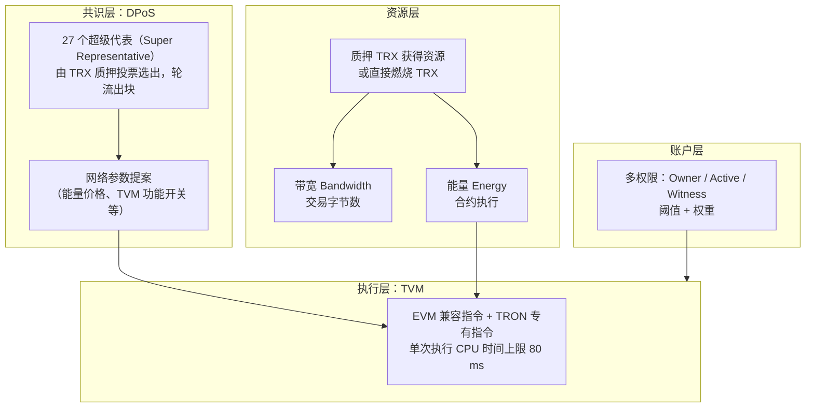
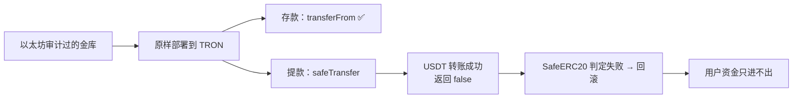

# C02 TRON：合约安全专题

> 学习目标：读完本章，你能——
> 1. 列出 TVM 与 EVM 的 8 项行为差异，并说出每项差异会让哪类以太坊代码出错。
> 2. 解释 TRON USDT"成功也返回 false"、能量与 CPU 时间限制、TRX 系统转账绕过 fallback 三个高频集成问题。
> 3. 识别 TRON 账户层的三类常见骗局：权限篡改、授权钓鱼、地址投毒。
>
> 前置章节：[03 EVM 与 Solidity 安全基础](../03-evm-solidity-basics.md)、[05 访问控制与权限](../05-access-control.md)、[07 外部调用与代币兼容性](../07-external-calls-tokens.md)、[09 MEV 与签名安全](../09-mev-signatures.md)
> 交互实验：[chain-porting-lab.html](../interactive/chain-porting-lab.html)、[signature-replay-lab.html](../interactive/signature-replay-lab.html)
>
> 最后核对：2026-11-09

---

## 开场：转账成功了，交易却回滚了

OpenZeppelin 审计 Across 的 TRON 部署时指出：TRON 上的 USDT 转账成功时也返回 `false`。一个在以太坊上运行良好的金库，搬到 TRON 后可能只进不出。

<details class="predict"><summary>🤔 先猜再看：金库用 `SafeERC20.safeTransfer` 向用户转 USDT。在 TRON 上，这笔提款的结果是什么？</summary>

交易回滚。USDT 实际可以转账，但返回 `false`，`SafeERC20` 判定失败。4.1 节给出了余额差校验的修复方式。

</details>

---

## 1. 一句话理解

**TRON 能跑 Solidity，但 TVM 不是 EVM：资源模型、地址、链 ID、部分操作码和最重要的代币（USDT）的行为都不同。把以太坊合约原样搬过来，编译能过，运行会错。**

TVM（TRON Virtual Machine）：TRON 的合约虚拟机。它兼容大部分 EVM 指令，并增加了 TRON 特有的指令（TRC-10、质押、投票）。

> 🎯 打个比方：TVM 像一台**改装过的同型号汽车**。
>
> - 方向盘、油门、刹车的位置一样（大部分操作码兼容），你上车就能开。
> - 但它不烧汽油，烧"能量"（Energy）。油箱有两个：质押获得的能量和直接燃烧的 TRX。
> - 仪表盘有几块表永远显示 0（`DIFFICULTY`、`GASLIMIT` 返回 0）。
> - 车牌格式不同（地址以 `T` 开头的 Base58，链上带 `0x41` 前缀）。
> - 路上最常见的乘客（USDT）有个怪习惯：下车时明明到了，却说"没到"（`transfer` 返回 `false`）。
>
> 比喻的局限：改装车的差异写在说明书里。TRON 的部分差异由"硬分叉开关"控制，会随网络提案变化。部署前要查当前状态。

---

## 2. 链的安全模型



**读图要点：**

- 出块者是 27 个超级代表。TVM 的很多行为由超级代表投票的"网络参数"决定，而不是写死在代码里。
- 资源模型决定交易是否能执行完。能量不足或超出 CPU 时间，交易失败但仍上链。
- 账户层原生支持多权限。"一个地址 = 一把私钥"在 TRON 上不成立。
- 局限：此图省略了 TRC-10（系统级代币）与 TRC-20（合约代币）的区别，两者在合约中的处理方式完全不同。

---

## 3. 与以太坊的差异

以下内容来自 TRON 官方开发文档"TVM vs EVM"页面（截至 2026 年）。

| # | 差异 | 以太坊 | TRON | 会让什么代码出错 | 对策 |
|---|---|---|---|---|---|
| 1 | 计费 | gas，EIP-1559 动态费 | 能量；`energyPrice` 是网络参数（2026 年 11 月 9 日读取主网 `getEnergyFee` 为 100 sun）；无优先费 | 依赖 `tx.gasprice` 或 `block.basefee` 的逻辑 | 不依赖这两个值 |
| 2 | 执行时限 | 只有 gas 上限 | 每次执行 80 ms CPU 时间，超时返回 `OUT_OF_TIME` | 在以太坊 gas 足够的大循环 | 分批处理；控制单笔计算量 |
| 3 | `CHAINID` | 小整数（主网 1） | 创世区块 ID 后 4 字节（主网 `728126428`） | 写死链 ID 的代码；链下签名工具 | 运行时读取 `block.chainid` |
| 4 | `CREATE2` 地址 | `keccak256(0xff ++ ...)` | `keccak256(0x41 ++ ...)` | 链下预计算地址、跨链"同地址部署"假设 | 用 TRON 公式计算 |
| 5 | `CREATE` 地址 | 创建者地址 + nonce | 创建者地址 + TVM 内部计数器（账户无 nonce） | 依据 nonce 预测合约地址 | 不预测，或改用 CREATE2 |
| 6 | 原生币转账 | 转给合约一定执行 `receive`/`fallback` | `TransferContract` 系统转账**不执行**合约代码；`TriggerSmartContract` 带 `callValue` 才执行 | 依赖 `receive()` 记账或拒收 | 不依赖 `receive` 记账；用内部变量记账 |
| 7 | 返回 0 的操作码 | 有意义 | `DIFFICULTY`、`GASLIMIT`、`BLOBHASH`、`BLOBBASEFEE` 返回 0 | 用它们做随机数或参数 | 不用 |
| 8 | 功能开关 | 硬分叉后全网可用 | `CREATE2`、`CHAINID`、`PUSH0`、`TSTORE` 等由网络参数开关控制，未开启时返回 `ILLEGAL_OPERATION` | 新版编译器默认生成 `PUSH0` 等新指令 | 用 TRON 适配的编译器，并设置与网络一致的 `evmVersion` |

> 💡 注意：差异 6 与以太坊上的"强制转入 ETH"（[03 章](../03-evm-solidity-basics.md) 第 4 节）是同一类问题：合约余额可以在合约代码不知情的情况下增加。任何 `require(address(this).balance == 记账值)` 都会被打破。

### 3.1 2026 年的 TVM 变化（截至 2026 年 11 月 9 日）

| 版本 / 提案 | 时间 | 变化 | 审计时要做什么 |
|---|---|---|---|
| [v4.8.1](https://github.com/tronprotocol/java-tron/releases) | 2026 年 2 月发布 | TIP-6780：`SELFDESTRUCT` 只在同一交易内创建的合约上删除代码 | 主网 `getAllowTvmSelfdestructRestriction` 已为 1；不要用旧语义推导 |
| v4.8.2 + [提案 107](https://tronrelic.com/blog/prague-and-osaka-upgrades-live-on-tron-as-network-passes-400-million-accounts) | 2026 年 8 月 28 日生效 | 开启 `ALLOW_TVM_PRAGUE`、`ALLOW_TVM_OSAKA`：TIP-2935 历史区块哈希、CLZ、MODEXP 上限和能量调整、P-256 预编译 | 确认 `evmVersion` 和目标功能；重测 MODEXP 能量 |
| v4.8.2.2–v4.8.2.4 | 2026 年 9–10 月 | 强制节点升级，修复 TVM 和存储边界问题 | 节点方跟进版本 |

公开参数接口 `getchainparameters` 显示：`getAllowTvmShangHai`、`getAllowTvmCancun`、`getAllowTvmBlob`、`getAllowTvmPrague`、`getAllowTvmOsaka` 都为 1，`getMaxCpuTimeOfOneTx` 为 80 ms。

> 💡 注意：java-tron 发布说明和主网参数里都没有 EIP-7702 的对应项。不要假设 TRON 已支持 7702 委托。部署前重新读取参数。

---

## 4. 案例深潜

### 4.1 USDT：成功却返回 false

OpenZeppelin 在 2026 年对 Across 协议 TRON 部署的审计报告中写明：

1. TRON 上的 USDT 合约，`transfer` 在成功时**也返回 `false`**。
2. 使用 `SafeERC20.safeTransfer` 推送 USDT 的代码，在 TRON 上会全部回滚。
3. 修复方案 `TronTransferLib`：调用 `transfer` 后，检查接收方余额是否增加了对应金额。
4. `transferFrom` 和 `approve` 行为标准，拉取方向不需要改。
5. 修复方案假设 USDT 没有开启转账手续费。Tether 在 TRON 上保留了开启手续费、黑名单和暂停的能力。
6. TRON 专用合约要用单独的构建配置部署。**合约本身不检查自己部署在哪条链上**，部署工具选错产物，问题就会回来。



**读图要点：**

- 这个问题不会让资金被盗，但会让资金**被锁**。如果合约不可升级，资金可能永久无法取出。
- 单元测试用的是模拟 USDT，测不出这个问题。必须在 TRON 测试网上用真实的 USDT 合约测试。
- 示例代码见 [examples/05-SafeTokenOps.sol](../examples/05-SafeTokenOps.sol)。

### 4.2 能量、CPU 时间与"失败但上链"的交易

TRON 交易执行失败时，交易**仍然上链**，有交易哈希，扣除已消耗的资源。常见失败原因：

| 结果 | 原因 | 对用户 / 集成方的影响 |
|---|---|---|
| `OUT_OF_ENERGY` | 能量和 `fee_limit` 不足以支付执行 | 转账未发生；资源已扣 |
| `OUT_OF_TIME` | 超过 80 ms CPU 时间 | 同上 |
| `REVERT` | 合约 `require` 失败（例如余额不足、地址被 Tether 冻结） | 同上 |

> ⚠️ 警告：交易所、支付网关、跨链桥在 TRON 上确认充值时，必须检查交易回执的执行结果为成功，并检查 `Transfer` 事件来自**正确的代币合约地址**。只检查"交易存在"或"交易里有转账调用"，就会把失败的交易记为到账（"假充值"）。公开报道中有用户遇到"FAILED – TRANSACTION REVERT"的 USDT 转账，被交易所错误标记为成功的情况，专家建议交易所核对链上结果（MEXC 新闻引述）。

### 4.3 TRX 系统转账绕过合约代码

```solidity
// ❌ 在 TRON 上不可靠：以为所有入账都会经过 receive()
uint256 public totalReceived;
// 只统计经过 receive 的转账
receive() external payable { totalReceived += msg.value; }
// 强制入账会让两者不等，该检查永久失败
function check() external view { require(address(this).balance == totalReceived); }
```

任何人用 `TransferContract`（普通 TRX 转账）向这个合约转 1 sun，`receive()` 不执行，`check()` 从此永远失败。如果某个关键函数依赖这个等式，就构成 DoS（[07 章](../07-external-calls-tokens.md) 第 4 节）。

<details class="predict"><summary>🤔 先猜再看：任何人向上面的合约发一笔 1 sun 的 `TransferContract`。`check()` 之后会怎样？</summary>

`receive()` 不执行，`totalReceived` 不变，合约余额增加 1 sun。`check()` 的等式从此不成立，永远失败。

</details>

> 🧪 动手验证：打开[链迁移风险检查器](../interactive/chain-porting-lab.html)，选择 TRON，点"全选"。记录 USDT 返回值这一项的严重度和修复建议，再切到 BNB Chain 比较同一组假设。

### 4.4 账户权限篡改（"多签诈骗"）

完整机制见 [05 章](../05-access-control.md) 第 5 节。攻击者拿到私钥后不立即转走资产，而是把 Owner / Active 权限改成自己的地址。受害者还会继续转入 USDT，攻击者等余额变大后一次转走。变种是 OTC 骗局：骗子提供"有余额但转不出"的私钥，诱导对方付 TRX "解锁"。

对开发者的启示：

- 钱包和交易所应在 UI 中显示账户权限配置；权限变化时告警。
- 收到一个 TRON 地址作为合约特权角色时，确认它的权限配置。

### 4.5 授权钓鱼与地址投毒

TRON 是 USDT 转账最活跃的网络之一，也是骗局最集中的网络之一（多家钱包安全月报）：

| 骗局 | 机制 | 防御 |
|---|---|---|
| 授权钓鱼 | 诱导用户对攻击者地址 `approve` 大额 USDT | 钱包清晰显示授权对象和金额；定期撤销授权 |
| 地址投毒 | 攻击者生成首尾字符与受害者常用地址相同的地址，发送 0 金额或小额转账，污染交易记录；受害者下次从记录中复制错误地址 | 核对完整地址；使用地址簿；钱包隐藏零金额转账 |
| 假 USDT | 部署名为 "USDT"、符号相同的假代币，发送给受害者 | 以合约地址识别代币，不以名称识别 |

### 4.6 签名与链 ID

- EIP-712 的域分隔符包含 `chainId`。在 TRON 上，`block.chainid` 返回 `728126428`（主网，开关开启时）。链下签名工具必须使用相同的值。EIP-712 域分隔符仍然能区分链，但不要在代码里写死以太坊风格的链 ID。
- TRON 账户没有 nonce，交易层靠 TAPOS 和 60 秒过期防重放。**合约层的签名防重放仍然要自己维护 nonce**（[09 章](../09-mev-signatures.md)）。
- 地址在 VM 内部是 20 字节，链边界加 `0x41` 前缀。签名消息中的地址编码要和合约中的 `abi.encode(address)` 一致。
- 合约里用 `ecrecover` 只能验证**单个**私钥签名。TRON 提供 `ValidateMultiSign` 预编译合约（地址 `0x0a`），可在合约中验证账户多签。

---

## 5. 链下风险：TRON 上的 USDT 用户

TRON 是 USDT 转账量最大的链之一。它的链下风险集中在普通用户身上：

| 风险 | TRON 上的形态 | 应对 | 详细章节 |
|---|---|---|---|
| 地址投毒 | 手续费低，攻击者大量发送粉尘转账，用外观相似的地址污染记录 | 把不请自来的小额入账默认视为可疑；从地址簿取地址 | [19](../19-user-scams.md) |
| 权限篡改骗局 | 分发预设多签的助记词，或诱导用户签署权限更新；之后再收"解封费" | Owner 权限变更请求一律中止；客服识别"代付手续费解冻"话术 | 第 4.4 节、[19](../19-user-scams.md) |
| 假充值 | 失败但上链的交易被误读为成功 | 检查交易结果字段 | 第 4.2 节、[23](../23-custody-exchange-ops.md) |
| 冻结与执法协作 | Tether、TRON、TRM 联合成立 T3 金融犯罪部门，2026 年 5 月称累计冻结 4.5 亿美元以上（自报） | 交易所接入冻结与情报流程 | [25](../25-fund-tracing-response.md) |

- 来源：[TRM（TRON 地址投毒）](https://www.trmlabs.com/resources/blog/understanding-address-poisoning-on-the-tron-blockchain)、[SlowMist（恶意多签）](https://slowmist.medium.com/beginners-guide-to-web3-security-risk-of-wallet-being-maliciously-multi-signed-fb5a9269ed87)、[imToken 安全提示](https://support.token.im/hc/en-us/articles/12718931255193-Security-Alert-Beware-of-TRX-Multisig-Scams)、[TRM（T3）](https://www.trmlabs.com/resources/blog/t3-financial-crime-unit-a-model-for-public-private-disruption-in-the-age-of-stablecoins)

> 💡 注意：本书没有找到 TRON 地址投毒规模的一手量化数据，所以这里只写机制，不写数量。

---

## 6. 迁移检查清单：以太坊 → TRON

- [ ] **TRX-1** 用 TRON 适配的编译器构建；`evmVersion` 与当前网络开启的 TVM 功能一致（检查 `PUSH0`、`TSTORE`、`MCOPY` 等）。
- [ ] **TRX-2** 所有 USDT 推送转账改为余额差校验；拉取转账保留 `SafeERC20`。
- [ ] **TRX-3** 明确 USDT 手续费被开启时的行为（回滚还是按实收记账）。
- [ ] **TRX-4** 单笔交易计算量受控，不会超过 80 ms CPU 时间；大循环已分批。
- [ ] **TRX-5** 不依赖 `receive()` 记录 TRX 入账；不依赖 `address(this).balance` 等式。
- [ ] **TRX-6** 不依赖 `DIFFICULTY`、`GASLIMIT`、`tx.gasprice`、`block.basefee`。
- [ ] **TRX-7** 链 ID 运行时读取；链下签名工具使用 TRON 链 ID。
- [ ] **TRX-8** `CREATE` / `CREATE2` 地址按 TRON 公式计算；不假设与以太坊同地址。
- [ ] **TRX-9** 特权地址的 TRON 账户权限配置已核查。
- [ ] **TRX-10** 在 Nile / Shasta 测试网上，用真实 USDT 合约跑完整的存取流程。
- [ ] **TRX-11** 集成方（交易所、网关）确认充值时检查执行结果和代币合约地址。

**把检查结果写进报告：**

| 检查项 | 发现时的证据 | 常见定级（用 [A02](../assessment/A02-risk-rating-reporting.md) 复核） | 练习位置 |
|---|---|---|---|
| TRX-1、TRX-6、TRX-8 | 构建配置、参数读取结果、地址计算 | High / Medium | [迁移检查器](../interactive/chain-porting-lab.html) |
| TRX-2、TRX-3、TRX-10 | 测试网上真实 USDT 的回执 | Critical / High（资金被锁） | [A08](../assessment/A08-reproduce-attacks.md) |
| TRX-4、TRX-5 | 能量测试、可 DoS 的调用路径 | High / Medium | [B47 Gas](../bootcamp/B47-gas.md) |
| TRX-7、TRX-9 | 签名域字段、账户权限配置 | Critical / High | [签名实验](../interactive/signature-replay-lab.html)、[A06](../assessment/A06-operational-key-security.md) |
| TRX-11 | 充值确认逻辑、失败交易测试 | Critical | [A03](../assessment/A03-exchange-contracts-wallets.md) |

发现按 [T03 报告模板](../templates/T03-finding-report.md) 记录。

去 [chain-porting-lab.html](../interactive/chain-porting-lab.html) 选择 "TRON"，勾选你的代码假设，生成迁移风险清单。

---

## 7. 术语表

| 术语 | 英文 | 定义 |
|---|---|---|
| TVM | TRON Virtual Machine | TRON 的合约虚拟机，兼容大部分 EVM 指令 |
| 能量 | Energy | TRON 合约执行消耗的资源，类似 gas |
| 带宽 | Bandwidth | TRON 交易按字节消耗的资源 |
| sun | sun | TRX 的最小单位，1 TRX = 10^6 sun |
| 超级代表 | Super Representative (SR) | 由投票选出、负责出块的 27 个节点 |
| TAPOS | Transaction as Proof of Stake | 交易引用近期区块以防重放的机制 |
| TRC-10 | TRC-10 | TRON 系统级代币标准，不依赖合约 |
| TRC-20 | TRC-20 | TRON 上与 ERC-20 兼容的合约代币标准 |
| 地址投毒 | Address Poisoning | 用相似地址污染交易记录，诱导转错地址 |

---

> 🪞 反思：想一个你准备搬到 TRON 上的合约，或者一个接收 TRON USDT 的系统。
> 1. 它的哪一步默认了代币返回 `true`？
> 2. 它确认到账时，读的是交易存在，还是执行结果？
> 3. 它依赖的 TVM 开关，你上一次读取是什么时候？

## 8. 思考题

1. 一个以太坊上的金库合约部署到 TRON 后，存款正常，提款全部失败。请写出排查步骤，并给出修复方案。
2. 如果 Tether 在 TRON 上开启了 0.1% 的 USDT 转账手续费，4.1 节的 `TronTransferLib` 方案会出现什么问题？你会怎样调整？
3. 打开 [signature-replay-lab.html](../interactive/signature-replay-lab.html)，选择目标链 TRON。为什么去掉 `chainId` 字段后，"分叉链重放"仍然可能成功？

下一专题：[C03 Mantle](C03-mantle.md)
