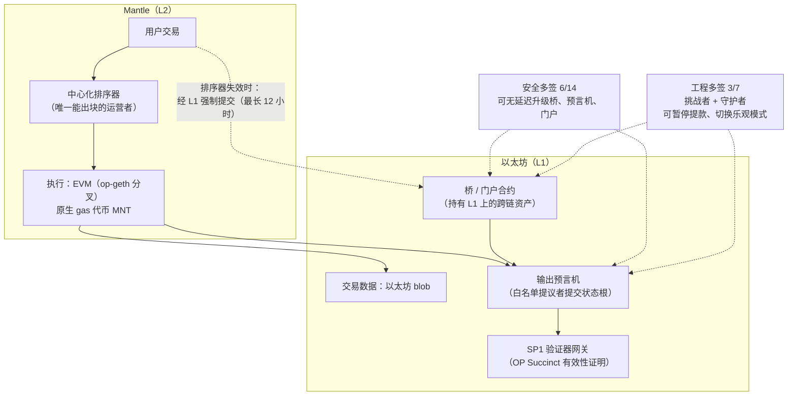
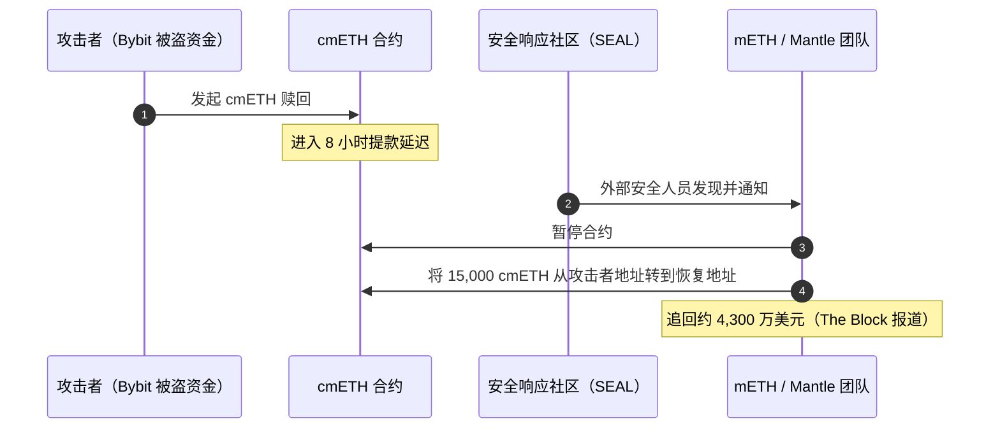
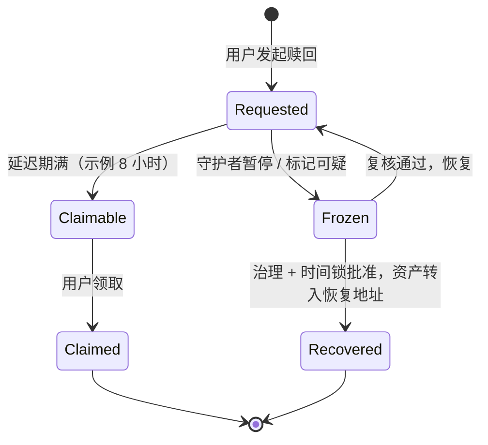

# C03 Mantle：合约安全专题（以太坊 L2 视角）

> 学习目标：读完本章，你能——
> 1. 说出 Mantle 作为以太坊 L2 的信任假设：排序器、证明系统、升级多签、提款路径。
> 2. 解释"原生 gas 代币是 MNT、ETH 是 ERC-20"对合约代码的 4 个影响。
> 3. 从 mETH 追回 cmETH 的案例中，总结"延迟 + 暂停"作为安全参数的设计方法。
>
> 前置章节：[08 预言机与闪电贷](../08-oracle-flashloan.md)、[10 可升级合约与代理](../10-upgradeable-proxy.md)、[12 跨链桥安全](../12-cross-chain-bridges.md)
> 交互实验：[chain-porting-lab.html](../interactive/chain-porting-lab.html)
>
> 最后核对：2026-11-09

---

## 开场：8 小时延迟换回 4,300 万美元

2025 年 2 月，Bybit 被盗资金进入了 cmETH 赎回流程。cmETH 有 8 小时延迟，团队在这段时间内暂停合约，并转回 15,000 cmETH（The Block 报道）。

🤔 先猜再看：同一起事故里，为什么原生 ETH 追不回来，cmETH 却能追回？

cmETH 赎回有延迟，团队还有暂停和转移权限。原生 ETH 没有这些机制。延迟和权限共同形成了窗口，同时也是用户要信任的中心化权力。4.1 节详细说明。

---

## 1. 一句话理解

**Mantle 是建在以太坊上的 L2。合约代码和以太坊几乎一样，但两件事不同：第一，"原生币"是 MNT 而不是 ETH；第二，你的资产安全不只取决于以太坊，还取决于 L2 的排序器、证明系统和升级多签。**

L2（Layer 2）：在以太坊之外执行交易、把交易数据和状态证明提交回以太坊的扩容网络。

> 🎯 打个比方：Mantle 像以太坊城旁边的一座**卫星城**。
>
> - 卫星城有自己的交通调度中心（排序器），调度很快，但只有一个调度员。
> - 卫星城每隔一段时间把账本送回以太坊城公证（状态根 + 证明）。
> - 卫星城的通用货币是 MNT。你从以太坊城带来的 ETH，在这里被换成一种"ETH 兑换券"（ERC-20 形式的 ETH）。
> - 卫星城的城市规划可以由 14 人委员会中的 6 人签字修改，而且**立即生效**（L2BEAT 截至 2026 年页面）。
>
> 比喻的局限：卫星城出问题时，居民可以通过以太坊城的"紧急通道"把交易强制送进卫星城（强制包含），但可能要等 12 小时。

---

## 2. 链的安全模型

以下信息来自 [ETHBEAT 的 Mantle 项目页](https://ethbeat.org/layer2s/projects/mantle)（截至 2026 年 11 月 9 日）。L2BEAT 于 2026 年 11 月 4 日[更名为 ETHBEAT](https://cryptobriefing.com/l2beat-rebrands-ethbeat-privacy-staking/)，本章其余位置沿用旧称。L2 架构变化快，部署前请以最新页面为准。

**读图要点：**

- **证明系统**：L2BEAT 将 Mantle 归类为 ZK Rollup，使用 OP Succinct（SP1）有效性证明。工程多签可以把它切换到"乐观模式"——此时不需要证明，安全依赖挑战者在终结期内挑战错误状态根。
- **数据可用性**：L2BEAT 记录，2026 年 4 月 16 日的 Arsia 升级移除了 EigenDA 路径，交易数据只发布到以太坊 blob。
- **升级权限**：安全多签（6/14）可以无延迟升级 L1 上持有资产的合约。L2BEAT 把"无升级延迟、无退出窗口"标为关键风险，并将 Mantle 评为 Stage 0。
- **排序与提款**：排序器是单一运营者。排序器停止出块，或白名单提议者停止提交状态根，提款都会被冻结。
- 局限：图中没有画 MNT 代币本身的权限。L2BEAT 记录，L1 上的 MNT 合约允许安全多签每年增发不超过总量 2% 的 MNT。

### 2.1 Mantle 的架构演进（公开资料）

| 阶段 | 执行 | 数据可用性 | 证明 |
|---|---|---|---|
| Mantle V1 | OVM | Mantle DA | 乐观 |
| Mantle V2 | OP Stack Bedrock（op-geth 分叉） | Mantle DA → EigenDA | 乐观（欺诈证明） |
| 2025 年 9 月 16 日起 | 同上 | EigenDA → 2026 年 4 月 Arsia 升级后只用以太坊（blob 或 calldata） | OP Succinct 有效性证明（可切换乐观模式；验证器依赖可信设置） |

### 2.2 2026 年需要更新的事实（截至 2026 年 11 月 9 日）

| 项目 | 当前状态 | 对合约和运营的影响 | 来源 |
|---|---|---|---|
| 费用模型 | Arsia 移除 `tokenRatio` 乘数；新增按交易收取的 operator fee；L1 数据费和 operator fee 预付，不计入 `gasUsed`；EIP-1559 基础费随用量调整 | 旧 gas 估算要重写；费用估算使用 `eth_estimateTotalFee` | [op-geth v1.5.3](https://newreleases.io/project/github/mantle-xyz/op-geth/release/v1.5.3) |
| 验证密钥 | 2026 年 8–9 月多次更新 OP Succinct 密钥；页面标注 v3.8.1 的密钥未验证 | 证明系统的版本要写进风险披露 | [ETHBEAT](https://ethbeat.org/layer2s/projects/mantle) |
| 活性 | 2026 年 10 月 15、28、29 日记录数据提交异常 | 依赖及时终结的协议要留余量 | [ETHBEAT](https://ethbeat.org/layer2s/projects/mantle) |
| 权限 | 安全多签 6/14 无延迟升级 L1 核心合约；工程多签 3/7；SP1 验证器网关多签 2/3；MNT 代币合约升级有 1 天延迟 | 协议的 L1 资产，安全上限仍是这些多签 | [ETHBEAT](https://ethbeat.org/layer2s/projects/mantle) |
| 区块 gas 上限 | 2026 年 11 月 9 日读取最新区块，`gasLimit` 为 60,000,000（公开 RPC） | 大批量操作要按当前值测试 | 公开 RPC |

> 💡 注意：架构每变一次，信任假设就变一次。协议的风险披露文档要写明"基于哪个时间点的 L2 架构"。

---

## 3. 与以太坊的差异

| # | 差异 | 以太坊 | Mantle | 会让什么代码出错 | 对策 |
|---|---|---|---|---|---|
| 1 | 原生币 | ETH | **MNT** | `msg.value`、`address(this).balance`、`payable` 函数的单位全部是 MNT。以 ETH 计价的逻辑会差一个汇率 | 明确每个 `payable` 入口收的是什么；价格换算使用 MNT/USD 喂价 |
| 2 | ETH 的形态 | 原生币 | ERC-20 形式（OpenZeppelin 审计报告中称为 BVM_ETH） | 以为"ETH 可以用 `call{value:}` 发送"的代码；WETH 包装逻辑 | ETH 当作 ERC-20 处理；用 `SafeERC20` |
| 3 | 回调入口 | 转 ETH 触发 `receive` | 转 MNT 触发 `receive`；转 ETH（ERC-20）不触发 | 重入分析和"接收通知"逻辑 | 按实际资产重新做重入分析（[04 章](../04-reentrancy.md)） |
| 4 | 交易费 | L1 gas | L2 执行费 + L1 数据费 + operator fee（2026 年 Arsia 后 `tokenRatio` 已从 gas 计算中移除） | 按旧 `tokenRatio` 公式写的 gas 估算和退款逻辑；Arsia 前的 OpenZeppelin 审计指出 L2 上可能出现 L1 上不会出现的 out-of-gas | 用 `eth_estimateTotalFee` 估算；关键操作不依赖精确 gas 预算 |
| 5 | 交易顺序 | 公开内存池 + 构建者市场 | 单一排序器 | MEV 和审查风险集中在运营者 | 披露排序器信任假设 |
| 6 | 排序器宕机 | 不适用 | 价格停止更新、清算停止；经 L1 强制提交最长约 12 小时 | 借贷、永续合约的清算和预言机逻辑 | 读取排序器在线状态；恢复后宽限期（[08 章](../08-oracle-flashloan.md) 5.1 节） |
| 7 | L1 → L2 消息 | 不适用 | 通过门户和跨域信使传递；OP Stack 系 L2 对来自 L1 合约的调用做地址别名（aliasing） | 在 L2 上用 `msg.sender == L1合约地址` 鉴权会失败 | 通过跨域信使获取原始发送者，并校验信使地址 |
| 8 | 提款 | 不适用 | 需要状态根被提交和（在乐观模式下）终结；可被工程多签暂停 | 依赖"提款一定能及时完成"的协议 | 设计流动性缓冲；披露提款可被暂停 |

🤔 先猜再看：一个合约写着 `require(msg.value == 0.01 ether)`。部署到 Mantle 后，用户需要付多少？付的是什么币？

用户付 0.01 MNT。`ether` 只是 10¹⁸ 的单位写法，不表示币种。如果业务按 ETH 定价，收到的价值会差一个 ETH/MNT 汇率。

> 🧪 动手验证：打开[链迁移风险检查器](../interactive/chain-porting-lab.html)，选择 Mantle，点"全选"。记录原生币假设这一项的修复建议，再切到 TRON 比较单位差异。页面里的费用说明可能早于 Arsia，以本章 2.2 节为准。

> ⚠️ 警告：差异 1 和 2 是最常见的移植错误。一个以太坊上的"用 ETH 支付手续费"合约，部署到 Mantle 后，用户支付的是 MNT。如果合约把 `msg.value` 当作 ETH 数量去计算美元价值，价格会错一个 ETH/MNT 汇率倍数。

---

## 4. 案例深潜

### 4.1 防御成功：mETH 协议追回 cmETH（2025 年 2 月）

**背景**：mETH Protocol 是 Mantle 生态的流动性（再）质押协议。用户质押 ETH 获得 mETH，进一步获得重质押凭证 cmETH。cmETH 赎回有 8 小时延迟。

**读图要点：**

- 三个条件缺一不可：协议有提款延迟、团队有暂停和资产恢复权限、外部安全社区能在数小时内联系到团队。
- 同一起事件中，Bybit 被盗的大部分 ETH 无法追回。区别在于：原生 ETH 没有延迟，cmETH 有。
- 这个案例也有另一面：**团队能把攻击者地址上的代币转走**，意味着团队也有能力转走任何用户的代币。这是一个需要向用户披露的中心化权限。

> 💡 注意：延迟和暂停是"可信中心化"的工具。它们在本案例中保护了资金，也意味着用户必须信任持有这些权限的人。设计时要回答：谁持有权限？有没有时间锁？权限被滥用时用户能否察觉？

公开报道还显示，事件发生后，市场担心风险传导，MNT 在数小时内下跌超过 10%（Yellow 报道）。**生态代币的价格风险**会影响以 MNT 作抵押品的借贷协议。

### 4.2 客户端层的漏洞：op-geth 审计（2024 年 4 月）

L2 的执行客户端本身就是"合约"的一部分——它决定了 EVM 规则怎样在这条链上运行。OpenZeppelin 对 Mantle op-geth 修改部分的审计，报告了 3 个严重问题（均已修复）：

| 问题 | 机制 | 如果未修复 |
|---|---|---|
| BVM_ETH 无限铸造 | ETH 转账缺少溢出检查，负的 `big.Int` 被当作正数写入 | 只存入 100 ETH，可以获得 200 ETH |
| 交易成本计算遗漏 `Value` | 复制粘贴错误使交易池接受付不起的交易 | 交易池被垃圾交易填满（DoS） |
| 代付余额检查 | 对多笔代付交易逐笔检查余额，而不是检查总额 | 无法支付的交易填满交易池 |

**教训**：

1. 在 L2 上，合约的可信计算基础（TCB）包括 L2 客户端、证明系统和桥合约。合约审计覆盖不到这些。
2. "原生 gas 代币不是 ETH"这个设计，迫使客户端增加了大量新代码（ETH 作为 ERC-20 的转账逻辑、`tokenRatio` 换算）。新代码 = 新攻击面。

### 4.3 信任假设也是"案例"：L2BEAT 风险清单

L2BEAT 页面列出的 Mantle 风险（截至 2026 年），可以直接转化为协议的风险披露：

| L2BEAT 风险 | 对 Mantle 上协议的含义 |
|---|---|
| 无升级延迟时，恶意升级可盗取资金 | 协议在 L1 桥上的资产，安全上限是 6/14 安全多签 |
| 非乐观模式下，证明密码学被破解或实现错误可盗取资金 | 证明系统是 TCB 的一部分 |
| 乐观模式下，无人检查状态时可盗取资金 | 模式切换会改变信任假设 |
| 提议者可通过不安全的验证器路由 ID 绕过验证 | 验证器网关配置是攻击面 |
| 中心化验证者 / 排序器宕机时，资金冻结 | 协议需要考虑长时间无法出块 |
| 运营者可抢跑用户交易 | MEV 风险集中在运营者 |

这是信任假设：用户相信这 14 个签名人中至少 9 个不会合谋，也不会同时被攻破。

> 💡 注意：L2BEAT 也提醒，Stage 评级不代表项目的整体安全性。把这些风险写进文档，是让用户在知情的前提下做选择。

---

## 5. 设计模式：把"延迟 + 暂停"做对

从 mETH 案例提炼出可复用的设计：

**读图要点：**

- 延迟期内，资产仍在协议控制下。暂停只阻止状态推进，不转移资产。
- "Recovered"路径是最敏感的权限。它应该需要比"暂停"更高的门槛（更多签名、时间锁、公开公告）。
- 局限：延迟会降低资本效率。业界常见的折中是：小额即时赎回 + 大额排队赎回，或按全局速率限制赎回。

---

## 6. 链下风险：L2 的运营方与用户入口

Mantle 作为 L2，链下风险主要来自运营方的权限和用户进出 L2 的入口：

| 风险 | Mantle 上的形态 | 应对 | 详细章节 |
|---|---|---|---|
| 排序器 | 单一排序器出块；停机或审查时依赖 L1 强制包含 | 充提监控 unsafe 与 finalized 头的差距 | [16](../16-consensus-chain-security.md) |
| 升级与证明模式 | 桥合约可由安全多签升级；输出预言机可切换模式（见第 4.3 节） | 关注升级公告；按 L2BEAT 风险设充提额度 | [14](../14-zk-proof-systems.md)、[12](../12-cross-chain-bridges.md) |
| 桥入口钓鱼 | 仿冒官方桥和"领取 MNT"空投页面 | 只用官方入口；核对代币合约地址 | [19](../19-user-scams.md)、[20](../20-frontend-dns-supply-chain.md) |
| 流动性质押 | mETH / cmETH 的提款延迟与暂停能力 | 延迟本身是安全参数：Bybit 事件中它帮助追回资产（第 4.1 节） | [25](../25-fund-tracing-response.md) |
| RPC | 官方和第三方 RPC 的可用性 | 交易所充值用多源校验 | [17](../17-node-rpc-infrastructure.md) |

> 💡 注意：截至本书核查时，没有查到 Mantle 自身的前端或密钥被攻破的公开事件。这不代表风险不存在：L2 的安全有很大一部分落在运营方的多签和流程上。

---

## 7. 迁移检查清单：以太坊 → Mantle

- [ ] **MNT-1** 所有 `payable` 函数、`msg.value`、`address(this).balance` 的单位已确认为 MNT。
- [ ] **MNT-2** ETH 相关逻辑改为 ERC-20 处理；不使用 `call{value:}` 发送 ETH。
- [ ] **MNT-3** 重入分析已按"MNT 触发回调、ETH 不触发"重做。
- [ ] **MNT-4** 价格计算区分 ETH 与 MNT；MNT 价格来源可靠。
- [ ] **MNT-5** 预言机读取包含排序器在线状态检查（如果该 L2 上提供相应喂价）。
- [ ] **MNT-6** 清算、利息、时间锁逻辑能承受最长 12 小时级别的出块中断。
- [ ] **MNT-7** L1 ↔ L2 消息通过官方跨域信使收发，并校验原始发送者。
- [ ] **MNT-8** gas 和费用估算已按 Arsia 后的模型更新（无 `tokenRatio`，含 operator fee），并留有余量。
- [ ] **MNT-9** 风险披露写明：L2 升级权限、证明模式、排序器、提款可暂停。
- [ ] **MNT-10** 协议自身的暂停 / 恢复权限有分级、有时间锁、已披露。

**把检查结果写进报告：**

| 检查项 | 发现时的证据 | 常见定级（用 [A02](../assessment/A02-risk-rating-reporting.md) 复核） | 练习位置 |
|---|---|---|---|
| MNT-1、MNT-2、MNT-4 | `payable` 入口清单、价格换算 | Critical / High | [迁移检查器](../interactive/chain-porting-lab.html) |
| MNT-3 | 按 MNT 和 ETH 分别重做的调用图 | Critical / High | [04 章](../04-reentrancy.md)、[B25](../bootcamp/B25-capstone-minilend.md) |
| MNT-5、MNT-6、MNT-8 | 中断场景测试、费用估算测试 | High / Medium | [A08](../assessment/A08-reproduce-attacks.md) |
| MNT-7 | 跨域消息校验代码 | Critical | [12 章](../12-cross-chain-bridges.md) |
| MNT-9、MNT-10 | 风险披露文档、权限配置 | Medium | [A04](../assessment/A04-defi-protocol-review.md) |

发现按 [T03 报告模板](../templates/T03-finding-report.md) 记录。

去 [chain-porting-lab.html](../interactive/chain-porting-lab.html) 选择 "Mantle"，勾选你的代码假设，生成迁移风险清单。

---

## 8. 三条链对比小结

| 维度 | BNB Chain | TRON | Mantle |
|---|---|---|---|
| 类型 | 独立 L1，PoSA | 独立 L1，DPoS | 以太坊 L2 |
| 虚拟机 | EVM | TVM（EVM 变体） | EVM（op-geth 分叉） |
| 原生币 | BNB | TRX | MNT（ETH 为 ERC-20） |
| 最大的移植陷阱 | 代币精度、区块数计时、分叉改动 | USDT 返回值、资源模型、操作码开关 | `msg.value` 单位、ETH 形态、L2 信任假设 |
| 代表性事故 / 案例 | Token Hub、Uranium、PancakeBunny、Venus | 账户权限诈骗、USDT 兼容、假充值 | op-geth 审计、mETH 追回 |
| 应急能力 | 验证者可协调停链 | 超级代表提案 | 多签可暂停提款、无延迟升级 |
| 本手册专题 | [C01](C01-bnb-chain.md) | [C02](C02-tron.md) | 本章 |

---

## 9. 术语表

| 术语 | 英文 | 定义 |
|---|---|---|
| 二层网络 | L2, Layer 2 | 把交易数据和证明提交到 L1 的扩容网络 |
| 排序器 | Sequencer | L2 上负责排序和出块的节点 |
| 强制包含 | Forced Inclusion | 用户绕过排序器、通过 L1 把交易送入 L2 |
| 状态根 | State Root | 某一时刻 L2 全部状态的哈希承诺 |
| 有效性证明 | Validity Proof | 证明状态转换正确的零知识证明 |
| 数据可用性 | DA, Data Availability | 交易数据被公开发布、可被任何人下载 |
| 地址别名 | Address Aliasing | L1 合约调用 L2 时，L2 上看到的发送者地址被加上固定偏移 |
| 可信计算基础 | TCB | 系统安全所依赖的全部组件 |

---

> 🪞 反思：想一个你放在 L2 上的资产或合约。
> 1. 能在无延迟下升级这条 L2 的是谁？你知道他们的名单吗？
> 2. 如果排序器停 12 小时，你的头寸会怎样？
> 3. 它的风险披露写的是哪一个时间点的架构？

## 10. 思考题

1. 一个在以太坊上运行的 NFT 市场，按 `msg.value` 收取 0.01 ETH 的铸造费。原样部署到 Mantle 后，用户实际支付的是什么？价值是多少？
2. mETH 团队能把攻击者地址上的 cmETH 转走。从普通用户的角度，你希望这个权限受到哪些限制？
3. 如果 Mantle 的工程多签把输出预言机切换到乐观模式，你的协议的信任假设发生了什么变化？你会在文档里怎样写？

返回：[README 学习目录](../README.md)
