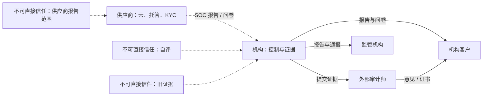
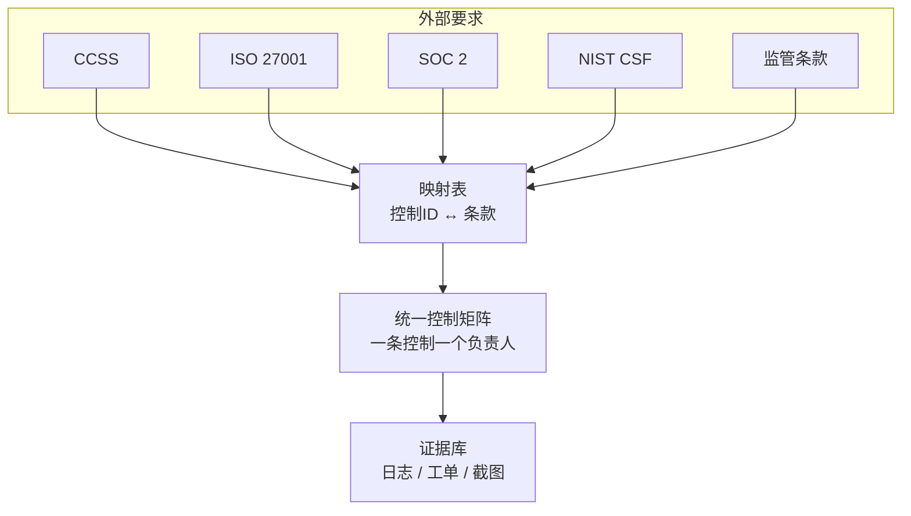
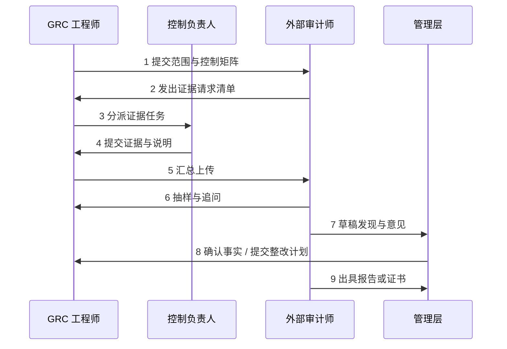
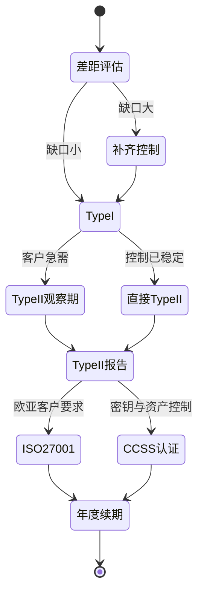

# X02 标准与合规对照：CCSS、ISO 27001、SOC 2、NIST CSF 与监管安全要求

> 学习目标：读完本章，你能——
> 1. 用一张"标准 × 控制域"映射表，把一套控制矩阵同时对到 CCSS、ISO 27001、SOC 2、NIST CSF 和主要监管要求上。
> 2. 为一次外部审计准备证据清单、抽样脚本和差异登记表，并避开常见不符合项。
> 3. 区分渗透测试、红队和外部审计，并为一家机构选出认证路线（SOC 2、ISO 27001、CCSS）。
>
> 适用角色：交易所、托管机构、钱包厂商、项目方的安全负责人、GRC（治理、风险与合规）工程师、合规官。
> 前置章节：[X01 安全体系怎么搭](X01-security-program-controls.md)（控制矩阵与风险登记）、[23 托管、充提与合规安全](../chapters/23-custody-exchange-ops.md)
> 交互实验 / 模板：[T06 运营安全自查表](../templates/T06-ops-security-self-check.md)
> 最后核对：2026-11-23

---

## 开场：认证是真的，声明是假的

2022 年 8 月 2 日，美国纽约州金融服务局（NYDFS）公布对 Robinhood Crypto 的处罚：罚款 3000 万美元。处罚同时涉及反洗钱和网络安全。NYDFS 认定它的网络安全计划存在"关键缺陷"。NYDFS 还认定，它在 2019 年提交的网络安全合规证明不成立，因为当时项目有缺陷。

这家公司并不是没有"合规动作"。它按期提交了证明。问题在于：提交证明时，没有人用证据证明每一条控制真的在运行。

<details class="predict"><summary>🤔 先猜再看：一家交易所拿到了 SOC 2 Type II 报告，也有 ISO 27001 证书。它的热钱包私钥是否一定安全？</summary>

不一定。证书只证明"审计范围内的控制，在审计期间，按审计师的抽样"运行良好。范围可以不含签名服务。控制也可以只覆盖"有制度"，不覆盖"能挡住攻击"。本章第 8 节的 Bybit 案例会说明：攻击发生在第三方的开发者电脑上，不在客户自己的系统范围内。

</details>

---

## 1. 一句话理解

**标准和监管是"考试大纲"，控制矩阵是"你的复习笔记"。一次把笔记写好，多门考试都能用。**

标准（Standard）：由行业机构发布的、自愿采用的控制要求，例如 ISO 27001。
监管要求（Regulation）：由法律规定的、必须遵守的义务，例如欧盟 DORA。
控制（Control）：一项具体的、可验证的安全措施，例如"提币审批需要两人"。
证据（Evidence）：证明控制在运行的记录，例如审批日志。

> 🎯 打个比方：标准像驾照考试的不同大纲。每个大纲的措辞不同，但都要你会刹车、会看后视镜、会让行。你不用为每个大纲各学一遍开车。你只需要把"开车技能"练好，再对照每个大纲查漏。
>
> 比喻的局限：驾照考试一次通过就终身有效。标准和监管每年都要复查，版本也会变。控制一旦停止运行，证书依然挂在墙上，风险却回来了。

---

## 2. 保护目标与信任边界

本章的保护目标不是资产本身，而是**"对外声明的可信度"**：向监管、审计师、客户和合作方声明"我们有这些控制"，这句话必须与事实一致。



**读图要点：**

- 实线是"声明流"：机构向审计师、监管、客户提交声明。虚线是"输入流"：供应商把报告交给你。
- 三个不可直接信任的东西：自评结论、供应商报告的范围、过期的证据。它们是后文控制清单要防的对象。
- 审计师是独立的第三方，但只看抽样。抽样之外的控制是否运行，仍由机构自己负责。
- 局限：图里没有画"内部人伪造证据"的情形。这一点靠证据库的只读存储和访问分权来防（见第 5 节 STD-C04）。

---

## 3. 标准与监管全景（截至 2026 年公开资料）

### 3.1 自愿标准

| 标准 | 是什么 | 本章核对到的事实 | 对 Web3 机构的意义 |
|---|---|---|---|
| CCSS | 加密货币安全标准，由 CryptoCurrency Certification Consortium（C4）维护 | 当前矩阵为 v9.0；分 Level I、II、III 三个等级；认证对象是"系统"，不是整个机构；C4 设有 CCSS 审计师（CCSSA）和实施师（CCSSI）认证 | 少数直接覆盖密钥生成、存储、使用、泄露应对的标准 |
| ISO/IEC 27001 | 信息安全管理体系（ISMS）要求，可认证 | 现行版本为 2022 版；2013 版证书的最终过渡期限为 2025-10-31（认证机构公开说明） | 通用的管理体系证书，机构客户和银行常要求 |
| ISO/IEC 27002 | 控制指南，不可单独认证 | 2022 版含 93 项控制，分组织、人员、物理、技术四类；11 项为新增（含威胁情报、云服务安全、ICT 业务连续性就绪） | 给 27001 的控制选择提供细节 |
| SOC 2 | AICPA 的服务机构控制报告，由注册会计师出具 | 依据 2017 年信任服务标准（TSC），2022 年修订了"关注点"，标准本身未变；五类：安全、可用性、处理完整性、保密性、隐私；安全类是必选 | 北美机构客户最常索要的报告 |
| NIST CSF 2.0 | 美国国家标准与技术研究院的网络安全框架 | 2024-02-26 发布；六项职能：治理（Govern，新增）、识别、保护、检测、响应、恢复 | 适合做"全局语言"和成熟度对齐，本身不可认证 |
| PCI DSS | 支付卡行业数据安全标准 | 现行 v4.0.1；PCI SSC 称 51 项新要求自 2025-03-31 起强制生效 | 只在你存储、处理或传输持卡人数据时适用 |
| CIS Controls | 互联网安全中心的优先级控制清单 | 现行 v8.1，共 18 项控制 | 适合小团队排优先级 |

> 💡 注意：CCSS 的 9.0 矩阵页列出的"方面"包括：密钥材料生成、钱包生成、密钥材料存储、密钥材料访问、密钥材料使用、数据销毁文档、安全测试 / 审计、日志与监控、治理与风险、密钥泄露文档。各方面适用的等级，以 C4 官方矩阵为准。本章不复述每一项的等级。

> 💡 注意：SOC 2 的通用准则分为 CC1 至 CC9：控制环境、沟通与信息、风险评估、监控、控制活动、逻辑与物理访问（CC6）、系统运营（CC7）、变更管理（CC8）、风险缓解（CC9）。编号以 AICPA 文本为准。

### 3.2 监管要求：只看与安全和韧性直接相关的部分

> 💡 注意：以下是安全工程师需要知道的"条款落点"，不是法律意见。适用性、过渡期和豁免请交给法务和当地律师。

| 监管 | 与安全直接相关的要求（已核对来源） | 来源类型 |
|---|---|---|
| 欧盟 MiCA（条例 2023/1114） | 适用日期：2024-12-30（第三、四编自 2024-06-30）。第 68(7) 条：加密资产服务提供商要保证服务连续，使用符合 DORA 的"有韧性且安全的 ICT 系统"，并建立含 ICT 业务连续性计划与响应恢复计划的连续性政策。第 68(8) 条：按 DORA 保障数据的可用性、真实性、完整性、保密性。第 70 条：保护客户资产与资金。第 73 条：外包后仍自负全责，并保留监督外包的能力。第 75 条：托管服务要有托管政策，并"最大限度降低因欺诈、网络威胁或疏忽造成的损失"；客户资产要与自有资产隔离（含链上）；因可归因事件丢失客户资产要承担赔偿责任，上限为损失时的市场价值。第 143(3) 条：旧制度下的服务商可继续服务至 2026-07-01，或至获批 / 被拒（以先到者为准），成员国可缩短。截至本章核对日，该最长过渡期已结束 | 欧盟官方公报法律文本（EUR-Lex） |
| 欧盟 DORA（条例 2022/2554） | 适用日期：2025-01-17。第 2(1)(f) 条把加密资产服务提供商列为适用对象。第二章（第 5–16 条）ICT 风险管理；第三章（第 17–23 条）事件管理与报告；第四章（第 24–27 条）韧性测试；第五章（第 28 条起）第三方风险。第 24(6) 条：至少每年对支持关键或重要功能的 ICT 系统和应用做适当测试。第 26 条：被识别的机构至少每 3 年做一次威胁导向渗透测试（TLPT），监管可调整频率 | 欧盟官方公报法律文本 |
| DORA 事件报告时限 | 授权条例 2025/301 第 5 条：初次通报最迟在"分类为重大"后 4 小时，且不晚于知悉后 24 小时；中期报告最迟在初次通报后 72 小时；最终报告最迟在中期报告后 1 个月 | 欧盟授权条例（经二手整理核对，以 EUR-Lex 原文为准） |
| 美国 NYDFS 23 NYCRR 500 | 2023-11-01 修订生效。500.17：确认发生网络安全事件后最迟 72 小时通知监管；支付勒索款后 24 小时内通知；每年 4 月 15 日前提交合规证明或确认。500.12：任何访问信息系统的人都要用多因素认证（受限豁免的机构仍须对远程访问、云端第三方应用和特权账户使用）。500.13(a)：维护完整、准确、有文档的资产清册，含所有者、位置、分类、支持到期日、恢复时间目标。500.12 与 500.13(a) 的过渡期至 2025-11-01 结束 | NYDFS 条例文本（经 Cornell LII 转载核对） |
| 香港 SFC《虚拟资产交易平台营运者指引》 | 2023 年 6 月版。10.6(c)：平台及其关联实体应把 98% 的客户虚拟资产存放在冷存储，仅限 SFC 个案批准的有限情形例外。10.22：补偿安排覆盖冷存储客户资产的 50% 和热存储及其他存储的 100%。第十二部分"网络安全"：12.13 要求在平台上线或修改前，以及此后定期，做严格的独立网络安全评估，范围至少含用户应用、钱包、物理安全、网络与系统（含渗透测试、托管系统源代码审查和漏洞扫描）；员工至少每年培训一次。此后 SFC 可能有补充通函，以官网最新版本为准 | SFC 官方指引 PDF |
| 新加坡 MAS | 2021-01-18 发布修订的《技术风险管理指引》：任命有经验的 CIO 与 CISO，加强对第三方服务商的监督，做模拟真实攻击者手法的网络演练，把安全控制嵌入开发与部署流程。针对数字支付代币服务商（DPTSP），MAS 2023-11-23 的咨询回应载明：通过 MAS Notice PSN05 对关键 IT 系统要求高可用与可恢复，关键系统恢复时间目标为 4 小时（不适用于底层公链）；发生严重且广泛影响的系统故障或 IT 安全事件，须在 1 小时内通报 MAS | MAS 官方新闻稿与咨询回应文件；现行条文以 MAS Notice PSN05 为准 |
| 迪拜 VARA | 《技术与信息规则手册》，当前版本自 2025-06-19 起生效。结构为：技术治理与风险评估框架、网络安全政策、密钥与 VA 钱包管理、测试与审计、业务连续性与网络安全事件、CISO 与管理层、员工能力、向 VARA 通报；附表给出五类风险（组织、技术、检测与响应、客户虚拟资产、数字运营韧性）的框架指引 | VARA 官方规则手册目录页；具体条款以官方 PDF 为准 |

> 💡 注意：本章没有逐条核对各国的其他数值阈值（例如渗透测试频率）。除上表写出的以外，一律"以官方最新文档为准"。

---

## 4. 参考架构：一套矩阵，多次映射

### 4.1 为什么要"一次实施，多次映射"

每个标准都有自己的条款编号和措辞。如果你为每个标准各做一套制度和证据，你会得到 5 套重复的工作，还会出现 5 个互相矛盾的版本。

做法是反过来：

1. 以你自己的控制矩阵为中心（[X01](X01-security-program-controls.md) 已经建好）。
2. 每条控制只有一个唯一 ID，一个负责人，一组证据。
3. 每条控制在一个"映射列"里，写它满足哪些标准的哪些条款。
4. 审计时，从"标准"出发反查"控制"，再从"控制"取"证据"。



**读图要点：**

- 数据从上往下流：外部要求先进映射表，映射表指向控制，控制指向证据。
- 出错最多的是"映射表"：映射写得太宽，审计师会抽到根本没有证据的条款。
- 局限：映射只说明"这条控制与条款相关"，不说明"这条控制足以满足条款"。满足与否要看控制的强度和范围。

### 4.2 标准 × 控制域映射表

下表给出 11 个控制域在各标准中的"落点"。它是起点，不是定论。逐条映射由你的控制矩阵完成。

| 控制域 | CCSS v9.0 方面 | ISO 27002:2022 主题 | SOC 2（TSC） | NIST CSF 2.0 类别 | 监管落点 |
|---|---|---|---|---|---|
| 治理与风险 | 2.03 治理与风险 | 组织 | CC1、CC3、CC4 | GV.OC、GV.RM、GV.RR、GV.PO、GV.OV | MiCA 68；DORA 第二章；MAS 董事会与 CISO |
| 资产与清册 | — | 组织 | CC3、CC6 | ID.AM | NYDFS 500.13(a) |
| 密钥生成与存储 | 1.01、1.02、1.03 | 技术 | CC6 | PR.DS | MiCA 75(3)；VARA 密钥与钱包管理；SFC 10.6 |
| 密钥访问与使用（签名路径） | 1.04、1.05 | 技术、组织 | CC6 | PR.AA | MiCA 75(3)；SFC 第十章 |
| 身份与访问（含 MFA） | 1.04 | 人员、技术 | CC6 | PR.AA | NYDFS 500.12 |
| 变更与发布 | 2.03 | 技术 | CC8 | PR.PS | DORA 第二章 |
| 日志与监控 | 2.02 日志与监控 | 技术 | CC7 | DE.CM、DE.AE | DORA 第三章；MAS 1 小时通报 |
| 安全测试与审计 | 2.01 安全测试 / 审计 | 组织、技术 | CC4、CC7 | ID.RA、ID.IM | DORA 24–26；SFC 12.13 |
| 事件响应与通报 | 2.04 密钥泄露文档 | 组织 | CC7 | RS.MA、RS.AN、RS.CO、RS.MI | DORA 19；NYDFS 500.17；MAS |
| 韧性与恢复 | 2.04 | 组织、技术 | CC7、CC9 | PR.IR、RC.RP、RC.CO | MiCA 68(7)；MAS 4 小时 RTO |
| 第三方与外包 | 2.03 | 组织 | CC9 | GV.SC | MiCA 73；DORA 第五章；MAS 第三方监督 |

> 💡 注意：SOC 2 通用准则没有"密钥"一栏。密钥控制主要落在 CC6（访问）下。若你的 SOC 2 范围不含签名服务，密钥类控制就不会被审计。写范围时要明确这一点（见 STD-C03）。

> 💡 注意：这张表是本手册的"建议映射"。同一条控制落在哪个类别，不同审计师可能有不同判断。以你和审计师商定的为准。

---

## 5. 控制清单

本章的控制管的是"声明的可信度"。

| ID | 控制项 | 要防什么 | 优先级 | 怎么验证 |
|---|---|---|---|---|
| STD-C01 | 适用性登记册：列出适用的标准和法规、司法辖区、负责人、下次评估日 | 漏掉适用的法规；不知道哪些要求有约束力 | P0 | 随机抽 3 条业务线，法务能指出各自适用的法规 |
| STD-C02 | 统一控制矩阵：每条控制唯一 ID、负责人、频率 | 同一件事有多个版本；负责人不明 | P0 | 矩阵里无空负责人；ID 全局唯一（用 6.3 节脚本检查） |
| STD-C03 | 范围声明：系统边界、排除项和排除理由 | 审计范围避开最关键系统 | P0 | 审计范围清单含签名服务、热钱包、提币审批；排除项有书面理由 |
| STD-C04 | 证据库：每条控制有证据类型、保存位置、保存期；库只读、访问分权 | 审计时临时补证据；证据被改 | P0 | 随机抽 5 条控制，10 分钟内取出最近一期证据 |
| STD-C05 | 证据新鲜度：自动采集优先，超期告警 | 证据过期；控制已停用而无人知道 | P1 | 看告警规则；人为让一份证据过期，告警是否触发 |
| STD-C06 | 差异与例外登记：每条差异有风险等级、负责人、到期日 | 已知缺口被遗忘；例外永久有效 | P0 | 例外登记表无无到期日的条目；逾期条目有升级记录 |
| STD-C07 | 管理层声明的子认证流程：签字前由各控制负责人逐项确认 | 声明与事实不符（Robinhood 案） | P0 | 看上一次声明的子认证记录；抽 3 项对照证据 |
| STD-C08 | 监管通报时钟表：每个辖区一行，含起算点、时限、责任人、模板 | 错过通报时限 | P0 | 桌面推演：给一个事件，15 分钟内说出各辖区的第一个时限 |
| STD-C09 | 第三方保证管理：收集供应商报告，核对范围、期间、例外、用户侧补充控制 | 把供应商的证书当成自己的保证 | P1 | 每个关键供应商有最新报告记录和范围核对记录 |
| STD-C10 | 审计与咨询分离；内部审计独立于被审部门 | 自己审自己 | P1 | 看采购合同与独立性声明；看内部审计汇报线 |
| STD-C11 | 安全测试分工与采购：渗透测试、红队、审计各有范围、频率、结果跟踪 | 把一种测试当成全部 | P1 | 看年度测试计划；每个发现都有关闭记录 |
| STD-C12 | 认证与监管日历：证书到期日、审计窗口、监管提交日、标准版本变更 | 证书过期；错过提交日 | P1 | 日历有负责人；前 90 天有提醒 |
| STD-C13 | 变更触发重评：新链、新产品、新司法辖区、重大事件后更新映射与范围 | 范围与现实脱节 | P1 | 看最近一次新产品上线，是否更新了映射表 |
| STD-C14 | 标准监控：每季度检查标准、指引和监管文件的新版本 | 用旧版标准或旧阈值 | P2 | 看季度记录；追踪一份已变更的文件 |

---

## 6. 落地做法

### 6.1 步骤

1. 列出"适用性登记册"（STD-C01）。先问法务：我们在哪些国家有牌照或客户？
2. 把 [X01](X01-security-program-controls.md) 的控制矩阵导出成表格，每条控制加"映射"列。
3. 先映射到 NIST CSF 2.0 和 ISO 27002 这两个"通用语言"，再映射到 SOC 2、CCSS 和监管条款。
4. 画出审计范围（STD-C03）：以"资金路径"为主线，不以"部门"为主线。
5. 给每条控制写证据：证据是什么，从哪里来，谁能取，保存多久。
6. 跑一次内部"迷你审计"，挑 10 条控制，只看证据，不问人。
7. 把发现的缺口写进差异登记表（6.4 节）。
8. 选认证路线（7.5 节），选外部审计师（7.4 节清单）。

### 6.2 控制条目示例（YAML，示例）

```yaml
# 控制矩阵中的一条记录（示例）
id: SIG-014
title: 提币签名请求必须经独立解码并由两人批准
domain: key-usage            # 对应第 4.2 节的"密钥访问与使用"
owner: head-of-treasury-ops
frequency: continuous        # continuous | daily | monthly | quarterly | annual
mappings:
  ccss: ["1.04", "1.05"]
  iso27002: ["theme:organizational", "theme:technological"]
  soc2: ["CC6"]
  nist_csf: ["PR.AA"]
  regulatory:
    - "MiCA Art.75(3) custody policy"
    - "SFC VATP 10.6"
evidence:
  - type: system-log
    source: signing-service/approval-events
    retention: 7y            # 示例；以法务和适用法规为准
  - type: sample-review
    source: monthly-withdrawal-sample
    retention: 7y
last_tested: 2026-10-14
next_test: 2027-01-14
exceptions: []               # 有例外时，写差异登记表编号
```

### 6.3 映射覆盖检查脚本（Python，示例）

输入是 CSV 控制矩阵。输出是"重复 ID""无负责人""无证据"的控制，以及每个控制域在各标准下已映射的控制数。

```python
#!/usr/bin/env python3
"""检查控制矩阵的映射覆盖。用法：python3 check_matrix.py matrix.csv
CSV 列：id,domain,owner,ccss,iso27002,soc2,nist_csf,regulatory,evidence
"""
import csv
import sys
from collections import defaultdict

STANDARDS = ["ccss", "iso27002", "soc2", "nist_csf"]

def main(path):
    rows = list(csv.DictReader(open(path, encoding="utf-8")))
    ids = [r["id"].strip() for r in rows]
    dup = {i for i in ids if ids.count(i) > 1}
    if dup:
        print("重复 ID:", ", ".join(sorted(dup)))
    for r in rows:
        if not r["owner"].strip():
            print(f"[无负责人] {r['id']}")
        if not r["evidence"].strip():
            print(f"[无证据]   {r['id']}")
    by_domain = defaultdict(lambda: defaultdict(int))
    for r in rows:
        for s in STANDARDS:
            if r[s].strip():
                by_domain[r["domain"]][s] += 1
    print("\n控制域 × 标准：已映射的控制数（0 表示该域在该标准下无控制）")
    for d in sorted(by_domain):
        cells = "  ".join(f"{s}={by_domain[d][s]}" for s in STANDARDS)
        print(f"{d:<20} {cells}")

if __name__ == "__main__":
    main(sys.argv[1])
```

> 建议配套（后续在 L3 训练营实现）：把这个脚本扩展成"矩阵 → 审计准备包"的生成器，并加上证据过期检查。

### 6.4 差异与例外登记表（模板，示例）

```markdown
| 编号 | 来源 | 描述 | 风险等级 | 负责人 | 处置 | 到期日 | 状态 |
|---|---|---|---|---|---|---|---|
| GAP-2026-007 | 内部迷你审计 | 离职员工的云账号平均 9 天后才禁用，超过 SLA 的 24 小时 | 高 | IT 运维负责人 | 修复：接入 HR 系统自动禁用 | 2026-12-31 | 进行中 |
| GAP-2026-011 | 供应商报告核对 | 某 KYC 供应商 SOC 2 范围不含我们使用的 API 网关 | 中 | 第三方风险经理 | 补偿控制：每季度人工对照访问日志 | 2027-03-31 | 已批准例外 |
```

规则：

- 例外必须有到期日。到期时要么修复，要么由管理层重新批准。
- "已批准例外"要写批准人和批准理由，并计入风险登记表（见 [X01](X01-security-program-controls.md)）。

### 6.5 监管通报时钟表（YAML，示例）

起算点不同，时限也不同。一定先写起算点。

```yaml
# 通报时钟表（示例；时限来自第 3.2 节核对的条文，使用前请法务确认适用性）
clocks:
  - regime: EU-DORA            # 适用于 MiCA 持牌的加密资产服务提供商
    trigger: "事件被分类为重大"
    steps:
      - {name: 初次通报, due: "分类后 4 小时，且不晚于知悉后 24 小时"}
      - {name: 中期报告, due: "初次通报后 72 小时"}
      - {name: 最终报告, due: "中期报告后 1 个月"}
  - regime: US-NYDFS-500
    trigger: "确认发生网络安全事件"
    steps:
      - {name: 通知监管, due: "确认后最迟 72 小时"}
      - {name: 勒索款支付通知, due: "支付后 24 小时"}
  - regime: SG-MAS-DPTSP
    trigger: "发生严重且广泛影响的系统故障或 IT 安全事件"
    steps:
      - {name: 通报 MAS, due: "1 小时（依据 MAS 2023 年咨询回应；以 Notice PSN05 为准）"}
owners: {primary: head-of-compliance, backup: ciso}
templates_dir: runbooks/regulatory-notice/
```

### 6.6 证据抽样（SQL，示例）

审计师会从总体里抽样。你要先自己抽一次。示例：检查"离职账号在 24 小时内禁用"。

```sql
-- 总体：过去 12 个月全部离职员工（示例表结构）
-- 对每个离职员工，找到最晚的账号禁用时间，计算耗时
SELECT t.employee_id,
       t.termination_time,
       MAX(a.disabled_time)                       AS last_disabled,
       EXTRACT(EPOCH FROM (MAX(a.disabled_time) - t.termination_time)) / 3600
                                                   AS hours_to_disable
FROM   terminations t
LEFT JOIN account_events a
       ON a.employee_id = t.employee_id AND a.event = 'DISABLED'
WHERE  t.termination_time >= NOW() - INTERVAL '12 months'
GROUP  BY t.employee_id, t.termination_time
HAVING MAX(a.disabled_time) IS NULL                          -- 从未禁用
    OR MAX(a.disabled_time) - t.termination_time > INTERVAL '24 hours'
ORDER  BY hours_to_disable DESC NULLS FIRST;
```

读结果的方法：

- 如果总体只有 30 人，审计师可能全查。你要全查。
- 结果不为空，就是差异。先登记，再修复，不要等审计师发现。

### 6.7 常见坑

- 只做"文档合规"：制度很全，但没有系统日志做证据。
- 范围画得很窄：只审计办公系统，不审计签名服务。
- 证据靠截图：截图可以补做，也可以改。能用系统导出的日志，就不用截图。
- 一个人同时是控制负责人和证据审核人。
- 映射写得太宽：你声称满足 20 个条款，审计师会各抽一次。

---

## 7. 运营：审计流程、证据与采购

### 7.1 审计流程



**读图要点：**

- GRC 是中间人：审计师不直接找控制负责人，这样证据口径一致。
- 第 6 步最耗时：抽样会追到具体的日志行。准备好 6.6 节的自查。
- 第 8 步是管理层的确认。它与 STD-C07 相连：管理层确认事实，不是确认"我们很好"。
- 局限：图里省略了现场访谈和系统演示，它们通常穿插在第 4–6 步之间。

### 7.2 证据清单（通用做法）

| 证据类别 | 例子 | 取证注意 |
|---|---|---|
| 制度与流程 | 访问控制政策、事件响应手册 | 要有版本、批准人、批准日期 |
| 配置 | IAM 策略导出、MFA 强制配置、密钥策略 | 用系统导出，带时间戳 |
| 运行记录 | 审批日志、提币审批事件、变更工单 | 覆盖整个审计期间，不只是最近一周 |
| 定期活动 | 访问复核记录、演练报告、渗透测试报告、培训记录 | 每个周期都有，不能缺期 |
| 人员 | 入职背景调查、离职清单、角色清单 | 注意个人数据的最小化 |
| 第三方 | 供应商 SOC 报告、合同、年度评估 | 核对范围和期间 |

### 7.3 常见不符合项（通用做法）

- 访问复核没有按期做，或做了没有留下被复核人的签字。
- 离职账号没有及时禁用。
- 风险评估一年没更新，但业务已经加了新链。
- 例外没有到期日。
- 证据覆盖的期间有空洞（例如中间两个月无记录）。
- 供应商报告没有人读过，范围与实际使用不一致。
- 日志保存期短于制度规定。
- 变更没有评审记录（紧急变更尤其常见）。

### 7.4 渗透测试、红队与外部审计的区别

| 类型 | 回答的问题 | 方法 | 产出 | 建议节奏（通用做法） |
|---|---|---|---|---|
| 外部审计（SOC 2、ISO 27001） | 控制是否按声明运行？ | 看制度、抽样证据、访谈 | 报告或证书 | 每年 |
| 渗透测试 | 这个系统有没有可利用的漏洞？ | 在约定范围内，用已知技术尝试攻破 | 漏洞清单和修复建议 | 每年一次加重大变更后 |
| 红队 | 一个有目标的对手能不能达成目标，我们能否发现？ | 按真实攻击者手法，跨系统、跨人，不事先通知防守方 | 攻击路径和检测盲区 | 成熟度较高后每年一次 |
| 代码或合约审计 | 这份代码有没有逻辑缺陷？ | 人工加工具 | 发现与修复验证 | 每次重大发布前 |

> 💡 注意：香港 SFC 指引要求平台上线或修改前后，做含渗透测试和托管系统源代码审查的独立评估。DORA 要求被识别的机构做威胁导向渗透测试（TLPT）。这些是监管要求，不能用一份 SOC 2 报告替代。

采购时的检查清单：

1. 审计师是否熟悉加密资产和签名路径？要看过往项目，不看口号。
2. 范围里是否明确列出签名服务、热钱包、提币审批、第三方托管？
3. 审计师是否独立于你的实施咨询方（STD-C10）？
4. 渗透测试方是否有私钥与链上系统测试经验，并签署了数据与资金安全条款？
5. 报告格式：能否给机构客户使用？是否可分享摘要？
6. 修复验证（retest）是否包含在报价里？

合约与代码审计的方法见 [27 审计、测试与工作流](../chapters/27-audit-testing-workflow.md) 和 [A07 外部审计与赏金](../assessment/A07-external-audit-bounty.md)。

### 7.5 认证路线：先 SOC 2 Type I 还是直接 Type II，ISO 27001 还是 CCSS

SOC 2 的两种报告（通用做法）：

- Type I：说明控制在某一天"设计是否合适"。
- Type II：说明控制在一段时间内"是否有效运行"。观察期通常由审计师和机构商定，常见为数月到一年（通用做法）。



**读图要点：**

- Type I 是"快速出一份报告"的路径，用来应付客户的第一轮尽调。Type II 才证明控制持续运行。
- ISO 27001 与 SOC 2 的控制重叠很大，因为二者都能从同一个控制矩阵映射。先有矩阵，两者都容易。
- CCSS 认证"系统"，所以它不能替代前两者，但它是与密钥相关控制的更直接证明。
- 局限：路线取决于客户和监管。图只表示依赖关系，不是推荐顺序。

选择建议（本章建议，非通用规则）：

| 你的情况 | 建议 |
|---|---|
| 主要客户在北美，机构客户要求报告 | 先 SOC 2，由 Type I 起步，再进入 Type II |
| 主要客户在欧洲、亚洲，或银行与托管合作方要求证书 | ISO 27001（2022 版） |
| 托管钱包或签名服务是核心产品 | 在上两项之外，评估对签名与钱包系统做 CCSS |
| 在欧盟持有 MiCA 牌照 | 监管合规优先，按 DORA 和 MiCA 条款建映射；证书是加分，不是替代 |

### 7.6 季度节奏

| 周期 | 活动 | 产出 |
|---|---|---|
| 每月 | 证据新鲜度检查；差异登记表到期复核 | 逾期清单 |
| 每季度 | 迷你审计 10 条控制；标准与监管文件版本检查；通报时钟表复核 | 迷你审计报告 |
| 每半年 | 桌面推演（通报时钟）；供应商报告复核 | 推演记录 |
| 每年 | 外部审计；渗透测试；管理层声明与子认证；适用性登记册重评 | 报告与证书 |

指标（建议）：控制有证据的比例、证据超期数、逾期差异数、例外平均存续天数、通报推演达标率。

---

## 8. 失效案例

以下案例都来自公开资料。每个案例只写摘要和对本章控制的映射。

### 8.1 Robinhood Crypto：声明与事实不符（2022-08）

- **来源类型：** NYDFS 新闻稿（2022-08-02）。
- **事实：** NYDFS 公布罚款 3000 万美元，并要求聘请独立顾问评估合规与整改。NYDFS 认定其网络安全计划存在"关键缺陷"，部分政策未完全满足网络安全条例，并认定它 2019 年提交的网络安全与交易监测合规证明不当，因为当时项目有缺陷。
- **绕过的控制：** STD-C07（声明前子认证）、STD-C04（证据库）。
- **教训：** 年度证明不是"填表"。每个签字人要有证据。

### 8.2 DMM Bitcoin：治理与签名路径的缺陷（2024）

- **来源类型：** 日本关东财务局业务改善命令（2024-09-26，依据资金决算法第 63 条之 16）。
- **事实：** 2024-05-31，4,502.9 BTC 的客户资产被未经授权转出。监管检查认定：没有负责系统的高管；系统管理、开发、运行和信息安全的权限集中在少数人手中，牵制失效；内部审计缺乏独立性；采用外部钱包时没有评估流出风险；转账签名由一人执行且无监督，私钥集中管理；没有设定日志保存期，不利于事后调查。命令还指出，公司知道这与监管指引冲突，仍继续这样做。公开报道称日本警察厅等把该事件归因于 TraderTraitor，手法是针对员工的社会工程。
- **绕过的控制：** STD-C10（独立性）、STD-C03（范围含签名路径）、STD-C04（日志保留）。
- **教训：** 监管检查看的是治理和日志，不只看技术。"知道与指引冲突仍继续"是最糟的发现。

### 8.3 Coinbase：外包支持人员被收买（2025-05）

- **来源类型：** Coinbase 向美国证监会提交的 8-K（2025-05-14，第 1.05 项）。
- **事实：** 攻击者疑似付钱给美国境外的多名承包商或员工，让其从可访问的内部系统收集客户信息。Coinbase 在 2025-05-11 收到勒索邮件，表示未支付；初步估计整改和自愿赔付费用 1.8 亿至 4 亿美元；密码和私钥未受影响，相关人员无权访问客户资金。申报文件称，内部监控在此前数月已标记部分访问。
- **绕过的控制：** STD-C09（第三方与外包的保证）。
- **教训：** 标准里的"人员安全"和"第三方"控制，要覆盖具体岗位的数据访问范围。监控发现问题到处置之间的时间也要度量。

### 8.4 Bybit 与 Safe{Wallet}：供应商的环境是你的环境（2025-02）

- **来源类型：** 美国联邦调查局（FBI）公告（2025-02-26）；取证公司 Sygnia 的公开调查文章；Safe 官方声明的转述。
- **事实：** FBI 将约 15 亿美元的虚拟资产被盗归因于朝鲜的 TraderTraitor，被盗时间约为 2025-02-21。Sygnia 的调查文章称：Safe{Wallet} 一名开发者的 macOS 工作站在 2025-02-04 被攻破，可能通过社会工程；攻击者没有注册新的 MFA 设备，而是用被劫持的 AWS 会话令牌，绕过 12 小时的 MFA 重新认证要求；承载 Safe{Wallet} 网页应用的 S3 存储桶里的 JavaScript 被注入恶意代码，代码只对 Bybit 的特定冷钱包生效；恶意交易后约 2 分钟，代码被移除。Sygnia 的文章没有指出 Bybit 自有环境被攻破。各来源对注入的具体日期并不一致，本章不采用具体日期。
- **绕过的控制：** STD-C09（第三方保证）、STD-C03（范围不含供应商）、STD-C11（测试范围）。
- **教训：** 你的审计范围到你的系统为止，攻击者的路径不会。要在控制清单里问：我们依赖的每个服务，谁在审计它的发布路径？这一类攻击的机制见 [20 前端、DNS 与供应链安全](../chapters/20-frontend-dns-supply-chain.md) 和 [29 签名路径 2026](../chapters/29-signing-path-2026.md)。

> 💡 注意：本章没有查到这四家机构在事发时各自持有哪些认证的可靠公开信息，所以不写"某机构有证书仍被攻破"这样的结论。上面的教训来自监管文件和事实披露本身。更多事故见 [28 事故案例库](../chapters/28-incident-casebook.md)。

---

## 9. 评估检查点

- [ ] **STD-1** 有适用性登记册，列出适用的标准、法规、辖区和负责人。（STD-C01）
- [ ] **STD-2** 有统一控制矩阵，每条控制有唯一 ID、负责人、频率；6.3 节脚本无报错。（STD-C02）
- [ ] **STD-3** 审计范围明确含签名服务、热钱包、提币审批和关键供应商；排除项有书面理由。（STD-C03）
- [ ] **STD-4** 证据库只读，保存位置、期限明确；随机抽 5 条控制可在 10 分钟内取证。（STD-C04）
- [ ] **STD-5** 关键证据有新鲜度检查，过期会告警。（STD-C05）
- [ ] **STD-6** 差异与例外登记表里没有无到期日、无负责人的条目。（STD-C06）
- [ ] **STD-7** 管理层声明前有逐项子认证，并有记录。（STD-C07）
- [ ] **STD-8** 监管通报时钟表覆盖所有适用辖区，每年至少推演一次。（STD-C08）
- [ ] **STD-9** 每个关键供应商有最新的保证报告记录，并核对范围、期间和用户侧补充控制。（STD-C09）
- [ ] **STD-10** 审计与实施咨询分离，内部审计独立于被审部门。（STD-C10）
- [ ] **STD-11** 有年度测试计划，区分渗透测试、红队、审计，每个发现都有关闭记录。（STD-C11）
- [ ] **STD-12** 有认证和监管日历，到期前 90 天有提醒。（STD-C12）
- [ ] **STD-13** 新链、新产品、新辖区上线前，映射表和范围已更新。（STD-C13）
- [ ] **STD-14** 每季度检查标准与监管文件的新版本。（STD-C14）

**把检查结果写进报告：**

| 检查项 | 状态（通过 / 部分 / 未通过） | 证据位置 | 差异编号 | 负责人 | 到期日 |
|---|---|---|---|---|---|
| STD-1 | | | | | |
| …… | | | | | |

---

## 10. 分级落地

| 档位 | 做什么 | 人和时间（示例，视机构规模而定） |
|---|---|---|
| 最小可行 | 适用性登记册；控制矩阵加映射到 NIST CSF 和 ISO 27002；证据库用共享文件夹加命名规则；差异登记表；通报时钟表；做一次内部迷你审计 | 1 名安全工程师加 1 名合规，约 6–8 周 |
| 标准 | 加上 SOC 2 或 ISO 27001 的外部审计；自动化证据采集；管理层子认证流程；季度证据新鲜度检查；年度渗透测试；供应商报告管理 | 1–2 名专职 GRC 加各控制负责人，约 6–12 个月到首份报告 |
| 成熟 | 控制即代码（YAML 加 CI 检查）；持续证据流；多标准统一审计；红队演练；与监管的主动沟通；CCSS 等专项认证 | 3–5 人的 GRC 团队，持续运营 |

---

## 11. 上手路径

**第一周**

1. 向法务要一份"我们有哪些牌照、在哪些国家有客户"的清单，建适用性登记册（STD-C01）。
2. 导出现有控制矩阵（来自 [X01](X01-security-program-controls.md)），加"映射"列。
3. 找出最近一次外部审计或监管检查的发现清单，看哪些没关闭。

**第一个月**

1. 完成 NIST CSF 与 ISO 27002 的初步映射。
2. 画出审计范围图，以"资金路径"为主线，对照 STD-C03。
3. 做一次 10 条控制的内部迷你审计（6.1 节第 6 步），登记差异。
4. 写通报时钟表，并做一次 30 分钟桌面推演（见第 14 节练习 3）。

**第一个季度**

1. 为关键供应商建报告台账，并核对范围。
2. 选择认证路线（7.5 节）并启动差距评估。
3. 建证据新鲜度检查和日历。
4. 向管理层提交一份"声明可信度"报告：用 STD-1 至 STD-14 的状态表。

---

## 12. 常见误区

| 误区 | 事实 |
|---|---|
| 有证书就是安全 | 证书只覆盖范围内、期间内、被抽样的控制 |
| 合规等于安全 | 合规是底线；攻击者不会按条款攻击 |
| 一套标准就够 | 不同客户和监管要求不同标准；用一套矩阵映射 |
| 映射越多越好 | 映射太宽会放大审计抽样范围，也会产生虚假保证 |
| 供应商有 SOC 2，我们就不用管 | 要核对范围、期间、例外和用户侧补充控制 |
| 审计前突击补证据 | 证据应该是运行的副产品，不是审计前的作品 |
| 例外可以长期保留 | 无到期日的例外会变成永久漏洞 |

---

## 13. 术语表

- 标准（Standard）：行业机构发布的自愿采用的要求，例如 ISO 27001。
- 监管要求（Regulation）：法律规定的强制义务，例如 DORA。
- 控制（Control）：一项可验证的安全措施。
- 证据（Evidence）：证明控制在运行的记录。
- 范围（Scope）：审计或认证覆盖的系统、流程和期间。
- ISMS（Information Security Management System，信息安全管理体系）：ISO 27001 要求建立并持续运行的管理体系。
- 适用性声明（Statement of Applicability，SoA）：ISO 27001 中，说明采用哪些控制及理由的文件。
- TSC（Trust Services Criteria，信任服务标准）：SOC 2 的评价标准。
- Type I / Type II：SOC 2 报告的两种类型，分别说明控制的设计和一段时间内的运行有效性（通用做法）。
- CUEC（Complementary User Entity Controls，用户实体补充控制）：服务商在报告里要求客户自己执行的控制（通用做法）。
- TLPT（Threat-Led Penetration Testing，威胁导向渗透测试）：DORA 要求的基于威胁情报的高级测试。
- 红队（Red Team）：模拟真实对手、以目标为导向的攻击演练。
- 不符合项（Nonconformity）：审计发现的控制与要求不一致之处。
- 抽样（Sampling）：从总体中抽取部分记录来检验控制是否运行。
- GRC（Governance, Risk and Compliance）：治理、风险与合规。

---

## 14. 动手练习与思考题

### 练习 1：做一张迷你映射表（40 分钟）

1. 取下列 8 条控制：提币双人审批、冷钱包私钥分片保管、离职账号 24 小时内禁用、生产变更需评审、日志保存 12 个月、年度渗透测试、供应商年度评估、事件通报时钟表。
2. 对每条控制，在 4.2 节表里找出它的 CCSS 方面、NIST CSF 类别、SOC 2 准则和监管落点。
3. 给每条控制写一个"证据"和"负责人"。
4. 把结果存成 CSV，跑 6.3 节脚本，看哪个域覆盖最弱。

### 练习 2：找差异（30 分钟）

用 6.6 节的 SQL 思路，为下面一份假想数据写出"哪些离职账号超过 24 小时"的结论，并写出 2 条差异登记。

| 员工 | 离职时间 | 账号禁用时间 |
|---|---|---|
| E1 | 2026-03-01 09:00 | 2026-03-01 11:00 |
| E2 | 2026-03-05 18:00 | 2026-03-09 10:00 |
| E3 | 2026-04-02 10:00 | 未禁用 |
| E4 | 2026-04-20 12:00 | 2026-04-21 09:00 |

（提示：E1 和 E4 在时限内；E2 约 88 小时；E3 从未禁用。）

### 练习 3：通报时钟桌面推演（30 分钟）

场景：周五 22:00，监控发现某签名服务的审批日志被批量导出。你的机构在欧盟持有 MiCA 牌照，同时有一个纽约持牌的子公司。

1. 事件何时算"被分类为重大"？由谁决定？
2. 用 6.5 节的表，列出各辖区的第一个时限和责任人。
3. 谁起草通报？模板在哪里？
4. 写出你在 15 分钟内要做的 3 件事。

### 练习 4：审一份范围声明（20 分钟）

下面是一份假想的 SOC 2 范围声明。找出至少 3 个会让它"可信度下降"的问题，并写出你会要求补充什么。

```text
范围：公司官网、客户门户、办公网络。
排除：交易撮合系统（由另一家子公司运营）、签名服务（已外包）、热钱包基础设施。
期间：2026-01-01 至 2026-03-31。
```

（提示：范围排除了资金路径；期间只有 3 个月；外包没有说明谁来保证。）

### 思考题

1. 如果你的客户要求 SOC 2，监管要求 DORA 条款，同行评审要求 CCSS，你会先做哪一件？为什么？
2. 一份供应商的 SOC 2 报告范围不含你使用的那个 API。你可以采取哪些补偿控制？

> 🪞 反思：你的机构上一次对外声明"我们有……控制"是什么时候？声明前，是否有人逐项核对了证据？

> 建议配套（后续在 L3 训练营实现）：通报时钟表模拟器，以及"控制矩阵 → 审计准备包"生成脚本。
