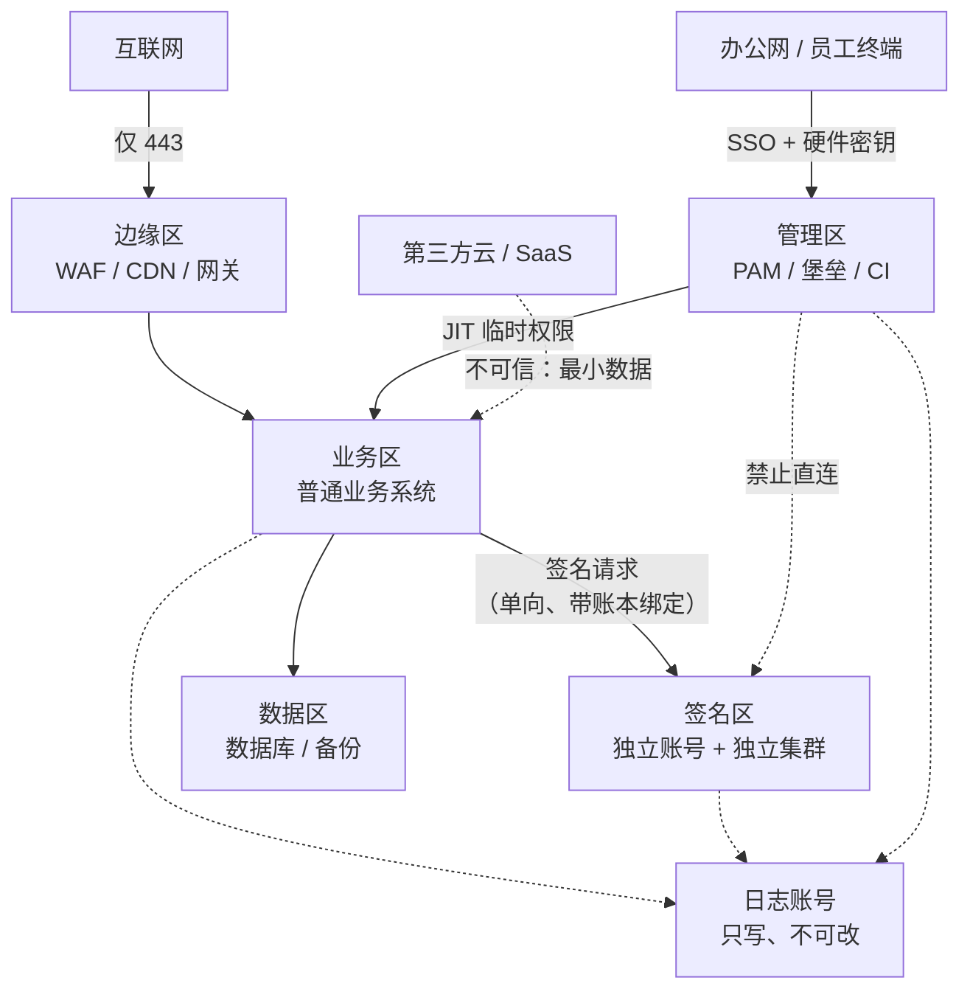
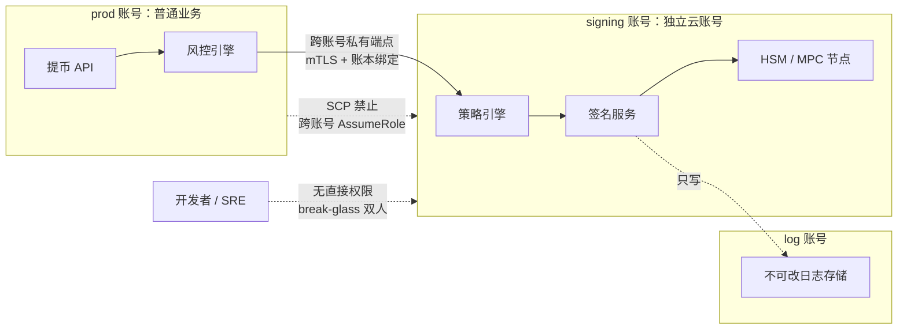
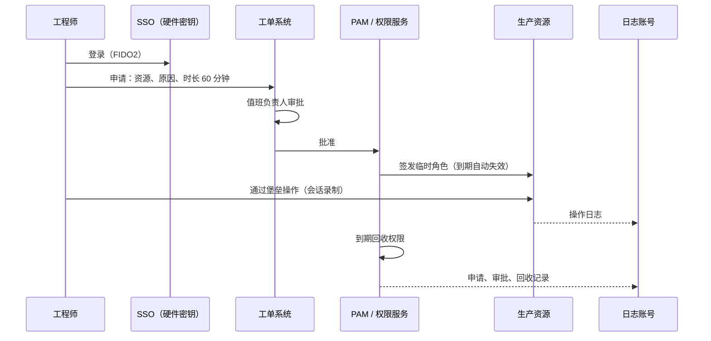
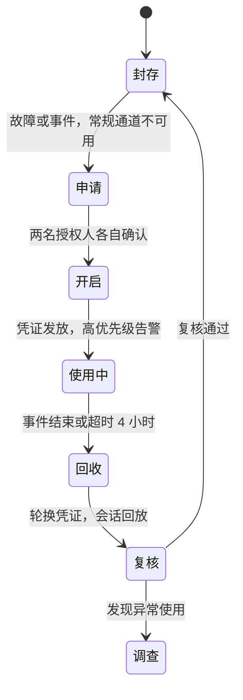

# X03 生产基础设施安全：云、K8s、零信任访问与机密管理

> 学习目标：读完本章，你能——
> 1. 画出一张"签名系统与普通业务系统隔离"的云架构图，并说明每条隔离线防什么。
> 2. 用 SCP、Pod Security、NetworkPolicy、准入策略和机密管理，把云与 K8s 的基线配置写成可审查的代码。
> 3. 用 INF-1 至 INF-25 对一套生产环境做第一轮评估，并排出第一周、第一个月、第一季度的动作。
>
> 适用角色：交易所、钱包、托管、项目方的安全工程师；平台 / SRE 工程师；安全负责人。
> 前置章节：[X01 安全体系怎么搭](X01-security-program-controls.md)；[18 钱包与密钥管理](../chapters/18-wallet-key-management.md)；[29 签名路径 2026](../chapters/29-signing-path-2026.md)（第 4 节：签名服务参考架构）
> 交互实验 / 模板：[T06 运营安全自查表](../templates/T06-ops-security-self-check.md)；[T04 上线门禁](../templates/T04-go-live-gate.md)
> 最后核对：2026-11-23

---

## 开场：钥匙没丢，门却是开的

2025 年 2 月，Bybit 的以太坊冷钱包被转走约 15 亿美元（事发时估值）。按 Sygnia 的取证结论，Bybit 自己的基础设施没有被攻破。攻击者先控制了 Safe{Wallet} 一名开发者的电脑，再拿到 Safe 的云凭证，改写了存放在 AWS S3 上的前端脚本。

<details class="predict"><summary>🤔 先猜再看：Bybit 的签名人都用了硬件钱包，也都做了多签。一个第三方云账号里的 JavaScript 文件被改，为什么能让多签失效？</summary>

因为多签只保证"几个人签了名"，不保证"几个人看到的是同一笔交易"。签名人在网页上看到的内容来自第三方的脚本。脚本被改后，屏幕显示的是正常转账，硬件钱包签的是另一笔交易。基础设施安全要回答的问题是：谁能改动签名人看到的东西，改动时有谁知道。第 8.5 节给出完整案例。

</details>

---

## 1. 一句话理解

**生产基础设施安全的目标是：任何一台机器、一个账号、一个人被攻破，攻击者都拿不到签名能力，也拿不到全部数据。**

基础设施（Infrastructure）：运行业务的云账号、网络、服务器、容器集群、机密存储和运维入口。

> 🎯 打个比方：基础设施像一栋写字楼的物业系统。大门有门禁，每层有分区门，机房和财务室另有独立的锁，每次进入都有登记。一张门禁卡丢了，小偷最多进一层楼，进不了金库。
>
> 比喻的局限：写字楼的门禁在物理上很难绕过。云上的"门"都是配置。一条错误的配置可以在几分钟内让所有分区门同时失效。所以本章把配置当作代码来审查。

本章讲平台层的控制。签名服务本身的设计见 [29 章](../chapters/29-signing-path-2026.md)。交付流水线见 X04。检测与响应见 X05。灾备见 X06。

---

## 2. 保护目标与信任边界

### 2.1 保护目标

| 目标 | 内容 | 失守的后果 |
|---|---|---|
| 签名能力 | 热钱包签名服务、MPC 节点、HSM 的调用权 | 资金被转走 |
| 账本与客户数据 | 数据库、对象存储、备份 | 账务被改、数据泄露 |
| 管理面 | 云控制台、K8s API、CI/CD、PAM | 攻击者获得改一切的权力 |
| 日志与证据 | 审计日志、取证数据 | 事后无法还原，监管无法交代 |

### 2.2 信任边界图



**读图要点：**

- 箭头方向就是信任方向。签名区只接受业务区的请求，业务区不能登录签名区的机器。
- 管理区权力最大，所以它自己最需要保护。管理区失守，所有分区同时失守。
- 日志账号只接收写入。任何分区的管理员都不能删除这里的日志。
- 局限：图里的"第三方"是一个框。真实环境中第三方有几十家，要逐家列清单（INF-25）。

### 2.3 哪些东西不能被信任

- 员工的终端。终端被控后，登录会话和 Cookie 都属于攻击者。
- 第三方托管的脚本、镜像和云账号。Bybit 事件中，签名人信任了第三方账号里的一个文件。
- 同一个云账号里的"内网"。账号内一个角色被攻破，就能读到同账号内其他资源。
- 长期有效的访问密钥。密钥泄露后没有过期时间。

---

## 3. 参考架构

### 3.1 分层与职责

| 层 | 组件 | 职责 | 为什么这样分 |
|---|---|---|---|
| 组织层 | 云组织（Organization）、SCP、集中身份 | 定义所有账号都不能做的事 | 单个账号的管理员也改不了护栏 |
| 账号层 | 每个环境一个账号：dev、staging、prod、signing、log、security | 限制爆炸半径 | 账号是云上最硬的隔离边界 |
| 网络层 | VPC、子网、安全组、出站代理、私有端点 | 控制谁能连谁 | 攻击者拿到一台机器后，要横向移动 |
| 平台层 | K8s 集群、准入策略、镜像仓库 | 统一运行规则 | 规则写一次，所有工作负载都遵守 |
| 机密层 | KMS、Vault 或同类、HSM | 保管密钥和机密，提供短期凭证 | 机密不落在代码、镜像、环境变量里 |
| 访问层 | SSO、PAM、堡垒、JIT 审批 | 人进入生产的唯一通道 | 一个入口，才有一份完整记录 |
| 观测层 | 集中日志、CSPM、告警 | 看见变化 | 配置漂移和越权要被发现 |

### 3.2 签名系统与普通业务系统隔离



**读图要点：**

- 签名区独占一个云账号和一个集群。它不与任何业务共用节点池、镜像仓库或 CI 凭证。
- 唯一入口是跨账号的私有端点，并且单向。业务区发请求，签名区不主动连业务区。
- 开发者在日常权限里没有签名区的任何角色。进入签名区只走 break-glass（第 6.3 节）。
- 局限：隔离只保证"拿不到"。请求内容是否正确由策略引擎与账本绑定校验，见 [29 章](../chapters/29-signing-path-2026.md) 4.2 与 4.3 节。

### 3.3 数据流中的四条硬规则

1. 人只通过 SSO 登录。机器只通过工作负载身份获取短期凭证。
2. 生产的任何变更先过代码评审，再由流水线执行。人不手工改生产。
3. 所有分区的日志只往日志账号写。
4. 出站流量默认拒绝，按域名放行。

---

## 4. 控制清单

优先级说明：P0 是上线前必须有；P1 是第一季度内完成；P2 是成熟阶段目标。

| ID | 控制项 | 要防什么 | 优先级 | 怎么验证 |
|---|---|---|---|---|
| INF-1 | 多账号分环境；签名区独占账号 | 一个账号失陷波及全部 | P0 | 列出账号清单；确认签名区账号里没有业务工作负载 |
| INF-2 | 组织级 SCP 护栏（禁止离开组织、关日志、关检测） | 管理员误操作或被盗后拆护栏 | P0 | 用测试账号尝试被禁操作，应被拒绝 |
| INF-3 | 根账号：硬件 MFA、无访问密钥、告警任何使用 | 根账号被盗等于全部被盗 | P0 | 凭证报告中根账号无密钥；根登录触发告警 |
| INF-4 | 日志集中到独立账号，对象锁，只写 | 攻击者删日志 | P0 | 用 prod 管理员角色尝试删除日志，应失败 |
| INF-5 | 全员 SSO，抗钓鱼 MFA（FIDO2 硬件密钥） | 钓鱼、MFA 疲劳、验证码被骗 | P0 | 统计 MFA 类型；禁用短信与验证码选项 |
| INF-6 | 人与机器身份分离；无长期访问密钥；用 OIDC 或工作负载身份 | 密钥泄露后永久有效 | P0 | 凭证报告中长期密钥数为 0（除登记的例外） |
| INF-7 | 入职、调岗、离职当日同步权限 | 离职人员仍有权限 | P1 | 抽查最近 10 名离职者的账号状态 |
| INF-8 | 特权访问 JIT：按工单申请，限时，自动回收 | 常驻管理员权限 | P0 | 管理员角色的常驻成员为 0 |
| INF-9 | PAM / 堡垒，会话录制，禁止直连生产 | 无记录的人工操作 | P1 | 抽查一次生产登录，能回放会话 |
| INF-10 | break-glass 流程：双人、告警、事后复核 | 紧急通道变成后门 | P0 | 每季度演练一次，记录使用与复核 |
| INF-11 | 网络分段与默认拒绝 | 横向移动 | P0 | 从业务区探测签名区，应不通 |
| INF-12 | 出站默认拒绝，按域名放行 | 数据外传、SSRF 取凭证、下载后门 | P1 | 在工作负载里访问未登记域名，应失败 |
| INF-13 | 管理面（K8s API、控制台、数据库、CI）不暴露公网 | 无密码控制台被扫到 | P0 | 外部端口扫描；查询公网 IP 清单 |
| INF-14 | K8s Pod Security 设为 restricted（签名区与业务区） | 特权容器、逃逸 | P0 | 创建特权 Pod，应被拒绝 |
| INF-15 | 每个命名空间默认拒绝的 NetworkPolicy | Pod 之间横向移动 | P0 | 从无关 Pod 连目标服务，应不通 |
| INF-16 | 准入策略：只允许内部仓库、按摘要引用的镜像 | 外部镜像、被替换的标签 | P1 | 部署一个 `:latest` 的公网镜像，应被拒绝 |
| INF-17 | K8s RBAC 最小权限；关闭默认服务账号令牌自动挂载 | 一个 Pod 失陷拿到集群权限 | P1 | 列出 cluster-admin 绑定；抽查 `can-i` |
| INF-18 | KMS / Vault / HSM 分工明确；密钥管理员与使用者分离 | 一个人既能管密钥又能用密钥 | P0 | 检查密钥策略的主体 |
| INF-19 | 机密不落盘：不进代码库、镜像、环境变量；定期轮换 | 仓库或镜像泄露机密 | P0 | 机密扫描零命中；抽查轮换记录 |
| INF-20 | 签名密钥不放在通用机密平台；只放 HSM 或 MPC | 通用平台被攻破后拿到签名密钥 | P0 | 检查签名密钥的存放位置 |
| INF-21 | 终端 EDR、基线、全盘加密、补丁 SLA | 终端被植入木马 | P0 | 终端清单与 EDR 覆盖率对账 |
| INF-22 | 运维与开发终端分级；禁止个人设备访问生产；会话与设备绑定 | 终端失陷后会话被劫持 | P0 | 用未登记设备访问，应被拒绝 |
| INF-23 | CSPM 持续检查配置漂移，高危项自动工单 | 配置被改后无人知道 | P1 | 故意放开一个测试存储桶，检查告警时间 |
| INF-24 | IaC 全覆盖；变更扫描与审批；禁止控制台手工改 | 手工变更无记录 | P1 | 对比 IaC 与实际资源，差异为 0 |
| INF-25 | 第三方云账号与 SaaS 清单，标注数据范围和访问方式 | 供应商账号失陷 | P1 | 清单覆盖所有向签名人或客户提供内容的第三方 |

> 💡 注意：INF-1、INF-20 与 [29 章](../chapters/29-signing-path-2026.md) 的签名服务隔离互相对应。本章管平台，29 章管签名链路。

---

## 5. 分级落地

| 档位 | 适用 | 做什么 | 人力与时间（示例） |
|---|---|---|---|
| 最小可行 | 10–50 人的团队，刚上线 | 不依赖复杂平台的 P0 项：INF-1 至 INF-6、INF-10、INF-11、INF-13、INF-19、INF-21、INF-22 | 1 名安全工程师加 1 名 SRE，4–6 周 |
| 标准 | 有托管资产的交易所、钱包、项目方 | 全部 P0 与 P1；签名区独占账号和集群；PAM 与会话录制；CSPM；IaC 全覆盖 | 2–3 人的平台安全小组，2–3 个季度 |
| 成熟 | 大型交易所、托管机构 | P2 目标：硬件级隔离的签名区、持续的配置证明、自动化回收权限、年度红队 | 4 人以上，持续运营 |

> 💡 注意：上表的人力和时间是本手册的示例估算，不是统计数据。实际取决于现有系统的混乱程度。

选择规则：

- 如果签名系统和业务系统共用同一个云账号，先做 INF-1。其他控制都建立在它上面。
- 如果存在长期访问密钥，先做 INF-6。
- 如果管理面有公网地址，当天关闭（INF-13）。

---

## 6. 落地做法

以下配置均为**示例**。上线前请对照云厂商和 Kubernetes 的最新官方文档，并在测试账号验证。

### 6.1 云组织护栏（SCP）

**步骤：**

1. 建立组织，开通 SCP。
2. 先把策略挂在一个测试 OU。
3. 验证被禁操作被拒绝。
4. 再挂到生产 OU。

下面的示例 SCP 禁止账号离开组织，禁止关闭日志与配置记录，并要求新实例使用 IMDSv2。`BreakGlassRole` 是登记在案的应急角色，不受第二条限制。

```json
{
  "Version": "2012-10-17",
  "Statement": [
    {
      "Sid": "DenyLeaveOrganization",
      "Effect": "Deny",
      "Action": "organizations:LeaveOrganization",
      "Resource": "*"
    },
    {
      "Sid": "DenyTamperWithAuditAndDetection",
      "Effect": "Deny",
      "Action": [
        "cloudtrail:StopLogging",
        "cloudtrail:DeleteTrail",
        "cloudtrail:UpdateTrail",
        "cloudtrail:PutEventSelectors",
        "config:StopConfigurationRecorder",
        "config:DeleteConfigurationRecorder",
        "guardduty:DeleteDetector"
      ],
      "Resource": "*",
      "Condition": {
        "ArnNotLike": { "aws:PrincipalArn": "arn:aws:iam::*:role/BreakGlassRole" }
      }
    },
    {
      "Sid": "RequireIMDSv2OnLaunch",
      "Effect": "Deny",
      "Action": "ec2:RunInstances",
      "Resource": "arn:aws:ec2:*:*:instance/*",
      "Condition": {
        "StringNotEquals": { "ec2:MetadataHttpTokens": "required" }
      }
    }
  ]
}
```

常见坑：

- SCP 只限制，不授予。SCP 通过后，账号内仍要有 IAM 权限。
- SCP 对管理账号（Management Account）不生效。所以管理账号里不要跑任何工作负载。
- 把 SCP 挂到根之前先挂测试 OU。一条写错的 SCP 可以让整个组织无法部署。
- 通用做法：另加一条 SCP 限制可用区域，只保留业务需要的区域。

### 6.2 身份与特权访问



**读图要点：**

- 申请人与审批人必须是两个人。工单里写明资源、原因、时长。
- 权限由系统到期回收。回收不依赖人记得。
- 日志同时记录"谁批的"和"做了什么"，事后能把两者对上。
- 局限：审批人有时不看内容直接点同意。所以要抽查审批质量（第 7 节）。

**步骤：**

1. 在 SSO 中只允许 FIDO2 硬件密钥，关闭短信和一次性验证码。
2. 把云控制台与 K8s 都接到 SSO。云里没有本地用户（除根账号和一个登记的应急用户）。
3. 管理员角色的常驻成员清零，改为 JIT 申请。
4. 流水线用 OIDC 换取短期云凭证。仓库里不存放云访问密钥。
5. 在 PAM 中为生产机器和数据库配置会话录制。

### 6.3 break-glass（应急通道）



**读图要点：**

- 开启需要两个人。这样没有人能单独打开应急通道。
- 每次开启都触发告警，并强制进入复核。复核是闭环的关键。
- 凭证用完即轮换。封存的凭证放在离线保管处，不放在日常机密库。
- 局限：事件高峰时，人会想跳过复核。把复核写进事件关闭的必填项。

### 6.4 Kubernetes 加固

截至 2026 年公开资料，Kubernetes 的几项事实：

- PodSecurityPolicy 在 1.25 版移除，由 Pod Security Admission 取代（Kubernetes 官方博客）。
- ValidatingAdmissionPolicy 在 1.30 版进入正式可用（GA，Kubernetes 官方博客）。
- Ingress NGINX 控制器的官方维护已于 2026 年 3 月结束，不再有安全更新。官方建议迁移到 Gateway API。用 `kubectl get pods -A -l app.kubernetes.io/name=ingress-nginx` 检查你是否还在用它。

下面是签名区命名空间的三份示例清单。

```yaml
# 示例 1：命名空间强制 restricted
apiVersion: v1
kind: Namespace
metadata:
  name: signing
  labels:
    tier: signing
    pod-security.kubernetes.io/enforce: restricted
    pod-security.kubernetes.io/enforce-version: latest
    pod-security.kubernetes.io/audit: restricted
    pod-security.kubernetes.io/warn: restricted
---
# 示例 2：默认拒绝所有入站与出站
apiVersion: networking.k8s.io/v1
kind: NetworkPolicy
metadata:
  name: default-deny-all
  namespace: signing
spec:
  podSelector: {}
  policyTypes: ["Ingress", "Egress"]
---
# 示例 3：只允许策略引擎访问签名服务，签名服务只访问 DNS 与机密服务
apiVersion: networking.k8s.io/v1
kind: NetworkPolicy
metadata:
  name: signer-allow-minimal
  namespace: signing
spec:
  podSelector:
    matchLabels: { app: signer }
  policyTypes: ["Ingress", "Egress"]
  ingress:
    - from:
        - podSelector:
            matchLabels: { app: policy-engine }
      ports:
        - { protocol: TCP, port: 8443 }
  egress:
    - to:
        - namespaceSelector:
            matchLabels: { kubernetes.io/metadata.name: kube-system }
          podSelector:
            matchLabels: { k8s-app: kube-dns }
      ports:
        - { protocol: UDP, port: 53 }
        - { protocol: TCP, port: 53 }
    - to:
        - namespaceSelector:
            matchLabels: { kubernetes.io/metadata.name: vault }
      ports:
        - { protocol: TCP, port: 8200 }
```

准入策略：只允许内部仓库、按摘要引用的镜像（示例）。

```yaml
apiVersion: admissionregistration.k8s.io/v1
kind: ValidatingAdmissionPolicy
metadata:
  name: trusted-image-only
spec:
  failurePolicy: Fail
  matchConstraints:
    resourceRules:
      - apiGroups: [""]
        apiVersions: ["v1"]
        operations: ["CREATE", "UPDATE"]
        resources: ["pods"]
  validations:
    - expression: >-
        (object.spec.containers +
         (has(object.spec.initContainers) ? object.spec.initContainers : []))
        .all(c, c.image.startsWith('registry.example.internal/') &&
                c.image.contains('@sha256:'))
      message: "镜像必须来自内部仓库，并按 sha256 摘要引用"
---
apiVersion: admissionregistration.k8s.io/v1
kind: ValidatingAdmissionPolicyBinding
metadata:
  name: trusted-image-only-binding
spec:
  policyName: trusted-image-only
  validationActions: ["Deny"]
  matchResources:
    namespaceSelector:
      matchLabels: { tier: signing }
```

常见坑：

- NetworkPolicy 需要网络插件支持。插件不支持时，策略不报错，也不生效。部署后用 INF-15 的方法实测。
- 默认拒绝出站后，DNS 会断。示例 3 已放行 kube-dns。
- 本示例没有覆盖临时容器（ephemeral containers）。需要时另加规则，或用成熟的策略引擎（Kyverno、OPA Gatekeeper 等）。
- 默认服务账号令牌会自动挂进 Pod。在不需要访问 K8s API 的工作负载里设 `automountServiceAccountToken: false`。
- K8s 的 Secret 默认只是 base64 编码。启用 etcd 静态加密，并接入外部 KMS（以官方最新文档为准）。

### 6.5 机密管理

角色分工：

| 组件 | 管什么 | 不管什么 |
|---|---|---|
| KMS | 加密密钥；信封加密；用 IAM 控制谁能调用 | 应用机密的生命周期 |
| Vault 或同类（通用做法） | 动态数据库凭证、短期令牌、应用机密 | 热钱包签名密钥 |
| HSM / MPC | 签名密钥，密钥不出设备 | 应用机密 |

> 💡 注意：Vault 的许可证与社区分支（如 OpenBao）情况会变化，选型前以官方最新说明为准。

示例：账务 API 通过 K8s 服务账号登录 Vault，只读一个动态数据库角色，令牌 15 分钟到期。

```bash
# 示例：配置角色（管理员在初始化时执行）
vault write auth/kubernetes/role/ledger-api \
  bound_service_account_names=ledger-api \
  bound_service_account_namespaces=ledger \
  token_policies=ledger-api \
  token_ttl=15m
```

```hcl
# 示例：策略 ledger-api，只允许读取一个动态凭证路径
path "database/creds/ledger-readonly" {
  capabilities = ["read"]
}
```

规则：

1. 机密不进代码库、镜像、`Dockerfile`、CI 日志。仓库开启机密扫描，命中即阻断合并。
2. 能用动态凭证的地方不用静态凭证。
3. 静态凭证写明负责人与轮换周期（建议 90 天内），到期自动提醒。
4. 密钥管理员与密钥使用者分离。管理员能改策略，但不能调用签名。
5. 怀疑泄露时，先轮换，再调查。

### 6.6 终端与主机

1. 终端分三级：普通办公、开发、特权运维。特权运维终端只做运维，不收邮件，不装通用软件。
2. 全部终端启用 EDR、全盘加密、自动补丁（高危漏洞 SLA 建议不超过 7 天）。
3. 禁止个人设备访问生产和代码库。用设备证书加 SSO 做设备准入。
4. 云服务器启用 IMDSv2，禁用 IMDSv1。对容器工作负载，限制 Pod 访问节点元数据服务。截至 2026 年公开资料，AWS 提供账号级的"新实例默认 IMDSv2"设置，Amazon Linux 2023 默认只接受 IMDSv2。已有实例不受账号级设置影响，要单独修改。
5. 服务器用不可变镜像。发现异常，重建，不修补。

### 6.7 配置漂移与云配置错误检查

IaC 扫描放在合并前（见 X04）。CSPM 放在运行时。下面是人工巡检的示例命令（只读）。

```bash
# 1. 账号级公开访问阻断是否开启
aws s3control get-public-access-block --account-id "$ACCOUNT_ID"

# 2. 仍允许 IMDSv1 的实例
aws ec2 describe-instances \
  --query "Reservations[].Instances[]|[?MetadataOptions.HttpTokens=='optional'].InstanceId" \
  --output text

# 3. 对全网开放 SSH 的安全组
aws ec2 describe-security-groups \
  --filters Name=ip-permission.cidr,Values=0.0.0.0/0 Name=ip-permission.from-port,Values=22 \
  --query 'SecurityGroups[].[GroupId,GroupName]' --output text

# 4. 特权 Pod 与 cluster-admin 绑定
kubectl get pods -A -o json | jq -r \
  '.items[] | select(.spec.containers[]?.securityContext.privileged==true)
   | "\(.metadata.namespace)/\(.metadata.name)"'
kubectl get clusterrolebindings -o json | jq -r \
  '.items[] | select(.roleRef.name=="cluster-admin") | .subjects[]? | "\(.kind)/\(.name)"'
```

下面的脚本读取 IAM 凭证报告，找出未启用 MFA 的控制台用户和超过 90 天未轮换的访问密钥。

```bash
aws iam generate-credential-report >/dev/null
sleep 5
aws iam get-credential-report --query Content --output text | base64 -d | python3 -c '
import csv, sys
from datetime import datetime, timezone, timedelta
now = datetime.now(timezone.utc)
for r in csv.DictReader(sys.stdin):
    u = r["user"]
    if r["password_enabled"] == "true" and r["mfa_active"] != "true":
        print("NO_MFA", u)
    for k in ("1", "2"):
        if r["access_key_%s_active" % k] == "true":
            t = datetime.fromisoformat(r["access_key_%s_last_rotated" % k].replace("Z", "+00:00"))
            if now - t > timedelta(days=90):
                print("OLD_KEY", u, "key" + k)
'
```

常见云配置错误清单：

| 错误 | 后果 | 检查 |
|---|---|---|
| 管理面（K8s Dashboard、数据库、CI）暴露公网且无认证 | 被扫描器发现，直接接管 | 外部扫描；INF-13 |
| 存储桶公开可写，或前端资源桶对多人可写 | 脚本被改（见 8.5） | 阻断公开访问；变更告警 |
| 实例角色权限过大 | 一个 SSRF 漏洞读走全部数据（见 8.2） | IAM Access Analyzer；INF-6 |
| IMDSv1 仍开启 | SSRF 可取得角色凭证 | 第 2 条命令 |
| 长期访问密钥放在代码或 CI 变量里 | 泄露后永久有效 | 凭证报告；机密扫描 |
| 日志与业务在同一账号 | 攻击者删日志 | INF-4 |
| 默认安全组全开 | 横向移动无阻碍 | 第 3 条命令 |

---

## 7. 运营：指标、告警、值班、演练、季度节奏

### 7.1 指标

| 指标 | 目标（建议） | 来源 |
|---|---|---|
| FIDO2 硬件密钥覆盖率 | 100% | SSO 报告 |
| 长期访问密钥数量 | 0（登记例外除外） | 凭证报告 |
| 管理员角色常驻成员数 | 0 | IAM 报告 |
| 特权会话录制率 | 100% | PAM |
| break-glass 使用次数与复核完成时间 | 每次 3 个工作日内复核 | 工单 |
| 高危配置漂移修复时间 | P0 项 24 小时内 | CSPM |
| EDR 覆盖率 | 100% | 终端清单对账 |
| 准入拒绝次数与原因分布 | 趋势下降 | K8s 审计日志 |

### 7.2 告警（示例，详见 X05）

| 告警 | 级别 | 说明 |
|---|---|---|
| 根账号任何登录或调用 | P1 | 应为 0 |
| break-glass 角色被使用 | P1 | 必须能对上工单 |
| 日志、检测服务被停用 | P1 | 对应 SCP 被绕过的尝试 |
| 签名区出现新的跨账号角色信任 | P1 | 隔离被打开 |
| 控制台无 MFA 登录 | P2 | 统一 SSO 后应为 0 |
| 存储桶策略变为公开 | P2 | 需在 15 分钟内确认 |

CloudTrail 查询示例（Athena，字段名按你的表结构调整）：根账号使用。

```sql
SELECT eventtime, eventname, sourceipaddress, useragent
FROM cloudtrail_logs
WHERE useridentity.type = 'Root'
  AND from_iso8601_timestamp(eventtime) > current_timestamp - interval '1' day
ORDER BY eventtime DESC;
```

假阳性：合法的根账号操作（例如账单变更）。调优方法：根账号使用要先登记工单，告警与工单自动对账。

### 7.3 值班与演练

- 云安全告警归入 X05 的值班体系。P1 告警 15 分钟内有人响应。
- 每季度做一次 break-glass 演练：真实开启、使用、回收、复核。
- 每半年做一次"账号失陷"桌面推演：假设一个 prod 账号的管理员密钥泄露，问攻击者能走多远（见 X06）。

### 7.4 季度节奏

| 周 | 动作 |
|---|---|
| 第 1–2 周 | 权限复核：管理员、cluster-admin、break-glass 持有人 |
| 第 3–4 周 | 第三方清单复核；终端覆盖率对账 |
| 第 5–8 周 | 轮换到期的静态机密；CSPM 高危项清零 |
| 第 9–12 周 | break-glass 演练；桌面推演；季度汇报 |

---

## 8. 失效案例

以下均为公开报道的真实事故。归因写"公开报道归因于"。金额为事发时美元估值。

### 8.1 Tesla：无密码的 K8s 控制台（2018 年 2 月，AWS）

- **事实**：云安全公司 RedLock 报告称，Tesla 的 Kubernetes 管理控制台暴露在公网，没有密码保护。攻击者借此接管集群，运行加密货币挖矿程序，并通过控制台里暴露的云凭证访问了 S3 数据。矿机把 CPU 用量压低，并通过 Cloudflare 隐藏矿池地址。
- **绕过的控制**：INF-13（管理面不暴露公网）、INF-19（凭证不暴露在工作负载中）、INF-12（出站管控）。
- **教训**：管理面没有认证，等于把集群交给第一个扫描到的人。低 CPU 用量的挖矿说明只看资源曲线发现不了入侵。
- **来源类型**：安全公司报告与媒体报道（RedLock；CNBC、TechCrunch）。

### 8.2 Capital One：SSRF 加过大的实例角色（2019 年 7 月，AWS）

- **事实**：公开报道称，攻击者利用一个配置错误的 Web 应用防火墙（WAF），让服务器替自己发请求（SSRF，服务端请求伪造），取得实例角色的临时凭证。该角色可读取大量 S3 存储桶。受影响客户约 1 亿美国人和 600 万加拿大人。2020 年 8 月，美国货币监理署（OCC）处以 8,000 万美元罚款，其命令指出该行在迁移到公有云前，没有建立有效的风险评估流程。
- **绕过的控制**：INF-6（机器身份最小权限）、INF-12（出站与元数据访问管控）、INF-23（配置持续检查）。
- **教训**：云上的一个应用漏洞，可以变成对整个账号数据的访问。实例角色的权限要按"这台机器被攻破会怎样"来定。强制 IMDSv2 是低成本的加固（SCP 示例见 6.1）。
- **来源类型**：监管处罚与媒体报道（OCC 命令；Banking Dive）。元数据服务版本等技术细节来自安全厂商的复盘，本章没有在监管文件中逐项确认，所以不把它写成确定事实。

### 8.3 Mixin Network：云服务商数据库被攻击（2023 年 9 月）

- **事实**：Mixin 称，2023 年 9 月 23 日，其云服务商的数据库被攻击，损失约 2 亿美元。项目方暂停了充值与提现，没有公开云服务商的名称。SlowMist 协助调查，Mandiant 向媒体确认其响应人员参与清理。
- **绕过的控制**：INF-25（第三方清单与数据范围）、INF-20（签名密钥不放在通用平台）、INF-1（隔离）。
- **教训**：一个"去中心化"的产品，其后台仍依赖中心化的云数据库。公开资料没有说明该数据库里存放了哪些机密，本章不做推断。能确定的结论只有一条：关键资产的控制权，不应该依赖任何你无法审计的第三方环境。
- **来源类型**：项目方声明与媒体报道（The Register、Bloomberg、SecurityWeek）。

### 8.4 DMM Bitcoin：钱包供应商员工被入侵（2024 年 5 月，比特币）

- **事实**：2024 年 5 月，DMM Bitcoin 损失 4,502.9 BTC，约 3.05 亿美元。FBI 与日本警察厅等机构于 2024 年 12 月公开归因于朝鲜的 TraderTraitor 组织。公开通报称：2024 年 3 月，攻击者冒充 LinkedIn 招聘人员接触 Ginco（DMM 的钱包系统供应商）的一名员工，诱使其运行托管在 GitHub 上的"入职测试"脚本。约两个月后，攻击者使用窃取的会话 Cookie 冒充该员工，进入 Ginco 的通信系统，篡改一笔正常的转账请求，把资金转到攻击者控制的钱包。
- **绕过的控制**：INF-22（终端分级与会话绑定）、INF-5（抗钓鱼 MFA 不能防已窃取的会话）、INF-25（供应商的访问范围）。
- **教训**：MFA 保护的是登录，不保护已建立的会话。会话被窃后，攻击者不需要再过 MFA。要用设备绑定、短会话和高风险操作二次验证。供应商员工的终端，也是你的攻击面。
- **来源类型**：执法机构公开通报与媒体报道（FBI、日本警察厅；SecurityWeek、Nippon.com）。

### 8.5 Bybit：第三方云账号里的前端脚本（2025 年 2 月，AWS）

- **事实**：2025 年 2 月 21 日，Bybit 的以太坊多签冷钱包被转走超过 40 万 ETH 与 stETH，价值超过 15 亿美元。Sygnia 与 Verichains 的取证结论：Safe{Wallet} 的一台开发者电脑被入侵；Safe 的 AWS S3 或 CloudFront 账号或 API 密钥很可能被泄露或控制；攻击者修改了存放在 S3 上的 JavaScript，使签名界面显示的内容与实际签名的交易不同；交易执行约两分钟后，恶意代码被撤下。Sygnia 没有在 Bybit 自己的基础设施中发现入侵证据。Safe 称已重建基础设施并轮换全部凭证。公开报道归因于朝鲜的 Lazarus 组织。
- **绕过的控制**：INF-22（开发者终端）、INF-6（云凭证泄露后的影响）、INF-4（对生产静态资源的变更要有记录与告警）、INF-25（第三方）。
- **教训**：最强的多签，也会被"签名人看到的内容不可信"绕过。基础设施侧要保证：向用户展示签名内容的资源，改动需要评审，改动时有告警，凭证短期有效。使用方要保证：用独立设备校验交易内容（见 [29 章](../chapters/29-signing-path-2026.md)）。
- **来源类型**：安全公司取证报告（Sygnia、Verichains）、项目方声明（Safe、Bybit）、媒体报道（BleepingComputer）。不同来源对脚本修改日期的写法略有差异，本章只写"事发前"。

---

## 9. 评估检查点

对每一项回答：是 / 否 / 部分，并附证据（截图、配置、日志）。

- [ ] **INF-1** 签名区独占云账号，账号里没有业务工作负载。
- [ ] **INF-2** 组织级 SCP 已禁止离开组织、关闭日志与检测。
- [ ] **INF-3** 根账号有硬件 MFA、无访问密钥，使用会告警。
- [ ] **INF-4** 日志在独立账号，开启对象锁，业务管理员无法删除。
- [ ] **INF-5** 全员使用 FIDO2 硬件密钥，短信与验证码已禁用。
- [ ] **INF-6** 长期访问密钥数为 0（或例外有登记和到期日）。
- [ ] **INF-7** 离职、调岗当日回收权限，抽查通过。
- [ ] **INF-8** 管理员角色没有常驻成员。
- [ ] **INF-9** 生产会话经堡垒进入并录制。
- [ ] **INF-10** break-glass 每季度演练，使用均有复核记录。
- [ ] **INF-11** 业务区无法直连签名区。
- [ ] **INF-12** 工作负载出站默认拒绝，实测通过。
- [ ] **INF-13** 管理面无公网暴露，外部扫描通过。
- [ ] **INF-14** 签名区与业务区命名空间强制 restricted。
- [ ] **INF-15** 每个命名空间有默认拒绝策略，已实测。
- [ ] **INF-16** 准入策略只允许内部仓库和摘要镜像。
- [ ] **INF-17** cluster-admin 绑定清单已审，默认令牌挂载已关闭。
- [ ] **INF-18** 密钥管理员与使用者是不同主体。
- [ ] **INF-19** 机密扫描零命中，轮换记录齐全。
- [ ] **INF-20** 签名密钥只在 HSM 或 MPC，不在通用机密平台。
- [ ] **INF-21** EDR 覆盖率 100%，全盘加密，补丁达标。
- [ ] **INF-22** 个人设备无法访问生产；会话与设备绑定。
- [ ] **INF-23** CSPM 运行，高危项有工单和修复时限。
- [ ] **INF-24** IaC 与实际资源差异为 0，控制台手工变更会告警。
- [ ] **INF-25** 第三方云与 SaaS 清单齐全，有数据范围和访问方式。

把检查结果写进报告：

| 检查项 | 证据 | 默认严重度（未满足时） | 关联 |
|---|---|---|---|
| INF-1、INF-2、INF-3、INF-4 | 账号清单；SCP 文本；根账号凭证报告；对象锁配置 | 高 | [A06 运营密钥安全](../assessment/A06-operational-key-security.md) |
| INF-5、INF-6、INF-7、INF-8 | SSO 报告；凭证报告；IAM 报告 | 高 | [21 章](../chapters/21-social-engineering-insiders.md) |
| INF-9、INF-10 | 会话回放；演练记录 | 中 | [T06](../templates/T06-ops-security-self-check.md) |
| INF-11、INF-12、INF-13 | 连通性测试；扫描报告 | 严重 / 高 | [17 章](../chapters/17-node-rpc-infrastructure.md) |
| INF-14 至 INF-17 | 创建违规 Pod 的拒绝记录；清单 | 高 | 本章 6.4 节 |
| INF-18、INF-19、INF-20 | 密钥策略；扫描结果；存放位置说明 | 严重 / 高 | [18 章](../chapters/18-wallet-key-management.md)、[29 章](../chapters/29-signing-path-2026.md) |
| INF-21、INF-22 | 终端对账；未登记设备访问测试 | 高 | [29 章](../chapters/29-signing-path-2026.md) 4.5 节 |
| INF-23、INF-24、INF-25 | CSPM 报告；IaC 差异；第三方清单 | 中 | [20 章](../chapters/20-frontend-dns-supply-chain.md) |

发现按 [T03 报告模板](../templates/T03-finding-report.md) 记录。

---

## 10. 上手路径

**第一周**

1. 拉出云账号清单，标出签名相关资源所在的账号。
2. 运行 6.7 节的命令，得到第一份"问题清单"。
3. 查管理面是否有公网地址，有就当天处理。
4. 查根账号有没有访问密钥和硬件 MFA。
5. 画出你组织的第 2.2 节信任边界图（用真实账号名）。

**第一个月**

1. 在测试 OU 上线 6.1 节的 SCP，验证后推到生产。
2. 把 SSO 的 MFA 限定为 FIDO2。
3. 清点长期访问密钥，制定替换计划。
4. 为签名区命名空间开启 restricted 与默认拒绝（6.4 节）。
5. 与财务、法务核对第三方清单，补齐缺口（INF-25）。

**第一个季度**

1. 完成 JIT 与 PAM，管理员常驻成员清零。
2. 第一次 break-glass 演练。
3. 签名区迁移到独立账号（如果之前没有）。
4. 上线 CSPM 与 IaC 扫描。
5. 向管理层汇报第 7.1 节的指标和未关闭风险。

---

## 11. 常见误区

| 误区 | 事实 |
|---|---|
| 用了多签，基础设施就不重要 | 多签依赖签名人看到的界面与设备。界面来自基础设施（8.5） |
| 内网是安全的 | 一个 SSRF 或一台失陷服务器，就让内网变成攻击者的内网（8.2） |
| 开了 MFA 就够了 | MFA 不能防已被窃取的会话（8.4）。要加设备绑定 |
| 密钥放进 Vault 就安全 | 通用机密平台不适合放签名密钥（INF-20） |
| K8s 的 Secret 是加密的 | 默认只是 base64 编码，要启用静态加密 |
| 做了 CSPM 就不用 IaC 审批 | CSPM 是事后发现，IaC 审批是事前阻止。两者都要 |
| 云厂商负责我的安全 | 云厂商负责云本身。账号、角色、配置由你负责（共担责任模型） |
| break-glass 是例外，不用管 | 无人看管的应急通道就是后门 |

---

## 12. 术语表

| 术语 | 英文 | 定义 |
|---|---|---|
| 基础设施 | Infrastructure | 运行业务的云账号、网络、服务器、容器集群、机密存储和运维入口 |
| 服务控制策略 | SCP（Service Control Policy） | 云组织级别的权限上限，账号管理员也无法突破 |
| 零信任 | Zero Trust | 不因"在内网"而信任；每次访问都验证身份、设备和权限 |
| 即时特权访问 | JIT（Just-In-Time Access） | 按需申请、限时生效、到期自动回收的特权权限 |
| 特权访问管理 | PAM（Privileged Access Management） | 管理、审批、录制特权会话的系统 |
| 应急通道 | Break-glass | 常规通道失效时使用的、受严格监控的紧急权限 |
| 实例元数据服务 | IMDS（Instance Metadata Service） | 云服务器上提供实例角色临时凭证的本地服务 |
| 服务端请求伪造 | SSRF | 攻击者让服务器代替自己发起请求，常用来访问元数据服务 |
| 准入控制 | Admission Control | K8s 在对象写入前执行的检查与拒绝 |
| 云安全态势管理 | CSPM | 持续检查云配置是否偏离基线的工具 |
| 基础设施即代码 | IaC | 用代码描述并创建基础设施，变更可评审、可回溯 |
| 硬件安全模块 | HSM | 保存密钥并在内部完成签名的专用硬件，密钥不出设备 |
| 配置漂移 | Configuration Drift | 实际配置偏离代码与基线的状态 |

---

> 🪞 反思：想一想你所在组织的生产环境。
> 1. 如果今天一名运维的笔记本被木马控制，攻击者在 1 小时内最远能碰到哪些系统？
> 2. 你的签名人在屏幕上看到的内容，来自谁管理的服务器？谁能改它？改的时候，谁会知道？
> 3. 上一次 break-glass 是什么时候用的？谁复核的？

## 13. 动手练习与思考题

### 13.1 动手练习（笔记本完成）

**练习 A：画图（30 分钟）。** 为一家只有"提币 API、风控、签名服务、数据库、CI"五个组件的小型交易所，画出分账号与分网络的架构图。标出：签名区的唯一入口，日志流向，人进入生产的唯一通道。

**练习 B：审配置（30 分钟）。** 下面是一份示例角色策略。找出至少 3 个问题，并写出修复版。

```json
{
  "Version": "2012-10-17",
  "Statement": [
    { "Effect": "Allow", "Action": "s3:*", "Resource": "*" },
    { "Effect": "Allow", "Action": "iam:PassRole", "Resource": "*" },
    { "Effect": "Allow", "Action": "sts:AssumeRole", "Resource": "arn:aws:iam::*:role/*" }
  ]
}
```

提示：动作范围、资源范围、能否跨账号扮演角色、这台机器被攻破后的后果。

**练习 C：写规则（20 分钟）。** 用 SQL 或 Sigma 写一条检测规则："签名区账号出现新的跨账号角色信任"。写出数据源、字段、假阳性和调优方法。

**练习 D：推演（30 分钟）。** 场景：凌晨 3 点，告警显示 `BreakGlassRole` 在没有工单的情况下被使用。写出你的前 5 个动作、要通知的人、要保存的证据。

建议配套（后续在 L3 训练营实现）：一个读取 Terraform 计划文件、检查 SCP 与安全组是否违反本章基线的小脚本。

### 13.2 思考题

1. 在 Capital One 与 Bybit 两个案例里，攻击者都先拿到了"一个云凭证"。如果你只能多做两项控制，选哪两项？为什么？
2. 你的团队想把签名密钥放进已有的 Vault 集群，因为"运维成本低"。用 INF-18 与 INF-20 写出你的反对理由和替代方案。
3. 在 DMM Bitcoin 案例里，MFA 没有阻止攻击。除了设备绑定，你还能在哪三个位置加控制？

下一章：[X04 软件交付与供应链安全](X04-delivery-supply-chain.md) —— 把"发布"变成可审计、可回滚的受控流程。

---

来源（独立查证，截至 2026-11-23）：

- BleepingComputer，《Lazarus hacked Bybit via breached Safe{Wallet} developer machine》（Sygnia、Verichains 与 Safe 声明的转述）
- The Register，《Mixin 200m heist》（2023-09-25）；Bloomberg 同日报道
- Banking Dive，《Capital One to pay $80M penalty over 2019 data breach》（2020-08）
- SecurityWeek，《FBI blames North Korea for $308M cryptocurrency hack》（2024-12-24）
- CNBC、TechCrunch，Tesla / RedLock 报道（2018-02）
- Kubernetes 官方博客：Pod Security Admission 稳定版（2022-08）、ValidatingAdmissionPolicy GA（2024-04）、Ingress NGINX 退役声明（2025-11、2026-01）
- AWS What's New：EC2 IMDSv2 默认设置（2024-03）
