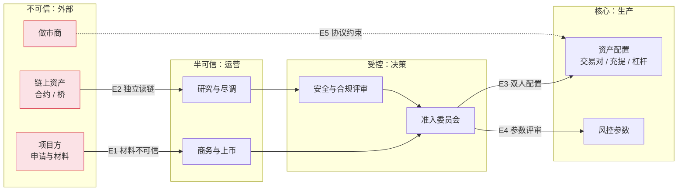
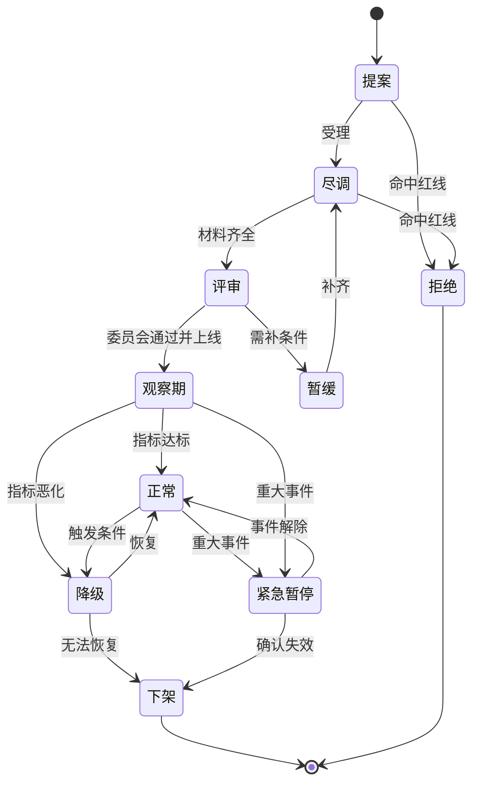
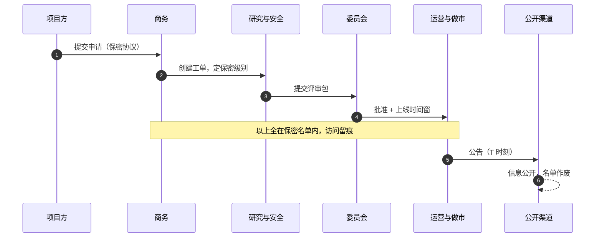

# X09 资产与市场准入：上币全周期、信息保护与分级准入

> 学习目标：读完本章，你能——
> 1. 画出一个币从提案到下架的全周期状态机，并写出每次状态转换需要的审批人和证据。
> 2. 设计一张"仅展示 / 现货 / 充值 / 提币 / 杠杆 / 抵押"的分级准入表，并给每一级写出量化的准入条件。
> 3. 为上币信息建立保密名单和内幕交易检测查询，并写出泄露后的应对流程。
>
> 适用角色：交易所安全工程师、上币与风控团队、合规官、做市与市场运营负责人。
> 前置章节：[A05 上币与合作项目尽调](../assessment/A05-listing-due-diligence.md)、[X07 交易所安全架构总览](X07-cex-architecture-overview.md)、[12 跨链桥安全](../chapters/12-cross-chain-bridges.md)、[23 托管、充提与合规安全](../chapters/23-custody-exchange-ops.md)
> 交互实验 / 模板：[上币评分卡](../interactive/listing-scorecard.html) ｜ [T05 上币尽调问卷](../templates/T05-listing-dd-questionnaire.md)
> 最后核对：2026-11-23

---

## 开场：一份只有几个人知道的名单

2022 年 7 月 21 日，美国 SEC 起诉了 Coinbase 的一名前产品经理 Ishan Wahi，以及他的哥哥 Nikhil Wahi 和朋友 Sameer Ramani。SEC 说，Ishan 负责协调 Coinbase 的公开上币公告，知道哪些币会在什么时间上线。

SEC 的指控称：从 2021 年 6 月到 2022 年 4 月，Ishan 把公告的时间和内容透露给另外两人。他们在公告前买入至少 25 种加密资产，公告后卖出，非法获利超过 110 万美元。SEC 还说，Coinbase 把上币信息列为保密信息，并警告员工不得据此交易或透露给他人。

这起案件里没有黑客，也没有漏洞。信息本来就在一个"被信任的人"手里。

<details class="predict"><summary>🤔 先猜再看：Coinbase 已经有保密政策，也警告了员工。为什么政策没有拦住这件事？</summary>

政策只写了"不许做"，没有写"怎样发现有人做了"。公开报道称，Coinbase 在 2022 年 4 月才开始调查，而交易从 2021 年 6 月就开始了，持续约 10 个月。保密政策是一条声明，不是一条控制。控制要能回答三个问题：谁看过这条信息？谁在公告前交易了这个币？这两群人有没有关联？本章第 6.5 节给出这三个问题的做法。

</details>

---

## 1. 一句话理解

**上一个币，就是把一份外部资产的全部风险接进交易所：合约风险、桥风险、价格风险、做市风险和信息风险。准入控制的工作，是决定它能接进多深，以及出问题时怎样把它退出去。**

> 🎯 打个比方：交易所的上币像机场的"航班准入"。一家新航空公司想飞这座机场，机场先查资质（尽调），再分配登机口（分级准入），先飞货运、后飞客运，出过事故就降级或停飞。机场还要保密"下周哪家航空公司来"，否则有人会先买下旁边的酒店。
>
> 比喻的局限：飞机不会被远程改造成另一种飞机。代币合约可以升级、可以增发、可以被桥抽走底层资产。准入结论会过期，所以"持续监控"和"退出"比"准入"本身更重要。

本章与 A05 的分工：

| 章节 | 回答的问题 | 产出 |
|---|---|---|
| [A05](../assessment/A05-listing-due-diligence.md) | 怎样评估一个项目？（评估方法、评分卡、红线） | 一份尽调结论 |
| **X09（本章）** | 机构怎样把评估变成流程和控制？（谁审批、怎样分级、怎样保密、怎样退出） | 一套准入制度与控制清单 |

---

## 2. 保护目标与信任边界

### 2.1 上币流程要保护什么

| 保护对象 | 说明 | 失守的后果 |
|---|---|---|
| 用户资金 | 用户买入的币不能是貔貅盘、可随意增发的币 | 用户损失；赔付；监管调查 |
| 交易所资产 | 抵押品、做市库存、热钱包里的币 | 坏账；穿仓；假充值 |
| 市场公正 | 上币时间、做市方式不能被内部人或做市商利用 | 内幕交易；操纵；信任下降 |
| 上币信息 | 公告前的时间、币种、条款 | 内幕获利；项目方被抢跑 |
| 决策可追溯 | 为什么上、谁批的、依据什么 | 出事后无法自证尽职 |

### 2.2 信任边界



**读图要点：**

- 项目方的材料（白皮书、审计报告、问卷答案）在 Z0，默认不可信。E1、E2 的控制是"独立核验"：地址、权限、字节码以链上读取为准，不以对方文档为准。
- 商务团队有业绩压力，不能同时拥有"批准上线"的权限。评审（安全、研究）和决策（委员会）必须与商务分开。
- E3 最容易被忽略：委员会批准的是"现货"，配置却被填成了"现货加杠杆"。配置要由双人完成，并与审批记录自动比对。
- 局限：图没有画上币信息怎样流动。3.4 节单独画信息流。

---

## 3. 参考架构

### 3.1 上币全周期状态机



**读图要点：**

- 每个箭头都需要"谁批准、什么证据"。没有证据的状态转换，不允许写进系统。
- "紧急暂停"可从任何上线状态进入，权限比"下架"低：值班人员可以暂停，下架要由委员会决定。
- "观察期"是设计核心：新币先以低限额运行，用链上和市场数据证明自己，再放开。
- 局限：状态机只描述单个资产。实际还要处理"一次下架 30 个币"这类批量操作，见 6.6 节。

### 3.2 分级准入：六个能力层

一个资产不是"上了"或"没上"。它可以只拥有一部分能力。每一层都是一次独立的风险接入。

| 层级 | 能力 | 新增的风险 | 默认前置条件 |
|---|---|---|---|
| L0 | 仅展示（行情页，不可交易） | 误导用户的信息风险 | 红线检查通过 |
| L1 | 现货交易 | 价格操纵、貔貅盘、流动性不足 | 完成尽调；做市协议已签 |
| L2 | 充值 | 假充值、合约漏洞、重组回滚 | 充值监听测试；确认数已定 |
| L3 | 提币 | 热钱包被投毒、桥资产失效 | 提币限额；地址校验；钱包余额上限 |
| L4 | 杠杆 / 合约 | 价格源被操纵、穿仓 | 指数价格多来源；深度达标；风险限额 |
| L5 | 抵押品 | 价格下跌引发连环强平 | 折价率；集中度限额；独立估值 |

> 💡 注意：顺序不是绝对的。有的交易所先开充值再开交易。但**能力越靠后，门槛越高**：抵押品的门槛必须高于现货，因为抵押品失效会变成交易所自己的坏账。

### 3.3 资产风险评分维度

[A05](../assessment/A05-listing-due-diligence.md) 讲过四维评分。机构落地时，把评分拆成可自动采集的字段，并按能力层设置不同的最低分。

| 维度 | 采集的字段（示例） | 谁采集 | 频率（建议） |
|---|---|---|---|
| 合约权限 | 可增发、可暂停、黑名单函数、可升级、owner 类型（EOA / 多签 / 时间锁） | 研究 + 脚本 | 上线前 + 每日 |
| 持仓集中度 | 前 10 地址占比；项目方与做市商持仓 | 脚本 | 每日 |
| 流动性 | 全市场 2% 深度；成交量；前 3 个交易场所占比 | 市场数据 | 每小时 |
| 价格源 | 可用指数来源数量；各源偏差 | 行情团队 | 每分钟 |
| 桥依赖 | 是否为桥接资产；桥类型；底层锁定资产与总供应对比 | 研究 + 脚本 | 每日 |
| 团队与审计 | 审计报告版本与链上字节码是否一致；赏金计划 | 研究 | 每季度 |
| 监管状态 | 白皮书、证券属性判断、制裁关联 | 合规 | 事件触发 |

### 3.4 数据流：谁知道上币信息



**读图要点：**

- 信息从 P 到 PUB 之间，至少经过 5 类人。每多一类，泄露面扩大一层。
- 保密名单按工单管理，不按部门管理。"商务部门的所有人"不是名单。
- 做市（O）常在公告前拿到币和时间，是内幕风险的高发点（LST-C06、LST-C08）。
- 局限：图只覆盖交易所内部。项目方、律师、媒体、其他交易所也知道信息，交易所对它们只有协议约束，没有直接控制力。

### 3.5 为什么这样分

1. **评审与商务分离**：商务的 KPI 是上币数量，评审的 KPI 是少出事。同一个人兼任，红线会变成"可协商的建议"。
2. **能力分层**：把"能不能买"和"能不能当抵押"分开。事故时可以只降级一层，而不是整体下架。
3. **观察期**：新币的真实风险要靠真实数据暴露。限额让暴露的代价可控。
4. **信息按工单控制**：名单小，才查得出是谁泄露。名单有 200 人时，调查无法进行。

---

## 4. 控制清单

优先级：P0 = 没有它，一个坏资产可能直接造成大额资损；P1 = 显著降低风险；P2 = 成熟度提升。

| ID | 控制项 | 要防什么 | 优先级 | 怎么验证 |
|---|---|---|---|---|
| LST-C01 | 上币红线清单，任一命中即否决；委员会不能豁免 P0 红线 | 貔貅盘、无限增发被"商务压力"放行 | P0 | 抽 5 个已上线资产，核对红线检查记录 |
| LST-C02 | 评审与商务分权：商务不能批准、不能改配置 | 业绩压力压过风险判断 | P0 | 检查工单系统：商务账号无"批准"和"配置"权限 |
| LST-C03 | 分级准入表：每层有量化条件；系统按层级开关充值、提币、杠杆、抵押 | 一次性开放全部能力 | P0 | 找一个仅 L1 的资产，尝试开杠杆，系统必须拒绝 |
| LST-C04 | 资产配置双人完成，并与批准记录自动比对 | 配置错误或内部人越权开通 | P0 | 测试环境把 L1 资产配成 L4，必须阻断 |
| LST-C05 | 部署地址以链上读取为准；审计报告字节码与部署一致 | 调包、假合约 | P1 | 抽查：重读链上权限和字节码哈希，与档案一致 |
| LST-C06 | 上币信息保密名单：按工单登记，访问留痕，名单内人员及关联账户在有效期内禁止交易该币 | 内部人抢跑 | P0 | 抽最近一次上币的访问记录，与名单对照 |
| LST-C07 | 上币内幕交易检测：公告前窗口的异常买入，与名单人员的关联 | 泄露后无人发现 | P1 | 回放一次历史上币，看规则能否标出人造的异常账户 |
| LST-C08 | 做市商准入与监管：协议要求双边报价、最小挂单量；单边抛售即告警；协议有冻结与清退权 | 做市商用库存抛售 | P0 | 测试库构造单边卖出的做市账户，看多久告警 |
| LST-C09 | 观察期限额：新币的充值、提币、杠杆、抵押有较低上限 | 新币一次性放大风险 | P1 | 检查配置：上线 30 天内的资产限额低于标准值 |
| LST-C10 | 持续监控：权限变更、增发、桥状态、集中度、价格偏离、流动性 | 准入后风险恶化无人知 | P0 | 修改测试合约的 owner，告警必须在 15 分钟内触发（示例目标） |
| LST-C11 | 抵押品与杠杆的独立价格源、折价率、集中度限额；变更需评审 | 单一价格源被操纵；抵押品暴跌 | P0 | 回放一个资产的极端行情，核对强平与折价 |
| LST-C12 | 桥接资产单独评估；监控桥状态；有"仅暂停该桥全部资产"的开关 | 桥被盗后继续接收假币 | P0 | 演练：暂停一座桥的全部资产的充提，记录分钟数 |
| LST-C13 | 事件处理手册：空投、分叉、改名、合约迁移 | 迁移期间的假充值和重复记账 | P1 | 桌面推演：一个代币宣布合约迁移 |
| LST-C14 | 紧急暂停与下架的权限、通知和用户保护流程 | 事发时无人拍板；下架引发挤兑 | P0 | 推演计时：从发现到暂停生效 |
| LST-C15 | 准入决策档案：材料、评分、批准人、条件、监控规则；保存期以当地监管要求为准 | 无法自证尽职 | P1 | 抽 3 个资产，30 分钟内重建决策过程 |
| LST-C16 | 每季度全量复评，低分资产降级 | 评分过期 | P2 | 复评报告与降级清单 |

---

## 5. 分级落地

| 档位 | 做什么 | 人力（示例） | 时间（示例） |
|---|---|---|---|
| 最小可行 | 红线清单（C01）；评审与商务分权（C02）；工单化的保密名单（C06）；新币仅开 L1，充提杠杆默认关闭（C03 简化版）；权限变更告警（C10 子集） | 1 名安全 + 1 名合规兼职 | 4–6 周 |
| 标准 | 加上分级表与自动比对（C03、C04）；做市协议与监控（C08）；观察期限额（C09）；桥资产专项（C12）；决策档案（C15）；内幕检测（C07） | 2–3 名安全与风控，1 名数据工程师 | 3–6 个月 |
| 成熟 | 全部控制；每日自动复评；上币决策可回放；季度演练 | 4–6 名，含上币风控专岗 | 6–12 个月，并持续运营 |

> 💡 注意：人力与时间是示例。起点是"能说清楚现在的流程里，谁有权把一个币从 L1 拉到 L5"。如果答案是"商务经理一个人"，先修这一条。

### 监管对准入的要求（截至 2026 年公开资料）

这里只列与准入流程直接相关的要求。条款细节以官方最新文本为准。

- **欧盟 MiCA 第 76 条（交易平台运营）：** 平台必须有明确、透明的运营规则。规则要覆盖准入审批、被排除的资产类别、资产保持可交易的条件（例如流动性门槛）和暂停交易的条件。准入前要做适合性评估，考虑技术方案的可靠性、与非法或欺诈活动的潜在关联，以及发行方和开发团队的经验与声誉。规则要禁止准入内置匿名化功能的资产，除非平台能识别持有人和交易历史。需要白皮书而未发布时，不得准入。来源类型：ESMA 的 MiCA 互动规则手册。
- **香港 SFC 虚拟资产交易平台指引：** 平台要设立代币准入与审查委员会，管理准入标准。每个代币要做尽职调查，因素包括团队背景、监管状态、供需与流动性（市值、成交量、做市商、锁仓）、技术面、集中持有与价格操纵风险、法律风险和洗钱风险。资产不再符合条件时，平台要评估是否暂停零售交易。零售可交易代币的"合资格大市值"条件和 SFC 事先批准要求，来自律所对 2023 年 SFC 咨询结论的总结（二手资料，请以 SFC 最新指引为准）。来源类型：SFC 官网的常见问题；律所总结。
- **市场滥用：** 欧盟 MiCA 设有市场滥用专章，包括内幕交易。美国 SEC 在 Wahi 案中的立场是：联邦证券法不因资产是加密资产就豁免内幕交易禁令。各辖区对"上币信息是否构成内幕信息"的认定不同，请法务确认。

---

## 6. 落地做法

### 6.1 步骤：把一个币从 L1 升到 L2、L3

1. 上币工单记录当前层级和目标层级。
2. 研究从链上重读权限、字节码哈希和持仓，与上一次档案比较。
3. 安全团队在测试环境完成该币的充值监听测试：正常充值、重组回滚、事件缺失、`transfer` 返回 `false`。
4. 运营设定充值确认数，以及单笔、单日上限。
5. 委员会批准，批准记录带上限额数字。
6. 两名运营人员完成配置。系统对照批准记录，数字不一致就阻断。
7. 配置生效后 24 小时内，每小时复核一次实际流量与限额。

### 6.2 准入分级配置（示例）

下面是示意性的 YAML，不对应任何真实产品。

```yaml
# 示例：资产准入策略（示意）
tiers:
  L1_spot:
    require: [no_redline, scorecard_min: 60, market_maker_signed]
    limits: {daily_volume_usd: 2_000_000}
  L2_deposit:
    require: [L1, deposit_listener_test_passed, confirmations_set]
    limits: {deposit_daily_usd: 500_000}
  L3_withdraw:
    require: [L2, hot_wallet_balance_cap, address_format_validation]
    limits: {withdraw_daily_usd: 300_000}
  L4_margin:
    require: [L1, scorecard_min: 75, index_sources_min: 3, depth_2pct_usd_min: 3_000_000]
    limits: {max_leverage: 3, oi_cap_usd: 5_000_000}
  L5_collateral:
    require: [L4, scorecard_min: 85, holder_top10_pct_max: 40, bridge_review_passed]
    haircut_pct: 30
    concentration_cap_pct_of_pool: 10
observation:
  days: 30
  limit_multiplier: 0.3      # 观察期内所有限额乘以 0.3
auto_downgrade_triggers:
  - owner_changed
  - mint_event_over_pct_supply: 1
  - top10_holder_pct_change_over: 10
  - index_deviation_pct_over: 5
  - bridge_paused
```

> 💡 注意：数字都是示例。真正的阈值要用你的历史数据和风险偏好确定，写进配置，并有变更评审（LST-C04）。

### 6.3 权限快照脚本（示例）

下面是示意性的 Python 骨架：只读查询链上权限，生成"准入快照"并比较差异。

```python
# 示例：准入快照（示意；需自备 RPC 与 ABI）
from web3 import Web3
import hashlib, time

def snapshot(rpc, token, abi):
    w3 = Web3(Web3.HTTPProvider(rpc))
    addr = Web3.to_checksum_address(token)
    c = w3.eth.contract(address=addr, abi=abi)
    code = w3.eth.get_code(addr)
    snap = {
        "ts": int(time.time()),
        "codehash": hashlib.sha256(bytes(code)).hexdigest(),
        "total_supply": c.functions.totalSupply().call(),
    }
    for fn in ("owner", "paused"):
        try:
            snap[fn] = getattr(c.functions, fn)().call()
        except Exception:
            snap[fn] = None  # 无此函数不代表安全，需要人工确认
    return snap

def diff(old, new):
    changed = [k for k in ("codehash", "owner", "paused") if old.get(k) != new.get(k)]
    if new["total_supply"] > old["total_supply"] * 1.01:
        changed.append("supply_up_over_1pct")
    return changed
```

建议：每日对 L1 以上资产运行一次，`diff` 非空就开工单。可升级代理的实现地址要另外读取（见 [10 可升级合约与代理](../chapters/10-upgradeable-proxy.md)）。代码哈希只能发现"字节码变了"，不能发现"代理指向的实现变了"。

### 6.4 做市商准入与监控

做市商拿到的是库存和时间优势，这是第二个大风险点。

1. **准入：** 查公司身份、控制人、历史关联（是否被其他场所清退）、资金来源。
2. **协议：** 要求双边报价、最小挂单量、最大价差、挂单持续时间；禁止公告前用非自有库存交易；约定冻结收益和清退的权利。
3. **库存：** 库存来源可核对，转入做市专用账户，不与自营混用。
4. **监控：** 对每个做市账户监控净卖出量、买卖挂单比例、占成交量比例、与库存的关系。
5. **处置：** 异常时先冻结收益，再通知项目方，再决定是否清退。

监控查询（示例，SQL 示意）：

```sql
-- 示例：做市账户上线首 72 小时的单边卖出
SELECT account_id, symbol,
       SUM(CASE WHEN side='sell' THEN qty END) AS sold,
       SUM(CASE WHEN side='buy'  THEN qty END) AS bought
FROM trades
WHERE account_id IN (SELECT account_id FROM market_maker_accounts)
  AND ts BETWEEN :listing_ts AND :listing_ts + INTERVAL '72 hours'
GROUP BY account_id, symbol
HAVING SUM(CASE WHEN side='sell' THEN qty END) > 0.2 * MAX(:mm_inventory)
   AND SUM(CASE WHEN side='sell' THEN qty END)
       > 4 * COALESCE(SUM(CASE WHEN side='buy' THEN qty END), 0);
```

- 假阳性：项目方书面指示做市商分发代币，或库存本来就是用于出售的做市借贷。调优：把合同约定的出售计划写进例外表，并要求项目方书面确认。
- 漏报：做市商把币分到多个子账户再出售。需要结合账户关联分析。

### 6.5 上币信息保密名单与内幕检测

**保密名单字段（示例）：**

| 字段 | 例子 |
|---|---|
| 工单 | LST-2026-0412 |
| 保密级别 | S1（时间 + 币种）/ S2（仅币种） |
| 名单内人员 | 员工 ID；律师、做市商、公关的联系人 |
| 开始时间 | 工单创建时间 |
| 结束时间 | 公告时间 + 24 小时 |
| 访问日志 | 谁在何时打开了工单、下载了文件 |

**规则（建议）：**

1. 名单人员和他们的关联账户（本人、同住亲属、已登记的外部钱包）在有效期内禁止交易该币。
2. 员工入职、转岗时登记个人账户与链上地址，并签署声明。
3. 工单的每一次访问写入审计日志。导出文件带水印（每人不同，用于追溯泄露源）。
4. 与项目方的保密条款写明：泄露可导致上币取消。

**检测查询（示例，SQL 示意）：**

```sql
-- 示例：公告前最后 48 小时才首次买入、金额较大的账户
SELECT b.account_id, b.usd, b.first_ts, a.created_at, a.kyc_country,
       EXISTS (SELECT 1 FROM insider_links l WHERE l.account_id = b.account_id) AS linked_to_insider
FROM (
  SELECT account_id, SUM(qty*price) AS usd, MIN(ts) AS first_ts
  FROM trades
  WHERE symbol = :symbol AND side = 'buy'
    AND ts BETWEEN :announce_ts - INTERVAL '30 days' AND :announce_ts
  GROUP BY account_id
) b
JOIN accounts a USING (account_id)
WHERE b.usd > :usd_threshold
  AND b.first_ts > :announce_ts - INTERVAL '48 hours'
  AND NOT EXISTS (SELECT 1 FROM trades x
                  WHERE x.account_id = b.account_id AND x.symbol = :symbol
                    AND x.ts < :announce_ts - INTERVAL '30 days')
ORDER BY linked_to_insider DESC, b.usd DESC;
```

- 假阳性：该币本来就有高热度，或市场已有传闻。调优：与同类币的公告前买入量做基线比较，只看相对基线的异常。
- 关联信息来源：登记的内部人地址、链上资金来源（同一地址给多个账户充值）、设备与 IP 重合。
- 局限：只能看到本交易所的数据。在其他交易所或场外买入，本规则看不到。这是内幕检测的上限。

**泄露后的应对（步骤）：**

1. 经法务批准，冻结涉事账户的提币。
2. 保全证据：工单访问日志、交易记录、通讯记录。
3. 判断是否提前公告，或推迟公告。
4. 通知项目方，并按协议处理。
5. 上报合规官，评估是否需要向监管通报（以所在辖区要求为准）。
6. 内部处置与整改，写进复盘。

### 6.6 持续监控与下架

**告警规则（示例）：**

| 触发 | 动作 | 处理人 |
|---|---|---|
| owner / admin 变更；实现合约升级 | P1 告警；该币进入"观察" | 研究 + 安全 |
| 单笔增发超过总量 1% | P1 告警；评估暂停充提 | 安全 |
| 桥暂停、桥被盗报道、桥底层资产低于供应 | 暂停该桥全部资产的充提 | 值班 |
| 指数价格偏离超过 5% 且持续 5 分钟 | 杠杆与抵押暂停新开仓 | 风控 |
| 前 10 持仓占比一周内上升超过 10 个百分点 | 评审降级 | 研究 |
| 项目方公告迁移 / 分叉 / 改名 | 创建事件工单；暂停充值 | 运营 + 安全 |

**下架流程（步骤）：**

1. 触发：评分降级、监管要求、项目方失联、安全事件。
2. 委员会决定。紧急情况下，值班负责人先暂停，事后 24 小时内补批。
3. 提前公告：给用户 N 天（示例：7 天）停止新开仓、卖出或提走。紧急下架可缩短，但要写明理由。
4. 关闭杠杆与抵押，处理未平仓位和强平。
5. 关闭充值，保留提币。
6. 期满后关闭交易。剩余余额按用户协议处理。
7. 保留提币通道一段时间，并公布后续处理方式。

> ⚠️ 警告：不要在没有公告的情况下关闭提币。无通知关闭提币会被用户理解为"交易所有问题"，引发挤兑。

### 6.7 空投、分叉、改名与合约迁移

| 事件 | 风险 | 处理要点 |
|---|---|---|
| 空投 | 空投代币本身可能是诈骗币；快照时间与余额不一致 | 先尽调空投币，再决定是否支持；明确快照时间 |
| 硬分叉 | 重放攻击；两条链的充提混淆 | 分叉前暂停充提；新链按新资产走完整流程 |
| 改名 / 换标识符 | 用户和系统把新旧币混用 | 保留旧标识符，新增映射表，公告 |
| 合约迁移（旧币换新币） | 旧合约仍可被充值；假迁移诈骗 | 多渠道确认官方公告；暂停旧币充值；验证后才启用新合约 |
| 可升级代币的合约升级 | 升级后行为改变 | 升级时进入观察，重做红线检查 |

### 6.8 常见坑

- 商务经理拥有"改交易对状态"的后台权限，绕过了委员会。
- 配置界面里"杠杆倍数"是文本框，没有上限校验。
- 观察期结束后限额自动放开，没有人复核。
- 桥接资产套用原生资产的评分。桥出事时，桥接资产价值归零，原生资产还在。
- 保密名单只在邮件里存在，没有访问日志。
- 评分每年更新一次，而合约 owner 昨天已经换了。

---

## 7. 运营：指标、告警、值班、演练、季度节奏

**指标：**

| 指标 | 说明 | 方向 |
|---|---|---|
| 红线否决率 | 申请中被红线否决的比例 | 不应长期接近 0 |
| 观察期资产数 | 当前处于观察期的资产 | 与限额挂钩 |
| 配置与批准不一致次数 | LST-C04 自动比对的拦截数 | 非 0 说明控制在起作用 |
| 权限变更告警到处置时间 | 从告警到决定的分钟数 | 越短越好 |
| 做市单边抛售告警数 | 每月 | 看趋势 |
| 每个工单的保密名单人数 | 平均值 | 越少越好 |
| 复评降级数 | 每季度被降级的资产数 | 与市场情况对照 |

**值班：** 资产监控告警进入安全运营的 P1–P4 队列（见 [X05 检测与响应工程](X05-detection-response-engineering.md)）。值班负责人可以暂停某资产的充提、杠杆和抵押，无权下架。

**节奏：**

| 时间 | 活动 |
|---|---|
| 每月 | 看板评审：观察期资产、告警、做市商 |
| 每季度 | 全量复评；做一次桌面推演（桥被盗、做市商抛售、上币信息泄露，三选一） |
| 每半年 | 抽查保密名单与访问日志；复核红线清单 |
| 每年 | 外部评审准入制度；对照监管要求更新 |

---

## 8. 失效案例

### 8.1 Coinbase 上币信息内幕交易（2021 年 6 月–2022 年 4 月，美国）

- **来源类型：** SEC 新闻稿 2022-127（2022 年 7 月 21 日）；美国纽约南区检察官办公室的判决公告；媒体报道。
- **事实：** SEC 称，Ishan Wahi 参与协调 Coinbase 的上币公告，并把时间和内容透露给哥哥 Nikhil Wahi 和朋友 Sameer Ramani。他们在公告前买入至少 25 种加密资产，其中至少 9 种被 SEC 认定为证券，获利超过 110 万美元。公开报道称，Ishan 对共谋电信欺诈认罪，2023 年 5 月被判 2 年监禁；Nikhil 在 2023 年 1 月被判 10 个月，并被命令支付 89.25 万美元。
- **打穿的控制：** 保密名单与内幕交易检测（LST-C06、LST-C07）。公开材料显示，保密政策存在，调查在 2022 年 4 月才开始。
- **教训：** 内部人拥有的是信息，不是越权的权限。访问控制拦不住一个本来就被授权的人。需要"访问留痕加交易关联"的发现能力，以及能核对个人账户的入职流程。
- **未确认：** 公开材料没有说明 Coinbase 用什么方法发现了这件事。本章不推测。

### 8.2 Binance 上 MOVE 与做市商抛售（2024 年 12 月–2025 年 3 月）

- **来源类型：** Binance 公告（经 The Block、Blockworks 转述）；Movement Network Foundation 的回应。
- **事实：** Binance 称，MOVE 在 2024 年 12 月上线后，一家做市商在买单很少的情况下卖出约 6600 万枚 MOVE，净获利约 3800 万 USDT。Binance 在 2025 年 3 月 18 日清退该做市商，冻结收益用于补偿用户，并称它与此前（2025 年 3 月 9 日）因不当行为被清退的 GPS、SHELL 做市商有关联。Movement 基金会称自己事先不知情，并计划用这笔资金做为期三个月的回购。公开报道（CoinDesk、Blockworks）将该做市商指认为 Web3Port；Binance 的公告没有点名。
- **打穿的控制：** 做市商准入与监控（LST-C08）。做市商拿到了库存和上线时间，却没有被实时监控单边抛售。
- **教训：** 做市商是上币流程里权力最大的外部方。准入时查关联历史，运营时看实时行为，并在协议里事先写好冻结与清退权。
- **未确认：** 公开报道对抛售的具体日期说法不一（上线当日或次日），本章写作"上线后不久"。用户补偿的最终方式，公开资料中并不清楚。

### 8.3 Multichain 桥接资产暂停充提（2023 年 5–7 月）

- **来源类型：** Binance 公告（经 The Block 转述）；The Block 报道，其中引用 DeFiLlama 数据。
- **事实：** 2023 年 5 月 24 日，Binance 因 Multichain 协议问题，暂停部分经 Multichain 转入的代币的充值。7 月 5 日，Binance 又公告，自 7 月 7 日起暂停一批 Multichain 桥接代币的充提（包括 POLS、ACH、BIFI、FARM、ALPACA、AVA 等，涉及 BNB Smart Chain、Fantom、以太坊），并称暂停持续到另行通知。The Block 报道称，Multichain 当时多条路线不工作，团队先称技术问题，后称不可抗力，并称联系不上 CEO；引用的 DeFiLlama 数据显示，Multichain 铸造的资产超过 13 亿美元。
- **打穿的控制：** 桥接资产单独评估与"按桥暂停"开关（LST-C12）。
- **教训：** 桥接代币的价值依赖桥。桥失效时，交易所不应只暂停一个币，而要能按"桥"暂停该桥下的全部资产。有这个开关，处理是一次配置；没有，是几十次人工操作。
- **未确认：** Binance 公告没有给出详细原因，本章只引用其公开表述。Multichain 的完整损失与归因不在本章范围。桥的机制见 [12 跨链桥安全](../chapters/12-cross-chain-bridges.md)。

### 8.4 Hyperliquid 的 JELLY 永续合约（2025 年 3 月）

- **来源类型：** The Block、CoinDesk 等媒体报道；Hyperliquid 验证者集的声明（经报道转述）。注意：Hyperliquid 是链上衍生品交易所，不是 CEX。选它是因为"低流动性资产配上杠杆"的风险，在 CEX 的杠杆准入里是同一个问题。
- **事实：** 2025 年 3 月 26 日，一个账户在 JELLYJELLY 上开空，同时有大户在 DEX 上抛售该币，价格下跌，Hyperliquid 的 HLP 金库接手了空头；另一个新账户随后做多，HLP 的未实现亏损在高点约 1200 万美元（Lookonchain 数据；各来源给出的数字不同）。Hyperliquid 的验证者集投票下架该永续合约。Hyper Foundation 表示，除被标记的地址外，用户会得到补偿。公开报道称此事使平台的去中心化程度受到质疑。
- **打穿的控制：** 杠杆准入的深度与价格源要求（LST-C11）；紧急暂停与下架的权限设计（LST-C14）。
- **教训：** 小市值、浅流动性的币开放杠杆后，现货价格就能被推动，进而伤害资金池。杠杆准入要看现货深度。紧急下架的决策权限要事先写清楚，否则事后的决定会引发合法性争议。
- **未确认：** 事件后 Hyperliquid 承诺的技术改进，公开资料中未见详细内容。本章不评论其后续措施。

### 8.5 案例与控制的映射

| 案例 | 保护域 ② 的环节 | 打穿的控制 |
|---|---|---|
| Coinbase 内幕交易 | 上币信息 | LST-C06、LST-C07 |
| MOVE 做市商 | 上线运营 | LST-C08 |
| Multichain 桥接资产 | 持续监控、桥依赖 | LST-C10、LST-C12 |
| JELLY 永续合约 | 杠杆准入、紧急下架 | LST-C11、LST-C14 |

> 💡 注意：本章没有收入"项目方在公告前泄露上币信息"这类事件。除上面的 Coinbase 案件外，没有查到足够可靠、可核对的公开来源，其他传闻不写。

---

## 9. 评估检查点

- [ ] **LST-1** 有书面的上币红线清单，P0 红线不能被委员会豁免。
- [ ] **LST-2** 商务账号无批准权限，无资产配置权限；已在系统中检查。
- [ ] **LST-3** 有分级准入表，每层有量化条件；系统按层级控制充值、提币、杠杆、抵押。
- [ ] **LST-4** 资产配置需两人完成，并与批准记录自动比对；已测试"配置高于批准"会被阻断。
- [ ] **LST-5** 部署地址和字节码以链上读取为准，并与审计报告核对。
- [ ] **LST-6** 每次上币有保密名单，访问有日志，名单内人员及关联账户有交易限制。
- [ ] **LST-7** 有公告前窗口的内幕交易检测，并回放过一次历史上币。
- [ ] **LST-8** 做市商有书面协议和实时监控，已测试单边抛售告警。
- [ ] **LST-9** 新币有观察期限额，观察期结束需要复核。
- [ ] **LST-10** 对 owner 变更、增发、升级、集中度、价格偏离有自动告警，并测试过。
- [ ] **LST-11** 杠杆与抵押品有独立价格源、折价率、集中度限额；回放过极端行情。
- [ ] **LST-12** 桥接资产有单独评估，有"按桥暂停"的开关，演练过。
- [ ] **LST-13** 有空投、分叉、改名、合约迁移的处理手册。
- [ ] **LST-14** 紧急暂停与下架的权限、公告模板、用户保护流程已书面化并演练。
- [ ] **LST-15** 上币决策档案完整，抽 3 个资产，30 分钟内能重建决策过程。
- [ ] **LST-16** 每季度全量复评，并有降级记录。

把检查结果写进报告：

| 结果 | 报告写法 | 动作 |
|---|---|---|
| 不满足且是 P0 | 红线项，写明潜在影响与负责人 | 90 天内整改，月报跟踪 |
| 不满足且是 P1 / P2 | 写入风险登记表 | 排入季度计划 |
| 满足但无证据 | 视为不满足 | 补证据 |
| 满足且有证据 | 记录证据位置与下次复核日期 | 季度复核 |

---

## 10. 上手路径

**第一周：**

1. 找到上币工单系统，列出所有能改资产状态的账号和角色。
2. 画出"一个币怎样从申请变成可交易"的流程图，标出谁批准、谁配置。
3. 读最近一次上币的完整记录，检查红线是否被检查过、证据是否留存。
4. 列出所有已上线的桥接资产和它们依赖的桥。

**第一个月：**

1. 写出红线清单和分级准入表，交委员会审议。
2. 为所有 L1 以上资产建立每日权限快照（见 6.3）。
3. 对最近一次上币，回放一次公告前异常买入查询（见 6.5）。
4. 做一次桥暂停的桌面推演，记录用时。

**第一个季度：**

1. 上线"配置与批准自动比对"。
2. 补充做市商协议，上线单边抛售监控。
3. 完成一次全量复评，产出降级清单。
4. 推演"上币信息泄露"，验证保密名单和证据保全流程。

---

## 11. 常见误区

| 误区 | 事实 |
|---|---|
| 尽调通过就是安全 | 尽调只是某一天的快照。可升级、可增发的合约明天就可能不同 |
| 做市商是合作伙伴，不需要监控 | 做市商拥有库存和时间优势，是上币流程里最大的外部风险方 |
| 抵押品和现货用同一套标准 | 抵押品失效会变成交易所自己的坏账，标准必须更高 |
| 保密协议足够保护上币信息 | 协议是威慑，不是发现手段。需要访问日志和交易关联 |
| 桥接资产和原生资产风险一样 | 桥接资产多一层桥依赖，桥出事会让资产价值归零 |
| 下架就是关掉交易对 | 下架包括处理未平仓位、充提、用户沟通，要有完整流程 |
| 红线可以特批 | P0 红线一旦能被特批，就变成了"可以谈的价格" |

---

## 12. 术语表

| 术语 | 英文 | 定义 |
|---|---|---|
| 上币 | Listing | 让一个资产在交易所可展示、交易、充提或作为抵押品 |
| 下架 | Delisting | 停止资产的交易、充提或其他能力 |
| 分级准入 | Tiered Access | 资产按风险拥有不同能力层，每层有独立门槛 |
| 观察期 | Observation Period | 新上线资产使用较低限额运行的一段时间 |
| 做市商 | Market Maker | 用自有库存在买卖两侧挂单，提供流动性的机构 |
| 内幕交易 | Insider Trading | 利用未公开的重大信息交易 |
| 保密名单 | Wall-crossing List | 记录哪些人在公告前知道某项保密信息 |
| 折价率 | Haircut | 抵押品估值打的折扣，用于吸收价格下跌 |
| 桥接资产 | Bridged Asset | 经跨链桥铸造、代表原资产的代币 |
| 指数价格 | Index Price | 综合多个来源得到的参考价格，用于强平和结算 |
| 适合性评估 | Suitability Assessment | 平台在准入前评估资产的技术、团队和风险的过程 |

---

## 13. 动手练习与思考题

### 练习 1：画一张分级准入表（30 分钟）

选一个你熟悉的币。对照 3.2 节的六个能力层，为它写出：

1. 每一层的准入条件（至少 2 项量化条件）。
2. 每一层的初始限额。
3. 触发降级的 3 个条件。

### 练习 2：写一条异常买入规则（45 分钟）

用 6.5 的 SQL 作为起点。自己造 20 行假交易数据（含 2 个异常账户），用 SQLite 或 pandas 验证规则能标出它们。记录假阳性，写出调优思路。

### 练习 3：桌面推演"做市商抛售"（30 分钟）

脚本：上线后 6 小时，监控发现做市账户净卖出占库存的 30%，价格下跌 25%（示例数值）。

1. 谁最先知道？谁有权冻结做市账户？
2. 要不要先通知项目方？
3. 用户补偿由谁决定？
4. 把每步的决策人和用时记在一张表里。

### 练习 4：审一份示例配置（20 分钟）

把 6.2 节的 YAML 加两个故意的错误（例如 L4 缺少 `index_sources_min`，观察期倍数设成 1），请别人找出来，并写出对应的检查项。

### 建议配套（后续在 L3 训练营实现）

一个"上币快照与差异告警"的小型工具：读取示例代币合约的权限与字节码，生成快照，对比差异并输出告警。

> 🪞 反思：想一想你所在机构（或你熟悉的一家交易所）。如果明天有一个币的 owner 被盗，从链上发生到你们的系统暂停这个币，需要多久？谁会第一个知道？

### 思考题

1. 评审与商务分权会让上币变慢。你怎样向业务团队证明这是值得的？可以用哪些指标衡量成本和收益？
2. 内幕交易检测只能看到本交易所内部的数据。有哪些情况它永远发现不了？你会用什么其他控制来补充？
3. 一个桥接资产的桥被暂停，桥的团队说"只是维护，三天后恢复"。交易所应当等多久？谁来决定？写出你的判断依据。

---

下一章：[X10 交易、结算与信用](X10-cex-trading-settlement-credit.md)
