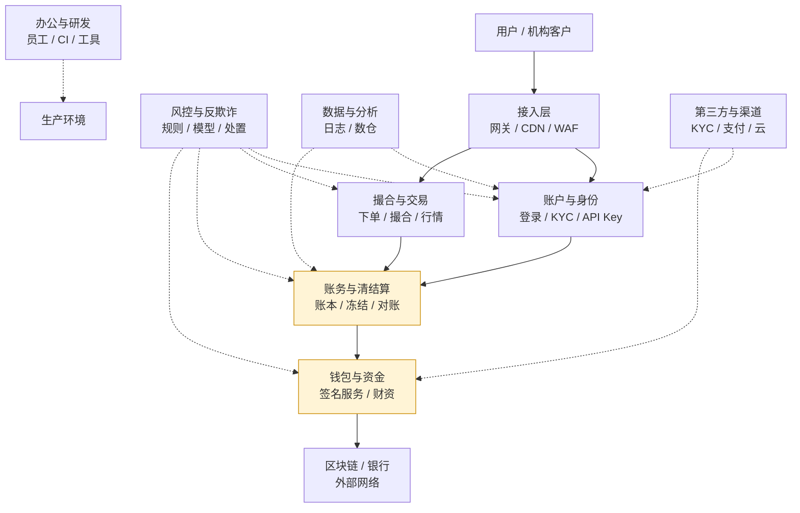
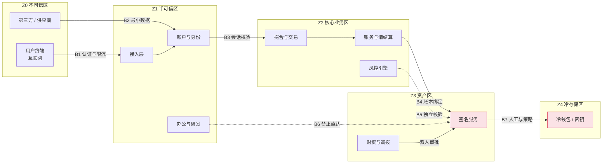
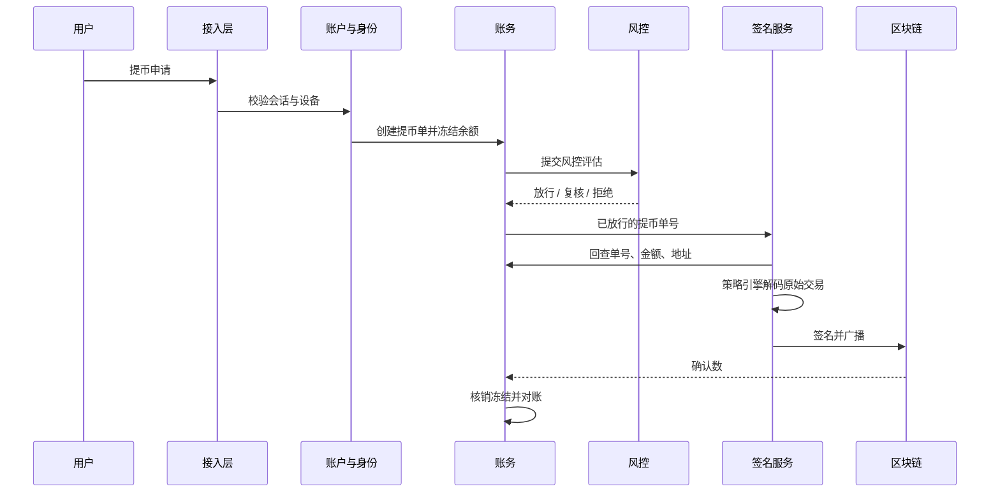
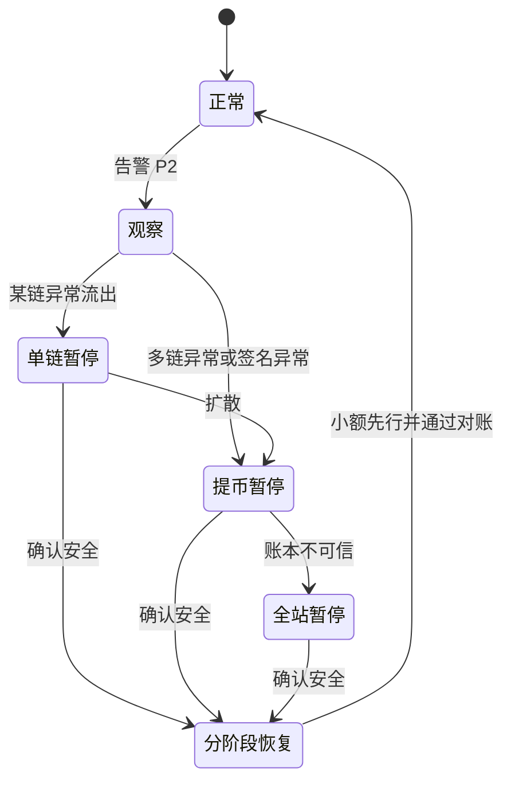
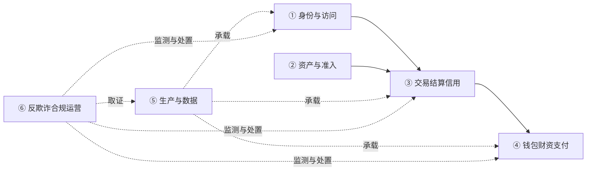

# X10 交易所安全架构总览：信任边界、数据流与六个保护域

> 学习目标：读完本章，你能——
> 1. 画出一家中心化交易所的系统分区图、信任边界图和数据流图，并在图上标出每条边界的控制点。
> 2. 把任意一起交易所事故归入六个保护域之一，并指出它打穿了哪一条边界、哪一类控制。
> 3. 用 L1–L4 成熟度表给一家交易所的架构自评，并选出第一季度要做的三件事。
>
> 适用角色：交易所安全工程师、安全架构师、安全负责人；想进入交易所安全团队的人。
> 前置章节：[23 托管、充提与合规安全](../chapters/23-custody-exchange-ops.md)、[29 2026 专题：签名路径](../chapters/29-signing-path-2026.md)、[28 事故案例库](../chapters/28-incident-casebook.md)
> 交互实验：[热钱包应急演练](../interactive/incident-response-sim.html)、[多签签前复核](../interactive/multisig-review-lab.html)
> 最后核对：2026-11-23

---

## 开场：一个钱包团队的工程师收到了"面试题"

2024 年 12 月，FBI 公开说明了日本交易所 DMM Bitcoin 约 3.08 亿美元（事发时估值）失窃的路径。公开报道称：攻击者在领英上冒充招聘者，联系了日本钱包软件公司 Ginco 的一名员工，发给他一份托管在 GitHub 上的"入职测试" Python 脚本。员工把脚本复制到个人 GitHub 后，电脑被控制。约两个月后，攻击者用会话 Cookie 冒充这名员工，并在 5 月底篡改了 DMM 一笔正常的转账请求。

公开报道没有指出 DMM 自己的外网入口被攻破。

<details class="predict"><summary>🤔 先猜再看：这起事故里，DMM 的"系统边界"在哪里？攻击者是从边界外打进来的吗？</summary>

不是。攻击者沿着一条被信任的路径走：供应商员工的电脑 → 供应商的通讯系统 → DMM 发出的转账请求。DMM 把供应商放在"可信"一侧，边界画错了位置。本章第 2 节教你怎样把这条线画对。

</details>

---

## 1. 一句话理解

**交易所不是一个系统，而是十个互相信任的系统。安全架构的工作，是决定谁可以信任谁，并让任何一个系统被攻破时，损失停在它自己的分区里。**

中心化交易所（Centralized Exchange，CEX）：由公司保管用户资产、用内部账本撮合交易的平台。

> 🎯 打个比方：交易所像一艘有多个船舱的货轮。船舱之间有水密门。一个舱进水，水密门关上，船不会沉。事故里的交易所，多半是水密门开着，或者门的钥匙挂在每个舱的墙上。
>
> 比喻的局限：船舱进水是物理过程，水不会"伪造一张合法的进水单"。攻击者会伪造请求，让正常的门自己打开。所以每扇门都要自己检查请求，不能只看请求从哪个舱来。

本章是交易所组（X10–X30）的总览。它回答三个问题：

1. 系统分几个区，各区放什么？
2. 哪些边界必须有控制点？
3. 防御工作怎样分给六个保护域，每个域在哪一章展开？

---

## 2. 保护目标与信任边界

### 2.1 交易所要保护什么

| 保护对象 | 一句话说明 | 失守的后果 |
|---|---|---|
| 客户资产 | 热、温、冷钱包里的链上资产，银行里的法币 | 直接资损；赔付；挤兑 |
| 账本真实性 | 内部账本记录每个用户的权益 | 账实不符；无法证明谁有多少 |
| 客户账户 | 登录、API Key、找回通道 | 单用户被盗；批量被盗 |
| 市场公正 | 价格、撮合、上币信息 | 操纵、内幕、错误强平 |
| 客户数据 | KYC、交易、联系方式 | 勒索、社工、监管处罚 |
| 运营连续性 | 提币、交易能持续运行，也能被安全地暂停 | 停摆；信任崩塌 |

### 2.2 九个系统分区



**读图要点：**

- 实线是资金与业务指令的主路径：用户 → 接入 → 账户 / 交易 → 账务 → 钱包 → 链。虚线是控制、观测和依赖关系。
- 金色节点（账务、钱包）是资产的最后两关。前面的分区被攻破，这两区仍要独立判断。
- 办公与研发、第三方不在主路径上，但它们有虚线通向生产。第 9 节的 DMM 与 Binance 案例都从虚线进入。
- 局限：真实交易所还有做市、法务、客服、数据供应商等分区。图只画与资金安全直接相关的部分。

| 分区 | 职责 | 它最怕什么 |
|---|---|---|
| 接入层 | 终止 TLS，限流，过滤恶意流量 | 拒绝服务；被劫持的域名和 CDN |
| 账户与身份 | 认证、KYC、会话、API Key、找回 | 账户接管；找回被社工 |
| 撮合与交易 | 接收订单，撮合，产生行情和成交 | 错误价格；拒绝服务；越权下单 |
| 账务与清结算 | 双分录记账，冻结，日终清算 | 账务被篡改；账实不符 |
| 钱包与资金 | 钱包分层，签名服务，调拨，法币渠道 | 伪造的提币请求；签名路径被控 |
| 风控与反欺诈 | 提币风控，交易监测，处置 | 规则被绕过；风控参数被篡改 |
| 数据与分析 | 日志、数仓、报表 | 数据泄露；日志被删 |
| 办公与研发 | 员工终端、代码库、CI/CD | 终端失陷；长期凭证 |
| 第三方与渠道 | 云、KYC 供应商、支付、客服外包 | 供应商失陷；内部人被收买 |

### 2.3 信任边界图

信任边界（Trust Boundary）：边界两侧的系统信任等级不同。数据跨过边界时，接收方必须重新检查，不能默认它是对的。



**读图要点：**

- 每个 B 编号是一个控制点。数据从左向右，每过一道边界，等级越高，检查越严。
- B4 最重要：签名服务只为"账本里真实存在的提币单"签名。它不能只相信上游传来的参数。
- B6 是虚线：办公与研发网络不应该有任何可以直达签名服务的路径，包括长期部署令牌。
- 局限：图把每个区画成一个整体。区内部仍要再分段，见 X03、X15。

> ⚠️ 警告：以下东西**不能被信任**。它们可以作为输入，不能作为结论。
> 1. 请求里的金额、地址、风控参数，如果它们来自可被改写的上游。
> 2. 屏幕上的显示。签名人看到的和实际签下的可以不同。
> 3. 供应商员工的电脑和会话。
> 4. 单一数据源，例如一组 RPC 或一个价格源。
> 5. "我已经关了服务"。关服务不会撤销已经写在链上的权限。

---

## 3. 参考架构

### 3.1 设计原则：局部失陷不扩散

| 原则 | 一句话 | 落点 |
|---|---|---|
| 隔离 | 不同信任等级的系统不共享网络、账号、凭证 | 分区、独立云账号、独立密钥 |
| 最小权限 | 每个身份只拿到完成当前任务的权限 | 短期凭证、JIT 提权、API Key 默认无提币权 |
| 独立校验 | 下游不继承上游结论，自己重新检查 | 签名服务读原始字节；账本对账 |
| 多方控制 | 高风险动作至少两个独立的人或系统同意 | 四眼原则；双人调拨；多签 |
| 失陷即常态 | 假设某一层已被攻破，设计下一层怎么办 | 限额；分链熔断；暂停开关 |
| 可撤销 | 任何授权都有撤销路径，并演练过 | 撤销手册；委托监控 |

### 3.2 数据流图：从申请到上链



**读图要点：**

- 数据在每一步都变形：申请 → 订单 → 单号 → 原始交易 → 区块。每次变形都是一次信任传递。
- "回查"和"解码"两步最关键：签名服务不接受"参数"，只接受"单号"，再回查账本，再解码交易。请求在传递途中被篡改（如 DMM 案例），或被伪造时，回查账本是最后一道独立检查。
- 局限：图只画提币。充值、划转、法币出入金是另外几条流，分别在 X14、X16 展开。

### 3.3 为什么这样分

1. **账务和钱包分开。** 账本说"可以付"，钱包独立确认"账本里真有这笔"。两边同时被控的难度远高于一边。
2. **风控放行结果要被签名服务单独验证。** 它不能是一个可以被伪造的布尔值。
3. **办公网络不连生产。** 工程师的电脑可以提交代码，不能持有直达生产的令牌。
4. **第三方只拿到最小数据。** 供应商失陷时，不能顺势登录交易所内部。

### 3.4 控制点示意配置

下面是一份**示例**的分区策略（YAML 示意，不对应任何真实产品）。它描述 B4 与 B6 两个控制点。

```yaml
# 示例：分区边界策略（示意）
boundaries:
  B4_ledger_to_signer:
    from: ledger-service
    to: signing-service
    allowed_payload: [withdrawal_order_id]      # 只传单号
    signer_must:
      - fetch_order_from_ledger_readonly        # 回查账本（只读账号）
      - match: [chain, asset, amount, to_address]
      - decode_raw_tx_and_apply_policy          # 解码原始交易
      - reject_if_tx_type_not_in: [transfer]    # 其他类型默认拒绝
  B6_office_to_prod:
    from: office-network
    to: [signing-service, wallet-backend]
    allow: []                                   # 空 = 无任何直达路径
    deploy_tokens:
      ttl_minutes: 30
      bound_to_device: true
      second_approver_required: true
```

### 3.5 失陷爆炸半径表：一个分区被攻破，损失停在哪里

下面是推演用的**示例**表。设计目标是：任何一行的"最坏结果"都不到达钱包与资金。读者可以用它检验自己的架构。

| 失陷的分区 | 攻击者拿到什么 | 设计目标：最坏结果 | 挡住它的控制 |
|---|---|---|---|
| 接入层 | 流量、会话 Cookie 的传输通道 | 用户会话被劫持，但提币要二次验证 | 设备绑定；提币二次认证；XAR-C10 |
| 账户与身份 | 单个用户账户 | 单用户损失，限额内 | 提币白名单；延迟生效；XAR-C09 |
| 撮合与交易 | 下单与行情 | 价格异常，被价格带和熔断拦截 | XAR-C11 |
| 账务与清结算 | 账本写权限 | 账实差异被对账发现；签名服务回查时发现异常 | XAR-C08、C02 |
| 风控引擎 | 放行结果 | 风控被绕过，但单笔和单日限额仍在 | XAR-C05 |
| 办公与研发 | 工程师终端和令牌 | 不能直达签名服务和钱包后台 | XAR-C04 |
| 第三方与渠道 | 供应商员工的会话 | 只能读到脱敏数据；请求在签名前被回查 | XAR-C12、C02 |
| 签名服务 | 代签能力 | 受策略、限额和熔断约束；撤销手册可用 | XAR-C03、C05、C07 |

> 💡 注意：这张表不说"不会发生"。它说"发生时，下一层还有什么"。如果某一行的右侧三列写不出内容，这一行就是你的 L1。

### 3.6 暂停开关与分级响应

暂停开关（Kill Switch）要分级，因为一次全站暂停的代价很高。分级让值班人员在证据不完整时，也敢于先按下最小的那一级。



**读图要点：**

- 级别从左向右升高：单链暂停、提币暂停、全站暂停。低一级的动作由值班负责人决定，高一级需要更高的权限人。具体权限表在 X16。
- 所有暂停状态只能经"分阶段恢复"回到正常，不能直接跳回。恢复前要重新核对账本和链上余额。
- 暂停不撤销链上权限。进入"提币暂停"的同时，要启动 XAR-C07 的撤销手册。
- 局限：图没有画"部分业务恢复"的多种组合。X16 给出恢复顺序示例。

---

## 4. 控制清单

优先级：P0 = 没有它，一次失陷就可能造成大额资损；P1 = 显著降低风险；P2 = 成熟度提升。

| ID | 控制项 | 要防什么 | 优先级 | 怎么验证 |
|---|---|---|---|---|
| XAR-C01 | 系统分区图和边界清单，每季度更新 | 没人知道谁连着谁 | P0 | 抽 3 个系统，图上能找到它的所有入站出站 |
| XAR-C02 | 签名服务只接受提币单号，并回查账本 | 伪造或被改写的提币请求 | P0 | 在测试环境发一个账本中不存在的单号，签名必须失败 |
| XAR-C03 | 策略引擎覆盖全部交易类型（含授权、委托、合约调用） | 绕过提币 API 的路径 | P0 | 列出链上交易类型清单，逐类做拒绝测试 |
| XAR-C04 | 办公与研发网络到签名服务无直达路径；部署令牌短期且需第二人批准 | 开发终端失陷变成生产失陷 | P0 | 在办公网段扫描签名服务端口；检查令牌有效期 |
| XAR-C05 | 热钱包限额与分链熔断 | 一次失陷清空全部热资金 | P0 | 单笔与单日限额配置截图；演练触发熔断 |
| XAR-C06 | 暂停开关分级（提币、充值、交易、单链），有明确权限人与恢复流程 | 无法止损 | P0 | 桌面演练，记录从决定到生效的分钟数 |
| XAR-C07 | 链上权限撤销手册（授权、委托、合约升级权限） | 关了服务但链上权限仍在 | P0 | 演练一次撤销，记录用时 |
| XAR-C08 | 账务、链上余额、银行三方对账，差异触发告警 | 账实不符被拖延发现 | P0 | 构造一笔差异，看多久告警 |
| XAR-C09 | 账户找回有冷静期和多因素，客服不能绕过风控 | 找回被社工 | P1 | 红队用话术测试客服 |
| XAR-C10 | API Key 默认无提币权，IP 白名单 | 泄露的 Key 直接提币 | P1 | 新建 Key，检查默认权限 |
| XAR-C11 | 价格源多来源，并有价格带和下限 | 单一价格源被操纵或显示错误 | P1 | 回放历史极端行情，看拦截是否触发 |
| XAR-C12 | 供应商与外包访问范围最小化，数据脱敏，离职即时回收 | 供应商和内部人成为入口 | P1 | 抽 5 个供应商账号，核对权限与最近使用 |
| XAR-C13 | 日志写入不可篡改存储，访问分权 | 攻击后删日志 | P1 | 用管理员账号尝试删除，必须失败并告警 |
| XAR-C14 | 处置权限表：谁能暂停、冻结、通知监管、公告，以及决策时间窗 | 事故中无人拍板 | P1 | 桌面推演里计时 |
| XAR-C15 | 上币信息保密名单和内幕交易检测 | 上币信息泄露 | P2 | 抽查最近一次上币的访问记录 |
| XAR-C16 | 每年一次覆盖六个保护域的红队或桌面推演 | 控制写在纸上但无效 | P2 | 推演报告与整改清单 |

---

## 5. 六个保护域及其关系

| 域 | 名称 | 核心问题 | 本手册章节 |
|---|---|---|---|
| ① | 客户身份与访问 | 进来的人是谁，能做什么 | X11 |
| ② | 资产与市场准入 | 哪些资产能进场，进到什么程度 | X12 |
| ③ | 交易、结算与信用 | 价格、账务、杠杆是否可信 | X13 |
| ④ | 钱包、财资与支付 | 资金怎样安全地离开 | X14 |
| ⑤ | 生产环境与数据 | 系统和证据是否可信 | X15 |
| ⑥ | 反欺诈、合规与安全运营 | 出事时谁判断、谁处置 | X16 |



**读图要点：**

- ①②→③→④ 是资产流动的方向：先有人和资产，再有交易，最后资金离开。
- ⑤ 是地基，承载其他所有域。地基被控，上面的控制都可能被改写。
- ⑥ 横跨所有域：监测、处置、取证。它不防止第一次失陷，它决定损失能否停下来。
- 局限：真实依赖更密。例如 ② 的上币评估也依赖 ⑤ 的数据。图只画主要关系。

---

## 6. 分级落地：成熟度模型 L1–L4

通用做法：按下表给自己打分。每个域单独评，取最低一档作为短板。

| 等级 | 名称 | 特征 | 签名与资金 | 暂停与恢复 |
|---|---|---|---|---|
| L1 | 基础 | 有基本防护；靠人记忆；边界没有文档 | 签名服务信任上游参数；热钱包无分链限额 | 暂停靠临时沟通 |
| L2 | 受控 | 分区图和权限清单存在；关键动作双人 | 签名回查账本；有单笔与单日限额 | 有暂停开关，没演练过 |
| L3 | 纵深 | 每个边界有独立校验；检测覆盖主路径 | 策略引擎覆盖全部交易类型；分链熔断；委托监控 | 分级暂停，每半年演练 |
| L4 | 韧性 | 假设失陷；红队驱动改进；证据可信 | 密钥与部署分离；撤销手册演练过；多源数据 | 年度全链路推演，分阶段恢复预案 |

### 6.1 三档投入（建议，示例人数）

| 档位 | 适用 | 做什么 | 示例投入 |
|---|---|---|---|
| 最小可行 | 小型交易所，安全 1–3 人 | 先做 XAR-C01、C02、C04、C05、C06、C08 | 1–2 人 × 3 个月 |
| 标准 | 中型交易所，安全 5–15 人 | 全部 P0 + 主要 P1；每半年演练 | 5–8 人 × 6–9 个月 |
| 成熟 | 头部交易所，安全 20 人以上 | 全部控制；红队；年度全链路推演；与监管、执法协同 | 持续运营，分摊到各域 |

> 💡 注意：以上人数和时间是**本章的示例估算**，不是行业统计。实际投入取决于业务规模、技术栈和现有团队。

### 6.2 自评表

给每个域打 1–4 分，并写下一条证据。没有证据的分数一律降一档。

| 域 | 得分 | 证据（文件、截图、演练记录） |
|---|---|---|
| ① 身份与访问 |  |  |
| ② 资产与准入 |  |  |
| ③ 交易、结算与信用 |  |  |
| ④ 钱包、财资与支付 |  |  |
| ⑤ 生产与数据 |  |  |
| ⑥ 反欺诈、合规与安全运营 |  |  |

---

## 7. 落地做法

### 7.1 画三张图（第一周的核心工作）

1. 向每个系统的负责人要一份"它调用谁、被谁调用"清单。
2. 画系统分区图（本章 2.2 节）。节点用系统名，不用团队名。
3. 在图上标信任等级（Z0–Z4）。第三方、办公网络一律先标 Z0 或 Z1。
4. 画数据流图：从"用户提币申请"走到"区块链广播"，每个箭头旁写"这里检查什么"。
5. 找出没有检查的箭头。这些就是你的第一批工作项。

### 7.2 一个对账查询（示例）

目的：找出"签名服务已签名，但账本里没有对应放行提币单"的交易。这是 XAR-C02 的运营版。

```sql
-- 示例：已签名但无对应放行单（假设表名，按实际改写）
SELECT s.tx_hash, s.chain, s.asset, s.amount, s.to_address, s.signed_at
FROM signing_log s
LEFT JOIN withdrawal_orders w
  ON  w.order_id   = s.order_id
  AND w.status     = 'RISK_APPROVED'
  AND w.chain      = s.chain
  AND w.asset      = s.asset
  AND w.amount     = s.amount
  AND w.to_address = s.to_address
WHERE s.signed_at BETWEEN now() - interval '15 minutes'
                      AND now() - interval '2 minutes'
  AND w.order_id IS NULL;
-- 任何一行 = P1 告警；金额超过阈值 = P1 并触发暂停评估
```

假阳性：账本与签名日志的写入有延迟。示例里留了 2 分钟缓冲，上线后按实际延迟调优。

### 7.3 一条检测规则（Sigma 风格，示例）

```yaml
title: 办公网段访问签名服务
logsource: { category: network_connection }
detection:
  sel:
    src_zone: office
    dst_service: [signing-service, wallet-backend]
  condition: sel
level: critical
falsepositives:
  - 经批准的紧急维护窗口（要有工单号，规则里按工单豁免）
```

### 7.4 一个自评脚本骨架（示例）

```python
# 示例：把自评表转成短板清单
scores = {"身份": 2, "准入": 2, "交易": 3, "钱包": 2, "生产": 3, "运营": 1}
worst = sorted(scores.items(), key=lambda kv: kv[1])[:3]
print("本季度先补：", [k for k, _ in worst])
```

### 7.5 常见坑

- 只画"应该怎样"的图。要画"现在实际怎样"的图。
- 把"在内网"当作"可信"。
- 暂停开关存在，但按下它需要的人在休假。
- 对账只做账本对账本，不做账本对链、对银行。
- 第三方供应商的账号没有进入离职回收流程。

---

## 8. 运营：指标、告警、值班、演练、季度节奏

| 指标 | 含义 | 建议方向 |
|---|---|---|
| 边界覆盖率 | 有控制点的边界 / 总边界 | P0 边界必须为 100% |
| 暂停开关演练用时 | 从决定到生效的分钟数 | 每季度缩短 |
| 对账差异发现时间 | 差异产生到告警 | 以分钟计 |
| 失效控制数 | 季度检查中发现不工作的控制 | 趋于 0 |
| 未关闭的 P0 整改 | 红队、审计发现的未关项 | 红线项，月报必列 |

季度节奏（建议）：

1. 第 1 个月：更新分区图和边界清单；复核权限清单。
2. 第 2 个月：控制验证（第 4 节"怎么验证"逐项跑一遍）。
3. 第 3 个月：做一次 30 分钟桌面推演，输出整改项。

值班要求（建议）：暂停开关的权限人至少有 2 人在线，并有备份人。演练时测一次"权限人联系不上"。

---

## 9. 失效案例

> 💡 注意：每个案例的来源都在本章撰写时（2026-11-23）重新查找并核对。案例只写摘要和教训；归因写"公开报道归因于"。更多事故见 [28 事故案例库](../chapters/28-incident-casebook.md)，签名路径事故的完整对比见 [29 章](../chapters/29-signing-path-2026.md)，复盘见《Web3 行业安全资损 101》。

### 9.1 Bybit（2025 年 2 月，以太坊）：域 ④，显示与签名

- **事实：** FBI 在 2025 年 2 月 26 日的公告中，把约 15 亿美元的失窃归因于朝鲜的 TraderTraitor 活动（[FBI IC3 公告](https://www.ic3.gov/psa/2025/psa250226)）。
- **项目方与取证说法：** Safe 称一台 Safe{Wallet} 开发者电脑被控制；Sygnia 称恶意 JavaScript 从 Safe 的云存储提供，只针对 Bybit 的冷钱包生效；对 Bybit 自身基础设施的取证未发现入侵（[BleepingComputer 转述](https://www.bleepingcomputer.com/news/security/lazarus-hacked-bybit-via-a-breached-safe-wallet-developer-machine/)）。
- **打穿的控制：** 签名人看到的界面被篡改，签下的是另一笔交易。对应 XAR-C03 与独立解码。
- **教训：** 屏幕不是可信输入。签名前要在独立环境解码原始交易。

### 9.2 DMM Bitcoin（2024 年 5 月，比特币）：域 ④ 与 ⑤，边界 B2

- **事实：** FBI 和日本警察厅把约 4,502.9 BTC（约 3.08 亿美元，事发时估值）归因于 TraderTraitor。公开报道称入口是 Ginco 员工被假招聘脚本控制，之后攻击者用会话 Cookie 冒充该员工，篡改一笔 DMM 的转账请求（[SecurityWeek 转述 FBI](https://www.securityweek.com/fbi-blames-north-korea-for-308m-cryptocurrency-hack-as-losses-surge-in-2024/)）。
- **打穿的控制：** 供应商员工的会话被当作可信；请求在传递途中可被改写。对应 XAR-C12、XAR-C02。
- **教训：** 供应商是你边界的一部分。请求要在最后一步重新核对，不能因为它来自"熟悉的通道"就签。

### 9.3 Coinbase 客服数据泄露（2025 年 5 月）：域 ① 与 ⑤，边界 B2

- **事实：** Coinbase 在 2025 年 5 月 15 日向 SEC 提交 8-K。报道称，犯罪者收买海外客服人员取得客户数据；缅因州总检察长办公室备案显示受影响用户 69,461 人；攻击者索要 2,000 万美元，Coinbase 拒绝，并估计相关成本在 1.8 亿到 4 亿美元之间；Coinbase 称密码和私钥未被取得（[The Register](https://www.theregister.com/2025/05/21/coinbase_confirms_insider_breach_affects/)）。
- **打穿的控制：** 客服角色可读取的客户数据过多，导出缺少告警。对应 XAR-C09、XAR-C12，以及 X15 的数据控制。
- **教训：** 数据泄露不直接丢币，但会变成后续社工诈骗的素材。损失来自诈骗赔付与处置成本。

### 9.4 Binance 价格与延迟事件（2025 年 10 月 10 日）：域 ③

- **事实：** 2025 年 10 月 10 日 21:36–22:16 UTC，USDe、BNSOL、WBETH 在 Binance 上出现明显偏离。Binance 对合约、杠杆和借贷用户，按 10 月 11 日 00:00 UTC 的市场价与强平价之差补偿；媒体报道总额约 2.83 亿美元（[The Block：补偿方案](https://www.theblock.co/news/markets/2025-10-11-binance-to-compensate-some-users-after-several-markets-depeg-there-are-no-excuses-374278)、[The Block：补偿完成](https://www.theblock.co/news/markets/2025-10-12-binance-pays-283-million-in-compensation-following-fridays-depegs-covering-user-losses-374295)）。
- **说法分歧：** Binance 称原因是行情波动与平台延迟，并称部分价格归零是显示错误；Ethena 创始人称其链上机制正常，偏离出自 Binance 内部指数（[BeInCrypto](https://beincrypto.com/binance-usde-ethena-depeg)）。**未确认：** 根因的完整技术报告。
- **后续措施：** 报道称 Binance 会把赎回价加入指数权重，并给 USDe 设最低价格阈值（[Decrypt](https://decrypt.co/344026/binance-reimburses-283m-after-market-crash-and-asset-depegging-issues)）。
- **对应控制：** XAR-C11。
- **教训：** 抵押品价格依赖单一来源时，一个窄市场的偏离会触发大批强平。这类事件没有黑客，也造成了大额资损。

### 9.5 Binance 热钱包事件（2026 年 10 月）：域 ④ 与 ⑤，边界 B6

- **事实：** FBI 在 2026 年 10 月 31 日发出的公告（媒体 11 月 1 日报道）称，朝鲜对超过 60 亿美元的失窃负责，并把活动命名为 TraderTraitor；Binance 称入口是一名 DevOps 工程师的电脑，攻击者随后访问服务容器并提交未授权提币；FBI 公布了 628 个洗钱相关地址（[BleepingComputer](https://www.bleepingcomputer.com/news/security/fbi-links-63-billion-binance-crypto-heist-to-north-korean-hackers/)、[Cointelegraph](https://cointelegraph.com/news/fbi-blames-north-korea-for-record-63b-binance-hack)）。
- **说明：** FBI 与 Binance 的原文页面在本次抓取时返回 403，以上以两家媒体转述为准。
- **未确认：** FBI 未公布归因依据。Binance 初步报告中的链上细节（委托机制、各时点）本章未能独立核对原文，不在此复述，完整路径见 [23 章](../chapters/23-custody-exchange-ops.md) 与 [29 章](../chapters/29-signing-path-2026.md)。
- **打穿的控制：** 开发终端到生产的路径（XAR-C04）；签名服务对请求的独立校验（XAR-C02、C03）。
- **教训：** 开发者电脑上的长期令牌，等于生产环境的钥匙。

> 💡 注意：本章没有收入"上币信息泄露"和"反欺诈规则被绕过"的独立案例，因为没有查到足够可靠、可核对的公开来源。X12、X16 会再查找。

### 9.6 案例与保护域的映射

| 案例 | 主要域 | 打穿的边界 | 对应控制 |
|---|---|---|---|
| Bybit 2025 | ④ | 显示 → 签名 | XAR-C03 |
| DMM 2024 | ④⑤ | 供应商 → 请求（B2） | XAR-C02、C12 |
| Coinbase 2025 | ①⑤ | 客服 → 数据 | XAR-C09、C12 |
| Binance 价格事件 2025 | ③ | 价格源 → 强平 | XAR-C11 |
| Binance 热钱包 2026 | ④⑤ | 办公 → 签名（B6） | XAR-C02、C04 |

### 9.7 攻击面总图

十年交易所事故大多落在两条路径上：**从人或供应商进入，沿着被信任的路径走到签名**；**业务逻辑或价格出错，不需要入侵**。按域归类如下，已有章节不再重复复盘：

| 域 | 典型事故模式 |
|---|---|
| ① 身份与访问 | 账号接管、SIM 劫持（[22](../chapters/22-physical-account-security.md)）；客服内部人（[21](../chapters/21-social-engineering-insiders.md)） |
| ③ 交易结算信用 | 价格源、强平、账务故障（X13 展开） |
| ④ 钱包财资支付 | 热钱包被盗（[23 章 5.2](../chapters/23-custody-exchange-ops.md)）；签名路径（[29](../chapters/29-signing-path-2026.md)） |
| ⑤ 生产与数据 | 终端失陷、数据泄露（[24](../chapters/24-data-privacy.md)、[21](../chapters/21-social-engineering-insiders.md)） |
| ⑥ 运营 | 响应延迟、赃款追踪（[25](../chapters/25-fund-tracing-response.md)） |

---

## 10. 评估检查点

- [ ] **XAR-1** 有当前的系统分区图，每个系统有负责人，且最近 90 天内更新过。
- [ ] **XAR-2** 每个信任边界有控制点，P0 边界的控制点有书面说明。
- [ ] **XAR-3** 签名服务只接受提币单号，并回查账本；已测试"不存在的单号必败"。
- [ ] **XAR-4** 策略引擎的交易类型清单已覆盖授权、委托、合约调用和各链的特殊类型。
- [ ] **XAR-5** 办公与研发网络无直达签名服务的路径；部署令牌短期、绑定设备、需第二人批准。
- [ ] **XAR-6** 热钱包有单笔和单日限额，且有分链熔断。
- [ ] **XAR-7** 暂停开关分级，权限人名单有备份，演练过且记录了用时。
- [ ] **XAR-8** 有链上权限撤销手册，已演练。
- [ ] **XAR-9** 账务、链上余额、银行有三方对账，差异有告警和审批流。
- [ ] **XAR-10** 账户找回有冷静期；客服工具不能绕过风控。
- [ ] **XAR-11** 抵押品价格有多来源、价格带和下限；回放过极端行情。
- [ ] **XAR-12** 第三方与外包账号清单完整，权限最小，离职即时回收。
- [ ] **XAR-13** 日志写入不可篡改存储，管理员无法静默删除。
- [ ] **XAR-14** 处置权限表存在：谁能暂停、冻结、通知监管、公告，并有决策时间窗。
- [ ] **XAR-15** 近 12 个月内做过覆盖提币异常场景的桌面推演。
- [ ] **XAR-16** 六个域都做过 L1–L4 自评，并有证据。

把检查结果写进报告：

| 结果 | 报告写法 | 动作 |
|---|---|---|
| 不满足且是 P0 | 红线项，写明潜在影响与负责人 | 90 天内整改，月报跟踪 |
| 不满足且是 P1 / P2 | 写入风险登记表 | 排入季度计划 |
| 满足但无证据 | 视为不满足 | 补证据 |
| 满足且有证据 | 记录证据位置与下次复核日期 | 季度复核 |

---

## 11. 上手路径

**第一周：**

1. 收集系统清单，画出分区图和数据流图。
2. 找出办公网络到生产的所有路径，列出长期令牌。
3. 问清签名服务收到什么：参数还是单号。
4. 问清谁能按暂停开关，上次按是什么时候。

**第一个月：**

1. 跑一遍第 4 节的"怎么验证"，把失效项写进风险登记表。
2. 实现 7.2 节的对账查询和 7.3 节的告警。
3. 与风控、合规、客服、法务开一次会，对齐处置权限表。

**第一个季度：**

1. 做一次 30 分钟桌面推演：提币异常。
2. 补齐 P0 控制中缺的两项。
3. 向管理层汇报自评结果和路线图。

---

## 12. 常见误区

1. **"冷钱包够安全，热钱包金额小。"** 热钱包金额小不等于总损失小。多链热钱包被批量清空的事件说明，热钱包也可能很大（见 [23 章](../chapters/23-custody-exchange-ops.md)）。
2. **"私钥没泄露就没事。"** 攻击者不一定要私钥，让签名服务代签即可（见 [29 章](../chapters/29-signing-path-2026.md)）。
3. **"在内网就可信。"** 内网只是位置，不是可信等级。
4. **"买了安全产品就安全。"** 安全产品本身是生产环境的特权节点，也是攻击目标。
5. **"事故都是黑客造成的。"** 价格源和账务逻辑出错同样造成资损。
6. **"暂停提币就止血了。"** 暂停不撤销链上已有的权限。

---

## 13. 术语表

| 术语 | 英文 | 定义 |
|---|---|---|
| 中心化交易所 | CEX | 公司保管用户资产并用内部账本撮合的平台 |
| 信任边界 | Trust Boundary | 两侧信任等级不同的分界线 |
| 保护域 | Protection Domain | 本手册按防御问题划分的六类工作 |
| 热钱包 | Hot Wallet | 在线、用于日常提币的钱包 |
| 冷钱包 | Cold Wallet | 离线保管的钱包 |
| 签名服务 | Signing Service | 对链上交易产生签名的内部服务 |
| 提币 | Withdrawal | 用户把资产从交易所转到链上地址 |
| 账本绑定 | Ledger Binding | 签名前回查账本，确认交易对应真实业务 |
| 分链熔断 | Per-chain Circuit Breaker | 只停止某一条链的资金流出 |
| 四眼原则 | Four-eyes Principle | 一个动作需要两个人独立批准 |
| 暂停开关 | Kill Switch | 停止某类业务的预先设计的开关 |

---

## 14. 动手练习与思考题

> 🧪 动手验证：打开[热钱包应急演练](../interactive/incident-response-sim.html)，先不勾选事前控制，走一遍。再勾选"已演练 MPC 紧急撤销手册"重跑。记录两次的最终损失差异，并写出它们对应本章哪几个 XAR 控制。

**练习（均可在笔记本上完成）：**

1. 画图：选一家你熟悉的交易所，按 2.2 和 2.3 节画分区图与信任边界图，标出至少 5 个控制点。
2. 填表：用 6.2 节自评表给它打分，每域写一条证据或写"无证据"。
3. 推演（30 分钟）：脚本是"凌晨 3 点，对账告警：签名日志里有 3 笔交易，账本里没有对应单"。写出谁先被叫醒，谁有权暂停，第 1 个 15 分钟做什么。
4. 审配置：把 3.4 节的 YAML 改成你认为更严格的版本，说明多加了哪条限制。

**建议配套（后续在 L3 训练营实现）：** 一个"提币单号回查"的小型靶场，用于测试签名服务对伪造请求的拒绝。

> 🪞 反思：想一想你熟悉的一个系统。它最后一次"关掉一个服务"之后，有哪些权限仍然有效？

### 思考题

1. 如果签名服务同时被攻击者控制，账本绑定还有用吗？还需要哪种独立控制？
2. 价格事件没有黑客，为什么也要放进安全架构？它与账务一致性怎样联系？
3. 一家小型交易所只有 2 个安全人员，只能做 3 个控制。选哪三个，为什么？

---

## 附：X11–X30 导读

**X11 客户身份、账户与访问（域 ①，前缀 IAM）。** 从登录到找回的完整生命周期。重点是账户找回：它是最大的后门。还有 API Key 默认权限、机构账户的四眼原则、客服与内部工具不能绕过风控。读完你能为找回流程写出冷静期和复核规则。

**X12 资产与市场准入（域 ②，前缀 LST）。** 一个币从提案到下架的全周期，以及仅展示、现货、充值、提币、杠杆、抵押的分级准入。重点是上币信息保密和资产风险评分。读完你能设计一张准入分级表。

**X13 交易、结算与信用（域 ③，前缀 TRD）。** 下单链路、价格保护、双分录与对账、保证金与强平。本章第 9.4 节的价格事件在这里展开。读完你能列出关键参数的变更控制。

**X14 钱包、财资与支付渠道（域 ④，前缀 TRS）。** 钱包分层、签名服务运营、冷温热调拨、地址簿、法币渠道隔离。本章的 B4、B6 在这里变成可执行的运营流程。读完你能写出一份调拨审批流程。

**X15 交易所生产环境与数据（域 ⑤，前缀 DAT）。** 核心系统分区、数据分级、日志可信、备份与恢复、第三方。第 9.3 节的数据泄露在这里展开。读完你能为日志设计防篡改方案。

**X16 反欺诈、合规与安全运营（域 ⑥，前缀 FRD）。** 欺诈监测、规则引擎、合规在系统中的落点、处置权限、取证与恢复。读完你能写出处置权限表和分阶段恢复提币方案。

> 通用底座：X03（基础设施）、X05（检测响应）、X06（韧性演练）为本组各章提供公共做法。
