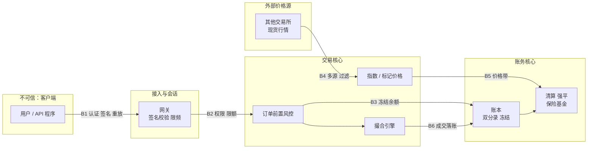
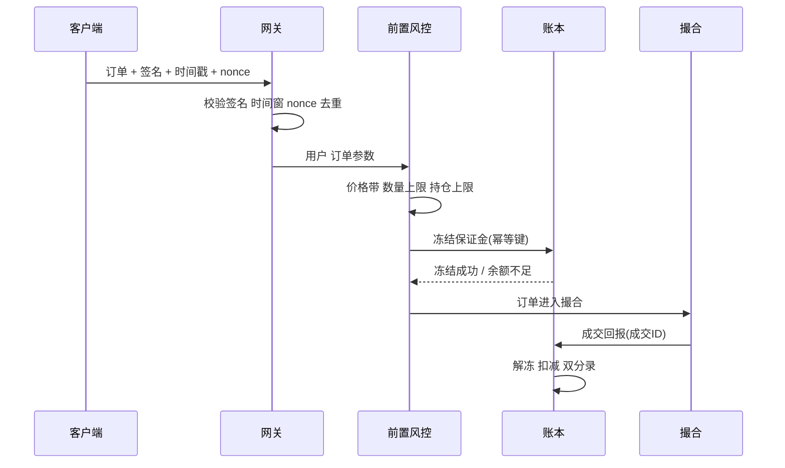
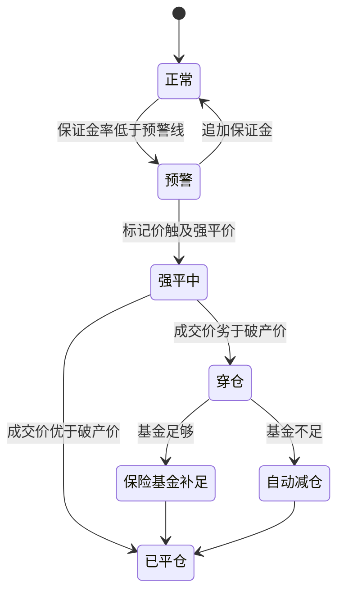

# X13 交易、结算与信用：交易授权、价格保护、账务一致与抵押授信

> 学习目标：读完本章，你能——
> 1. 画出一笔订单从签名到清算的链路，并在每个环节标出"检查什么、谁来检查"。
> 2. 为价格源、账本、保证金和关键参数写出可验证的控制，并写出对账与价格带的规则（SQL / 伪代码）。
> 3. 设计一张关键参数变更控制表，并用一次 30 分钟桌面推演检验它。
>
> 适用角色：交易所安全工程师、风控与账务系统负责人、想进入交易所安全团队的人。
> 前置章节：[X10 交易所安全架构总览](X10-cex-architecture-overview.md)、[08 预言机与闪电贷](../chapters/08-oracle-flashloan.md)、[11 DeFi 经济安全](../chapters/11-defi-economic-security.md)、[23 托管、充提与合规安全](../chapters/23-custody-exchange-ops.md)
> 交互实验：[永续合约实验](../interactive/perp-lab.html)、[预言机操纵实验](../interactive/oracle-manipulation-lab.html)
> 最后核对：2026-11-23

---

## 开场：一个没有黑客的周五晚上

2025 年 10 月 10 日（周五）UTC 晚间，加密市场大幅下跌。Binance 公开说明：在 21:36 到 22:16（UTC）之间，USDe、BNSOL、WBETH 三种资产在平台上出现明显偏离。把这三种资产当抵押品的合约、杠杆和借贷用户被强平。Binance 随后按"10 月 11 日 00:00 UTC 的市场价与强平价之差"补偿用户，媒体报道总额约 2.83 亿美元。

没有私钥泄露，没有人入侵。

<details class="predict"><summary>🤔 先猜再看：既然没有入侵，这件事属于"安全"范围吗？</summary>

属于。安全的目标是"资产与账本按设计运行"。强平引擎读到一个错误价格，就会按设计卖出用户的抵押品。系统没有出错，输入出了错。价格源是交易所的信任边界之一。本章教你把这条边界画出来，并给它配上控制。

</details>

---

## 1. 一句话理解

**交易所的信用体系建立在三个数字上：价格、余额、风险参数。攻击者或故障只要改动其中一个，不入侵任何服务器，也能让资产易主。**

> 🎯 打个比方：交易所像一家带记账员的当铺。顾客下单是"提出一笔交易"，记账员记账是"账务"，估价师估价是"价格"，当铺老板定抵押折扣是"风险参数"。估价师报错价，记账员照样按规则收和放。
>
> 比喻的局限：当铺里估价师和记账员是两个人，互相能看见。交易所里价格是毫秒级自动产生的，账本是几百万笔流水。没有自动对账和自动拦截，人眼什么也发现不了。

本章覆盖保护域 ③，回答五个问题：

1. 订单从哪里来，凭什么可信？
2. 价格怎样产生，怎样防止它被操纵或算错？
3. 账本怎样保证"每一分钱有来有去"？
4. 抵押、强平、保险基金出问题时，损失停在哪？
5. 谁能改手续费、杠杆和风险限额，改的时候留下什么证据？

本章不重复撮合引擎与账本的业务原理。读者可先读《CEX 交易所学习手册》的账本、撮合、风控与合约章节，本章只讲安全控制。

---

## 2. 保护目标与信任边界

### 2.1 保护什么

| 对象 | 失守的后果 |
|---|---|
| 订单真实性 | 别人替你下单；重放同一订单 |
| 价格（指数价、标记价） | 错误强平；操纵者靠平台价格获利 |
| 账本余额 | 凭空出现的余额被提走；账实不符 |
| 保证金与强平规则 | 穿仓；保险基金被击穿；自动减仓（ADL）波及无辜用户 |
| 风险参数与费率 | 参数被改成对内部人有利的值 |
| 撤单与恢复能力 | 行情剧烈时撤不了单，市场失控 |

### 2.2 交易链路的信任边界



**读图要点：**

- 数据从左向右，每个 B 编号是一个控制点。B1 管"这单是谁的"，B3 管"他有没有钱"，B4–B5 管"价格对不对"，B6 管"成交有没有记账"。
- 价格源（Z4）在边界之外。外部行情不能直接进入强平，要先经过 B4 的多源聚合与 B5 的价格带。
- 撮合引擎成交后，必须落到账本（B6）。成交与记账不同步，就是账务不一致的来源。
- 局限：图画的是现货与永续的合并简图。法币通道、充提属于 [X14](X14-cex-wallet-treasury-payment.md)。

> ⚠️ 警告：以下东西不能被信任，只能作为输入。
> 1. 单一外部价格源，包括被大型交易所引用的价格。
> 2. 客户端发来的时间戳、数量、价格（价格必须经过价格带）。
> 3. 上游"已冻结"的口头结论。账本必须自己检查可用余额。
> 4. 任何能关闭风控或改写账本的运维入口。它们要有审批与留痕。

---

## 3. 参考架构

### 3.1 组件与职责

| 组件 | 职责 | 安全要点 |
|---|---|---|
| 网关 | 校验 API 签名，限频，终止会话 | 防重放、防越权、防耗尽 |
| 订单前置风控 | 检查余额、持仓上限、价格带、下单频率 | 同步执行，失败默认拒绝 |
| 撮合引擎 | 按价格与时间优先撮合 | 只接收通过前置风控的订单；撤单有保底通道 |
| 价格服务 | 计算指数价和标记价 | 多源、剔除离群值、价格带与下限 |
| 账本 | 双分录记账，冻结、解冻、扣减 | 只追加；幂等；写入权限最小 |
| 清算与强平 | 日终清算，强平，保险基金，ADL | 触发价必须来自标记价而非最新成交价 |
| 对账服务 | 比对撮合、账本、钱包三方结果 | 独立账号、只读权限、差异告警 |
| 参数中心 | 存放费率、杠杆、风险限额 | 变更需审批，配置带版本与回滚 |

### 3.2 为什么这样分

1. **价格服务独立。** 撮合引擎的最新成交价容易被一笔小额单推动。强平用独立计算的标记价，操纵者要同时影响多个来源。
2. **对账服务只读且独立。** 对账程序若能改账，攻击者改账之后也能改对账结果。
3. **参数中心独立。** 参数存在代码或数据库中，谁能改，谁就能改利润。把它做成有审批的独立服务。
4. **前置风控同步，市场监测异步。** 前置风控挡住明显错误；异步监测挡住策略性操纵（刷量、对敲）。

### 3.3 下单链路时序



**读图要点：**

- 签名只证明"这个密钥发的"，不证明"这个人想发"。所以 API Key 的权限与 IP 白名单（见 [X11](X11-cex-identity-account-access.md)）是第二层。
- 冻结带幂等键。同一个订单重放，账本只冻结一次。
- 成交回报带成交 ID。账本按成交 ID 去重，网络重试不会重复记账。
- 局限：图省略了行情推送、撤单与部分成交。撤单也要走同一条链路，因为撤单会解冻余额。

### 3.4 价格保护

价格保护分四层。每一层独立生效，上一层失效时下一层还在。

| 层 | 做什么 | 示例参数（示例，非行业标准） |
|---|---|---|
| 来源 | 至少 3 个独立现货来源；按流动性加权 | 来源不足 3 个时，该标的暂停开新仓 |
| 过滤 | 剔除偏离中位数过大的来源；剔除过期数据 | 偏离中位数 > 3% 或延迟 > 5 秒，剔除 |
| 价格带 | 标记价相对前值的单次变化上限；下单价相对标记价的偏离上限 | 单次 ±5%；下单价偏离 ±10% |
| 兜底 | 触发熔断，暂停强平或转人工 | 价格带触发后，强平延迟 N 秒并告警 |

> 💡 注意：价格带是为了挡住"明显错误"。真实行情剧烈时，价格带会让价格滞后，应有"人工放宽"的受控流程，并写进参数变更控制（第 6.4 节）。

价格服务的一段伪代码（示例）：

```python
# 示例：标记价计算的最小骨架（伪代码）
def mark_price(sources, prev_mark, now):
    fresh = [s for s in sources if now - s.ts <= 5]          # 剔除过期
    if len(fresh) < 3:
        raise PriceUnavailable("来源不足，暂停开新仓并告警")
    med = median([s.price for s in fresh])
    kept = [s for s in fresh if abs(s.price - med) / med <= 0.03]  # 剔除离群
    if len(kept) < 3:
        raise PriceUnavailable("离群来源过多")
    px = weighted_avg(kept, weight="liquidity_7d")           # 按流动性加权
    # 价格带：单次变化超过 5% 时，先限幅并告警
    lo, hi = prev_mark * 0.95, prev_mark * 1.05
    if not (lo <= px <= hi):
        alert("P2", "mark price band hit", px, prev_mark)
        px = min(max(px, lo), hi)
    return px
```

原理见 [08 预言机与闪电贷](../chapters/08-oracle-flashloan.md)：单一来源可被操纵，上下限与多源是通用做法。CEX 的价格服务是同一类问题，只是"预言机"在内部。

### 3.5 账务一致性

账务一致性的核心是三个不变量。每个不变量都应有自动检查。

| 不变量 | 含义 | 检查方法 |
|---|---|---|
| 借贷平衡 | 每笔分录借方合计 = 贷方合计 | 每笔写入时检查；每天全量检查 |
| 守恒 | 全部用户余额 + 平台账户 = 钱包与银行的实际资产（含在途） | 三方对账，见第 6.2 节 |
| 幂等 | 同一业务事件（充值、成交、提币）只记一次 | 唯一键约束；重放测试 |

三个常见的失败模式：

1. **先到账后确认。** 系统在链上充值确认前就给用户加了余额，用户立即交易或提币。第 8.2 节的案例属于这一类。
2. **特权账户。** 某个账户被代码标记为"允许透支"。第 8.3 节的案例。
3. **事件重复处理。** 消息重试导致同一笔成交记两次。这是工程缺陷，也是攻击面。

### 3.6 保证金、强平与损失分担



**读图要点：**

- 强平触发的依据是标记价（第 3.4 节）。价格源出错，会让"正常"的用户直接进入"强平中"。
- 穿仓（用户亏损超过保证金）时，损失先由保险基金承担，再由 ADL 让盈利方减仓。两者都是"把损失分给别人"的机制，要有上限和告警。
- 保险基金的余额、强平单的成交价、ADL 的触发都应作为监控指标（第 7 节）。
- 局限：图省略了分层保证金、组合保证金和关联账户。关联账户的集中敞口由 TRD-C09 处理。

### 3.7 撤单与拒绝服务

行情剧烈时，用户最需要的是撤单。攻击者也知道这一点。如果网关被拒绝服务压垮，用户撤不了单，会被动强平。

建议：

1. 撤单走独立的限频桶，不与下单争用。
2. 撤单与追加保证金保留保底通道，即使行情推送降级，也能提交。
3. 压测要包含"行情峰值 + 撤单洪峰"。
4. 因交易所故障造成的损失，按预先写好的补偿规则处理（TRD-C16），不要事后临时拍板。

---

## 4. 控制清单

优先级：P0 = 没有它，一次失陷或故障就可能造成大额资损；P1 = 显著降低风险；P2 = 成熟度提升。

| ID | 控制项 | 要防什么 | 优先级 | 怎么验证 |
|---|---|---|---|---|
| TRD-C01 | API 请求签名含时间戳与 nonce，服务端去重并限制时间窗 | 请求重放 | P0 | 重放一条已成功的请求，必须被拒 |
| TRD-C02 | 订单前置风控：余额、价格带、持仓上限，失败默认拒绝 | 越权下单、错价下单 | P0 | 发送超出价格带的订单，必须被拒并留日志 |
| TRD-C03 | 账本只追加，写入权限只给账务服务；人工调账走审批 | 账本被篡改 | P0 | 用运维账号尝试 UPDATE 流水，必须失败 |
| TRD-C04 | 所有入账事件带唯一键，账本幂等 | 重复记账、双花 | P0 | 对同一充值事件并发提交 100 次，只入账一次 |
| TRD-C05 | 充值入账以链上确认数为准，确认前不可交易不可提币 | 先到账后确认 | P0 | 构造未确认充值，检查余额与可用状态 |
| TRD-C06 | 三方对账（撮合、账本、钱包 / 银行），差异自动告警 | 账实不符被拖延 | P0 | 构造一笔差异，记录告警用时 |
| TRD-C07 | 无"免风控 / 允许透支"账户；必须存在的做市或内部账户有清单、限额与季度复核 | 特权账户 | P0 | 在账户表中查询所有风控豁免标志 |
| TRD-C08 | 标记价至少 3 个独立来源，离群剔除，价格带与下限 | 单源被操纵 | P0 | 回放第 7.4 节的极端行情 |
| TRD-C09 | 单用户与关联账户的持仓、集中度上限；关联账户合并计算 | 一个人拿走整个池的风险 | P1 | 用多个关联账户构造集中持仓，看是否合并计算 |
| TRD-C10 | 抵押品折价率、价格下限、集中度限额按资产分级 | 窄市场资产作抵押 | P1 | 抽查 5 个抵押资产，核对折价率与来源 |
| TRD-C11 | 保险基金与 ADL 指标告警；穿仓率、基金回撤有阈值 | 损失悄悄蔓延 | P1 | 回放历史穿仓，告警是否触发 |
| TRD-C12 | 关键参数（费率、杠杆、限额）变更需双人审批、带版本与回滚 | 内部人改参数 | P0 | 一个人尝试直接改，必须失败 |
| TRD-C13 | 对账差异处理流程：谁发现、谁审批、怎样留痕，超时升级 | 差异被私下抹平 | P1 | 抽 3 条历史差异，检查有无审批与证据 |
| TRD-C14 | 市场操纵监测：刷量、对敲、价格推动、抢跑 | 操纵与内幕交易 | P1 | 用已知案例回放，检查命中 |
| TRD-C15 | 撤单与追加保证金独立保底通道，行情峰值压测 | 峰值时撤不了单 | P1 | 压测报告含撤单洪峰 |
| TRD-C16 | 事故补偿规则预先写好：范围、基准价、审批人 | 事后拍板、事后争议 | P2 | 规则文档与桌面推演 |

---

## 5. 分级落地

| 档位 | 适用 | 做什么 | 示例投入（本章估算，非行业统计） |
|---|---|---|---|
| 最小可行 | 小型交易所，安全 1–3 人 | TRD-C01、C02、C03、C05、C06、C07、C12 | 1–2 人 × 2–3 个月 |
| 标准 | 中型交易所，安全 5–15 人 | 全部 P0 + C09–C11、C13；每半年做一次价格与对账演练 | 3–5 人 × 6 个月，需风控与账务团队配合 |
| 成熟 | 头部交易所 | 全部控制；独立的市场监测团队；年度极端行情回放；参数变更全量审计 | 持续运营 |

> 💡 注意：账务与价格系统都在业务关键路径上。安全人员不能单方面上线拦截规则。落地时要与风控、账务、撮合团队共同评审，先"只告警"运行 2–4 周，再切换为"拦截"。

---

## 6. 落地做法

### 6.1 第一步：画"一笔单的生命周期"

1. 选一类订单（现货限价单）。向撮合、风控、账务、清算团队各要一份"我接收什么、产出什么、失败时怎么办"。
2. 画出第 3.3 节那样的时序图，用你们的实际系统名。
3. 在每个箭头旁写"这里检查什么"。写不出的就是缺口。
4. 重点问三件事：谁能绕过前置风控？谁能直接写账本？价格是谁算的？

### 6.2 对账：三方对账与差异查询

对账有三个层次。

| 层次 | 比较什么 | 频率 |
|---|---|---|
| 撮合 ↔ 账本 | 每个成交 ID 是否有对应分录 | 准实时（分钟） |
| 账本内部 | 借贷是否平衡；用户余额合计是否等于科目余额 | 每小时 / 每日 |
| 账本 ↔ 钱包 / 银行 | 用户总权益是否被实际资产覆盖 | 每日，并在大额变动后加跑 |

示例 SQL（表名为假设，按实际改写）：

```sql
-- 示例 1：成交已发生但账本无分录（撮合 ↔ 账本）
SELECT t.trade_id, t.user_id, t.asset, t.qty, t.executed_at
FROM matching_trades t
LEFT JOIN ledger_entries e ON e.ref_type = 'TRADE' AND e.ref_id = t.trade_id
WHERE t.executed_at < now() - interval '2 minutes'
  AND e.ref_id IS NULL;
-- 任何一行 = P2；同一用户多行或金额超阈值 = P1

-- 示例 2：账本借贷不平衡
SELECT batch_id, SUM(CASE WHEN side='D' THEN amount ELSE -amount END) AS diff
FROM ledger_entries
WHERE created_at > now() - interval '1 day'
GROUP BY batch_id
HAVING SUM(CASE WHEN side='D' THEN amount ELSE -amount END) <> 0;
-- 任何一行 = P1（账本本身不一致）

-- 示例 3：客户负债 vs 实际资产（按币种）
SELECT a.asset,
       a.customer_liability,
       w.hot + w.warm + w.cold + w.in_transit AS assets
FROM (SELECT asset, SUM(balance) AS customer_liability FROM user_balances GROUP BY asset) a
JOIN wallet_snapshot w USING (asset)
WHERE (w.hot + w.warm + w.cold + w.in_transit) < a.customer_liability;
-- 任何一行 = P1：资产不足以覆盖客户负债，立即升级并评估暂停该币种提币
```

假阳性：撮合与账本之间有异步延迟，示例 1 留了 2 分钟缓冲；链上在途资金要计入 `in_transit`，否则会在提币高峰误报。上线后按实际延迟调优。

> ⚠️ 警告：对账程序要使用独立只读账号和独立存储。如果对账程序与账务服务共享写权限，攻击者改账之后可以同步改对账结果。

### 6.3 一条充值入账规则（对应 TRD-C05）

```yaml
# 示例：充值入账状态规则（示意，确认数仅为示例）
deposit_policy:
  BTC:     { confirmations_credit: 3, confirmations_trade: 3, confirmations_withdraw: 6 }
  ETH:     { finality: "finalized", allow_trade_before_finality: false }
  default: { allow_trade_before_confirmation: false }
rules:
  - if: deposit.status != "CONFIRMED"
    then: { available_balance_delta: 0, withdrawable: false }
  - if: deposit.chain_reorg_detected
    then: { reverse_credit: true, freeze_account_activity: true, alert: P1 }
  - if: deposit.credited_early_for_ux        # 为改善体验而提前入账
    then: { max_amount_usd: 100, requires: "风控豁免单 + 双人审批", withdrawable: false }
```

要点：为改善体验而提前入账是常见需求。如果要做，必须有金额上限、账户资格、"提前入账部分不可提币"和告警。第 8.2 节的案例说明，缺少约束的提前入账会变成"凭空印币"。

### 6.4 关键参数变更控制

参数分三级。每级的变更要求不同。

| 级别 | 示例参数 | 变更要求（建议） |
|---|---|---|
| A 级 | 保证金率、最大杠杆、抵押折价率、标记价来源与权重、强平规则、保险基金规则 | 提案 + 风险评估 + 双人审批（风控负责人 + 安全或合规）；生效延迟 ≥ 30 分钟（紧急除外）；自动回放对比 |
| B 级 | 手续费率、返佣、限频、单日限额 | 双人审批；留版本；10 分钟内可回滚 |
| C 级 | 展示、文案、非风险类开关 | 单人变更，有日志 |

变更工单的模板（示例）：

```yaml
# 示例：参数变更工单（示意）
change:
  id: PRM-2026-1123-07
  level: A
  param: "collateral.XYZ.haircut"
  from: 0.10
  to: 0.20
  reason: "窄市场偏离，降低抵押价值"
  risk_review: { owner: risk-lead, replay_report: "link", worst_case_liquidations: "示例 1,200 户" }
  approvers: [risk-lead, security-lead]     # 申请人不能是批准人
  effective_at: "2026-11-23T10:30:00Z"
  rollback: { owner: oncall-risk, max_minutes: 10 }
  evidence: [ticket, diff, replay_report, approval_log]
```

> 💡 注意：A 级参数的"收紧"可能触发强平。变更前必须回放：这个新参数在最近 30 天会强平多少用户。该数字要出现在工单里。

### 6.5 市场操纵与内幕监测（规则示例）

监测的目的，是发现"平台自己的价格被推动"的信号，不是惩罚用户。

```yaml
# 示例：对敲嫌疑（Sigma 风格，示意，阈值需按实际调优）
title: 关联账户自成交占比过高
detection:
  sel:
    pair_counterparty_same_cluster: true      # 买卖双方属于同一关联簇
    window_minutes: 60
    cluster_volume_share_of_pair: ">= 0.30"   # 该簇占该交易对 60 分钟成交的 30% 以上
  condition: sel
level: medium
falsepositives:
  - 做市商的内部做市账户（应在清单中并标注）
  - 低流动性新币的上线首日
```

```yaml
# 示例：窄市场推动后集中强平（指标组合，示意）
title: 窄市场推动后集中强平
detection:
  sel1: { pair_depth_usd_within_1pct: "< 200000" }        # 盘口深度浅（示例阈值）
  sel2: { price_change_5min: ">= 0.15" }
  sel3: { liquidated_notional_after_move: ">= 5 * pair_depth_usd_within_1pct" }
  sel4: { opposite_side_new_positions_before_move: "exists" }   # 事前有反向新开仓
  condition: sel1 and sel2 and sel3 and sel4
level: high
falsepositives:
  - 真实的新闻驱动行情（用多来源价格是否同步变化来排除）
```

内幕与抢跑：把"可能影响价格的内部信息"（上币、下架、参数调整）的知情名单与交易记录对比。命中员工或关联账户是 P1，转合规与法务。上币信息保护见 [X12](X12-cex-asset-listing-market-access.md)。

### 6.6 常见坑

- 强平使用最新成交价，而不是标记价。
- 标记价的多个来源其实依赖同一个上游。
- 价格带只做"拦截"，没有"人工放宽"通道，行情真实暴涨时系统自己出问题。
- 测试环境没有真实的极端行情。
- 账务调账用数据库直连脚本完成，没有审批与留痕。
- "内部做市账户"被豁免风控，且无人复核。

---

## 7. 运营：指标、告警、值班、演练、季度节奏

### 7.1 指标与告警

| 指标 | 含义 | 告警建议（示例） |
|---|---|---|
| 对账差异数与存续时间 | 差异产生到关闭的时间 | 超过 15 分钟 P2；超过 1 小时 P1 |
| 客户负债覆盖率 | 资产 / 客户负债 | 小于 100% 立即 P1 |
| 价格源数量与偏离 | 可用来源数；与中位数偏离 | 来源 < 3 为 P1 |
| 价格带触发次数 | 单位时间触发 | 突增 P2 |
| 强平量、穿仓率、保险基金回撤 | 损失传导情况 | 日内回撤超阈值 P1 |
| ADL 触发次数 | 损失已越过保险基金 | 任何一次 P1 |
| 无审批的参数变更数 | 控制是否生效 | 应恒为 0；出现即 P1 |
| 免风控账户数 | 特权账户 | 新增一个就告警 |
| 撤单成功率与延迟 | 韧性 | 峰值期低于基线 P2 |

### 7.2 值班与升级

- 价格异常与对账差异属于 P1 / P2 事件，值班表里要有风控工程师与账务工程师，不只是安全。
- 预先批准"最小止损动作"：暂停某交易对开新仓、暂停某抵押品估值、延迟强平。这些动作要在事故前由风控负责人书面授权。完整权限表见 [X16](X16-cex-fraud-compliance-secops.md)。
- 暂停与恢复的分级参见 [X10 第 3.6 节](X10-cex-architecture-overview.md)。

### 7.3 季度节奏（建议）

1. 第 1 个月：复核参数清单与豁免账户清单；跑一遍 TRD-C03、C04、C07 的验证。
2. 第 2 个月：极端行情回放（第 7.4 节）；对账演练（构造差异，计时）。
3. 第 3 个月：30 分钟桌面推演（第 13 节练习 3）；整理整改项与月报。

### 7.4 极端行情回放（脚本示例）

```python
# 示例：回放一段历史行情，检查价格带与强平触发（伪代码）
prev_mark = None
for tick in replay("2025-10-10T21:15:00Z", "2025-10-10T22:30:00Z"):   # 示例窗口
    mark = mark_price(tick.sources, prev_mark or tick.index, tick.ts)
    liq = engine.liquidations_if(mark)
    report.add(tick.ts, mark, tick.max_source_deviation, len(liq))
    prev_mark = mark
# 输出：价格带触发次数、来源被判为离群的次数、被强平的用户数
# 关键问题：如果标记价包含某个异常来源，会多强平多少人？
```

---

## 8. 失效案例

> 💡 注意：以下案例的来源在本章撰写时（2026-11-23）重新查找并核对。案例只写摘要和教训；各方说法有分歧时，如实标注。本章没有收入"账务被内部人静默改写"的独立案例，因为没有查到足够可靠的公开来源。

### 8.1 Binance 价格与强平事件（2025 年 10 月 10 日）：对应 TRD-C08、C10、C15、C16

- **事实：** Binance 公告称，2025 年 10 月 10 日 21:36–22:16（UTC），USDe、BNSOL、WBETH 在平台上偏离。把这些资产作为抵押品、受影响的合约、杠杆与借贷用户获得补偿，补偿额为"10 月 11 日 00:00 UTC 的市场价"与"强平价"之差，媒体报道总额约 2.83 亿美元（[The Block：补偿完成](https://www.theblock.co/news/markets/2025-10-12-binance-pays-283-million-in-compensation-following-fridays-depegs-covering-user-losses-374295)）。
- **说法分歧：** Binance 称部分价格归零是显示问题；Ethena 方面称，只有单一场所偏离，最深的流动性池没有偏离（[BeInCrypto](https://beincrypto.com/binance-usde-ethena-depeg)、[Decrypt](https://decrypt.co/344026/binance-reimburses-283m-after-market-crash-and-asset-depegging-issues)）。**未确认：** 根因的完整技术报告。
- **后续措施：** 报道称，Binance 会把赎回价加入指数权重，并给 USDe 设置软价格下限（同上）。
- **打穿的控制：** 抵押品估值对单一场所的依赖；价格带与下限不足。
- **教训：** 没有黑客，也造成了大额损失。抵押品价格必须多源，窄市场资产要有折价率和下限，补偿规则要提前写好。

### 8.2 Kraken 充值入账缺陷（2024 年 6 月）：对应 TRD-C05、C04

- **事实：** Kraken 安全负责人 Nick Percoco 在 2024 年 6 月 19 日披露，一个近期的界面改动让客户账户在充值完全到账前就被入账。三个账户据称利用此缺陷提走近 300 万美元，Kraken 称资金来自自有财资，不是客户资产。Kraken 在数小时内修复，6 月 20 日称资金已退回（[The Block](https://www.theblock.co/news/business/2024-06-19-kraken-discloses-bug-exploited-for-nearly-3-million-300888)）。
- **说法分歧：** 安全公司 CertiK 称自己是报告方，并称自己在做漏洞测试。双方对测试范围、资金返还和沟通方式说法冲突，社区也对时间线有质疑。**本章不判断谁对谁错。**（[CryptoSlate](https://cryptoslate.com/certik-reveals-it-found-kraken-vulnerability-and-will-return-funds-denies-extortion-allegations/)）
- **打穿的控制：** 入账条件放宽后，没有"未确认前不可提币"的独立检查。对应 TRD-C05。
- **教训：** 为体验而提前入账，要有金额上限与独立的提币检查。账务规则的任何放宽，都要当作安全变更评审。披露流程见 [X36](X36-disclosure-bounty-ops.md)。

### 8.3 FTX 的 allow_negative 标志（2019–2022 年）：对应 TRD-C07、C03

- **事实：** 在 2023 年对 Sam Bankman-Fried 的刑事审判中，FTX 联合创始人 Gary Wang 作证称，代码里有一个 `allow_negative` 标志，让 Alameda 的账户可以在余额为零或为负时继续交易。据报道，他说这是应 Bankman-Fried 要求添加的（[The Register 转述庭审](https://www.theregister.com/2023/10/10/ftx_python_code/)）。
- **说法分歧与数字：** 辩方称这个标志用于 Alameda 的稳定币兑换。报道给出的信用额度和破产缺口数字不一致，**本章不引用具体金额**。Axios 的原文页面本次抓取返回 403，本章不依赖它。
- **打穿的控制：** 账户级的风控豁免没有独立审批与监测。对应 TRD-C07。
- **教训：** 任何"某些账户不受风控约束"的开关，都是最高级别的特权。它必须出现在清单中，受限额约束，并被独立复核。内部账户也是账户。

### 8.4 Hyperliquid JELLY 事件（2025 年 3 月）：对应 TRD-C09、C10

> 💡 注意：Hyperliquid 是链上永续合约平台，不是中心化交易所。这里引用它，是因为同样的机制（浅盘口资产 + 大额持仓 + 强平 + 公共流动性池承接）也会出现在 CEX 的合约产品中。

- **事实：** 2025 年 3 月 26 日，一个账户在 JELLYJELLY 永续合约上持有空单，该资产现货流动性较浅。报道称，该仓位的损失由 Hyperliquid 的 HLP 金库承接，金库一度出现约 1200 万美元未实现亏损。验证者投票下架该合约；Hyperliquid 称，除被标记的地址外，用户将由 Hyper Foundation 补偿（[The Block](https://www.theblock.co/post/348314/hyperliquid-delists-jellyjelly-memecoin-amid-whale-manipulation-fiasco)、[CoinDesk](https://hotfix.coindesk.com/markets/2025/03/26/hyperliquid-delists-jellyjelly-after-vault-squeezed-in-usd13m-tussle)）。
- **说法分歧：** 各媒体对损失、结算价与事件经过的描述不同，也有批评认为人工下架与去中心化叙事矛盾。**本章不引用统一数字。**
- **打穿的控制：** 对浅盘口资产的持仓上限与集中度限额；强平单被池子承接后的损失上限。
- **教训：** 新币合约要有持仓上限、杠杆上限和价格来源要求（对应 [X12](X12-cex-asset-listing-market-access.md) 的分级准入）。"事后下架 + 补偿"是最后手段，不是控制。

### 8.5 案例映射

| 案例 | 控制失效点 | 对应控制 |
|---|---|---|
| Binance 价格事件 2025 | 抵押品价格单一依赖；窄市场 | TRD-C08、C10、C16 |
| Kraken 入账缺陷 2024 | 提前入账；无独立提币检查 | TRD-C05、C04 |
| FTX allow_negative | 账户级风控豁免 | TRD-C07、C03 |
| Hyperliquid JELLY 2025 | 浅盘口资产的持仓与集中度 | TRD-C09、C10 |

---

## 9. 评估检查点

- [ ] **TRD-1** API 请求带时间戳和 nonce；已测试重放必被拒。
- [ ] **TRD-2** 订单前置风控含价格带、持仓上限；失败默认拒绝；已用越界订单测试。
- [ ] **TRD-3** 账本只追加；运维账号无法直接修改流水；调账需审批并留痕。
- [ ] **TRD-4** 所有入账事件有唯一键；并发重放测试通过。
- [ ] **TRD-5** 充值入账以确认数为准；已测试未确认充值不可交易、不可提币；"提前入账"例外有上限与审批。
- [ ] **TRD-6** 有撮合 ↔ 账本、账本内部、账本 ↔ 钱包 / 银行三层对账；差异有告警与计时。
- [ ] **TRD-7** 无免风控 / 允许透支账户；做市与内部账户有清单、限额和季度复核。
- [ ] **TRD-8** 标记价至少 3 个独立来源，且来源上游不同；有离群剔除、价格带与下限。
- [ ] **TRD-9** 单用户与关联账户持仓有上限，关联账户合并计算。
- [ ] **TRD-10** 抵押品有折价率、价格下限、集中度限额，且按资产分级。
- [ ] **TRD-11** 保险基金与 ADL 有告警；有回放历史穿仓的记录。
- [ ] **TRD-12** A / B 级参数变更需双人审批，有版本、回滚与回放证据；申请人不能是批准人。
- [ ] **TRD-13** 对账差异有处理流程：发现人、审批人、证据、超时升级。
- [ ] **TRD-14** 有操纵与内幕监测规则，并用已知案例回放过。
- [ ] **TRD-15** 撤单与追加保证金有保底通道，压测含撤单洪峰。
- [ ] **TRD-16** 事故补偿规则已写好，并经过桌面推演。

把检查结果写进报告：

| 结果 | 报告写法 | 动作 |
|---|---|---|
| 不满足且是 P0 | 红线项，写明潜在资损与负责人 | 90 天内整改，月报跟踪 |
| 不满足且是 P1 / P2 | 写入风险登记表 | 排入季度计划 |
| 满足但无证据 | 视为不满足 | 补证据（截图、测试记录、工单） |
| 满足且有证据 | 记录证据位置与下次复核日期 | 季度复核 |

---

## 10. 上手路径

**第一周：**

1. 画出"一笔单的生命周期"时序图（第 6.1 节），标出缺口。
2. 查询所有"风控豁免"和"允许透支"标志，列出账户清单与负责人。
3. 问清：价格是谁算的，几个来源，来源是否同一上游。
4. 问清：谁能直接写账本，谁能改 A 级参数。

**第一个月：**

1. 实现第 6.2 节的三条对账查询，先只告警。
2. 把参数分成 A / B / C 三级，起草变更工单模板。
3. 跑一遍 TRD-C01、C03、C04、C05 的"怎么验证"，把失效项写进风险登记表。
4. 与风控、账务、撮合团队开一次会，对齐"最小止损动作"的授权。

**第一个季度：**

1. 做极端行情回放（第 7.4 节），修正价格带与来源权重。
2. 做一次 30 分钟桌面推演。
3. 补齐两项 P0 控制，向管理层汇报自评与路线图。

---

## 11. 常见误区

1. **"价格有问题是行情问题，不是安全问题。"** 价格错误会触发强平，等价于资产被转移。
2. **"我们有多个价格源，所以安全。"** 要看它们是否同一上游，以及一个源出错时是否被剔除。
3. **"对账是财务的事。"** 对账差异可能是攻击的第一个信号，应进入安全告警。
4. **"内部账户不用限额。"** 内部账户风险最大，应受最严格的清单与复核。
5. **"事后补偿就行。"** 补偿靠资本金与声誉，不是控制，且补偿规则需事前写好。
6. **"价格带越窄越好。"** 过窄会让价格滞后，导致套利与错误拒单。要有受控的放宽流程。

---

## 12. 术语表

| 术语 | 英文 | 定义 |
|---|---|---|
| 指数价格 | Index Price | 综合多个现货来源计算的参考价格 |
| 标记价格 | Mark Price | 用于计算未实现盈亏与强平的价格，通常以指数价为基础 |
| 价格带 | Price Band | 对价格单次变化或下单价偏离设置的上下限 |
| 双分录记账 | Double-entry Bookkeeping | 每笔业务同时记借方与贷方，借贷合计相等 |
| 幂等 | Idempotency | 同一请求处理一次与多次，结果相同 |
| 对账 | Reconciliation | 比较两个独立记录，找出差异 |
| 保证金 | Margin | 开仓时用户冻结的抵押资产 |
| 强平 | Liquidation | 保证金不足时，系统强制平掉持仓 |
| 穿仓 | Negative Equity | 强平后用户亏损超过其保证金 |
| 保险基金 | Insurance Fund | 用来承接穿仓损失的平台资金池 |
| 自动减仓 | Auto-Deleveraging (ADL) | 保险基金不足时，让盈利方被动减仓 |
| 折价率 | Haircut | 抵押品计价时打的折扣 |
| 刷量 | Wash Trading | 同一人或关联账户自买自卖，制造虚假成交量 |
| 对敲 | Matched Trading | 关联账户互相成交，操纵价格或成交量 |

---

## 13. 动手练习与思考题

> 🧪 动手验证：打开[永续合约实验](../interactive/perp-lab.html)，观察标记价与强平触发点的关系。再打开[预言机操纵实验](../interactive/oracle-manipulation-lab.html)，观察单一来源被推动时的损失。写下：哪一条 TRD 控制能让这两次实验的结果变小。

**练习（均可在笔记本上完成）：**

1. 画图：为你熟悉的交易所画一笔限价单的时序图（第 3.3 节），在每个箭头旁写"检查什么"。
2. 写规则：用第 6.2 节的格式，为"提币单已扣减余额但账本无对应冻结"写一条对账 SQL，并写出假阳性。
3. 推演（30 分钟）：脚本是"21:36 UTC，价格服务告警：某抵押资产在 A 来源的价格比其他来源低 40%，强平量开始上升"。写出：谁先被叫醒？谁有权暂停该抵押品估值或延迟强平？前 15 分钟做什么？事后补偿的基准价怎么定？
4. 审工单：把第 6.4 节的变更工单改写成你认为更严格的版本，说明多加了哪条限制。

**建议配套（后续在 L3 训练营实现）：** 一个"极端行情回放 + 价格带 + 强平"的小型脚本，用于测试价格服务在来源离群时的行为。

> 🪞 反思：想一想你熟悉的一个系统。有没有哪个账户或服务，"因为很重要所以不被检查"？

### 思考题

1. 如果标记价的三个来源其实都读同一个上游，多源控制还有用吗？如何检查？
2. 一个做市账户被豁免了价格带与持仓上限。如果它的 API Key 被盗，会发生什么？如何限制爆炸半径？
3. 对账差异应该由谁关闭？为什么"发现差异的人"和"批准抹平差异的人"不能是同一个人？
