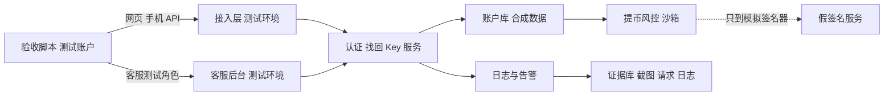
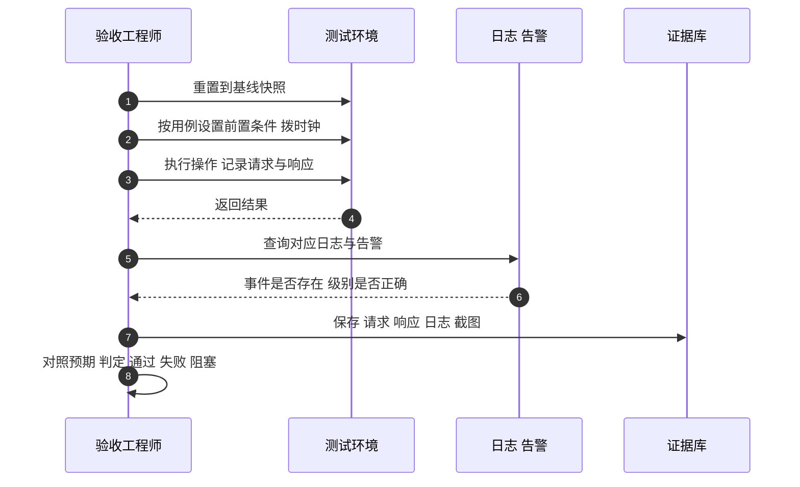
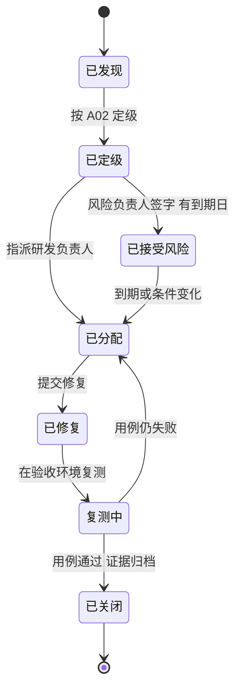

# X17 客户身份与访问·工程验收：撤权、越权与找回流程怎么证明有效

> 学习目标：读完本章，你能——
> 1. 为交易所的认证、会话、找回、API Key、机构权限和客服工具写出一套可重复执行的验收用例，并说清每条用例的前置条件、预期结果和证据。
> 2. 用历史或合成数据回放账户风险信号规则，算出召回率和精确率，并据此决定规则能否上线。
> 3. 写出验收报告和上线门禁：哪些用例失败时必须拦住发布，哪些可以带条件放行。
>
> 适用角色：交易所安全工程师、QA / 测试工程师、账户与身份团队负责人、内审人员
> 前置章节：[X11 客户身份、账户与访问](X11-cex-identity-account-access.md)、[X05 检测与响应工程](X05-detection-response-engineering.md)、[X06 韧性与验证](X06-resilience-validation.md)
> 交互实验 / 模板：本章第 5 节的回放脚本与第 8 节的验收报告模板可直接改写；[T03 发现报告模板](../templates/T03-finding-report.md)
> 最后核对：2026-11-23

---

## 开场：设计文档说"有冷静期"

一家虚构的交易所（示例）在设计文档里写了："找回成功后，提币延迟 72 小时。"评审会上所有人都点了头。三个月后，一名用户在找回成功 20 分钟后提走了资金。

复盘发现：延迟规则只挂在网页端的提币接口上。移动端用的是另一个版本的接口，这个接口读的是"最近一次登录设备"，而不是"账户是否处于找回后限制期"。找回成功后，攻击者在手机端登录，系统把这台设备记成"已知设备"，限制就被跳过了。

<details class="predict"><summary>🤔 先猜再看：要在上线前发现这个问题，验收用例至少要覆盖哪一件事？A. 网页端提币被延迟　B. 每一个提币入口（网页、手机、API）在找回后都被延迟　C. 延迟时间等于 72 小时</summary>

答案是 B。设计写在文档里，控制落在代码里。验收要沿着"一个动作能走到的所有入口"逐个试。A 只证明了一个入口，C 只证明了数字。第 4 节的用例 IAV-T08 到 IAV-T10 专门做这件事。

</details>

---

## 1. 一句话理解

**设计章回答"该怎么设计"，本章回答"凭什么说它真的做到了"：每条控制都要有一条能重复执行的用例、一份留得住的证据，和一个明确的通过标准。**

验收（Verification）：在受控环境里，用预先写好的用例检查控制是否按设计工作，并留下证据。
回放（Replay）：把历史或合成的事件按时间顺序重新喂给检测规则，对照"标准答案"看规则命中了什么、漏掉了什么。
上线门禁（Release Gate）：发布前必须通过的检查。P0 用例失败，发布停止。

> 🎯 打个比方：设计像建筑图纸上画的防火门。验收像消防演习：真的点一把火，看每一层的门是否关上、警报是否响、人是否从正确的出口出去。图纸再好，演习没做，你只知道"计划如此"。
>
> 比喻的局限：演习一次就能看到结果。账户系统每周都在发版，今天关上的门，下周可能因为一次重构又打开。所以本章的用例要能自动重复跑，并绑定在发布流程上。

本章不重复设计内容。控制的由来与取舍见 [X11](X11-cex-identity-account-access.md)。本章引用的控制 ID 沿用 X11 第 4 节的 `IC-nn`（对应其第 9 节检查项 `IAM-n`）。

---

## 2. 验收对象与信任边界

### 2.1 验收什么

| 对象 | 验收重点 | 对应 X11 控制 |
|---|---|---|
| 登录与 MFA | 速率限制、MFA 由服务端强制、新设备限制 | IC-01、IC-04、IC-08 |
| 会话 | 设备绑定、登出与撤销、会话固定、敏感操作重新认证 | IC-09 |
| 找回 | 分层、冷静期、原渠道通知、找回后限制、多入口一致 | IC-03、IC-05、IC-06 |
| 提币限制 | 新地址延迟、MFA 重置后限制、各入口一致 | IC-04、IC-07 |
| API Key | 默认权限、IP 绑定、权限变更生效时间、撤销 | IC-10、IC-11 |
| 机构与子账户 | 角色分离、四眼、越权与 IDOR | IC-15 |
| 客服与内部工具 | 分级、批量限制、风控冻结不可绕过 | IC-12、IC-13、IC-14 |
| 日志与规则 | 日志不可改、规则能触发 | IC-16、IC-17 |

### 2.2 验收的"测试面"



**读图要点：**

- 验收脚本和客服测试角色是两条独立的测试面。前者模拟外部用户和攻击者，后者模拟内部人员。
- 提币风控只连到"假签名服务"。验收永远不应该触发真实链上转账。
- 日志与告警也是被验收对象：用例不仅看"操作被拒"，还看"有没有留下日志、有没有响警报"。
- 局限：图画的是单个测试环境。如果测试环境与生产环境的配置不一致，验收结果不能替代生产抽查（IAV-12）。

---

## 3. 验收环境与数据

### 3.1 环境应该长什么样

| 要求 | 做法 | 为什么 |
|---|---|---|
| 与生产同配置 | 策略文件、风控规则、功能开关从同一代码仓库部署，只替换密钥和端点 | 否则"测试通过"没有意义 |
| 不碰生产 | 独立账号体系、独立数据库、独立域名；出站网络只允许到假签名器、测试邮件和测试短信网关 | 防止测试触发真实通知与资金动作 |
| 假的外部依赖 | 邮件、短信、人脸活体、第三方风控都用桩（stub）；桩要能返回"通过 / 失败 / 超时" | 能做故障注入，也能读到通知内容 |
| 可重置 | 每次验收前一键恢复到基线快照 | 用例之间不互相污染 |
| 时间可控 | 服务从可注入的时钟取时间，用例里可以把时间拨快 24 或 72 小时 | 冷静期不可能真等三天 |
| 访问受控 | 验收账号只在测试环境有效；测试环境不放真实用户数据 | 见 [24 数据与隐私](../chapters/24-data-privacy.md) |

"时间可控"最容易被忽略。如果服务里直接调用系统时间，冷静期用例只能真的等，结果就是没人测。验收环境要求服务从一个时钟接口取时间，这是一项要提给研发的需求。

### 3.2 造数据

测试账户要覆盖"真实用户的各种形态"，而不是一个管理员账号。示例：

| 账户标签 | 特征 | 用来验收 |
|---|---|---|
| A-NEW | 新注册，未完成 KYC | 注册与限制路径 |
| B-NORMAL | 已 KYC，一台已知设备，有余额与已生效地址 | 基线行为 |
| C-HIGH | 高余额，已启用 Passkey | 高风险找回 |
| D-SMSONLY | 只有短信一个因素 | IC-03 |
| E-API | 持有三个 Key：只读、交易、提币 | API Key 用例 |
| F-ORG | 机构主账户，两名管理员，三个子账户 | 角色分离与四眼 |
| G-OTHER | 另一个普通用户 | 越权测试的"受害者" |

越权测试至少需要两个互不相关的账户（B-NORMAL 与 G-OTHER）：用 B 的会话去访问 G 的资源。只有一个账户，测不出水平越权。

### 3.3 验收执行流程



**读图要点：**

- 判定要同时看三件事：操作结果、日志事件、告警。只看第一项会漏掉"拒绝了但没人知道"的问题。
- 每条用例的证据要能被第三人复查：请求与响应的原文、日志查询语句、截图或录屏。
- 用例失败时，保留现场（不要立即重置快照），再提缺陷。
- 局限：图里的验收工程师是人。第 8 节会说明哪些用例应该自动化，在每次发布时重复执行。

---

## 4. 验收用例库

约定：用例 ID 为 `IAV-Txx`；"操作"只写在测试环境怎么做；"预期"写成可以判定的结果；"证据"写要保存什么。每条用例默认还要检查"日志里有对应事件"，表里只在特别要求时单独写。

### 4.1 认证与会话

| 用例 ID | 控制项 | 前置条件 | 操作（测试环境） | 预期结果 | 证据 |
|---|---|---|---|---|---|
| IAV-T01 | IC-01 | B-NORMAL；速率限制已开启 | 同一来源对 25 个不同测试账户各连续失败登录 3 次 | 来源被限速或验证码挑战；规则 1 告警触发；限速期内该来源用正确密码登录同样被挑战 | 请求序列、响应码、告警记录 |
| IAV-T02 | IC-08 | B-NORMAL；已开启 TOTP | 登录后直接调用"登录完成"接口，跳过 MFA 步骤；再调用时缺少 MFA 参数、参数为空、参数为旧验证码 | 全部被拒；会话停留在"待 MFA"状态，不能访问账户数据 | 请求与响应原文 |
| IAV-T03 | IC-08 | B-NORMAL | 同一 TOTP 验证码在 30 秒内使用两次（重放） | 第二次被拒（一次性） | 请求与响应 |
| IAV-T04 | IC-04 | B-NORMAL | 用未登记设备登录，立即尝试：改手机、加提币地址、提币 | 三项均被拒或延迟；用户收到新设备通知 | 响应、通知内容 |
| IAV-T05 | IC-04 | B-NORMAL；时钟可控 | 新设备登录后拨快到限制期结束前 1 分钟，再拨到结束后 1 分钟，各重复 IAV-T04 | 前者仍受限，后者解除（边界） | 两次响应对比 |
| IAV-T06 | IC-09 | B-NORMAL；会话绑定设备 | 把会话令牌复制到另一设备的请求头里调用账户接口 | 被拒或要求重新认证；产生会话异常事件 | 请求、日志 |
| IAV-T07 | IC-09 | B-NORMAL | 用户在设备 1 点"退出所有设备"；随后用设备 2 的旧令牌调用任意接口 | 立即失效（以秒计，不是"下次刷新"） | 时间戳对照 |
| IAV-T07b | IC-09 | B-NORMAL | 会话固定检查：登录前取得会话 ID，登录成功后比较 | 登录前后会话 ID 必须不同；旧 ID 不能使用 | 前后 ID 对比 |

### 4.2 找回与提币限制

| 用例 ID | 控制项 | 前置条件 | 操作（测试环境） | 预期结果 | 证据 |
|---|---|---|---|---|---|
| IAV-T08 | IC-06 | B-NORMAL 刚完成高风险找回 | 在网页端立即提币到已生效地址 | 被延迟或拒绝；账户处于"找回后限制期" | 响应、账户状态 |
| IAV-T09 | IC-06 | 同 T08 | 在手机端各版本（最新版、最低支持版）重复 T08 | 与网页端结果一致 | 各版本响应对比表 |
| IAV-T10 | IC-06 | 同 T08；E-API 的提币 Key | 用带提币权限的 API Key 发起提币 | 同样被延迟或拒绝；Key 不能绕过账户级限制 | 响应、风控日志 |
| IAV-T11 | IC-03 | D-SMSONLY | 声称丢失全部因素，仅提供短信验证码走找回 | 被拒或升级为高风险流程，不能自动通过 | 流程截图、状态 |
| IAV-T12 | IC-05 | C-HIGH | 发起高风险找回；检查所有通知的收件地址 | 通知发往变更前的原邮箱与原设备；申请人新填的渠道不作为通知目的地；通知含"不是我"入口 | 邮件桩内容、收件人 |
| IAV-T13 | IC-05 | 同 T12 | 在冷静期内点击原渠道通知里的"不是我" | 账户立即冻结，找回单作废，进入人工复核 | 状态变更、日志 |
| IAV-T14 | IC-05 | C-HIGH | 冷静期内并发提交 5 个找回申请 | 只有一个找回单有效；并发不会产生多个有效单 | 数据库记录数 |
| IAV-T15 | IC-05 | C-HIGH；活体桩可返回"失败" | 活体比对返回失败、超时、异常三种结果 | 全部走拒绝或人工，不会降级为"自动通过"（故障注入） | 桩配置、响应 |
| IAV-T16 | IC-06 | B-NORMAL 刚重置 MFA | 重置后立即：创建 API Key、开启 Key 提币权限、加提币地址、提币 | 全部延迟；MFA 重置后限制期内提币不可用 | 响应 |
| IAV-T17 | IC-07 | B-NORMAL；时钟可控 | 新增提币地址；立即提币；拨到延迟期前 1 分钟再提；拨到延迟期后再提 | 前三次被拒；第四次成功（边界） | 四次响应 |

### 4.3 API Key 与机构权限

| 用例 ID | 控制项 | 前置条件 | 操作（测试环境） | 预期结果 | 证据 |
|---|---|---|---|---|---|
| IAV-T18 | IC-10 | E-API | 创建新 Key，不勾选任何权限；再创建 Key 并勾选提币但不填 IP | 第一个默认只读；第二个被拒或提币权限不生效 | 创建响应、权限字段 |
| IAV-T19 | IC-10 | E-API 有 IP 白名单的 Key | 从白名单外 IP 用该 Key 交易、提币 | 全部被拒；产生日志 | 响应、日志 |
| IAV-T20 | IC-10、IC-11 | E-API；开启提币权限的 Key | 关闭该 Key 的提币权限，立即用同一 Key 发提币请求，记录生效时间 | 缩权在目标时间内对所有节点生效（目标值写进验收标准，如 5 秒） | 变更时间与首次拒绝时间 |
| IAV-T21 | IC-10 | E-API | 扩权变更（只读改交易、交易加提币）后立即使用新权限 | 扩权遵循延迟生效；缩权立即生效（两者不对称） | 响应 |
| IAV-T22 | IC-11 | E-API；主账户与子账户各有 Key | 执行"一键撤销全部 Key" | 主账户与所有子账户的 Key 全部失效，耗时记录在案 | 撤销前后调用结果、耗时 |
| IAV-T23 | IC-15 | F-ORG | 用"交易员"角色调用提币；用"资金管理员"角色调用下单；管理员给自己发起的提币审批 | 三项均被拒（发起人与批准人必须不同） | 响应、审批记录 |
| IAV-T24 | IC-07、IC-15 | F-ORG | 提币白名单新增地址：仅一名管理员批准；两名批准但其中一名是发起人本人 | 都不生效；两名不同批准人才生效，且仍需延迟 | 审批流记录 |

### 4.4 越权（IDOR）与客服工具

| 用例 ID | 控制项 | 前置条件 | 操作（测试环境） | 预期结果 | 证据 |
|---|---|---|---|---|---|
| IAV-T25 | IC-08、IC-15 | B-NORMAL、G-OTHER | 用 B 的会话，把请求里的账户 ID、订单 ID、地址 ID、Key ID 换成 G 的（读取、修改、删除各一遍） | 全部被拒，且返回内容不能区分"不存在"与"无权限"（避免枚举） | 请求原文与响应 |
| IAV-T26 | IC-15 | F-ORG | 子账户成员用自己的会话访问其他子账户资源，及主账户设置 | 被拒；跨子账户不可见 | 响应 |
| IAV-T27 | IC-12 | 客服测试角色 | 客服账号尝试：重置 MFA、改绑手机、直接解冻、批量查看 70 个账户资料 | 前三项被拒或只能提交工单；批量超限需要主管审批 | 响应、审批队列 |
| IAV-T28 | IC-13 | B-NORMAL 被风控冻结 | 客服账号对该账户点击或调用"解冻"（含直接调用后端接口） | 按钮不可用；直接调用被拒；有告警 | 界面截图、接口响应 |
| IAV-T29 | IC-12 | 客服测试角色 | 不带工单号查看完整证件图；带无效工单号再查看一次 | 均被拒；规则 5、6 的数据源里有记录 | 响应、审计日志 |
| IAV-T30 | IC-16 | 业务账号（客服、运营、数据库普通账号） | 尝试修改或删除账户事件日志表 | 失败；写入权限仅属于日志服务 | 数据库权限输出 |

**读图要点（对整张用例库）：**

- 共 31 条（含 T07b），覆盖正常（T04、T18）、边界（T05、T17）、越权（T23–T26、T28）、重放（T03）、并发（T14）、故障注入（T15）。
- 每条用例至少对应一个 IC 控制。反过来，X11 的每条 P0 控制至少要有一条用例，缺的补上（IAV-1）。
- T09 和 T10 是开场故事的"补丁"：同一个限制，必须在网页、手机各版本和 API 上各验一遍。
- 局限：本表是基线，不是上限。每次出现新入口（新 App、新开放接口）就要新增用例。

---

## 5. 回放验收：规则到底能不能抓到

用例库验证"预防类控制"。回放验证"检测类控制"：X11 第 6.4 节的七条规则，在数据上能抓到多少，误伤多少。

### 5.1 方法

1. 准备事件集：历史数据（脱敏后）加合成数据。历史数据里要有已确认的接管案例；案例少，就用合成事件补充，并注明哪些是合成的。
2. 准备标准答案（ground truth）：每个账户有一个标签，"确认接管"或"正常"。标签来自申诉和人工复核结论，不能来自规则自己的输出。
3. 按时间顺序喂给规则。规则读取的是"事件当时"能看到的数据，不能偷看未来。
4. 计算指标：
   - 召回率 = 命中的接管账户数 ÷ 全部接管账户数。
   - 精确率 = 命中的接管账户数 ÷ 全部命中账户数。误报率按告警口径，等于 1 减精确率。
5. 看漏报：每个漏掉的接管账户，写明"它的路径为什么没被任何规则看到"，回灌给 X11 的规则设计。
6. 决定：把召回与精确的目标值写进验收标准（示例：P1 规则精确率 ≥ 80%，整套规则对已知路径召回 ≥ 70%；数值按团队能处理的告警量调整）。

> 💡 注意：召回和精确率互相牵制。阈值调低，召回高，告警多到没人看；调高则相反。验收的任务不是追求"完美"，而是让团队清楚地知道"这套规则对哪几条路径有效，对哪几条无效"。

### 5.2 回放脚本（Python，示例）

脚本可以直接运行（Python 3.8 及以上，只用标准库）。数据为合成的示意数据，规则对应 X11 的规则 2 和规则 3。

```python
# 示例：账户安全规则回放。数据为合成，字段为示意。
from datetime import datetime, timedelta

T0 = datetime(2026, 1, 1, 0, 0)
def t(h): return T0 + timedelta(hours=h)

# 事件：(用户, 时间, 类型, 属性)
events = [
    ("u1", t(1),  "recovery_ok", {}),
    ("u1", t(3),  "withdraw",    {"usd": 5000, "new_device": True, "new_addr": True}),
    ("u2", t(2),  "recovery_ok", {}),
    ("u2", t(20), "withdraw",    {"usd": 2000, "new_device": False, "new_addr": False}),
    ("u3", t(5),  "mfa_reset",   {}),
    ("u3", t(5.2),"add_addr",    {}),
    ("u4", t(6),  "mfa_reset",   {}),
    ("u4", t(9),  "add_addr",    {}),
    ("u5", t(7),  "recovery_ok", {}),
    ("u5", t(8),  "withdraw",    {"usd": 1500, "new_device": True, "new_addr": False}),
]
# 标准答案：人工确认的接管账户（u2、u4 是正常用户）
truth = {"u1", "u3", "u5"}

def rule2_recovery_withdraw(evs, strict=True):
    """规则 2：找回后 24 小时内提币。strict 时要求新设备且新地址。"""
    hits = set()
    rec = {u: ts for u, ts, k, _ in evs if k == "recovery_ok"}
    for u, ts, k, a in evs:
        if k != "withdraw" or u not in rec: continue
        if not (rec[u] <= ts <= rec[u] + timedelta(hours=24)): continue
        if a["usd"] < 1000: continue
        if strict and not (a["new_device"] and a["new_addr"]): continue
        hits.add(u)
    return hits

def rule3_change_then_addr(evs, minutes=30):
    """规则 3：改 MFA 后 30 分钟内加提币地址。"""
    hits = set()
    chg = {u: ts for u, ts, k, _ in evs if k == "mfa_reset"}
    for u, ts, k, _ in evs:
        if k == "add_addr" and u in chg and chg[u] <= ts <= chg[u] + timedelta(minutes=minutes):
            hits.add(u)
    return hits

def score(name, hits, truth):
    tp = len(hits & truth)
    recall = tp / len(truth) if truth else 0
    precision = tp / len(hits) if hits else 0
    print(f"{name:20s} 命中={sorted(hits)} 召回={recall:.2f} 精确={precision:.2f} 漏报={sorted(truth-hits)}")

if __name__ == "__main__":
    r2s = rule2_recovery_withdraw(events, strict=True)
    r2l = rule2_recovery_withdraw(events, strict=False)
    r3 = rule3_change_then_addr(events)
    score("规则2 严格", r2s, truth)
    score("规则2 宽松", r2l, truth)
    score("规则3", r3, truth)
    score("规则2严格 或 规则3", r2s | r3, truth)
```

示例输出（以上数据）：

```text
规则2 严格     命中=['u1']              召回=0.33 精确=1.00 漏报=['u3', 'u5']
规则2 宽松     命中=['u1', 'u2', 'u5']  召回=0.67 精确=0.67 漏报=['u3']
规则3          命中=['u3']              召回=0.33 精确=1.00 漏报=['u1', 'u5']
规则2严格 或 规则3  命中=['u1', 'u3']    召回=0.67 精确=1.00 漏报=['u5']
```

读法：

- 严格版规则 2 不误报，但漏掉了"老地址 + 新设备"的 u5。宽松版抓到 u5，代价是误伤了 u2（正常用户找回后提币）。
- 两条规则合起来仍然漏掉 u5。这是验收的产出：写进缺陷单，"找回后用已有地址、在新设备上提币"这条路径没有规则覆盖。方案是给宽松版加"新设备"作为单独的 P2 告警。
- 玩具数据只有 5 个账户，不能说明任何比例。真实回放要用几千个账户以上的数据，并分别统计每条规则。

### 5.3 回放查询（SQL，示例）

事件已经在数据仓库里时，可以直接用 SQL 对账。表结构为示意：`events(user_id, ts, event_type, attrs)`，`truth(user_id, label)`。

```sql
-- 示例：规则 2 宽松版在回放窗口内的召回与误报
WITH hits AS (
  SELECT DISTINCT w.user_id
  FROM events r
  JOIN events w
    ON w.user_id = r.user_id
   AND w.event_type = 'withdraw'
   AND w.ts BETWEEN r.ts AND r.ts + interval '24 hours'
  WHERE r.event_type = 'recovery_ok'
    AND (w.attrs->>'usd')::numeric >= 1000
    AND r.ts >= timestamp '2026-01-01' AND r.ts < timestamp '2026-04-01'
)
SELECT
  count(*) FILTER (WHERE t.label = 'takeover')                             AS truth_total,
  count(*) FILTER (WHERE h.user_id IS NOT NULL AND t.label = 'takeover')   AS true_hit,
  count(*) FILTER (WHERE h.user_id IS NOT NULL AND t.label <> 'takeover')  AS false_hit
FROM truth t
LEFT JOIN hits h USING (user_id);
```

### 5.4 回放时的三个陷阱

- 标签偏差：只有被用户申诉的接管才进入标准答案。没申诉的接管（用户没发现，或盗走的是小额）会让"召回"被高估。验收报告要写清标签来源。
- 阈值过拟合：在同一批数据上调阈值又评估，会得到好看的数字。把数据分成"调优集"和"验证集"，只在验证集上报结果。
- 时间泄漏：规则里用了"账户最终被冻结"这类事后字段。回放时只使用事件发生当时已经存在的字段。

---

## 6. 控制清单（本章自己的检查项）

优先级：P0 为失效后验收结论不可信；P1 为验收质量下降；P2 为成熟度提升。本章前缀为 IAV。

| ID | 控制项 | 要防什么 | 优先级 | 怎么验证 |
|---|---|---|---|---|
| IAV-1 | X11 每条 P0 控制至少有一条验收用例，用例库与控制清单有对照表 | 控制存在但从没被测过 | P0 | 对照表无空行 |
| IAV-2 | 所有"提币限制类"用例在网页、手机各支持版本、API 上各执行一遍 | 多入口不一致（开场故事） | P0 | 用例 T08–T10、T16 的入口矩阵全部有证据 |
| IAV-3 | 验收环境配置与生产同源，差异清单经审批 | 测试通过但生产失效 | P0 | 对比两环境策略文件的哈希 |
| IAV-4 | 验收环境隔离生产，出站只到桩和假签名器 | 测试触发真实通知与资金动作 | P0 | 检查出站规则与密钥范围 |
| IAV-5 | 时钟可注入，冷静期与延迟用例可拨时间 | 时间类控制无人测 | P1 | 用例 T05、T17 能自动运行 |
| IAV-6 | 越权用例使用至少两个互不相关账户，覆盖读取、修改、删除 | 单账户测不出水平越权 | P0 | 用例 T25、T26 的请求证据 |
| IAV-7 | 每条用例同时检查结果、日志事件、告警三项 | "拒绝了但没人知道" | P1 | 抽查 5 条用例的证据 |
| IAV-8 | 检测规则回放有标准答案、有数据切分、有目标值 | 规则上线后才发现没用 | P0 | 回放报告含召回、精确、标签来源 |
| IAV-9 | 规则阈值变更必须重新回放并留存结果 | 阈值随手改动 | P1 | 抽查最近 3 次变更 |
| IAV-10 | 门禁用例自动化并绑定发布流水线 | 回归：重构后控制失效 | P0 | 流水线配置与最近一次运行记录 |
| IAV-11 | 验收报告使用统一模板，不符合项分级并有整改与复测记录 | 缺陷无人跟进 | P1 | 抽查最近一份报告 |
| IAV-12 | 生产环境每季度做一次只读抽查（配置核对，不做破坏性操作） | 测试环境与生产漂移 | P1 | 抽查记录 |
| IAV-13 | 用例证据不含真实用户个人信息；测试账户凭证不明文入库 | 验收本身变成泄露源 | P1 | 抽查证据库 |

---

## 7. 分级落地

人数与时间为建议值，不是统计数字。

| 档位 | 适用 | 做什么 | 人和时间 |
|---|---|---|---|
| 最小可行 | 团队小，账户系统刚成型 | 在预发布环境手工执行本章 P0 门禁用例（见 8.5）；证据放共享目录；每次大版本发布前跑一遍 | 1 名安全 + 1 名测试，约 4–6 周建出第一版 |
| 标准 | 有合规要求，有机构客户 | 全部用例入库；门禁用例自动化并进流水线；规则回放按季度做；验收报告模板；生产季度只读抽查；时钟可注入、入口矩阵 | 安全 2 人 + 测试 2 人 + 研发配合，约 3–6 个月 |
| 成熟 | 大型、全球化 | 用例随接口契约生成；回放平台化，规则变更自动回放；与红队合作做绕过测试；验收结果接入发布看板；外部渗透测试复核 | 专职验收小组 3–5 人，持续迭代 |

> 💡 注意：最小可行档里最值钱的是"入口矩阵"（IAV-2）。很多账户系统不是控制没做，而是只做在了一个入口上。

---

## 8. 落地做法

### 8.1 步骤

1. 列出 X11 的 IC 控制清单，每条写出"一句话预期行为"。
2. 为每条 P0 控制写至少一条用例，用第 4 节的六列表格做模板。
3. 与研发约定验收环境：同源配置、可拨时钟、假外部依赖。
4. 先手工跑通一遍，把环境与脚本问题修掉，再写自动化。
5. 把门禁用例做成自动化，接入发布流水线，失败即阻止发布。
6. 第一次回放：用最近 90 天脱敏数据加合成数据，出召回与精确，写缺陷单。
7. 每季度更新用例库：新入口、新规则、新事故，各对应加用例。

### 8.2 自动化用例骨架（Python + pytest，示例）

骨架演示"各入口矩阵"和"越权"两类用例的写法。`env`、`clock` 是你们自己封装的测试夹具，接口为示意。

```python
# 示例：pytest 骨架。fixture 与接口名均为示意。
import pytest

ENTRYPOINTS = ["web", "mobile_latest", "mobile_min_supported", "api_key_withdraw"]

@pytest.fixture
def recovered_account(env):
    # 前置：账户刚完成高风险找回，处于限制期
    acct = env.create_account(tag="B-NORMAL")
    env.run_high_risk_recovery(acct)
    return acct

@pytest.mark.parametrize("entry", ENTRYPOINTS)
def test_withdraw_blocked_after_recovery(env, recovered_account, entry):
    """IAV-T08/T09/T10：找回后，所有入口的提币都受限。"""
    resp = env.client(entry, recovered_account).withdraw(
        amount_usd=100, address=recovered_account.settled_addr)
    assert resp.status in ("DELAYED", "DENIED")
    assert env.logs.find(event="withdraw_blocked_recovery", user=recovered_account.id)
    assert env.alerts.exists(rule="post_recovery_withdraw", user=recovered_account.id)

def test_new_address_delay_boundary(env, clock):
    """IAV-T17：新地址延迟的边界。"""
    acct = env.create_account(tag="B-NORMAL")
    addr = env.client("web", acct).add_address()
    assert env.client("web", acct).withdraw(100, addr).status != "OK"
    clock.advance(hours=23, minutes=59)
    assert env.client("web", acct).withdraw(100, addr).status != "OK"
    clock.advance(minutes=2)
    assert env.client("web", acct).withdraw(100, addr).status == "OK"

@pytest.mark.parametrize("resource", ["account", "order", "address", "api_key"])
@pytest.mark.parametrize("action", ["read", "update", "delete"])
def test_horizontal_access_denied(env, resource, action):
    """IAV-T25：水平越权。B 不能操作 G 的资源，且响应不泄露存在性。"""
    b, g = env.create_account(tag="B-NORMAL"), env.create_account(tag="G-OTHER")
    rid = env.create_resource(g, resource)
    resp_exist = env.client("web", b).call(resource, action, rid)
    resp_none  = env.client("web", b).call(resource, action, "nonexistent-id")
    assert resp_exist.status in (403, 404)
    assert (resp_exist.status, resp_exist.body_shape) == (resp_none.status, resp_none.body_shape)
```

### 8.3 验收缺陷的生命周期



**读图要点：**

- 缺陷只有"复测通过并归档证据"才能关闭。研发说"已修"不算。
- "已接受风险"必须有签字人和到期日，并写入 [X01](X01-security-program-controls.md) 的风险登记。P0 缺陷不能被接受后带着上线（见 8.5）。
- 复测用同一条用例、同一个测试账户标签，才能证明修的是同一个问题。
- 局限：图没有画"修复引入新缺陷"。这类回归由自动化用例发现。

### 8.4 验收报告模板

```markdown
# 账户与访问工程验收报告
- 版本 / 构建号：
- 验收环境与配置哈希：
- 验收日期与执行人：
- 范围：认证 / 会话 / 找回 / API Key / 机构 / 客服（勾选）

## 1 结论
- 通过标准：P0 门禁用例 100% 通过；P1 用例 ≥ 90% 通过且余下均有计划；回放达到目标值
- 结论：通过 / 带条件通过 / 不通过

## 2 用例执行汇总
| 分组 | 用例数 | 通过 | 失败 | 阻塞 | 未执行（原因） |

## 3 不符合项
| 编号 | 用例 ID | 控制 ID | 描述 | 等级 | 负责人 | 到期日 | 状态 |

## 4 回放结果
| 规则 | 数据范围与标签来源 | 召回 | 精确 | 漏报路径 | 是否达标 |

## 5 与上次验收的差异
## 6 证据索引（路径，不含真实个人信息）
## 7 签字：验收人 / 研发负责人 / 安全负责人
```

不符合项分级建议（与 [A02 风险定级与报告](../assessment/A02-risk-rating-reporting.md) 保持一致，示例）：

| 等级 | 判据 | 例子 | 处理 |
|---|---|---|---|
| Critical | 可导致资金被盗，且无其他缓冲 | 缺少 MFA 参数时提币仍成功 | 立即停发布；修复并复测 |
| High | 削弱 P0 控制，但存在另一层缓冲 | 手机旧版本绕过找回后延迟，但地址白名单仍有效 | 本版本修复；缓冲层要书面确认 |
| Medium | P1 控制失效，或检测遗漏已知路径 | 规则对"老地址 + 新设备"漏报 | 下个版本修复；列入规则回灌 |
| Low | 文档与行为不一致，无直接风险 | 通知文案写 48 小时，实际 72 小时 | 排期处理 |

### 8.5 上线门禁

建议门禁如下。

- P0 门禁（任一失败，不得发布）：IAV-T01、T02、T04、T08、T09、T10、T11、T12、T16、T17、T18、T19、T22、T23、T25、T27、T28。
- P1 门禁（失败需风险负责人书面放行，并设到期日）：T03、T05、T06、T07、T07b、T13、T14、T15、T20、T21、T24、T26、T29、T30。
- 规则门禁：上线或修改 P1 告警规则前，回放必须达到目标值，或有书面理由。
- 触发条件：改动认证、会话、找回、API Key、权限、客服后台或风控规则的发布，都要重新跑相关组。新增入口必须先补用例再上线。

### 8.6 常见坑

- 只测"用户点击路径"，不直接调用后端接口。攻击者不点按钮。
- 越权用例只换了 ID，没换会话；或者用管理员账号测，因为管理员本来就有权限，测试全"通过"。
- 把测试账户的白名单、设备绑定放在基线里，导致"新设备"和"新地址"用例无法复现。每条用例要自己造前置条件。
- 通知桩只检查"发了邮件"，没检查收件人和内容。
- 回放时直接用"最终状态"标签，导致规则看似完美（时间泄漏）。
- 自动化用例用了真实客服账号或真实第三方服务，产生真实副作用。

---

## 9. 运营：指标、告警、值班、演练、季度节奏

### 9.1 指标

| 指标 | 定义 | 怎么用 |
|---|---|---|
| P0 控制用例覆盖率 | 有至少一条用例的 P0 控制数 ÷ P0 控制总数 | 目标 100%；差额就是未验证的风险 |
| 门禁用例自动化率 | 自动化的门禁用例数 ÷ 门禁用例总数 | 趋势上升；未自动化的要有人工执行计划 |
| 用例通过率与回归数 | 每次发布 P0 用例失败数；重新出现的已关闭缺陷数 | 回归数应趋近于零 |
| 入口一致性 | 限制类用例在各入口结果一致的比例 | 目标 100% |
| 不符合项平均关闭时间 | 按等级分别统计 | 向管理层汇报 |
| 规则召回与精确 | 每次回放的结果；按规则列出 | 与目标值比较，看趋势 |
| 生产抽查差异数 | 季度抽查中发现测试与生产配置不一致的项 | 应趋近于零 |

### 9.2 值班与告警

验收本身不是 7×24 工作，但它的失败要有人接：

| 触发 | 级别 | 响应 |
|---|---|---|
| 流水线 P0 用例失败 | 发布阻断 | 研发负责人当天处理；安全参与定级 |
| 生产抽查发现配置漂移 | P2 | 两个工作日内恢复一致并复测 |
| 生产出现 P0 控制失效迹象（例如无 IP 绑定的提币 Key 出现） | P1 | 按 X11 规则 4 的处置流程，并回到本章补用例 |

### 9.3 季度节奏（建议）

- 每次发布：自动化门禁用例跑一遍；涉及账户的改动加跑对应分组。
- 每月：评审新增入口、接口、规则，补用例；评审不符合项关闭情况。
- 每季度：规则回放；生产只读抽查；一次"绕过测试"工作坊（安全与研发一起，从攻击者视角想"哪个入口还没测"）。
- 每年：外部渗透测试复核本章用例是否遗漏；更新验收标准与目标值。

### 9.4 与 X05、X06、X18 的分工

X05 讲规则怎么写、怎么上线、怎么调优。本章讲规则上线前怎么验、怎么回放。X06 讲红队与桌面推演，那是"对抗式"验证；本章是"对照式"验证，两者互补：用例库验已知的控制，红队找未知的绕过，红队发现的绕过要回灌成新用例。事件发生之后的处置与恢复见 [X18](X18-cex-identity-recovery-ops.md)。

---

## 10. 失效案例

以下案例只写摘要和教训，来源均为公开资料，经本章单独核对。金额为事发时美元估值。完整背景见 [28 事故案例库](../chapters/28-incident-casebook.md)。

### 10.1 Coinbase 短信找回流程缺陷（2021-03 至 2021-05，披露于 2021-10）

- 公开事实：据 CoinDesk 报道，Coinbase 在向监管机构提交的客户通知中说，2021 年 3 月至 5 月 20 日，攻击者利用其账户找回流程里的一个缺陷，获得短信两步验证码，绕过短信 MFA，至少 6000 名客户受影响。攻击者事先已掌握受害者的邮箱、密码和已验证手机号。Coinbase 认为这些信息来自钓鱼，而非自身系统泄露。Coinbase 表示会补偿被盗资金，并建议用户改用硬件密钥或验证器 App。
- 映射本章用例：IAV-T11（只有短信的找回）、IAV-T02（MFA 由服务端强制）。登录页的 MFA 测过，不等于找回路径测过。
- 来源类型：企业向监管机构的客户通知（经 [CoinDesk](https://www.coindesk.com/business/2021/10/01/coinbase-multi-factor-authentication-hack-affects-at-least-6000-customers) 报道）。
- 教训：每一条能"重置因素"的路径，都要用独立用例验证它的强度不低于登录。

### 10.2 Crypto.com 未经 2FA 输入的提币（2022-01）

- 公开事实：Crypto.com 的风控监测在 2022 年 1 月 17 日发现，有交易在用户没有输入 2FA 的情况下被批准，随后暂停提币约 14 小时。公司报告称影响 483 名用户，未授权提币包括 4,836.26 枚 ETH、443.93 枚 BTC 和约 6.62 万美元的其他代币，合计约 3400 万美元；公司称已补偿用户。公司撤销全部 2FA 令牌，要求用户重新设置，并新增规则：新提币地址登记后 24 小时才能首次提币。
- 说明：据 TechCrunch 报道，公司没有公开解释攻击者如何绕过 2FA，本书不推断具体手法。
- 映射本章用例：IAV-T02（跳步与缺参）、IAV-T17（新地址延迟的边界）。事后新增的 24 小时规则，正是 T17 要验证的控制。
- 来源类型：企业安全报告及媒体对它的报道（[TechCrunch](https://techcrunch.com/2022/01/20/2fa-compromise-led-to-34m-crypto-com-hack/)、[BleepingComputer](https://www.bleepingcomputer.com/news/security/cryptocom-confirms-483-accounts-hacked-34-million-withdrawn/)）。
- 教训：MFA 实现有逻辑缺陷时，唯一的缓冲往往是延迟类控制，所以它的生效与边界必须被验证。

### 10.3 3Commas API Key 泄露（2022-12）

- 公开事实：据 SiliconANGLE 报道，2022 年 12 月有人在社交平台公开了约 10 万个 API Key，并称这只是所窃取总量的一部分；用户报告的损失约 2200 万美元。3Commas 起初称平台安全无问题、是用户被钓鱼，随后确认泄露数据属实，并请 Binance、KuCoin 等交易所撤销所有与该服务关联的 Key。Binance 方面也公开提醒用户尽快停用 Key。
- 映射本章用例：IAV-T19（白名单外调用被拒）、IAV-T22（一键与批量撤销，含子账户）、IAV-T20（缩权的生效时间）。
- 来源类型：媒体报道（[SiliconANGLE](https://siliconangle.com/2022/12/29/crypto-trading-service-3commas-confirms-massive-api-key-leak-hack/)）。
- 教训：第三方泄露 Key 时，交易所的应对速度取决于"批量撤销"是否真的演练过，以及缩权是否秒级生效。

### 10.4 Coinbase 客服外包人员数据泄露（2025-05）

- 公开事实：Coinbase 在 2025 年 5 月提交的 SEC 8-K 文件中披露，公司于 5 月 11 日收到勒索邮件；其判断是，有人买通了海外的客服类合同人员或员工，从内部系统获取客户信息。涉及字段包括姓名、地址、联系方式、部分遮掩的证件与银行信息、证件图像、账户余额快照与交易历史。公司称，监控此前已发现这些"无业务需要的访问"，并已解雇相关人员；密码与私钥未被泄露，涉事人员无法访问客户资金。公司初步估计整改与自愿补偿的费用约 1.8 亿至 4 亿美元，并表示会自愿补偿被诱骗转账的零售客户。
- 映射本章用例：IAV-T27（批量查看上限）、IAV-T29（无工单查看证件）。同时说明规则 6 的回放价值：用历史客服操作数据回放，能否在更早阶段发现异常访问。
- 来源类型：监管文件（[SEC 8-K](https://www.sec.gov/Archives/edgar/data/1679788/000167978825000094/coin-20250514.htm)）。
- 教训：监测发现异常，不等于处置闭环。验收要同时检验"告警有没有触发"和"告警之后权限有没有被收回"。

> 💡 注意：这四个案例有一个共同点：被绕过的都不在"登录页"的主路径上，而在找回、2FA 逻辑、API Key 批量处置、客服数据访问这些侧门。对应的验收用例，正是第 4 节里最容易被漏掉的几条。

---

## 11. 评估检查点

- [ ] **IAV-1** X11 每条 P0 控制都有至少一条验收用例，且有对照表。
- [ ] **IAV-2** 找回后限制、新设备限制、新地址延迟，在网页、手机各支持版本与 API 上都有验收证据。
- [ ] **IAV-3** 验收环境与生产同源配置，差异清单经过审批。
- [ ] **IAV-4** 验收环境与生产隔离，出站只到桩与假签名器。
- [ ] **IAV-5** 时钟可注入，冷静期与延迟的边界用例可自动运行。
- [ ] **IAV-6** 越权用例使用至少两个互不相关账户，包含读取、修改、删除，响应不泄露存在性。
- [ ] **IAV-7** 每条用例都同时核对操作结果、日志事件和告警。
- [ ] **IAV-8** 检测规则已用有标准答案的数据回放，并有召回与精确的目标值。
- [ ] **IAV-9** 规则阈值变更必须重新回放，有留存记录。
- [ ] **IAV-10** 门禁用例已自动化并绑定发布流水线，失败会阻止发布。
- [ ] **IAV-11** 验收报告使用统一模板，不符合项有分级、负责人、到期日与复测记录。
- [ ] **IAV-12** 生产环境每季度做一次只读抽查。
- [ ] **IAV-13** 证据库不含真实用户信息，测试凭证不明文入库。

**把检查结果写进报告：**

| 检查项 | 发现时的证据 | 常见定级（用 [A02](../assessment/A02-risk-rating-reporting.md) 复核） | 练习位置 |
|---|---|---|---|
| IAV-1、IAV-2 | 用例与控制的对照表；入口矩阵 | High | 本章练习 1、2 |
| IAV-3、IAV-4 | 配置哈希对比；出站规则 | Critical / High | [A06](../assessment/A06-operational-key-security.md) |
| IAV-6、IAV-7 | 越权用例的请求与响应；日志对照 | Critical / High | 本章练习 4 |
| IAV-8、IAV-9 | 回放报告；变更记录 | Medium | 本章练习 3、[B60](../bootcamp/B60-account-access-security.md) |
| IAV-10、IAV-11 | 流水线配置；验收报告 | High / Medium | 本章练习 4、5 |

发现按 [T03 报告模板](../templates/T03-finding-report.md) 记录。

---

## 12. 上手路径

### 第一周

1. 读 X11 第 4 节，把 17 条 IC 控制抄进一张表，逐条写"一句话预期行为"。
2. 用本章第 4 节的用例库，在测试账户上手工跑 T04、T08、T11、T25 四条，记录结果与证据。
3. 列出账户系统的所有入口：网页、手机各版本、API、客服后台，建一张入口矩阵。
4. 问研发三个问题：测试环境配置是否与生产同源？时钟能否注入？外部通知是否有桩？

### 第一个月

1. 完成 P0 门禁用例的手工执行与第一份验收报告，不符合项按等级入缺陷库。
2. 与研发一起补齐"可拨时钟"和"通知桩"。
3. 做第一次规则回放：七条规则里先选规则 2、3、6，用合成数据加脱敏历史数据，出召回与精确。
4. 为门禁用例排出自动化计划。

### 第一个季度

1. 门禁用例自动化并接入发布流水线，建立门禁。
2. 完成所有规则的回放与调优，设定目标值；每次阈值变更重新回放。
3. 第一次生产只读抽查；把差异登记入账。
4. 做一次"账户接管"桌面推演，推演中发现的未覆盖路径回灌成新用例（与 [X18](X18-cex-identity-recovery-ops.md) 的恢复演练衔接）。

---

## 13. 常见误区

- **"设计评审过了就等于有效。"** 评审只看文档，验收才看行为。开场的故事里，设计评审没有错，错在落地时少了一个入口。
- **"自动化测试全绿就行。"** 绿的只是你写了的用例。越权、并发、重放这些容易漏写的类别，要对照用例库逐类检查。
- **"用管理员账号测一遍就行。"** 管理员什么都能做，测不出任何权限问题。要用真实角色的测试账户。
- **"回放准确率 100% 说明规则很好。"** 更可能是数据泄漏或标签偏差。先查标签来源与时间泄漏。
- **"验收是上线前一次性的事。"** 账户系统每周发版。没有自动化和门禁，验收结果只在验收那天有效。
- **"测试环境通过就够了。"** 配置漂移很常见。每季度对生产做只读抽查。

---

## 14. 术语表

| 术语 | 英文 | 定义 |
|---|---|---|
| 验收 | Verification | 在受控环境里用预写用例检查控制是否按设计工作 |
| 回放 | Replay | 把历史或合成事件按时间顺序喂给规则，对照标准答案 |
| 标准答案 | Ground Truth | 经确认的"哪些账户确实被接管"的标签 |
| 召回率 | Recall | 被规则抓到的真实接管数 ÷ 全部真实接管数 |
| 精确率 | Precision | 真实接管的命中数 ÷ 规则全部命中数 |
| 越权 | Broken Access Control | 访问了本无权访问的资源或功能；水平指同级用户，垂直指更高权限 |
| 不安全的直接对象引用 | IDOR | 仅凭可猜测的对象标识就能访问他人资源的缺陷 |
| 会话固定 | Session Fixation | 登录前后会话标识不变，攻击者可预先植入标识 |
| 桩 | Stub | 测试中替代真实外部依赖的假实现 |
| 上线门禁 | Release Gate | 发布前必须通过的检查，失败则停止发布 |
| 回归 | Regression | 已修复的缺陷在后续变更中重新出现 |

---

## 15. 动手练习与思考题

### 练习 1：补全对照表（30 分钟）

把 X11 的 IC-01 到 IC-17 列在左列，右列填本章用例 ID。找出没有用例的控制（提示：IC-02、IC-14、IC-17 在本章只有间接覆盖）。为其中一条写出新用例，使用 `用例 ID | 控制项 | 前置条件 | 操作 | 预期结果 | 证据` 六列。

### 练习 2：入口矩阵（30 分钟）

画一张表，行是"网页、手机最新版、手机最低支持版、开放 API、客服后台"，列是"找回后提币、新设备提币、新地址提币、创建 API Key"。对你熟悉的一家交易所（用公开文档，或虚构一家），填出每个格子"是否受同一限制"。找出最可能不一致的两个格子，写出理由。

### 练习 3：手算回放（30 分钟）

下面是 6 个账户（示例数据），标准答案为 a1、a3、a4 被接管。规则：找回后 12 小时内提币，且金额 ≥ 1000。

```text
账户  找回时间   提币时间   金额    标准答案
a1    02:00     05:00     3000    接管
a2    03:00     14:30     1200    正常
a3    04:00     06:00     500     接管
a4    无找回     09:00     8000    接管
a5    05:00     08:00     1500    正常
a6    无找回     10:00     200     正常
```

算出命中集合、召回与精确。再回答：漏掉了哪些账户？应该加什么规则才能覆盖？

### 练习 4：写一条自动化用例（45 分钟）

用第 8.2 节骨架，为 IAV-T22（一键撤销含子账户）写一条 pytest 用例：前置条件、操作、三项断言（Key 失效、日志、耗时不超过目标值）。写完后说明：测试夹具里还需要什么（例如"可创建子账户"的接口）。

### 练习 5：30 分钟桌面推演——"验收通过了，生产还是出了事"

背景：本季度验收报告显示 P0 用例全部通过。上线两周后，生产出现一批账户在找回后 5 分钟内被提币。
注入：（1）15 分钟后，你们发现这些提币都来自手机旧版本。（2）再过 15 分钟，你们发现测试环境没有"手机最低支持版"的账号。
评分：团队能否在 10 分钟内说清：（a）用例库缺了哪条；（b）门禁为什么没拦住；（c）怎样把本次发现回灌成新用例；（d）要不要临时关闭旧版本的提币入口。

### 思考题

1. 验收环境为了安全，不连真实的人脸活体服务，只用桩。这样会漏掉哪类缺陷？你怎样用别的办法补？
2. 一条检测规则的精确率是 50%，召回是 90%。值班团队每天只能处理 10 条告警。你怎样决定它是否上线、以什么级别上线？
3. 研发说"一键撤销全部 Key 的接口太慢，没法在 5 秒内完成"。你怎样判断这是目标值定得不合理，还是实现有问题？

### 建议配套（后续在 L3 训练营实现）

规则回放脚本与合成数据集可做成训练营的小工具；账户验收用例可导出为 pytest 套件。反欺诈规则的验收与调查取证练习见 B83（配 [X27](X27-cex-fraud-verification.md)），以训练营目录为准。
