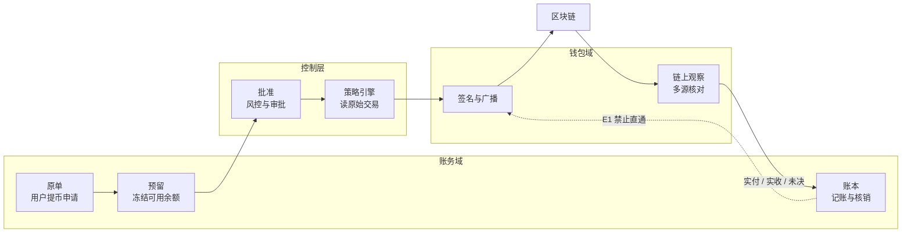
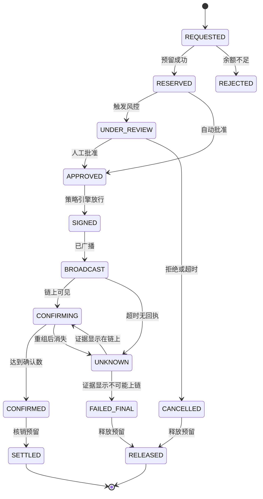
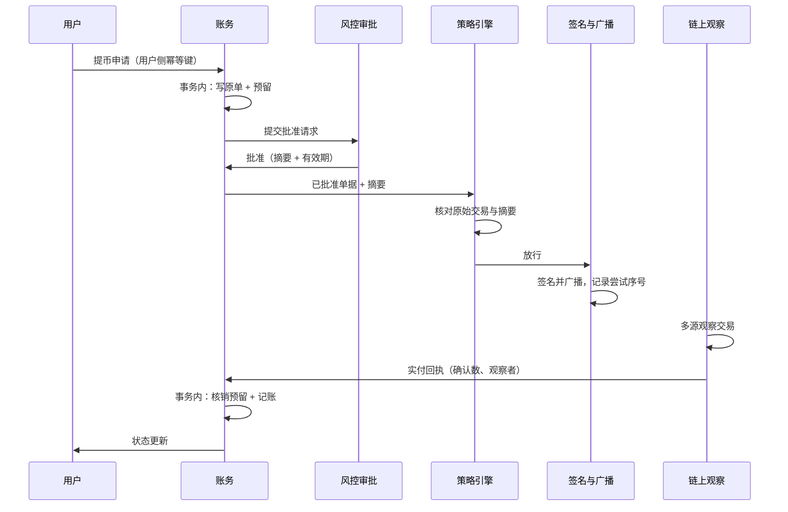
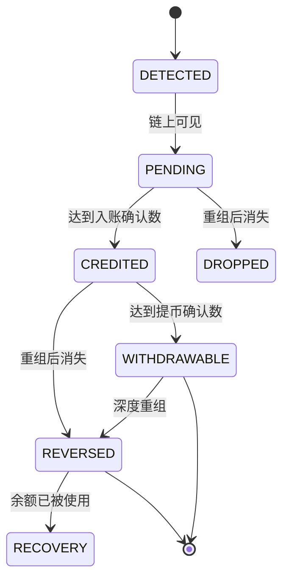

# X26 域间交接：原单、预留、批准、实收、实付与未决状态

> 学习目标：读完本章，你能——
> 1. 画出"交易与账务"和"钱包与支付"两个域之间的交接契约：下行三件单据（原单、预留、批准），上行三类回执（实收、实付、未决）。
> 2. 为提币和充值各写一张状态机，并说清每个状态里钱在哪、谁有权推进、什么条件才能释放预留。
> 3. 设计幂等键与对账键，写出能抓出"重复支付、悬挂预留、记账与链上不符"的对账查询，并用 16 条用例验收。
>
> 适用角色：交易所安全工程师、账务与清结算工程师、钱包与支付团队、财资与运营负责人。
> 前置章节：X07-cex-architecture-overview.md、X10-cex-trading-settlement-credit.md、X11-cex-wallet-treasury-payment.md、[23 托管、充提与合规安全](../chapters/23-custody-exchange-ops.md)、[29 2026 专题：签名路径](../chapters/29-signing-path-2026.md)
> 交互实验：[确认深度实验](../interactive/confirmation-depth-lab.html)、[RPC 多源核对实验](../interactive/rpc-quorum-lab.html)
> 模板：[T09 事件手册与值班](../templates/T09-incident-runbook-oncall.md)
> 最后核对：2026-11-23

> 💡 注意：分工。X10 讲账务内部的不变量与充值入账规则。X11 讲钱包分层、签名服务与三方对账。本章只讲两个域之间的"接缝"：一份单据怎样从账务走到钱包，一份回执怎样从钱包走回账务，中间任何一步失败、超时、重复时账怎么记。本章不重复 X10、X11 的控制，只引用它们的编号。

---

## 开场：一个按钮，两次付款

假设一笔 10 万美元的 USDT 提币在广播后 5 分钟没有收到回执。运营看到状态是"处理中"，用户在催。工单系统里有一个"重新发送"按钮。运营点了它。

接下来有两种结局。第一种：系统用同一个 nonce 重新广播，只有一笔能上链，用户收到一次款。第二种：系统把原单当作失败，释放预留，生成一笔新的签名请求，用新的 nonce 发出。结果原交易其实只是在内存池里排队，后来也上链了。用户收到两次款，账务里却只扣了一次。

<details class="predict"><summary>🤔 先猜再看：这两种结局的差别在哪一步？</summary>

差别不在签名，也不在风控，而在"失败"这个状态的定义。第一种结局里，系统没有宣布失败，只是替换同一笔交易。第二种结局里，系统在"没有收到回执"时就宣布了失败。**没有回执不等于失败，它只是"未决"。** 本章的核心规则是：预留只能在"确定不会上链"之后释放，而"确定"必须有可核对的链上依据。

</details>

交易所历史上多次出现这类问题。第 9 节列出的案例，从 2014 年的提币并发漏洞，到 2019 年的链重组，根因都在两个域交接的接缝上。

---

## 1. 一句话理解

**两个域之间只传"单据"和"回执"，每一份都有唯一编号；钱的状态只由单据状态推动，未决状态里钱必须保持冻结，直到有链上证据才能变成"已付"或"已退回"。**

> 🎯 打个比方：公司财务（账务域）和出纳（钱包域）之间传递"付款申请单"。财务先在账上把这笔钱圈起来（预留），主管签字批准，出纳去银行汇款。银行回单回来前，这张单子不能作废，也不能重开一张。回单到了，财务才销账。
>
> 比喻的局限：银行回单是权威的，一张就够。链上的"回单"是概率性的：区块可能重组，节点可能给出不一致的答案，同一笔交易还可能换了哈希。所以链上的"回单"要多源核对，并且要等足够的确认。

---

## 2. 保护目标与信任边界

### 2.1 保护目标

| 目标 | 一句话 | 失守的后果 |
|---|---|---|
| 一单一付 | 一份已批准的提币单，最多在链上成功支付一次 | 重复支付，直接损失 |
| 先预留后支付 | 没有预留成功的单据不能进入签名 | 余额不足仍付出，透支 |
| 付出等于扣减 | 链上实际流出等于账务实际扣减 | 账实不符，被盗长期不发现 |
| 未决不失真 | 状态不明时，钱保持冻结且被统计 | 要么重复付，要么用户资金失踪 |
| 入账以确认为准 | 链上不可逆之前，充值不能当作可提币资金 | 先入账后回滚，凭空印币 |

### 2.2 信任边界



**读图要点：**

- 下行路径是"原单 → 预留 → 批准 → 策略引擎 → 签名"。账务不能绕过批准直接让钱包签名（E1）。
- 上行路径是"链上观察 → 账本"。账本只信钱包域的观察结果，不信钱包域"说"的结果，所以观察层要独立于签名层。
- 钱包域不修改账本，账务域不持有密钥。两边各自只能改自己的状态。
- 局限：图没有画风控规则本身怎么设计。风控见 [X13](X13-cex-fraud-compliance-secops.md)。

> ⚠️ 警告：以下东西不能被信任。
> 1. 钱包服务返回的"成功"。成功必须由链上观察层独立确认。
> 2. 单个节点返回的交易状态。节点会落后、会分叉、会返回缓存。
> 3. 交易哈希作为唯一标识。哈希可能因替换交易而改变（见 3.6 节）。
> 4. 消息只投递一次的假设。任何消息队列都可能重复投递。
> 5. 工单里"已确认失败"的人工备注，没有证据附件时不能据此释放预留。

---

## 3. 参考架构

### 3.1 交接契约：六类对象

| 对象 | 方向 | 含义 | 谁创建 | 谁能修改 |
|---|---|---|---|---|
| 原单（Request） | 账务内部 | 用户的提币申请，带用户侧幂等键 | 账务 | 只追加状态 |
| 预留（Hold） | 账务 → 钱包 | 把可用余额冻结，金额与原单绑定 | 账务 | 释放或核销，各一次 |
| 批准（Approval） | 控制层 → 钱包 | 风控与审批结论，含目标地址、金额、有效期的摘要 | 风控与审批 | 不可改，只能作废 |
| 实付（Settlement） | 钱包 → 账务 | 链上实际支付的金额、手续费、区块位置 | 钱包观察层 | 重组时可撤回 |
| 实收（Receipt） | 钱包 → 账务 | 链上实际到账的充值事件 | 钱包观察层 | 重组时可撤回 |
| 未决（Pending） | 钱包 → 账务 | 钱包域无法确定结果的状态，带账龄 | 钱包观察层 | 只能被证据推进 |

下行消息（账务 → 钱包）的最小字段，建议写成一份受签名保护的契约：

```json
{
  "type": "WithdrawalApproved",
  "withdrawal_id": "W-2026-000123",
  "hold_id": "H-2026-000123",
  "chain": "ethereum",
  "asset": "USDT",
  "to": "0x…（登记过的地址）",
  "amount": "100000.000000",
  "fee_cap": "5.00",
  "approval_digest": "sha256(上面各字段 + 批准人 + 过期时间)",
  "expire_at": "2026-11-23T10:30:00Z"
}
```

上行消息（钱包 → 账务）：

```json
{
  "type": "WithdrawalResult",
  "withdrawal_id": "W-2026-000123",
  "attempt_no": 1,
  "status": "CONFIRMED",
  "tx_ref": "chain=ethereum,hash=0x…,nonce=812",
  "actual_amount": "100000.000000",
  "actual_fee": "2.31",
  "observed_height": 21000000,
  "observed_by": ["node-a", "node-b", "indexer-c"]
}
```

> 💡 注意：以上字段名是示例。关键设计是：下行带"批准摘要"和"过期时间"，策略引擎用它核对签名前的原始交易；上行带"尝试序号"和"多源观察者列表"，账务可以判断结果是否被多个来源确认。

### 3.2 提币状态机



**读图要点：**

- `SIGNED` 之后不能直接 `CANCELLED`。签名后只有两条路：确认成功，或拿到"不可能上链"的证据。
- `UNKNOWN` 是一等状态，不是异常分支。它只有两个出口，都需要证据。
- `RELEASED` 只来自 `CANCELLED`（签名前）和 `FAILED_FINAL`（签名后）。其他路径不能释放预留。
- 局限：图没有画换手续费重发（同 nonce 替换）。替换在同一状态内产生新的尝试序号，见 3.6 节。

每个状态里钱在哪里，账务怎么记（示例科目，实际科目因交易所而异）：

| 状态 | 用户余额 | 账务动作（示例） | 谁能推进 |
|---|---|---|---|
| REQUESTED | 可用 | 无 | 账务服务 |
| RESERVED | 可用减、冻结加 | 借"用户可用"，贷"用户冻结" | 账务服务 |
| APPROVED / SIGNED | 冻结 | 无 | 风控审批，策略引擎 |
| BROADCAST / CONFIRMING | 冻结 | 借"用户冻结"，贷"提币在途"（广播时） | 钱包观察层 |
| UNKNOWN | 冻结 | 无，保持"提币在途"，进入未决报表 | 只能由证据推进 |
| CONFIRMED / SETTLED | 冻结已核销 | 借"提币在途"，贷"钱包资产"和手续费科目 | 账务服务，凭实付回执 |
| FAILED_FINAL / RELEASED | 冻结回到可用 | 借"提币在途"，贷"用户可用" | 账务服务，凭失败证据 |

### 3.3 提币时序



**读图要点：**

- "写原单 + 预留"必须在账务的同一个数据库事务内完成。分开写会产生"有单无预留"或"有预留无单"。
- 策略引擎只认"已批准单据 + 摘要"，不认账务直接发来的请求。对应 X11 的 TRS-C03。
- 回执由观察层发出，签名层的广播结果只作为线索。
- 局限：时序没有画失败分支，失败分支见 3.2 节状态机。

### 3.4 充值状态机



**读图要点：**

- 入账、可交易、可提币是三道门槛，确认数依次升高。可提币门槛最高，因为提币一旦发出就无法撤回。
- `REVERSED` 是冲正：账务把这笔充值反向记账。如果用户已经把钱花了或提走，进入 `RECOVERY`，按欠款处理并限制账户。
- 归集（把充值地址的钱转到温钱包）与记账分开。记账凭充值交易本身，不凭归集交易。
- 局限：确认数是链相关参数，会随链的安全状况变化。通用做法是按链配置并定期复核，必要时临时调高。

### 3.5 未决状态的账务处理

未决状态不是"系统有问题"，而是"系统诚实地承认自己不知道"。处理规则是：

1. 钱保持冻结，不释放，不重复预留。
2. 未决单据按账龄分级进入报表，并计入对账的"在途"一栏。
3. 观察层持续用多源查询，一旦证据明确，自动推进状态。
4. 超过账龄阈值升级给人，人工处置必须双人，必须附证据。
5. 未决期间，用户界面显示"处理中"，不显示"失败"。

什么算"确定不会上链"的证据，取决于链的机制（通用做法，细节以各链官方文档为准）：

| 链模型 | 确定失败的证据 | 不能当作证据的东西 |
|---|---|---|
| 账户模型（如以太坊） | 发送地址的该 nonce 已被另一笔交易使用并已最终确认，且那笔不是我方尝试 | 内存池里查不到，某节点返回"未知交易" |
| UTXO 模型（如比特币） | 该交易花费的输入已被另一笔交易花费并达到足够确认 | 某个浏览器显示"未找到" |
| 交易有区块哈希有效期的链（如 Solana） | 交易引用的区块哈希已过有效期，且这笔交易未在链上出现 | 刚刚过期但观察层落后 |

> ⚠️ 警告：账户模型里，"原交易仍在内存池"是"未决"，不是"失败"。如果这时用新的 nonce 重发，两笔都可能上链。正确的重发方式是用同一个 nonce、更高的费用替换。UTXO 模型里，重发必须复用同样的输入，这样两笔交易互相冲突，最多一笔能被确认。

### 3.6 幂等键与对账键

| 键 | 作用 | 约束 | 谁生成 |
|---|---|---|---|
| `client_request_id` | 用户重复点击不会产生两个原单 | 同一用户内唯一 | 客户端或接入层 |
| `withdrawal_id` | 一份原单的全局编号，贯穿所有系统 | 全局唯一 | 账务 |
| `hold_id` | 一次预留 | 与 `withdrawal_id` 一对一 | 账务 |
| `approval_digest` | 绑定批准内容，防止签名前被改 | 一次批准一个 | 审批服务 |
| `attempt_no` | 一单可有多次链上尝试（替换交易） | `(withdrawal_id, attempt_no)` 唯一 | 钱包域 |
| `(chain, from, nonce)` | 账户模型下一个 nonce 只能被一笔交易占用 | 唯一 | 钱包域 |
| `(chain, tx_hash, log_index)` | 一笔充值事件 | 唯一 | 观察层 |
| `tx_hash` | 链上交易标识 | **不能作为提币的唯一键** | 链 |

> 💡 注意：提币必须用 `withdrawal_id` 贯穿，而不是 `tx_hash`。替换交易会产生新哈希；早期比特币的交易延展性（Transaction Malleability）可以让同一笔支付换一个哈希。以哈希为唯一标识的系统，会把"哈希变了"误判为"没付出"。

对账键的设计原则：任意两个系统都能用同一个键 join。提币对账用 `withdrawal_id`；充值对账用 `(chain, tx_hash, log_index)`；钱包在途资金对账用 `(chain, from, nonce)`。

---

## 4. 控制清单

| ID | 控制项 | 要防什么 | 优先级 | 怎么验证 |
|---|---|---|---|---|
| HND-C01 | 原单与预留在同一事务内创建；`client_request_id` 唯一约束 | 重复提交、有单无预留 | P0 | 并发提交同一幂等键 100 次，只产生一个原单 |
| HND-C02 | 无预留成功的单据不能进入审批与签名 | 透支付款 | P0 | 构造余额不足的单据，直接调用签名接口，必须被拒 |
| HND-C03 | 批准绑定摘要与有效期；策略引擎签名前重算比对 | 批准后被改地址或金额 | P0 | 改动已批准单据的目标地址，签名必须被拒 |
| HND-C04 | 状态转移用乐观锁（版本号）或比较并交换；禁止回退到更早状态 | 并发处理、竞态 | P0 | 两个线程同时推进同一单，只一个成功 |
| HND-C05 | 预留只能在 `CANCELLED`（签名前）或 `FAILED_FINAL`（带证据）后释放 | 未决时释放导致重复支付 | P0 | 在 `UNKNOWN` 状态调用释放，必须被拒 |
| HND-C06 | `UNKNOWN` 为一等状态，设账龄告警与升级 | 状态不明被忽略 | P0 | 注入无回执单据，确认告警与升级时间 |
| HND-C07 | 重广播只能同 nonce 替换或复用同输入，禁止"新 nonce 重发" | 一单两付 | P0 | 在测试网模拟超时，确认系统只替换不新建 |
| HND-C08 | `(chain, from, nonce)` 与 `(withdrawal_id, attempt_no)` 唯一约束 | 双重占用 | P0 | 尝试插入重复，必须失败 |
| HND-C09 | 实付回执需多源观察确认；单源结果只作线索 | 假回执、节点说谎 | P0 | 让一个节点返回伪造的成功，账务必须不推进 |
| HND-C10 | 充值入账、可交易、可提币三道确认门槛，按链配置 | 先入账后回滚 | P0 | 见 X10 TRD-C05；构造未确认充值，检查余额可用性 |
| HND-C11 | 重组检测：已入账充值或已确认提币发生变化时自动冲正并告警 | 重组导致凭空印币 | P0 | 在私有测试链制造重组，确认冲正与告警 |
| HND-C12 | 冲正后余额已被使用的账户自动受限并进入追偿流程 | 重组套利 | P1 | 构造已提走的冲正，确认账户状态 |
| HND-C13 | 消息队列至少一次投递，消费者按键幂等；用事务发件箱（Outbox）发布 | 重复消息、丢消息 | P0 | 重放同一消息 100 次，账务只处理一次 |
| HND-C14 | 提币三键对账（原单、账本、链上）与预留对账，每日全量加每小时增量 | 账实不符长期不发现 | P0 | 注入一条差异，记录告警用时 |
| HND-C15 | 手工修改状态需双人审批、附证据、写不可变日志 | 内部人改状态 | P0 | 一个人尝试直接改状态，必须失败 |
| HND-C16 | 钱包切主或服务恢复后，先对账未决单据再恢复发送 | 切主后重发 | P1 | 切主演练，确认恢复前跑了未决对账 |

---

## 5. 分级落地

| 档次 | 做什么 | 人和时间（示例） |
|---|---|---|
| 最小可行 | 原单与预留同事务；`withdrawal_id` 与唯一约束；预留释放只允许两条路径；每日提币三键对账；未决账龄报表 | 账务 1 人 + 钱包 1 人；4–6 周 |
| 标准 | 加：批准摘要与签名前重算；乐观锁；Outbox 与消费者幂等；多源观察；重组检测与冲正；每小时对账；切主前未决对账 | 账务、钱包、安全各 1–2 人；3–6 个月 |
| 成熟 | 加：每笔状态转移的证据留存；自动故障注入（超时、重复、重组）；季度联合演练；对账结果进入管理层报表 | 跨团队 5 人以上；12 个月以上 |

> 💡 注意：时间与人数是示例。顺序建议：先做唯一约束与预留规则（改动小，直接堵住重复支付），再做对账，最后做故障注入。

---

## 6. 落地做法

### 6.1 第一步：画出"一笔提币的全部记录"

1. 列出一笔提币在各系统里产生的记录：原单、预留、批准、签名请求、广播记录、链上交易、账本分录、用户通知。
2. 为每条记录写：属于哪个域、主键是什么、能被谁修改。
3. 检查每一对相邻记录有没有共同的键。没有共同键的地方，就是对账盲区。
4. 把盲区补成 `withdrawal_id` 字段，写进各系统的表结构。

### 6.2 表结构与约束（示例）

```sql
-- 示例：关键约束（PostgreSQL 风格，字段为示意）
CREATE TABLE withdrawal (
  withdrawal_id   text PRIMARY KEY,
  user_id         bigint NOT NULL,
  client_request_id text NOT NULL,
  chain           text NOT NULL,
  asset           text NOT NULL,
  to_address      text NOT NULL,
  amount          numeric(38,18) NOT NULL CHECK (amount > 0),
  status          text NOT NULL,
  version         int  NOT NULL DEFAULT 0,
  approval_digest text,
  updated_at      timestamptz NOT NULL DEFAULT now(),
  UNIQUE (user_id, client_request_id)              -- 对应 HND-C01
);

CREATE TABLE withdrawal_hold (
  hold_id        text PRIMARY KEY,
  withdrawal_id  text NOT NULL UNIQUE REFERENCES withdrawal,
  amount         numeric(38,18) NOT NULL,
  state          text NOT NULL CHECK (state IN ('HELD','SETTLED','RELEASED')),
  release_proof  text                                 -- 释放必须带证据编号，对应 HND-C05
);

CREATE TABLE withdrawal_attempt (
  withdrawal_id  text NOT NULL REFERENCES withdrawal,
  attempt_no     int  NOT NULL,
  chain          text NOT NULL,
  from_address   text NOT NULL,
  nonce          bigint,                              -- 账户模型使用
  tx_hash        text,
  status         text NOT NULL,
  PRIMARY KEY (withdrawal_id, attempt_no),            -- 对应 HND-C08
  UNIQUE (chain, from_address, nonce)
);
```

### 6.3 预留事务与状态推进（示例）

```sql
-- 示例：预留（对应 HND-C01、HND-C02）。一个事务，要么全成，要么全败。
BEGIN;
  INSERT INTO withdrawal (withdrawal_id, user_id, client_request_id, chain, asset,
                          to_address, amount, status)
  VALUES ($1, $2, $3, $4, $5, $6, $7, 'RESERVED');      -- 重复幂等键会在此失败

  UPDATE account_balance
     SET available = available - $7, frozen = frozen + $7
   WHERE user_id = $2 AND asset = $5 AND available >= $7;  -- 余额不足则影响 0 行
  -- 应用层检查：影响行数必须为 1，否则 ROLLBACK
  INSERT INTO withdrawal_hold (hold_id, withdrawal_id, amount, state)
  VALUES ($8, $1, $7, 'HELD');
COMMIT;

-- 示例：状态推进用版本号，只允许前进（对应 HND-C04）
UPDATE withdrawal
   SET status = 'SIGNED', version = version + 1, updated_at = now()
 WHERE withdrawal_id = $1 AND status = 'APPROVED' AND version = $2;
-- 影响行数为 0：说明状态已变，不得重试同一动作，要重新读取
```

### 6.4 重广播与未决判定（伪代码，示例）

```python
# 示例：未决单据的判定（账户模型；字段与函数名为示意）
def resolve_unknown(w, observers):
    attempts = db.attempts(w.withdrawal_id)
    mine = {x.tx_hash for x in attempts}
    # 1. 任一尝试已被多源确认：推进为成功
    for a in attempts:
        if quorum(observers, "tx_confirmed", a.tx_hash, min_sources=2):
            return advance(w, "CONFIRMING", evidence=a.tx_hash)
    # 2. 该 nonce 被别的交易占用并最终确认，且不是我方任何尝试：确定失败
    a = attempts[-1]
    used = quorum_value(observers, "nonce_consumed_by", w.chain, a.from_address, a.nonce)
    if used and used not in mine:
        return advance(w, "FAILED_FINAL", evidence=used)
    # 3. 其余情况：仍是未决，只允许同 nonce 加价替换，不允许新 nonce
    if age(w) > REPLACE_AFTER:
        return rebroadcast_same_nonce_higher_fee(w)
    return stay_unknown(w)
```

> ⚠️ 警告：这段逻辑里没有"超时就失败"的分支。超时只触发升级或替换，不触发释放。把这一条写进代码评审清单。

### 6.5 对账查询（示例）

```sql
-- Q1：链上已成功，账务未核销（预留悬挂，用户被多冻结）
SELECT w.withdrawal_id, w.amount, w.status
FROM withdrawal w JOIN withdrawal_attempt a USING (withdrawal_id)
JOIN chain_tx c ON c.chain = a.chain AND c.tx_hash = a.tx_hash
WHERE c.status = 'CONFIRMED' AND w.status NOT IN ('CONFIRMED','SETTLED');

-- Q2：账务已释放或失败，但链上有成功交易（最危险：可能重复支付）
SELECT w.withdrawal_id, c.tx_hash, c.amount
FROM withdrawal w JOIN withdrawal_attempt a USING (withdrawal_id)
JOIN chain_tx c ON c.chain = a.chain AND c.tx_hash = a.tx_hash
WHERE w.status IN ('RELEASED','FAILED_FINAL','CANCELLED') AND c.status = 'CONFIRMED';

-- Q3：同一原单有多笔成功支付（重复支付）
SELECT a.withdrawal_id, count(*) AS paid_cnt
FROM withdrawal_attempt a JOIN chain_tx c ON c.chain = a.chain AND c.tx_hash = a.tx_hash
WHERE c.status = 'CONFIRMED' GROUP BY a.withdrawal_id HAVING count(*) > 1;

-- Q4：冻结余额与活跃预留合计不等
SELECT b.user_id, b.asset, b.frozen, COALESCE(h.total,0) AS held
FROM account_balance b LEFT JOIN (
  SELECT w.user_id, w.asset, sum(h.amount) AS total
  FROM withdrawal_hold h JOIN withdrawal w USING (withdrawal_id)
  WHERE h.state = 'HELD' GROUP BY 1,2) h USING (user_id, asset)
WHERE b.frozen <> COALESCE(h.total,0);

-- Q5：未决账龄
SELECT withdrawal_id, now() - updated_at AS age FROM withdrawal
WHERE status = 'UNKNOWN' ORDER BY age DESC;
```

差异分类建议：**P1** 是 Q2、Q3（资金可能已经多付）；**P2** 是 Q1、Q4（用户资金被占用，但没有多付）；**P3** 是 Q5 超过阈值的未决。

### 6.6 常见坑

- 以交易哈希为唯一标识，替换交易后找不到原单。
- "没有回执"和"失败"共用一个状态。
- 预留与原单分两次写，中间崩溃。
- 消息队列重试没有幂等，同一回执核销两次。
- 钱包服务切主后，新主从自己的数据库重发"待发送"队列，旧主已经发过。
- 重组后只回滚了充值，没有回滚由这笔充值产生的交易与提币。
- 人工在数据库里直接改状态，绕过版本号与审批。

---

## 7. 运营：指标、告警、值班、演练

### 7.1 指标与告警

| 指标 | 含义 | 建议告警（示例阈值） |
|---|---|---|
| 未决单据数与最大账龄 | `UNKNOWN` 状态的数量与时长 | 任一超过 15 分钟 P3；超过 60 分钟 P2 |
| 对账 Q2、Q3 命中数 | 可能重复支付 | 任一命中 P1 |
| 预留悬挂金额 | Q1、Q4 合计 | 超过阈值 P2 |
| 重组冲正次数 | 链重组影响 | 任一次 P2；涉及已提币 P1 |
| 回执延迟 | 广播到实付回执的耗时 | 分位数持续高于基线 |
| 人工改状态次数 | 绕过自动流程 | 任一次通知；每周复核 |

### 7.2 值班与升级

- 一线：钱包运营，处理 P3 未决，按手册核对多源证据。
- 二线：账务工程师，处理 P2 悬挂与对账差异。
- P1：立即叫醒账务负责人、钱包负责人和安全，暂停该链的自动提币（分链熔断，见 X11 的 TRS-C05），再核对。
- 谁能手工推进状态：账务负责人与钱包负责人共同批准，附证据，不得一人完成。

### 7.3 季度节奏（建议）

1. 第 1 个月：对账查询回放，注入 5 种差异，核对召回。
2. 第 2 个月：故障注入演练（消息重复、钱包切主、观察层单源失真）。
3. 第 3 个月：联合桌面推演，账务、钱包、风控、客服、安全一起参加。
4. 每季度：复核各链确认数与账龄阈值。

---

## 8. 验收与恢复（精简版）

### 8.1 验收用例精选

在测试环境中执行。完整的验收方法论见 X18、X20，本章只列交接专属用例。用例 ID 以 `HND-T` 开头，控制项指向第 4 节。

| 用例 ID | 控制项 | 前置条件 | 操作（测试环境） | 预期结果 | 证据 |
|---|---|---|---|---|---|
| HND-T01 | HND-C01 | 测试用户余额 1000 | 同一幂等键并发提交 100 次 | 只有 1 个原单，冻结 1 份 | 数据库计数与请求日志 |
| HND-T02 | HND-C02 | 余额 10 | 提交 100 的提币，再直接调签名接口 | 两处都被拒 | 接口返回与日志 |
| HND-T03 | HND-C03 | 已批准单据 | 改动数据库里的目标地址 | 策略引擎拒签，告警 | 拒签日志 |
| HND-T04 | HND-C04 | 单据处于 APPROVED | 两个进程同时推进 | 仅一个成功，另一个得到冲突 | 版本号与日志 |
| HND-T05 | HND-C05 | 单据处于 UNKNOWN | 调用释放预留 | 被拒，记录审计 | 接口返回 |
| HND-T06 | HND-C06 | 广播后屏蔽回执 | 等待账龄阈值 | 触发 P3，再升级 P2 | 告警记录与时间 |
| HND-T07 | HND-C07 | 测试网，交易挂起 | 触发重发 | 同 nonce 加价替换，无新 nonce | 链上交易列表 |
| HND-T08 | HND-C08 | 已有 attempt | 插入重复 nonce | 唯一约束拒绝 | 数据库错误 |
| HND-T09 | HND-C09 | 一个观察节点被改成返回成功 | 链上实际未成功 | 账务不推进，告警源不一致 | 观察日志 |
| HND-T10 | HND-C10 | 链上 1 确认的充值 | 查看余额 | 可见但不可交易不可提币 | 余额接口 |
| HND-T11 | HND-C11 | 私有测试链 | 制造 3 区块重组，使充值消失 | 自动冲正，告警 | 账本与告警 |
| HND-T12 | HND-C12 | 冲正前用户已提走 | 触发重组 | 账户受限，进入追偿 | 账户状态 |
| HND-T13 | HND-C13 | 钱包回执入队 | 重放同一消息 100 次 | 核销 1 次 | 账本分录 |
| HND-T14 | HND-C14 | 构造 Q2 差异 | 运行对账 | P1 告警，用时记录 | 告警时间戳 |
| HND-T15 | HND-C15 | 普通账务账号 | 直接改状态 | 被拒，审批流缺失 | 权限拒绝日志 |
| HND-T16 | HND-C16 | 有 5 笔 UNKNOWN | 切主 | 恢复前先跑未决对账，不重发 | 演练记录 |

**上线门禁：** HND-T01、T02、T03、T05、T07、T09、T11、T13 任一未通过，不得对真实用户开放自动提币。

### 8.2 回放验收（示例）

```python
# 示例：对一天的历史单据回放注入故障，数一数对账查询抓出了多少
import random
faults = {"dup_msg": 20, "lost_ack": 20, "reorg": 10, "double_attempt": 10}
# 1. 从测试库取 1000 笔已完成提币，复制为合成数据
# 2. 随机挑选并注入以上故障，记录被注入的单据编号集合 injected
# 3. 运行 6.5 节的 Q1–Q5，得到命中集合 found
recall = len(found & injected) / len(injected)
print("召回率", recall)          # 目标：Q2、Q3 类故障召回率 100%
```

### 8.3 事故后的恢复清单

适用场景：消息积压后恢复、钱包服务切主、链分叉后恢复、观察层故障。

- [ ] 暂停受影响链的自动提币，保留状态与日志的快照。
- [ ] 导出所有非终态提币单据（REQUESTED 到 UNKNOWN）与所有未决充值。
- [ ] 对每个 `UNKNOWN`，按 3.5 节的证据表逐条判定，附多源证据。
- [ ] 运行 6.5 节的 Q1–Q4，差异清零或逐条登记。
- [ ] 核对钱包链上余额与账务科目，差异按 X11 的三方对账处理。
- [ ] 重组影响的充值已全部冲正，涉及已用余额的账户已受限。
- [ ] 小额、单链、受监控地恢复提币，观察一个完整周期，再放量。
- [ ] 向受影响用户发出说明，客服口径与账务状态一致。
- [ ] 复盘：哪条控制没拦住，补回第 4 节的控制与第 8.1 节的用例。

> 💡 注意：钱包侧的复付、迁移与轮换在 X21，对账方法论在 X20。本章清单只覆盖"两域交接"部分。

---

## 9. 失效案例

> 说明：以下均为公开资料的摘要，信息源类型已标注。完整复盘见《Web3 行业安全资损 101》。查不到可靠来源的案例不写。

### 9.1 Poloniex：并发提币与负余额（2014 年 3 月）：对应 HND-C01、C04

- **事实：** 2014 年 3 月 4 日，交易所 Poloniex 的负责人在论坛通报，约 12.3% 的比特币被盗。他称攻击者发现，在几乎同一时刻提交多笔提币，系统会把它们一并处理，导致余额变成负数（媒体报道，来源：[CoinDesk](https://www.coindesk.com/poloniex-loses-12-3-bitcoins-latest-bitcoin-exchange-hack)）。报道中对根因的表述并不完全一致，有的称是第三方软件，有的称是自己的账务与提币设计。
- **处置：** 公开报道称，Poloniex 把损失按比例摊到用户余额上，并把提币改为从全局队列逐笔串行处理。
- **打穿的控制：** 预留与余额检查不是原子的，并发请求同时通过了"余额够不够"的检查。对应 HND-C01、C04。
- **教训：** 提币检查与扣减必须在同一个事务里，并发请求要靠数据库约束串行，而不是靠"应用层先查后扣"。

### 9.2 Mt. Gox：交易哈希变了，"没付"还是"付了"（2014 年 2 月）：对应 HND-C07、C08

- **事实：** 2014 年 2 月，Mt. Gox 停止业务并申请破产，公开声明称攻击者利用交易延展性（Transaction Malleability）。苏黎世联邦理工学院的 Decker 与 Wattenhofer 分析了此前一年多的比特币网络数据，结论是没有发现大规模利用该问题的证据（学术论文，来源：[arXiv:1403.6676](https://arxiv.org/abs/1403.6676)）。
- **本章怎样用这个案例：** 本章不判断 Mt. Gox 倒闭的原因。我们只用它说明一个设计教训：如果系统用交易哈希判断"是否已付"，哈希一变，就会把已付的单据当作未付。
- **打穿的控制：** 以哈希为唯一标识，没有以内部单号贯穿。对应 HND-C07、C08。
- **教训：** 提币对账用 `withdrawal_id`，一笔提币的多次尝试放在 `withdrawal_attempt` 里，重发要复用输入或 nonce。

### 9.3 Coinbase 观察到的 Ethereum Classic 深度重组（2019 年 1 月）：对应 HND-C10、C11

- **事实：** Coinbase 在博客中称，2019 年 1 月 5 日检测到 Ethereum Classic（ETC）的深度链重组，随后暂停了 ETC 相关交互，并称其账户未受影响。更新后的数字是 15 次重组，其中 12 次包含双花，合计约 219,500 ETC，约合 110 万美元（事发时估值）（项目方公告，来源：[Coinbase 博客](https://medium.com/the-coinbase-blog/ethereum-classic-etc-is-currently-being-51-attacked-33be13ce32de)；媒体对时间线的报道略有差异）。
- **控制是否生效：** 本案例里交易所发现并暂停了，是"控制生效"的例子。它说明：重组检测和按链调高确认数，必须在入账之前就具备。对应 HND-C10、C11。
- **教训：** 确认数不是常数。对算力较低的链，要有"检测到异常重组就提高确认数或暂停入账与提币"的开关。

### 9.4 Bitcoin Gold 对交易所的双花（2018 年 5 月）：对应 HND-C10、C11、C12

- **事实：** 2018 年 5 月，Bitcoin Gold 网络遭遇 51% 攻击。该项目团队称，攻击者转出超过 388,000 BTG，约 1800 万美元（事发时估值）。多家媒体报道称攻击目标是交易所：先充值，再换成其他币并提走，随后重组使原充值消失（媒体报道，来源：[BleepingComputer](https://www.bleepingcomputer.com/news/security/hacker-makes-over-18-million-in-double-spend-attack-on-bitcoin-gold-network/)，另见 [MIT DCI 分析](https://medium.com/mit-media-lab-digital-currency-initiative/reorgs-on-bitcoin-gold-counterattacks-in-the-wild-da7e2b797c21)）。有的交易所称确认是同一个人所为，但这是交易所的说法，不是司法认定。起始日期各来源略有出入。
- **打穿的控制：** "可提币"门槛过低，或与"入账"门槛相同，重组后提币已无法追回。对应 HND-C10、C12。
- **教训：** 可提币确认数必须高于可交易确认数；对低算力的链要提高确认数或限制提币；冲正后的追偿要有预案。

### 9.5 邻近案例：Kraken 充值入账缺陷（2024 年 6 月）

该案例属于"入账规则放宽，没有独立的提币检查"，已在 X10 的 8.2 节展开，本章不重复。它对应本章的 HND-C10：入账状态必须影响可提币状态。

### 9.6 案例映射

| 案例 | 域间交接的缺口 | 本章控制 |
|---|---|---|
| Poloniex 2014 | 预留与余额检查不原子 | HND-C01、C04 |
| Mt. Gox 2014（教学用例） | 以哈希为唯一标识 | HND-C07、C08 |
| Coinbase ETC 2019 | 重组检测与暂停开关（控制生效） | HND-C10、C11 |
| Bitcoin Gold 2018 | 可提币确认数过低 | HND-C10、C12 |
| Kraken 2024 | 入账放宽没有约束提币 | HND-C10 |

> 💡 注意：这些案例多为早期事件。2025–2026 年公开的交易所事故，更多集中在签名路径与钱包控制（见 X11 第 8 节），公开材料中较少披露"提币状态机"层面的根因，所以本章不为凑数而增加案例。

---

## 10. 评估检查点

- [ ] **HND-1** 原单与预留在同一事务内创建，用户幂等键有唯一约束。
- [ ] **HND-2** 没有预留成功的单据，无法进入审批与签名。
- [ ] **HND-3** 批准绑定摘要与有效期，策略引擎在签名前重算。
- [ ] **HND-4** 提币状态机有书面文档，状态转移只允许前进，并发用版本号保护。
- [ ] **HND-5** 预留释放只允许在两种情况：签名前取消；签名后有"不可能上链"的证据。
- [ ] **HND-6** `UNKNOWN` 是显式状态，有账龄指标、告警与升级。
- [ ] **HND-7** 重发只用同 nonce 加价替换或复用同输入，系统里没有"新 nonce 重发"的路径。
- [ ] **HND-8** 提币以 `withdrawal_id` 贯穿各系统，`tx_hash` 不是唯一键。
- [ ] **HND-9** 实付回执经过至少两个独立来源确认。
- [ ] **HND-10** 充值有入账、可交易、可提币三道门槛，且可提币门槛最高。
- [ ] **HND-11** 重组检测会自动冲正，并告警。
- [ ] **HND-12** 冲正后余额已被用走的账户会自动受限，有追偿流程。
- [ ] **HND-13** 消息消费幂等，使用事务发件箱发布。
- [ ] **HND-14** 提币三键对账和预留对账每日运行，Q2、Q3 命中即 P1。
- [ ] **HND-15** 手工改状态需双人审批、附证据、写不可变日志。
- [ ] **HND-16** 钱包切主或服务恢复前，必须先对账未决单据。

**把检查结果写进报告：**

| 检查项 | 状态（通过 / 部分 / 未做） | 证据（文档、日志、截图） | 责任人 | 整改期限 |
|---|---|---|---|---|
| HND-1 | | | | |
| HND-5 | | | | |
| HND-7 | | | | |
| HND-14 | | | | |

---

## 11. 上手路径

**第一周**

1. 画出一笔提币和一笔充值的"全部记录"图（6.1 节），标出没有共同键的地方。
2. 读一遍提币服务的代码，找：有没有"超时即失败"的分支；有没有"新 nonce 重发"的分支。
3. 在测试库里跑 6.5 节的 Q1–Q4，看看现在有多少命中。

**第一个月**

1. 补唯一约束与预留释放的证据字段。
2. 把 `UNKNOWN` 从"其他"状态里拆出来，加账龄报表。
3. 上线每日提币三键对账。
4. 在测试网做一次"超时重发"演练。

**第一个季度**

1. 加签名前摘要重算、多源观察、重组冲正。
2. 做一次联合桌面推演（第 13 节练习 3）。
3. 跑完整的 HND-T01–T16，写验收报告，补整改。

---

## 12. 常见误区

| 误区 | 实际 |
|---|---|
| 超时就是失败，释放预留让用户重试 | 超时只是未决。释放要有链上证据 |
| 钱包服务返回"已广播"就等于已付 | 广播不等于上链，更不等于不可逆 |
| 交易哈希是天然的唯一键 | 替换交易会改变哈希 |
| 消息队列保证只投递一次 | 通常只保证至少一次，消费者要自己幂等 |
| 重组只影响充值 | 重组也会让已确认的提币消失，状态要能回到 `UNKNOWN` |
| 对账每天一次就够 | 重复支付要小时级发现 |
| 用户界面可以直接显示"失败" | 未决期间显示"处理中"，失败要有证据 |

---

## 13. 术语表与练习

### 术语表

| 术语 | 英文 | 一句话定义 |
|---|---|---|
| 原单 | Request | 用户提币申请，带唯一编号 |
| 预留 | Hold | 把可用余额冻结，并与原单绑定 |
| 批准 | Approval | 风控与审批对一笔提币的结论，带摘要 |
| 实付 | Settlement | 链上实际发生的支付，含金额与手续费 |
| 实收 | Receipt | 链上实际到账的充值事件 |
| 未决 | Pending / Unknown | 结果无法确定的状态，钱保持冻结 |
| 幂等 | Idempotency | 同一请求重复执行，结果与执行一次相同 |
| 事务发件箱 | Transactional Outbox | 把"要发的消息"和业务数据写在同一个事务里，再异步投递 |
| 冲正 | Reversal | 用反向分录抵消一笔已记录的账务 |
| 交易延展性 | Transaction Malleability | 在不改变支付内容的情况下，改变交易标识的现象 |
| 链重组 | Chain Reorganization | 链上区块被另一条更长的链替换 |

### 动手练习与思考题

> 🧪 动手验证：打开[确认深度实验](../interactive/confirmation-depth-lab.html)，调整确认数，看重组概率如何变化。再打开 [RPC 多源核对实验](../interactive/rpc-quorum-lab.html)，让一个节点说谎，观察多源核对是否能发现。写下：本章哪几条控制，依赖这两个实验里的结论。

**练习（均可在笔记本上完成）：**

1. 画图：为你熟悉的链画出提币状态机，标出每个状态里钱在哪个科目。
2. 写 SQL：写一条"冻结余额大于活跃预留合计"的对账查询，并写出一种假阳性（提示：并发中的状态推进）。
3. 推演（30 分钟）：脚本是"09:20，钱包主服务故障，运维切到备服务；09:35，发现 37 笔提币处于 BROADCAST 且无回执，其中 3 笔金额超过 10 万美元；客服已收到 80 个咨询"。回答：谁先被叫醒？谁有权暂停自动提币？这 37 笔怎么判定？什么条件下才能释放预留？对外怎么说？
4. 审流程：拿一份你们的提币工单"重新发送"的操作说明，指出其中哪一步可能导致一单两付，并改写。

**建议配套（B81 练习章，后续实现）：** 配套 B81"钱包与渠道三方对账与未决状态"，用示例数据练习提币三键对账与未决分类。

> 🪞 反思：想想你熟悉的系统。有没有哪个"失败"状态，其实只是"没有收到回执"？

### 思考题

1. 如果钱包服务和账务服务由不同团队维护，谁应该拥有 `UNKNOWN` 状态？为什么"发起方"和"推进状态的人"不应该是同一个人？
2. 一条链的确认数从 12 提高到 64，会给用户体验和风险分别带来什么变化？谁有权做这个决定？
3. 对账发现了 Q2 差异（账务已释放，链上却成功）。第一小时内应该做哪三件事？先追回，还是先止损？
