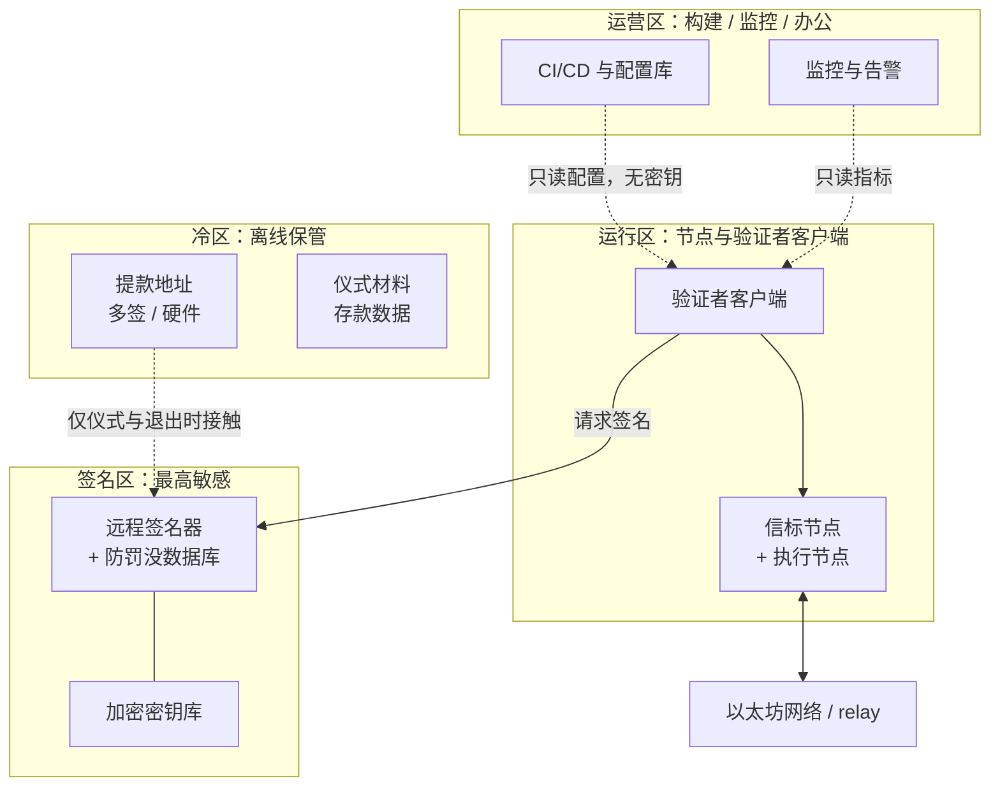
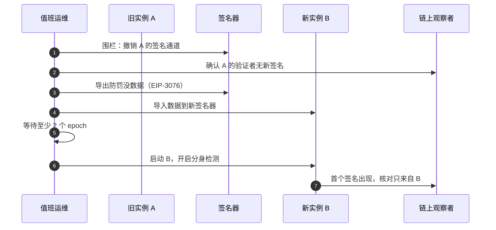
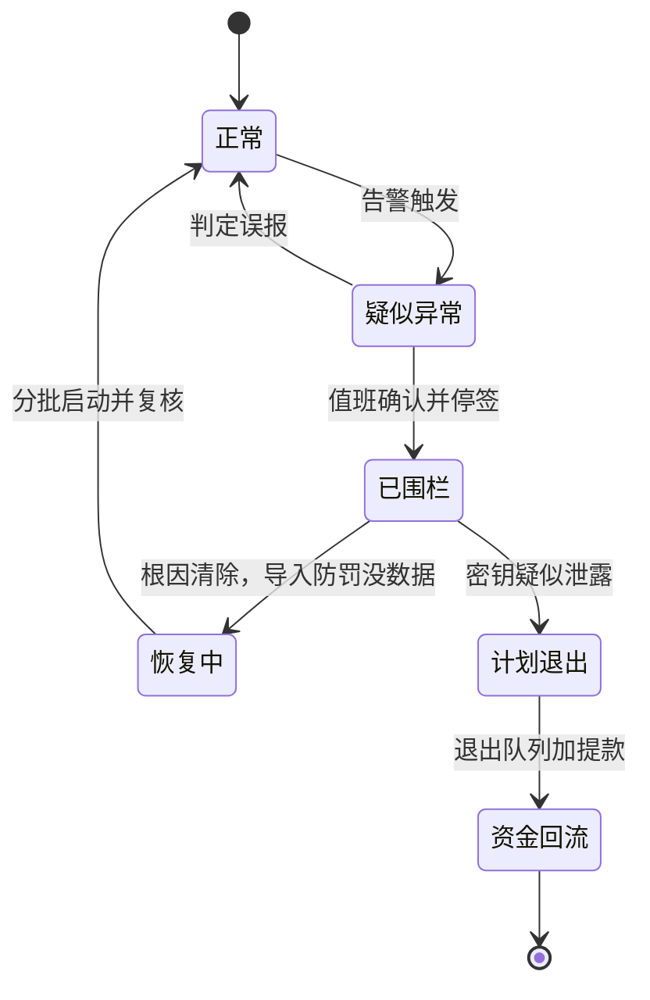

# X35 质押、节点与验证者运营：密钥、防罚没与监控

> 学习目标：读完本章，你能——
> 1. 画出一套验证者运营的密钥分层图，说清签名密钥、提款地址、费用接收地址、基础设施凭证各归谁保管、被盗后各会发生什么。
> 2. 写出一份"迁移与故障切换"运行手册，并配置远程签名器、防罚没数据库和分身检测，使同一把密钥任何时刻只有一个签名者。
> 3. 配置验证者监控与三条链上告警（费用接收地址漂移、提款凭证变更、罚没事件），并为客户端 bug、密钥泄露、云故障各写一份应急预案。
>
> 适用角色：质押服务商、验证者运营商、交易所 / 托管机构的质押业务负责人、流动性质押（LST）协议的运营方评估人员
> 前置章节：[17 节点、RPC 与验证者基础设施](../chapters/17-node-rpc-infrastructure.md)、[16 共识层与链级安全](../chapters/16-consensus-chain-security.md)、[X03 生产基础设施安全](X03-production-infra-security.md)、[X05 检测与响应工程](X05-detection-response-engineering.md)
> 交互实验 / 模板：[B63 节点、RPC、确认与暴露面](../bootcamp/B63-node-rpc-practice.md)（节点暴露面盘点）；本章给出密钥分层表、迁移运行手册、监控与告警规则、事故预案要点
> 最后核对：2026-11-23

> 💡 注意：本章只写质押与验证者运营特有的部分。云与 K8s 加固、机密管理见 X03；日志、SIEM、事件指挥、SOAR 边界见 X05。节点与 RPC 的数据可信度、日蚀、MEV-Boost 的机制见 17 章，本章不重复。示例以以太坊为主，§3.4 给 Cosmos 系链的差异。

---

## 开场：一个真实场景

2023 年 10 月 11 日，Lido 的节点运营商 Launchnodes 的主数据中心因 VPN 故障出现间歇性中断。运营商决定切换到冷备数据中心。15:45 开始起备用节点，15:53 到 15:55 之间，监控已经检测到罚没。最终 20 个验证者被罚没。

<details class="predict"><summary>🤔 先猜再看：运营商有备用机房、有远程签名器、有监控。为什么还是双签了？</summary>

因为远程签名器没有开启防罚没数据库，而且旧机房的验证者客户端没有被阻止继续签名。两套客户端连着同一个签名器，各自请求签名。签名器照单全签。事后复盘认为，切换前先销毁旧机房集群和签名器，很可能就能避免。备用机房本身没有问题。问题是"旧实例已停止"这件事没有被证明，只是被相信了。

</details>

这次事故不是攻击。它来自一个再普通不过的运维决定：机器看起来宕机了，起一台备用机。

2025 年 9 月 10 日，SSV 网络上的一个集群有 39 个验证者被罚没，原因是验证者所有方 Ankr 的一次内部维护失误：它在 SSV 之外并行运行了一个验证者实例。2026 年 9 月底，MetaMask 质押业务出现基础设施入侵，被改的不是签名密钥，而是费用接收地址。

三件事说明：验证者运营的主要风险是**两把钥匙同时在用**和**配置被悄悄改写**，而不是有人"黑进链"。本章讲怎样把这两件事做成流程、配置和告警。

---

## 1. 一句话理解

**验证者运营就是在保证"每把签名密钥任何时刻只有一个签名者"的前提下，让节点尽量不停机。** 两者是矛盾的：越想高可用，越容易出现两个签名者。

质押（Staking）：把资产锁进协议，参与出块与投票，换取奖励；违规会被扣罚。
验证者（Validator）：以太坊上持有质押并负责投票与出块的角色。
罚没（Slashing）：对双重签名等违规行为的强制惩罚：扣除部分质押，并强制退出。
双签（Equivocation）：对同一位置签署两个互相冲突的消息。
签名密钥（Signing Key）：验证者用来签投票和区块的 BLS 密钥，必须在线。
提款凭证（Withdrawal Credentials）：决定验证者资金最终去哪里的字段；以太坊上 `0x01` 和 `0x02` 指向一个执行层地址。
DVT（Distributed Validator Technology，分布式验证者技术）：把签名密钥拆成多份，分给多台机器共同签名。

> 🎯 打个比方：验证者密钥像一枚公司公章。公章必须放在办公室，随时能盖，这是"在线"。但如果两个人同时拿着复刻的公章，对同一份合同盖了两个不同的章，公司就要被罚款。运营的重点是：任何时候只有一枚公章在用，换章时先收回旧章，再启用新章。
>
> 比喻的局限：公章被盗，通常是被冒用盖章，后果可以很大。验证者签名密钥被盗，攻击者拿不走本金，只能制造罚没或掉线。真正能动本金的是提款凭证，它是另一把钥匙。

---

## 2. 保护目标与信任边界

### 2.1 保护目标

| 目标 | 失去后果 | 主要威胁 |
|---|---|---|
| 本金（质押资产） | 直接损失 | 提款地址被盗或设错；提款凭证被改 |
| 签名唯一性 | 罚没，强制退出，约 36 天后才可提款 | 迁移、故障切换、并行实例 |
| 在线性 | 错过奖励；长时间离线被逐步扣罚 | 云故障、客户端 bug、网络隔离 |
| 奖励归属 | 奖励被截走 | 费用接收地址被改 |
| 客户信任与账务 | 赔付、客户流失 | 客户资产混用；事故通知迟缓 |

### 2.2 信任边界图



**读图要点：**

- 提款地址在冷区，平时不接触任何在线系统。它只在存款、退出、合并时用到。
- 签名区只接受来自运行区的签名请求。运营区（CI、监控、办公）到签名区没有路径。
- 虚线表示"只读或极少使用"。如果 CI 能写验证者配置，它就能改费用接收地址（见案例 4）。
- 局限：图没有画"签名唯一性"。它是时间维度的约束，要靠防罚没数据库和迁移流程保证，见 §3.2。

### 2.3 密钥分层：四把钥匙，四种后果

| 钥匙 | 能做什么 | 被盗后果 | 保管建议 |
|---|---|---|---|
| 签名密钥 | 签投票与区块 | 攻击者可制造罚没、让验证者掉线；拿不走本金 | 远程签名器加防罚没数据库；或 DVT 分片 |
| 提款凭证（`0x01` / `0x02` 地址） | 收本金与奖励；Pectra 之后还能触发退出与合并 | 本金被转走；验证者被强制退出 | 多签或硬件钱包，冷区；每客户一个 |
| 费用接收地址 | 决定区块的交易费与 MEV 收入归谁 | 奖励被截走；金额小，但最先暴露入侵 | 写进配置，变更要审批并告警 |
| 基础设施凭证（云、CI、SSH） | 间接控制上面三者的运行环境 | 可替换配置、植入代码、读取密钥 | 按 X03；与签名区隔离 |

> 💡 注意：Pectra（2025 年 5 月 7 日主网激活）改变了提款凭证的权力。EIP-7002 让持有 `0x01` 提款凭证的地址，不需要签名密钥，直接从执行层触发退出和部分提款。EIP-7251 把单个验证者的最大有效余额提高到 2048 ETH，并引入 `0x02`（复利）凭证；合并请求同样必须由源验证者的提款地址发起。来源：[ethereum.org Pectra 路线图](https://ethereum.org/roadmap/pectra/)、[EIP-7002](https://eips.ethereum.org/EIPS/eip-7002)、[EIP-7251](https://eips.ethereum.org/EIPS/eip-7251)。EIP-7002 自己也提醒：有些托管安排假设"提款凭证不能触发退出"，这个假设现在不成立。

---

## 3. 参考架构

### 3.1 分层与职责

| 层 | 组件 | 职责 | 不能做 |
|---|---|---|---|
| 冷区 | 提款多签、仪式材料保管 | 生成、保管、授权退出与合并 | 连接任何在线系统 |
| 签名区 | 远程签名器、防罚没数据库、加密密钥库 | 只在不违反历史记录时签名 | 被 CI 或办公网访问 |
| 运行区 | 验证者客户端、信标节点、执行节点 | 请求签名、收发网络消息 | 持有明文密钥 |
| 运营区 | 配置库、CI/CD、监控、值班 | 部署、观测、告警 | 持有密钥；写入签名区 |
| 独立观察者 | 链上 watcher（独立于运行区） | 订阅罚没、出块、凭证变更事件 | 与运行区共用数据源 |

为什么这样分：运行区必然暴露在网络里，客户端 bug 与故障切换都发生在这里。把密钥和"是否可以签名"的判断放到签名区，运行区即使失陷或被错误地起了两份，签名器仍能拒绝冲突请求。独立观察者回答另一个问题：如果上面所有东西都在撒谎，链上是否出现了异常。

### 3.2 签名唯一性：迁移与故障切换的正确顺序



**读图要点：**

- 第 1 步"围栏"（Fencing）在签名器一侧做：让旧实例即使还在运行也拿不到签名。不依赖"旧机器已经关了"这个说法，因为机房故障时你常常连不上旧机器。
- 第 2 步用链上数据独立确认，不信运行区自己的日志。
- 第 3 到 4 步让新实例继承历史签名记录，否则新实例可能重复签旧位置。
- 第 5 步的等待，覆盖尚在网络中传播的旧签名。
- 局限：如果新旧实例用同一个签名器、同一个防罚没数据库，且数据库没有被关闭，它们本来就会被互相拒绝。这是 §6.2 的关键配置。

### 3.3 事故状态机



**读图要点：**

- "已围栏"是安全的休息态：停签的代价是错过奖励，远小于罚没。
- 密钥疑似泄露时，路径是退出，不是原地恢复。退出需要排队，见 §7.3。
- 局限：状态机没有表示"部分验证者异常"。大型运营商要对每一批验证者各维护一个状态，并设批量上限。

### 3.4 其他架构要点

- **客户端多样性**：以太坊要求 2/3 质押投票才能最终确定，某个客户端占比超过 1/3，它的 bug 就能让最终性停止（[16 章 §3.1](../chapters/16-consensus-chain-security.md)）。运营商自己的验证者也应按客户端拆开。2025 年 12 月 Fusaka 上线后的 Prysm 事件说明这不是理论问题，见案例 5。
- **DVT**：把签名密钥拆成多份分给一个集群，需要阈值份额才能签名（例如 4 个运营方里 3 个）。它减少单机故障，也让任何一台机器都拿不到完整密钥。代价是更多节点和可能更高的延迟（来源：[ethereum.org DVT](https://ethereum.org/en/staking/dvt/)）。**DVT 不能替你管迁移**：SSV 的复盘明确写道，同一时刻只应有一个集群实例在运行，冗余应在 DVT 内部实现，不能再叠一套并行环境。
- **网络隔离**：验证者客户端和签名器不暴露公网，执行与信标节点的管理面不对外，细则见 [17 章 §4.4](../chapters/17-node-rpc-infrastructure.md) 与 [B63](../bootcamp/B63-node-rpc-practice.md)。
- **MEV 与 relay**：relay 与构建者的机制见 [17 章 §3.5](../chapters/17-node-rpc-infrastructure.md)。运营层的要求只有三条：relay 白名单成文；费用接收地址写死在配置里；任何 relay 变更走变更流程。

> 💡 注意：Cosmos 系（CometBFT）的差异：双签通常导致验证者被永久"墓碑"（tombstoned）并扣罚，无法重新加入；防罚没靠 `priv_validator_state.json` 这类签名状态文件，远程签名器 tmkms 自带签名状态。2023 年 8 月，Neutron 消费链升级时有两名验证者删除了防止双签的状态文件而双签。Cosmos Hub 治理提案 818 想追罚，按验证者追踪站的数据该提案被否决；Informal Systems 的复盘还指出，提案作者把消费链的区块高度当成了 Hub 的高度。来源：[Informal Systems 复盘](https://informal.systems/blog/818-post-mortem)、[Blockworks](https://blockworks.com/news/0xresearch-cosmos-neutron)。各链罚没规则不同，运营前读该链官方文档。

---

## 4. 控制清单

优先级：P0 上线前必须有；P1 第一季度内；P2 成熟阶段目标。

| ID | 控制项 | 要防什么 | 优先级 | 怎么验证 |
|---|---|---|---|---|
| VAL-1 | 密钥分层：签名密钥、提款地址、费用接收地址、基础设施凭证分属四个保管域，保管人互不重叠 | 一人或一套系统失陷，波及全部 | P0 | 填 §2.3 表，核对每把钥匙的保管人和系统 |
| VAL-2 | 密钥仪式：离线生成、双人在场、全程存证；存款前独立核对存款数据里的提款凭证 | 提款地址设错或被替换，本金永久丢失 | P0 | 抽一批存款数据，用第二套工具解析，凭证与预期地址一致 |
| VAL-3 | 提款地址为多签或硬件钱包，不在验证者主机上；按客户或批次拆分 | 一把钥匙动全部本金；客户资产混用 | P0 | 列出提款地址清单，确认没有任何地址的私钥存在于运行区 |
| VAL-4 | 费用接收地址写入配置，来源可审计，变更走审批 | 奖励被改道（案例 4） | P0 | 查看所有验证者客户端的费用接收地址配置，与白名单一致 |
| VAL-5 | 使用远程签名器，防罚没数据库开启，单一事实源，不允许关闭 | 同一密钥被两处签出冲突消息（案例 1） | P0 | 查签名器启动参数；对已签位置请求冲突签名，应被拒绝 |
| VAL-6 | 单一签名权：任何时刻每把密钥只有一个签名实体；禁止"热备并行" | 并行实例双签（案例 2） | P0 | 用链上观察者核对：每个验证者每个 epoch 的签名只来自一处 |
| VAL-7 | 迁移与故障切换运行手册：围栏、导出、导入、等待、启动、复核 | 切换中双签 | P0 | 桌面演练一次；抽查最近一次迁移的记录是否逐步签字 |
| VAL-8 | 故障切换不自动化，启动备用实例需人工确认围栏证据 | 自动脚本在误判时起第二份 | P0 | 检查编排与监控配置，没有"宕机自动拉起同密钥实例"的规则 |
| VAL-9 | 开启分身检测，作为最后一道防线 | 流程失效时的兜底 | P1 | 启动一个测试网验证者，确认启动日志含检测等待 |
| VAL-10 | 客户端多样性：任一共识或执行客户端，占本机构验证者比例建议低于 1/3 | 单一客户端 bug 让全部验证者同时受损（案例 5） | P1 | 输出客户端分布表，超限须有书面接受 |
| VAL-11 | 验证者客户端与签名器不暴露公网；签名器只接受运行区白名单来源 | 外部直连签名、被扫描发现 | P0 | 外部端口扫描；从运营区探测签名器应不通 |
| VAL-12 | 节点管理面（RPC、指标、SSH）不暴露公网，管理经堡垒与 SSO | 节点被控制或被当作跳板 | P0 | 按 B63 §8 盘点暴露面 |
| VAL-13 | CI/CD 与签名区隔离：构建系统无密钥、无签名器访问权，无法写费用接收地址 | CI 凭证失陷后取得密钥或改配置（案例 3、4） | P0 | 用 CI 的服务账号尝试读签名区机密，应被拒绝 |
| VAL-14 | 验证者监控：证明率、提案、同步、对等数、签名延迟 | 掉线与错过奖励长期无人发现 | P0 | 关闭一个测试节点，告警应在预设时限内触发 |
| VAL-15 | 独立链上 watcher：订阅罚没事件与自有公钥的活动，独立于运行区 | 运营自己的日志撒谎或缺失 | P0 | 用测试网制造一次罚没，watcher 应告警 |
| VAL-16 | 漂移告警：区块的费用接收地址不在白名单；提款凭证变更；来自白名单之外地址的退出或合并请求 | 配置被改、提款地址被改 | P0 | 回放 §6.4 的规则，用测试数据验证命中 |
| VAL-17 | 紧急停签开关：签名器侧一键拒绝所有请求，有权限人员明确、可演练 | 事故中停不下来 | P1 | 每季度演练，从决定到停签的时间有记录 |
| VAL-18 | 客户端升级流程：测试网演练、小批量灰度、可回滚；订阅各客户端安全公告 | 新版本 bug 波及全体（案例 5） | P1 | 查最近一次升级的灰度记录和回滚方案 |
| VAL-19 | 合并与大额验证者规则：合并前评估集中度；分批；不一次合并全部 | 合并后单个验证者承担过大的故障后果 | P1 | 合并计划文档；每个 `0x02` 验证者的余额上限有批准记录 |
| VAL-20 | 客户资产隔离：每客户独立提款地址与标签，账务与链上对账 | 客户资产混用，事故中无法归责 | P0 | 随机抽 5 个客户，从账务一路查到提款地址与验证者公钥 |
| VAL-21 | 运营方准入（用于 LST 与服务商）：运营方集合、权限、保证金或赔付承诺、事故通知义务 | 单个运营方事故由全体持有人承担 | P1 | 查准入文件与赔付条款，见 §6.6 |
| VAL-22 | relay 与 MEV 策略成文：白名单、费用接收地址、复核周期 | relay 异常或不合规 | P1 | 比对策略文件与客户端实际配置 |
| VAL-23 | 退出与资金回流演练：含队列时间估算与客户通知 | 密钥泄露后无法在需要的时间内撤出 | P1 | 每年一次测试网或小额主网退出演练 |
| VAL-24 | 事故预案：密钥泄露、罚没、云故障、客户端 bug、供应链入侵各一份，含对客户与 LST 方的通知 | 事故中临时决策 | P0 | 预案中有负责人、决策门槛、通知模板；桌面演练过 |
| VAL-25 | 签名器备份加密、恢复演练；恢复时先导入防罚没数据 | 恢复动作本身制造双签或丢失历史 | P0 | 在隔离环境恢复一次，确认高水位线不低于生产 |

---

## 5. 分级落地

| 档位 | 适用 | 做什么 | 人力与时间（示例） |
|---|---|---|---|
| 最小可行 | 自有资产，验证者不多，或刚做质押业务 | VAL-1、2、3、4、5、6、7、8、11、14、24；用现成的远程签名器；备用环境只冷备，不并行 | 1 名运维加 1 名安全兼职，4–6 周 |
| 标准 | 为客户质押的交易所 / 托管 / 服务商 | 全部 P0 与 P1；独立 watcher；客户端多样性；演练；运营方准入 | 2–3 人的质押运营加安全小组，2–3 个季度 |
| 成熟 | 大型服务商、LST 运营方 | DVT 或多运营方；停签开关做到"人批准后一键"；季度演练；外部评估；与协议方共享告警 | 4 人以上，持续运营 |

> 💡 注意：上表人力和时间是本手册的示例估算，不是统计数据。

选择规则：

- 如果你现在没有开启防罚没数据库，先做 VAL-5。其他一切建立在它上面。
- 如果存在"宕机自动拉起备用"的脚本，先关掉（VAL-8）。
- 如果验证者主机上有提款地址的私钥，先迁走（VAL-3）。

---

## 6. 落地做法

### 6.1 密钥仪式与存款前核对

仪式的目标：让提款地址只由冷区保管，并让存款数据里的提款凭证被两套独立工具读出来对上。

1. 在离线机器上生成签名密钥和存款数据。至少两人在场，全程录像或存证。
2. 提款地址在硬件钱包或多签上预先创建，记录地址与多签成员。
3. 用第二套工具解析存款数据，读出提款凭证。凭证必须等于提款地址。
4. 签名密钥导入签名器的加密密钥库。离线机器清除。
5. 存款先发小额测试批次，等验证者在链上被激活，再发大批量。
6. 记录：谁在场、工具版本、存款数据哈希、提款地址。

> ⚠️ 警告：存款数据里的提款凭证设错，本金可能永久无法取回。这是第一道，也是最贵的校验。

### 6.2 远程签名器与防罚没数据库

防罚没数据库（Slashing Protection Database）：记录每个验证者已签过的区块位置与投票区间，拒绝会造成罚没的新请求。它用 EIP-3076 的互换格式导入导出。

EIP-3076 互换格式的最小示例（示例数值）：

```json
{
  "metadata": {
    "interchange_format_version": "5",
    "genesis_validators_root": "0x<主网的创世验证者根>"
  },
  "data": [
    {
      "pubkey": "0x<验证者公钥>",
      "signed_blocks": [{ "slot": "81952" }],
      "signed_attestations": [{ "source_epoch": "2290", "target_epoch": "3007" }]
    }
  ]
}
```

规范要求验证者客户端或签名器遵守的最低规则（来源：[EIP-3076](https://eips.ethereum.org/EIPS/eip-3076)）：

- 拒绝签 slot 小于等于已导入最低 slot 的区块（重复签同一内容除外）。
- 拒绝签源 epoch 低于已导入最低源 epoch 的投票。
- 拒绝签目标 epoch 小于等于已导入最低目标 epoch 的投票。
- 导入和导出只在客户端或签名器停止时做。

Web3Signer 只支持 PostgreSQL 作为防罚没数据库，默认开启，多个实例可共用一个数据库，由数据库串行化冲突请求（来源：[Web3Signer 文档](https://docs.web3signer.consensys.com/concepts/slashing-protection)）。配置示意（示例，参数以所用版本文档为准）：

```bash
# 示例：Web3Signer 启动参数（密码走机密管理，不写进命令行历史）
web3signer \
  --key-store-path=/etc/web3signer/keys \
  --http-listen-host=10.20.0.5 \
  --http-host-allowlist=signer.internal \
  eth2 \
  --network=mainnet \
  --slashing-protection-enabled=true \
  --slashing-protection-db-url=jdbc:postgresql://pg.sign.internal/web3signer \
  --slashing-protection-db-username=signer \
  --slashing-protection-db-password-file=/run/secrets/pg_pass
```

常见坑：

- 把 `--slashing-protection-enabled` 设为 `false` 用于"调试"，忘了改回。案例 1 的复盘中，这个签名器没有开启防罚没。
- 两套签名器各有一个数据库，但持有同一批密钥。冲突请求落在不同数据库，谁也不拒绝。
- 数据库没有备份，或备份比生产旧。恢复后高水位线倒退，新签名可能与旧签名冲突（VAL-25）。
- 只依赖客户端自带的本地数据库。启用远程签名器后，事实源应在签名器的数据库里。

### 6.3 迁移与故障切换运行手册

```yaml
# runbook-failover.yaml（示例）：每一步需要签字人和证据
trigger: "旧实例疑似宕机超过 N 分钟（N 由值班负责人定，示例 15）"
approvers: ["值班负责人", "第二值班人"]   # 双人，禁止单人启动备用
steps:
  - id: 1
    action: "在签名器侧撤销旧实例的签名通道（防火墙规则或客户端令牌）"
    evidence: "签名器日志：旧实例请求被拒；规则变更工单号"
  - id: 2
    action: "查链上观察者：自有验证者在最近 2 个 epoch 的签名来源"
    evidence: "观察者面板截图；无来自旧实例的新证明"
  - id: 3
    action: "停止签名器写入，导出防罚没数据（EIP-3076）"
    evidence: "导出文件哈希、行数"
  - id: 4
    action: "导入新签名器；比较高水位线不低于旧值"
    evidence: "导入前后对比表"
  - id: 5
    action: "等待至少 2 个 epoch"
    evidence: "时间戳"
  - id: 6
    action: "分批启动新实例，开启分身检测；每批后复核"
    evidence: "批次编号、监控截图"
abort_if:
  - "步骤 1 无法证明旧实例已被围栏"
  - "步骤 2 发现旧实例仍在签名"
never:
  - "同一密钥同时加载到两个签名者"
  - "为了更快而关闭防罚没检查"
```

常见坑：

- 值班人凭"监控显示离线"判断旧实例已停。离线可能只是监控链路断了。
- 先启动新实例，再回头处理旧实例。顺序必须是先围栏。
- 在维护窗口里手工起一个"临时验证者"测试。案例 2 中 Ankr 就是在 SSV 之外并行运行了实例。
- 云厂商的自动恢复或 K8s 的副本自动补位，在你不知情时起了第二份。

### 6.4 监控与告警规则

三类信号：运行健康、签名与罚没、配置与凭证漂移。第一类用常规指标，第二、三类用独立链上 watcher。

**运行健康（示例，指标名因客户端而异）：**

```yaml
# Prometheus 告警规则（示例）
groups:
- name: validator-health
  rules:
  - alert: AttestationMissRateHigh
    expr: sum(rate(validator_attestation_missed_total[15m])) / sum(rate(validator_attestation_expected_total[15m])) > 0.05
    for: 10m
    labels: { severity: P2 }
    annotations: { summary: "证明漏签率 > 5%（示例阈值）" }
  - alert: BeaconNodeNotSynced
    expr: beacon_node_sync_distance_slots > 4
    for: 5m
    labels: { severity: P2 }
  - alert: SignerRefusingRequests
    expr: increase(signer_slashing_protection_rejections_total[5m]) > 0
    labels: { severity: P1 }   # 防罚没拒绝了签名：先查，不要先"修"
```

> ⚠️ 警告：`SignerRefusingRequests` 命中，说明防罚没数据库刚挡住了一次冲突签名。这可能意味着有第二个签名者在运行。先确认围栏，不要关闭防罚没"让它先跑起来"。

**链上 watcher（示例表结构，按自己的 indexer 调整）：**

规则 1：区块里的费用接收地址不在白名单（对应案例 4）。

```sql
-- blocks(slot, proposer_index, fee_recipient, ts)
-- our_validators(validator_index, pubkey, allowed_fee_recipient)
SELECT b.slot, b.proposer_index, b.fee_recipient, v.allowed_fee_recipient
FROM blocks b
JOIN our_validators v ON v.validator_index = b.proposer_index
WHERE b.ts > now() - interval '1 hour'
  AND lower(b.fee_recipient) <> lower(v.allowed_fee_recipient);
-- 命中即 P1：同一批验证者出现多条，按疑似入侵处置
-- 假阳性：计划内更换接收地址（先更新白名单，再变更配置）；
--   使用 relay 时，区块里的接收地址可能是构建者地址，需按 relay 的支付方式建模
--   （调优：改为比较"提议者实际收款地址"）
```

规则 2：提款凭证变更与执行层触发的请求来源（对应 VAL-16）。

```sql
-- credential_changes(ts, validator_index, kind, old_cred, new_cred)  -- 例如 BLS 转执行层
-- el_requests(ts, validator_index, kind, source_address)            -- kind: exit / partial_withdrawal / consolidation
SELECT c.ts, c.validator_index, 'cred_change' AS kind, c.new_cred AS detail
FROM credential_changes c JOIN our_validators v USING (validator_index)
WHERE c.ts > now() - interval '1 day'
UNION ALL
SELECT r.ts, r.validator_index, r.kind, r.source_address
FROM el_requests r JOIN our_validators v USING (validator_index)
WHERE r.ts > now() - interval '1 day'
  AND r.source_address NOT IN (SELECT addr FROM approved_withdrawal_addrs);
-- 命中凭证变更：P1。命中非白名单来源的退出或合并请求：P1。
-- 假阳性：计划内合并（先在工单里登记，再发请求）。
```

规则 3：罚没事件。

```sql
-- slashings(ts, validator_index, kind)   -- kind: proposer / attester
SELECT s.* FROM slashings s JOIN our_validators v USING (validator_index)
WHERE s.ts > now() - interval '10 minutes';
-- 命中即 P1：立即进入 §3.3 的"疑似异常"，同时冻结同一签名器下其他批次的变更操作
-- 假阳性：几乎没有；先当真。
```

规则 4（静默检测）：自有验证者在 2 个 epoch 内没有任何证明，且不在计划维护中，定 P2；超过 10 个 epoch（示例阈值）定 P1。写法同 [X05 的静默检测](X05-detection-response-engineering.md)。

告警分级、值班、SOAR 边界沿用 X05。本章特有的一条自动化边界：**允许自动停签，不允许自动启动**。停签是可恢复动作，启动备用实例才会产生罚没。

### 6.5 客户端升级与多样性

1. 每个客户端维护一张"版本与占比"表：共识客户端、执行客户端、验证者客户端、签名器。
2. 升级先上测试网，再上主网 1 个批次，观察至少 1 个 epoch 周期加一次完整日常负载。
3. 订阅各客户端的安全公告与事故复盘页。
4. 任一客户端占比超过 1/3，在季度评审里决定降占比或书面接受。
5. 升级要有回滚版本，并在测试网演练过一次回滚。

### 6.6 质押服务商与流动性质押的运营方评估

站在协议方或客户角度，评估一个运营方：

| 评估项 | 问什么 | 好的信号 |
|---|---|---|
| 密钥与提款 | 谁持有提款地址？运营方能否动本金？ | 运营方不持有提款凭证；提款在协议或客户手里 |
| 签名唯一性 | 有没有防罚没数据库？迁移流程？ | 有成文运行手册，有演练记录 |
| 事故赔付 | 罚没谁承担？ | 有保证金、保险或赔付承诺；历史上兑现过（如案例 1，运营商赔付了罚没与停机损失） |
| 集中度 | 客户端、云厂商、地理分布 | 多云、多客户端 |
| 事故通知 | 多长时间内通知？通知谁？ | 书面 SLA；有协议方联系人 |
| 权限范围 | 运营方被盗时最坏结果？ | 最坏是罚没或掉线，不是丢本金 |

DVT 与运营方集合是减少单点的办法，不是免责：SSV 案例中，集群内部没有双签，罚没来自集群之外的第二个实例。

### 6.7 常见坑汇总

- 把"备用"理解为"另一台同时在线的机器"。验证者的备用是冷备：启动需要围栏与等待。
- 只监控节点是否在线，不监控"谁在签名"。
- 把提款地址设成运营方的地址，省了客户的操作，却把本金风险转给了运营方。
- 合并（EIP-7251）之后单个验证者余额大，一次掉线或罚没的绝对损失变大。Pectra 同时把初始罚没从有效余额的 1/32 降到 1/4096（共识规范常量 `MIN_SLASHING_PENALTY_QUOTIENT_ELECTRA = 4096`），但初始罚没只是罚没成本的一部分，别只看这一项。
- 恢复备份时忘了防罚没数据库，等于把"高水位线"倒回过去。

---

## 7. 运营：指标、告警、值班、演练、季度节奏

### 7.1 指标

| 指标 | 含义 | 目标（示例） |
|---|---|---|
| 证明有效率 | 按期成功证明的比例 | 高于 99%，低于 98% 触发调查 |
| 提案成功率 | 被分配的提案成功出块 | 100% 为正常，失败逐一复盘 |
| 签名唯一性核对覆盖率 | 被独立 watcher 覆盖的验证者比例 | 100% |
| 罚没次数 | 自有验证者被罚没次数 | 0 |
| 围栏时间 | 从决定到旧实例证明被围栏 | 示例：15 分钟内 |
| 费用地址漂移事件 | 非白名单接收地址的区块数 | 0 |
| 客户端最大占比 | 单一客户端占自有验证者比例 | 低于 33% |

### 7.2 值班

- 7×24 值班有主备，且至少一人有权限停签，不需要再找人审批。
- 值班手册的第一页是：什么情况下停签，怎么停，怎么确认停住了。
- 发现罚没时的第一动作：冻结同一签名器下其他批次的任何变更，再查原因。

### 7.3 退出与资金回流的时间预算

退出不是即时的。公开报道里的例子：Kiln 在 2025 年 9 月自主退出全部以太坊验证者，据 The Block 报道每个验证者需要 10 到 42 天；2026 年 10 月初 MetaMask 质押事件期间，以太坊退出队列一度约 77.3 万 ETH，按 CryptoSlate 报道隐含等待约 13 天 10 小时，外加约 7.6 天的提款扫描延迟；Lido 估计整个退出、提款、再进入的流程最长约 45 天（含约 27 天的入场队列）。这些数字随队列变化，只用来说明量级。

结论：密钥疑似泄露时，用停签保护自己，用退出带走本金，两件事的时间尺度不同，预案里要分开写。

### 7.4 演练

| 演练 | 频率 | 做什么 | 通过标准 |
|---|---|---|---|
| 故障切换桌面推演 | 每季度 | 按 §6.3 的手册走一遍，不上真实密钥 | 每步有证据，30 分钟内完成围栏判断 |
| 停签开关 | 每季度 | 在测试网一键停签，再恢复 | 停签时间有记录，恢复后无双签 |
| 费用地址漂移告警 | 每半年 | 在测试网改费用接收地址 | 告警在预设时限内触发 |
| 退出演练 | 每年 | 测试网或小额主网完整退出 | 资金回到提款地址，账务对平 |
| 备份恢复 | 每半年 | 隔离环境恢复签名器 | 高水位线不低于生产 |

### 7.5 季度节奏

1. 第 1 个月：客户端占比评审、版本表、暴露面扫描。
2. 第 2 个月：演练（故障切换、停签、告警）。
3. 第 3 个月：运营方评估复核、事故预案修订、行动项关闭率汇报。

### 7.6 事故预案要点

五份预案共用一个骨架：触发条件、第一动作、决策人、对外通知、恢复条件。各自的第一动作不同：

| 事故 | 第一动作 | 不能做 |
|---|---|---|
| 罚没发生 | 冻结同批次变更；确认围栏；查第二个签名者 | 关闭防罚没、急着重启 |
| 签名密钥疑似泄露 | 停签相关验证者；启动计划退出 | 原地换机继续用同一密钥 |
| 费用接收地址被改 | 停止受影响验证者的提案；恢复配置前先查入侵路径 | 只改回地址就结束 |
| 客户端 bug | 按客户端公告处理；灰度换版本 | 因为恐慌而同时迁移全部验证者 |
| 云故障或供应链入侵 | 围栏；轮换凭证；评估预防性退出（案例 3） | 在入侵未控制前重启签名器 |

通知：谁在多长时间内通知客户、LST 协议方、下游协议。把模板写好，别在事故中现写。

---

## 8. 失效案例

> 💡 注意：以下每个案例只写摘要和教训。金额与数量取公开报道，各来源有出入时已注明。案例有限：公开可查的验证者运营事故主要来自以太坊，多数复盘只披露部分事实，缺失处已写明。本章没有收录 2026 年内的以太坊罚没复盘，原因是未查到可靠来源。

### 案例 1：Launchnodes 为 Lido 运营的验证者双签（2023 年 10 月，以太坊）

- **来源类型**：运营商与 Lido 的事后报告（[Lido 博客](https://blog.lido.fi/post-mortem-launchnodes-slashing-incident/)）。
- **经过**：2023 年 10 月 11 日，主数据中心 VPN 故障，运营商切换到冷备数据中心，备用节点指向原有的 Web3Signer。复盘称，这个 Web3Signer 没有开启防罚没，且旧数据中心的验证者客户端没有被阻止继续签名，导致 20 个验证者因投票违规被罚没。初始罚没约 20 ETH，含停机与错过奖励的总影响预计约 28.7 ETH。运营商随后向 Lido 的奖励金库补偿约 25.7 ETH，并承诺继续承担这些验证者退出前的罚没。
- **绕过的控制**：VAL-5、VAL-6、VAL-7、VAL-8。
- **教训**：备用机房本身没有错，错在"旧实例已停止"没有被证明。复盘建议切换前先销毁旧集群与签名器。运营方赔付的做法值得写进准入条款（VAL-21）。

### 案例 2：SSV 集群 39 个验证者被罚没（2025 年 9 月，以太坊）

- **来源类型**：SSV 事后报告（[SSV](https://ssv.network/blog/community/slashing-post-mortem-september-2025)）。
- **经过**：2025 年 9 月 10 日有两起罚没。一起是 1 个验证者，原因未确认；SSV 称其日志里只有一次证明签名，调查仍在进行。另一起是同一集群的 39 个验证者：SSV 在 13:17（UTC）检测到，13:38 联系验证者所有方 Ankr，13:45 Ankr 关停受影响的运营方，15:44 Ankr 确认根因是"内部维护失误，在 SSV 之外并行运行了一个验证者实例"。第一起的检测到告警间隔约 2 分钟。有媒体称该集群约两个月前从 Allnodes 迁来，官方复盘中我们没有读到这一点。
- **绕过的控制**：VAL-6、VAL-7；VAL-15 部分有效（检测快，但罚没已发生：告警不能代替围栏）。
- **教训**：SSV 的复盘写道，冗余应在 DVT 内部做，不应再叠加并行环境；防罚没最重要的时刻是维护、迁移和故障切换。我们没有找到 Ankr 自己发布的完整复盘，"为什么起了第二个实例"只有这一句官方说明。

### 案例 3：Kiln 的 CI 凭证失陷（2025 年 9 月，多链）

- **来源类型**：Kiln 官方事件说明（[Kiln](https://kiln.fi/post/re-enablement-of-kiln-services-and-security-incident-information)）、The Block 报道（[The Block](https://www.theblock.co/post/370141/kiln-exits-ethereum-validators)）。
- **经过**：Kiln 称 2025 年 9 月 8 日发现未授权活动。复盘称，攻击者获取了一名基础设施工程师的 GitHub 访问令牌，用它触发 CI/CD 工作流，收集存储的机密和云凭证，并向 API 服务注入恶意负载，使接口返回恶意交易。一家企业客户在 8 月 31 日签了一笔恶意的 Solana 解除质押交易，Solana 质押账户的提款权限被改，造成资金损失；媒体报道 SwissBorg 损失约 4,000 万美元（各来源估值约 4,000 万至 4,130 万）。Kiln 称没有发现其他恶意交易。9 月 10 日，Kiln 开始有序退出其全部以太坊验证者，作为预防措施，并轮换了可能受影响验证者的密钥。官方说明没有确认以太坊验证者密钥或提款凭证是否被访问。
- **绕过的控制**：VAL-13；VAL-1；预防性退出是 VAL-23、VAL-24 的实战。
- **教训**：一个开发者令牌，经 CI 通向云凭证和生产接口。对质押服务商来说，"能让客户签恶意交易的 API"与"能拿到密钥"同样致命。入侵后预防性退出全部验证者，是一个重而有效的决定，代价是退出队列与客户的等待。令牌如何被盗，Kiln 称尚未确认。对应 [X04](X04-delivery-supply-chain.md)。

### 案例 4：MetaMask 质押的费用接收地址被改（2026 年 9 月，以太坊）

- **来源类型**：MetaMask 与 Lido 的公告（经 [Decrypt](https://decrypt.co/379800/metamask-exits-lido-validators-amid-infrastructure-security-incident)、[CryptoSlate](https://cryptoslate.com/metamask-security-scare-pushes-ethereum-validator-exits-to-a-nine-month-high/) 转述），以及链上研究者的分析。截至 2026 年 11 月 23 日，我们没有读到完整的官方复盘，也没能打开 MetaMask 的原始声明。
- **经过**：公开报道称，MetaMask 质押业务的部分基础设施被未授权访问，攻击者修改了一些验证者的奖励接收地址。研究者最初估计约 0.36 ETH，MetaMask 在 11 月初的说明（经媒体转述）给出约 0.385 ETH。MetaMask 称没有发现本金或提款密钥被泄露，该业务为非托管，不持有客户的提款密钥。MetaMask 与 Lido 对受影响验证者做了预防性退出。研究者估计约 1.7 万个验证者、约 52.3 万 ETH 被退出，这个数字不是 MetaMask 确认的。Lido 称完整的退出、提款与再进入最长约 45 天，stETH 持有人无需操作。11 月的更新称受影响验证者已全部完成退出。
- **未披露**：入侵路径、签名密钥是否暴露、最终受影响数量。
- **绕过的控制**：VAL-4、VAL-16、VAL-13。公开资料里，是链上研究者先指出了接收地址异常，没有看到运营方告警先于它的说法。
- **教训**：攻击者没有拿走本金，却迫使一家大运营方整体退出数万个验证者。费用接收地址是改动成本低、检测价值高的信号：金额再小，也说明攻击者已能改写运营方配置。预案要覆盖"本金安全，但必须撤出"这种情况，包括与 LST 协议和下游协议的沟通。

### 案例 5：Prysm 在 Fusaka 之后的客户端缺陷（2025 年 12 月，以太坊）

- **来源类型**：开发者分析（[potuz](https://potuz.net/posts/fulu-bug/)）、媒体报道（[Cointelegraph](https://cointelegraph.com/news/month-old-ethereum-client-bug-blamed-prysm-outage)、[crypto.news](https://crypto.news/what-broke-ethereums-fusaka-upgrade/)）。Prysm 官方事后报告页（[Prysm](https://prysm.offchainlabs.com/docs/misc/mainnet-postmortems/)）我们访问时返回 404，没有核对原文。
- **经过**：2025 年 12 月 3 日 Fusaka 在主网激活，次日 Prysm 客户端出现问题。开发者分析称，缺陷与 Prysm 为滞后节点的旧证明重新生成状态的逻辑有关，相关修复在测试网上运行了约一个月，没有触发。公开报道称，当时约 248 个区块缺失（约 42 个 epoch），验证者少拿约 382 ETH 奖励，网络投票参与率下降，但仍高于最终性所需的 2/3。没有罚没，后果是掉线与错过奖励。
- **绕过的控制**：VAL-10（Prysm 验证者占比高的运营商受损最重）、VAL-18（升级灰度）。
- **教训**：客户端 bug 的后果通常是掉线，不是罚没。但掉线期间，如果运营商手忙脚乱地"换客户端、重启、迁移"，就是双签的高发时刻。事故中的变更也要走 §6.3 的手册。报道称网络当时离失去最终性只差约 9 个百分点，这就是 1/3 线的现实含义。

---

## 9. 评估检查点

- [ ] **VAL-1** 密钥分层表存在，四类钥匙的保管人和系统互不重叠，最近 90 天内复核过。
- [ ] **VAL-2** 最近一次存款前，有双人在场的仪式记录，并有第二套工具核对提款凭证的证据。
- [ ] **VAL-3** 提款地址为多签或硬件钱包，运行区主机上没有任何提款私钥；客户资产按客户拆分。
- [ ] **VAL-4** 所有验证者客户端的费用接收地址与白名单一致，变更有审批记录。
- [ ] **VAL-5** 签名器的防罚没数据库开启，只有一个事实源，冲突请求测试被拒绝。
- [ ] **VAL-6** 独立 watcher 核对过：每个验证者的签名只来自一处。
- [ ] **VAL-7** 迁移与故障切换运行手册成文，最近一个季度演练过，每步有证据。
- [ ] **VAL-8** 编排与监控配置中没有自动拉起同密钥实例的规则。
- [ ] **VAL-9** 分身检测已开启，启动日志可证。
- [ ] **VAL-10** 客户端分布表存在，任一客户端占比不超过 1/3，或有书面接受。
- [ ] **VAL-11** 外部扫描中，验证者客户端与签名器均不可达。
- [ ] **VAL-12** 节点管理面不暴露公网，按 B63 盘点过。
- [ ] **VAL-13** CI 服务账号读不到签名区机密，也不能写费用接收地址。
- [ ] **VAL-14** 关闭测试节点时，健康告警在预设时限内触发。
- [ ] **VAL-15** 独立 watcher 覆盖全部自有验证者，并用测试网验证过。
- [ ] **VAL-16** 费用地址、提款凭证、执行层请求三类规则上线，有回放测试记录。
- [ ] **VAL-17** 停签开关演练过，决定到停签的时间有记录。
- [ ] **VAL-18** 最近一次客户端升级有灰度与回滚记录。
- [ ] **VAL-19** 每个 `0x02` 验证者有余额上限批准，合并走工单。
- [ ] **VAL-20** 随机抽 5 个客户，账务到提款地址到验证者公钥可一路追溯。
- [ ] **VAL-21** 运营方准入文件含权限、赔付与事故通知条款。
- [ ] **VAL-22** relay 白名单成文，与客户端配置一致。
- [ ] **VAL-23** 一年内演练过退出与资金回流。
- [ ] **VAL-24** 五类事故预案存在，有负责人、决策门槛、通知模板。
- [ ] **VAL-25** 备份恢复演练过，恢复后高水位线不低于生产。

把检查结果写进报告：

| 检查项 | 结果 | 证据 | 负责人 | 到期日 |
|---|---|---|---|---|
| VAL-1 至 VAL-25 逐项 | 通过 / 部分 / 不通过 | 文件、截图、测试记录链接 | 姓名 | 日期 |

---

## 10. 上手路径

**第一周**

1. 盘点：列出所有验证者、签名器、客户端、提款地址、费用接收地址（填 §2.3 表）。
2. 查防罚没数据库是否开启，数据库是否只有一个事实源（VAL-5）。
3. 搜索编排与监控配置里有没有"自动拉起同密钥实例"的规则，有就关（VAL-8）。
4. 与运维约定：从今天起，任何迁移与重启要先写一行围栏证据。

**第一个月**

1. 写 §6.3 的运行手册，做一次桌面推演。
2. 上线费用接收地址与提款凭证两类 watcher 规则（VAL-4、VAL-16）。
3. 迁走验证者主机上的提款私钥（VAL-3），拆分客户资产（VAL-20）。
4. 出客户端分布表，设降占比计划（VAL-10）。

**第一个季度**

1. 独立 watcher 覆盖全部验证者（VAL-15）。
2. 停签开关与备份恢复各演练一次。
3. 写五份事故预案，其中"密钥疑似泄露"与"客户端 bug"各做一次推演。
4. 对现有运营方（或自己）按 §6.6 打分，把差距写成行动项。

---

## 11. 常见误区

| 误区 | 事实 |
|---|---|
| "备用机一直开着，切换最快" | 同一密钥并行就是双签的条件。备用必须冷备，启动前围栏。 |
| "我们有 DVT，就不会双签" | DVT 管集群内的冗余。集群外再起一个实例（案例 2），照样被罚没。 |
| "签名密钥被盗，本金就没了" | 签名密钥拿不走本金。本金取决于提款凭证。但签名密钥被盗仍能造成罚没与掉线。 |
| "Pectra 之后罚没便宜了，可以放松" | 初始罚没变小，强制退出和其他惩罚仍在；合并后单个验证者的绝对损失更大。 |
| "监控看到离线就是宕机" | 可能是监控链路断了，也可能是另一个实例在签名。先围栏，后启动。 |
| "客户端 bug 是社区的事" | 你的验证者在 bug 里掉线，损失是你的。客户端占比、灰度与回滚是运营责任。 |
| "出了事马上退出就好" | 退出要排队，可能要几周。停签是即时的，退出是慢的，预案分开写。 |
| "费用接收地址金额小，不用管" | 它是最便宜的入侵信号（案例 4）。 |

---

## 12. 术语表

| 术语 | 英文 | 含义 |
|---|---|---|
| 罚没 | Slashing | 对违规签名的强制扣罚与强制退出 |
| 双签 | Equivocation | 对同一位置签两个冲突消息 |
| 防罚没数据库 | Slashing Protection DB | 记录已签位置，拒绝冲突请求 |
| 互换格式 | EIP-3076 Interchange Format | 导入导出防罚没数据的标准 JSON 格式 |
| 远程签名器 | Remote Signer | 持有密钥并代为签名的独立服务，如 Web3Signer |
| 分身检测 | Doppelganger Detection | 启动后观察约 2 个 epoch，发现同一验证者已在别处活动就退出 |
| 围栏 | Fencing | 证明旧实例无法再签名，而不是相信它已经停了 |
| 提款凭证 | Withdrawal Credentials | 指向提款地址的字段，`0x01` / `0x02` 为执行层地址 |
| 最大有效余额 | MaxEB（EIP-7251） | 单个验证者的有效余额上限，Pectra 起为 2048 ETH |
| 合并 | Consolidation | 把多个验证者的余额并入一个，需源验证者的提款地址发起 |
| DVT | Distributed Validator Technology | 把签名密钥拆给多台机器，阈值签名 |
| 费用接收地址 | Fee Recipient | 区块交易费与 MEV 收入的归属地址 |
| 墓碑 | Tombstoned | Cosmos 系链上因双签被永久踢出的状态 |
| 客户端多样性 | Client Diversity | 网络和运营商不过度依赖单一客户端 |

---

## 13. 动手练习与思考题

### 13.1 动手练习（笔记本完成）

**练习 1：画你的密钥分层图。** 虚构一家有 200 个验证者的质押服务商，填 §2.3 的表，并标出每把钥匙的保管人。回答：一个运维的账号被盗，最坏结果是什么？

**练习 2：写迁移手册。** 用 §6.3 的模板，为"主机房整体断电"这个场景写一份手册。每一步写证据。标出你认为最容易被省略的一步。

**练习 3：读日志找异常。** 下面是一段签名器日志（示例）。找出异常，说明应该做什么。

```text
10:02:11 signer: key=0xaa..01 att target_epoch=3007 from=vc-primary  OK
10:02:12 signer: key=0xaa..01 att target_epoch=3007 from=vc-standby  REJECTED (slashing-protection)
10:02:40 signer: key=0xaa..02 att target_epoch=3007 from=vc-primary  OK
10:03:05 signer: key=0xaa..01 att target_epoch=3008 from=vc-standby  REJECTED (slashing-protection)
```

参考答案：备用客户端 `vc-standby` 在主实例正常工作时连续请求同一把密钥的签名，被防罚没数据库挡下。这说明有人起了第二个实例。应该：确认围栏（在签名器侧撤销 `vc-standby` 的通道），查谁起了它，同时检查其他密钥是否也有类似请求。不要关闭防罚没。

**练习 4：回放一条规则。** 用 §6.4 规则 1，自己造 20 行 `blocks` 数据，其中 2 行的费用接收地址被改，1 行是计划内更换。让查询只命中 2 行，写下怎样避免命中计划内更换。

**练习 5：30 分钟推演。** 找两位同事。场景：周六凌晨，监控显示主机房全部验证者离线，一位运维想直接在备用机房启动。你扮指挥官，要求对方按 §6.3 回答每一步的证据。记录：谁有权批准启动？围栏证据是什么？卡点在哪？

**思考题**

1. 案例 2 里 SSV 的监控在检测到罚没后很快告警，但罚没已经发生。检测之外，哪一类控制能在罚没之前拦住它？
2. Pectra 之后，提款地址能触发退出。如果你是运营方，并且客户持有提款地址，这对你的服务条款和事故预案意味着什么？反过来，如果你持有客户的提款地址呢？
3. 案例 4 中本金没丢，却退出了数万个验证者。你会怎样设定"什么情况下整体退出"的决策门槛？谁有权做这个决定？

建议配套（后续在 L3 训练营实现）：一个"迁移演练模拟器"，用笔记本模拟两套验证者客户端、一个带防罚没数据库的签名器和一个独立 watcher，让学员按手册切换，并在顺序做错时看到被拒签与罚没事件。
