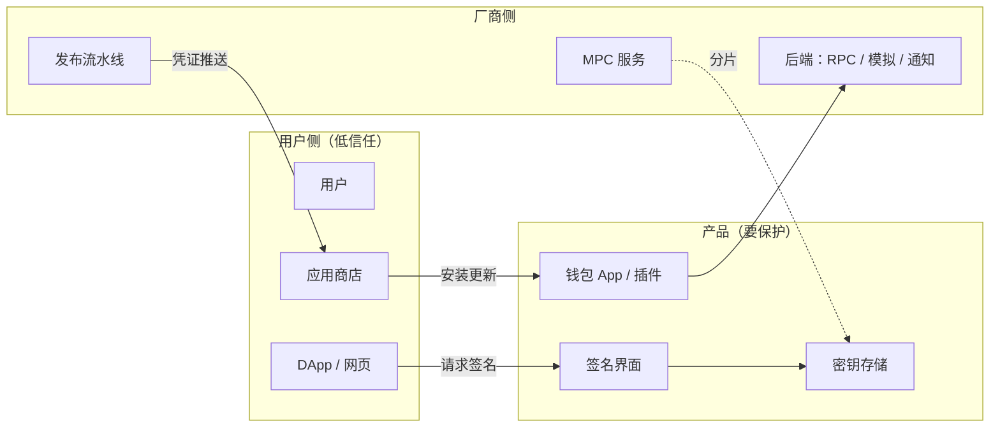
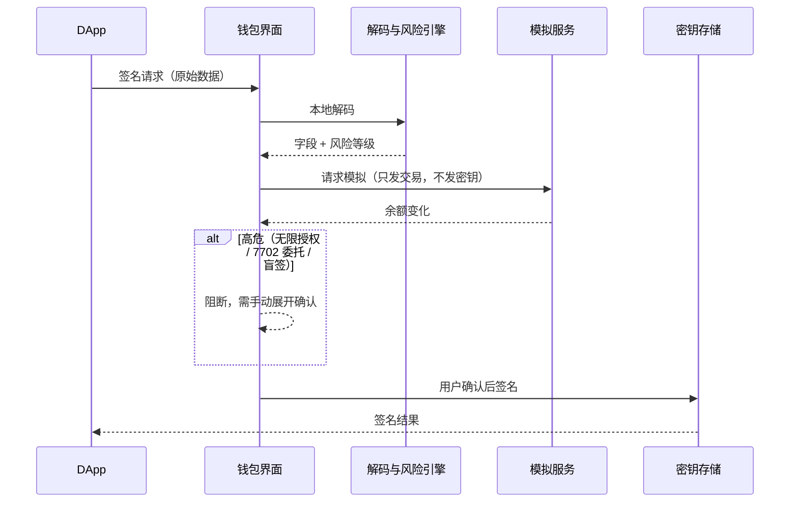
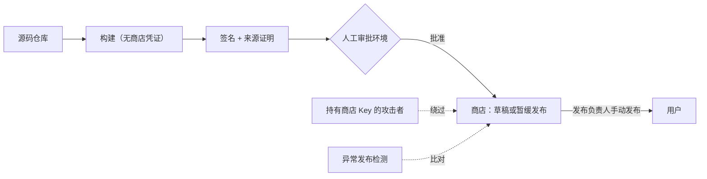
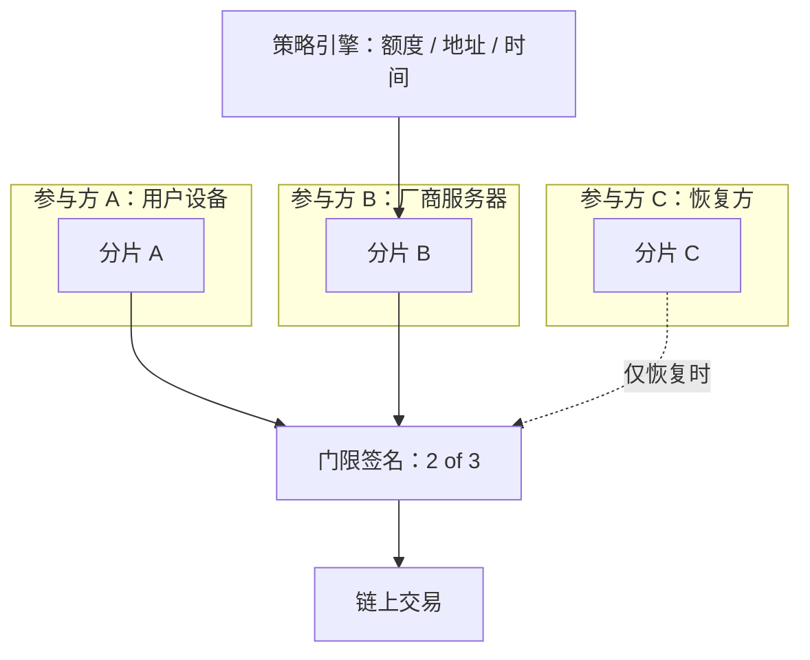

# X37 钱包厂商安全：App、插件、硬件与 MPC 服务

> 学习目标：读完本章，你能——
> 1. 为一款钱包产品（插件、移动 App、硬件、MPC 服务）画出威胁模型，指出"用户的密钥"在哪些环节会被厂商自己弄丢。
> 2. 把钱包产品的发布路径、签名界面和后端服务做成一张控制清单，并写出发布门禁、日志脱敏和异常发布检测的配置。
> 3. 为钱包事故准备好"商店下架、强制升级、用户迁移、赔付"的应急剧本，并做一次 30 分钟桌面推演。
>
> 适用角色：钱包产品的安全负责人、AppSec 工程师、发布负责人、MPC 服务运营者，以及要评估钱包供应商的机构安全人员。
> 前置章节：[15 账户抽象与新钱包范式](../chapters/15-account-abstraction-wallets.md)、[18 钱包与密钥管理](../chapters/18-wallet-key-management.md)、[19 用户侧诈骗](../chapters/19-user-scams.md)、[X04 软件交付与供应链安全](X04-delivery-supply-chain.md)、[X05 检测与响应工程](X05-detection-response-engineering.md)
> 交互实验 / 模板：[phishing-signature-lab.html](../interactive/phishing-signature-lab.html) ｜ 训练营：[B57 钱包与私钥实操](../bootcamp/B57-wallet-key-practice.md)
> 最后核对：2026-11-23

> 💡 注意：本章的配置、规则和数值是"示例"。商店规则、硬件与 MPC 的公开安全结论会变化。落地前以各商店、各厂商的官方最新文档为准。时效事实截至 2026 年公开资料。

---

## 开场：一个没有走审批的版本

2025 年 12 月 24 日，一个版本号为 2.68 的 Trust Wallet 浏览器扩展出现在 Chrome 商店里。Trust Wallet 的团队没有发布过它。

项目方事后说明：攻击者拿到了发布用的商店 API Key。他用这把 Key 直接上传了一个被篡改的构建，绕过了内部的审批和人工评审。这个构建通过了商店的自动审查，并自动发布。恶意代码把用户钱包里的助记词发往攻击者的域名。

<details class="predict"><summary>🤔 先猜再看：钱包插件被替换成恶意版本，用户的"设备"没有任何问题。哪一把钥匙，才是这次事故里真正被偷走的资产？</summary>

不是用户的助记词，也不是合约权限。被偷走的是**厂商的发布凭证**：一把能把代码推到每个用户浏览器里的 Key。用户的助记词只是它的下游。对钱包厂商来说，"发布权"本身就是资金级资产。这也是本章与 [18 章](../chapters/18-wallet-key-management.md) 的分工：18 章讲用户怎样保管自己的钥匙，本章讲厂商怎样保证自己的产品不会变成偷钥匙的工具。

</details>

这类事故的共同点是：用户没有做错任何事。他们按官方渠道安装，按产品提示操作。损失来自产品团队的流程缺口。

---

## 1. 一句话理解

**钱包厂商的安全目标是：不管发生什么，产品都不能在用户不知情时，读取或使用用户的密钥。** 这包括厂商自己的员工、服务器、依赖库和发布渠道。

钱包产品（Wallet Product）：替用户保管私钥或签名能力，并展示、签署链上交易的软件或设备。
发布面（Release Surface）：一个版本从代码到用户设备要经过的所有凭证、系统和商店。
盲签（Blind Signing）：签名时只显示一串哈希或十六进制数据，用户看不到交易的真实含义。

> 🎯 打个比方：钱包厂商像一家锁具厂。用户把家里的钥匙放进厂里造的保险箱。保险箱设计得再好，如果厂里的出货仓库谁都能进，出厂前被人换了一把后门锁，所有买家都会受害。
>
> 比喻的局限：保险箱出厂后基本不变。软件钱包会持续更新，每一次更新都是一次"重新出货"。攻击者不需要攻破锁的设计，只需要等到下一次更新。

本章把钱包厂商要做的事分成五块：产品里的密钥与签名界面、发布与商店、后端服务、MPC 服务运营、漏洞响应与事故。

---

## 2. 保护目标与信任边界

先看四类产品各自把密钥放在哪里。这决定了威胁模型。

| 产品类型 | 密钥在哪 | 厂商能碰到密钥吗 | 主要风险点 |
|---|---|---|---|
| 浏览器插件 | 浏览器本地加密存储 | 不能，但厂商每次更新都能改代码 | 发布凭证、商店账号、依赖投毒、冒牌插件 |
| 移动 App | 手机安全区或加密文件 | 不能，同上 | 日志与崩溃上报、第三方 SDK、冒牌 App、云备份 |
| 硬件钱包 | 安全芯片或微控制器 | 不能 | 固件签名、供应链篡改、物理攻击、配套软件 |
| MPC / 托管型 | 分片分散在用户设备和厂商服务器 | 厂商持有一部分分片 | 分片独立性、协议实现、恢复流程、运营人员 |

> 💡 注意：这里的"不能"是设计目标，不是保证。第 8 节的案例会显示，每一类产品都出现过"厂商的流程让这个目标失效"的事故。



读图要点：
- 要记住：`DApp → 签名界面` 这条线的输入完全不可信。`REL → STORE` 这条线上的凭证，是最集中的单点。
- 后端（`BE`）看得到用户的地址、行为和部分请求，但不应该看得到密钥材料。
- MPC 的虚线表示厂商持有一部分分片，信任关系最复杂，见第 6.5 节。
- 图没有画第三方 SDK 和依赖。它们在 `APP` 和 `REL` 两个方框的内部，是第 6 节的重点。

---

## 3. 参考架构

### 3.1 五个安全域

建议把一款钱包产品的安全工作分成五个域。每个域有自己的负责人和检查项。

| 域 | 范围 | 主要产出 | 与已有章节的分工 |
|---|---|---|---|
| 密钥与客户端 | 密钥生成、存储、随机数、内存、日志、SDK | 安全开发规范、脱敏测试 | 密钥分层见 [18 章](../chapters/18-wallet-key-management.md) |
| 签名界面 | 请求解码、风险提示、阻断、模拟 | 解码规则库、风险策略 | 危险签名类型见 [19 章](../chapters/19-user-scams.md) |
| 发布与渠道 | CI、凭证、商店、固件、更新、下架 | 发布门禁、渠道清单 | 通用方法见 [X04](X04-delivery-supply-chain.md) |
| 后端服务 | RPC、模拟、通知、账号、云备份 | 访问控制、数据最小化 | 通用方法见 [X03](X03-production-infra-security.md) |
| MPC 与恢复 | 分片、协议、恢复流程、运营 | 分片保管规范、恢复演练 | 本章第 6.5 节 |

### 3.2 签名界面是最后一道关口

用户最终看到的签名界面，决定了他签的是什么。界面的数据来源有两条：DApp 传来的请求，和厂商自己解码出的内容。两者必须分开。



读图要点：
- 解码在本地完成，结果以本地为准。服务端的模拟只做补充，不能让服务端决定"能不能签"。
- 模拟服务只接收交易内容，不接收任何密钥材料。
- 高危类型默认阻断。让用户"多点一次"不是阻断，要让他看到具体字段。
- 局限：模拟能被"条件触发"的合约绕过（模拟时无害，上链时有害）。所以模拟是提示，不是证明。

### 3.3 发布路径要拆成三段

钱包的发布路径与普通软件相同，但后果更重。建议拆成三段，每段用不同的凭证：

1. **构建**：CI 在隔离环境里构建，只带"读源码"的权限，不带商店凭证。
2. **签名与来源证明**：构建产出的制品由独立的签名步骤签名，并写入来源证明。
3. **提交商店**：由需要人工审批的环境来调用商店接口。商店凭证只存放在这个环境里。

通用做法见 [X04](X04-delivery-supply-chain.md)。本章只补钱包特有的部分：多个渠道（Chrome、Firefox、Edge、App Store、Google Play、官网下载）要有统一清单，每个渠道有负责人和独立的下架流程。



读图要点：
- 正常路径经过审批环境。攻击者拿到商店 Key 时，会直接走虚线，所以必须有"商店里出现了什么"的独立检测。
- 检测的数据来自商店本身，而不是来自你自己的流水线日志。流水线日志里没有攻击者的发布。
- 局限：如果攻击者同时拿到发布负责人的商店账号，"手动发布"这一步也会被绕过。账号多因素和成员最小化仍然需要。

---

## 4. 控制清单

优先级：P0 为上线前必须有；P1 为一个季度内要有；P2 为成熟阶段的增强。

| ID | 控制项 | 要防什么 | 优先级 | 怎么验证 |
|---|---|---|---|---|
| WLT-1 | 助记词、私钥、签名原文在日志、崩溃上报、遥测里被屏蔽 | 密钥通过日志泄露 | P0 | 用测试助记词跑全流程，在日志后端全文搜索 |
| WLT-2 | 随机数只用操作系统或硬件的安全随机源，禁止用普通伪随机数 | 可枚举的密钥空间 | P0 | 代码扫描禁用函数；每个平台一条熵测试 |
| WLT-3 | 第三方 SDK 有清单，且无 SDK 能访问密钥或签名界面 | SDK 读取或外传密钥 | P0 | 对照 SDK 清单；抓包检查外联域名 |
| WLT-4 | 发布凭证（商店 API Key、签名密钥）只存放在需审批的发布环境 | 凭证被盗后直接发布 | P0 | 审阅 CI 凭证位置；演练"没有审批能否发布" |
| WLT-5 | 商店开发者账号启用强多因素，成员最少，离职当天移除所有发布相关账号和令牌 | 账号接管、离职账号残留 | P0 | 季度账号核对表 |
| WLT-6 | 所有发布渠道有统一清单：账号、负责人、下架联系人 | 出事时找不到人 | P0 | 打开清单，30 秒内找到任一渠道的下架入口 |
| WLT-7 | 签名请求本地解码；对无限授权、批量授权、委托、盲签默认阻断或强警告 | 用户被骗签名 | P0 | 用 [19 章](../chapters/19-user-scams.md) 的危险签名样本逐类测试 |
| WLT-8 | 构建可复现，制品有来源证明，发布前哈希与评审版本一致 | 发布的不是评审过的 | P1 | 在两台干净机器上重建并比较哈希 |
| WLT-9 | 依赖锁定到提交或哈希，新增依赖需评审，禁止运行时加载远程可执行代码 | 依赖投毒、远程代码替换 | P1 | 扫描清单文件和包内的外部脚本引用 |
| WLT-10 | 发布异常检测：商店出现未经内部流水线产生的版本，即时告警 | 绕过流程的发布 | P1 | 演练：手工上传一个测试版本，计时告警 |
| WLT-11 | 紧急下架与强制升级剧本，含各渠道联系方式、回滚版本和用户通知模板 | 响应太慢 | P1 | 季度桌面推演，记录各步骤耗时 |
| WLT-12 | 后端服务不接收密钥材料；请求日志按最小化保留 | 后端成为密钥或隐私汇聚点 | P1 | 抽样检查接口和日志字段 |
| WLT-13 | RPC、模拟、通知服务的账号与权限分离，生产访问需审批 | 后端被攻破后扩大影响 | P1 | 对照 [X03](X03-production-infra-security.md) 的检查 |
| WLT-14 | 云备份与恢复功能经过独立威胁建模；默认设备端加密，服务端不持有可解密材料 | 备份扩大信任边界 | P1 | 威胁建模记录；渗透测试范围含备份 |
| WLT-15 | MPC 的各个分片分属不同的人、不同的账号、不同的云或硬件 | 名义门限 | P0（MPC 产品） | 画分片归属图，检查有无同一管理员或同一云账户 |
| WLT-16 | MPC 协议使用经审计的实现，并对照原论文检查"失败签名"等边界处理 | 协议实现偏离导致泄露分片 | P0（MPC 产品） | 审计报告；对照论文的差异清单 |
| WLT-17 | MPC 恢复流程有冷静期、多因素和人工复核边界，并被红队测试 | 恢复变成后门 | P0（MPC 产品） | 红队用社工方式尝试恢复；记录结果 |
| WLT-18 | 公开的安全联系入口和漏洞披露政策，含安全港条款 | 研究员找不到人，只能公开 | P1 | 发一封测试报告，计算首次响应时间 |
| WLT-19 | 硬件钱包固件签名密钥离线保管、双人控制；设备端校验固件签名 | 恶意固件 | P0（硬件产品） | 审阅密钥仪式记录；改一个字节的固件应被拒绝 |
| WLT-20 | 配套软件的下载页和首次使用流程有来源提示；官方说明"不要求输入助记词" | 冒牌软件诱导输入助记词 | P1 | 抽查官网、商店文案和设备首次使用流程 |
| WLT-21 | 品牌监测：商店、搜索广告、社交账号里出现冒牌产品时有发现和投诉流程 | 冒牌 App 骗走助记词 | P1 | 每周检索商店；记录投诉到下架的耗时 |
| WLT-22 | 事故赔付和用户迁移预案：何时触发、怎样核实、由谁批准 | 事故后的二次混乱 | P2 | 桌面推演含赔付决策 |

---

## 5. 分级落地

| 档位 | 团队规模（示例） | 做什么 | 时间（示例） |
|---|---|---|---|
| 最小可行 | 1 名兼职安全 + 开发 3–10 人 | 做 WLT-1、2、4、5、6、7。核心是：日志脱敏、发布凭证收口、渠道清单、危险签名阻断 | 4–6 周 |
| 标准 | 1–2 名专职安全 + 平台工程师 | 在上面基础上做 WLT-3、8、9、10、11、12、13、18、21。核心是：发布异常告警和下架剧本能跑通 | 一个季度 |
| 成熟 | 安全团队 + 红队 + 外部审计 | 做齐全部控制，含 MPC / 硬件专项（WLT-14 至 17、19、20）、定期红队、赔付预案 | 持续运营 |

> 💡 注意：不论哪一档，WLT-4（发布凭证收口）都应第一周开始。它的成本最低，对应的事故后果最大。

---

## 6. 落地做法

### 6.1 密钥与客户端

**步骤：**

1. 列出所有"密钥材料"的数据类型：助记词、私钥、种子、Keystore 密码、签名原文。
2. 在日志、崩溃上报、遥测的采集端写拦截器。不要在后端清洗，因为数据已经离开设备。
3. 用测试助记词跑完创建、导入、签名、备份的全流程。
4. 在日志后端和崩溃平台里全文搜索这个测试助记词。找到就是缺陷。

下面是一个崩溃上报的脱敏示例（JavaScript，示意）：

```javascript
// 示例：上报前的拦截器。在设备端执行，不要依赖后端清洗。
const HEX_KEY = /\b(0x)?[0-9a-fA-F]{64}\b/g;

function scrub(text, wordlist) {
  // 1) 64 位十六进制：可能是私钥或签名原文
  let out = text.replace(HEX_KEY, "[REDACTED_HEX]");
  // 2) 连续 12 个及以上的助记词单词
  const tokens = out.split(/\s+/);
  let run = 0;
  for (let i = 0; i < tokens.length; i++) {
    if (wordlist.has(tokens[i].toLowerCase())) run++; else run = 0;
    if (run >= 12) {
      for (let j = i - run + 1; j <= i; j++) tokens[j] = "[REDACTED_WORD]";
      run = 0;
    }
  }
  return tokens.join(" ");
}

Sentry.init({
  beforeSend(event) {
    event.message = scrub(event.message || "", BIP39_SET);
    // 面包屑、请求体、额外字段都要处理；更稳妥的做法是不采集输入框内容
    event.breadcrumbs = [];
    return event;
  },
});
```

> 💡 注意：正则只是兜底。最稳的做法是密钥材料从不进入任何字符串拼接路径，并且不采集输入框内容和剪贴板。

**随机数检查：** 每个平台写一条测试，断言熵来自操作系统的安全随机源，并在代码扫描里禁用普通伪随机数函数。Trust Wallet 浏览器扩展的随机数缺陷就是这类问题：Ledger Donjon 的分析指出，该扩展的 WebAssembly 构建用 Mersenne Twister 生成随机数，种子只有 32 位，可以预先算出全部可能的助记词。详见第 8 节案例 3。

**第三方 SDK：** 做一张清单：SDK 名称、版本、用途、网络外联域名、是否在签名页面加载。原则是：签名页面和密钥页面不加载任何统计、广告或客服 SDK。

### 6.2 发布与商店

**门禁一：发布凭证收口。** 下面是一个 GitHub Actions 的示例。构建任务没有商店凭证。商店凭证只存放在名为 `store-release` 的环境里，该环境要求两名评审人批准。

```yaml
# 示例：构建与发布分离。商店凭证只在 store-release 环境中可见。
name: release-extension
on:
  push:
    tags: ["v*"]

permissions:
  contents: read

jobs:
  build:
    runs-on: ubuntu-24.04
    outputs:
      sha256: ${{ steps.hash.outputs.sha256 }}
    steps:
      - uses: actions/checkout@<完整 40 位提交哈希>
      - run: npm ci --ignore-scripts
      - run: npm run build:extension
      - id: hash
        run: echo "sha256=$(sha256sum dist/extension.zip | cut -d' ' -f1)" >> "$GITHUB_OUTPUT"
      - uses: actions/upload-artifact@<完整 40 位提交哈希>
        with: { name: extension, path: dist/extension.zip }

  submit-to-store:
    needs: build
    runs-on: ubuntu-24.04
    environment: store-release      # 仓库设置里要求 2 名评审人，并限制只能从 v* 标签触发
    steps:
      - uses: actions/download-artifact@<完整 40 位提交哈希>
        with: { name: extension }
      - name: 校验哈希与构建任务一致
        run: |
          test "$(sha256sum extension.zip | cut -d' ' -f1)" = "${{ needs.build.outputs.sha256 }}"
      - name: 提交到商店（存为草稿，不自动发布）
        env:
          STORE_CLIENT_ID: ${{ secrets.STORE_CLIENT_ID }}
          STORE_REFRESH_TOKEN: ${{ secrets.STORE_REFRESH_TOKEN }}
        run: ./tools/upload-to-store.sh extension.zip --draft-only
```

要点：
1. 商店凭证只出现在 `submit-to-store`，且需要人工审批。
2. 提交时存为草稿或"暂缓发布"，由发布负责人在商店控制台手动点击发布。Chrome 商店官方文档写明，审查通过后可以取消自动发布，之后手动发布；审查通过后有 30 天的发布窗口（截至 2026 年公开资料，以官方文档为准）。
3. Chrome 商店要求开发者账号启用两步验证，但这只是账号层面的最低要求。Ledger 事件里，攻击者用与账号关联的 API Key 绕过了双因素（见案例 2）。所以长期有效的 Key 本身要收口。

**门禁二：禁止远程可执行代码。** Chrome 商店 Manifest V3 的要求是：扩展的全部逻辑必须在提交的包内，不能加载并执行外部来源的代码。这既是商店规则，也是安全设计：它让"审查通过的就是运行的"。示例 manifest 片段：

```json
{
  "manifest_version": 3,
  "content_security_policy": {
    "extension_pages": "script-src 'self'; object-src 'self'"
  }
}
```

> ⚠️ 警告：钱包界面在运行时从你自己的服务器拉取脚本来渲染，会让"发布评审"变成"服务器上的任何改动"。2023 年 12 月 Ledger Connect Kit 事件的关键点之一，就是下游 DApp 通过 CDN 实时加载这个库，没有人工放行环节。

**门禁三：异常发布检测。** 下面是一条检测规则（伪 SQL，示意）。它比较商店里出现的版本和内部流水线批准的版本。

```sql
-- 示例：每 15 分钟运行。
-- 数据源 1：商店版本列表（轮询商店接口，或定期下载商店里的包并计算哈希）。
-- 数据源 2：内部发布系统的"已批准发布"记录。
SELECT s.channel, s.version, s.first_seen_at
FROM store_listing_versions s
LEFT JOIN approved_releases a
  ON a.channel = s.channel AND a.version = s.version AND a.package_sha256 = s.package_sha256
WHERE a.version IS NULL
  AND s.first_seen_at > now() - interval '30 minutes';
-- 结果非空即 P1 告警：呼叫发布负责人，按下架剧本处理。
-- 假阳性：商店重写包元数据；人工紧急发布未登记。调优：紧急发布也必须先登记。
```

**冒牌应对：** 每周在每个商店、搜索广告和社交平台检索产品名及常见错拼。发现冒牌后：

1. 截图并保存证据。
2. 通过商店的侵权或冒充渠道投诉。
3. 在官网和社交账号发警示。
4. 把冒牌分发域名通知浏览器和域名黑名单服务。
5. 把"投诉到下架"的耗时记为指标。

> 💡 注意：硬件钱包厂商要在官方文案里写清楚"官方软件从哪里下载"和"官方永远不会要求输入助记词"。2026 年 4 月，有报道称一个假冒 Ledger Live 的应用出现在苹果应用商店里（案例 5）。商店审核不等于官方渠道。

### 6.3 签名界面

建议把解码规则做成可测试的规则库，每条规则有"输入样本、期望展示、风险等级"。下面是一个示例策略（YAML，示意）：

```yaml
# 示例：签名请求风险策略。action 取值：allow / warn / block_by_default
rules:
  - id: SIG-APPROVE-UNLIMITED
    match: { method: eth_sendTransaction, selector: "0x095ea7b3", amount_gte: "2^255" }
    action: warn
    show: [spender, token, amount, spender_is_contract, spender_age_days]
  - id: SIG-SETAPPROVALFORALL
    match: { selector: "0xa22cb465", approved: true }
    action: warn
  - id: SIG-PERMIT-OFFCHAIN
    match: { method: eth_signTypedData_v4, primaryType: [Permit, PermitSingle, PermitBatch] }
    action: warn
    show: [spender, token, amount, deadline]
  - id: SIG-7702-DELEGATION
    match: { type: eip7702_authorization }
    action: block_by_default   # 展示委托合约地址、链 ID、是否跨链有效；用户需手动展开确认
  - id: SIG-RAW-HASH
    match: { method: [eth_sign, personal_sign], payload_is_32_byte_hash: true }
    action: block_by_default   # 盲签：只显示哈希，用户无法理解
```

这些规则对应 [19 章](../chapters/19-user-scams.md) 的危险签名类型和 [15 章](../chapters/15-account-abstraction-wallets.md) 的 7702 风险。验证方法：用样本库逐条回放，检查界面展示的字段和等级。样本库进版本管理，每次出现新的钓鱼样式，就加一条样本。可以用[钓鱼签名实验](../interactive/phishing-signature-lab.html)生成样本思路。

硬件钱包的原则更严：设备屏幕必须独立解析交易，不依赖电脑或手机上的配套软件。WazirX 事件中公开争议的焦点之一，是签名人看到的界面与实际签名内容不一致（见 [18 章](../chapters/18-wallet-key-management.md)）。Ledger 在 2023 年 12 月的事故报告里，把"去掉盲签选项、推广清晰签名"列为后续方向。

### 6.4 后端服务

钱包后端通常有：RPC 网关、交易模拟、推送通知、账号与云备份、价格和代币列表。运营安全的重点：

1. **数据最小化。** RPC 网关会看到"某个 IP 查询了某个地址"。缩短地址与 IP 关联日志的保留期，并限制访问。
2. **代币列表与价格源是信任输入。** 恶意列表能让钱包展示假余额或假代币。列表的变更要有评审和审计记录。
3. **推送通知不是安全通道。** 钓鱼者会仿冒通知。通知里不放"点击确认"类链接。
4. **云备份。** 如果提供备份，默认应在设备端用用户控制的密钥加密，服务端拿不到明文。对备份和恢复做独立威胁建模，因为它会扩大密钥的信任边界。公开争议见 [18 章](../chapters/18-wallet-key-management.md) 对 Ledger Recover 的摘要。

访问控制和机密管理的通用方法见 [X03](X03-production-infra-security.md)。

### 6.5 MPC 服务运营

MPC（Multi-Party Computation，多方计算）：多个参与方各持一个密钥分片，共同完成签名，任何一方都拿不到完整私钥。



读图要点：
- 门限签名里，任意两个分片配合即可签名。如果 B 和 C 在同一个管理员或同一个云账户之下，攻击者拿到那个账户，就等于拿到两个分片。
- 策略引擎在厂商这一侧。它能拒绝签名，但不能替代协议本身的正确性。
- 局限：图只画了分片的归属，没有画协议的实现细节。协议的实现错误会让"任何一方拿不到私钥"的前提失效。

MPC 服务的运营控制，围绕四件事：

1. **分片独立性（WLT-15）。** 画一张分片归属图：每个分片由谁管理、在哪个云账户或硬件里、用哪个身份访问。检查有没有"同一个人或同一个账户能碰到两个分片"。[18 章](../chapters/18-wallet-key-management.md) 的 Multichain 案例就是这类失败：分片服务器都在同一个人的云账户下，门限只是名义上的。
2. **协议实现（WLT-16）。** 只用经过独立审计的实现。对照原论文逐项检查：失败签名怎么处理、零知识证明有没有省略、参数范围检查是否完整。案例 4 的 BitForge 就是"实现偏离论文"的实例。
3. **恢复流程（WLT-17）。** 恢复是 MPC 钱包最大的后门。建议：恢复请求先进入冷静期；通知所有已绑定的设备和联系方式；要求至少两种独立的验证因素；高额账户的恢复要人工复核；复核人员看到的客户信息要受限，且复核动作留痕。用红队按社工方式测试：能不能靠一通电话改掉恢复方式。
4. **运营人员权限。** 厂商侧分片的访问必须有双人控制和会话记录。人员变动要在当天撤销权限。

> 💡 注意：MPC 与多签不是同一件事。多签在链上可见，每个签名人单独出签名。MPC 在链上只有一个普通签名，规则在链下。对用户来说，MPC 钱包的"策略"是否生效，取决于厂商的运营，所以它的信任关系更依赖厂商。选择取舍见 [29 签名路径](../chapters/29-signing-path-2026.md)。

### 6.6 硬件钱包补充

硬件钱包的特有控制：

1. **固件签名（WLT-19）。** 固件签名密钥离线保管，双人控制。设备启动时校验固件签名。用"改一个字节"的固件测试设备是否拒绝。
2. **供应链。** 设备出厂到用户手里要经过制造、物流、零售。要有防拆封和首次使用的真伪校验步骤，并写进说明书。
3. **物理攻击。** 故障注入、侧信道属于公开研究的范围。厂商应当为这类研究者提供披露渠道，并把"需要物理接触"与"远程可利用"分开分级。
4. **配套软件。** 配套软件会被冒牌。把官方下载入口和校验方法写在设备首次使用流程里，而不只写在官网（WLT-20）。

### 6.7 漏洞响应与披露

1. 设立公开的安全联系入口和披露政策（通用流程见 [X36](X36-disclosure-bounty-ops.md)）。
2. 研究员报告后 1 个工作日内确认收到（示例 SLA）。
3. 严重度判断要包含"是否可能泄露密钥或使用密钥"，这类问题一律从最高级处理。
4. 修复后要问：已经创建的钱包怎么办？Trust Wallet 的随机数事件说明：修好代码不够，已生成的弱密钥要通知用户迁移资金。
5. 公告要写：影响范围、受影响版本、用户要做什么、什么时候做。

### 6.8 常见坑

- 只保护了钱包里的密钥，没有保护商店账号和 CI 里的 API Key。
- 把"商店审查通过"当作安全验证。审查不检查代码是不是你自己发的。
- 渠道清单只有"官网和 Chrome"，漏了 Edge、Firefox、旧账号下残留的 App。
- 崩溃上报接了一个新的 SDK，没人评审它采集什么。
- 紧急剧本写了，但联系人已经离职。

---

## 7. 运营：指标、告警、值班、演练、季度节奏

### 7.1 指标

| 指标 | 含义 | 目标（示例） |
|---|---|---|
| 异常发布发现时间 | 从商店出现未批准版本到告警 | < 15 分钟 |
| 紧急下架完成时间 | 从确认恶意版本到各渠道下架或替换 | < 2 小时（按渠道分别统计） |
| 发布凭证覆盖率 | 在需审批环境里存放的发布凭证占比 | 100% |
| 离职账号清理时间 | 离职到所有发布相关账号被移除 | 当天 |
| 日志脱敏测试通过率 | 测试助记词在日志后端被搜到的次数 | 0 |
| 冒牌产品下架耗时 | 从发现到商店下架 | 持续记录，看趋势 |
| 漏洞首次响应时间 | 从收到报告到首次回复 | < 1 个工作日 |

### 7.2 告警与值班

- P1：商店出现未批准版本；发布凭证在非预期环境被使用；用户大量反馈助记词丢失。
- P2：新增第三方 SDK 外联域名；渠道账号新增成员；冒牌产品出现。
- 值班：P1 要有发布负责人、安全负责人、公关负责人三个人在 15 分钟内可联系上。通用值班与升级方法见 [X05](X05-detection-response-engineering.md)。

### 7.3 演练

每季度做一次 30 分钟的桌面推演，脚本见第 13 节练习 2。每半年做一次真实动作演练：在测试渠道里，故意上传一个"未批准版本"，检查告警和下架流程是否走通。通用演练方法见 [X06](X06-resilience-validation.md)。

### 7.4 季度节奏

| 周 | 动作 |
|---|---|
| 第 1–2 周 | 渠道清单核对；商店账号成员核对；离职人员清理 |
| 第 3–4 周 | 签名规则库回放；新增钓鱼样本入库 |
| 第 5–8 周 | 依赖与 SDK 评审；脱敏测试；第三方 SDK 外联抓包 |
| 第 9–10 周 | 桌面推演；演练发布异常告警 |
| 第 11–12 周 | MPC 分片归属图复核；季度报告 |

---

## 8. 失效案例

> 💡 注意：以下每个案例只写摘要和教训。金额为事发时美元估值，均来自公开来源。完整复盘见《Web3 行业安全资损 101》。

### 案例 1：Trust Wallet 浏览器扩展 v2.68（2025 年 12 月，多链）——发布 Key 被盗，绕过审批

- 项目方公告称：2025 年 11 月 Sha1-Hulud npm 供应链事件暴露了团队的 GitHub secrets，攻击者因此拿到源码和 Chrome 商店 API Key。项目方称"有高度把握"事件与之有关，调查仍在进行。
- 12 月 24 日，恶意 v2.68 绕过内部审批发布，通过商店审查后自动上线，引用了攻击者域名上的代码。公告称 2,520 个地址被盗，约 850 万美元（截至公告时）。项目方回滚到干净版本并发布 v2.69，并表示将赔付。
- 失效的控制：WLT-4（凭证收口）、WLT-10（异常发布检测）。
- 教训：发布凭证与资金同级。商店 Key 要放进需审批的环境，商店里出现未经批准的版本要能被即时发现。
- 来源类型：项目方公告。[Trust Wallet 公告](https://trustwallet.com/blog/announcements/trust-wallet-browser-extension-v268-incident-community-update)。

### 案例 2：Ledger Connect Kit（2023 年 12 月，多链）——前员工的 npm 账号

- Ledger 在 2023 年 12 月 20 日的事故报告中说：攻击者钓鱼了一名前员工，拿到他的 npm 账号，并用与账号关联的 API Key 绕过了双因素。Ledger 已撤销该员工对内部和其他外部系统的权限，但漏掉了 npm，因为外部工具需要手工移除。
- 12 月 14 日，恶意版本 1.1.5 至 1.1.7 发布，带有 Angel Drainer 的代码，诱导使用该库的 DApp 的用户签署授权。Ledger 称 13:45（CET）得知，约 40 分钟内部署了修复版本，估计资产被主动抽走的时间不到 2 小时。媒体引述 Ledger 声明，用户损失约 60 万美元（Ledger 报告本身未给出总额）；Tether 冻结了攻击者的部分 USDT。
- 失效的控制：WLT-5（离职当天移除所有账号）、WLT-9（不让下游实时加载未评审的代码）。
- 教训：外部工具也要进入离职清单。让下游 DApp 实时加载你的库，等于把你的发布账号变成了他们的发布账号。Ledger 在报告中列出的改进包括：把所有外部工具加入离职检查、扩大代码签名、做第三方访问控制审计、去掉盲签选项。
- 来源类型：厂商事故报告、媒体报道。[Ledger 事故报告](https://www.ledger.com/blog/security-incident-report)、[The Hacker News](https://thehackernews.com/2023/12/crypto-hardware-wallet-ledgers-supply.html)。

### 案例 3：Trust Wallet 浏览器扩展的 32 位种子（2022 年 11 月报告，2023 年 4 月公开）——随机数

- Ledger Donjon 的公开文章说：2022 年 11 月 17 日，他们通过赏金计划向 Binance 报告。扩展的 WebAssembly 构建用 Mersenne Twister 伪随机数生成器，种子只有 32 位，约 43 亿种；原生 iOS 和 Android 构建用的是系统安全随机源，不受影响。
- 研究员预先算出全部种子对应的地址，再扫描链上已用地址，用户无需任何操作就可能被盗。NVD 记录该缺陷（CVE-2023-31290），并称它在 2022 年 12 月和 2023 年 3 月被在野利用。修复在 Trust Wallet Core 3.1.1 和扩展 0.0.183。
- 失效的控制：WLT-2（安全随机源）。
- 教训：同一个核心库编译到不同平台，随机源可能不同，每个平台都要有熵测试。修复代码之后，已创建的弱钱包要通知用户迁移资金。
- 来源类型：安全研究方公开分析、漏洞库。[Ledger Donjon 文章](https://www.ledger.com/blog/Funds-of-every-wallet-created-with-the-Trust-Wallet-browser-extension-could-have-been-stolen)、[NVD CVE-2023-31290](https://nvd.nist.gov/vuln/detail/CVE-2023-31290)。

### 案例 4：BitForge（2023 年 8 月披露，MPC 钱包实现）——实现偏离协议

- Fireblocks 研究团队在 2023 年 8 月披露：GG-18 和 GG-20 协议的部分实现缺少必要的零知识证明；Lindell17 的部分实现偏离了学术论文，处理失败签名时泄露了部分私钥信息。公告称超过 15 家钱包提供方、区块链和开源项目受影响，攻击者需要有特权访问。某些实现中提取密钥需要的签名次数少至 16 次；Lindell17 约需 200 次签名请求。
- 披露流程为 90 天。公告点名 Coinbase WaaS 和 Zengo 修复较快。公开资料中没有看到已被利用的报告。Fireblocks 称自家协议不受影响，这是厂商自己的说法。
- 失效的控制：WLT-16（协议实现对照论文）。
- 教训：用 MPC 不等于安全。要问供应商用的是什么协议、谁审计、怎样处理失败签名。
- 来源类型：安全公司研究公告、媒体报道。[Fireblocks 研究博客](https://www.fireblocks.com/blog/bitforge-fireblocks-researchers-uncover-vulnerabilities-in-over-15-major-wallet-providers)、[BleepingComputer](https://www.bleepingcomputer.com/news/cryptocurrency/new-bitforge-cryptocurrency-wallet-flaws-lets-hackers-steal-crypto/)。

### 案例 5：假冒 Ledger Live 的应用（2026 年 4 月，苹果应用商店）——冒牌渠道

- 链上调查者 ZachXBT 称：2026 年 4 月 7 日至 13 日，一个假冒 Ledger Live 的应用在苹果应用商店出现，期间超过 50 名疑似受害者损失约 950 万美元；4 月 13 日该应用被下架。Cointelegraph 报道时，苹果没有公开说明，总额和受害人数来自 ZachXBT 的调查，未经第三方确认。
- 公开报道称，一名音乐人输入 24 个助记词后损失约 42 万美元的比特币（各报道的美元估值略有差异）。Ledger 的技术负责人称，Ledger 从不要求用户输入 24 个词，并提醒用户不能信任软件环境，包括应用商店。
- 失效的控制：WLT-20、WLT-21（来源提示与冒牌监测）。
- 教训：硬件钱包厂商不能只依赖商店审核。要在设备首次使用流程里告诉用户官方来源，并主动检索冒牌。
- 来源类型：链上调查者公开分析、媒体报道。[Cointelegraph](https://cointelegraph.com/news/fake-ledger-app-apple-app-store-9-5m-crypto-theft-zachxbt)。

> 💡 注意：硬件钱包的物理攻击研究也在持续出现。例如 Ledger Donjon 对 Trezor Safe 3 的评估（Trezor 安全门户记载为 2024 年 11 月报告）显示，针对供应链篡改的部分防护可以被已知手法绕过；Trezor 称 Safe 5 使用更新的微控制器。这类研究通常需要物理接触，厂商的做法是公开披露并说明分级。来源：[Trezor 安全门户](https://trezor.io/vulnerability/donjon-s-trezor-safe-3-evaluation)。

### 案例映射

| 案例 | 失效的控制 | 如果这条控制有效 |
|---|---|---|
| Trust Wallet v2.68 | WLT-4、WLT-10 | 凭证在审批环境里，攻击者拿不到；即使拿到，未批准版本会在 15 分钟内告警 |
| Ledger Connect Kit | WLT-5、WLT-9 | 前员工账号当天被移除；下游不会实时加载未评审的代码 |
| Trust Wallet 32 位种子 | WLT-2 | 每个平台的熵测试会暴露 Wasm 构建的问题 |
| BitForge | WLT-16 | 对照论文的审计会发现缺失的证明 |
| 假冒 Ledger Live | WLT-20、WLT-21 | 用户在首次使用时被告知官方来源；冒牌更快被发现和投诉 |

---

## 9. 评估检查点

- [ ] **WLT-1** 用测试助记词跑完创建、导入、签名、备份，在日志和崩溃平台里搜不到它。
- [ ] **WLT-2** 每个平台的随机源都是系统安全随机源；有熵测试。
- [ ] **WLT-3** 有第三方 SDK 清单；签名和密钥页面不加载任何统计或客服 SDK。
- [ ] **WLT-4** 商店 API Key 和签名密钥只在需审批的环境里；构建任务拿不到它们。
- [ ] **WLT-5** 商店开发者账号启用强多因素；成员最少；离职当天移除。
- [ ] **WLT-6** 有全渠道清单：账号、负责人、下架入口。
- [ ] **WLT-7** 无限授权、批量授权、7702 委托、盲签默认阻断或强警告；有样本回放测试。
- [ ] **WLT-8** 构建可复现；发布前哈希与评审版本一致。
- [ ] **WLT-9** 依赖锁定；新增依赖需评审；不运行时加载远程可执行代码。
- [ ] **WLT-10** 商店出现未批准版本会在 15 分钟内告警（已演练）。
- [ ] **WLT-11** 紧急下架和强制升级剧本已演练，联系人有效。
- [ ] **WLT-12** 后端不接收密钥材料；日志字段经抽样检查。
- [ ] **WLT-13** 后端服务账号与权限分离；生产访问需审批。
- [ ] **WLT-14** 云备份与恢复功能有独立威胁建模；服务端拿不到可解密明文。
- [ ] **WLT-15** MPC 分片归属图显示无同一人或同一账户能碰到两个分片。
- [ ] **WLT-16** MPC 实现经独立审计，并对照原论文检查过边界处理。
- [ ] **WLT-17** 恢复流程有冷静期、多因素和人工复核，并被红队社工测试过。
- [ ] **WLT-18** 有公开的安全联系入口和披露政策；测试报告在 1 个工作日内得到回复。
- [ ] **WLT-19** 固件签名密钥离线保管、双人控制；改一个字节的固件被设备拒绝。
- [ ] **WLT-20** 设备首次使用流程和官网都写明官方来源和"官方不要求输入助记词"。
- [ ] **WLT-21** 每周检索冒牌产品，记录投诉到下架的耗时。
- [ ] **WLT-22** 有赔付与用户迁移预案，含触发条件和批准人。

把结果写进报告：

| 检查项 | 结果（通过 / 部分 / 缺失 / 不适用） | 证据（文件、截图、演练记录） | 负责人 | 整改日期 |
|---|---|---|---|---|
| WLT-1 | | | | |
| …逐项填写 | | | | |

---

## 10. 上手路径

**第一周**
1. 列出所有发布渠道（商店、官网、固件下载），做成清单，写上账号、负责人和下架入口（WLT-6）。
2. 找出所有发布凭证的存放位置：CI 密钥、开发者个人电脑、密码管理器（WLT-4）。
3. 核对商店开发者账号成员，移除离职人员，确认多因素（WLT-5）。
4. 用测试助记词跑一遍产品，在日志里搜它（WLT-1）。

**第一个月**
1. 把商店凭证迁入需审批的发布环境，构建与发布分离（6.2 的示例）。
2. 写异常发布检测，演练一次"未批准版本"（WLT-10）。
3. 建签名规则库和样本回放（WLT-7）。
4. 做第三方 SDK 清单并抓包检查外联域名（WLT-3）。
5. 开通公开的安全联系入口（WLT-18）。

**第一个季度**
1. 做一次完整的桌面推演，含商店下架和赔付决策（WLT-11、22）。
2. 建可复现构建和来源证明（WLT-8）。
3. 若有 MPC 或硬件产品：画分片归属图，复核协议实现和恢复流程，做固件签名测试（WLT-15 至 17、19）。
4. 向管理层汇报：指标、缺口、已接受风险。

---

## 11. 常见误区

| 误区 | 实际情况 |
|---|---|
| "密钥只在用户设备上，我们厂商没风险" | 厂商能通过更新改变设备上的代码。发布权就是风险 |
| "商店审查通过就安全" | 审查不检查"是不是你自己发的"。Trust Wallet 的恶意版本通过了审查 |
| "我们用 MPC，所以没有单点" | 分片在同一个账号下就是单点；协议实现也可能有缺陷 |
| "日志脱敏交给后端做" | 数据已经离开了设备。要在采集端做 |
| "硬件钱包不会出事" | 固件、配套软件、供应链和冒牌渠道都有风险，物理攻击研究也在持续出现 |
| "做了多因素验证就够了" | Ledger 事件里，攻击者用与账号关联的 API Key 绕过了双因素 |
| "冒牌产品是商店的责任" | 用户会把损失算在你的品牌上。要主动检索和投诉 |

---

## 12. 术语表

| 术语 | 英文 | 定义 |
|---|---|---|
| 发布面 | Release Surface | 一个版本从代码到用户设备经过的所有凭证、系统和商店 |
| 盲签 | Blind Signing | 签名时只显示哈希或十六进制数据，用户看不到交易含义 |
| 清晰签名 | Clear Signing | 在签名界面展示可读的交易字段 |
| MPC | Multi-Party Computation | 多方各持分片，共同签名，任何一方拿不到完整私钥 |
| 门限签名 | Threshold Signature | 达到约定数量的分片才能签名，如 2-of-3 |
| 来源证明 | Provenance | 说明制品由哪个仓库、提交和流水线构建的签名声明 |
| 安全随机源 | CSPRNG | 适合密码学用途的随机数生成器 |
| 固件 | Firmware | 硬件设备里的底层软件 |
| 冒牌产品 | Impersonating App | 仿冒官方名称、图标的应用或插件 |
| 安全港 | Safe Harbor | 承诺善意报告漏洞的研究员不被追责的条款 |

---

## 13. 动手练习与思考题

**练习 1：画你的发布面。** 选一款你熟悉的钱包产品（可以用公开资料假设）。画一张图：从代码仓库到每个商店和下载渠道，标出每一段的凭证。圈出"一把凭证能直接发布"的位置。再写出：如果这把凭证被盗，多久能发现？

**练习 2：30 分钟桌面推演。** 场景：周五晚上，用户反馈插件新版本"要求重新输入助记词"，社交媒体上有人说钱被转走。商店里的最新版本，内部没有人发布过。

- 分钟 0–10，确认并判断：谁来确认？看什么证据？
- 分钟 10–20，处置：谁能下架？回滚到哪个版本？怎样通知用户不要打开？
- 分钟 20–30，沟通与后续：公告怎么写？怎样核实受害者？赔付谁批准？

记录每一步的耗时和卡点。

**练习 3：写一条规则。** 用 6.2 的 SQL 示例，改写成你所在环境的版本：数据源是什么？多久轮询一次？假阳性有哪些？再写 3 条回放测试样本。

**练习 4：审一份分片归属图。** 示例：分片 A 在用户手机；分片 B 在厂商云账号 X 的服务器 1；分片 C 在厂商云账号 X 的服务器 2；云账号 X 的管理员是同一个人。找出所有失效点，写出整改方案。

**思考题**
1. 钱包插件的更新机制，对安全是好事还是坏事？如果让用户手动确认每次更新，会引入什么新风险？
2. MPC 钱包的恢复流程里，"方便"和"安全"怎样取舍？如果你来定冷静期，选 24 小时还是 7 天？依据是什么？
3. 你的产品如果发现一个已经被用户创建的"弱密钥"缺陷，你有哪些渠道通知用户？通知本身会不会成为钓鱼者模仿的对象？

> 🪞 反思：对照你自己团队的发布流程，列出"谁拿到哪一把凭证，就能把代码推给用户"。这张清单有几项？

建议配套（后续在 L3 训练营实现）：一个"异常发布检测"脚本：下载商店包，与内部制品比哈希，输出告警；一个"日志脱敏回归测试"：用测试助记词跑流程并搜索日志。
