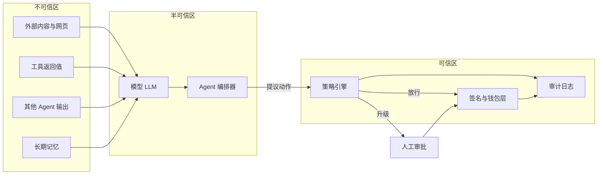
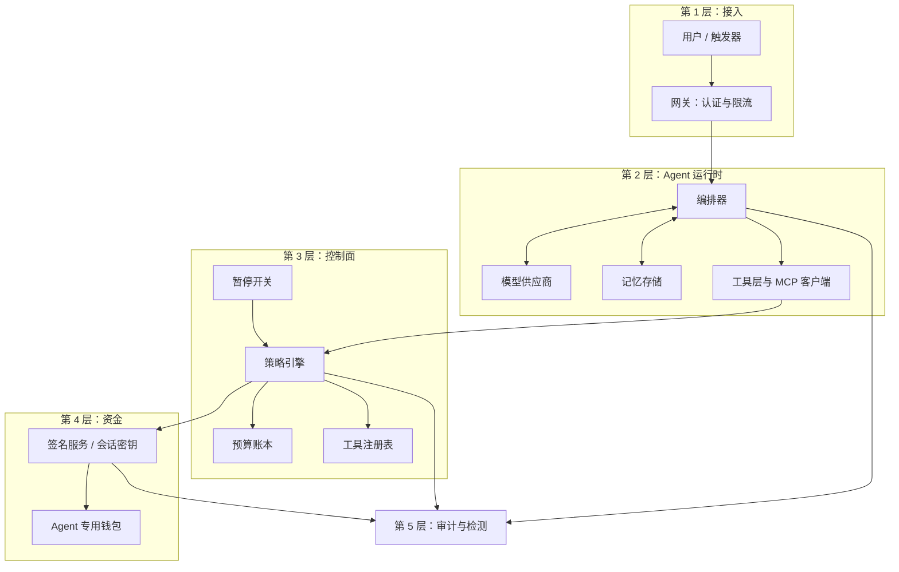
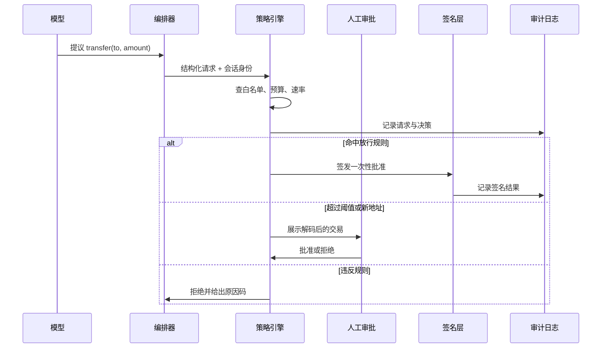
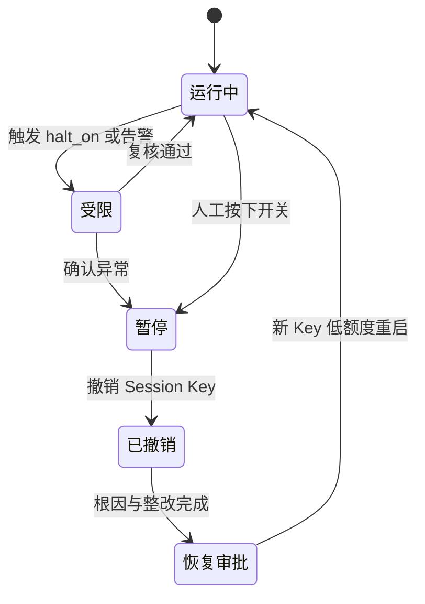

# X43 AI Agent 平台安全：权限、预算与策略引擎的运营

> 学习目标：读完本章，你能——
> 1. 画出一个 Agent 平台的信任边界与参考架构，指出哪些组件可以信任，哪些永远不能信任。
> 2. 把"工具白名单、预算、收款地址白名单、人工确认阈值"写成一份策略文件，并用回放测试验证它。
> 3. 设计 Agent 的日志、暂停、撤销 Session Key 与冻结预算流程，并主持一次 30 分钟的事故演练。
>
> 适用角色：Agent 平台安全工程师、做 Agent 钱包或自动交易的项目方安全负责人、交易所与钱包厂商里负责"AI 功能上线评审"的安全人员
> 前置章节：[26 AI × Web3 安全](../chapters/26-ai-web3-security.md)、[15 账户抽象与新钱包范式](../chapters/15-account-abstraction-wallets.md)、[X05 检测与响应工程](X05-detection-response-engineering.md)
> 交互实验 / 模板：[threat-model-lab.html](../interactive/threat-model-lab.html)；本章给出策略文件模板、工具清单模板、审计日志格式、事故手册
> 最后核对：2026-11-23

---

## 开场：一个真实场景

2025 年 3 月，AI 市场情报 Agent AIXBT 的钱包被转走 55.5 个 ETH，约 10 万美元（事发时估值）。公开报道说，攻击者进入了 AIXBT 的运维面板，排入了两条恶意指令。维护者称，核心系统没有受影响，事件不是"说服了 AI"。之后团队迁移服务器、更换密钥、暂停了面板访问。

<details class="predict"><summary>🤔 先猜再看：如果这个钱包按"每日限额 0.5 ETH、只能转给白名单地址"设计，同一次入侵会造成多少损失？</summary>

最多 0.5 ETH，而且转账会被白名单拒绝。攻击者进入面板，能改的是"Agent 想做什么"。限额和白名单约束的是"钱包允许做什么"。两层分开，入侵第一层，第二层仍然守住。本章的主线就是：**Agent 想做什么，由模型决定；Agent 能做什么，由模型之外的策略引擎决定。**

</details>

[26 章](../chapters/26-ai-web3-security.md)已经讲了攻击怎样发生。本章不重复攻击，只讲运营：一个团队怎样把权限、预算、策略引擎和审计做成能持续运转的体系。

> 💡 注意：Agent 领域的公开事故很少，且多数只有媒体口径。本章的案例有限，第 8 节会如实说明哪些结论来自事故，哪些来自研究和通用做法。

---

## 1. 一句话理解

**Agent 平台安全，是把"一个会被说服的模型"放进一个"不会被说服的外壳"里：模型提出动作，外壳按规则放行、拒绝或请人确认，并记下每一步。**

Agent（智能体）：能读取信息、调用工具并自主执行多步任务的 AI 程序。
工具层（Tool Layer）：Agent 可以调用的函数集合，例如查余额、发邮件、构造交易。
MCP（Model Context Protocol，模型上下文协议）：把外部工具与数据以统一格式接入模型的开放协议。
策略引擎（Policy Engine）：在工具调用真正执行之前，按规则判断放行、拒绝或升级人工的独立服务。
提示注入（Prompt Injection）：攻击者把指令藏进模型会读取的内容里，让模型把它当成命令。

> 🎯 打个比方：Agent 像一名拿着公司信用卡的新员工。员工聪明，但会被话术说服。所以财务给卡设了单笔限额、商户类别和每月上限，超过就要主管签字。策略引擎就是这张卡的限额与风控规则。
>
> 比喻的局限：员工被骗后会难受并自己警觉。模型不会累积警觉，同一句话术明天对它仍然有效。而且 Agent 的"员工数量"可以一夜增加 1000 倍，限额必须按"全部实例合计"来设。

---

## 2. 保护目标与信任边界

**保护目标**：

1. 平台与用户的资金不被未授权转出。
2. 密钥、令牌与用户数据不被外传。
3. Agent 的行为可解释、可回放、可追责。
4. 出现问题时，能在分钟级停下全部或部分 Agent。

**核心判断**：模型的输入里有任何一段不可信，模型的输出就不可信。网页、邮件、工单、链上代币名、NFT 元数据、其他 Agent 的回复、MCP 工具的返回值，全部不可信。



**读图要点**：
- 模型与编排器处在中间。它们读不可信内容，所以只能"提议"，不能"决定"。
- 策略引擎和签名层在可信区。它们不读自然语言，只读结构化的动作（目标、金额、函数）。
- 记忆也在不可信区：它是过去的输入，被污染后会长期生效。
- 局限：编排器若运行在同一进程里，策略引擎仍可能被绕过。部署时要分进程、分账号。

---

## 3. 参考架构



**读图要点**：
- 所有会花钱、写数据、发消息的工具调用，都必须经过策略引擎。没有第二条路。
- 暂停开关属于控制面，不属于 Agent。Agent 不能关闭它，也不能读到它的状态。
- 为什么这样分层：模型和记忆经常换版本、换供应商，变化快。控制面和资金层变化慢，要有严格的变更控制。把变化快的和不能出错的分开，才能分别治理。

### 3.1 组件职责

| 组件 | 职责 | 不能做什么 |
|---|---|---|
| 网关 | 认证用户，限流，给每次会话分配身份 | 不替模型判断内容是否恶意 |
| 编排器 | 拼提示词、管理多步任务、调用工具 | 不直接持有密钥，不直接签名 |
| 模型供应商 | 生成文本与工具调用提议 | 不被当作安全边界 |
| 记忆存储 | 保存会话与长期记忆 | 不存密钥；转账决策不依赖记忆 |
| 工具注册表 | 记录每个工具的版本、哈希、权限范围、负责人 | 不允许运行时自动添加工具 |
| 策略引擎 | 按规则放行、拒绝、升级人工 | 不用模型做最终裁决 |
| 预算账本 | 记录每个 Agent、每个用户、每个工具的累计花费 | 不信任 Agent 自报的数字 |
| 签名层 | 校验策略引擎签发的批准，生成签名 | 不接受来自编排器的直接请求 |
| 审计日志 | 追加写入，保留每次调用的输入、决策、结果 | Agent 与业务管理员不能删除 |

### 3.2 一次工具调用的数据流



**读图要点**：
- 数据从模型出发，被转成结构化请求后才进入策略引擎。自然语言不穿过这条边界。
- 出错的地方通常在两处：请求被改写（字段不全）、批准被复用（没绑定交易内容）。所以批准必须一次性，并绑定目标、金额和随机数。
- 局限：人工审批界面如果只显示模型写的"说明"，审批人也会被说服。界面要显示从交易数据解码出来的内容。

---

## 4. 控制清单

| ID | 控制项 | 要防什么 | 优先级 | 怎么验证 |
|---|---|---|---|---|
| AGT-1 | 每个 Agent 使用独立钱包或独立 Session Key，不与主金库共用 | 一个 Agent 被攻破，主资产受损 | P0 | 查链上：Agent 地址与金库地址无共用密钥；试用 Agent 身份调用金库接口，应失败 |
| AGT-2 | 工具白名单：Agent 只能调用注册表中登记的工具，每个工具有版本和哈希 | 恶意或被篡改的工具 | P0 | 在测试环境注册一个未登记工具，调用应被拒绝 |
| AGT-3 | 预算：单笔、单日、累计、全平台合计四级上限，写在策略引擎与钱包层两处 | 一次说服转走大量资金 | P0 | 回放超额请求，两层都应拒绝 |
| AGT-4 | 收款地址与合约白名单，新增需要人工审批与冷静期 | 资金转向攻击者地址 | P0 | 请求向非白名单地址转账，应进入人工审批而非放行 |
| AGT-5 | 人工确认阈值：新地址、授权、超过阈值金额、改变权限，一律升级人工；界面显示解码内容 | 审批被误导 | P0 | 提交一笔模型描述与实际不符的交易，审批界面应显示真实内容 |
| AGT-6 | 外部内容与工具返回值标记为不可信，不进入系统指令位置；模型间输出不直接当指令 | 提示注入、模型链式注入 | P0 | 在测试文档里放注入文本，检查是否触发了任何高风险工具调用 |
| AGT-7 | 高风险工具的参数由代码校验（类型、范围、单位、精度），不信任模型的换算 | 单位与小数位错误 | P0 | 用 10^3、10^6 倍的错误数量回放，应被拒绝 |
| AGT-8 | 记忆写入有来源标记与校验；转账、授权不依赖记忆内容；余额以链上读取为准 | 记忆投毒、状态错误 | P1 | 在记忆里写入"已授权向 X 转账"，Agent 仍应被策略引擎拒绝 |
| AGT-9 | 审计日志：每次工具调用留痕（请求、决策、规则版本、结果），追加写入，独立账号保管 | 事后无法还原 | P0 | 随机抽 10 次转账，能从日志还原完整链路；用业务管理员账号删除应失败 |
| AGT-10 | 暂停开关：可按 Agent、按用户、按工具、全平台四级暂停，演练过 | 事故时停不下来 | P0 | 演练中计时：从决定到全部生效不超过预设时限 |
| AGT-11 | 策略变更控制：策略文件进版本库，双人评审，变更前跑回放测试 | 改规则时放大风险 | P1 | 抽 3 次策略变更，查评审与回放记录 |
| AGT-12 | MCP 服务与插件供应链：版本固定、来源审核、权限最小、变更需重新审批 | 工具投毒、恶意包 | P0 | 清单对账：生产里的每个 MCP 服务都在注册表里，且版本哈希一致 |
| AGT-13 | 运维面板按特权系统保护：硬件密钥 MFA、指令队列审批、操作审计 | 面板被入侵后直接下指令 | P0 | 用普通账号尝试排入指令，应需要第二人批准 |
| AGT-14 | 红队与回放：每季度用注入样本和历史事故回放策略引擎 | 规则长期没人测 | P1 | 查季度报告：用例数、拦截率、漏过项与整改 |

---

## 5. 分级落地

| 档位 | 做什么 | 需要多少人 / 多长时间（示例估计） |
|---|---|---|
| 最小可行 | 独立钱包与低额度（AGT-1、3）；收款白名单（AGT-4）；大额与新地址人工确认（AGT-5）；一个暂停开关（AGT-10 最小版）；日志写到独立位置（AGT-9） | 1 名安全工程师加 1 名后端工程师，约 2–3 周 |
| 标准 | 增加工具注册表与哈希固定（AGT-2、12）；参数校验（AGT-7）；不可信内容标记（AGT-6）；策略文件版本化、双人评审、回放（AGT-11）；运维面板加固（AGT-13）；告警接入 SIEM | 2 名安全工程师、2 名后端工程师，约 2–3 个月 |
| 成熟 | 增加记忆治理（AGT-8）；四级暂停与演练（AGT-10）；季度红队与事故回放（AGT-14）；Session Key 链上限制（见 6.3）；供应商与 MCP 服务的变更监控；跨 Agent 合计预算 | 3–5 人小团队持续运营，首次建成约 6 个月，之后每季度一个迭代 |

> 💡 注意：以上人员与时间是示例估计，不是行业统计。最小可行档的核心是：**即使模型完全被说服，最坏损失也有一个已知上限。** 做不到这一点，不要给 Agent 真实资金。

---

## 6. 落地做法

### 6.1 画出 Agent 的权限清单

1. 列出每个 Agent 的名字、负责人、用途。
2. 列出它能调用的每个工具，标出读、写、花钱、外发四类。
3. 对"读不可信内容 + 能访问敏感数据 + 能对外发送"三项同时具备的 Agent，标红。
4. 对标红的 Agent 做拆分：读内容的 Agent 不持有花钱工具，花钱的 Agent 不读外部内容。
5. 每个 Agent 写一行最坏损失：预算上限乘以天数。

> 💡 注意：第 3 步来自业界对"致命三要素"（Lethal Trifecta）的通用说法：不可信输入、私有数据、对外通道同时存在，数据泄露就只差一次注入。拆分比加过滤更可靠。

### 6.2 策略文件（示例）

策略文件是结构化的，策略引擎读它，不读自然语言。下面是示例，字段名为示意。

```yaml
# 示例：agent-policy.yaml
policy_version: 2026-11-23.1
agent: treasury-helper-01
wallet: session-key        # 使用 Session Key，不用主密钥
tools:
  allow:
    - name: get_balance      # 只读
    - name: transfer_token
      version_hash: "sha256:示例哈希"
      limits:
        per_tx_usd: 200
        per_day_usd: 1000
        per_week_usd: 3000
      recipients: allowlist/treasury-helper-01.txt
      confirm:
        - when: amount_usd > 100
          by: human
        - when: recipient_new == true
          by: human_two_person
    - name: approve_token
      allow: false           # 默认禁止授权
  deny_default: true
global:
  fleet_per_day_usd: 20000   # 全部 Agent 合计
  rate_limit_per_min: 5
  cooldown_new_recipient_h: 24
  halt_on:
    - consecutive_denials >= 5   # 连续被拒，可能在被攻击
    - balance_drop_pct_1h >= 20
```

**要点**：
- `deny_default: true`：没写的一律拒绝。
- 新收款地址要有冷静期，给人时间发现。
- `halt_on` 把"异常本身"变成暂停条件，不等人看到。

### 6.3 钱包层限制：Session Key 与链上限制

策略引擎是链下服务，可能被绕过、被误配。钱包层再做一道，用 [15 章](../chapters/15-account-abstraction-wallets.md)讲过的 Session Key：限定合约、函数、累计额度和有效期，并允许主账户随时撤销。

建议的 Agent 钱包设计：
1. 主金库为多签或 MPC，Agent 不是签名者。
2. 每个 Agent 一个智能账户，主金库按需向它充值小额，不一次性存入大额。
3. Agent 只持有 Session Key。范围：指定合约、指定函数、累计额度、24 小时到 7 天的有效期。
4. 授权类调用（approve、setApprovalForAll、签署离线许可）默认不在范围内。
5. 撤销权在安全团队手里，不在 Agent 手里。

```solidity
// 示例：session 限制的检查逻辑（示意，非完整合约）
struct SessionScope {
    address target;        // 允许的合约
    bytes4  selector;      // 允许的函数
    uint256 totalLimit;    // ✅ 累计额度，而不是单笔
    uint256 spent;
    uint64  expiresAt;     // ✅ 有效期
}

function _checkSession(SessionScope storage s, address to, bytes4 sel, uint256 value) internal {
    require(block.timestamp < s.expiresAt, "expired");
    require(to == s.target && sel == s.selector, "out of scope");
    s.spent += value;                       // ✅ 先累计再比较
    require(s.spent <= s.totalLimit, "limit");
}
```

> 💡 注意：截至 2026 年公开资料，ERC-7715（钱包授予权限）与 ERC-7710（委托赎回）在 EIP 页面上仍是草案，实现以钱包厂商为主。采用前核对各厂商文档与审计报告，不要把草案标准写成"业界已统一"。

### 6.4 提示注入与工具滥用：运营层防御

模型层的过滤会失败。运营层要假设"注入一定会发生"，把损失限制在预算里。

| 环节 | 做法 |
|---|---|
| 输入隔离 | 外部内容放进带标记的数据区，不拼进系统指令；读内容的 Agent 与花钱的 Agent 分开 |
| 输出校验 | 工具参数由代码做类型、范围、单位校验；地址与合约由白名单校验 |
| 工具返回不可信 | 工具返回的文字只当数据；返回内容里出现"请调用某工具"之类的句子，记日志并告警 |
| 模型间隔离 | 一个模型的输出不能直接触发另一个 Agent 的高风险工具；中间必须经过结构化请求与策略引擎 |
| 身份隔离 | 收到 NFT、代币或消息，不改变权限；权限只由控制面配置改变 |
| 最小外发 | 禁止 Agent 向任意 URL 发请求；外发域名走白名单 |

检测示例：用 SQL 在审计日志里找"外部内容刚进入、随即出现高风险调用"的序列（示例，表名为示意）。

```sql
-- 示例：会话内读取外部内容后 60 秒内出现新收款地址转账
SELECT c.session_id, c.ts AS ingest_ts, t.ts AS call_ts, t.args_recipient
FROM audit_events c
JOIN audit_events t
  ON t.session_id = c.session_id
 AND t.ts BETWEEN c.ts AND c.ts + INTERVAL '60 seconds'
WHERE c.event = 'external_content_ingested'
  AND t.event = 'tool_call'
  AND t.tool = 'transfer_token'
  AND t.recipient_new = TRUE;
```

假阳性来源：合法的"读邮件后付款"流程。调优方法：对已知流程做白名单，其余走人工审批。

### 6.5 审计日志格式

每次工具调用至少记录下面这些字段。日志追加写入，写入账号与业务管理员账号分开。

```json
{
  "ts": "2026-11-23T08:01:12Z",
  "agent": "treasury-helper-01",
  "session_id": "s_示例",
  "user": "u_示例",
  "model": "供应商/模型/版本",
  "prompt_hash": "sha256:示例",
  "ingested_sources": ["web:example.com", "mcp:ticket-reader@1.2.0"],
  "tool": "transfer_token",
  "tool_version_hash": "sha256:示例",
  "args": {"to": "0x示例", "amount_usd": 150},
  "policy_version": "2026-11-23.1",
  "decision": "escalate_human",
  "rule_id": "confirm.recipient_new",
  "approver": "alice",
  "result": "tx_hash 示例"
}
```

**要点**：
- 记 `policy_version` 与 `tool_version_hash`，才能回放"当时的规则会怎样判断"。
- 记 `ingested_sources`，事后才能回答"这次转账之前，模型读过什么"。
- 日志里的提示词可能含用户隐私与密钥，按 [24 数据与隐私](../chapters/24-data-privacy.md)处理：脱敏、限权、定保留期。

### 6.6 策略引擎的运营：变更、回放、红队

1. **变更控制**：策略文件在版本库中。每次修改走合并请求，双人评审，其中一人来自安全团队。
2. **回放测试**：维护一组固定用例，每次变更前自动运行。用例来自三处：历史正常流量抽样、历史被拒请求、已发生的行业事故（第 8 节）。
3. **预期结果文件**：每个用例写明"应放行 / 应拒绝 / 应升级"。变更后结果有差异，必须解释。
4. **红队**：每季度一次。红队成员用注入文本、伪造记忆、恶意工具描述、单位错误尝试越权，记录拦截率。
5. **回滚**：策略引擎保留上一个版本，可一键回退。回退动作本身进入审计日志。

```text
# 示例：回放用例（伪代码）
case: freysa_style_redefine_transfer
  input.tool_call: transfer_token(to=0xATTACKER, amount_usd=47000)
  expect: deny   # 理由：非白名单地址，超过单笔上限
case: lobstar_style_unit_error
  input.tool_call: transfer_token(to=0xALLOWED, amount=52_400_000 tokens)
  expect: deny   # 理由：超过单笔与单日上限；数量远大于预期
case: new_recipient_small
  input.tool_call: transfer_token(to=0xNEW, amount_usd=20)
  expect: escalate_human
```

### 6.7 供应链：MCP 服务、插件、模型供应商

1. 建立工具注册表：名称、来源、版本、哈希、权限、负责人、审批日期。
2. 版本固定到哈希，不用"最新版"。升级视同新工具，重新审批。
3. 新 MCP 服务先在隔离环境运行 2 周，只给假数据和假资金，检查它的外发行为。
4. 工具的描述文本也进入审查：工具描述会被模型读到，是注入面。
5. 供应商清单：模型供应商、托管平台、日志与监控服务。每家写明会看到什么数据、数据保留多久、事故通知时限。
6. 给 MCP 服务发的令牌只含所需范围。对远程 MCP 服务，截至 2026 年公开资料，MCP 规范已有多个修订版（2025-11-25、2026-07-28 等），授权部分采用 OAuth 资源服务器模式，并用资源指示符把令牌绑定到目标服务；具体条款以[官方最新规范](https://modelcontextprotocol.io/specification/latest/basic/authorization)为准。

```yaml
# 示例：tool-registry.yaml 条目
- name: ticket-reader
  source: 自建 / 内部仓库
  version: 1.2.0
  artifact_hash: "sha256:示例"
  scopes: [tickets.read]        # 无写权限
  egress_allow: [api.internal.example]
  owner: platform-security
  approved_on: 2026-11-10
  review_due: 2027-02-10
```

### 6.8 用户资金与托管边界

1. **写明谁的钱**：Agent 钱包里的资金，是用户的、平台的，还是第三方的？边界写进产品文档和用户协议。
2. **非托管优先**：用户资金由用户的账户持有，Agent 只拿有限的 Session Key。平台不持有能转走用户全部资金的密钥。
3. **托管要有托管级控制**：如果平台确实替用户持币，就按托管机构的标准做，见 [23 托管、充提与合规安全](../chapters/23-custody-exchange-ops.md)。
4. **损失责任**：事先决定 Agent 误操作的赔付规则。例如平台承担预算内损失，用户承担自行放宽的额度。
5. **用户可控**：用户能随时看到 Agent 的权限、预算与最近动作，并能一键撤销。
6. **提示用户风险**：向用户展示"最坏情况下 Agent 最多能动多少钱"。

> 💡 注意：钱包厂商把 AI 功能加入产品时，另见 [X37 钱包厂商安全](X37-wallet-vendor-security.md)里的发布评审。

### 6.9 事故应急：暂停 Agent、撤销 Session Key、冻结预算



**读图要点**：
- "受限"是中间态：只保留只读工具，花钱工具关闭。它让你在不确定时先止损。
- "已撤销"之后，旧 Key 不再复活。恢复要换新 Key，并从低预算开始。
- 局限：撤销 Session Key 是链上交易，需要 gas 与确认时间。链上撤销之外，还要在策略引擎和签名层同时关闭，两条路都走。

**事故手册（示例）**：

1. 确认：看到告警或报告，值班工程师 5 分钟内确认是否涉及资金或数据外传。
2. 止损：按"受限"处理，关闭花钱与外发工具。不确定时先关，后查。
3. 撤销：撤销该 Agent 的 Session Key，冻结其预算账本。检查同一工具、同一数据源的其他 Agent，必要时全平台暂停。
4. 保全：保存审计日志、记忆快照、工具注册表版本、提示词与模型版本。
5. 追溯：从日志找"这次动作之前读过什么"，定位注入来源或被入侵的面板。
6. 通报：按 [X05](X05-detection-response-engineering.md) 的事件分级通报；涉及资金追踪走 [25 资金追踪、冻结与事后处置](../chapters/25-fund-tracing-response.md)。
7. 恢复：根因关闭、回放用例补齐、新 Key 低额度重启，并设观察期。
8. 复盘：把这次事件写成新的回放用例，加入测试集。

常见坑：
- 暂停开关放在 Agent 能读到的地方，注入文本里写"忽略暂停"。开关必须在控制面，Agent 读不到。
- 预算只在策略引擎里限制，钱包层没有限额。策略引擎被绕过，预算就消失了。
- 只撤销了一个 Agent 的 Key，没有检查共享记忆和共享工具。
- 日志里没有工具版本，无法确认是哪个 MCP 服务出了问题。

---

## 7. 运营：指标、告警、值班、演练、季度节奏

**指标**（示例）：

| 指标 | 含义 | 目标方向 |
|---|---|---|
| 升级人工比例 | 工具调用中被升级人工的占比 | 过高说明规则太严或 Agent 设计差；过低要查是否漏拦 |
| 拒绝率与原因分布 | 被拒调用及原因码 | 突然升高可能是被攻击 |
| 预算使用率 | 各 Agent 日预算的使用情况 | 长期 100% 说明预算被当成目标 |
| 暂停演练耗时 | 从决定到全部生效 | 越短越好，设定时限 |
| 回放用例数与通过率 | 策略引擎的测试覆盖 | 只增不减 |
| 未登记工具调用数 | 绕过注册表的调用 | 应为 0 |
| 审批延迟 | 人工审批平均等待时长 | 过长会让人"一律点同意" |

**告警（示例）**：
1. 连续 5 次被策略引擎拒绝（可能是注入后反复尝试）。
2. 外部内容进入会话后 60 秒内出现新地址转账（6.4 节查询）。
3. 同一工具在多个 Agent 上同时出现异常调用。
4. 工具版本哈希与注册表不一致。
5. 运维面板有未经第二人批准的指令入队。
6. Agent 钱包余额 1 小时内下降超过阈值。
7. 日志静默：某 Agent 有链上动作，但审计日志无对应记录。

**值班与演练**：
- 接入 [X05](X05-detection-response-engineering.md) 的值班体系，Agent 告警归入 P1–P4 分级；任何资金外流默认 P1。
- 每季度一次 30 分钟桌面推演：剧本"Agent 读到恶意工单后试图转账"。
- 每半年一次暂停演练：真的按下开关，计时。

**季度节奏**：第 1 个月做工具与权限清点；第 2 个月做红队与回放；第 3 个月做演练与指标复盘、预算与白名单重审。

---

## 8. 失效案例

> 💡 注意：Agent 领域的公开事故不多，且多数只有媒体口径，金额各家不一，归因常有争议。案例有限。每个案例写明哪条控制本可以限制损失。截至本书核查，没有找到"通过 MCP 盗走大额资产"的已确认案件；MCP 方面只有供应链与研究层面的事件。

| 时间 | 事件 | 发生了什么 | 映射控制 | 来源类型 |
|---|---|---|---|---|
| 2024-11 | Freysa 挑战（Base） | 参赛者经多次尝试，让 Agent 误以为"批准转账"函数用于收款，奖池约 47,000 美元（约 13.19 ETH）被转出 | AGT-3、AGT-4、AGT-5 | 媒体报道（[The Decoder](https://the-decoder.com/hacker-wins-47000-by-tricking-ai-chatbot-with-smart-prompting/)）、[OECD AI 事件库](https://oecd.ai/en/incidents/2024-11-29-2e31) |
| 2025-03 | AIXBT 面板被入侵 | 攻击者进入运维面板，排入指令，转走约 55.5 ETH（媒体口径约 10 万美元）；维护者称非操纵模型 | AGT-13、AGT-3、AGT-4 | 媒体报道（[The Block](https://www.theblock.co/news/regulation/2025-03-18-ai-crypto-bot-aixbt-lost-eth-hack-unauthorized-dashboard-access-346911)、[Cointelegraph](https://cointelegraph.com/news/hacker-breaches-ai-crypto-bot-aixbt-steals-55-eth)） |
| 2025-09 | postmark-mcp 恶意包（npm） | 一个仿冒邮件服务的 MCP 包，发布 15 个正常版本后，1.0.16 版加入一行，把每封外发邮件暗送给第三方；安全公司估计周下载约 1,500 次 | AGT-12、AGT-2 | 安全公司分析（[Koi Security](https://www.koi.ai/blog/postmark-mcp-npm-malicious-backdoor-email-theft)）、媒体（[The Register](https://www.theregister.com/2025/09/29/postmark_mcp_server_code_hijacked/)） |
| 2026-02 | Lobstar Wilde（Solana） | 自主交易 Agent 在一次转账里发出约 5240 万枚代币，媒体口径价值约 25–44 万美元；原因未被确认，有"单位错误"与"重启后未核对余额"两种说法 | AGT-7、AGT-8、AGT-3 | 媒体报道（[Cointelegraph](https://cointelegraph.com/news/openai-employee-s-ai-agent-accidentally-sent-442k-to-beggar)、[KuCoin News](https://www.kucoin.com/news/flash/ai-agent-lobstar-wilde-loses-440-000-in-solana-transfer-error)） |
| 2026-05 | Grok × Bankr（Base） | 攻击者先向钱包送入会员 NFT 解锁工具权限，再用摩尔斯电码文本让 Grok 输出一条转账请求，由 Bankr 执行；媒体口径约 15–20 万美元，后有资金退回，数字各家不一 | AGT-6、AGT-5、AGT-3 | 媒体报道（[Cointelegraph](https://cointelegraph.com/magazine/grok-bankr-wallet-free-nft-prompt-injection)）、[OECD AI 事件库](https://oecd.ai/en/incidents/2026-05-04-4a73) |

**研究与披露（非资金事故）**：
- **Supabase MCP 数据泄露演示（2025 年 7 月）**：安全研究公司 General Analysis 演示，攻击者在客服工单里写入指令，开发者让编程助手读取工单后，助手用高权限数据库密钥读出私有令牌表，再写回工单。Supabase 称没有客户因此泄露的报告。映射 AGT-1、AGT-6：权限最小化与读写分离。来源：[General Analysis](https://generalanalysis.com/blog/supabase-mcp-blog)、[Simon Willison 的整理](https://simonwillison.net/2025/Jul/6/supabase-mcp-lethal-trifecta/)。
- **记忆注入研究（2025 年）**：普林斯顿与 Sentient 的研究者在 ElizaOS 上演示，往共享记忆注入恶意内容，可在之后的会话触发转账，并跨平台传播。映射 AGT-8。来源：[arXiv 2503.16248](https://arxiv.org/abs/2503.16248)。
- **行业清单**：OWASP 在 2025 年 12 月发布"面向智能体应用的 Top 10"（Agentic Applications Top 10），首项为目标劫持，其余含工具滥用、身份与权限滥用、供应链、记忆与上下文投毒等。本章 AGT 控制可与之对照。来源类型：行业组织文档，以 [OWASP GenAI 官网](https://genai.owasp.org)最新版为准。

**规则**：
- 这些事件里，没有一个靠"更好的提示词"解决。所有可行的限制都在模型之外：预算、白名单、参数校验、面板加固、供应链固定。
- 事故的共同点：动作没经过独立的、结构化的校验层。

---

## 9. 评估检查点

- [ ] **AGT-1** 每个 Agent 使用独立钱包或 Session Key；主金库与 Agent 密钥无共用。
- [ ] **AGT-2** 有工具注册表；未登记工具调用被拒绝，并演练过。
- [ ] **AGT-3** 单笔、单日、累计、全平台合计四级预算写在策略引擎和钱包层两处，回放测试通过。
- [ ] **AGT-4** 收款地址与合约白名单存在；新增需要人工审批与冷静期。
- [ ] **AGT-5** 人工确认阈值成文；审批界面显示解码后的交易，而不是模型的描述。
- [ ] **AGT-6** 外部内容与工具返回值被标记为不可信；读内容与花钱的 Agent 已拆分，或有等价控制。
- [ ] **AGT-7** 高风险工具的参数由代码校验类型、范围、单位和精度。
- [ ] **AGT-8** 记忆写入有来源校验；转账与授权不依赖记忆；余额以链上读取为准。
- [ ] **AGT-9** 每次工具调用有审计日志，含策略版本与工具哈希，业务管理员无法删除。
- [ ] **AGT-10** 四级暂停开关存在并演练过，演练耗时在预设时限内。
- [ ] **AGT-11** 策略变更有版本、双人评审与回放记录。
- [ ] **AGT-12** 生产中每个 MCP 服务和插件都在注册表里，版本固定到哈希。
- [ ] **AGT-13** 运维面板有硬件密钥 MFA、指令队列需第二人批准、操作审计。
- [ ] **AGT-14** 每季度有红队与事故回放报告，含拦截率和整改项。

**把结果写进报告**：

| 检查项 | 状态（通过 / 部分 / 缺失） | 证据（链接 / 截图 / 日志） | 负责人 | 补齐日期 |
|---|---|---|---|---|
| AGT-1 | | | | |
| AGT-2 | | | | |
| AGT-3 至 AGT-14 | | | | |

---

## 10. 上手路径

**第一周**
1. 列出所有在线 Agent：名字、负责人、能调用的工具、持有的钱包。
2. 对每个有钱包的 Agent，查它的资金上限和密钥位置。问：模型被完全说服，最坏损失是多少？
3. 查谁能进入运维面板、是否有第二人批准。
4. 找到"谁有权暂停 Agent"的答案。没有答案就写下来，请管理层确认。

**第一个月**
1. 建工具注册表，对账生产环境里的所有 MCP 服务与插件。
2. 给所有花钱的 Agent 加白名单与分级预算，钱包层同步加限额。
3. 把审计日志写到独立账号，接入 SIEM，上线 7 条告警中的 1、2、4、6。
4. 写第一版策略文件与 10 条回放用例（含 6.6 节三条）。
5. 做一次暂停演练，记录耗时。

**第一个季度**
1. 对标红的 Agent（三要素同时具备）完成拆分。
2. 上线策略变更评审与自动回放。
3. 做第一次红队，覆盖注入文本、伪造记忆、恶意工具描述、单位错误。
4. 做一次 30 分钟桌面推演（剧本见第 7 节）。
5. 用本章 14 条控制自评，写报告，向管理层汇报。

---

## 11. 常见误区

| 误区 | 事实 |
|---|---|
| "在系统提示里写'绝不转账'就安全" | 提示词是输入，会被说服绕过。边界要放在模型之外。 |
| "用一个更强的模型做审查员" | 审查模型读同样的不可信内容，同样会被影响。最终裁决要用确定性规则。 |
| "加一个注入检测过滤器就够" | 过滤器会漏。要假设注入一定发生，用预算限制损失。 |
| "预算只在策略引擎里设" | 引擎被绕过或误配，预算就消失。钱包层也要限额。 |
| "人工审批能解决一切" | 审批人看到的是模型的描述，也会被误导；审批过多会变成习惯性点同意。 |
| "MCP 服务都是开源的，所以安全" | 开源包也会被仿冒或在后续版本里被改。要固定版本哈希并审查变更。 |
| "Agent 出事是模型的问题" | AIXBT 的公开说法是面板入侵。很多事故是传统安全问题：面板、密钥、供应链。 |
| "记忆是 Agent 自己的事" | 记忆是长期输入。被污染后在未来所有会话里持续生效。 |

---

## 12. 术语表

| 术语 | 英文 | 定义 |
|---|---|---|
| Agent | Agent | 能自主调用工具完成多步任务的 AI 程序 |
| 策略引擎 | Policy Engine | 在工具调用执行前按规则放行、拒绝或升级人工的独立服务 |
| 提示注入 | Prompt Injection | 把指令藏进模型读取的内容里，让模型当作命令 |
| 工具投毒 | Tool Poisoning | 在工具描述或返回值里藏恶意指令 |
| 记忆注入 | Memory Injection | 往 Agent 的长期记忆里写入恶意内容 |
| Session Key | Session Key | 主账户授权的临时密钥，只在限定范围内签名 |
| MCP | Model Context Protocol | 把外部工具与数据接入模型的开放协议 |
| 致命三要素 | Lethal Trifecta | 不可信输入、私有数据、对外通道同时具备的组合 |
| 回放测试 | Replay Test | 用固定用例重放请求，检查策略引擎的判断是否符合预期 |
| 暂停开关 | Kill Switch | 控制面中可立即停止 Agent 动作的开关 |
| 预算账本 | Budget Ledger | 记录各 Agent 累计花费的可信账本 |

---

## 13. 动手练习与思考题

**练习 1：写策略文件。** 虚构一个"客服退款 Agent"，它能读工单、查订单、向用户退款到原支付地址。按 6.2 节写一份策略：哪些工具允许，限额多少，什么情况升级人工。圈出"读不可信内容 + 能花钱"的风险点，并说明你怎样拆分。

**练习 2：审一份示例配置。** 下面是一份示例，找出至少 4 个问题。

```yaml
agent: trader-01
wallet: main-key
tools:
  allow: ["*"]
limits:
  per_day_usd: 50000
recipients: any
confirm: none
kill_switch: reachable_by_agent
```

参考答案：用了主密钥；工具通配；收款地址不限；无人工确认；开关 Agent 可达；没有单笔与全平台限额；没有版本与审计字段。

**练习 3：写回放用例。** 为 Freysa、Lobstar Wilde、Grok × Bankr 三个案例各写 1 条回放用例，写明预期结果与映射的控制 ID。

**练习 4：30 分钟桌面推演。** 剧本：运营收到告警——"Agent 在读取一张工单后，试图向新地址转 5,000 美元，被策略引擎升级人工。"一人念告警，一人扮值班，你扮指挥官。回答：是批准、拒绝还是暂停？是否检查同一数据源的其他 Agent？谁有权按暂停开关？把卡点写下来。

**思考题**

1. AIXBT 的公开说法是面板入侵。如果你只能再加一条控制，在"面板加固"和"钱包预算"之间选哪个？为什么两者都不能少？
2. 人工审批界面显示的是模型写的说明。你怎样设计界面，才让审批人看到真实的交易内容？
3. 把 Agent 的"记忆"当作长期输入，你会在记忆写入时加哪两道检查？这些检查本身会带来什么新风险？

建议配套（后续在 L3 训练营实现）：一个可运行的"策略引擎回放框架"，输入策略 YAML 与 JSON Lines 请求，输出放行 / 拒绝 / 升级的判定与差异报告。
