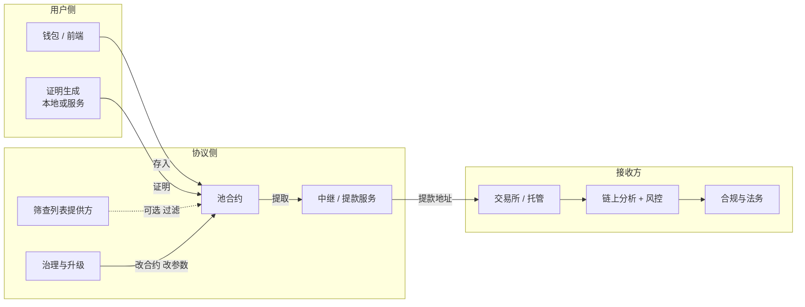
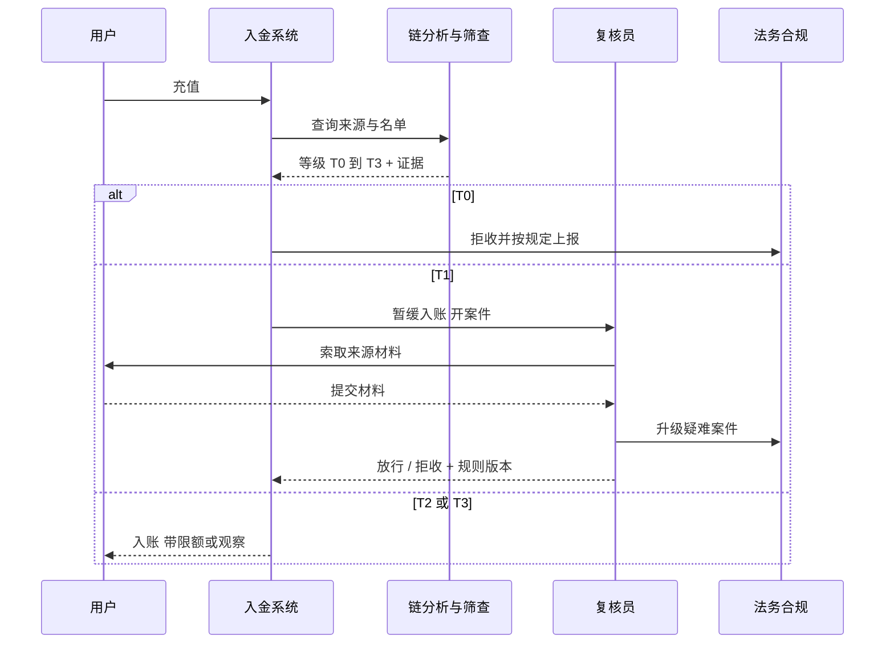
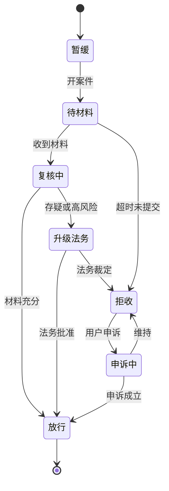

# X43 隐私协议与混币器：合规、检测与运营安全

> 学习目标：读完本章，你能——
> 1. 区分四类隐私机制（混币池、屏蔽池、默认隐私链、带"关联集"的隐私池），说出各自的威胁模型和合规暴露点。
> 2. 以"接收方"（交易所、托管、支付机构）身份，写出一份分层的隐私来源资金处理策略，并能用笔记本回放测试。
> 3. 以"协议运营方"身份，列出证明系统、升级与治理、前端与中继、可选披露四个域的运营控制，并做一次监管变化推演。
>
> 适用角色：交易所与托管机构的合规和风控工程师、隐私协议及其前端 / 钱包的运营与安全负责人、链上情报分析师。
> 前置章节：[24 数据与隐私](../chapters/24-data-privacy.md)、[23 托管、充提与合规安全](../chapters/23-custody-exchange-ops.md)（Tornado Cash 的制裁与诉讼时间线在 5.3 节）、[25 资金追踪与响应](../chapters/25-fund-tracing-response.md)、[X13 反欺诈、合规与安全运营](X13-cex-fraud-compliance-secops.md)
> 交互实验：[去匿名化实验](../interactive/deanonymization-lab.html)
> 最后核对：2026-11-23

> 💡 注意：分工。去匿名化的原理（链上关联、时间与金额特征）见 [24 章](../chapters/24-data-privacy.md)；Tornado Cash 制裁、撤销与刑事案件的时间线见 [23 章](../chapters/23-custody-exchange-ops.md) 5.3 节，本章不重复。本章回答三个新问题：**接收方怎样把"来源于隐私协议"这一事实变成分层的、可解释的风控决定；协议运营方怎样把证明系统、治理和前端当作生产系统来运营；法规变化很快时，两边怎样保持可调整。**

> ⚠️ 警告：本章只写防御与合规。隐私本身是合法需求（薪资、商业往来、人身安全）。本章不描述任何规避监测、筛查或制裁的方法。监管状态以 2026 年公开资料为准，各司法辖区差异大，落地前请让法务确认。

---

## 开场：一笔来自隐私池的充值

周二早上，一家交易所的合规系统弹出一条告警：一个已完成 KYC 的老用户，充入 50 ETH，上游第二跳是某个隐私池的提款地址。用户在工单里解释说，这是他的年终奖，公司要求他"不暴露工资地址"。

<details class="predict"><summary>🤔 先猜再看：你是合规官。直接拒收、直接放行，还是别的？</summary>

两种极端都不理想。直接拒收，会把大量合法隐私用途一刀切，还可能把客户推向没有任何审查的渠道；直接放行，则忽略了这类来源被盗币洗白的真实占比。成熟的做法是**分层**：先问"这个隐私协议在你所属辖区的状态是什么（被制裁、被禁止、未明确）"，再问"这笔资金有没有可核对的来源证据"，最后才是"额度与观察期怎么设"。本章第 6.1 节给出可直接改的策略模板。

</details>

---

## 1. 一句话理解

**隐私协议的安全运营，是在"保护合法用户的隐私"与"让资金来源可以被合理解释"之间，做出可调整、可审计的取舍。**

混币器（Mixer）：把多个用户的存款汇入同一资金池，再由不同地址提取，从而切断存取之间的直接链上关联。屏蔽池（Shielded Pool）：用零知识证明隐藏金额与地址的资产池，用户在池内转账时链上只留下证明。关联集（Association Set）：隐私池里由第三方策展的"合法来源子集"，用户可以证明自己的存款属于其中，而不暴露具体是哪一笔。

> 🎯 打个比方：隐私池像一个大型停车场。进去的车很多，出来时你拿到的车不一定是原来那辆。普通车主得到了保护；但停车场如果不看车牌就放进一辆赃车，赃车也同样被"藏"在里面。关联集相当于"只在白名单车辆出入口开专用通道"。
>
> 比喻的局限：停车场只有一个门，真实协议的入口、出口、中继和前端是不同的运营方，各有不同的法律责任。

---

## 2. 保护目标与信任边界

### 2.1 两类读者的目标

| 角色 | 保护目标 | 失守后果 |
|---|---|---|
| 协议运营方（含合约开发、前端、中继） | 用户资金不被盗；证明系统无逻辑缺陷；治理不被劫持；对筛查与披露有明确立场 | 池内资金损失；无法解释的合规暴露；个人被追责 |
| 接收方（交易所、托管、支付） | 不接收制裁对象资金；对隐私来源有可解释的分层处理；不一刀切伤及合法用户 | 监管处罚；资金被冻结；用户流失 |
| 用户 | 隐私不被过度收集；合法资金有渠道证明来源 | 误冻结；被平台拒收 |

### 2.2 信任边界



读图要点：

- 最不可信的边界有三处：**证明生成**（若由第三方服务生成，用户的私密输入会暴露给它）、**治理与升级**（谁能改池合约）、**筛查列表提供方**（它决定哪些存款算"合法"，本身是单点信任）。
- 接收方看不到池内部，只能看到"进入池的地址"和"提出池的地址"。所有判断都基于这两端的链上与链下证据。
- 前端与中继常常是协议里最"中心化"的部分，也最容易被点名追责或被攻击。

---

## 3. 机制分类与威胁模型

| 类型 | 机制 | 典型风险 | 接收方可见信息 |
|---|---|---|---|
| 混币池（固定面额等） | 存款承诺 + 零知识提款证明，切断存取关联 | 合约与证明 bug；治理劫持；制裁与诉讼；匿名集太小导致被关联 | 存入地址、提出地址、时间、金额 |
| 屏蔽池（可变金额、池内转账） | 池内账户模型，转账只留证明 | 证明系统缺陷导致无限铸造；视图密钥管理；列表提供方单点 | 进池与出池两端 |
| 默认隐私链 | 协议层隐藏发送方、接收方或金额 | 交易所上币与监管；链分析准确度有限 | 通常只能看到入金与出金记录 |
| 带关联集的隐私池 | 在混币池上加"我的存款属于某合法集合"的证明 | 关联集策展人的偏见与失误；集合缩小后隐私下降；策展人是受信第三方 | 提款时可能带有关联集证明 |

关键判断：

1. **证明系统的错误是静默的**。普通合约 bug 会产生链上异常（余额变化、事件），而零知识系统里"能证明假命题"的缺陷，可能在没有任何外部迹象时被利用。所以要靠池总量不变式（链上存入总和 ≥ 提出总和）做持续监测，见案例 2。
2. **匿名集大小就是用户的保护强度**。池很小或高度依赖单一面额时，时间与金额特征能帮分析者缩小范围（见 [24 章](../chapters/24-data-privacy.md)）。这是产品安全问题，不只是监管问题。
3. **关联集不等于"合法"**。它是策展人的判断，不是法律结论，也不是制裁筛查的替代。公开资料显示，Privacy Pools（0xbow，2025-03 上线以太坊主网）与 Railgun 的 Private Proof of Innocence 都采用"受信的列表提供方"这类设计，并在文档里承认这是一个中心化点。

### 3.1 监管版图（截至 2026 年公开资料，均需法务复核）

| 事项 | 公开事实 | 对运营的含义 |
|---|---|---|
| 美国 OFAC | 2022-05 制裁 Blender.io（首个被制裁的混币器），2022-08 制裁 Tornado Cash（2025-03 撤销，见 23 章），2023-11 制裁 Sinbad.io | 名单会增删，接收方必须自动同步并记录时间点 |
| 美国 FinCEN | 2023-10 提议把国际 CVC 混币列为"主要洗钱关注类别"（第 311 条）；据公开报道于 2026-10 撤回，理由包括对合法活动的寒蝉效应，未改变既有反洗钱义务 | 提议不是规则；撤回也不等于可以不设政策 |
| 欧盟 AMLR（法规 2024/1624） | 据报道，其第 79 条禁止信贷机构、金融机构和加密资产服务提供商（CASP）维护匿名账户或处理增强匿名币，主要规则自 2027-07-10 起适用；自托管钱包点对点转账不在禁止范围；技术标准仍在制定 | 欧盟用户的上币与入金政策要为 2027 年做准备；具体措辞以官方文本为准 |
| 交易所实践 | Kraken 于 2024-10-31 对 EEA 客户停止 Monero 交易与充值；Binance 2024-02 以"不满足上币标准"为由下架 Monero | 下架 / 受限是常见路径，需要迁移与用户沟通预案 |
| FATF | 年度针对性更新持续关注稳定币与旅行规则的落实；以最新更新文本为准 | 旅行规则与隐私来源是两件事，不要混用 |

### 3.2 运营方的法律与技术边界

隐私协议常说"代码是不可变的，我们无法控制"。这句话在技术上可能成立，在法律与运营上却不一定。把边界拆开看更清楚：

| 层 | 技术上能否被运营方控制 | 运营上要想清楚的事 |
|---|---|---|
| 不可变的池合约 | 通常不能改、不能冻结 | 美国第五巡回法院 2024-11 在 Van Loon 案中认定不可变合约不属于制裁法下的"财产"（详见 23 章），但这是一个辖区的一个判决，不能推广到所有辖区和所有设计 |
| 可升级合约 / 参数 | 能改，且有人持有权限 | 谁持有、怎样决策、怎样披露，都是可被追问的运营决定 |
| 前端 | 完全可控 | 是否筛查、屏蔽哪些地址或地区，是运营方的选择，也是责任所在 |
| 中继、提款服务 | 完全可控 | 它是否记录日志、是否会拒绝服务，直接影响用户隐私与可用性 |
| 治理 | 受投票规则约束 | 治理被劫持时，"我们只是开发者"无法解释损失 |

据公开报道，Tornado Cash 的两名开发者在不同辖区分别被判刑或被陪审团裁定部分罪名成立（见 23 章 5.3 节，案件仍在进行中），Samourai 创办人则以共谋经营无牌汇款业务认罪（见案例 3）。这些案件各自的事实与法律依据不同，不能简单类比，但共同点是：**当运营方对服务有持续的控制或经营行为时，"代码即法律"不是一个可靠的免责假设**。建议每个运营方在上线前取得书面法律意见，并把意见的适用范围和复核日期写进立场文档。

---

## 4. 控制清单

前缀 PRV。「A」是协议运营方，「B」是接收方。

| ID | 对象 | 控制项 | 要防什么 | 优先级 | 怎么验证 |
|---|---|---|---|---|---|
| PRV-1 | A | 证明电路与合约独立审计，含形式化或差分测试；审计范围含电路与可信设置 | 静默的证明系统缺陷 | P0 | 看审计报告范围、问题关闭记录 |
| PRV-2 | A | 池总量不变式监控：存入累计 − 提出累计 ≥ 0，按资产逐日（或更频繁）对账，异常即暂停 | 无限铸造类缺陷被利用 | P0 | 回放历史并注入一笔超额提款，看告警与暂停 |
| PRV-3 | A | 升级与治理控制：时间锁、提案代码哈希固定、执行前独立复核 | 治理被恶意提案劫持 | P0 | 抽一份提案，核对执行代码哈希与审议版本一致 |
| PRV-4 | A | 前端与中继的筛查与披露立场成文：是否筛查、按哪份名单、变更怎样决策、谁批准 | 立场不清导致法律风险和用户误解 | P0 | 看公开文档与内部决策记录 |
| PRV-5 | A | 前端供应链与域名防护（见 [20 章](../chapters/20-frontend-dns-supply-chain.md)） | 前端被替换，用户被钓 | P0 | 抽查发布流程与 DNS 变更审批 |
| PRV-6 | A | 视图密钥与可选披露的密钥管理，访问留痕 | 密钥泄露等于隐私泄露 | P1 | 看密钥存放、访问日志 |
| PRV-7 | A | 应急暂停与恢复预案：谁能暂停、范围、用户如何自助提款 | 暂停权滥用或缺位 | P1 | 演练一次暂停与恢复 |
| PRV-8 | B | 隐私协议分级表：按辖区列出"禁止 / 受限 / 允许"，法务签署并定期复核 | 一刀切或无标准 | P0 | 看表与最近复核日期 |
| PRV-9 | B | 入口出口监控：对存入隐私池与来自隐私池的转账打标，按分级触发动作 | 制裁资金漏过 | P0 | 回放含已知标注地址的历史数据，算召回 |
| PRV-10 | B | 制裁与被盗币地址实时筛查，含上游多跳 | 直接接收制裁对象资金 | P0 | 注入测试地址，看拦截时间 |
| PRV-11 | B | 来源证明流程：可核对的材料清单、时限与升级路径 | 一刀切拒收；无据放行 | P1 | 抽 10 个案件看材料与结论是否一致 |
| PRV-12 | B | 隐私币与混币来源资金的上币 / 入金政策，含下架与迁移预案 | 监管变化时被动 | P1 | 看政策与一次下架演练 |
| PRV-13 | B | 决策留痕与可申诉：每次拒收、冻结、放行记录规则版本与依据 | 事后无法解释 | P1 | 随机抽查案件的规则版本 |
| PRV-14 | A+B | 法规变化监测：每月一次，覆盖制裁、起诉、判决、监管规则 | 规则过时 | P1 | 看变更日志 |

---

## 5. 分级落地

| 档位 | 协议运营方 | 接收方 | 人力与周期（示例） |
|---|---|---|---|
| 最小可行 | 审计 + 池总量监控 + 前端与域名防护 + 立场文档 | 制裁地址实时筛查 + 隐私协议分级表 + 人工复核 | 1 名工程师 + 1 名合规，约 1 个月 |
| 标准 | 加时间锁与提案哈希复核、应急暂停演练、可选披露 | 入口出口打标 + 分层策略 + 来源证明流程 + 申诉 | 2–3 人，约 1 个季度 |
| 成熟 | 持续形式化验证与赏金、关联集多提供方 | 多供应商链分析交叉、规则回放、监管变化推演每季度 | 4 人以上，持续运营 |

---

## 6. 落地做法

### 6.1 接收方：分层策略（示例）

先把"来源"分成四个等级，再决定动作。下面是一份可改写的策略文件示例，所有阈值均为示例，必须由本机构合规部门按风险偏好调整。

```yaml
# 示例：隐私来源资金处理策略（接收方）
version: 2026-11
tiers:
  T0_prohibited:        # 被制裁实体、被盗币已知地址、辖区明令禁止的协议
    match: [sanctions_list, stolen_funds_list, jurisdiction_banned_protocol]
    action: reject_and_report        # 拒收并按规定上报
  T1_restricted:        # 来自隐私协议，且辖区状态未明确
    match: [privacy_protocol_withdraw_within_hops:2]
    action: hold_for_review          # 暂缓入账，进入人工复核
    review_sla_hours: 48
    required_evidence: [source_of_funds_doc, wallet_ownership_proof]
  T2_monitored:         # 间接来源，上游距隐私池较远
    match: [privacy_protocol_withdraw_within_hops:5]
    action: allow_with_limit
    limit_usd_per_day: 10000         # 示例
    observe_days: 30
  T3_normal:
    action: allow
overrides:
  - when: user_risk_rating == "high"
    action: escalate_one_tier
audit:
  record_fields: [rule_version, evidence_ids, reviewer, decision, ts]
```

读法：`within_hops` 表示上游多少跳内出现隐私协议；跳数越少越可疑，但多跳是推断，要标明。规则版本要写进记录，方便事后解释。

### 6.2 接收方：处置流程与案件状态



读图要点：T0 不经人工，直接按规定处理；T1 必须有人工复核与升级路径；每一步的结论都要记录规则版本。



读图要点：每个状态都要有责任人与时限；"超时未提交"要有通知与二次提醒，不能静默拒收；拒收后必须有申诉入口。

### 6.3 接收方：入口出口监控查询（示例）

```sql
-- 示例：近 7 天内每个已 KYC 用户的隐私协议相关充值
SELECT d.user_id, d.tx_hash, d.amount_usd,
       e.label AS upstream_label, e.hops
FROM   deposits d
JOIN   address_exposure e ON e.address = d.from_address
WHERE  d.ts >= now() - interval '7 days'
  AND  e.label_type = 'privacy_protocol'
  AND  e.hops <= 2
ORDER  BY d.amount_usd DESC;
```

`address_exposure` 是链分析供应商或自建数据的物化结果；要在文档里写明标签来源、更新频率和已知误差（见 [X46](X46-threat-intel-ops.md)）。

### 6.4 回放评估：用标注数据算召回与误报（示例）

```python
# 示例：每条记录 {"tx": "...", "tier_truth": "T0|T1|T2|T3", "tier_pred": "..."}
def recall_precision(records, tier):
    tp = sum(1 for r in records if r["tier_truth"] == tier and r["tier_pred"] == tier)
    fn = sum(1 for r in records if r["tier_truth"] == tier and r["tier_pred"] != tier)
    fp = sum(1 for r in records if r["tier_truth"] != tier and r["tier_pred"] == tier)
    recall = tp / (tp + fn) if tp + fn else None
    precision = tp / (tp + fp) if tp + fp else None
    return recall, precision
# T0 的召回要求接近 100%；T1 的误报用复核工作量衡量，不只看比例
```

T0 漏报的代价是监管处罚，T1 误报的代价是人工工时和用户体验。两者目标不同，不要共用一个阈值。

### 6.5 协议运营方：池总量不变式与暂停（伪代码，示例）

```text
# 每个区块或每 N 分钟运行
for asset in pool.assets:
    deposited = sum(Deposit.amount where asset)
    withdrawn = sum(Withdraw.amount where asset)
    fees      = sum(Fee.amount where asset)
    balance   = pool.balanceOf(asset)
    assert balance == deposited - withdrawn - fees      # 对账
    assert withdrawn <= deposited                       # 总量不变式
if violated:
    page_oncall(); propose_pause(guardian_multisig)     # 多签，范围限单资产
```

屏蔽池里金额不透明时，这个不变式要靠池的公开总量与存取事件计算；设计时就要把可对账的公开量留出来，不能事后补。

### 6.6 协议运营方：升级与治理四步法

1. **提案公开代码，固定哈希**：提案写明将被执行的字节码哈希，投票前后核对一致。
2. **时间锁足够长**：给社区与监测方复核窗口。
3. **独立复核**：不由提案人自己复核；清单含"是否可自毁后被替换代码""是否改动权限""是否转移资产"。
4. **执行后验证**：对比执行前后的权限与代码哈希。

与 [X42 DAO 与治理运营](X42-dao-governance-ops.md) 配合使用。

### 6.7 可选披露与审计

- **视图密钥**：持有者可查看自己账户的交易，用于对审计师或监管者披露。密钥要分级、过期、留痕。
- **关联集证明**：向接收方证明"我的存款属于某合法集合"，而不暴露具体存款。接收方应把它当作**一项证据**，不是通行证。
- **对用户的透明度**：写清楚筛查名单来源，以及被拒绝时怎么办（各协议的退出路径不同，以官方文档为准）。

### 6.8 接收方：隐私币上币与下架评估清单

隐私币（默认隐私链上的原生资产）与隐私池来源资金是两个问题：前者是"要不要上币、怎样持续运营"，后者是"来的钱怎么处理"。上币评估建议至少回答下面六类问题，结论写入上币记录（与 [X09 资产与市场准入](X09-cex-asset-listing-market-access.md) 的流程衔接）。

| 评估项 | 要问什么 | 通过条件（建议） |
|---|---|---|
| 辖区状态 | 目标辖区是否禁止、限制或要求特别许可 | 法务出具书面意见，按辖区分别开关 |
| 可见性 | 入金与出金是否至少留下可记录的地址与金额 | 能满足本机构的交易监测与旅行规则流程；做不到的字段要有补偿措施 |
| 可选披露 | 协议是否支持向审计方披露（视图密钥等） | 有书面流程与密钥管理责任人 |
| 链分析能力 | 供应商对该链的覆盖与误差是否已评估 | 有回放测试结果，并写明局限 |
| 下架预案 | 规则突然变化时，用户余额怎样迁移与退出 | 有通知时限、只提不买期、最终清退方案 |
| 沟通口径 | 对用户、监管、合作方的统一说法 | 客服与公告模板已备 |

下架不是失败，是政策工具。公开资料中，Kraken 对 EEA 客户的 Monero 停止交易与充值给出了明确日期，Binance 也在 2024 年以不满足上币标准为由下架过 Monero，这说明"提前公告 + 明确日期 + 只提不买"是行业常见做法。每次下架后都应复盘：用户余额清退率、客服工单量、投诉与舆情。

### 6.9 协议运营方：前端、中继与提款服务的运营清单

前端与中继是最容易被攻击、也最容易被点名追责的部分。下面的清单按"一次发布、一次告警、一次变更"的粒度写。

| 环节 | 控制 | 验证方式 |
|---|---|---|
| 发布 | 前端构建可复现，发布包哈希对外可核；发布需第二人批准 | 抽一次发布，核对哈希与审批记录 |
| 域名与 DNS | 注册商账号硬件密钥 + 锁定；DNS 变更走变更单 | 看注册商设置与最近变更记录 |
| 合约地址 | 前端只加载固定地址，且在界面显示；地址变更需公告 | 对照官方文档与前端配置 |
| 中继 | 中继不接触用户私密输入；运营方公布费用与故障时的自助路径 | 阅读设计文档，做一次中继不可用的演练 |
| 证明生成 | 默认在用户本地完成；若提供云端服务，明确告知并最小化日志 | 查日志字段与保留期 |
| 筛查 | 名单来源、命中后的页面文案与用户救济路径成文 | 随机命中案例核对文案与记录 |
| 监测 | 监测池合约事件、提案、权限变化、前端哈希变化 | 注入一条异常事件，看告警 |

一个常被忽略的点是**证明生成的日志**：为了排错而记录的请求参数，可能把本该保密的信息留在日志里。日志字段要在设计阶段就评审，并设置较短保留期。

### 6.10 用户沟通模板（示例）

暂缓入账通知（接收方）：

```text
主题：您的充值需要补充来源材料
您于 [日期] 充入的 [金额 资产] 目前处于人工复核状态。
原因：根据我们的合规政策，此类来源需要额外确认。这不代表我们认为您有不当行为。
需要您提供：[材料清单，如资金来源说明、地址归属证明]
处理时限：收到材料后 [48 小时] 内给出结论。
如果您不同意复核结论，可以在 [入口] 提交申诉。
我们只收集完成复核所必需的信息，保留期为 [期限]。
```

协议运营方对筛查立场的公告要点：说明使用的名单与更新频率；说明被拦截时用户可以做什么；说明谁能改这个设置、怎样改；说明发生监管变化时会怎样调整并提前多久通知。

### 6.11 常见坑

| 坑 | 说明 | 做法 |
|---|---|---|
| 只看直接来源 | 隐私池提款后再转一两手 | 多跳暴露 + 时间窗，但标明"推断" |
| 把链分析标签当事实 | 聚类有误差 | 标签附置信度；人工复核后才作最终决定 |
| 名单更新靠人工 | 名单变更后迟迟不生效 | 同步写成自动任务，记录最近同步时间 |
| 暂停权无约束 | 单一密钥可暂停整个池 | 多签 + 范围限制 + 事后披露 |
| 证明服务外包不审 | 用户输入暴露给第三方 | 默认本地生成，外包需评估并披露 |

---

## 7. 运营：指标、告警、值班、演练

| 指标（示例） | 目标（示例） | 说明 |
|---|---|---|
| 制裁名单同步延迟 | < 1 小时 | 发布到生效的时间 |
| T0 事件拦截时点 | 入账前 | 到账即拦，而不是事后冻结 |
| T1 复核 SLA 达成率 | ≥ 95% | 与策略中的 48 小时对应 |
| 池不变式告警误报 | 逐条复盘 | 误报多要修规则，不要关告警 |
| 规则版本覆盖率 | 100% 案件有版本号 | 保证可解释 |

**告警**：T0 命中（立即）、池不变式异常（立即）、提案代码哈希与审议版本不符（立即）、名单同步失败（4 小时内）。

**值班**：合规与风控各一人，加协议侧工程师一人；暂停和恢复要有明确授权人。

**季度节奏**：每月法规变化复核；每季度一次监管变化推演（见 13 节）；每半年一次暂停与恢复演练。

**每月复核清单（建议）**：

1. 制裁名单本月的新增与移除，是否已同步、同步时间是否已记录。
2. 所在辖区与主要用户辖区的新规、判决、执法案例，有无需要调整分级表的变化。
3. T1 案件的平均处理时长、最长未结案件、申诉成立率。申诉成立率偏高说明规则太严，偏低且投诉多说明申诉入口有问题。
4. 链分析标签供应商的覆盖变化与已知误报反馈。
5. 运营方另需：池合约的权限与代码哈希是否与上月一致，治理提案是否有异常，前端发布包哈希是否有未批准的变化。

**运营方演练剧本：池不变式告警（30 分钟）**。背景：池合约某资产的对账结果显示，累计提出比累计存入多出一小部分。注入 1：值班工程师收到告警，此时没有任何用户投诉，链上也没有明显异常交易。注入 2：二十分钟后，社区有人问"池是不是有问题"。注入 3：审计方回复，需要两天才能判断是否为证明缺陷。评分点：是否在 15 分钟内召集多签持有人并决定暂停范围；暂停决定是否有书面依据；对外公告是否说清"已知什么、未知什么、用户可以做什么"；是否保留了所有链上与日志证据；恢复条件是否由独立复核方给出，而不是由提出暂停的人自己宣布。这个剧本要点是练习"在信息不完整时决策"，而不是练习找答案。

**复盘问题**：本月有没有一个决定，我们不能用规则版本和证据向外部解释？有，就说明留痕机制不够。

**与相邻章节的衔接**：链上异常的响应流程用 [X05](X05-detection-response-engineering.md) 的值班与升级机制；被盗资金的追踪与冻结沟通见 [25 章](../chapters/25-fund-tracing-response.md)；制裁命中后的处置权限与上报见 [X13](X13-cex-fraud-compliance-secops.md)。

---

## 8. 失效案例

### 案例 1：Tornado Cash 治理劫持（2023-05）

- **发生了什么**：公开报道称，攻击者提交了一个看起来与此前通过的提案逻辑相同的提案，其中带有自毁逻辑，通过后可在同一地址部署不同代码，借此给自己控制的地址分配大量治理票，取得治理控制权，并提走部分治理资产。报道的损失约 200 万美元量级；攻击者随后通过提案把控制权交还社区。多家媒体强调这不是混币器核心合约的漏洞，而是治理层。
- **绕过了哪条控制**：对"提案审议版本"与"实际执行代码"一致性的核对缺位。
- **映射**：PRV-3、PRV-7。
- **教训**：核心合约再稳，治理层仍可能成为入口。提案必须固定代码哈希并独立复核。

### 案例 2：Zcash 无限伪造漏洞（2018 发现，2019-02 披露）

- **发生了什么**：Electric Coin Company 公告称，其密码学家 2018 年 3 月发现了可导致无限伪造 Sprout 池币的缺陷，根因在零知识证明的密钥生成参数；2018-10 的 Sapling 升级后该缺陷不再可被利用，2019-02 才公开披露（CVE-2019-7167）。ECC 称通过监测池内总量，未发现被利用的迹象；使用类似技术的 Horizen、Komodo 被提前通知。
- **绕过了哪条控制**：这类缺陷本身"静默"，总量对账提供的是**事后保证**。
- **映射**：PRV-1、PRV-2、PRV-7。
- **教训**：屏蔽池的总量不变式监控是关键的最后一道防线；披露要协调：先通知受影响项目，再公开。

### 案例 3：Samourai Wallet 创办人被判刑（2025）

- **发生了什么**：根据美国司法部（纽约南区）公开信息，两名创办人 2025-07 认罪（共谋经营无牌汇款业务），2025-11 分别被判 5 年和 4 年监禁，各罚款 25 万美元，并上缴约 637 万美元（相当于其所得手续费）。公开资料称检方强调他们没有实施 KYC 与反洗钱计划。
- **映射**：PRV-4、PRV-14。
- **教训**：对前端与服务运营方，"不托管资产"不等于没有监管暴露。立场成文、法务意见与持续的法规监测是运营责任的一部分。这是单个案件，各辖区做法不同，以当地法务为准。

### 案例 4：混币服务被制裁（Blender.io 2022-05、Sinbad 2023-11）

- **发生了什么**：OFAC 2022-05 制裁 Blender.io，是首次制裁混币器；2023-11 制裁 Sinbad.io，美国财政部称其被 Lazarus Group 用于洗钱，并与 Blender 有基础设施关联。
- **映射**：PRV-8、PRV-9、PRV-10。
- **教训**：名单会变。接收方要自动同步，并保留"当时是否在名单上"的时间点记录。Tornado Cash 的完整时间线见 [23 章](../chapters/23-custody-exchange-ops.md)。

### 案例 5：监管并不单向，FinCEN 撤回混币规则提议（2026-10）

2023-10 的提议未最终生效，2026-10 据报道被撤回，既有的反洗钱义务不变。**教训**：监管会摆动，不能把"今天没有硬性规则"当成"不需要政策"，也不要把"提议"当"现行规则"。映射：PRV-8、PRV-14。

---

## 9. 评估检查点

**协议运营方：**

- [ ] **PRV-1** 电路与合约有独立审计，范围含可信设置或参数生成。
- [ ] **PRV-2** 池总量不变式监控在线，已用注入测试验证告警与暂停。
- [ ] **PRV-3** 治理提案有哈希固定与独立复核，时间锁已配置。
- [ ] **PRV-4** 筛查与披露立场已成文并公开。
- [ ] **PRV-5** 前端与域名防护已审查。
- [ ] **PRV-6** 视图密钥有分级与留痕。
- [ ] **PRV-7** 暂停与恢复演练过一次，暂停权为多签。

**接收方：**

- [ ] **PRV-8** 隐私协议分级表经法务签署且在复核周期内。
- [ ] **PRV-9** 入口出口打标上线，用历史标注回放测过召回。
- [ ] **PRV-10** 制裁与被盗币地址筛查同步延迟已度量。
- [ ] **PRV-11** 来源证明流程有 SLA、材料清单、升级路径。
- [ ] **PRV-12** 隐私币与混币来源的上币 / 入金政策与下架预案已写出。
- [ ] **PRV-13** 决策记录含规则版本与依据，可申诉。
- [ ] **PRV-14** 每月法规监测有记录。

把结果写进报告：

| 控制 | 状态 | 证据 | 负责人 | 下一步 |
|---|---|---|---|---|
| PRV-n | 通过 / 部分 / 缺失 | 文档、截图、回放结果 | 姓名 | 日期 |

---

## 10. 上手路径

**第一周**：确认你们是运营方还是接收方；列出所处辖区对混币器、隐私币、制裁名单的现状，请法务书面确认；盘点现有筛查是否覆盖多跳。

**第一个月**：写出分层策略初稿（6.1）；用 10–20 个已知标注的历史案例回放；运营方则做池不变式对账脚本与治理提案复核清单。

**第一个季度**：上线入口出口打标与 T1 复核流程；做第一次监管变化推演；建立法规月度复核。

---

**检验自己是否真的上手了**：第一个季度结束时，你应该能当面回答四个问题。其一，如果监管明天宣布禁止某个协议，我们的系统多久能生效、旧规则怎样保留？其二，一笔被暂缓的充值，用户现在在哪个状态、谁负责、还剩多少时间？其三，上周的一条 T0 命中，规则版本和证据在哪里？其四（运营方），上一次提案执行的代码哈希和审议版本是否一致，证据在哪里？答不上来的，就是下个季度的任务。

---

## 11. 常见误区

1. "隐私等于洗钱"：隐私有大量合法用途；一刀切会伤害合法用户，也把风险转移到你看不到的地方。
2. "制裁撤销了，就没风险"：风险从"名单命中"变成"来源评分"，见 [23 章](../chapters/23-custody-exchange-ops.md) 的思考题。
3. "我不托管资产，所以无责任"：案例 3 说明运营前端、提供服务同样可能被追责。
4. "关联集 / 证明 = 合法证明"：它是证据，不是结论。
5. "链分析标签是事实"：它是推断，有误差。
6. "合规做完了，安全就够了"：案例 1、2 的问题都发生在合规之外。

---

## 12. 术语表

| 术语 | 说明 |
|---|---|
| 混币器（Mixer） | 通过资金池切断存取关联的服务 |
| 屏蔽池（Shielded Pool） | 用零知识证明隐藏金额与地址的资产池 |
| 关联集（Association Set） | 由策展人维护的合法来源子集 |
| 视图密钥（Viewing Key） | 让持有者可查看交易但不能花费的密钥 |
| 匿名集（Anonymity Set） | 与某笔交易无法区分的候选集合 |
| 可信设置（Trusted Setup） | 某些证明系统在启动前生成公共参数的仪式 |
| 不变式（Invariant） | 任何状态下都必须成立的关系，如总量守恒 |
| 制裁名单（Sanctions List） | 政府公布的受限实体与地址清单 |
| 多跳暴露（Multi-hop Exposure） | 资金上游若干跳内出现某类实体 |

---

## 13. 动手练习与思考题

**练习 1：画分层决策图（20 分钟）**。把 6.1 的四个等级画成 flowchart，加上"辖区状态""来源证据""用户风险评级"三个判定点。

**练习 2：来源证明材料清单（20 分钟）**。针对"年终奖""投资分红""二手交易"三种说法，写出各自应提供哪些可核对材料，以及哪些材料看起来合理但其实无法验证。

**练习 3：监管变化推演（30–45 分钟，3 人一组）**。背景：你是一家交易所的合规负责人。注入 1：某辖区宣布禁止机构接收来自某隐私协议的资金，30 天后生效。注入 2：用户群里出现大量被暂缓入账的抱怨。注入 3：另一辖区同时撤销了对该协议的限制。评分：是否在 24 小时内更新分级表；是否保留旧规则版本以便解释；是否给出已入账资金的处置方案；是否与法务和客服口径一致。

**练习 4：控制矩阵（20 分钟）**。用 [T08 控制矩阵与风险登记表](../templates/T08-control-matrix-risk-register.md) 把 PRV-1 至 PRV-14 填上状态与证据。

**思考题：**

1. 如果关联集由单一策展人维护，它的失误或偏见会怎样变成用户的权利损失？你会怎样设计申诉机制？
2. 接收方的"来源证明"流程里，哪些材料本身会泄露用户不愿暴露的信息？怎样做数据最小化（参见 [24 章](../chapters/24-data-privacy.md)）？
3. 屏蔽池金额不透明时，池总量不变式要靠什么公开量？如果协议设计时没有留，你会怎样提出改进？

**建议配套（后续在 L3 训练营实现）**：隐私来源规则回放脚本，用合成的标注数据评估召回与误报。
