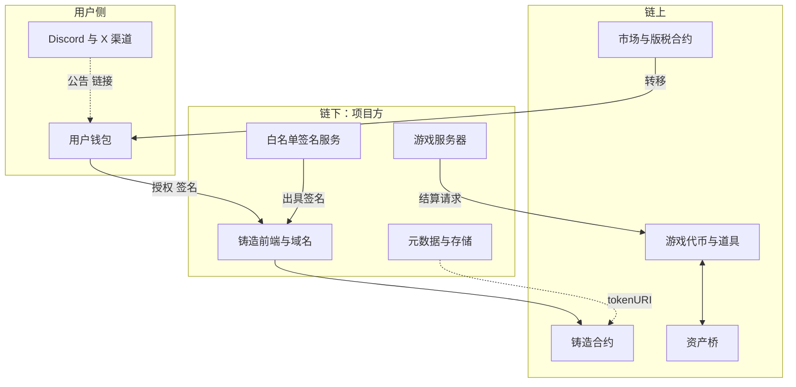
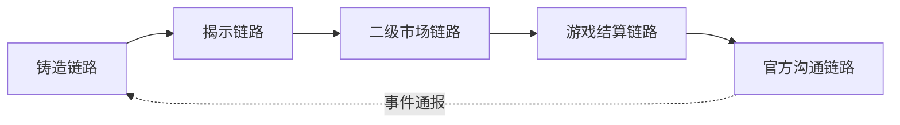
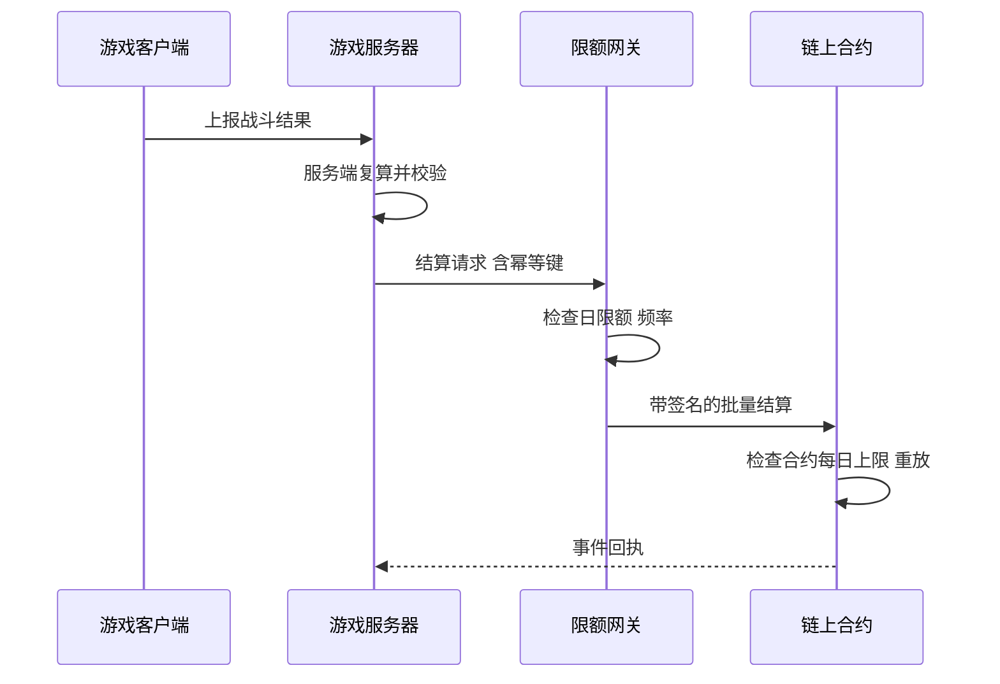

# X44 NFT、GameFi 与元宇宙项目：铸造、市场、游戏经济与运营安全

> 学习目标：读完本章，你能——
> 1. 为一次 NFT 发行（铸造、白名单、元数据揭示）画出信任边界，并用一张门禁表判断"可发行 / 附条件 / 暂缓"。
> 2. 为链游设计"游戏服务器 ↔ 链"的结算边界、资源与代币的水龙头和水槽监控，并写出 5 条可直接落地的告警规则。
> 3. 主持一次 30 分钟的发行日推演，覆盖铸造合约被卡死、官方渠道被盗、授权钓鱼三类事件。
>
> 适用角色：NFT / GameFi 项目方安全负责人、合约与游戏服务端工程师、社区与发行运营
> 前置章节：[02 密码学与随机数](../chapters/02-cryptography-randomness.md)、[05 访问控制与权限](../chapters/05-access-control.md)、[09 MEV 与签名](../chapters/09-mev-signatures.md)、[19 用户诈骗](../chapters/19-user-scams.md)、[20 前端、DNS 与供应链](../chapters/20-frontend-dns-supply-chain.md)、[X33 DeFi 项目方安全运营](X33-defi-project-ops.md)、[X05 检测与响应工程](X05-detection-response-engineering.md)
> 交互实验 / 模板：[T04 上线门禁清单](../templates/T04-go-live-gate.md)；本章给出发行门禁表、铸造合约骨架、监控规则和推演剧本
> 最后核对：2026-11-23

---

## 开场：一个真实场景

2022 年 4 月，NFT 项目 AkuDreams 用"可退款的荷兰式拍卖"发行 Akutars。荷兰式拍卖（Dutch Auction）：价格从高到低下降，所有人最后按同一个成交价付款，多付的部分退回。拍卖结束后，团队应先退款，再提走收入。

公开报道称，拍卖约募集了 11,539 ETH（约 3400 万美元，事发时估值）。随后合约卡死：用户退款无法处理，团队也提不出收入。报道称一个地址主动触发了这个缺陷，这个地址没有获利，只在链上留了一条说明。这笔资金被永久锁在合约里。

<details class="predict"><summary>🤔 先猜再看：这个项目没有被"黑"走一分钱，却损失了全部募资。问题出在哪一层？</summary>

问题出在"合约的状态机没有被当成运营流程来验收"。"退款 → 提取收入"是一条有先后顺序的流程。流程里的一个检查条件，让提取永远通不过。没有人在主网发行前，用真实规模的数据把这条流程从头跑到尾。

NFT 与 GameFi 项目的安全，不只在合约代码里。它在发行日的流程、官方渠道的可信度、游戏服务器与链的边界里。本章把这些做成清单。

</details>

本章还会提到另外四个事件：Meebits 的稀有度抽取、Premint 的前端注入、Munchables 的内部开发者、Ronin 的验证者入侵。它们分别落在"随机与元数据""官方渠道""人员""游戏链桥"四个位置。

---

## 1. 一句话理解

**NFT 与 GameFi 项目的安全运营，是把"铸造、揭示、交易、游戏结算、官方沟通"五条链路，变成有门禁、有监控、有应急开关的流程。**

NFT（Non-Fungible Token）：每个编号唯一的链上凭证，常见标准是 ERC-721 和 ERC-1155。
GameFi：把代币、道具和收益放上链的游戏。
元数据（Metadata）：描述 NFT 名称、图片和属性的数据，通常存在链外。
铸造（Mint）：创建新 NFT 的链上操作。
揭示（Reveal）：发行后才公开每个 NFT 的真实图片和属性。
水龙头（Faucet）与水槽（Sink）：游戏经济里产出代币或道具的渠道，叫水龙头。消耗代币或道具的渠道，叫水槽。

> 🎯 打个比方：演唱会开票。门票（NFT）要防假票和黄牛，售票窗口（铸造）要防系统崩溃，场内消费（游戏经济）要防通胀，官方公告（渠道）要防假公告。
>
> 比喻的局限：演唱会的售票方可以撤销门票、退钱、报警。链上的 NFT 转出后无法撤销，合约卡死后资金无法退回，授权被钓鱼后资产几分钟就被转走。所以"事前验收"比"事后补救"重要得多。

---

## 2. 保护目标与信任边界

项目方要保护六样东西：募资与金库、铸造公平性、用户的 NFT 与授权、游戏经济的稳定、官方渠道的可信度、团队内部权限。



读图要点：
- 实线是资金与授权路径，虚线是"用户凭信任去相信"的信息路径（元数据、公告链接）。
- 最容易出事的是虚线：用户从官方渠道点进的链接，决定了他在哪个前端签名。
- 游戏服务器是链外中心化组件。它对链发出的结算请求，必须被限额和审计。
- 局限：这张图没有画第三方服务，例如存储网关、RPC 和邮件服务商。这些要在供应商清单里单列。

下表列出"不能被信任"的东西。

| 不能被信任的东西 | 原因 | 对应控制 |
|---|---|---|
| 链上可见的随机来源 | 调用者可以先模拟再决定是否提交 | NFT-1 |
| 揭示前可被推断的元数据 | 稀有度会提前泄露 | NFT-2 |
| 前端静态脚本 | 一个脚本被替换，所有签名请求都被改写 | NFT-8 |
| 官方渠道里的任何链接 | 渠道账号会被盗 | NFT-9 |
| 游戏客户端上报的结果 | 客户端可被修改 | NFT-12 |
| 内部开发者的单人合约改动 | 内部人也是威胁来源 | NFT-18 |

---

## 3. 参考架构

### 3.1 五条链路与职责



读图要点：这是发行方的时间顺序。每条链路有自己的负责人、门禁和告警。
最后一条虚线表示：任何一条链路出事，都由"官方沟通链路"对外通报，所以沟通渠道要最先被保护。

| 链路 | 核心组件 | 负责人 | 主要风险 |
|---|---|---|---|
| 铸造 | 铸造合约、白名单、定价、退款 | 合约工程师 | 状态卡死、抢跑、白名单绕过、重入 |
| 揭示 | 元数据存储、随机种子 | 合约加运营 | 稀有度提前泄露、元数据被改 |
| 二级市场 | 市场合约、版税、授权 | 产品加安全 | 授权钓鱼、版税绕过、订单签名滥用 |
| 游戏结算 | 游戏服务器、代币合约、桥 | 服务端加合约 | 无限铸币、外挂、桥被盗 |
| 官方沟通 | Discord、X、域名、邮件 | 社区运营 | 账号被盗、假公告 |

### 3.2 铸造合约的几种白名单做法

通用做法有三种。

| 做法 | 机制 | 优点 | 风险 |
|---|---|---|---|
| Merkle 树白名单 | 合约存根哈希，用户提交证明 | 链上成本低 | 根设置错误、叶子未绑定地址和数量、可重复领取 |
| 签名白名单 | 后端用私钥签 `(地址, 数量, 截止时间, nonce)` | 灵活，可动态发放 | 签名密钥泄露、签名可重放、未绑定合约和链 |
| 链上登记 | 先用交易登记地址 | 简单直观 | 成本高，易被女巫刷 |

签名白名单的合约骨架如下（示例，非生产代码）。

```solidity
// 示例：签名白名单铸造的关键检查（Solidity ^0.8.20）
bytes32 public constant TYPEHASH =
    keccak256("Allow(address to,uint256 qty,uint256 deadline,uint256 nonce)");

mapping(address => uint256) public minted;   // 每地址已铸数量
mapping(bytes32 => bool) public usedSig;     // 签名已使用

function mintAllowed(uint256 qty, uint256 deadline, uint256 nonce, bytes calldata sig)
    external payable
{
    require(saleOpen, "sale closed");
    require(block.timestamp <= deadline, "expired");                  // ✅ 有截止时间
    require(totalSupply() + qty <= MAX_SUPPLY, "sold out");
    require(msg.value == price * qty, "bad value");
    bytes32 digest = _hashTypedDataV4(                                // ✅ EIP-712：绑定链与合约
        keccak256(abi.encode(TYPEHASH, msg.sender, qty, deadline, nonce))
    );
    require(!usedSig[digest], "used");                                // ✅ 防重放
    require(ECDSA.recover(digest, sig) == signer, "bad sig");
    require(minted[msg.sender] + qty <= MAX_PER_WALLET, "limit");
    usedSig[digest] = true;                                           // ✅ 先改状态
    minted[msg.sender] += qty;
    _mint(msg.sender, qty);                                           // 回调接收者最后发生
}
```

> ⚠️ 警告：`_safeMint` 会回调接收者合约。如果在回调前没有更新 `minted` 和 `totalSupply`，攻击合约可以在回调里再次铸造，绕过每钱包限额。先改状态，再铸造。重入的完整机制见 [04 重入攻击](../chapters/04-reentrancy.md)。

### 3.3 为什么这样分

铸造合约只管"谁能付多少钱换多少个"。揭示、版税、游戏结算都不放进同一个合约。原因：

1. 发行期合约会承载大量资金，函数越少，卡死和重入的面越小。
2. 铸造合约发行结束后应关闭或冻结，而游戏合约要长期运行。
3. 把权限拆开，才能让不同角色持有不同密钥。

---

## 4. 控制清单

| ID | 控制项 | 要防什么 | 优先级 | 怎么验证 |
|---|---|---|---|---|
| NFT-1 | 随机性不依赖调用者可预知的链上值；采用提交-揭示或可验证随机数（VRF） | 调用者模拟后挑选稀有编号 | P0 | 在分叉网络里，用测试合约重复模拟 100 次，确认结果不能被预知 |
| NFT-2 | 揭示前元数据不含可推断的稀有度；批量揭示用发行后才确定的种子 | 稀有度提前泄露 | P0 | 检查存储里的所有文件和索引，确认揭示前不含属性 |
| NFT-3 | 白名单绑定地址、数量、截止时间、链和合约；签名只用一次 | 重放、跨合约复用 | P0 | 回放同一签名两次，第二次应失败 |
| NFT-4 | 每钱包限额在状态更新后才铸造，或用重入保护 | 回调绕过限额 | P0 | 用恶意接收者合约在测试网回归 |
| NFT-5 | 合约升级权限在多签加时间锁之后；代理实现已验证；发行前审计覆盖所有实现 | 内部人改合约、未验证实现 | P0 | 用 `cast` 读取管理员与实现地址，对照权限登记表 |
| NFT-6 | 退款、提取、暂停三条流程各自独立，且不会互相卡死 | 状态机死锁 | P0 | 主网规模压测：模拟满额、全部退款、再提取 |
| NFT-7 | 提取权限指向多签；收入先进入金库地址再分配 | 单人转走募资 | P0 | 读取合约 `owner` 与收款地址，核对多签 |
| NFT-8 | 前端脚本固定版本并校验完整性；域名开启注册锁和 DNSSEC；发行日冻结变更 | 前端脚本被替换 | P0 | 对照 [20 前端、DNS 与供应链](../chapters/20-frontend-dns-supply-chain.md) 的核对项 |
| NFT-9 | 官方渠道开启硬件密钥登录、管理员最小化、机器人和权限分离 | 社区账号被盗发假链接 | P0 | 检查每个管理员账号的 2FA 类型和 Discord 权限 |
| NFT-10 | 授权提示使用最小范围；市场和白名单页面不要求全局授权 | 授权钓鱼 | P1 | 抓取每个签名请求，核对类型与范围 |
| NFT-11 | 元数据存储使用内容寻址并固定；可变元数据有登记与时间锁 | 项目方或被盗账号改图 | P1 | 检查 `tokenURI` 指向，评估是否可被单方更改 |
| NFT-12 | 游戏服务器的结算请求带限额、频率和幂等键；链上合约自带每日上限 | 无限铸币、重复结算 | P0 | 在测试环境重放同一请求 100 次，确认只生效一次 |
| NFT-13 | 游戏代币的铸币权限分层：不允许服务器热钱包直接无限铸币 | 服务器被盗等于无限增发 | P0 | 读取铸币角色与限额 |
| NFT-14 | 资产桥与验证者采用 X32 的控制；验证者密钥分散、白名单定期复核 | 桥被盗 | P0 | 见 [X32 L2、跨链桥与预言机运营方](X32-l2-bridge-oracle-ops.md) |
| NFT-15 | 经济监控：水龙头与水槽比、单地址占比、异常铸造速度 | 通胀、女巫、外挂刷资源 | P1 | 用本章 SQL 在历史数据上回放 |
| NFT-16 | 反外挂：服务端权威、行为异常检测、封禁与申诉 | 外挂刷资源 | P1 | 抽样复核异常账号 |
| NFT-17 | 暂停开关：铸造、交易、游戏结算、桥分别可停；守护者只有刹车权 | 事件扩大 | P0 | 每季度演练，记录从决定到生效的分钟数 |
| NFT-18 | 开发者与外包人员：入职背景核验、合约改动需要两人审核、禁止单人部署 | 内部人植入后门 | P0 | 检查合并规则与部署账号 |
| NFT-19 | 发行日作战室：值班表、公告模板、回滚方案、独立复核人 | 事件无人决策 | P1 | 发行前一周做桌面推演 |
| NFT-20 | 事件后赔付与沟通预案：谁能决定补偿、范围、资金来源 | 用户信任崩溃 | P2 | 检查预案是否已获治理或管理层批准 |

---

## 5. 分级落地

| 档次 | 适用 | 做什么 | 需要多少人与时间 |
|---|---|---|---|
| 最小可行 | 小型 NFT 发行，一次性铸造 | NFT-1 至 NFT-9 中的 P0；发行前审计；多签收款；官方渠道硬件密钥；发行日值班 | 1 名安全负责人加 1 名合约工程师，约 2 周 |
| 标准 | 持续运营的 NFT 项目或轻量链游 | 全部 P0 加 NFT-10、NFT-11、NFT-15；监控与暂停演练；授权钓鱼巡检 | 2 至 3 人，约 6 至 8 周，之后每周约半天 |
| 成熟 | 有自有代币、桥或自有链的链游 | 全部控制；游戏经济专项复核；桥与服务器的红队；季度演练；第三方鉴证 | 安全小组 3 至 5 人，约一个季度起步 |

以上人数与时间为建议估算，不是行业统计。

---

## 6. 落地做法

### 6.1 发行就绪门禁（可直接改写）

下面这张表在发行前 7 天、1 天、发行前 1 小时各过一遍。

```yaml
# 示例：NFT 发行门禁（每项必须有证据链接）
gate: nft-launch
items:
  - id: G1
    check: "审计报告覆盖铸造合约、白名单、退款与提取全部路径，高危已修复"
    evidence: "审计报告链接、复测记录"
  - id: G2
    check: "主网规模压测：满额铸造、全部退款、提取收入，三步全部通过"
    evidence: "分叉测试日志"
  - id: G3
    check: "合约管理员、收款人为多签；签名人名单与权限登记表一致"
    evidence: "cast 输出截图"
  - id: G4
    check: "暂停开关已测试；暂停人已在值班表"
    evidence: "演练记录"
  - id: G5
    check: "前端脚本版本固定；域名注册锁已开；发行日冻结变更"
    evidence: "构建哈希、注册商截图"
  - id: G6
    check: "官方渠道所有管理员已启用硬件密钥；机器人权限最小化"
    evidence: "管理员清单"
  - id: G7
    check: "公告模板、假链接处置流程、对外发言人已确定"
    evidence: "作战室文档"
decision: "全部通过=可发行；G1 G2 G3 G4 任一失败=暂缓"
```

### 6.2 用 `cast` 核对链上权限

```bash
# 示例：核对铸造合约的权限（把 $NFT 和 $RPC 换成你的地址与节点）
cast call $NFT "owner()(address)" --rpc-url $RPC
# 读取 EIP-1967 代理的管理员槽与实现槽，核对是否与登记表一致
cast storage $NFT 0xb53127684a568b3173ae13b9f8a6016e243e63b6e8ee1178d6a717850b5d6103 --rpc-url $RPC
cast storage $NFT 0x360894a13ba1a3210667c828492db98dca3e2076cc3735a920a3ca505d382bbc --rpc-url $RPC
# 检查铸币角色
cast call $NFT "hasRole(bytes32,address)(bool)" $MINTER_ROLE $GAME_SERVER --rpc-url $RPC
```

核对结果写入权限登记表：地址、角色、持有人、轮换日期、对应多签的签名人。登记表做法见 [X33 DeFi 项目方安全运营](X33-defi-project-ops.md)。

### 6.3 随机与揭示：三种做法比较

| 做法 | 说明 | 局限 |
|---|---|---|
| 链上哈希（`block.timestamp` 加调用者） | 看似随机 | 调用者可模拟结果，再决定是否提交，不可用 |
| 提交-揭示 | 先提交承诺，延后若干区块再揭示 | 要处理用户不揭示的情况 |
| VRF（可验证随机函数） | 预言机给出带证明的随机数 | 有费用与回调延迟；仍要防止选择性取消 |

更稳妥的做法是：发行结束后，才由 VRF 生成一个全局种子，再用种子对全部编号做一次置换。每个用户的编号在铸造时已确定，稀有度在种子公开后才可知。

### 6.4 授权与市场

授权钓鱼是 NFT 用户最常见的资产损失。项目方能做的有四件事：

1. 官方前端只请求最小授权，不请求 `setApprovalForAll`，除非必要并给出说明。
2. 发行页与市场页使用单独域名，且不放第三方广告脚本。
3. 巡检假站：每天搜索与项目名相似的域名和社交账号，提交下架与封禁请求。
4. 发行日公告里写明"官方永远只有这几个链接"。

版税由市场自愿执行还是合约强制执行，随市场而变。截至 2026 年公开资料，各市场政策不一，以各市场最新文档为准。项目方不要把版税收入写进安全假设。

### 6.5 游戏服务器与链的边界



读图要点：
- 客户端只"上报"，不决定结果。结果由服务端复算。
- 限额网关是一个独立服务，它的上限与合约每日上限是两层独立限制。
- 合约自己的上限，是服务器被盗时的最后一道防线。
- 局限：如果限额网关和服务器由同一批人持有密钥，两层限制可被同时绕过。要分开保管。

合约侧的每日铸币上限示意如下（示例）。

```solidity
// 示例：游戏代币的每日铸币上限
uint256 public constant DAILY_CAP = 1_000_000e18;   // 示例数值
uint256 public mintedToday;
uint256 public dayStart;

function gameMint(address to, uint256 amt) external onlyRole(GAME_MINTER) {
    if (block.timestamp >= dayStart + 1 days) { dayStart = block.timestamp; mintedToday = 0; }
    require(mintedToday + amt <= DAILY_CAP, "daily cap");  // ✅ 服务器被盗也只能铸到上限
    mintedToday += amt;
    _mint(to, amt);
}
```

### 6.6 经济监控：水龙头与水槽

下面的 SQL 示例按天统计代币的产出和消耗，用来发现通胀与刷资源。表结构为示意。

```sql
-- 示例：每日净增发与消耗比（表 token_flows 为示意）
WITH d AS (
  SELECT date_trunc('day', ts) AS day,
         SUM(CASE WHEN kind = 'faucet' THEN amount ELSE 0 END) AS produced,
         SUM(CASE WHEN kind = 'sink'   THEN amount ELSE 0 END) AS burned
  FROM token_flows
  GROUP BY 1
)
SELECT day, produced, burned, produced - burned AS net_inflation,
       burned::numeric / NULLIF(produced, 0) AS sink_ratio
FROM d ORDER BY day DESC LIMIT 30;

-- 最近 24 小时产出量前 10 的地址占总产出的比例
WITH per AS (
  SELECT addr, SUM(amount) AS a FROM token_flows
  WHERE kind = 'faucet' AND ts >= now() - interval '1 day' GROUP BY addr
)
SELECT (SELECT SUM(a) FROM (SELECT a FROM per ORDER BY a DESC LIMIT 10) t)
       / NULLIF((SELECT SUM(a) FROM per), 0) AS top10_share;
```

### 6.7 元数据与存储

元数据决定用户看到的图片和属性，要回答三个问题。

1. 存在哪里？项目方自己的服务器最灵活，也最脆弱。一次入侵就能改写全部图片。
2. 地址能不能变？如果 `baseURI` 可被管理员随时修改，用户其实在信任管理员。
3. 揭示前放什么？占位图应对所有编号相同，文件名和索引不应按稀有度排列。

通用做法：用内容寻址存储（例如 IPFS 的 CID）固定最终元数据。揭示时一次性设置 `baseURI`，并在设置后冻结。如果确需可变（例如游戏道具升级），把变更写成链上事件，并加时间锁。

### 6.8 游戏经济：把"通胀"当成安全问题

游戏代币的价格崩溃，在用户眼里就是"项目被黑"。运营方要在上线前回答下面五个问题。

| 问题 | 为什么重要 | 验收方式 |
|---|---|---|
| 每天最多产出多少代币？ | 没有上限，外挂和漏洞就能无限增发 | 合约与网关两层上限 |
| 每个水龙头对应什么水槽？ | 只产出不消耗，必然通胀 | 画出产出与消耗的流向图 |
| 单个地址能占多少比例？ | 女巫与脚本会集中刷取 | 单地址与设备聚类告警 |
| 玩家资产能否在链外私下转让？ | 绕过市场会让监控失明 | 统计链外与链上流转量 |
| 出事时能否冻结结算？ | 否则只能眼看通胀扩散 | 暂停演练 |

反外挂的基本原则是"服务端权威"：战斗结果、掉落和资源产出都由服务端计算，客户端只发送操作。链上结算只接受服务端签名的批量请求。通用做法还包括对异常账号做延迟结算：先记账，若干小时后复核再上链。

### 6.9 元宇宙与虚拟地块

土地、虚拟形象和空间类项目，多出三类运营风险。

- 创作者内容：用户上传的 3D 模型和脚本可能含恶意内容，需要审核或沙箱。
- 空间内的链接与支付入口：它们等同于一个前端，要按 NFT-8 处理。
- 平台账号与多人活动：活动期间的主持人账号被盗，会向大量用户同时推送钓鱼链接。按 NFT-9 管理。

### 6.10 订单签名与市场授权

NFT 市场多用"链下签名订单、链上成交"的模式。用户签的是一份订单，不是一笔转账。钓鱼者会让用户签一份"价格接近零"的订单，再由自己成交。项目方能做的：

1. 官方前端在签名前，用人话展示价格、收款人和有效期。
2. 巡检并上报已知的钓鱼订单地址，与市场和钱包厂商共享。
3. 对集合设置"异常成交价"监控：成交价远低于地板价，且买方是新地址，就告警。

钱包与签名展示的通用问题见 [X37 钱包厂商安全](X37-wallet-vendor-security.md)。

### 6.11 常见坑

- 只审计铸造合约，没有审计退款与提取的组合流程。
- 管理员是单个 EOA，发行后才想起换多签。
- 元数据服务器是项目方自己的网站，被攻破就能改所有图。
- 发行日前端临时改动，没有走构建与哈希核对。
- 官方 Discord 的机器人拥有过高权限。
- 游戏服务器的热钱包同时拥有铸币权限。

---

## 7. 运营：指标、告警、值班、演练、季度节奏

### 7.1 告警规则

下面是三条规则示意（伪代码，示例）。

```yaml
# 示例：铸造速度异常
name: nft_mint_burst
condition: >
  count(Transfer from 0x0, window=1m) > 3 * baseline_p95
  OR single_addr_mints_in_block > MAX_PER_WALLET
severity: high
action: page onduty, prepare pause
---
# 示例：权限与升级变更
name: nft_admin_change
condition: event in (OwnershipTransferred, Upgraded, AdminChanged, RoleGranted, RoleRevoked)
severity: critical
action: page security, verify against change ticket
---
# 示例：游戏代币异常增发
name: game_token_inflation
condition: minted_last_1h > 0.5 * DAILY_CAP OR net_inflation_24h > 2 * trailing_7d_avg
severity: high
action: throttle gateway, review top addresses
```

此外建议至少配置以下告警：

| 告警 | 触发 | 处置人 |
|---|---|---|
| 收入地址转出 | 收款多签的任何转出 | 安全负责人 |
| 元数据变更 | `tokenURI` 或基础地址被设置 | 合约工程师 |
| 假站出现 | 新注册的相似域名 | 社区运营 |
| 官方账号登录异常 | 新设备登录、管理员变更 | 社区负责人 |
| 授权激增 | 一小时内大量用户授权同一未知地址 | 安全值班，准备公告 |

### 7.1.1 发行日运营要点

发行日是攻击者最集中的时间。项目方要在这一天把"变量"降到最少。

1. 发行前 48 小时冻结前端、合约参数和官方渠道的管理员变更。需要改动时，走紧急变更单，并由第二人复核。
2. 作战室里放一张"官方链接清单"。所有公告只从这张清单取链接。
3. 社区频道开启慢速模式，关闭陌生人私信入口，限制新成员发链接。
4. 发行开始后，每 15 分钟由安全值班报告一次：铸造进度、告警数、假站数、授权激增情况。
5. 发行结束后 24 小时内，复核收入多签的流水，并关闭不再需要的铸造权限与白名单签名密钥。

局限：这些措施降低风险，不能消除风险。Premint 的案例表明，一个第三方工具被入侵，也能让合法域名上的用户受损。

### 7.2 值班与演练

- 发行日：值班不少于 3 人。安全、合约、社区各 1 人，另有 1 位有权拍板暂停的人。
- 每季度：做一次暂停演练，记录"决定 → 生效"的分钟数。
- 每半年：做一次官方渠道失陷演练，例如"X 账号被盗发出假空投链接"。

### 7.3 季度节奏

| 月 | 做什么 |
|---|---|
| 第 1 月 | 权限登记表复核、签名人轮换、监控规则回放 |
| 第 2 月 | 经济监控复盘、反外挂复核、第三方供应商复核 |
| 第 3 月 | 桌面推演、暂停演练、门禁表更新 |

### 7.4 推演剧本：发行日三个注入（30 分钟）

背景：项目今天 20:00 铸造 5000 个 NFT，价格 0.1 ETH（示例）。

| 时间 | 注入 | 要求团队做什么 |
|---|---|---|
| 20:05 | 公开频道里出现"官方抽奖"链接，来自一个管理员账号 | 判断账号是否被盗；冻结该账号；发出"不要点链接"的公告 |
| 20:15 | 监控显示同一批地址在一笔交易里铸造数量超过限额 | 判断是否重入或白名单绕过；是否暂停铸造；谁有权暂停 |
| 20:25 | 铸造结束，提取收入失败，合约回滚 | 判断是否状态卡死；是否已有退款流程；对外说什么 |

评分：

| 维度 | 满分 | 标准 |
|---|---|---|
| 决策时间 | 3 | 每个注入从发现到决定不超过 5 分钟 |
| 授权清晰 | 3 | 谁决定、谁执行没有争议 |
| 沟通 | 2 | 公告包含"已知、未知、下一步、官方链接" |
| 证据保全 | 2 | 保存交易哈希、截图、账号日志 |

### 7.5 公告模板（两种）

用户公告（示例）：

```text
【事件通告】
时间：2026-xx-xx xx:xx UTC
已知：我们发现官方 Discord 出现了非官方链接。该链接已删除，相关账号已冻结。
未知：影响范围正在统计。
请你：不要点击该链接；如已签名授权，请到授权管理工具撤销；官方发行链接只有：<域名列表>。
下一步：xx:xx UTC 更新进度。
```

合作方（市场、钱包、安全公司）通知（示例）：

```text
我们是 <项目>。请将以下合约地址与域名加入风险提示：<地址与域名>。
事件时间：<UTC>。联系人：<邮箱>。
需要你们协助：下架相关集合的虚假挂单；封禁钓鱼域名。
```

---

## 8. 失效案例

以下 5 个案例均来自公开报道或官方复盘。金额为事发时估值，随来源不同有差异。

### 案例 1：Meebits 稀有度抽取（2021 年 5 月，以太坊）

- 事实：公开技术讨论称，Meebits 在揭示前，各编号的稀有度已可通过 IPFS 上的文件推断。铸造合约用调用者、时间戳等链上值选编号。攻击者先模拟交易，看到结果不满意就用更高 gas 替换交易，反复重试，直到拿到稀有编号。媒体报道称他以此铸造的一个稀有 Meebit 卖出约 76.5 万美元（各来源数字有出入）。Larva Labs 暂停了铸造与交易。
- 绕过的控制：NFT-1（随机性）、NFT-2（元数据泄露）。
- 教训：链上"随机"对调用者可见。资产价值高时，抽取结果不能由调用者模拟得出。
- 来源类型：OpenZeppelin 论坛技术讨论、Code4rena 审计报告、媒体报道。

### 案例 2：AkuDreams 退款卡死（2022 年 4 月，以太坊）

- 事实：公开报道称，荷兰式拍卖后约 11,539 ETH 被锁在合约里，用户与团队都无法取出。一个地址触发了缺陷，没有获利。团队表示会用其他资金给用户补退款，并另行发放 NFT。
- 绕过的控制：NFT-6（流程状态机验收）、NFT-5（审计覆盖）。
- 教训：合约之间的先后依赖要用主网规模的数据压测。详细的代码层原因以 BlockSec 等安全公司分析为准，本章未逐行核对。
- 来源类型：媒体报道（The Block、Decrypt、Cointelegraph）、项目方在社交平台的说明。

### 案例 3：Premint 前端被注入（2022 年 7 月）

- 事实：公开分析称，premint.xyz 被注入恶意 JavaScript，页面诱导用户签署授权，攻击者随后转走 NFT。CertiK 的分析称约 314 个 NFT，约 275 ETH（约 37.5 万美元，事发时估值）。根因细节在公开资料中有出入，CertiK 的文章没有说明注入是怎样发生的。
- 绕过的控制：NFT-8（前端脚本）、NFT-10（授权）。
- 教训：第三方发行工具的前端也是你的信任边界。用户在合法域名上签名，不等于安全。
- 来源类型：安全公司分析（CertiK）、媒体报道（The Block、BankInfoSecurity）。

### 案例 4：Munchables 内部开发者（2024 年 3 月，Blast）

- 事实：公开报道称，Munchables 在 Blast 上被转走约 6250 万美元的 ETH。分析称，一名受雇的开发者在合约里预先埋入后门，通过升级合约实现，修改了锁定余额，随后提走资金。链上研究者 ZachXBT 称该开发者与朝鲜相关，这是研究者的说法，并非官方认定。资金在约一天后归还，团队称开发者交出了钱包私钥。
- 绕过的控制：NFT-5（升级与审核）、NFT-18（人员）。
- 教训：单人可部署、实现合约未验证，是同一种风险。人员背景核验与两人审核，是技术控制之外的必要控制。
- 来源类型：媒体报道（The Block、CryptoSlate、Cointelegraph、Blockworks）、安全公司分析。

### 案例 5：Ronin 与 Axie Infinity（2022 年 3 月）

- 事实：2022 年 3 月 23 日，Ronin 桥被转走约 173,600 ETH 和 2550 万 USDC（事发时估值约 6 亿美元以上）。Ronin 官方复盘称，攻击者通过针对一名员工的鱼叉式钓鱼进入 Sky Mavis 的系统，控制了 Sky Mavis 的四个验证者。媒体报道称，一个遗留的、未被撤销的白名单权限让攻击者拿到 Axie DAO 的验证者签名，凑够 9 个中的 5 个。事件在约六天后，因用户提币失败才被发现。公开报道称 FBI 将其归因于朝鲜相关的 Lazarus Group。
- 绕过的控制：NFT-14（桥与验证者）、NFT-9（人员与渠道）、NFT-17（监控与暂停）。
- 教训：验证者集中、临时授权没有撤销、缺少大额提币告警，叠加在一起造成了损失。
- 来源类型：官方复盘（Ronin 与 Sky Mavis）、媒体报道（TechCrunch、The Block、Forklog）。

### 案例对照

| 案例 | 位置 | 失效的是 | 关键控制 |
|---|---|---|---|
| Meebits | 随机与元数据 | 设计假设 | NFT-1、NFT-2 |
| AkuDreams | 铸造合约流程 | 验收缺失 | NFT-6 |
| Premint | 前端 | 供应链 | NFT-8 |
| Munchables | 人员与升级 | 内部人 | NFT-5、NFT-18 |
| Ronin | 桥与验证者 | 密钥集中与监控 | NFT-14、NFT-17 |

---

## 9. 评估检查点

- [ ] **NFT-1** 铸造的编号不能被调用者模拟后挑选
- [ ] **NFT-2** 揭示前存储里没有可推断稀有度的文件
- [ ] **NFT-3** 白名单签名绑定地址、数量、截止时间、链与合约，且只能用一次
- [ ] **NFT-4** 每钱包限额不能被回调绕过
- [ ] **NFT-5** 升级权限在多签加时间锁之后，实现合约已验证并被审计
- [ ] **NFT-6** 退款、提取、暂停流程已在主网规模下压测
- [ ] **NFT-7** 收入由多签控制
- [ ] **NFT-8** 前端脚本版本固定，域名有注册锁，发行日冻结变更
- [ ] **NFT-9** 官方渠道管理员用硬件密钥，权限最小化
- [ ] **NFT-10** 官方前端不请求不必要的全局授权
- [ ] **NFT-11** 元数据存储内容寻址，可变元数据有登记与时间锁
- [ ] **NFT-12** 游戏结算有限额、频率和幂等键
- [ ] **NFT-13** 铸币权限分层，服务器热钱包不能无限铸币
- [ ] **NFT-14** 桥与验证者符合 X32 的控制
- [ ] **NFT-15** 经济监控上线，已在历史数据回放
- [ ] **NFT-16** 反外挂与申诉流程存在
- [ ] **NFT-17** 铸造、交易、结算、桥各有独立暂停，并有演练记录
- [ ] **NFT-18** 合约改动需要两人审核，开发者背景已核验
- [ ] **NFT-19** 发行日作战室、值班与公告模板就位
- [ ] **NFT-20** 事件后赔付与沟通预案已获批准

把结果写进报告：

| 检查项 | 状态（通过 / 附条件 / 不通过） | 证据链接 | 负责人 | 复核日期 |
|---|---|---|---|---|
| NFT-1 | | | | |
| …… | | | | |

---

## 10. 上手路径

**第一周**
1. 列出所有合约、管理员、收款地址、签名人，做成权限登记表。
2. 检查官方渠道的管理员清单与 2FA 类型，把没有硬件密钥的管理员降权。
3. 画一张本项目版的信任边界图（对照第 2 节）。

**第一个月**
1. 按第 6.1 节门禁表过一次，列出缺口。
2. 配置第 7.1 节的告警，并用历史数据回放。
3. 做一次暂停演练，记录分钟数。

**第一个季度**
1. 做一次桌面推演（第 7.4 节）。
2. 对游戏服务器与链的结算边界做一次专项复核。
3. 建立假站巡检与披露渠道，接入 [X36 漏洞披露、赏金与安全社区协作](X36-disclosure-bounty-ops.md)。

---

## 11. 常见误区

| 误区 | 事实 |
|---|---|
| 审计过了就安全 | 审计覆盖的是代码。发行流程、官方渠道、内部人不在其中 |
| 没人黑我们就没有损失 | AkuDreams 没有被盗走资金，但资金被永久锁定 |
| 随机数用区块哈希就够了 | 调用者可模拟，价值高时会被利用 |
| 元数据放自己的服务器更灵活 | 同时也让一次入侵可以改写所有图片 |
| 前端是产品问题，不是安全问题 | 前端被替换，所有签名请求都会被改写 |
| 游戏服务器只是链下组件 | 它持有结算权限，是链的信任边界 |

---

## 12. 术语表

| 术语 | 解释 |
|---|---|
| NFT | 每个编号唯一的链上凭证 |
| 铸造 / Mint | 创建新 NFT |
| 揭示 / Reveal | 发行后才公开图片与属性 |
| 荷兰式拍卖 / Dutch Auction | 价格从高到低，统一成交价 |
| Merkle 白名单 | 用 Merkle 根校验地址是否在名单中 |
| VRF | 可验证随机函数，随机数带有可验证的证明 |
| 水龙头 / 水槽 | 游戏中产出与消耗代币或道具的渠道 |
| 授权 / Approval | 允许某地址转移你的代币或 NFT |
| 守护者 / Guardian | 只有刹车权限的角色 |

---

## 13. 动手练习与思考题

### 练习 1：画你的发行信任边界图（20 分钟）
为一次假想发行画图：铸造合约、白名单签名服务、前端、元数据存储、官方渠道。标出每个"用户凭信任相信"的点，并给每个点写一条控制。

### 练习 2：给门禁表打分（30 分钟）
拿一个你熟悉的公开 NFT 项目，只用公开信息（合约是否验证、管理员是否多签、元数据位置）填第 9 节的检查表。记录哪些项"查不到"，查不到也是一种结论。

### 练习 3：写一条经济告警（20 分钟）
假设一个游戏代币每天上限产出 100 万（示例）。写出两条告警：一条针对"一小时内产出超过日上限一半"，一条针对"单地址占当日产出的比例超过 20%"。写出处置步骤。

### 思考题
1. AkuDreams 没有任何人获利，仍然损失全部募资。你的项目里，哪一条"先后顺序"的流程最可能出现同样的卡死？
2. 游戏服务器被盗时，哪一层限制最后生效？这一层与服务器由不同的人保管吗？
3. 官方 Discord 被盗发出钓鱼链接，你的团队从发现到公告需要几分钟？谁有权发公告？

> 🪞 反思：把你自己的项目放进第 8 节的对照表，哪一行最像你？哪一个控制你现在无法证明有效？

建议配套（后续在 L3 训练营实现）：发行日推演剧本卡片与授权钓鱼巡检脚本。

相关章节：[X32 L2、跨链桥与预言机运营方](X32-l2-bridge-oracle-ops.md)、[X37 钱包厂商安全](X37-wallet-vendor-security.md)、[21 社会工程与内部人](../chapters/21-social-engineering-insiders.md)、[12 跨链桥安全](../chapters/12-cross-chain-bridges.md)。
