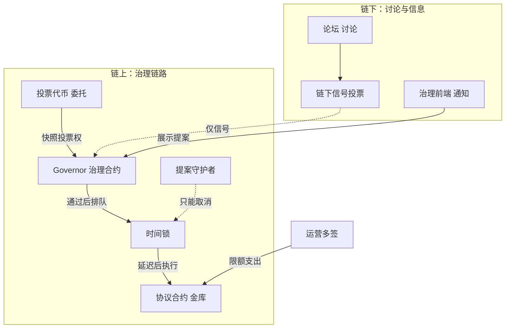
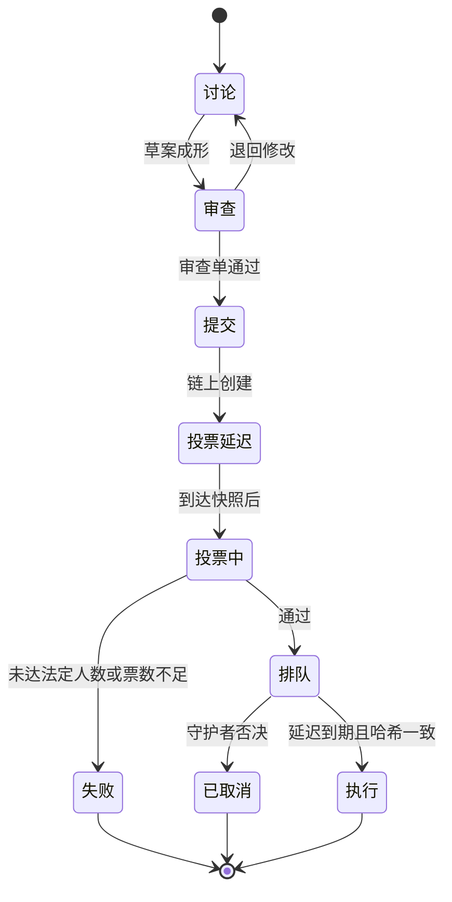
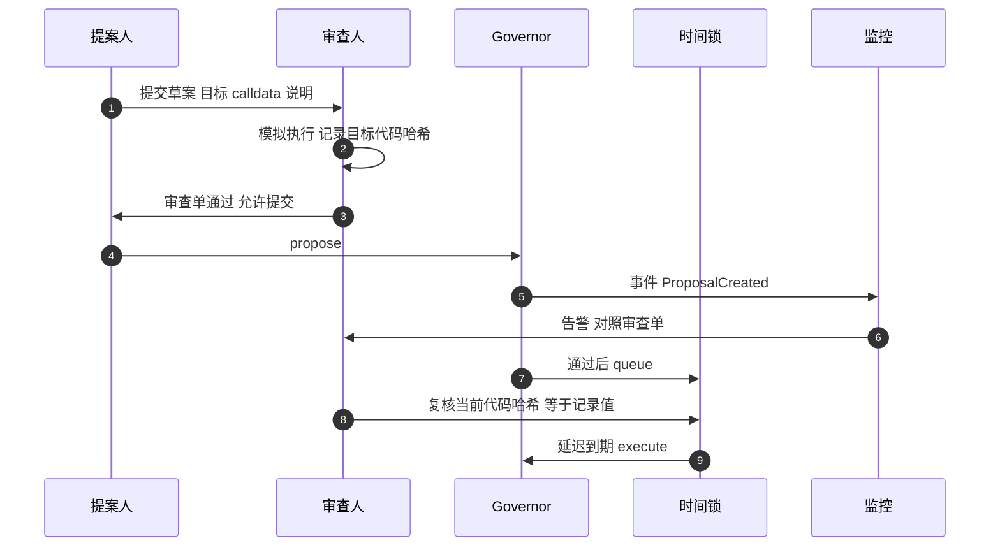

# X47 DAO 与治理运营：提案、投票、金库与应急权限

> 学习目标：读完本章，你能——
> 1. 给一个 DAO 画出"提案 → 投票 → 时间锁 → 执行"的完整链路，标出每一段谁说了算、谁能拦，并写出一份提案审查单。
> 2. 用 `cast` 命令核对治理合约的参数（投票延迟、快照、法定人数、时间锁、守护者），并在提案排队与执行两个时点核对代码哈希。
> 3. 写出 5 类治理监控规则和一份金库支出控制，并主持一次 40 分钟的"恶意提案"桌面推演。
>
> 适用角色：DAO 与协议治理的安全负责人、治理协调人（Governance Facilitator）、委托人（Delegate）、多签签名人、治理合约工程师
> 前置章节：[05 访问控制与权限](../chapters/05-access-control.md)、[11 DeFi 经济安全（第 3 节治理攻击）](../chapters/11-defi-economic-security.md)、[X33 DeFi 项目方安全运营](X33-defi-project-ops.md)、[X05 检测与响应工程](X05-detection-response-engineering.md)
> 交互实验 / 模板：[闪电贷治理攻击与防御](../interactive/audit-governance.html)、[多签交易签前复核面板](../interactive/multisig-review-lab.html)、[T04 上线门禁清单](../templates/T04-go-live-gate.md)；本章给出提案审查单、治理参数核对脚本、监控规则和金库支出控制
> 最后核对：2026-11-23

---

## 开场：一个真实场景

2023 年 5 月，Tornado Cash 的治理合约上出现一个提案。提案说明写道：它重复一个已经通过的旧提案（提案 16）的逻辑，用来处罚部分中继者（Relayer）。投票人对照旧提案，觉得没问题，投了赞成。

公开分析称，这个提案合约里多了一个 `emergencyStop` 函数，里面带有 `selfdestruct`。提案通过后，攻击者先销毁该合约，再用确定性部署在同一地址放入另一份代码。治理合约按地址执行提案，于是执行的是第二份代码。第二份代码给攻击者控制的多个地址各写入 10,000 个 TORN 的锁定余额，合计约 120 万票。各方对损失的口径不一：Coinspect 的复现文档称总损失约 270 万美元以上；CoinDesk 报道称，攻击者先提走 10,000 个 TORN，换得约 2.56 万美元。

<details class="predict"><summary>🤔 先猜再看：投票人读了提案说明，也对照了旧提案。他们错在哪一步？</summary>

投票人审的是"说明文字"和"提案提交时的代码"。治理合约执行的是"执行那一刻该地址上的代码"。两者之间有几天时间，代码可以被换掉。

所以治理运营的第一原则是：**投票和执行必须绑定同一份字节码。** 提案审查要核对代码哈希，而不是只读说明。本章第 6.3 节给出做法。

</details>

治理攻击不只是"闪电贷借票"。Beanstalk 是投票权没有快照（见 [11](../chapters/11-defi-economic-security.md)）。Build Finance 是投票人太少。Audius 是治理合约被重新初始化。Compound 提案 289 是合法投票里的大户。这些事件的共同点是：**治理是一条有特权的写入通道，它的运营要像对待 root 权限一样严格。**

---

## 1. 一句话理解

**DAO 治理运营，是把"改规则、花金库、升级合约、启用应急权限"这四类决定，变成有审查、有快照、有延迟、有刹车、有监控的流程。**

DAO（Decentralized Autonomous Organization，去中心化自治组织）：由代币持有人通过链上投票决定协议参数和资金用途的组织。
提案（Proposal）：一组待执行的链上调用，附带说明文字。
快照（Snapshot）：在某个固定时点记录每个地址的投票权，之后的转账不再影响本次投票。
委托（Delegation）：代币持有人把投票权交给另一个地址（委托人）行使。
法定人数（Quorum）：提案要有效，至少需要的参与票数。
时间锁（Timelock）：提案通过后先公开排队，延迟一段时间才能执行。
提案守护者（Proposal Guardian）：只能取消提案、不能提案或执行的角色。

> 🎯 打个比方：小区业主大会。大会决定要不要动用维修基金。要防四件事：有人临时买房拉票；会议通知写的是 A、合同写的是 B；通过后当天就划款；几个大户串通把基金转走。解法分别是：以开会前一天的产权为准、签字前核对合同原文、决议公示几天后才划款、设一个能"叫停"的角色。
>
> 比喻的局限：业主大会有现实身份和法律责任。DAO 的投票权可以被借、被租、被买，投票人是匿名地址，叫停角色本身也是链上权限，也会成为攻击目标。

---

## 2. 保护目标与信任边界

治理要保护五样东西：金库资金、协议权限（升级与参数）、投票的完整性、治理信息渠道、紧急权限本身。



读图要点：
- 权力从代币流向 Governor，再经时间锁到达协议。每一段都应有一个"能拦"的角色。
- 链下信号投票不自动执行，只表达意愿。链上执行另有通道，这条通道最容易出现"文字与代码不一致"。
- 守护者虚线只指向"取消"。它不能提案，也不能执行。
- 局限：图没有画跨链治理消息（治理合约在一条链上、协议部署在另一条链上）。跨链信任问题见 [X32](X32-l2-bridge-oracle-ops.md)。

**不能被信任的东西：**
- **提案说明文字**。它和实际调用数据可以不一致（见案例 2）。
- **投票时刻的合约代码**。它可以在执行前被替换（见案例 2）。
- **投票权的"当前余额"**。它可以被闪电贷借来（见案例 1）。
- **"人少所以没人反对"**。低参与时，少数人可以合法通过提案（见案例 3、5）。
- **治理合约自己的初始化状态**。重复初始化可以让攻击者变成管理员（见案例 4）。
- **治理前端显示的提案**。前端可能被篡改或延迟，用户看到的未必是链上的提案。

---

## 3. 参考架构

### 3.1 提案全生命周期



读图要点：
- "审查"在链上提交之前，"哈希一致"在执行之前。两个时点都要有人负责，并留证据。
- "投票延迟"让持币人有时间买入或委托。快照应取在投票开始之前的区块，闪电贷借来的票不被计入。
- "排队"是公开的等待期。这个期间必须有监控和公告，否则延迟只是摆设（和 [X33](X33-defi-project-ops.md) 第 3.1 节同理）。
- 局限：图是通用的 Governor 流程。不同协议的名称和阶段略有差别，以实际合约为准。

### 3.2 一次提案的"双时点核对"



读图要点：
- 步骤 2 把"目标合约的代码哈希"写进审查单。步骤 8 在排队后再核一次。两次不一致，提案作废。
- 审查人和提案人不是同一人。监控只负责发现差异，决定权在审查人和守护者。
- 局限：哈希核对只能发现"代码被换"。它发现不了"代码本来就恶意"。后者靠第 6.1 节的审查单和审计。

### 3.3 组件职责表

| 组件 | 职责 | 不能做什么 | 变更方式 |
|---|---|---|---|
| 投票代币与委托 | 记录投票权的历史检查点 | 不能用"当前余额"计票 | 合约升级走治理与时间锁 |
| Governor | 创建提案、计票、排队 | 不能绕过时间锁执行 | 参数变更本身是提案 |
| 时间锁 | 延迟执行、公开排队 | 不能由单个 EOA 管理 | 最小延迟只能经时间锁修改 |
| 提案守护者 | 取消可疑或恶意提案 | 不能提案、执行、改参数 | 由治理限期授权并定期续期 |
| 运营多签 | 限额内的日常支出、紧急暂停 | 不能升级、不能超限额 | 签名人变更走治理 |
| 治理协调人 | 维护论坛流程、审查单、公告 | 不持有任何签名权 | 由 DAO 聘任 |
| 监控与值班 | 发现提案、参数、投票异常 | 不持有任何签名权 | 由安全负责人管理 |

> 💡 注意：提案守护者是一把双刃剑。它能拦住恶意提案，也能被用来拦住正当提案。设计时要写明可否决的情形、任期和续期方式，并让它的每一次使用留下公开理由（见案例 5）。

---

## 4. 控制清单

优先级：P0 必须有；P1 应该有；P2 成熟后补。

| ID | 控制项 | 要防什么 | 优先级 | 怎么验证 |
|---|---|---|---|---|
| DAO-1 | 投票权按提案创建前的快照计算，使用历史检查点（如 ERC20Votes 的 `getPastVotes`） | 闪电贷借票 | P0 | 读合约：`clock()` 与 `proposalSnapshot()`；测试网用借来的票投票，应为 0 |
| DAO-2 | 通过的提案必须经时间锁才能执行，不设"同一交易内通过并执行"的通道 | 同交易治理攻击 | P0 | 读合约：不存在紧急直执行函数；`getMinDelay()` 不为 0 |
| DAO-3 | 投票延迟与投票期有明确下限（示例：延迟 ≥ 1 天，投票期 ≥ 3 天） | 来不及反应 | P0 | `votingDelay()`、`votingPeriod()` |
| DAO-4 | 法定人数有下限，并按总供给或可投票供给的比例设置 | 低参与度下被少数人通过 | P0 | `quorum(block)` 与最近 10 个提案的实际参与率对照 |
| DAO-5 | 提案提交门槛：持票量下限，防垃圾提案 | 提案洪水、噪声掩护 | P1 | `proposalThreshold()` |
| DAO-6 | 提案审查单：提交前填写目标、calldata 解码、影响、模拟结果 | 文字与代码不一致 | P0 | 抽查最近 5 个提案是否有审查单 |
| DAO-7 | 排队与执行时点核对目标代码哈希；提案目标不得含 `selfdestruct`、任意 `delegatecall`、可升级代理（除非该代理本身受时间锁约束） | 提案代码被替换 | P0 | 见第 6.3 节脚本 |
| DAO-8 | 提案守护者：只能取消，任期有限，使用须公开理由 | 恶意提案通过后无法拦截 | P0 | 读合约：守护者地址与到期；演练一次取消 |
| DAO-9 | 治理合约和投票代币初始化只能执行一次，部署后立即检查 | 重复初始化夺权 | P0 | `cast storage` 读初始化标志；审计报告覆盖 |
| DAO-10 | 治理参数变更（延迟、法定人数、时间锁、守护者）自己也走提案与时间锁 | 绕过治理改规则 | P0 | 读合约：这些 setter 受治理（时间锁）限制 |
| DAO-11 | 大额金库支出分级：小额由多签按预算执行，大额必须提案并经时间锁 | 金库被一次性转空 | P0 | 支出分级表与最近 20 笔支出对照 |
| DAO-12 | 多签与链上治理衔接：多签的权限范围、额度和任期写在治理文档里，并可从链上核对 | 多签权限悄悄变大 | P1 | 治理文档与 Safe 的模块、阈值、签名人对照 |
| DAO-13 | 委托人透明：公开委托人名单、投票记录、利益披露 | 贿赂与利益冲突 | P1 | 治理门户可查；每季度抽查 |
| DAO-14 | 大额委托与代币转移告警（示例：占投票供给 ≥ 1%） | 权力突然集中 | P1 | 告警规则回放（见第 6.4 节） |
| DAO-15 | 提案创建、排队、取消、执行事件的实时告警，推送到值班频道 | 恶意提案无人发现 | P0 | 在测试网创建提案，5 分钟内应有告警 |
| DAO-16 | 反晚期操纵：触达法定人数后延长投票期 | 最后一刻大户翻盘 | P1 | 读合约：是否启用晚期法定人数延长（如 OpenZeppelin 的 GovernorPreventLateQuorum 扩展） |
| DAO-17 | 治理前端的发布与域名保护，标准同 [X04](X04-delivery-supply-chain.md)、[20](../chapters/20-frontend-dns-supply-chain.md)；前端展示 calldata 解码，不只展示说明文字 | 用户在假前端上签署委托或投票 | P1 | 前端发布清单；随机提案的展示与链上比对 |
| DAO-18 | 官方通知渠道清单：公告同时发到论坛和官方账号，并附链上提案编号 | 假提案、假公告 | P1 | 渠道清单；季度检查渠道所有权 |
| DAO-19 | 应急权限（暂停、升级、紧急执行）单独列表，每一项有持有人、触发条件、可逆性和演练记录 | 应急权限成为后门 | P0 | 应急权限登记表（第 6.2 节） |
| DAO-20 | 治理攻击响应剧本：谁能取消、谁能暂停协议、怎么对外说 | 事发时互相等待 | P0 | 桌面推演（第 13 节） |
| DAO-21 | 治理参数每季度核对：链上值与治理文档一致 | 文档与链上漂移 | P1 | 第 6.2 节脚本，输出差异表 |
| DAO-22 | 治理合约、代币、时间锁、守护者模块纳入审计范围 | 治理合约自身漏洞 | P1 | 审计报告范围页 |

---

## 5. 分级落地

| 档位 | 做什么 | 人和时间（示例） |
|---|---|---|
| 最小可行 | DAO-1、2、3、4、6、8、15、19：快照、时间锁、延迟与法定人数、审查单、守护者、提案告警、应急权限登记 | 1 名安全工程师 + 1 名治理协调人，约 2 周 |
| 标准 | 再加 DAO-5、7、9–14、16–18、20、21：代码哈希核对、金库分级、委托透明、大额委托告警、前端与渠道保护、季度参数核对、桌面推演 | 1.5 名安全工程师 + 治理协调人，约 6–8 周 |
| 成熟 | 再加 DAO-22 与自动化：提案自动模拟、治理参数漂移监控、独立第三方对守护者与委托人的评议、每年一次红队式治理演练 | 2–3 名安全工程师，持续运营 |

> 💡 注意：最小可行档里没有"哈希核对自动化"，但有"审查单"。人工审查单是更便宜的第一道防线。自动化是第二道。

---

## 6. 落地做法

### 6.1 提案审查单（可直接改写）

提案提交到链上之前，由审查人填写。示例：

```markdown
# 提案审查单（示例）
- 提案编号 / 论坛链接：
- 提案人 / 审查人（不得同一人）：
- 一句话目的：
- 目标合约清单（地址 + 链 + 是否已验证源码 + 当前 extcodehash）：
- calldata 解码（每一项：函数签名、参数、资金流向）：
- 是否涉及：升级 / 参数 / 金库转出 / 权限变更 / 新增签名人
- 是否含 delegatecall、selfdestruct、任意外部调用：是 / 否（是则否决，除非有书面豁免）
- 模拟执行结果（分叉环境，列出状态变化与余额变化）：
- 与说明文字的差异（逐项对照）：
- 最坏情况：金额上限 / 可逆性 / 回滚办法：
- 审查结论：通过 / 附条件 / 退回
- 守护者备注（谁将盯住这个提案）：
```

做法要点：
1. 说明文字与 calldata 解码逐项对照。凡是"同旧提案 X"这类措辞，审查人要对旧提案的代码做 diff。
2. 目标是新部署合约时，读它的字节码（不只读源码），记录 `extcodehash`。
3. 金额按"最坏情况"填写，不填"预计"。

### 6.2 治理参数核对与应急权限登记

下面的脚本读取一个基于 OpenZeppelin Governor 与 TimelockController 的 DAO。地址是占位符，函数名以实际合约为准。示例：

```bash
# 示例：核对治理关键参数（只读）
GOV=0xGovernorAddress; TL=0xTimelockAddress; RPC=https://eth.example/rpc
GUARD=0xGuardianAddress; DEPLOYER=0xDeployerEOA

cast call $GOV "votingDelay()(uint256)"       --rpc-url $RPC   # 投票延迟
cast call $GOV "votingPeriod()(uint256)"      --rpc-url $RPC   # 投票期
cast call $GOV "proposalThreshold()(uint256)" --rpc-url $RPC   # 提案门槛
cast call $GOV "quorum(uint256)(uint256)" $(( $(cast block-number --rpc-url $RPC) - 1 )) --rpc-url $RPC
cast call $GOV "timelock()(address)"          --rpc-url $RPC   # 应等于 $TL
cast call $TL  "getMinDelay()(uint256)"       --rpc-url $RPC   # 时间锁最小延迟

# 谁能向时间锁排队？应只有 Governor
cast call $TL "hasRole(bytes32,address)(bool)" $(cast keccak "PROPOSER_ROLE")  $GOV   --rpc-url $RPC
# 取消者应是守护者
cast call $TL "hasRole(bytes32,address)(bool)" $(cast keccak "CANCELLER_ROLE") $GUARD --rpc-url $RPC
# 部署者 EOA 不应再持有管理员角色（DEFAULT_ADMIN_ROLE 的值是 32 字节的 0）
cast call $TL "hasRole(bytes32,address)(bool)" 0x0000000000000000000000000000000000000000000000000000000000000000 $DEPLOYER --rpc-url $RPC
```

读结果的规则：
- 任何一个 EOA 持有 `DEFAULT_ADMIN_ROLE`、`PROPOSER_ROLE` 或 `EXECUTOR_ROLE`，记为 P0 差异。
- 链上值与治理文档不一致，记为 P1 差异，要求一周内修文档或提案修参数。
- 脚本输出存档，作为季度核对（DAO-21）的证据。

应急权限登记表（示例）：

| 权限 | 持有人 | 触发条件 | 能否逆转 | 任期 | 最近演练 |
|---|---|---|---|---|---|
| 取消提案 | 提案守护者多签 | 用户资金面临风险、单一实体控制、安全紧急情况 | 能（可重新提案） | 6 个月，续期需提案 | 填写日期 |
| 暂停协议 | 运营多签 | 活跃攻击 | 能（解除需治理或多签） | 常设 | 填写日期 |
| 紧急升级 | 不设 | 不适用 | 不适用 | 不适用 | 不适用 |

### 6.3 提案代码哈希核对（针对 Tornado 一类攻击）

在排队后、执行前，对提案里每个"新部署的目标合约"重新读取代码哈希，和审查单对比。示例：

```bash
#!/usr/bin/env bash
# 示例：执行前核对目标代码哈希。expected.txt 每行：地址 哈希（取自审查单）
RPC=https://eth.example/rpc
while read -r ADDR EXPECTED; do
  ACTUAL=$(cast keccak "$(cast code "$ADDR" --rpc-url "$RPC")")
  if [ "$ACTUAL" != "$EXPECTED" ]; then
    echo "DIFF  $ADDR expected=$EXPECTED actual=$ACTUAL"   # 差异：通知守护者取消
    exit 2
  fi
done < expected.txt
echo "OK all hashes match"
```

做法要点：
1. 审查时记录哈希，排队时再记一次，执行前最后核对一次。
2. 提案目标不应是"可被销毁后重建"的合约。审查时扫描字节码里的 `SELFDESTRUCT`（0xff）与 `DELEGATECALL`（0xf4）。字节码扫描会有误报，命中后人工读源码。
3. 2024 年 3 月的 Dencun 升级（EIP-6780）改变了 `selfdestruct`：只有在创建合约的同一笔交易内，它才会删除合约代码。这让"销毁并在同地址重建"大幅受限。但不要因此省略核对：可升级代理和指向可变目标的 `delegatecall`，仍然能改变实际执行的代码。以各链当前规则为准。
4. 差异出现时的动作只有一个：值班人通知守护者，守护者在时间锁内取消，然后公开说明。

### 6.4 治理监控规则

5 类规则，推送到值班频道：

| 规则 | 触发条件（示例） | 动作 |
|---|---|---|
| 新提案 | `ProposalCreated` 事件 | 5 分钟内值班人对照审查单；无审查单则升 P2 |
| 提案内容异常 | calldata 含升级、转出国库、改角色、`delegatecall` | 升 P1，通知守护者 |
| 投票权集中 | 单一地址或关联地址在投票期前后 2 天内获得的委托票占可投票供给 ≥ 1% | 记录并关注 |
| 临近截止的大户入场 | 投票期最后 10% 时间内出现占比 ≥ 5% 的新票 | 升 P2，评估是否需要延长 |
| 治理参数变更 | `quorum`、延迟、时间锁、守护者的 setter 被调用 | 与提案编号对照，无对应提案则升 P0 |

```sql
-- 示例：检出"提案前后委托票集中增长"（表结构为示意）
-- delegate_changes(delegate, block_time, delta_votes)
-- proposals(id, start_time, end_time)  supply_snapshot(proposal_id, total_votes)
SELECT p.id, d.delegate, SUM(d.delta_votes) AS gained
FROM   proposals p
JOIN   delegate_changes d
  ON   d.block_time BETWEEN p.start_time - INTERVAL '2 days' AND p.end_time
JOIN   supply_snapshot s ON s.proposal_id = p.id
GROUP  BY p.id, d.delegate, s.total_votes
HAVING SUM(d.delta_votes) >= 0.01 * s.total_votes
ORDER  BY gained DESC;
```

常见坑：
- 只监控新提案，不监控参数 setter。攻击者可以先改规则，再提案。
- 告警只发给一个人。提案常在周末或凌晨上链。
- 把所有大户委托都当成攻击。先建基线，再设阈值。

### 6.5 金库与支出控制

金库分三层（比例和限额均为示例）：

| 层 | 用途 | 控制 |
|---|---|---|
| 日常运营层 | 薪酬、供应商、小额资助 | 多签，按季度预算，单笔不超过金库 0.5% |
| 项目拨款层 | 资助、做市、投资 | 提案通过 + 时间锁；分期释放；里程碑核对 |
| 战略储备层 | 长期储备 | 提案通过 + 较长时间锁；单笔上限 |

做法：
1. 每笔支出有编号，写明收款地址、金额、依据、批准路径。
2. 大额支出分期释放，并给一次性转出设上限。
3. 收款地址在提交前用另一渠道确认（和 [X14](X14-cex-wallet-treasury-payment.md) 的地址白名单同理）。
4. 多签签名前解码 calldata，对照支出编号。不要只看"目标合约"。
5. 对"用金库代币换投票权""回购代币并委托给指定地址"这类操作单独审查。

### 6.6 委托与贿赂

大额委托有合法的一面（委托人专业化），也有风险（贿赂、利益输送、租票）。运营做法：
- 委托人在门户上披露：身份（真名或可验证的化名）、投票理由、利益关系（持仓、受资助情况）。
- 把公开投票理由做成习惯，不强制，避免流于形式。
- 在治理规则里写明：为某提案付费投票须披露；被查实时，社区可以宣布该次投票无效并启动复议。链上无法区分这类行为，只能依靠规则和公开监督。
- 定期公布委托集中度（例如前 10 名委托人的占比）。

### 6.7 治理前端与通知渠道

用户看到的提案来自前端，不来自链。前端被篡改，用户就会在假提案或假委托页面上签名。运营做法：
1. 前端展示每个提案的 calldata 解码和目标合约地址，并链接到区块浏览器。
2. 每个提案公告都附链上提案编号。用户可以用编号自行核对。
3. 官方渠道（论坛、官方账号、Discord）的管理员账号启用硬件密钥，并按季度检查成员清单。
4. 公告里不放"点击此处投票"的链接，只放治理门户的固定域名。

### 6.8 治理攻击发生时的 6 步响应

1. 值班人确认告警对应的提案编号和状态（投票中、排队中还是已执行）。
2. 如果提案在排队中，守护者立即在时间锁内取消。取消需要几个签名人，事先写在登记表里。
3. 如果提案已执行，暂停协议的相关模块（由运营多签操作，不用升级权限）。
4. 在官方渠道发出第一份公告：已知事实、已采取的动作、下一次更新时间。不猜测攻击者身份。
5. 保存证据：提案交易、投票记录、目标合约字节码、相关地址。
6. 复盘后以提案形式修复规则，例如调高法定人数、加长延迟，并公开记录。

### 6.9 多签与链上治理的衔接

很多 DAO 用"链下投票 + 多签落地"。投票结果由多签成员手动执行。这种模式的风险在衔接处：
1. 多签执行的交易必须与投票通过的内容一致。签名人签名前，对照提案编号和 calldata 解码。
2. 多签的权限范围写进治理文档：能动哪些合约、单笔上限、任期。链上 Safe 的签名人和阈值每季度核对一次（DAO-12）。
3. 多签成员变更要有对应的治理决议。没有决议的签名人变更，按 P0 处理。
4. 多签成员不应同时是提案守护者的全部成员，避免一次钓鱼拿下两把钥匙。签名前复核方法见 [多签交易签前复核面板](../interactive/multisig-review-lab.html)。

---

## 7. 运营：指标、告警、值班、演练、季度节奏

**指标（示例，需按自己的 DAO 校准）：**

| 指标 | 含义 | 目标 |
|---|---|---|
| 提案审查单覆盖率 | 提交的提案中有审查单的比例 | 100% |
| 提案告警响应时间 | 事件到值班人确认 | ≤ 15 分钟 |
| 参与率与前 10 委托人占比 | 衡量低参与和集中风险 | 持续记录，趋势异常时评审 |
| 参数一致性 | 链上值与文档一致的比例 | 100%，差异 ≤ 7 天关闭 |
| 守护者演练间隔 | 上次演练距今天数 | ≤ 180 天 |

**值班：** 提案上链、投票期最后一天、排队期、执行前 1 小时，都应有人在线。把这四个时点写进治理日历。

**季度节奏：**
1. 第 1 周：核对治理参数与应急权限登记表（DAO-21）。
2. 第 4 周：复盘本季度所有提案：审查单、告警、参与率。
3. 第 8 周：桌面推演一次（第 13 节）。
4. 第 12 周：评估守护者任期、委托集中度和金库支出，向社区公开摘要。

---

## 8. 失效案例

> 来源均为公开资料。完整复盘请链接到《Web3 行业安全资损 101》。金额为事发时估值，各方口径不一。

### 案例 1：Beanstalk（2022 年 4 月，以太坊）
- 来源类型：项目方复盘（[BIP-18](https://bean.money/bip-18)）、安全公司分析。
- 摘要：攻击者用闪电贷借入资产，换得多数投票权，通过紧急提案通道在同一交易内执行。Beanstalk 称约 7,700 万美元的非协议用户资产被转走。
- 绕过的控制：投票权快照（DAO-1）、时间锁（DAO-2）。
- 教训：不要设"同一交易内通过并执行"的通道。完整机制见 [11](../chapters/11-defi-economic-security.md)。

### 案例 2：Tornado Cash 治理接管（2023 年 5 月，以太坊）
- 来源类型：安全研究者分析与媒体报道（[Coinspect 复现](https://www.coinspect.com/learn-evm-attacks/cases/tornadocash-governance-takeover/)、[CoinDesk](https://www.coindesk.com/tech/2023/05/21/attacker-takes-over-tornado-cash-dao-with-vote-fraud-token-slumps-40)）。本手册没有找到项目方正式复盘，细节以第三方分析为准。
- 摘要：提案声称重复旧提案的逻辑，实际多了写入投票权的代码。通过后，提案合约被销毁并在同一地址换入另一份代码。执行后攻击者获得约 120 万票。公开分析称总损失约 270 万美元以上。
- 绕过的控制：提案审查（DAO-6）、执行时点哈希核对（DAO-7）、守护者（DAO-8）。
- 教训：投票人读的是说明，治理执行的是地址上的代码。

### 案例 3：Build Finance DAO（2022 年 2 月，以太坊）
- 来源类型：媒体报道（[The Block](https://www.theblock.co/post/134180/build-finance-dao-suffers-hostile-governance-takeover-loses-470000)），转述项目方公告。本手册未能抓取项目方原帖。
- 摘要：据报道，攻击者推动了一个让其取得 BUILD 代币合约控制权的提案，并获通过。随后攻击者增发 BUILD、转走金库中的 METRIC 代币。项目方称损失约 47 万美元。
- 绕过的控制：法定人数与参与率（DAO-4）、守护者（DAO-8）。
- 教训：投票人太少时，"合法通过"也可以是接管。参与率要被监控，守护者要先于攻击存在。有报道称社区版主在 2 月 9 日已发出警告，告警要有人响应，而不只是被发出（DAO-15）。

### 案例 4：Audius（2022 年 7 月，以太坊）
- 来源类型：对项目方事后报告的二手转述（[Rekt](https://rekt.news/audius-rekt)）、媒体报道（[Cointelegraph](https://cointelegraph.com/news/hacker-drains-1-08m-from-audius-following-passing-of-malicious-proposal)）。多篇文章引用的 Audius 官方复盘链接在本手册核对时打不开，未能读原文。
- 摘要：据 Rekt 转述，代理合约把管理员地址存在存储槽 0，与 OpenZeppelin `Initializable` 的变量冲突，攻击者因此重新初始化治理合约，改写守护者、给自己造出巨量委托票，并通过一个提案把 18,564,497 个 AUDIO 从社区金库转到自己地址，在 Uniswap 换得 704 ETH（约 100 万美元）。
- 绕过的控制：初始化一次性（DAO-9）、治理审计覆盖（DAO-22）。
- 教训：治理合约是代码，要和金库合约一样审计并核对部署状态。升级代理的存储布局见 [10](../chapters/10-upgradeable-proxy.md)。

### 案例 5：Compound 提案 289 与提案守护者（2024 年 7–8 月，以太坊）
- 来源类型：媒体报道（[Cointelegraph](https://cointelegraph.com/news/golden-boys-behind-compound-governance-attack-agree-to-rescind-proposal)）、项目治理论坛（[Proposal Guardian 提案](https://www.comp.xyz/t/compound-governance-proposal-guardian/5544)）。
- 摘要：提案 289 要创建 goldCOMP 并动用 499,000 个 COMP（约 2,500 万美元，事发时估值），于 2024 年 7 月 28 日以微弱优势通过。社区批评其为治理攻击，提案方否认。7 月 30 日提案方同意撤回，并由另一提案替代。2024 年 8 月，论坛提出"提案守护者"：由社区多签对未执行的提案调用取消，初始任期 6 个月，续期需新提案。
- 对应的控制：法定人数与参与率（DAO-4）、守护者（DAO-8）、委托透明（DAO-13）。
- 教训：这是合法投票下的大户行为，不是漏洞。规则允许的事，要靠社区监督和守护者约束。守护者自己需要任期、使用条件和公开理由。公开资料对后续续期和争议的描述不一，以官方论坛为准。

---

## 9. 评估检查点

- [ ] **DAO-1** 投票权按提案创建前的快照计算，用借来的票测试结果为 0。
- [ ] **DAO-2** 不存在同一交易内通过并执行的通道；时间锁延迟大于 0。
- [ ] **DAO-3** 投票延迟与投票期有明确下限，写在治理文档里。
- [ ] **DAO-4** 法定人数按比例设置，并与历史参与率对照过。
- [ ] **DAO-5** 提案门槛已设置并记录。
- [ ] **DAO-6** 最近 5 个提案都有审查单，且审查人不等于提案人。
- [ ] **DAO-7** 排队与执行前核对过目标代码哈希，提案目标无任意 `delegatecall` 与 `selfdestruct`。
- [ ] **DAO-8** 守护者只能取消，有任期，使用须公开理由，近 180 天演练过一次。
- [ ] **DAO-9** 治理合约与代币的初始化函数部署后不可再调用，已在链上核对。
- [ ] **DAO-10** 治理参数的 setter 只能由治理自己（时间锁）调用。
- [ ] **DAO-11** 金库支出分级，最近 20 笔支出与分级表一致。
- [ ] **DAO-12** 多签权限范围、额度、任期与治理文档一致。
- [ ] **DAO-13** 委托人名单与利益披露公开。
- [ ] **DAO-14** 大额委托变化有告警，最近一次回放通过。
- [ ] **DAO-15** 提案创建、排队、取消、执行事件 5 分钟内送达值班频道。
- [ ] **DAO-16** 评估过晚期法定人数延长，并有书面决定（启用或不启用的理由）。
- [ ] **DAO-17** 治理前端展示 calldata 解码，发布与域名有保护。
- [ ] **DAO-18** 官方通知渠道清单完整，公告附链上提案编号。
- [ ] **DAO-19** 应急权限登记表齐全：持有人、条件、可逆性、演练。
- [ ] **DAO-20** 治理攻击响应剧本存在，近 6 个月演练过。
- [ ] **DAO-21** 治理参数季度核对有存档，差异已关闭。
- [ ] **DAO-22** 治理合约、代币、时间锁和守护者模块已纳入审计。

**把检查结果写进报告：**

| 检查项 | 结论（通过 / 不通过 / 不适用） | 证据（命令输出、链接、截图） | 风险等级 | 整改负责人与日期 |
|---|---|---|---|---|
| DAO-1 | | | | |
| DAO-7 | | | | |
| DAO-8 | | | | |

---

## 10. 上手路径

**第一周：**
1. 列出你的 DAO 的治理合约、时间锁、守护者、多签地址，画一张权限链图（改写第 2 节的图）。
2. 跑第 6.2 节的参数核对，记下所有 P0 与 P1 差异。
3. 读最近 5 个已执行的提案，看有没有审查单，说明和 calldata 是否一致。
4. 给"新提案"事件装一个最简告警，推送到你的手机。

**第一个月：**
1. 写提案审查单并在下一个提案上试用。
2. 建应急权限登记表。
3. 在测试网做一次守护者取消演练。
4. 装第 6.4 节的前三类监控规则，用历史提案回放。

**第一个季度：**
1. 起草金库分级与支出控制，提交论坛讨论。
2. 做一次桌面推演（第 13 节）。
3. 写第一份季度治理安全报告，向社区公开摘要。
4. 与审计公司确认治理合约和守护者模块在审计范围内。

---

## 11. 常见误区

| 误区 | 实际情况 |
|---|---|
| "有投票就是去中心化，不需要安全控制" | 投票是特权写入通道，攻击者的目标恰恰是它 |
| "提案通过就代表社区同意" | 低参与下，少数人也能通过；说明文字和代码也可能不一致 |
| "加了时间锁就安全" | 时间锁只提供延迟，要有人在延迟里看、有人能取消 |
| "守护者能解决一切" | 守护者本身是权限。要限定能力、任期，并公开使用理由 |
| "审计过治理合约就不用管" | Audius 的合约据报道审计过，仍被重新初始化。要核对部署状态 |
| "大户投票就是攻击" | 合法大户投票属于规则允许的行为。要在规则和监督里解决，不只靠代码 |
| "链下投票一样安全" | 链下信号不自动执行，但通过后常由多签落地。多签的权限和审查同样重要 |

---

## 12. 术语表

| 术语 | 英文 | 定义 |
|---|---|---|
| 治理攻击 | Governance Attack | 获得足够投票权或诱导通过恶意提案，合法地改变协议或转走资产 |
| 快照 | Snapshot | 在固定时点记录投票权，之后的转账不影响该次投票 |
| 委托 | Delegation | 把投票权交给其他地址行使 |
| 法定人数 | Quorum | 提案有效所需的最低参与票数 |
| 投票延迟 | Voting Delay | 提案创建到投票开始之间的等待 |
| 时间锁 | Timelock | 通过后先排队、延迟后才能执行的合约 |
| 提案守护者 | Proposal Guardian | 只能取消提案的角色 |
| 代码哈希 | Code Hash | 合约运行时字节码的哈希，可用来确认代码未被替换 |
| 晚期法定人数 | Late Quorum | 投票临近结束时才达到法定人数，可能被用来突袭 |
| 治理协调人 | Governance Facilitator | 维护提案流程和审查的人 |

---

## 13. 动手练习与思考题

**练习 1（笔记本，30 分钟）：画权限链并找洞。** 选一个公开 DAO，读它的治理文档和区块浏览器页面，画出"代币 → Governor → 时间锁 → 协议 / 金库"的权限链。标出谁能提案、谁能取消、谁能执行、谁能改参数。找出至少 2 处没有"拦截者"的环节。

**练习 2（填表，20 分钟）：** 为一个假想的 DAO 填写第 6.2 节的应急权限登记表。每一项都写明"能否逆转"和"谁来演练"。

**练习 3（40 分钟桌面推演：恶意提案）。**
- 背景：一个 DAO 的金库持有 3,000 万美元（示例）。投票期 3 天，时间锁 2 天，守护者是 4-of-6 多签。
- 注入 1（第 0 分钟）：监控告警，新提案"更新中继者名单，同提案 16"，提案人是新地址，没有审查单。
- 注入 2（第 10 分钟）：论坛里两位委托人表态支持。审查人发现目标合约是 3 小时前新部署的。
- 注入 3（第 20 分钟）：提案通过，进入排队。排队后代码哈希核对显示与审查记录不同。
- 注入 4（第 30 分钟）：论坛有人说守护者"不应干预投票结果"。
- 评分（满分 12 分，8 分及格）：5 分钟内确认告警（1 分）；要求审查单并核对目标代码（2 分）；在时间锁内取消并留下公开理由（3 分）；准备对外公告（2 分）；回应"守护者越权"的质疑（2 分）；提出至少 2 条规则改进（2 分）。

**建议配套（后续在 L3 训练营实现）：** 提案审查单自动生成工具（解码 calldata、记录代码哈希、分叉模拟），以及治理参数漂移检查脚本。

**思考题：**
1. 你的 DAO 把"投票延迟"设为 0。写出攻击者因此能做的一件事，并设计一个不改合约的临时缓解措施。
2. 提案守护者能取消任何提案。怎样防止它被用来阻止正当提案？写出至少三条约束。
3. 一个 DAO 的投票参与率长期低于 5%。把它写成一条风险登记，并给出一项运营措施和一项合约措施。

> 🪞 反思：在你熟悉的协议里，找出一个"我以为有人在看"的治理环节（提案公告、时间锁队列、守护者续期）。如果今晚一个恶意提案上链，谁会在 15 分钟内发现？谁有权取消？如果两个答案都是"不知道"，这就是你本周要做的第一件事。
